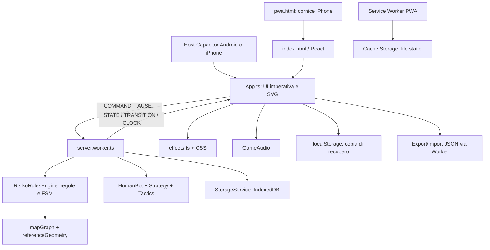
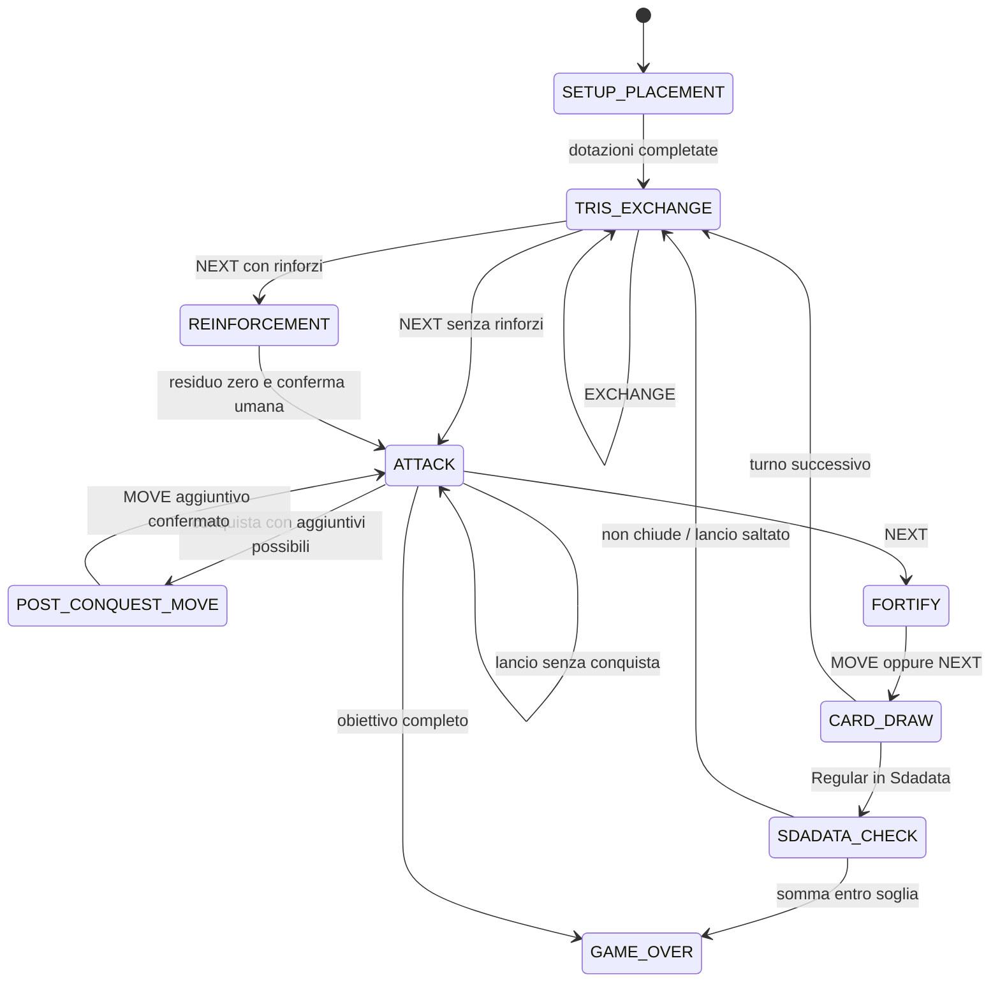

# RisiKo Offline — Technical Specification (archivio 1.8.0)

> Documento storico della versione 1.8.0. Per le modifiche implementate nella 2.0.0 leggere [la specifica integrativa](docs/SPECIFICA-2.0.md) e [le verifiche attuali](docs/VERIFICHE-2.0.md). L’appendice sorgenti sottostante rimane riferita alla 1.8.0.

**Baseline:** `risiko-offline` **1.8.0**, build nativa **12**.  
**Lingua del prodotto e del documento:** italiano.  
**Data della ricognizione:** 4 novembre 2026.  
**Tipo di documento:** specifica descrittiva dell’implementazione esistente, con contratti, formule, risorse, verifiche e limiti.  
**Fonte primaria:** i sorgenti presenti in questo progetto, confrontati con i test e con il rapporto di consegna 1.8.0.

Questo documento descrive il prodotto effettivamente implementato. Le richieste iniziali e i documenti delle release precedenti aiutano a comprenderne l’evoluzione, ma non sostituiscono il comportamento corrente. In particolare, Countdown è implementato, Antartide è facoltativa, Survival è disponibile, la home è verticale e l’installazione iPhone può avvenire tramite PWA. Alcuni documenti storici riportano ancora il contrario.

La specifica ha tre livelli: spiegazione funzionale e tecnica; cataloghi estratti dai sorgenti; appendice con le implementazioni testuali esatte dei moduli di produzione e degli strumenti di verifica. L’appendice serve a conservare anche dettagli difficili da esprimere senza ambiguità in prosa, come ogni coordinata SVG, selettore CSS, coefficiente IA e condizione di validazione. Le immagini, il font e il campione audio sono identificati tramite percorso, caratteristiche e SHA-256: i relativi binari rimangono nel progetto e non sono incorporati come Base64 nel Markdown.

Il termine **classica**, quando riferito alla mappa, significa «mappa base senza Antartide». Non indica la presenza di obiettivi classici: il gioco usa esclusivamente gli obiettivi territoriali Torneo.

## Indice

- [1. Identità, obiettivi e perimetro del prodotto](#section-1)
- [2. Architettura e organizzazione del codice](#section-2)
- [3. Contratti dati e invarianti](#section-3)
- [4. Geografia, continenti, obiettivi e mazzi](#section-4)
- [5. Regolamento e macchina a stati](#section-5)
- [6. Protocollo UI–Worker, temporizzazione e atomicità](#section-6)
- [7. Intelligenza artificiale: decisioni, priorità e difficoltà](#section-7)
- [8. Schermate, navigazione e comportamento della UI](#section-8)
- [9. Specifica visiva: palette, tipografia, layout e SVG](#section-9)
- [10. Interazione touch, zoom e finestre](#section-10)
- [11. Animazioni e sincronizzazione visuale](#section-11)
- [12. Audio e feedback aptico](#section-12)
- [13. Persistenza, risultati, recupero e backup](#section-13)
- [14. PWA, cache offline e rotazione iPhone](#section-14)
- [15. Piattaforme native e distribuzione](#section-15)
- [16. Toolchain, build e workflow GitHub](#section-16)
- [17. Prestazioni, robustezza e modello di sicurezza](#section-17)
- [18. Verifica automatica, benchmark e stato della consegna](#section-18)
- [19. Limiti, compatibilità e criteri di accettazione](#section-19)
- [20. Provenienza e documentazione storica](#section-20)
- [21. Catalogo completo dei territori e delle rotte](#section-21)
- [22. Catalogo completo degli obiettivi e delle carte](#section-22)
- [23. Catalogo risorse e parametri visivi residui](#section-23)
- [24. Inventario dei file della baseline e integrità](#section-24)
- [25. Catalogo della verifica eseguita](#section-25)
- [26. Appendice normativa: sorgenti e configurazioni esatti](#section-26)
- [27. Controllo di completezza del documento](#section-27)


<a id="section-1"></a>
## 1. Identità, obiettivi e perimetro del prodotto

### 1.1. Identità

| Proprietà | Valore implementato |
|---|---|
| Nome pacchetto npm | `risiko-offline` |
| Nome visualizzato | `RisiKo Offline` |
| Identificatore nativo | `it.local.risiko` |
| Versione applicativa | `1.8.0` |
| Versione schema partita | `1` |
| Versione schema backup | `1` |
| Versione IndexedDB | `1` |
| Android versionCode / iOS build | `12` |
| Giocatore umano | Uno, sempre ID `0` |
| Avversari | Due, tre o quattro bot |
| Tavoli | Tre, quattro o cinque giocatori complessivi |
| Lingua | Italiano; date visualizzate con locale `it-IT` |
| Backend remoto | Assente |
| Motore autorevole | Dedicated Web Worker locale |
| Connessione durante la partita | Non necessaria dopo disponibilità dei file locali/offline |

Il prodotto riprende l’impostazione visiva e d’uso di RisiKoPlay, ma è una ricostruzione indipendente. Non utilizza account, servizi, lobby, script o API del sito ufficiale. Non viene attestata una corrispondenza grafica pixel-perfect. Nel testo delle regole compare la dichiarazione di non affiliazione a Spin Master.

### 1.2. Funzioni incluse

Sono inclusi configurazione locale, partita Torneo, bot con strategie configurabili, quattro difficoltà, mappa SVG interattiva, due modalità di conclusione, espansione Antartide, carte e tris, animazioni, audio, vibrazione facoltativa, cronologia, autosalvataggio, profilo e statistiche locali, build Android, progetto iPhone nativo e PWA installabile su iPhone.

La PWA aggiunge precache completo, stato di disponibilità offline, aggiornamento esplicito, rotazione assistita e trasferimento di partita/statistiche tramite backup JSON.

### 1.3. Funzioni escluse

Non esistono multiplayer, Pass & Play, più giocatori umani, chat, amici, negozio, classifiche online, eventi ufficiali, acquisti, login, autenticazione, sincronizzazione cloud, server di matchmaking, notifiche push, telemetria applicativa o raccolta analitica. La grafica della home richiama il portale di riferimento senza riprodurre pulsanti verso servizi non implementati.

Non esistono obiettivi «conquista 24 territori» o «distruggi il colore X». Survival è un livello IA; non cambia le regole, non introduce alleanze coordinate dei bot contro l’umano e non dà loro armate o dadi privilegiati.

<a id="section-2"></a>
## 2. Architettura e organizzazione del codice

### 2.1. Componenti



### 2.2. Entrypoint e rendering

`index.html` carica il CSS e `src/react.ts`. React 19 crea un singolo contenitore DOM e, tramite `useEffect`, chiama `mountGame(root)`. Il gioco non è una gerarchia di componenti React con stato React: la gestione della schermata, la generazione dei template HTML, gli eventi e gli aggiornamenti SVG avvengono nel modulo imperativo `src/gui/App.ts`.

`src/main.ts` è l’ingresso alternativo senza React: monta direttamente lo stesso gioco. È utilizzato dalla build locale di ripiego quando Vite non è installato. Il comportamento del motore e della UI resta condiviso.

All’interno di `.app-shell` vengono mantenuti:

| Nodo | Responsabilità |
|---|---|
| `#scene` | Home, preparazione, tavolo, profilo o risultati |
| `#dialogs` | Finestre di consultazione, combattimento, movimento e pagine di impostazioni |
| `#effects` | Presentazione temporanea di dadi, pesca, tris e Sdadata |
| `#toast` | Messaggi di stato, errori e istruzioni, `role="status"` |
| `.portrait-notice` | Invito alla rotazione quando necessario sulla plancia |

`render()` sostituisce il markup della scena, mantenendo separati i dialoghi. Durante una transizione già avviata evita la ricostruzione della plancia; aggiorna i dialoghi consultabili e il widget obiettivo. I tick del timer modificano direttamente il testo del cronometro.

### 2.3. Moduli e responsabilità

| Area | File principali | Compito |
|---|---|---|
| Dati | `src/data/mapGraph.ts` | Territori, grafo, continenti, mazzi, obiettivi, varianti |
| Geometria | `src/data/referenceGeometry.ts` | Coordinate e path SVG effettivi della mappa base |
| Regole | `src/engine/RisikoRulesEngine.ts` | Creazione, validazione, comandi, dadi, punteggi, timer, migrazioni |
| Contratti | `src/engine/types.ts` | Tipi di stato, giocatore, configurazione, comandi e viste |
| Autorità locale | `src/engine/server.worker.ts` | Serializzazione richieste, persistenza, bot, clock e protocollo |
| Presentazione | `src/engine/presentation.ts` | Differenze di stato trasformate in effetti e barriera ACK |
| Probabilità | `src/ai/BotAI.ts` | Enumerazione dadi, conquista esatta, inferenza obiettivi |
| Strategia | `src/ai/Strategy.ts`, `Tactics.ts` | Pianificazione Medio/Difficile/Survival |
| Comportamento | `src/ai/HumanBot.ts` | Memoria, sortite, riconquista e tempi delle decisioni |
| Compatibilità IA | `src/ai/LegacyStrategy.ts` | Strategia Facile e stima dei sopravvissuti |
| Configurazione IA | `src/ai/policy.ts` | Otto priorità, personalità e tregua |
| Interfaccia | `src/gui/App.ts` | Schermate, input, fotocamera, dialoghi, lifecycle |
| Disegno | `src/gui/art.ts`, `mapGeometry.ts` | Carri, badge, carte, dadi, obiettivi, grafico e rotte |
| Effetti | `src/gui/effects.ts`, `styles.css` | Animazioni, contatori, clash e finestre flottanti |
| Audio | `src/gui/AudioService.ts` | Campione clash, sintesi procedurale e aptica |
| Orientamento | `src/gui/orientation.ts` | Separazione bridge nativo / API web |
| Persistenza | `StorageService.ts`, `LocalSnapshot.ts`, `TournamentStats.ts` | Partita, copia locale, risultati e aggregati |
| Backup | `src/services/Backup.ts` | Schema, limiti, validazione e compatibilità |
| PWA | `src/pwa/*`, `public/sw-template.js` | Installazione, cache, aggiornamenti, cornice iPhone |

### 2.4. Routing e navigazione

La navigazione usa `history.replaceState` con hash; non richiede riscritture server per questi percorsi:

| Schermata | Hash |
|---|---|
| Home | `#/app/gui/user/home` |
| Preparazione | `#/app/gui/user/prepare` |
| Tavolo | `#/app/gui/game/table` |
| Risultati | `#/app/gui/game/results` |
| Profilo | `#/app/gui/profile/local` |

Lo stato `screen` interno è l’autorità di navigazione. Non è implementato un router che ricostruisca arbitrariamente una partita dal solo URL. Al ricaricamento la UI inizializza il Worker e recupera l’eventuale partita in pausa.

<a id="section-3"></a>
## 3. Contratti dati e invarianti

### 3.1. Separazione delle versioni

La versione npm 1.8.0 non coincide con la versione del salvataggio. `GameState.version=1` e IndexedDB versione 1 vengono mantenuti per la continuità dei dati. I campi opzionali consentono di caricare dati precedenti e normalizzarli. L’appendice dei sorgenti contiene le dichiarazioni TypeScript complete, senza omissioni.

### 3.2. Stato completo

`GameState` conserva:

- Identità e ordine: `id`, `revision`, `players`, `order`, `active`, `round`.
- Regole e variante: `manualReinforcement`, `endMode`, `antarctica`, `turnSeconds`.
- Casuale: `rng` per dadi/mazzo/distribuzione e `aiRng` per decisioni bot.
- Economia: `board`, `deck`, `discard`, `reinforcements`, `turnReinforcements`, `setupBatch`, `conquests`.
- Stato della FSM: `phase`, `pending`, `paused`, `reason`, `winner`.
- Tempo: `remainingMs`, `elapsedMs`, `matchRemainingMs`.
- Storico: `log`, `lastBattle`, `lastSdadata`, `placementHistory`, `scoreHistory`.
- Memoria/inferenza: `beliefs`, `botContexts`.
- Protezione comandi: `lastCommandId`.

Una cella della plancia è `{owner, armies}`. Gli ID dei territori coincidono con gli indici dell’array. Gli ID giocatori coincidono con gli indici di `players`, ma l’ordine al tavolo è definito separatamente da `order`.

### 3.3. Giocatore

Ogni `Player` include `id`, `name`, `color`, `human`, `difficulty`, `blind`, `objective`, `cards`, `setupRemaining`, `eliminated`, `botPolicy` opzionale. Il nome umano viene ripulito con `trim()`, limitato a 24 caratteri e sostituito da `Comandante` se vuoto.

| ID | Nome bot/default | Colore |
|---|---|---|
| 0 | Nome umano / Comandante | `#2458ee`, blu |
| 1 | Falco | `#d91e34`, rosso |
| 2 | Vega | `#303a3d`, antracite |
| 3 | Atlas | `#269459`, verde |
| 4 | Ombra | `#f0d846`, giallo |

Il viola appartiene alla palette dei territori e ai riferimenti grafici storici, ma non è un sesto colore giocatore nel tavolo corrente a massimo cinque partecipanti.

### 3.4. Vista pubblica

`project(state, viewer)` produce un `GameView`. Esclude `rng`, `aiRng`, mazzo ordinato, scarti, `beliefs`, `botContexts`, `lastCommandId`, cronologia Undo completa e identità delle carte/obiettivi altrui. Aggiunge `deckCount`, `viewer`, `undoAvailable` e aggregati pubblici per giocatore: carte in mano, armate totali, territori, rinforzi previsti.

L’obiettivo, le carte, i punti obiettivo e i punti fuori obiettivo vengono esposti solo al relativo viewer o a partita conclusa. Durante il gioco lo storico dei punti degli altri giocatori contiene `null`; alla fine è svelato. Una difficoltà Blind appare `?` fino al risultato finale.

Questa separazione disciplina UI e IA, non costituisce un sistema anti-cheat contro chi controlla il dispositivo: IndexedDB, il backup e la copia locale contengono lo stato completo. `LOCAL_SAVE` trasferisce intenzionalmente tale stato al thread principale per scrivere la copia di recupero.

### 3.5. Invarianti controllate dal motore

`assertState()` verifica, fra l’altro:

1. Variante coerente con 42 o 44 celle e versione schema 1.
2. Tre, quattro o cinque giocatori e ordine senza duplicati.
3. Ogni territorio ha un proprietario valido e almeno un’armata, salvo lo stato legacy temporaneo di conquista non ancora migrato.
4. Una conquista pendente aggiornata ha origine/destinazione proprie, confinanti, minimo 1–3 e numero obbligatorio già presente nel territorio conquistato.
5. Al massimo 130 armate per giocatore, massimo sette carte in mano, obiettivo valido.
6. `eliminated` coincide con l’assenza di territori.
7. Conservazione di tutte le carte: ogni ID appare una sola volta tra mazzo, scarti e mani.
8. Rinforzi e cronometri non negativi; validità delle opzioni persistite.

La validazione dei backup è più ampia della sola `assertState()`: controlla struttura, tipi, profondità, dimensioni, nomi, riferimenti, eventi e statistiche.

<a id="section-4"></a>
## 4. Geografia, continenti, obiettivi e mazzi

### 4.1. Mappa base

La mappa base ha 42 territori, sei continenti e viewBox iniziale `0 0 1240 690`. Ogni territorio contiene ID, nome completo, nome breve, continente, punti, vicini, centro del token `x/y` e path SVG.

I dati `rows` in `mapGraph.ts` conservano anche vecchie coordinate e sagome, ma nella costruzione di `territories` vengono usati nome, abbreviazione, continente e vicini, seguiti da `referenceShape(id)`. Pertanto le coordinate effettive sono quelle di `referenceGeometry.ts`, non i vecchi valori dei tuple `rows`.

| Continente | ID | Territori | Bonus per turno | Punti territoriali base | Colore base continente |
|---|---|---:|---:|---:|---|
| Nord America | `na` | 9 | 5 | 35 | `#89642d` |
| Sud America | `sa` | 4 | 2 | 12 | `#53776a` |
| Europa | `eu` | 7 | 5 | 32 | `#4e315c` |
| Africa | `af` | 6 | 3 | 23 | `#806231` |
| Asia | `as` | 12 | 7 | 51 | `#456737` |
| Oceania | `oc` | 4 | 2 | 11 | `#873d69` |

Il totale base è 164 punti. Nella mappa base il punteggio di ciascun territorio è il numero dei suoi vicini. L’elenco completo di nomi, punti, adiacenze, colori e centri è riportato nei cataloghi generati più avanti.

Particolarità del grafo: Cina–Medio Oriente è un confine valido; Afghanistan–India e Africa Orientale–Medio Oriente non lo sono. I test proteggono queste differenze dal grafo di altre edizioni di Risk.

### 4.2. Antartide

L’opzione è disattivata per default, scelta alla creazione e persistita nel salvataggio. Non si attiva/disattiva durante una partita.

| Elemento | Comportamento |
|---|---|
| Continente | `an`, Antartide |
| Territorio 42 | Antartide Occidentale, 3 punti, centro `(565,686)` |
| Territorio 43 | Antartide Orientale, 3 punti, centro `(707,703)` |
| Collegamento interno | 42 ↔ 43 |
| Collegamento Sud America | Argentina 12 ↔ Antartide Occidentale 42 |
| Collegamento Africa | Africa del Sud 24 ↔ Antartide Orientale 43 |
| Collegamento Oceania | Australia Orientale 41 ↔ Antartide Orientale 43 |
| Bonus continentale | +2 rinforzi se entrambi i territori sono posseduti |
| Colore continente | `#80b8cf` |
| Colori territori | `#71b7d2`, `#b1d5e5` |
| ViewBox iniziale | `0 0 1240 815` |
| Mazzo | 46 carte |

I punti dei territori base non aumentano per i nuovi confini. I due territori antartici valgono ciascuno tre punti fuori obiettivo, non vengono inseriti nei sedici obiettivi da 86 e possono incidere sugli spareggi. Si passa a 170 punti territoriali complessivi, senza cambiare il valore obiettivo.

Il limite iniziale del 50% impedisce a un giocatore di ricevere entrambi i territori antartici. Armate iniziali 35/30/25, mani di piazzamento da tre e limite totale 130 restano invariati. `mapFor()` centralizza la selezione di grafo, carte, continenti, rotte e dimensioni: gli algoritmi IA utilizzano la stessa variante del motore.

### 4.3. Obiettivi Torneo

Sono presenti sedici obiettivi distinti: Letto, Quattro in Nord, Ciclista, Buco, Diagonale, Formula 1, Tre A, Kamchatka e Giappone, Eurasia, Nord mondo, Siberiana, Tappeto, Guerra fredda, Sud mondo, Alaska e Alberta, Tre in Europa.

Ogni obiettivo è un insieme preciso di territori base che somma 86 punti. La funzione `objectivePoints(objectiveId, owned)` somma i punti dei territori dell’obiettivo attualmente posseduti. L’assegnazione avviene senza reinserimento: due giocatori non ricevono lo stesso obiettivo.

La vittoria immediata verifica il possesso di **tutti** i territori dell’obiettivo. Il punteggio massimo dell’obiettivo è 86; il vincitore per RisiKo riceve però **100 punti tavolo** nella classifica finale e nelle statistiche. L’interfaccia distingue i due valori, limitando il display obiettivo a 86.

La documentazione di provenienza riporta 117 corrispondenze su 120 intersezioni tra coppie di obiettivi e tre discrepanze rispetto alla matrice pubblicata: Letto/Siberiana 36 invece di 24; Ciclista/Formula 1 74 invece di 70; Tre A/Siberiana 54 invece di 53. Sono dichiarate e mantenute nei test. Non è attestato un confronto visivo indipendente di tutte le carte ufficiali ad alta risoluzione.

### 4.4. Carte territorio

La mappa base utilizza 42 carte territorio e due Jolly. Gli ID carta 0–41 coincidono con il territorio. Il simbolo è assegnato con `id % 3` nella sequenza `cannone`, `fante`, `cavaliere`: quattordici carte per simbolo. I Jolly hanno ID 42 e 43 e `territory:null`.

Con Antartide si aggiungono **carta 44 → territorio 42 / cannone** e **carta 45 → territorio 43 / fante**. Gli ID dei Jolly non vengono spostati. È essenziale non confondere ID carta e ID territorio per l’espansione.

L’associazione simbolo/territorio è una distribuzione locale, non dichiarata identica al mazzo fisico. Le illustrazioni sono vettoriali militari: cannone con ruota, fante con fucile, cavallo con cavaliere. Non sono pezzi degli scacchi.

<a id="section-5"></a>
## 5. Regolamento e macchina a stati

### 5.1. Configurazione iniziale

Il default della UI è quattro giocatori, nome Comandante, tre bot Medio, 180 secondi per turno, Regular, durata Countdown memorizzata 45 minuti, Antartide disattivata, velocità Normale e rinforzi manuali con conferma prima di attaccare.

Le durate selezionabili nel menu sono 60, 120, 180, 240, 300 e 600 secondi. Il motore accetta qualsiasi intero fra 60 e 600. Countdown ammette soltanto 30, 45 o 60 minuti.

Gli obiettivi, l’ordine iniziale, i territori e il mazzo sono mescolati. Il PRNG del motore è xorshift32, con shift 13/17/5, normalizzazione unsigned e output diviso per `2^32`. Il seme zero viene sostituito da 1. `aiRng` viene inizializzato con XOR `0x9e3779b9`, mantenendo distinta la casualità decisionale da quella di gioco. Il seed può essere passato dai test; la UI non espone un selettore di seed.

La distribuzione usa rejection sampling, massimo 100.000 tentativi. Distribuisce equamente in ordine inverso rispetto ai posti iniziali e rifiuta un’assegnazione se un giocatore supera `floor(numeroTerritoriContinente/2)`. Ogni territorio parte con una sola armata.

### 5.2. Dotazione iniziale e piazzamento

| Giocatori | Armate totali iniziali per giocatore | Territori base assegnati | Armate ulteriori nella mappa base |
|---:|---:|---|---|
| 3 | 35 | 14 ciascuno | 21 ciascuno |
| 4 | 30 | 10 o 11 | 20 o 19 |
| 5 | 25 | 8 o 9 | 17 o 16 |

`setupRemaining = dotazione iniziale - territori ricevuti`. Il contatore `14/35` rappresenta armate già schierate e dotazione totale; non significa «ne restano quattordici».

Ogni mano di setup concede tre armate, oppure il residuo se inferiore. La UI piazza una singola armata per tocco; il motore supporta anche comandi multipli entro il residuo della mano. Esaurita la mano passa al successivo giocatore con armate ancora da posizionare. Terminati tutti i residui, inizia il giro 1 dal primo giocatore dell’ordine iniziale.

Non esiste scadenza di turno durante il setup. Il setup contribuisce a `elapsedMs`, ma non consuma il Countdown di partita.

### 5.3. Stati

| Stato | Significato | Azioni/uscita principale |
|---|---|---|
| `SETUP_PLACEMENT` | Distribuzione della dotazione iniziale | PLACE; passaggio automatico di mano |
| `TRIS_EXCHANGE` | Inizio turno, prima dei piazzamenti | EXCHANGE ripetibile; NEXT |
| `REINFORCEMENT` | Distribuzione dei rinforzi | PLACE; Undo umano; NEXT a residuo zero |
| `ATTACK` | Attacchi facoltativi | ATTACK ripetibile; NEXT |
| `POST_CONQUEST_MOVE` | Scelta delle armate aggiuntive dopo trasferimento obbligatorio | MOVE, anche zero aggiuntivi |
| `FORTIFY` | Un solo spostamento strategico finale | MOVE conclude turno; NEXT salta |
| `CARD_DRAW` | Pesca eventuale | Stato transitorio interno a endTurn |
| `SDADATA_CHECK` | Eventuale lancio finale | Stato transitorio interno a endTurn |
| `GAME_OVER` | Partita terminata | Nessun comando di gioco accettato |



La FSM è implementata tramite funzioni e `switch`, non mediante una libreria esterna. Le transizioni di vittoria e Countdown possono interrompere il flusso ordinario. `CARD_DRAW` e `SDADATA_CHECK` possono essere attraversati nello stesso comando: gli effetti visuali vengono ricavati dal log e mostrati successivamente.

### 5.4. Rinforzi

Il reddito teorico è:

`floor(territoriPosseduti / 3) + somma(bonus dei continenti interamente posseduti)`.

Non si applica un minimo di tre. Il reddito effettivamente disponibile è limitato a `130 - armateInCampo`. Eventuali rinforzi eccedenti non sono accantonati. Gli aggregati `nextReinforcements` mostrano il valore teorico; il residuo del turno è quello effettivamente ammesso.

All’inizio del turno si azzerano conquiste, movimento pendente e storia Undo; si ripristina il cronometro ordinario e si entra in `TRIS_EXCHANGE`. `turnReinforcements` registra i rinforzi ricevuti nel turno, compresi quelli dei tris, ed è usato anche per l’ammissibilità delle sortite disperate.

### 5.5. Tris

| Combinazione | Base |
|---|---:|
| Tre simboli uguali senza Jolly | 8 |
| Tre simboli diversi senza Jolly | 10 |
| Un Jolly e due simboli uguali | 12 |
| Due Jolly o combinazione differente | Non valida |

Si aggiungono due armate per ciascuna carta del tris il cui territorio è posseduto dal giocatore. Le tre carte devono essere distinte e presenti in mano. La somma entra nella **riserva distribuibile** del turno: il motore non piazza automaticamente quei +2 sul territorio illustrato. L’evidenziazione della mappa comunica quali carte generano il bonus.

È possibile giocare più tris consecutivi prima di uscire da `TRIS_EXCHANGE`. Non esiste cambio forzato a cinque carte. Il limite in mano è sette. Il bonus applicato è troncato dalla capacità residua delle 130 armate, includendo i rinforzi già in riserva.

### 5.6. Attacco

Un attacco è legale se l’origine appartiene al giocatore attivo, la destinazione è nemica e adiacente, l’origine ha più di un’armata e:

`min(3, armateOrigine - 1) >= min(3, armateDifesa)`.

Nei giri 1–4 non è consentito attaccare l’ultimo territorio di un avversario. Attaccante e difensore lanciano sempre il massimo numero legale, fino a tre; non c’è selezione manuale di meno dadi. I dadi vengono ordinati decrescentemente e confrontati a coppie. Solo un valore strettamente maggiore vince per l’attaccante; ogni pareggio causa una perdita all’attaccante.

Un comando ATTACK esegue un solo lancio. Il Blitz è un’automazione della UI che invia ulteriori ATTACK dopo la presentazione e la verifica delle nuove condizioni; non è una risoluzione atomica di tutta la battaglia nel motore.

### 5.7. Conquista e trasferimento

Quando le armate del difensore arrivano a zero:

1. La destinazione cambia proprietario.
2. Il contatore conquiste del turno aumenta.
3. Il motore trasferisce immediatamente un numero di armate pari ai dadi dell’ultimo attacco.
4. `pending={from,to,min,transferred}` conserva il minimo e il trasferimento già avvenuto.
5. Se vi sono ulteriori armate trasferibili, si entra nella scelta degli aggiuntivi.

La UI non mostra un territorio conquistato vuoto. Il numero zero nello slider significa **zero carri aggiuntivi**, non zero carri presenti. Se non sono possibili aggiuntivi, la partita torna direttamente ad ATTACK. Se la conquista completa l’obiettivo, termina immediatamente senza chiedere un movimento facoltativo.

### 5.8. Spostamenti

Gli spostamenti sono solo fra territori propri **direttamente adiacenti**, non lungo un’intera catena di territori connessi.

La guarnigione residua è due se l’origine confina con nemici, altrimenti uno. Per il movimento post-conquista aggiornato, minimo aggiuntivo zero e massimo `armateOrigine - guarnigione`. Il trasferimento obbligatorio della conquista è l’unico caso che può lasciare un’armata su un confine nemico.

Lo spostamento strategico finale ha minimo uno, può essere saltato ed è consentito una sola volta. Confermarlo chiude il turno. I confini vengono rivalutati dopo il cambio di proprietà.

### 5.9. Eliminazione e pesca

L’eliminazione si determina dall’assenza di territori. Le carte dell’eliminato sono mescolate; il vincitore dello scontro ne riceve fino al limite di sette, le rimanenti vanno negli scarti. Il giocatore eliminato perde tutta la mano e viene saltato dall’ordine di turno. Le nuove carte non possono essere cambiate nella fase attacco corrente.

A fine turno, se è stato conquistato almeno un territorio e la mano ha meno di sette carte, viene pescata una sola carta. Se il mazzo è vuoto, gli scarti vengono rimescolati. Se non ci sono né carte nel mazzo né scarti, non si pesca. A sette carte non si pesca.

### 5.10. Fine Regular, Sdadata e Countdown

Regular prevede venti giri ordinari. Al termine del turno dell’ultimo giocatore attivo del giro 20 viene inizializzata la Sdadata con soglia 4 e ancora pari a quel giocatore. Il controllo usa **due dadi**, non uno. Chiude quando la somma è minore o uguale alla soglia. Con almeno tre conquiste nel turno il lancio viene saltato.

La soglia sale a 5, poi 6, poi 7 attraversando nuovamente il posto dell’ancora nell’ordine iniziale. Il posto resta un riferimento virtuale anche se il giocatore è eliminato. Non si supera 7. Le soglie non aumentano dopo ogni singolo lancio.

Countdown misura 30/45/60 minuti attivi dopo il setup, default 45. Esclude pausa e animazioni bloccate dalla barriera di presentazione; include le attese decisionali dei bot. Alla scadenza termina subito per classifica, senza Sdadata. La vittoria per obiettivo completo resta attiva anche in Countdown.

Classifica: punti obiettivo decrescenti, poi punti dei territori fuori obiettivo, poi ordine iniziale inverso. Il vincitore per RisiKo ha 100 punti tavolo. Antartide può contribuire al secondo criterio, mai al primo.

### 5.11. Timeout e Undo

La scadenza del turno non esegue un tris automatico. I rinforzi rimasti vengono piazzati uno alla volta sul territorio proprio meno presidiato, con parità risolta per ID. Viene rispettato l’eventuale trasferimento obbligatorio legacy; non vengono eseguiti attacchi o spostamenti facoltativi. Segue la normale chiusura con pesca/Sdadata.

Undo è disponibile soltanto all’umano durante REINFORCEMENT. Ogni PLACE registra territorio, quantità e precedente stato delle inferenze. UNDO_PLACE ripristina armate, riserva e inferenza, registrando un evento con count negativo. L’Undo è sequenziale/LIFO e si perde passando ad ATTACK. Non si applica al setup, ai tris, ai dadi o alle conquiste.

<a id="section-6"></a>
## 6. Protocollo UI–Worker, temporizzazione e atomicità

### 6.1. Messaggi verso il Worker

| Tipo | Payload rilevante | Effetto |
|---|---|---|
| `INIT` | `presentation`, snapshot opzionale | Profilo, caricamento, eventuale recupero localStorage |
| `NEW` | `config` | Nuova partita, salvataggio e aggiornamento nome profilo |
| `COMMAND` | `id`, `revision`, `command` | Comando umano validato e serializzato |
| `PAUSE` | Nessuno | Consolida il tempo trascorso e salva in pausa |
| `RESUME` | Nessuno | Valida e salva stato non in pausa |
| `SPEED` | `speed` | Cambia ritmo e invalida piano temporizzato |
| `PRESENTED` | ID transizione | Sblocca il motore dopo l’animazione corrispondente |
| `PROFILE` | Nessuno | Rilegge profilo e risultati |
| `EXPORT_BACKUP` | Nessuno | Salva in pausa ed esporta stato completo/profilo |
| `IMPORT_BACKUP` | Testo JSON | Valida e sostituisce dati con transazione |

### 6.2. Messaggi in uscita

| Tipo | Contenuto |
|---|---|
| `PROFILE` | Nome e risultati ordinati |
| `READY` | `hasGame` |
| `STATE` | `GameView` per umano ID 0 |
| `TRANSITION` | ID, viste before/after, effetti, velocità |
| `CLOCK` | ID partita, revisione e tre contatori temporali |
| `LOCAL_SAVE` | Stato completo o null per cancellare la copia |
| `ERROR` | Messaggio leggibile |
| `BACKUP_FILE` | Testo JSON da trasformare in Blob |
| `BACKUP_RESTORED` | Profilo e vista pubblica ripristinati |
| Eventi di gioco | `onGameStateUpdate`, `onDiceRolled`, `onTurnChanged`, `onSdadataRoll`, `onGameOver` |

I comandi di dominio sono PLACE, EXCHANGE, NEXT, UNDO_PLACE, ATTACK, MOVE e TIMEOUT. Il Worker riserva i COMMAND ricevuti dalla UI al giocatore umano. Le decisioni bot percorrono direttamente la stessa `applyCommand()`.

### 6.3. Commit e idempotenza

Le richieste vengono messe in una catena di Promise (`busy`), evitando mutazioni concorrenti. `applyCommand()` clona l’input, controlla fase/attore/pausa, applica la modifica, aumenta la revisione ed esegue `assertState()`.

`commit(next,before)` salva prima su IndexedDB; solo dopo assegna lo stato in memoria e pubblica snapshot, eventi e transizione. Il client invia un UUID e la revisione vista. Il duplicato dell’ultimo ID viene ignorato; una revisione non attuale viene rifiutata. Non è un registro globale di tutti gli UUID: la deduplicazione esplicita riguarda l’ultimo comando, affiancata al controllo di revisione.

Durante una presentazione pendente i nuovi comandi non vengono applicati. In caso di errore la coda cancella presentazione e piano bot, mette in pausa lo stato in memoria e pubblica ERROR. Un fallimento della scrittura non viene presentato come azione completata.

### 6.4. Clock

Il Worker ha un intervallo di 50 ms, protetto da `ticking`. Calcola il delta con `performance.now()`. I tick ordinari effettuano una copia superficiale dei soli contatori, senza clonare plancia e log. Solo la scadenza che produce un’azione richiede la clonazione completa.

Il messaggio CLOCK viene inviato circa ogni 1.000 ms. Il salvataggio dei contatori avviene circa ogni 5.000 ms; questo salvataggio non azzera l’attesa del bot già pianificata. Le azioni di gioco salvano invece immediatamente.

`elapsedMs` misura tempo attivo incluso setup, esclusa pausa e attesa degli effetti. `remainingMs` è il turno ordinario; `matchRemainingMs` è Countdown. Le durate possono avere frazioni di millisecondo e il backup le accetta come numeri finiti non negativi.

### 6.5. Barriera di presentazione

`PresentationGate` mantiene ID e deadline a 10.000 ms. Il Worker conserva già lo stato dopo l’azione, mentre la UI mostra e anima una proiezione prima/dopo. Solo un ACK con ID corrispondente libera la barriera. Un ACK duplicato o estraneo non completa un’altra transizione.

La sequenza di effetti viene compressa a massimo 8.000 ms complessivi. Un watchdog a 10.000 ms evita che un’interfaccia persa blocchi la partita indefinitamente. In background o fuori dal tavolo la UI conferma subito la transizione invece di riprodurla nascosta. Pausa, ritorno ai menu e cancellazione effetti puliscono timer e suoni.

<a id="section-7"></a>
## 7. Intelligenza artificiale: decisioni, priorità e difficoltà

### 7.1. Vincoli informativi

Ogni bot riceve `project(state, botId)`: conosce il proprio obiettivo e le proprie carte, la plancia completa, dimensioni delle mani avversarie, ordine, eventi pubblici e opzioni strategiche. Non riceve il mazzo ordinato, il PRNG di gioco o gli obiettivi/carte reali degli avversari. Non consulta servizi esterni né modelli neurali.

Il sistema combina euristiche, probabilità esatte dei combattimenti e lookahead stocastico limitato. Non è minimax esaustivo, MCTS generale, rete addestrata o un motore tipo Stockfish. I coefficienti sono espliciti nel sorgente; i livelli più alti aumentano profondità/campionamenti e tolgono gli errori comportamentali deliberati, ma non garantiscono gioco ottimo o imbattibilità.

### 7.2. Pipeline decisionale

1. Il Worker proietta lo stato per il bot attivo.
2. `humanDecision()` aggiorna memoria, perdita territori, cautela e sortite.
3. La decisione va a `strategicCommand()`; Facile viene instradato alla strategia legacy.
4. In fase di attacco Medio/Difficile/Survival cercano prima opportunità tattiche vincolanti (`forcingAttacks`).
5. Se non ve ne sono, ordinano i candidati e confrontano continuazioni/risposte secondo difficoltà.
6. La mossa scelta viene pianificata con ritardo visuale, revisione, attore, contesto aggiornato e nuovo `aiRng`.
7. Alla scadenza del ritardo il Worker usa la stessa `applyCommand()` dell’umano.
8. Dopo salvataggio, la UI mostra gli effetti. Il bot successivo non agisce durante gli effetti.

### 7.3. Probabilità esatte dei dadi

`diceDistribution(a,d)` enumera tutti i `6^(a+d)` esiti, ordina i dadi, applica i pareggi alla difesa e aggrega le coppie di perdite. Il risultato è memorizzato per numero di dadi. Per 3 contro 3 vengono enumerati 46.656 casi.

`conquestOdds(A,D)` usa ricorrenza memoizzata:

- `P(A,0)=1`.
- Se `min(3,A-1) < min(3,D)` o non resta un dado attaccante, `P=0`.
- Altrimenti `P(A,D)=Σ p(esito) × P(A-perditeAttaccante,D-perditeDifensore)`.

Questa probabilità descrive la conquista proseguendo finché legalmente possibile; non include la soglia di arresto Blitz scelta dall’utente, una decisione di ritirata futura, rinforzi successivi o contrattacchi avversari. La UI la arrotonda alla percentuale intera.

`conquestEstimate()` calcola anche il numero medio di armate superstiti **condizionato alla conquista**, non un residuo deterministico. In 3 contro 3 le perdite attese di un singolo lancio sono circa 1,893132716 all’attaccante e 1,106867284 al difensore. La tabella completa delle distribuzioni è generata nel catalogo.

### 7.4. Otto opzioni strategiche

Tutte le opzioni sono attive di default. La UI può configurarle per bot, copiarle a tutti o ripristinarle.

| Chiave | Etichetta | Ruolo nella valutazione |
|---|---|---|
| `weakBorders` | Sfrutta i confini deboli | Premio alle conquiste su guarnigioni basse |
| `continents` | Completa continenti | Reddito ricorrente, campagne e completamenti |
| `defend` | Difendi confini e passaggi | Riserva difensiva e valore di riduzione del rischio |
| `disruptGrowth` | Ostacola il consolidamento | Penalizza crescita avversaria vicina a un continente |
| `breakBonus` | Interrompi i bonus avversari | Premio alla rottura di continenti completi |
| `containLeader` | Contieni il leader | Attenzione all’avversario pubblicamente più forte |
| `eliminate` | Cerca eliminazioni vantaggiose | Valore dell’eliminazione e delle carte recuperabili |
| `reserve` | Conserva una riserva | Costo dell’esposizione e limiti ai movimenti |

`graceRounds` è un intero 0–3. Durante la tregua il bot può rinforzare/difendere ma non attacca. Le opzioni modificano priorità, non autorizzano azioni illegali e non obbligano un attacco contro qualsiasi debolezza se altri costi prevalgono. La strategia della partita salvata rimane quella impostata all’avvio; il pannello di configurazione modifica la prossima partita.

### 7.5. Personalità

| Personalità | Differenza numerica significativa |
|---|---|
| `equilibrato` | Pesi base |
| `stratega` | Punti obiettivo del bersaglio ×1,7 invece di ×1,15; valore di posizione punti ×1,7 invece di ×1,35 |
| `incursore` | Bonus di rottura continente ×10 invece di ×7 nella funzione gain |
| `conquistatore` | Premio prima conquista per pescare carta 7 invece di 5 |

La configurazione iniziale prepara personalità equilibrato, stratega, incursore, conquistatore per i quattro slot possibili. La normalizzazione `botPolicy()` usa equilibrato se il valore non è riconosciuto.

### 7.6. Valore del bersaglio e ordine degli attacchi

Per i livelli nuovi, `gain()` parte da 2 e somma:

- Punti del territorio nell’obiettivo ×1,15, oppure ×1,7 per Stratega.
- Prima conquista con mano inferiore a sette: +5, oppure +7 per Conquistatore.
- Confine debole: `max(0,4-difensori) ×1,3`, se abilitato.
- Continente proprio completabile: bonus ×9 se manca un solo territorio; bonus ×`3/mancanti` se ne mancano due o tre.
- Campagna continentale preferita: bonus ×2,5. Il continente candidato massimizza `bonus × frazionePosseduta / Σ(armateNemiche+1)` tra i continenti incompleti con almeno un territorio proprio.
- Rottura continente interamente nemico: bonus ×7, o ×10 per Incursore.
- Consolidamento avversario a non più di due territori dal completo: bonus ×2.
- Ultimo territorio avversario: +10 e +4 per carta acquisibile entro sette.
- Contenimento: +4 se l’avversario è il massimo per `armate + reddito×5` e supera la potenza propria del 15%.
- Riconquista ricordata: +4.
- Completamento immediato del proprio obiettivo: valore 10.000.

`rankAttacks()` filtra le mosse illegali. Richiede probabilità almeno 0,65 per la campagna ordinaria oppure 0,48 se il valore del bersaglio è almeno 50. Il punteggio di base è:

`win×value - (1-win)×(A-1)×1,2 - (A-survivors)×1,1`.

Con riserva attiva sottrae il rischio di lasciare l’origine a due armate, pesato per il valore del possesso ×0,35, e il rischio del nuovo fronte, pesato per gain ×0,22. Le parità vengono risolte per ID origine e destinazione.

Il valore `holding()` è `1 + puntiObiettivo×0,65 + bonusContinente×controllo`, dove il termine continentale usa 4 per continente già completo oppure la frazione posseduta per incompleto, se l’opzione continenti è abilitata.

### 7.7. Opportunità tattiche prioritarie

`forcingAttacks()` evita che una simulazione pessimistica di carte avversarie ipotetiche faccia ignorare occasioni evidenti. Riconosce:

- Vittoria immediata per obiettivo.
- Completamento del proprio continente.
- Interruzione del bonus continentale avversario.
- Eliminazione dell’ultimo territorio avversario.

Per vittoria immediata la soglia è 55%. Per gli altri casi richiede almeno 90% e non più di tre difensori. Stima il costo di esporre l’origine e confronta il beneficio con tale costo più 2. I premi sono bonus×9 per completamento, bonus×7 per rottura, 12+carteAvversarie×3 per eliminazione. Le opzioni disattivate rimuovono le rispettive priorità. La tregua blocca anche queste opportunità.

### 7.8. Rinforzi per gruppi e difesa dei passaggi

La strategia valuta investimenti di più armate, non soltanto il guadagno marginale di un carro. Prima individua gli accessi dei continenti già controllati che confinano con stack nemici di almeno quattro armate.

`defensiveCommitments()` riserva fino al minore fra tutti i rinforzi e il massimo tra il 65% arrotondato per eccesso e quanto necessario per portare a tre i passaggi esposti. Iterativamente preferisce:

`(armate<3 ? 8 : 0) + (rischioPrima-rischioDopo) × (bonus×8+4)`.

Non continua a rinforzare un accesso quando il rischio stimato è già ≤0,4. Il vincolo è attivo soltanto nei rinforzi ordinari, con difesa abilitata.

Il piano greedy valuta pacchetti difensivi fino a `ceil(minaccia×0,65)+1` e pacchetti offensivi da una fino a tutte le armate disponibili. Per un candidato offensivo serve probabilità almeno 0,6. I costi dei pacchetti sono normalizzati con `quantità^0,6`.

Medio e setup utilizzano questo piano. Difficile/Survival confrontano anche concentrazioni dell’intera riserva libera su un fronte e allocazioni miste che conservano circa il 30% iniziale del piano. Allocazioni equivalenti vengono deduplicate. Il piano difensivo protetto rimane incluso.

| Parametro piano rinforzi | Difficile | Survival |
|---|---:|---:|
| Shortlist ordinaria | 5 | 8 |
| Campioni per piano | 12 | 24 |
| Profondità campagne | 5 | 8 |
| Penalità deviazione standard | 0,15 | 0,15 |

Il piano base viene riaggiunto se assente dalla shortlist. Il contesto conserva l’ordine dei piazzamenti e ne consuma uno per comando. Viene ricostruito se fase, giro, quantità residua o proprietà dei territori non coincidono più.

### 7.9. Differenze dei livelli in attacco

| Livello | Radici considerate | Campioni | Profondità propria | Risposte per avversario |
|---|---:|---:|---:|---:|
| Facile | Strategia legacy, larghezza 6 | Nessun rollout nuovo | 1 | Euristica legacy |
| Medio | 3 | Nessuno | Una continuazione pesata | Nessun rollout completo |
| Difficile | 4 | 24 | 5 | 1 |
| Survival | 6 | 48 | 8 | 2 |

Medio valuta una conquista ipotetica con superstiti medi e aggiunge il 30% del valore positivo del successivo attacco dallo stesso territorio, pesato per la probabilità di vincere il primo.

Difficile e Survival campionano campagne reali tramite le distribuzioni esatte di perdite. Dopo ogni lancio simulato possono interrompersi se la probabilità residua scende sotto 0,65 oppure 0,48 per bersagli di alto valore. Confrontano due politiche: fermarsi dopo il primo combattimento oppure proseguire una campagna. Non scelgono retroattivamente la migliore singola realizzazione fortunata: confrontano medie e varianza delle politiche.

Il modello di posizione combina punti obiettivo, territori ×1,7, armate ×0,8, reddito e conservabilità dei continenti. Un continente completo vale `bonus × (5 + retention×10)`, dove retention è limitata dal passaggio più vulnerabile. Sottrae bonus continentali avversari ×2 se breakBonus è attivo e piccoli costi di esposizione per territori propri.

La valutazione simulata usa `media - deviazioneStandard×0,12`. Il punteggio finale di attacco è 45% euristica e 55% simulazione. Attacca soltanto se il migliore ha valore positivo, salvo il percorso tattico prioritario.

### 7.10. Modello delle risposte avversarie

Gli obiettivi altrui sono campionati da probabilità inferite esclusivamente dal log visibile. Una conquista pesa 1,2, un rinforzo 0,25; il territorio presente in un obiettivo aumenta il suo score, l’assenza lo riduce di metà peso. La distribuzione usa softmax con temperatura 3 e limite inferiore dell’esponente −20.

Gli obiettivi campionati restano distinti. Le carte ignote sono campionate da un insieme di carte non presenti nella propria mano usando le dimensioni pubbliche delle mani. Il modello non ricostruisce perfettamente mazzo, scarti e storia nascosta: è una simulazione approssimata e non un accesso alla mano reale.

Ogni avversario simulato riceve reddito e il miglior tris campionato, entro 130, rinforza un fronte promettente ed esegue una o due campagne secondo il livello. Si usano flussi pseudo-casuali comparabili tra il caso «attacco» e il caso «mantieni posizione». Non vengono modellati tutti i possibili piani futuri di ogni avversario.

### 7.11. Occupazione e spostamento finale

Dopo una conquista il bot prova tutti i numeri legali di armate aggiuntive. Bilancia opportunità offensive da origine e destinazione, rischio di contrattacco e importanza dei territori. Con difesa attiva può preservare almeno tre armate su un accesso continentale esposto; non è una nuova regola generale.

A fine turno viene eseguita una BFS sui territori propri partendo dai confini. Un trasferimento verso distanza minore dal fronte riceve un premio `quantità×0,65`. Si confrontano guadagno offensivo, riduzione del rischio sulla destinazione e costo di indebolire un’origine già di frontiera. Resta valido il solo spostamento adiacente previsto dal motore.

### 7.12. Facile e compatibilità

Facile conserva `LegacyStrategy.ts`: rinforzi più rumorosi, attacchi a profondità uno, score perturbato casualmente e soglia base di conquista 70%, corretta dall’umore e limitata fra 48% e 90%. Le priorità strategiche restano leggibili, ma il livello non usa il nuovo confronto stocastico delle risposte.

Il codice legacy contiene anche rami per altri livelli usati dai benchmark di confronto; nel percorso corrente `Strategy.ts` gli delega soltanto Facile. Non vanno confusi con l’implementazione attuale di Medio e Difficile.

### 7.13. Memoria e sortite disperate

`BotContext` conserva temperamento, giro, turni giocati, armate precedenti, cautela, ultimo territorio perso, scadenza della riconquista, indice del log già letto, piano rinforzi ed episodio di sortita. Una perdita di almeno il 25% della forza rispetto alla precedente osservazione può attivare cautela. Il ricordo di un territorio perso dura fino a due turni propri, salvo riconquista anticipata.

La verifica di una sortita avviene **dopo i tris**, una sola volta nel turno, solo se:

- giro almeno 5;
- tregua terminata;
- non più di otto territori;
- `turnReinforcements < 3`, quindi meno di tre rinforzi effettivi anche dopo i bonus/tris;
- almeno tre turni propri dall’ultimo episodio.

| Livello | Probabilità condizionata all’ammissibilità |
|---|---:|
| Facile | 6% |
| Medio | 3% |
| Difficile | 2% |
| Survival | 0% |

Non è una percentuale applicata indiscriminatamente a ogni turno. Avere otto territori non basta se un continente o un tris porta i rinforzi ricevuti ad almeno tre. L’episodio sceglie un attacco legale, favorisce la riconquista e le difese basse, dura al massimo tre lanci e si interrompe se l’origine perde almeno metà della forza iniziale o l’attacco non è più legale.

### 7.14. Ritmo visuale

La UI propone Normale=1, Veloce=2, Istantaneo=0. Il protocollo ammette anche 4, non esposto nei tre pulsanti correnti. La casualità dei ritardi usa `Math.random()` indipendentemente dai PRNG di gioco e decisione.

Per Medio/Difficile/Survival:

| Azione | Base Normale |
|---|---|
| PLACE | 350–600 ms |
| ATTACK | 550–1.000 ms |
| Altre | 500–1.000 ms |

Il ritardo è diviso per la velocità e ulteriormente limitato dal tempo restante / numero stimato di passi (`max(8,rinforzi + armate×0,65 + territori)`), lasciando margine di 500 ms. Il setup usa un budget convenzionale di 30 secondi per il calcolo del ritardo, non una scadenza di setup.

Facile conserva intervalli umani più lunghi: 400–900 ms per piazzamenti ripetuti nello stesso punto, 1–2 secondi cambiando territorio, 2–4 secondi per decisioni ordinarie, 4–8 secondi per decisioni complesse e 5% di tali casi a 8–15 secondi. Il limite massimo è 30 secondi e comunque non oltre il tempo residuo.

In Istantaneo si eliminano attesa e transizioni dei bot. Gli effetti dell’umano rimangono visibili a velocità almeno 2. Il cambio velocità invalida il piano temporizzato; la velocità è una preferenza di sessione, non un campo durevole di `GameState`.

<a id="section-8"></a>
## 8. Schermate, navigazione e comportamento della UI

### 8.1. Home verticale

La home è una colonna centrale fino a 440 px, scrollabile verticalmente anche su schermi larghi. Non è una schermata a due colonne. Contiene, nell’ordine:

1. Header blu petrolio con marchio testuale RisiKo!, dicitura TORNEO · OFFLINE e pulsante audio.
2. Pulsante profilo con emblema circolare R, nome, partite e vittorie.
3. Banner tratto da `app-icon.jpg`: mappa colorata, logo e cane con elmo; didascalia «IL TUO TAVOLO. LA TUA STRATEGIA.».
4. Pulsante arancione GIOCA / PREPARA LA BATTAGLIA, disabilitato finché il Worker non è pronto.
5. Pulsante verde RIPRENDI PARTITA con turno, se esiste una partita non conclusa.
6. Righe cliccabili: LE TUE STATISTICHE; PARTITA E STRATEGIE BOT; SURVIVAL; AUDIO E VIBRAZIONE; COME SI GIOCA.
7. Solo web: INSTALLA E OFFLINE; SALVATAGGI E BACKUP.
8. Footer: un giocatore, 2–4 bot, autosalvataggio, Regular/Countdown e stato offline web.

SURVIVAL imposta tutti gli slot attualmente presenti a Survival e apre la preparazione; non avvia una partita senza configurazione. Aggiungendo altri slot mentre tutti sono Survival, i nuovi mantengono Survival.

### 8.2. Preparazione

La preparazione usa una colonna fino a 480 px, un unico contenitore impostazioni scrollabile e nessuna seconda fessura interna con scroll indipendente. Il vecchio pannello illustrativo laterale resta nel template ma è nascosto dalle regole CSS finali.

Controlli: nome massimo 24, numero giocatori 3/4/5, dotazione iniziale aggiornata automaticamente, durata turno, Regular/Countdown, durata totale quando Countdown, velocità bot, checkbox Antartide, lista bot e selettori difficoltà, pulsante Strategia per ciascuno, Tutti casuali, ripresa e avvio.

Casuale/Blind estrae Facile, Medio o Difficile; **non** Survival. Il livello è nascosto fino al termine. Il pannello Strategie espone personalità, otto checkbox, tregua 0–3, Applica a tutti e Ripristina consigliati. L’Antartide non modifica le dotazioni iniziali mostrate.

Se è già presente una partita non conclusa, GIOCA apre una conferma di sostituzione. Le statistiche delle partite concluse restano. Le partite abbandonate/sostituite non producono risultati.

### 8.3. Tavolo e HUD

Il tavolo occupa `100dvh`, con quattro righe separate: giocatori, mappa flessibile, comandi di fase, footer. Questa struttura evita che comandi e velocità si sovrappongano alla mappa o fra loro.

La barra giocatori segue l’ordine casuale `order`, non l’ID. Ogni box mostra orb del colore, nome, TU oppure livello/personalità, armate, territori, numero carte e reddito previsto. Il turno attivo ha bordo/luminosità del colore e triangolo; gli eliminati sono attenuati.

Sulla mappa: contatore armate, nome attivo, fase, clessidra e tempo; strumenti NOMI, regole e menu; indicazione giro/setup/Countdown/Sdadata; rail laterale punti, carte, obiettivo, cronologia; widget obiettivo collassabile; zoom −/centra/+; ultimo combattimento in miniatura quando non vi è un altro dialogo o effetto.

Durante setup il numeratore è il totale già schierato e il denominatore la dotazione 35/30/25. Durante cambio tris/rinforzi il numeratore è la riserva residua; fuori da tali fasi mostra le armate in campo su 130. La dicitura disponibile è una rappresentazione UI e non un secondo magazzino di truppe.

La sequenza fasi mostra Rinforzi → Attacco → Spostamento → Fine turno. Il pulsante cambia in Piazzamento rinforzi, Inizia attacco, Spostamento o Fine turno e si abilita solo quando la fase e il turno lo consentono. Durante i rinforzi compaiono +1/+3/+5/+10/Tutti e Annulla ultimo piazzamento.

### 8.4. Selezione, illuminazione e obiettivo

In piazzamento i territori umani disponibili hanno contorno luminoso e un pulsante grafico `+` presso il carro. La quantità del tocco iniziale è sempre uno; nei rinforzi ordinari è il minore tra quantità selezionata e residuo.

In attacco, selezionando un territorio proprio vengono evidenziati soltanto origine e bersagli **legalmente attaccabili**. In FORTIFY vengono evidenziate solo le destinazioni proprie adiacenti con movimento disponibile. Gli altri territori mantengono il loro aspetto ordinario. La classe CSS `.map-territory--dimmed` rimane definita per compatibilità, ma il renderer corrente non la assegna per la selezione attacco.

La modalità distinta «Mostra Punti su Mappa» attenua invece i territori fuori obiettivo, evidenzia quelli dell’obiettivo e aggiunge un badge `+N pt` sopra ciascuno. Fuori obiettivo il valore mostrato è +0, compresi i due territori antartici. Questo overlay è intenzionale e non coincide con l’illuminazione dei bersagli.

Il widget espanso mostra punti correnti su 86, miniatura obiettivo, toggle mappa e bonus dei continenti. Il dialogo OBIETTIVO mostra inoltre ID della carta ed elenco espandibile dei nomi e punti.

### 8.5. Carte e consultazione persistente

Le carte sono pulsanti con sagoma del paese, nome, simbolo militare e stato selezionato. Si conservano al massimo tre selezioni; scegliendone una quarta viene rimossa la più vecchia. La preview calcola bonus base e +2 per territori posseduti. Un tris non valido disabilita il pulsante di utilizzo.

Il pulsante carte brilla quando l’umano può giocare un tris in TRIS_EXCHANGE, mostrando il valore del migliore. La mappa evidenzia i territori propri delle carte selezionate valide o, in assenza, del miglior tris disponibile.

Carte e obiettivo possono essere consultati mentre i bot giocano. Un cambio turno o una transizione non li chiude automaticamente. Il dialogo conserva selezione, scroll della mano e focus quando ricostruito. Durante queste consultazioni gli effetti non eliminano la finestra aperta. Il timer e i bot non vengono messi automaticamente in pausa dalla semplice apertura delle carte.

### 8.6. Combattimento e Blitz

Il pannello pre-attacco mostra origine e destinazione, armate correnti, ultimi dadi di quella coppia se disponibili, probabilità, slider di arresto e tre azioni: Attacca 1 volta, Blitz/Ferma blitz, Ritirati.

Lo slider va da 2 al numero di armate dell’origine, default 3. La regola è fermare il Blitz quando l’origine scende **sotto** la soglia. Dopo una presentazione completa, se l’attacco è ancora legale e le armate sono almeno la soglia, viene programmato un altro comando dopo 120 ms. La revisione attesa viene ricontrollata prima dell’invio. Conquista, cambio attore, pausa, chiusura o arresto esplicito annullano il Blitz.

Durante i dadi viene mostrata una finestra separata con due colonne, dadi rossi e blu ordinati verticalmente, confronti, perdite e indicazione di conquista. Per l’attaccante umano è disponibile Ferma blitz anche durante la presentazione.

### 8.7. Movimento compatto

Il pannello di movimento è flottante, non a schermo intero. Mostra destinazione, origine, eventuale numero già trasferito e un valore aggiuntivo. Slider e scorciatoie: Min, −1, +1, +5, Max. Il numero viene vincolato ai limiti del motore; lo slider aggiorna in anteprima i contatori di origine/destinazione senza alterare lo stato autorevole.

In conquista non compare la chiusura libera finché la scelta obbligatoria non è stata completata. Se si consulta una carta durante tale scelta, la chiusura della consultazione torna al pannello movimento.

### 8.8. Pausa, cronologia e feedback

Pausa mostra uno strato sulla plancia con «POSIZIONE SALVATA», Riprendi e Torna al menu. Background (`visibilitychange`) e evento nativo `risiko-pause` inviano PAUSE e arrestano Blitz. Non è prevista ripresa automatica soltanto perché l’app torna visibile.

La cronologia mostra gli ultimi 250 eventi in ordine inverso con colore del giocatore. Il log persistito non viene limitato a 250: questo è soltanto il limite visuale. I messaggi toast durano cinque secondi. Gli errori di turno, attacco illegale, file backup o salvataggio vengono resi leggibili senza mostrare uno stack tecnico all’utente.

### 8.9. Risultati e profilo

I risultati sono una pagina verticale: motivo della fine, vincitore, giri, durata, tutti gli obiettivi svelati, posizione, livello bot/Blind rivelato, miniatura obiettivo, punti obiettivo/tavolo, punti fuori obiettivo, territori e carte. Il grafico dei punti usa tutti i campioni registrati a fine turno/fine partita, su asse verticale 0–86. L’asse orizzontale distribuisce uniformemente i campioni, non il tempo reale.

Il profilo mostra nome, livello locale, XP, partite, vittorie, media punti, frequenza delle conclusioni per RisiKo/Sdadata e durata media; aggiunge le statistiche Torneo e l’istogramma dei dadi. La cronologia è una lista di schede espandibili, non una tabella larga. La classifica personale mostra le dieci migliori prestazioni ordinate per punti e poi posizione.

La percentuale «Fine per RisiKo!» del profilo conta tutte le proprie partite terminate con quel motivo, anche se vinte da un bot. La voce «RisiKo!» delle statistiche Torneo conta invece le vittorie umane per quel motivo. La distinzione deriva dalle due aggregazioni realmente implementate.

<a id="section-9"></a>
## 9. Specifica visiva: palette, tipografia, layout e SVG

### 9.1. Due ambienti visivi coordinati

Il prodotto corrente non applica il vecchio tema antracite/dorato a ogni schermata. La cascata CSS finale distingue:

- **Menu e pagine:** carta geografica azzurra, reticolo, triangoli, pannelli blu petrolio, bordi bianchi/ciano, pulsanti arancioni e ripresa verde.
- **Plancia:** oceano blu scuro, HUD metallico antracite e ambra, continenti cromaticamente distinti, carri del colore giocatore. I dialoghi compatti sul tavolo adottano la palette blu/ciano dei menu.

`styles.css` contiene revisioni sovrapposte. I blocchi finali prevalgono sui primi, salvo specificità e media query. Non bisogna descrivere un valore leggendo solo la prima occorrenza di una classe. L’appendice conserva l’intero foglio nell’ordine originale proprio per rendere verificabile questa cascata.

### 9.2. Palette effettiva principale

| Uso | Valori |
|---|---|
| Fondo mappa | Gradiente radiale `#0f1c2e` → `#070d17` |
| Fondo esterno al mondo SVG | `#070d17` |
| Pannello tattico base | `#181c26` |
| Ambra | `#d49b35` |
| Testo tattico | `#f2eee5`; secondario `#aab4c5` |
| Fondo home | `#087b9e` con gradiente 150° `#0b689b` → `#37bce1` al 48% → `#006781` |
| Header portale | `#003447`; bordo `#8ee4f3` |
| Pannello riga menu | `#004a65e8` |
| Pannello impostazioni | `#04556fef` |
| Bordo pannello home | `#c9f0f4`, 2 px |
| Profilo/emblema | Fondo `#023e59`; emblema `#05619c`, bordo bianco |
| GIOCA home | `#ff9d25` fino al 48%, `#ff7800` dal 49%; bordo `#ffd691` |
| GIOCA preparazione | `#ff922b` / `#ff710b`; bordo `#ffbd6a` |
| Ripresa home | `#38b681` → `#078958`; bordo `#b1f3ce` |
| Conferme fase tavolo | `#238564` → `#14523f`; bordo `#7cbe9f` |
| Primari tattici residui | `#d93829` → `#9e1b12`, bordo `#e5a75b` |
| Dialoghi tavolo | `#075c76` → `#003b53`, bordo `#9be3ee` |
| Dadi attacco | `#d93829` |
| Dadi difesa | `#2784df` |
| Badge numerico carro | Fondo `#111827`, testo bianco |
| Prestigio argento | `#c4d0dd` |
| Prestigio oro | `#e7ba50`, stella `#f6d97a` |
| Badge punti | Fondo `#7b541a`, bordo `#edc77e`, testo `#fff1c5` |

Il gradiente arancione a separazione 48/49% crea due fasce nette, richiamando i pulsanti del portale. Bordi chiari, ombre inferiori corte e highlight interni ne rendono evidente la cliccabilità. La pressione sposta il controllo di un pixel verso il basso e applica ombra interna. Il passaggio mouse aumenta la luminosità; i pulsanti disabilitati sono attenuati e non eseguono azioni.

### 9.3. Tipografia

Il testo generale finale usa `Arial, sans-serif`. Le definizioni iniziali includono una famiglia Board con fallback locale DejaVu Sans, ma le regole successive impostano Arial per app/documento. Il logo è testo in grassetto corsivo con spaziatura negativa, non il font proprietario estratto dal sito.

I numeri dei carri usano `RisikoCounter`, file locale `public/fonts/risiko-counter.ttf`, peso 900, stile normale, `font-display:block`, con fallback Arial. La licenza lo identifica come subset numerico modificato di Open Sans ExtraBold; il glifo 1 è ricostruito dal riferimento fornito dall’utente. Gli altri numeri mantengono il disegno Open Sans. Non è identificato come font originale ufficiale.

`counterFontSize(count,signed)` restituisce 15 per massimo due caratteri, 12 per tre e 10 oltre; considera l’eventuale segno. `armyBadge` sottrae un pixel al valore restituito. I numeri negativi visuali usano il segno meno tipografico. Le durate sono `minuti:secondi` con secondi a due cifre.

### 9.4. Dimensioni del portale

| Elemento | Dimensioni/regole |
|---|---|
| Colonna home | `min(100%,440px)`, padding 20/16/32 px |
| Colonna pagine secondarie | `min(100%,460px)`, padding 18/16/32 px |
| Preparazione | Massimo 480 px |
| Header home | Altezza minima 42 px |
| Pulsante profilo home | Altezza minima 68 px |
| Banner | `clamp(170px,29dvh,270px)` |
| Immagine banner | `object-fit:cover`, posizione 50% 45% |
| GIOCA | Altezza minima 58 px, font 25 px |
| Riprendi | Altezza minima 48 px |
| Righe navigazione | Altezza minima 45 px |
| Pulsanti pagine | Altezza minima 46 px |
| Schede storia partita | Summary minimo 48 px |
| Opzioni strategia | Riga minima 60 px |
| Toggle audio | Riga minima 52 px |

Il fondo home sovrappone un motivo SVG triangolare 28×24, due reticoli di passo 48 px e il gradiente. L’emblema R è un cerchio blu con doppi contorni chiari. Le statistiche e i risultati sono organizzati in due colonne interne di dati, mantenendo la navigazione e la pagina principali verticali.

### 9.5. Layout della plancia e responsive

La griglia ordinaria è `56px minmax(0,1fr) auto 34px`, gap 5 px. Padding esterni rispettano `env(safe-area-inset-*)`, con minimi 6 px sopra, 8 laterali e 4 sotto. L’area mappa riserva 76 px a destra alla barra strumenti. Quest’ultima ha larghezza 68 px, parte a 40 px dal bordo superiore e scorre verticalmente se non contiene tutto.

I controlli zoom sono orizzontali, a destra 82 px e basso 4 px nell’area mappa, distinti dalla colonna Cronologia. Ogni pulsante zoom è 34×32 px. I pulsanti laterali ordinari hanno altezza minima 44 px; Cronologia minimo 38 px. L’obiettivo collassato è largo fino a 180 px; espanso 210 px. Il log è largo `min(350px,60vw)`.

Il command deck ha altezza minima 54 px e massima 100 px, con testo istruzione 11 px e fasi 9 px. Il footer ordinario è 34 px. Per landscape sotto 600 px di altezza, la griglia passa a riga giocatori 48 px, footer 30 px, gap 4 px e comandi minimi 48 px, 62 quando contiene le quantità di rinforzo. Sotto 700 px di larghezza vengono nascosti alcuni testi secondari e il carro decorativo del contatore riserva per preservare i controlli principali.

Le media query storiche includono ulteriori soglie 500/420 px d’altezza e 740/759/760 px di larghezza. La loro definizione esatta è in appendice. La leggibilità non è garantita da un unico breakpoint: dipende dalla cascata e dalle dimensioni reali del viewport WebView.

### 9.6. Composizione della mappa

L’ordine SVG è significativo:

1. `defs`: pattern, gradienti, maschere, filtri e simbolo legacy carro.
2. Rettangolo esteso da −4000/−4000, 9200×9200, per il fondo oltre la mappa durante pan.
3. Oceano radiale nelle dimensioni della variante.
4. Triangoli con maschera verticale che li rende più visibili ai bordi.
5. Reticolo cartografico.
6. Decorazioni: cerchi, assi e nomi degli oceani a bassissima opacità.
7. Rotte marittime.
8. Sottodisegno dei contorni continentali.
9. Gruppi territorio con superficie, grana, hitbox invisibile e segno + quando applicabile.
10. Etichette e carri, non intercettanti gli eventi pointer.
11. Rosa dei venti.
12. Durante le animazioni, gruppo transitorio `#map-fx`.

Il reticolo SVG è 28×28, tratto `#9addcc`, spessore 0,5, opacità 0,25. I triangoli SVG sono 18×16 con stroke `#011f2d`, 2 px e opacità 0,32. La grana terrestre è un pattern 17×19 con piccoli segmenti chiari e scuri; non richiede immagini raster.

Sono presenti definizioni SVG per turbulence/soft-light, ombre e morphology continentale. Non tutte sono applicate nel renderer corrente. Per evitare costose passate di blur durante il pan, il contorno finale usa sottodisegno piatto; l’ultima regola `.world-map .continent-outlines{filter:none}` disabilita il filtro del gruppo.

### 9.7. Territori, confini e colori

Ogni territorio ha un path `land` riempito con la propria voce in `territoryColors`. I colori continentali sono il fallback. L’appartenenza continentale resta visivamente riconoscibile: Nord America ocra/arancio, Sud America verdi/grigi, Europa porpora, Africa terra/ocra, Asia verdi, Oceania magenta/viola, Antartide azzurri ghiaccio.

I confini interni usano stroke `rgba(15,23,42,.7)` e larghezza 1,2. Il sottodisegno dei path continentali usa stroke ambra 5,6; riempiendo successivamente i territori resta esposta una porzione del bordo esterno. Non è una fusione geometrica boolean dei sei continenti. Il risultato, soprattutto nei piccoli gap fra path, dipende dalle sagome originali.

Il nome breve viene collocato a `y−23` rispetto al centro del carro. La regola finale usa 12 unità SVG, stroke scuro 1,3 e paint-order stroke per contrasto. NOMI nasconde le etichette senza rimuovere title/aria-label del territorio.

I territori legali in attacco hanno contorno 2,8 e bordo pulsante `#ffcf72`/`#fff2ba`. L’origine ha contorno chiaro e anello luminoso. Queste animazioni non riempiono tutti i territori di giallo.

### 9.8. Rotte marittime

`seaRoute()` cerca l’intersezione tra il raggio centro→centro e la costa. I comandi Q vengono approssimati con dodici segmenti per curva. La rotta ordinaria è una Bézier quadratica con curvatura `min(28,lunghezza×0,16)` perpendicolare alla direzione. Gli ancoraggi sono piccoli cerchi di raggio 2,3.

Alaska–Kamchatka è una rotta spezzata sui due margini della mappa, con due curve verso x=0 e x=1240. Le altre coppie sono elencate integralmente nel catalogo. Il tratto finale è `#a9b8cc`, 1,5, dash `6 4`, opacità 0,7; ancoraggi `#ddc58e` con bordo `#29384c`.

### 9.9. Carro isometrico e badge

`tankModel()` produce un disegno SVG 3/4 composto da:

- ombra ellittica nera, centro `(24,31)`, raggi 22/5, opacità 0,35;
- volume scuro dello scafo e cingoli;
- fasce dei cingoli color acciaio;
- tre ruote circolari visibili, raggio 2,2, bordo chiaro;
- scafo superiore nel colore giocatore;
- fiancata ombreggiata nera al 28%;
- torretta sopraelevata con contorno scuro e ombra al 25%;
- canna obliqua sporgente;
- riflessi bianchi al 36% e 40%.

`armyToken()` usa viewBox 64×46. Il numero non è sovrapposto al corpo del carro: lo scudo è centrato `(48,29)`, raggio 13 con disco interno scuro e seconda circonferenza nel colore giocatore. Da cinque a nove armate il bordo esterno diventa argento; da dieci oro e stella; da dodici compare una linea dorata sotto. Non esiste un blocco di regole a dodici.

Sulla plancia il modello è traslato a `(x−22,y−14)` e scalato 0,7 nel sistema di coordinate della mappa. Carri, numeri, nomi e segni + aumentano e diminuiscono con lo zoom. Solo la hitbox resta compensata alla dimensione touch minima.

La vecchia silhouette piatta `tankShape` è ancora usata per i badge fluttuanti di variazione e mantenuta in art.ts. L’icona tank compatta dell’HUD è un terzo disegno vettoriale semplice, distinto dal carro isometrico principale.

### 9.10. Carte, obiettivo e grafico

Le carte hanno pannello scuro blu, bordo ambra e stato selezionato con outline luminoso. Il paese è ritagliato usando un viewBox derivato dai numeri contenuti nel suo path, con margine di quattro unità. Il Jolly mostra tre fasce contenenti cavaliere, fante e cannone; il retro mostra RisiKo! OFFLINE.

La carta obiettivo usa fondo `#065266`, territori richiesti `#b5dc58`, altri `#bae4ea`, bordo `#398b87`. ViewBox base `220 45 840 580`; Antartide `220 0 840 815`. L’ID è sovrapposto come bollino. Non vengono mostrati gli obiettivi dei bot prima del termine.

Il grafico finale usa viewBox 600×150, assi da `(30,10)` a `(590,125)`, polilinee del colore giocatore con stroke 2,5, punti limitati a 86 e legenda nomi. Se lo storico è assente nei salvataggi precedenti, compare un messaggio esplicativo.

<a id="section-10"></a>
## 10. Interazione touch, zoom e finestre

### 10.1. Fotocamera

La fotocamera è `{x,y,w,h}` nel modulo App. Il rapporto altezza/larghezza segue la variante. La larghezza è limitata fra 380 e 1240 unità. Zoom + moltiplica per 0,8; zoom − per 1,25; wheel usa 0,88/1,12. Lo zoom è centrato sul viewport corrente, non sul dito o puntatore. Reset ripristina l’intera mappa.

Pan è limitato a x da −100 a `1240−w+100`, y da −70 a `altezzaMappa−h+70`. Si conserva quindi un margine navigabile attorno ai bordi. La trasformazione degli spostamenti screen→SVG usa l’inversa della matrice effettiva, considerando letterboxing e preserveAspectRatio.

### 10.2. Gesture

Pointer Events mantiene i pointer per ID e usa pointer capture. Un movimento con somma degli spostamenti assoluti superiore a sei pixel viene interpretato come trascinamento. Con due pointer si misura il rapporto fra distanze per pinch zoom. Un pointerup senza trascinamento seleziona il territorio iniziale.

Le modifiche della mappa da movimento vengono accorpate con `requestAnimationFrame`, al massimo un aggiornamento programmato. Non si rigenera l’intero HTML durante ogni passo del pan. La rotazione della cornice PWA mantiene un viewport interno coerente con queste coordinate.

### 10.3. Hitbox

Ogni territorio ha un cerchio trasparente centrato sul carro. `fitMapTargets()` ricava la scala da `getScreenCTM()` e imposta `r=22/scala`, ottenendo diametro 44 CSS px anche sulle isole piccole. Il ricalcolo viene evitato se la scala, arrotondata a cinque decimali, non cambia.

Poiché hitbox vicine possono sovrapporsi, `territoryAtPoint()` sceglie il centro più vicino entro 22 px, altrimenti usa il territorio del target SVG. Il test browser cerca un punto realmente raggiungibile con `elementFromPoint`; non invia un evento sintetico attraverso altri elementi.

Questo requisito 44 px riguarda le hitbox territoriali; non implica che ogni singolo controllo dell’HUD sia 44×44. Per esempio i pulsanti zoom sono 34×32 nella UI corrente.

### 10.4. Eliminazione del rimbalzo

Il viewport appartiene all’interazione utente. Una transizione non effettua auto-fit per rivelare origine e destinazione fuori inquadratura e non ripristina una vecchia fotocamera dopo una gesture. Il markup è prodotto direttamente con il viewBox corrente. La fotocamera si resetta solo su nuova identità partita o sul comando esplicito di centratura.

La scena SVG viene mantenuta durante gli effetti. I test registrano ogni mutazione del viewBox, inclusi valori intermedi, per rilevare il lampo a mappa completa che non emergerebbe controllando soltanto il valore finale.

### 10.5. Posizionamento anti-sovrapposizione 1.8.0

Il log ricevuto segnalava che `.combat-actions` intercettava il click su `[data-action="zoom-in"]`. La causa affrontata è geometrica: un pannello collocato con offset fissi poteva coprire i controlli.

`positionPanel()` misura pannello e rettangoli di `.reference-zoom`, `.reference-sidebar`, `.command-deck`, `.table-footer`, `.players-row`. Genera candidati agli angoli, al centro e ai lati degli ostacoli, con margine otto pixel. Valuta ogni candidato con:

`areaSovrappostaPesata×10000 + territoriCoinvoltiCoperti×1000 + distanzaDallaPreferita×0,01`.

La priorità degli ostacoli interattivi è 1000, quella della barra giocatori 1. In spazio limitato viene preferita l’eventuale copertura della lettura giocatori alla copertura dei comandi. La posizione preferita è quella trascinata dall’utente quando si riapre lo stesso pannello.

L’header «Trascina per spostare la finestra» usa Pointer Events. Durante il drag il pannello viene limitato allo schermo con margine sei pixel; al rilascio viene nuovamente cercata una posizione libera. Il resize riposiziona i pannelli. Non è una garanzia matematica di assenza di sovrapposizione su un viewport arbitrariamente piccolo: se non esiste un rettangolo libero, la funzione minimizza il costo.

Il test aggiunto verifica raggiungibilità del centro del pulsante zoom e conserva i clic Playwright reali. I test puri coprono 844×390, 932×430 e 667×375 con diverse dimensioni delle finestre.

### 10.6. Accessibilità disponibile e limiti

Sono presenti `aria-label` sui territori e sui principali pulsanti, `role=button` e tabindex sui territori, Enter per selezione, Escape per chiudere le finestre non obbligatorie, focus visibile, stato aria-pressed delle carte, aria-expanded del widget e messaggi status. I campi testuali permettono selezione mentre il resto dell’interfaccia la disabilita.

I dialoghi distinguono `aria-modal` vero per consultazione/menu e falso per flottanti. È conservato il focus su carte/azioni quando i dialoghi si ricostruiscono, ma non è implementato un focus trap generale né viene dichiarata una certificazione WCAG. Le informazioni strategiche non dipendono solo dal colore: sono presenti nomi, numeri e stati testuali.

<a id="section-11"></a>
## 11. Animazioni e sincronizzazione visuale

### 11.1. Tecnica utilizzata

Gli effetti usano markup SVG/HTML, classi CSS, trasformazioni 3D CSS e callback temporizzate con `setTimeout`. Non è presente un motore WebGL/Canvas né un sistema fisico dei dadi. Non è utilizzata una timeline generale basata su Web Animations API: il coordinamento è scritto nel modulo `effects.ts`.

`makeTransition()` confronta log prima/dopo e crea effetti `battle`, `place`, `move`, `exchange`, `draw`, `sdadata`. Include soltanto dettagli pubblici o carte del viewer. I piazzamenti multipli di un timeout vengono raggruppati per territorio senza perdere armate.

### 11.2. Durate base

| Effetto | Durata a velocità 1 |
|---|---:|
| Battaglia | 1.800 ms |
| Piazzamento / Undo | 360 ms |
| Movimento | 520 ms |
| Cambio tris | 850 ms |
| Pesca carta | 1.600 ms |
| Sdadata | 1.500 ms |

Le durate sono divise per velocità almeno uno. Per speed zero il helper limita place a 80 ms e altri effetti a 320 ms, ma il percorso principale elimina le transizioni dei bot istantanei e riproduce quelle umane a speed 2. `sequenceScale()` riduce tutte le durate se la sequenza eccede otto secondi.

### 11.3. Sequenza di una battaglia

1. Si apre Battle Box con probabilità e colonne attacco/difesa.
2. Viene emesso il cue di rotolamento.
3. Origine e bersaglio ricevono classi specifiche; compare il vettore direzionale tratteggiato, salvo reduced motion.
4. L’origine mostra due anelli con tacche; il bersaglio riceve una sagoma di esplosione stellata e due onde.
5. Dopo `min(350/max(1,speed),durata×0,55)` si attivano impatto, suono clash e variazioni di perdite.
6. Il difensore resta visivamente con la guarnigione precedente fino al cambio diretto alla guarnigione conquistatrice; non compare il frame di zero.
7. Per conquista, dopo un ulteriore 18% della durata: cue trionfale, marcia carro, trasferimento obbligatorio e cambio colore.
8. I dadi vengono risolti e i confronti resi visibili; al 78% viene aggiunta la classe show-losses.
9. L’uscita inizia al massimo fra 80% durata e durata−160 ms.
10. Completata l’intera sequenza viene inviato PRESENTED.

Il vettore d’attacco è una linea diretta origine→destinazione con punta e dash animati. È stato reintrodotto dalle richieste successive al periodo in cui la freccia era stata rimossa; descrivere la 1.8.0 come «senza frecce» sarebbe errato.

### 11.4. Dadi

Ogni dado è un cubo CSS di sei facce. La faccia principale mostra il risultato reale; la faccia opposta è `7−risultato`, le altre completano 1–6. I pallini sono cerchi SVG di raggio 2,5 in viewBox 30×30. Il giallo usa pallini scuri, gli altri bianchi.

Il keyframe tattico dura 350 ms e combina rotateX, rotateY e piccoli salti verticali. I risultati sono ordinati decrescentemente; i collegamenti di confronto sono linee luminose CSS con flash di 400 ms e sfasamento di 130 ms per coppia. La vista visuale non cambia i valori già determinati dal motore.

### 11.5. Contatori, piazzamenti e movimento

Un piazzamento avvia cue deploy e incremento al 15% della durata. La variazione fluttuante usa una piccola sagoma carro con +N/−N; i guadagni sono verde/oro e le perdite rosse. Le perdite salgono con piccoli movimenti laterali. Il territorio rinforzato emette un ping.

Il movimento modifica i due contatori nella stessa transizione e anima un carro lungo il vettore tra centri. La durata della marcia è una frazione della durata effetto; le coordinate CSS sono passate mediante `--march-x`, `--march-y`, `--march-ms`. La UI ricostruisce lo scudo numerico secondo la nuova soglia di prestigio.

### 11.6. Carte e Sdadata

La pesca mostra retro, volo, rotazione e fronte per l’umano, con nome territorio e figura. Per i bot il fronte reale non viene trasmesso e si mantiene una carta nascosta. Lo scambio mostra tre carte reali dell’umano oppure tre dorsi per il bot, con bonus e uscita dei cartoncini.

La Sdadata mostra due dadi, nome del giocatore, somma e soglia. Un turno con tre conquiste registra il blocco nel log ma non genera un lancio inesistente. La fine della partita usa la pagina risultati e grafico, non un filmato esterno.

### 11.7. Riduzione movimento e cancellazione

Con `prefers-reduced-motion:reduce` ogni effetto viene limitato a 450 ms prima della scala di sequenza, si eliminano vettore/marcia o animazioni non essenziali e i risultati restano leggibili. Le impostazioni non inventano un risultato diverso né saltano il commit.

Ogni transizione conserva i timer creati; la cancellazione li elimina, rimuove classi e layer temporanei, impedisce callback tardivi e doppio completamento. Il codice impedisce di ripresentare lo stesso ID già concluso. Le carte consultate sono gestite su layer separato proprio per evitare che un bot le chiuda durante un attacco.

<a id="section-12"></a>
## 12. Audio e feedback aptico

### 12.1. Servizio e preferenze

`GameAudio` usa Web Audio API. Le preferenze sono in `localStorage['risiko-audio']`: muted, volume e haptics. Default: audio non silenziato, volume 0,65, vibrazione disattivata. Il volume è vincolato a 0–1; il controllo UI è 0–100.

L’AudioContext viene creato/ripreso dopo un gesto utente sui pulsanti. Il campione locale viene richiesto tramite `./audio/clash.wav`, percorso relativo compatibile con GitHub Pages sotto-directory. Se il caricamento fallisce può essere ritentato al successivo unlock. Non si scaricano suoni da terzi.

### 12.2. Campione clash

`clash.wav` è PCM mono, 22.050 Hz, 16 bit, 9.261 frame, **0,42 secondi**. Viene riprodotto all’impatto. Prima di avviare un clash, `stop()` arresta voci e toni già tracciati per evitare accumuli nelle sequenze rapide. Il servizio non implementa una colonna sonora continua.

### 12.3. Effetti sintetizzati

| Metodo | Sintesi |
|---|---|
| `tap()` | Oscillatore 400→180 Hz in 60 ms, gain iniziale 0,07×volume, fine circa 80 ms |
| `playDeploy()` | Pulse 700 Hz/55 ms e 190 Hz/80 ms, secondo a +25 ms |
| `playDiceRoll()` | Sette pulse a passi di 45 ms, frequenze 260/390/520 cicliche; rumore filtrato 900 Hz |
| `playConquest()` | 392/494/587 Hz, attacchi a passi di 55 ms, durata 280 ms, sinusoidi |
| `playCardDraw()` | Rumore 220 ms filtrato a 2.600 Hz e sei sawtooth 1.400+i×170 Hz a passi 25 ms |
| `playCardTrade()` | 330/440/554/660 Hz a passi 65 ms, durata 200 ms |
| `playTurnStart()` | 660 Hz/130 ms seguito da 880 Hz/220 ms a +180 ms |

Il rumore è generato localmente, mono, con inviluppo quadratico e filtro band-pass Q 0,7. I pulse usano attacco di 5 ms, discesa esponenziale del gain e frequenza finale al 55% con minimo 35 Hz. I nodi vengono scollegati al termine. Le funzioni silenziate non producono audio; `dispose()` chiude il contesto.

### 12.4. Aptica

`navigator.vibrate` è chiamato solo se disponibile e abilitato. Pattern dadi `[12,28,12]`, conquista `[35,45,60]`, in millisecondi. La preferenza è etichettata «Vibrazione Android». Il supporto non è garantito da Safari/iPhone e l’assenza dell’API non causa errore di gioco. Il manifest Android include VIBRATE.

<a id="section-13"></a>
## 13. Persistenza, risultati, recupero e backup

### 13.1. IndexedDB

Database `risiko-offline`, versione 1, tre object store senza keyPath:

| Store | Chiave | Contenuto |
|---|---|---|
| `game` | `current` | Stato completo corrente |
| `profile` | `name` | Nome locale |
| `results` | ID partita | Record della partita conclusa |

`save()` valida lo stato e scrive partita/risultato in una transazione `game+results`. Il risultato usa `put` con ID partita, perciò una stessa partita non aggiunge righe duplicate alle statistiche. La data può essere riscritta da un ulteriore save dello stesso GAME_OVER, ma la chiave resta unica.

All’avvio la partita viene presentata in pausa. Se IndexedDB non contiene una partita e il client invia uno snapshot valido, viene recuperato e salvato. Un salvataggio incompatibile produce un messaggio e consente di creare una nuova partita; non viene interpretato come partita valida.

### 13.2. Migrazioni

`upgradeConquestSave()` gestisce il vecchio stato POST_CONQUEST_MOVE con territorio a zero e senza `transferred`: trasferisce il minimo una sola volta, aumenta revisione e, se non vi è spazio per aggiuntivi, ritorna in ATTACK.

`StorageService.load()` attiva il rinforzo manuale per i salvataggi che ne erano privi, aggiunge policy default ai giocatori senza policy e ricostruisce `turnReinforcements` se assente da residuo e piazzamenti del turno. I dati aggiornati vengono risalvati.

### 13.3. Copia localStorage

Il Worker non dispone di localStorage. Dopo commit e salvataggi periodici invia LOCAL_SAVE al thread principale, che scrive JSON in `risiko-autosave-v1`. Questa copia è un recupero secondario; il principale resta IndexedDB. Un errore quota genera un avviso una sola volta nella sessione. Il ripristino di un backup senza partita invia null e cancella la copia, impedendo il recupero accidentale del vecchio tavolo.

### 13.4. Risultati e statistiche

`ResultRecord` contiene ID, data in epoch ms, nome umano, posizione 1-based, punti tavolo, punti obiettivo opzionali, motivo, durata attiva, numero giocatori, Antartide opzionale e istogramma dadi opzionale.

L’istogramma conta solo i dadi da combattimento dell’umano: i suoi dadi quando attacca e quelli difensivi quando viene attaccato. Non include i dadi della Sdadata. Le statistiche sommano le sei frequenze dei risultati salvati; i risultati storici senza istogramma contribuiscono zero.

`winRate` e media punti sono arrotondati all’intero. XP per posizione: 3 giocatori 50/25/10; 4 giocatori 70/50/25/10; 5 giocatori 90/70/50/25/10. Livello locale `1+floor(XP/100)`. Non esiste una progressione server né un livello competitivo verificato.

### 13.5. Backup JSON

Forma esterna:

```json
{
  "format": "risiko-offline-backup",
  "version": 1,
  "createdAt": "data ISO 8601",
  "game": "GameState completo oppure null",
  "profile": {"name": "nome locale", "results": []}
}
```

Il frammento mostra la forma; il valore di game non è una stringa nel file reale. Contiene stato completo, casualità, obiettivi bot, mani, log, contesto IA, eventuale Undo e statistiche. Non include preferenze audio, impostazione di rotazione, cache, zoom o selezioni della sessione.

Limiti e controlli:

- Massimo `12×1024×1024` byte UTF-8.
- Profondità dell’albero inferiore a 32.
- Rifiuto delle chiavi `__proto__`, `constructor`, `prototype` ovunque.
- Solo numeri finiti; interi sicuri per contatori/ID, durate finite non negative anche frazionarie.
- Schema e data validi, massimo 10.000 risultati, ID risultato non duplicati.
- Massimo 100.000 eventi log; messaggi massimo 4.000 caratteri.
- Validazione giocatori, uno umano ID 0, livelli, colori ammessi, obiettivi distinti, fasi, board e carte.
- Eventi con dadi da 1 a 6 e perdite 0–3, territori validi, conteggi ±130.
- Istogrammi a sei voci, score history con 0–86, piani bot e cronologia Undo coerenti nei tipi.
- Validazione finale motore e migrazione conquista legacy.

Non si tratta di un backup firmato, cifrato o anti-manomissione. La validazione impedisce molte incompatibilità e input strutturalmente dannosi; non certifica l’autenticità di una partita modificata dall’utente.

### 13.6. Flusso di esportazione/importazione

Export mette in pausa e salva la partita, legge il profilo e genera il JSON. La UI crea un Blob URL e offre link download e Web Share, se disponibile. Il nome è `risiko-backup-YYYY-MM-DD.json`. L’azione di download/condivisione è separata dalla generazione, per rispettare le restrizioni dei gesti utente su mobile. Il precedente Blob URL viene revocato.

Import controlla dimensione e contenuto, mostra nome/data/risultati/giro/numero giocatori e richiede il pulsante Sostituisci e ripristina. La scrittura usa **una transazione** su game, profile e results: salva o cancella la partita, aggiorna nome, svuota i risultati precedenti e carica quelli del backup. Abort/quota error lascia i dati precedenti intatti. La partita importata è in pausa.

I comandi di backup sono esposti nella UI web, non nei menu nativi correnti. Il JSON non viene inviato a un servizio remoto dall’app. Il dispositivo può comunque eliminarne i dati locali se l’utente cancella il sito/app o il sistema libera spazio: esportare serve a conservarne una copia indipendente.

<a id="section-14"></a>
## 14. PWA, cache offline e rotazione iPhone

### 14.1. Manifest e modalità di installazione

`public/manifest.webmanifest` definisce name RisiKo Offline, short_name RisiKo, lingua it, id e scope `./`, start_url `./pwa.html`, display standalone e orientation any. I colori tema/fondo sono `#003447`. Sono incluse icone PNG 192×192 e 512×512 con purpose any; l’Apple touch icon è 180×180. Non è dichiarata un’icona maskable separata.

I meta Apple abilitano la finestra web dedicata e la status bar black-translucent. Entrambe le pagine usano `viewport-fit=cover`. Il percorso relativo consente la pubblicazione sotto un repository, ad esempio `/risiko/`, senza riferimenti obbligatori alla radice del dominio.

### 14.2. Distinzione native/web e ingresso Apple

`isNativeApp()` consulta il bridge Capacitor. Nelle app native non vengono registrati Service Worker, applicati redirect Apple o mostrati i menu PWA. Il gioco continua a usare i file incorporati.

`isAppleMobile()` rileva iPhone/iPad/iPod dalla user agent oppure MacIntel con più di un punto touch, per includere iPad in modalità desktop. Il progetto nativo è per iPhone, ma il percorso web riconosce anche questi altri dispositivi Apple.

L’ingresso web top-level Apple viene rediretto a `pwa.html`. Questa contiene un iframe same-origin `index.html?webapp=1`, con titolo accessibile e permessi fullscreen/web-share. L’indice nel frame non redirige di nuovo perché `window.parent !== window`. Un browser non Apple che apre pwa.html viene riportato a index.html.

### 14.3. Rotazione assistita

Il controller della UI richiede portrait nei menu e landscape soltanto sul tavolo. Su Apple web comunica con il parent tramite messaggio `RISIKO_ORIENTATION`, includendo modalità e preferenza assisted. Il parent accetta soltanto messaggi dallo stesso origin e dallo specifico iframe.

Quando la plancia chiede landscape ma il viewport esterno è verticale, `assistedFrame()` scambia larghezza e altezza. L’iframe viene ruotato di 90° con origine 0 0 e traslazione orizzontale pari alla sua altezza. Il suo viewport interno è realmente orizzontale: media query, dimensioni e coordinate del gioco lavorano nel proprio sistema.

Il contenitore esterno rispetta le safe area; `ResizeObserver`, resize e visualViewport aggiornano le misure. Quando il telefono/browser è già in landscape, la rotazione CSS viene rimossa. Tornando ai menu torna portrait. Preferenza `risiko-web-rotation`, default attiva, disattivazione con valore `off`.

Non viene forzata la rotazione del sistema operativo, né rimosso il blocco rotazione dell’iPhone. Il suggerimento d’uso è ruotare fisicamente il telefono con il lato superiore verso sinistra. Sul web non Apple si tenta `screen.orientation.lock('landscape')` se disponibile, ignorando i rifiuti; nei menu si tenta unlock.

### 14.4. Generazione Service Worker

Il build helper enumera tutti i file di dist, escludendo sw.js, sw-template.js e .DS_Store. Ordina i percorsi e calcola SHA-256 su template, nomi e contenuti. Usa i primi venti caratteri esadecimali come revisione della cache, sostituisce i placeholder del template, elimina il template dal pacchetto finale e crea `.nojekyll`.

Il nome cache è `risiko-pwa:<pathnameScope>:<revisione>`. La versione della cache deriva dai contenuti, non solo da package.json. Install usa `cache.addAll()` con request cache reload per tutto il precache: un fallimento elimina la cache incompleta e fa fallire install.

Activate elimina soltanto cache precedenti dello stesso prefisso/scope e chiama `clients.claim()`. Non vengono cancellati IndexedDB o localStorage. Le copie della stessa app sotto percorsi differenti hanno cache statiche separate; i dati IndexedDB, invece, sono legati all’origin e usano lo stesso nome database. Non è implementata una separazione del database per pathname: due installazioni sullo stesso origin possono condividere i dati del gioco.

### 14.5. Strategia fetch e stato pronto offline

Il Service Worker gestisce solo GET same-origin presenti nella whitelist precache. Normalizza query/hash e tratta la radice scope come index.html. Usa cache-first; se manca una risorsa prova la rete e memorizza una risposta OK. Non intercetta URL sconosciuti come se fossero sempre la home e non implementa una cache generale di API o backup.

Il client registra `./sw.js` con scope relativo e updateViaCache none. Il messaggio `RISIKO_CACHE_STATUS` controlla che tutte le URL previste abbiano una risposta memorizzata e risponde con ready/version. La home mostra «✓ Pronto offline» solo con ready vero. In caso di API non disponibile o contesto non idoneo, mostra un errore/stato non pronto invece di attestare disponibilità offline.

La PWA richiede HTTPS, salvo gli ambienti localhost consentiti dal browser. Non si installa aprendo un file HTML dall’app File. Il primo caricamento e ogni aggiornamento richiedono rete; le partite successive possono funzionare senza connessione se il pacchetto è stato conservato.

### 14.6. Aggiornamenti controllati

Non si esegue skipWaiting automaticamente durante install. Una nuova versione resta waiting mentre il gioco continua con la corrente. Il pulsante di aggiornamento verifica registration.update(); quando è disponibile una waiting e lo stato UI la segnala, invia `RISIKO_ACTIVATE`. Al controllerchange richiesto il client ricarica la pagina, o la pagina parent nel caso iframe.

Non esiste un reload automatico imposto nel mezzo di una partita per il solo fatto che una nuova build sia disponibile. Partita e statistiche non sono memorizzate nella cache degli asset e restano separate dagli aggiornamenti. Eliminare i dati del sito rimuove invece anche questi archivi.

### 14.7. Installazione e storage persistente

Su Safari l’utente apre il link HTTPS, attende pronto offline, usa Condividi → Aggiungi alla schermata Home e avvia dall’icona. Se compare «Apri come app web», deve rimanere abilitato. È opportuno attendere nuovamente lo stato pronto dalla finestra installata: la gestione dati Safari/standalone può variare fra versioni iOS.

Su browser che emettono beforeinstallprompt il client lo conserva e può aprirlo dopo un gesto. `navigator.storage.persist()` viene richiesto in modo opportunistico, senza presupporre concessione. Non c’è firma Apple da rinnovare per la PWA, ma non viene promesso che lo storage locale sia eterno.

<a id="section-15"></a>
## 15. Piattaforme native e distribuzione

### 15.1. Android

| Parametro | Valore |
|---|---|
| Host | Capacitor Android 8.0.0 |
| App ID / namespace | `it.local.risiko` |
| Min SDK | 24, Android 7 |
| Compile/target SDK | 36 |
| JDK sorgente/target | 21 |
| Android Gradle Plugin | 8.13.0 |
| Gradle bootstrap | 8.14.3 |
| Build tools CI | 36.0.0 |
| MainActivity | BridgeActivity con plugin GameOrientation |
| Avvio | sensorPortrait |
| Launch mode | singleTask |
| Backup sistema | allowBackup=false |
| Cleartext | Disabilitato |
| Permessi | VIBRATE; INTERNET rimosso tramite manifest merge |

Il gioco usa contenuti locali con schema Android https di Capacitor e allowMixedContent=false. La presenza del riferimento HTTPS locale non implica connessioni ai server ufficiali.

`MainActivity` registra il plugin prima di super.onCreate. Nasconde status/navigation bar: API 30+ WindowInsetsController, precedenti immersive sticky flags. Al ritorno del focus ripristina immersive mode. `onPause()` invia un evento JavaScript `risiko-pause` prima della pausa nativa.

`GameOrientation.set()` accetta soltanto portrait/landscape e chiama sul thread UI SENSOR_PORTRAIT oppure SENSOR_LANDSCAPE. Il JS evita richieste duplicate della stessa modalità e permette retry se il bridge fallisce.

L’APK di CI è debug, non una release Play Store firmata con una chiave di pubblicazione dedicata. Per aggiornare conservando i dati servono stesso applicationId e firma compatibile. Il repository non contiene una procedura completa Play Store/AAB con segreti di firma.

### 15.2. Icona Android

Il disegno attuale deriva dalla seconda immagine scelta dall’utente: mappa molto colorata, scritta RisiKo! rossa su campo bianco e cane con elmo. Non è il vecchio carro piatto dorato.

`app_icon_art.jpg` è una copia binaria del disegno usato dalla web app. Prima di API 26 il drawable è un bitmap gravity fill; da API 26 un adaptive-icon usa fondo dedicato e foreground con inset di 18 dp sui quattro lati. La forma finale dipende dalla maschera del launcher; non si dichiara che l’intera immagine quadrata rimanga visibile in ogni launcher.

### 15.3. iPhone nativo

| Parametro | Valore |
|---|---|
| Progetto | `ios/App/App.xcodeproj` |
| Scheme | `App` |
| Deployment target | iOS 15.0 |
| Famiglia dispositivo | 1, iPhone |
| Mac Catalyst | NO |
| Designed for iPhone/iPad on Mac | NO |
| Designed for iPhone/iPad on XR | NO |
| Preparazione | macOS e Xcode 26+ |
| Identificatore | `it.local.risiko` |
| Dipendenza | `@capacitor/ios@8.0.0`, installata separatamente dal helper |

Il target produce un’app per iPhone; il Mac è la macchina di compilazione/firma, non la piattaforma destinataria. L’Info.plist abilita portrait e landscape sinistra/destra, full-screen, storyboard Main e LaunchScreen e regione it.

`GameViewController` estende CAPBridgeViewController, registra GameOrientation e mantiene la maschera orientamenti. Su iOS 16+ usa requestGeometryUpdate; su versioni precedenti usa il percorso UIDevice/attemptRotation. AppDelegate delega la maschera al controller. La rotazione nativa e quella assistita PWA sono due percorsi distinti.

`ios:setup` verifica macOS e Xcode, installa Capacitor iOS esatto con `--no-save --package-lock=false --ignore-scripts`, esegue build, converte l’icona JPEG in PNG 1024 con sips, sincronizza Capacitor e verifica la configurazione. Non altera il lockfile Android condiviso. Un npm ci successivo può rimuovere la dipendenza iOS non salvata: il helper la reinstalla.

L’archivio CI iOS è non firmato e non direttamente installabile. La firma con Xcode o TestFlight resta un processo Apple separato; non serve alla PWA. Nella consegna 1.8.0 non è stata eseguita compilazione Swift/Xcode locale né distribuzione di un IPA firmato.

<a id="section-16"></a>
## 16. Toolchain, build e workflow GitHub

### 16.1. Dipendenze dirette

| Pacchetto | Versione | Ruolo |
|---|---|---|
| react | 19.0.0 | Wrapper di mount |
| react-dom | 19.0.0 | createRoot |
| @capacitor/core | 8.0.0 | Host nativo |
| @capacitor/android | 8.0.0 | Piattaforma Android |
| @capacitor/cli | 8.0.0 | Build/sync tooling |
| @types/react | 19.0.0 | Tipi sviluppo |
| @types/react-dom | 19.0.0 | Tipi sviluppo |
| typescript | 5.9.3 | Typecheck |
| vite | 7.0.0 | Bundling |
| playwright | 1.57.0 | Browser automation |

package.json richiede Node ≥22.18; i workflow usano Node 24. Il test runner sfrutta direttamente TypeScript in Node con `--test-isolation=none`. Il compiler TS usa ES2022, moduli ESNext, moduleResolution bundler, librerie ES2022/DOM/WebWorker, strict, noEmit, skipLibCheck, estensioni .ts negli import e jsx react-jsx. Il typecheck include `src`, non tutte le fixture JavaScript dei test.

### 16.2. Comandi npm

| Comando | Risultato |
|---|---|
| `npm run dev` | Compila e serve dist con server locale, default porta 4173 |
| `npm run build` | Build Vite o fallback, poi pacchetto PWA |
| `npm run build:react` | Stesso script build corrente |
| `npm run typecheck` | `tsc --noEmit` |
| `npm test` | Suite `tests/*.test.ts` con Node |
| `npm run test:ui` | Browser Chromium dell’interfaccia |
| `npm run test:pwa` | Chromium e WebKit iPhone su percorso /risiko/ |
| `npm run pwa:verify` | Integrità statica pacchetto PWA già costruito |
| `npm run android:sync` | Build web + cap sync android |
| `npm run apk` | Sync e assembleDebug |
| `npm run ios:setup` / `ios:sync` | Helper macOS di preparazione iPhone |
| `npm run ios:open` | Apertura progetto Xcode tramite Capacitor |
| `npm run ios:verify` | Verifica statica configurazione iPhone |
| `npm run benchmark:ai` | Confronto IA storico |
| `npm run benchmark:planner` | Arena contro legacy/opportunista |
| `npm run benchmark:arena` | Arena indipendente con tempo simulato |

`dev` non avvia un dev server Vite con HMR: `serve.mjs` esegue prima una build e poi serve i file. Per vedere nuove modifiche serve la ricompilazione prevista dallo script.

### 16.3. Build web

Vite usa `base:'./'` e due ingressi, index.html e pwa.html. Produce bundle hashati, CSS, Worker dedicato e asset copiati da public. Segue la generazione del Service Worker.

Se non è disponibile Vite, `build.mjs` elimina dist, usa `stripTypeScriptTypes` di Node per i moduli .ts, sostituisce gli import .ts con .js, esclude react.ts, copia public, riscrive index verso main.js e pwa verso shell.js. Nei CSS del fallback corregge il percorso del font da root assoluta a relativo. Questo fallback non equivale a eseguire typecheck o installare dipendenze native.

Il verificatore statico controlla riferimenti locali, import risolti, assenza di endpoint remoti nel pacchetto applicativo, configurazione orientamento e rimozione del permesso Internet nel manifest sorgente. `pwa:verify` controlla manifest, dimensioni icone, presenza delle risorse precache, Worker/audio e assenza di percorsi root assoluti in HTML/CSS.

### 16.4. Workflow Android

`android.yml`: push su main o avvio manuale, ubuntu-24.04, timeout 30 minuti, permesso contents read. Sequenza:

1. Checkout, Node 24, Temurin JDK 21.
2. SDK Android 36 e licenze.
3. npm install.
4. Typecheck e test.
5. Build web.
6. Installazione Chromium Playwright con dipendenze.
7. Browser UI con RECORD_UI=1.
8. Capacitor sync Android.
9. Gradle assembleDebug con stacktrace e console plain.
10. Upload APK `risiko-offline-debug`.
11. Upload sempre dei log `log-compilazione` e prove `verifica-interfaccia`.

Il workflow Android usa npm install; Pages/iOS usano npm ci. Questa differenza è reale nel repository. Il percorso APK è `android/app/build/outputs/apk/debug/app-debug.apk`.

### 16.5. SDK, Gradle e log

`ci-android-sdk.sh` usa gli strumenti preinstallati su ubuntu-24.04 tramite ANDROID_HOME o ANDROID_SDK_ROOT. Verifica sdkmanager, accetta le licenze conservando il log e controlla l’exit code di sdkmanager, non quello di yes eventualmente terminato da SIGPIPE. Installa platform 36, build-tools 36.0.0 e platform-tools.

Il wrapper Gradle è un bootstrap sorgente: scarica Gradle 8.14.3 e il relativo SHA-256, verifica checksum ed estrae nella cache. Non è incluso il consueto wrapper JAR. Questi download avvengono sulla macchina di build, non nell’app installata.

`ci-run.sh` esegue il comando, ne salva stdout/stderr con tee e mantiene sia il codice di errore del comando sia un eventuale errore di tee. Produce annotazione GitHub con percorso del log. Non converte un fallimento in successo.

### 16.6. Workflow iPhone

`ios.yml`: solo manuale, macos-15, timeout 35 minuti, Xcode 26, Node 24, npm ci, typecheck, test, ios setup e `xcodebuild archive` con CODE_SIGNING_ALLOWED=NO/CODE_SIGNING_REQUIRED=NO. L’artifact è nominato esplicitamente `iphone-archivio-non-firmato-NON-installabile`. Include log ma non firma o pubblicazione TestFlight.

### 16.7. Workflow Pages

`pages.yml`: manuale, gruppo concurrency github-pages senza cancellare il run in corso. Job build ubuntu-24.04, timeout 25 minuti: npm ci, typecheck, test, build, pwa verify, installazione Chromium/WebKit, test:ui e test:pwa. Carica prove browser/PWA/log anche in caso di errore.

Solo dopo successo viene caricato dist come artifact Pages; il job deploy usa permessi pages write e id-token write e ambiente github-pages. La pubblicazione è bloccata se un test richiesto fallisce. Il workflow non è stato eseguito nel repository remoto da questa sessione.

Per usarlo: mantenere i file alla radice del repository, Settings → Pages → Source GitHub Actions e avviare il workflow. Il collegamento finale è quello di deployment. Il pacchetto sorgente non va caricato direttamente come sito statico: va pubblicata dist oppure lo ZIP web statico.

<a id="section-17"></a>
## 17. Prestazioni, robustezza e modello di sicurezza

### 17.1. Ottimizzazioni implementate

- Calcolo IA nel Worker, separato dal thread di disegno.
- Cache delle distribuzioni dadi, delle probabilità e delle stime di superstiti.
- Geografia precalcolata e riepiloghi di posizione con invalidazione quando la plancia simulata cambia.
- Piani rinforzo conservati e consumati senza ricalcolo a ogni singolo carro, finché coerenti.
- Lookahead con shortlist/profondità/campioni limitati.
- Timer con copia superficiale invece di clonazione del log/board a ogni tick.
- CLOCK una volta al secondo e salvataggi timer ogni cinque secondi.
- Aggiornamento pan/pinch accorpato con requestAnimationFrame.
- Hitbox ricalcolate soltanto al variare della scala.
- SVG preservato durante gli effetti e dialoghi separati.
- Contorni continentali senza filtri blur/morphology attivi sul pan.
- Pulizia di timer, audio e Blob URL per evitare accumuli.
- Pacing bot adattato al tempo residuo, evitando che l’attesa assorba il turno.

Non è implementato un limite universale in millisecondi alla ricerca IA, una gestione adattiva in base al modello di telefono o un renderer virtualizzato per tutte le schermate. Una partita molto lunga può ancora far crescere log, score history e dimensione dei salvataggi. Il limite visuale di 250 eventi non tronca lo storico persistito.

### 17.2. Misure disponibili

`docs/performance-1.4.1.json` misura soltanto 500 tick Node da 50 ms con 4.000 eventi: circa 1.610,74 ms prima e 0,223 ms dopo l’ottimizzazione del cronometro. Non misura FPS, tempo touch-to-paint, GPU o Android fisico.

L’arena 1.6.0 registra decisioni medie circa 7,58 ms, percentile 95 circa 44,84 ms, massimo circa 293,23 ms sulla macchina del benchmark. Sono dati storici di quel campione, non un requisito garantito su tutti i telefoni.

### 17.3. Sicurezza e isolamento

Il prodotto non gestisce credenziali o sessioni ufficiali. Nomi e messaggi inseriti nei template sono escaped per `&<>"'`; i campi numerici/strutturali sono validati dal motore o dal parser backup. La CSP limita script, connessioni, font e risorse al proprio origin, consente data per immagini, blob per Worker/media e inline style necessari ai template; vieta object e vincola base-uri.

L’iframe PWA è same-origin per poter ospitare il medesimo gioco e condividere storage; non è una barriera di sicurezza contro il proprio codice. I messaggi di orientamento verificano origin e source. I dati della partita non sono cifrati e rimangono accessibili al proprietario del browser/dispositivo.

Non esiste un server che convalidi classifiche o una firma dei risultati. La privacy della proiezione evita letture accidentali da UI e bot, ma un utente che modifica il proprio salvataggio può alterare la partita. L’obiettivo è integrità del flusso locale, non competizione online anti-cheat.

<a id="section-18"></a>
## 18. Verifica automatica, benchmark e stato della consegna

### 18.1. Test di dominio/componenti

La suite eseguita per la consegna 1.8.0 ha **143 test superati, zero falliti, zero saltati**. Il rapporto finale registra circa 98,65 secondi. Sono inclusi regole, dati, probabilità, Antartide, partite complete, strategie, regressioni tattiche, UI, animazioni, audio, orientamento, Worker, persistenza, backup, PWA e geometria pannelli.

La suite usa Node test runner, con stub mirati per DOM/IndexedDB/Worker quando necessario. Un test di markup o un test puro di geometria non sostituisce l’esecuzione nel browser reale. I nomi effettivi dei 143 casi del run sono riportati nell’appendice di verifica.

### 18.2. Browser UI

`scripts/browser-test.mjs` usa Chromium Playwright, server locale porta 4173, viewport iniziale 844×390, trace e screenshot; registra video se RECORD_UI è attivo. Controlla errori JavaScript e richieste fuori origin, prova home/profile portrait, preparazione su viewport bassi, strategie, audio, Antartide e setup completo 3/4/5.

`completeSetup()` piazza tutte le armate residue tramite clic reali, controlla revisione e incremento del token e usa velocità bot istantanea per contenere il tempo del test. Le fixture successive vengono salvate in IndexedDB solo dopo aver lasciato la pagina del vecchio Worker: evita che la sua pausa sovrascriva la nuova fixture.

La verifica HUD legge tutti i rettangoli in una singola `page.evaluate`, su posizione stabile; controlla elementi presenti/non null, righe non sovrapposte, zoom distinto dal rail e assenza di overflow orizzontale. Questo affronta il precedente errore `Cannot read properties of null (reading 'y')` provocato da misure separate su DOM ricostruito.

Sono mantenuti controlli su proporzione dello zoom dei carri, font incorporato, consultazione carte durante turni bot, conquista e movimento, assenza di rimbalzo del viewBox. Il controllo 1.8.0 del pannello verifica con elementFromPoint che zoom-in sia raggiungibile mentre il dialogo combattimento è aperto e poi lo clicca realmente.

### 18.3. Browser PWA

`test:pwa` serve esclusivamente `/risiko/` sulla porta 4174, per intercettare errori di percorsi root. Esegue Chromium e WebKit con profilo iPhone 13. Prepara una fixture reale in IndexedDB, attende cache pronta, riprende, piazza, usa zoom e carte, torna ai menu, esporta/importa, rifiuta backup non valido, mette offline il context e ricarica.

Controlla recupero di Worker/stato e fetch audio con HTTP 200 dalla cache. Nel frame ruotato usa tocchi reali convertendo coordinate interne in quelle del viewport esterno, senza force click. Un contesto Capacitor simulato verifica che non vengano avviati iframe/SW/menu PWA e che venga chiamato GameOrientation.

WebKit automatizzato è una verifica di compatibilità utile, non un iPhone fisico e non la stessa cosa dell’installazione Safari Aggiungi alla Home.

### 18.4. IA: scenari e arene

I test avversariali riproducono accessi deboli di Antartide, Oceania ed Europa, difesa di un’Europa del bot contro dodici carri vicini, tris multipli, occupazione verso nuovi fronti, riserve difensive persistenti e budget temporale. I test strategici verificano anche l’uso delle sole informazioni pubbliche e il comportamento delle opzioni.

`benchmark:planner` confronta i livelli nuovi con legacy Medio/Difficile e un opportunista concentrato. Parametri: BENCH_SEEDS, BENCH_OFFSET; una serie comprende 18 partite fra livelli, tavoli e varianti.

`benchmark:arena` usa avversari separati builder/raider/finisher, include tempo di calcolo e ritardo nelle scadenze, ruota il posto candidato e verifica invarianti dopo ogni azione. Parametri ARENA_OFFSET e ARENA_GAMES, default 18. Conserva report e opportunità economiche mancate in artifacts/ai.

Nel campione storico 1.6.0: Medio vince 5/6, Difficile 6/6, Survival 5/6; nessun timeout candidato e nessuna opportunità economica mancata secondo lo specifico rilevatore del benchmark. Il fatto che Survival non abbia vinto tutte le partite è compatibile con un gioco stocastico e non viene nascosto. Il campione è piccolo, con avversari limitati: questi dati non dimostrano superiorità contro giocatori umani esperti.

### 18.5. Stato delle prove 1.8.0

| Verifica | Esito documentato |
|---|---|
| Suite Node completa | 143 pass, 0 fail |
| TypeScript | Passato |
| Build web Vite | Passata |
| Capacitor sync Android | Passato |
| Verifica statica PWA | Passata |
| Verifica statica pacchetto web/Android | Passata |
| Verifica statica progetto iPhone | Passata |
| Browser UI locale | Bloccato prima dell’avvio da `listen EPERM` sulla porta 4173 |
| Browser PWA locale | Bloccato prima dell’avvio del server sulla porta 4174 |
| Workflow remoto 1.8.0 | Predisposto, non attestato come eseguito qui |
| Compilazione APK nativa finale 1.8.0 | Non eseguita nella consegna locale |
| Compilazione/firma iOS | Non eseguita qui |
| Prova su iPhone fisico | Non eseguita qui |

Il fix del log è implementato e coperto da test geometrici/regressioni. Non va descritto come già certificato da Playwright in questo ambiente: il blocco di socket impedisce di completare la prova browser. I workflow conservano i test e richiedono successo prima degli artifact/pubblicazione.

<a id="section-19"></a>
## 19. Limiti, compatibilità e criteri di accettazione

### 19.1. Limiti espliciti

1. Fedeltà visiva ricostruita, non copia pixel-perfect del servizio ufficiale.
2. Font numerico ricostruito e mazzo simboli distribuito localmente.
3. Tre discrepanze documentali dichiarate nella matrice obiettivi.
4. PWA offline subordinata a download completo e conservazione dello storage.
5. Rotazione iPhone PWA assistita nel contenuto, non imposizione dell’orientamento OS.
6. Nessun salvataggio cloud o cifratura backup.
7. Viewport, selezioni, velocità della sessione e stato dei dialoghi non sono tutti persistiti come parte della partita.
8. Browser moderni richiesti per SVG/CSS/API utilizzate; minSdk Android non certifica ogni versione WebView preinstallata.
9. Strategia bot approssimata con budget finito; non promette vittorie o forza «massima» assoluta.
10. Concorrenza fra più schede della stessa origin non coordinata da un lock applicativo: la destinazione prevista è una sessione di gioco locale alla volta.
11. Log completo e statistiche possono crescere; i limiti del parser backup possono impedire export di uno storico oltre la soglia ammessa.
12. Alcune definizioni, import e template storici restano nel codice anche se nascosti o non attivati dalla UI finale.

### 19.2. Requisiti di regressione da preservare

- Sempre uno umano e 2–4 bot; nessuna modalità hot-seat.
- Obiettivi Torneo da 86; 100 punti tavolo per vittoria immediata.
- Difesa a tre dadi, pareggi alla difesa, divieto di inferiorità dadi.
- Setup senza possesso iniziale oltre il 50% di un continente e con residui corretti.
- Mani setup da tre, nessun minimo automatico di tre rinforzi ordinari.
- Limite 130 per giocatore, sette carte, badge 12 solo grafico.
- Antartide opzionale senza cambiare ID preesistenti/Jolly/obiettivi.
- Conquista già guarnita, aggiuntivi separati, nessun frame a zero.
- Carte/obiettivo consultabili senza chiusura durante le mosse bot.
- Zoom invariato durante azioni ed effetti, grafica scalata con mappa, hitbox minime separate.
- HUD e zoom realmente cliccabili, nessun force click per nascondere sovrapposizioni.
- Commit persistito prima della presentazione, ACK e watchdog funzionanti.
- Nessuna lettura di obiettivi/carte avversarie reali da parte dell’IA.
- Sortite Medio/Difficile rare e solo sotto i requisiti concordati.
- PWA esclusa dal percorso nativo, API native di rotazione conservate.
- Backup con conferma e transazione atomica; versione incompleta cache non promossa.

### 19.3. Collaudo su dispositivo ancora necessario

Per completare la qualifica di una distribuzione: installare l’APK come aggiornamento e verificare salvataggi, rotazione menu/plancia, background/ripresa, audio/vibrazione, pan/pinch e dialoghi su schermo basso; installare la PWA da Safari, verificarne l’icona, riavvio offline, safe area, rotazione assistita e fisica, download/condivisione backup e aggiornamento da home. Non basta aprire il link in un browser desktop.

<a id="section-20"></a>
## 20. Provenienza e documentazione storica

Il regolamento di riferimento primario è il MHT «RisiKo! Online – Come si gioca» fornito dall’utente, con integrazioni concordate. `docs/regole-mht.txt` conserva il testo estratto del regolamento. `docs/FONTI.md` elenca i riferimenti a regolamenti Torneo/Master/Challenge e alla ricostruzione delle carte obiettivo. Questa ricognizione non ha ricontattato i siti esterni per attestare che siano ancora raggiungibili.

I riferimenti visivi sono screenshot e registrazioni forniti nel corso del progetto. Il gioco usa ricostruzioni SVG/CSS locali, il campione audio locale e l’immagine icona scelta dall’utente. Le barre di browser, desktop e sistema operativo visibili nelle foto non fanno parte dell’app.

I file `AGGIORNAMENTO-*`, `CORREZIONE-*`, `FIX-*`, preview HTML/PNG/SVG e benchmark sotto docs sono documenti di evoluzione. Le preview sono statiche e possono mostrare grafica non più corrente; non sono pagine aggiuntive del gioco in produzione. `docs/REGOLE.md`, per esempio, conserva una frase storica che esclude Countdown, contraddetta dal codice 1.8.0. La presente specifica usa il comportamento implementato e rende esplicita questa differenza.

La licenza del font è inclusa in `public/fonts/LICENSE-counter.txt`. La presenza di tale licenza non equivale a una dichiarazione di licenza globale per tutti i marchi, immagini o componenti del progetto. Il pacchetto npm è private e non contiene una dichiarazione generale di licenza per l’intera applicazione.


<a id="section-21"></a>
## 21. Catalogo completo dei territori e delle rotte

Le tabelle seguenti sono estratte dalle strutture runtime della 1.8.0, non trascritte dalle immagini. Gli ID sono zero-based. Le coordinate sono quelle effettive dei token; i path completi si trovano nell’appendice dei sorgenti.

### 21.1. Territori

| ID | Nome completo | Etichetta breve | Continente | Punti | Centro SVG x,y | Colore superficie | Vicini base / aggiunte Antartide |
|---:|---|---|---|---:|---|---|---|
| 0 | Alaska | Alaska | `na` | 3 | 286, 130 | `#a77d37` | 1, 3, 29 |
| 1 | Territori del Nord Ovest | Nord Ovest | `na` | 4 | 363, 126 | `#956536` | 0, 2, 3, 4 |
| 2 | Groenlandia | Groenlandia | `na` | 4 | 526, 102 | `#b77519` | 1, 4, 5, 13 |
| 3 | Alberta | Alberta | `na` | 4 | 338, 188 | `#af994e` | 0, 1, 4, 6 |
| 4 | Ontario | Ontario | `na` | 6 | 401, 210 | `#b76631` | 1, 2, 3, 5, 6, 7 |
| 5 | Quebec | Québec | `na` | 3 | 466, 196 | `#b08744` | 2, 4, 7 |
| 6 | Stati Uniti Occidentali | USA Ovest | `na` | 4 | 328, 255 | `#a8391e` | 3, 4, 7, 8 |
| 7 | Stati Uniti Orientali | USA Est | `na` | 4 | 389, 279 | `#a45128` | 4, 5, 6, 8 |
| 8 | America Centrale | America Centr. | `na` | 3 | 335, 331 | `#b96c24` | 6, 7, 9 |
| 9 | Venezuela | Venezuela | `sa` | 3 | 381, 392 | `#387b66` | 8, 10, 11 |
| 10 | Perù | Perù | `sa` | 3 | 375, 465 | `#528679` | 9, 11, 12 |
| 11 | Brasile | Brasile | `sa` | 4 | 426, 449 | `#749989` | 9, 10, 12, 20 |
| 12 | Argentina | Argentina | `sa` | 2 | 386, 538 | `#38775e` | 10, 11 / 42 (Antartide) |
| 13 | Islanda | Islanda | `eu` | 3 | 586, 159 | `#9a538a` | 2, 14, 15 |
| 14 | Gran Bretagna | Gran Bretagna | `eu` | 4 | 583, 217 | `#664a79` | 13, 15, 16, 17 |
| 15 | Scandinavia | Scandinavia | `eu` | 4 | 662, 148 | `#926090` | 13, 14, 17, 19 |
| 16 | Europa Occidentale | Europa Ovest | `eu` | 4 | 581, 284 | `#653c71` | 14, 17, 18, 20 |
| 17 | Europa Settentrionale | Europa Nord | `eu` | 5 | 651, 233 | `#744780` | 14, 15, 16, 18, 19 |
| 18 | Europa Meridionale | Europa Sud | `eu` | 6 | 667, 270 | `#8b6080` | 16, 17, 19, 20, 21, 34 |
| 19 | Ucraina | Ucraina | `eu` | 6 | 724, 184 | `#773b75` | 15, 17, 18, 26, 33, 34 |
| 20 | Africa del Nord | Africa Nord | `af` | 6 | 590, 376 | `#876124` | 11, 16, 18, 21, 22, 23 |
| 21 | Egitto | Egitto | `af` | 4 | 671, 355 | `#986e32` | 18, 20, 23, 34 |
| 22 | Congo | Congo | `af` | 3 | 649, 458 | `#aa903e` | 20, 23, 24 |
| 23 | Africa Orientale | Africa Est | `af` | 5 | 704, 431 | `#8b592c` | 20, 21, 22, 24, 25 |
| 24 | Africa del Sud | Africa Sud | `af` | 3 | 654, 530 | `#794920` | 22, 23, 25 / 43 (Antartide) |
| 25 | Madagascar | Madagascar | `af` | 2 | 731, 501 | `#b49245` | 23, 24 |
| 26 | Urali | Urali | `as` | 4 | 782, 198 | `#829a4b` | 19, 27, 33, 35 |
| 27 | Siberia | Siberia | `as` | 5 | 837, 161 | `#27653d` | 26, 28, 30, 31, 35 |
| 28 | Jacuzia | Jacuzia | `as` | 3 | 903, 127 | `#487e36` | 27, 29, 30 |
| 29 | Kamchatka | Kamchatka | `as` | 5 | 984, 129 | `#8c9e38` | 0, 28, 30, 31, 32 |
| 30 | Cita | Cita | `as` | 4 | 894, 190 | `#4e863b` | 27, 28, 29, 31 |
| 31 | Mongolia | Mongolia | `as` | 5 | 887, 239 | `#315f35` | 27, 29, 30, 32, 35 |
| 32 | Giappone | Giappone | `as` | 2 | 980, 274 | `#57865b` | 29, 31 |
| 33 | Afghanistan | Afghanistan | `as` | 4 | 778, 259 | `#688743` | 19, 26, 34, 35 |
| 34 | Medio Oriente | Medio Oriente | `as` | 6 | 740, 316 | `#235a37` | 18, 19, 21, 33, 35, 36 |
| 35 | Cina | Cina | `as` | 7 | 872, 291 | `#8b9d4b` | 26, 27, 31, 33, 34, 36, 37 |
| 36 | India | India | `as` | 3 | 821, 343 | `#287343` | 34, 35, 37 |
| 37 | Siam | Siam | `as` | 3 | 886, 367 | `#367361` | 35, 36, 38 |
| 38 | Indonesia | Indonesia | `oc` | 3 | 919, 444 | `#914774` | 37, 39, 40 |
| 39 | Nuova Guinea | Nuova Guinea | `oc` | 3 | 1005, 456 | `#963b78` | 38, 40, 41 |
| 40 | Australia Occidentale | Australia Ovest | `oc` | 3 | 932, 520 | `#993c7b` | 38, 39, 41 |
| 41 | Australia Orientale | Australia Est | `oc` | 2 | 979, 548 | `#a4478c` | 39, 40 / 43 (Antartide) |
| 42 | Antartide Occidentale | Antartide Ovest | `an` | 3 | 565, 686 | `#71b7d2` | — / 12, 43 (Antartide) |
| 43 | Antartide Orientale | Antartide Est | `an` | 3 | 707, 703 | `#b1d5e5` | — / 42, 24, 41 (Antartide) |

Le aggiunte indicate esistono soltanto nella variante Antartide. Per i territori 42/43 l’intera lista è aggiunta; non esistono nella mappa base.

### 21.2. Collegamenti marittimi disegnati

Il grafo di attacco non dipende dalla presenza di una linea visiva; queste sono le coppie rese come rotte. Tutte sono collegamenti del grafo della rispettiva variante.

| Coppia ID | Origine | Destinazione | Variante |
|---|---|---|---|
| 0 ↔ 29 | Alaska | Kamchatka | Base e Antartide |
| 2 ↔ 13 | Groenlandia | Islanda | Base e Antartide |
| 8 ↔ 9 | America Centrale | Venezuela | Base e Antartide |
| 11 ↔ 20 | Brasile | Africa del Nord | Base e Antartide |
| 16 ↔ 20 | Europa Occidentale | Africa del Nord | Base e Antartide |
| 18 ↔ 20 | Europa Meridionale | Africa del Nord | Base e Antartide |
| 18 ↔ 21 | Europa Meridionale | Egitto | Base e Antartide |
| 21 ↔ 34 | Egitto | Medio Oriente | Base e Antartide |
| 37 ↔ 38 | Siam | Indonesia | Base e Antartide |
| 38 ↔ 39 | Indonesia | Nuova Guinea | Base e Antartide |
| 38 ↔ 40 | Indonesia | Australia Occidentale | Base e Antartide |
| 39 ↔ 40 | Nuova Guinea | Australia Occidentale | Base e Antartide |
| 39 ↔ 41 | Nuova Guinea | Australia Orientale | Base e Antartide |
| 23 ↔ 25 | Africa Orientale | Madagascar | Base e Antartide |
| 24 ↔ 25 | Africa del Sud | Madagascar | Base e Antartide |
| 29 ↔ 32 | Kamchatka | Giappone | Base e Antartide |
| 31 ↔ 32 | Mongolia | Giappone | Base e Antartide |
| 13 ↔ 14 | Islanda | Gran Bretagna | Base e Antartide |
| 13 ↔ 15 | Islanda | Scandinavia | Base e Antartide |
| 14 ↔ 15 | Gran Bretagna | Scandinavia | Base e Antartide |
| 14 ↔ 16 | Gran Bretagna | Europa Occidentale | Base e Antartide |
| 14 ↔ 17 | Gran Bretagna | Europa Settentrionale | Base e Antartide |
| 12 ↔ 42 | Argentina | Antartide Occidentale | Solo Antartide |
| 24 ↔ 43 | Africa del Sud | Antartide Orientale | Solo Antartide |
| 41 ↔ 43 | Australia Orientale | Antartide Orientale | Solo Antartide |

<a id="section-22"></a>
## 22. Catalogo completo degli obiettivi e delle carte

### 22.1. Obiettivi: appartenenza esatta

#### Obiettivo 1 — Letto

**23 territori, 86 punti.** ID: `0, 1, 2, 3, 4, 5, 6, 7, 8, 9, 10, 11, 12, 20, 21, 22, 23, 34, 36, 37, 38, 39, 40`.

Alaska (3); Territori del Nord Ovest (4); Groenlandia (4); Alberta (4); Ontario (6); Quebec (3); Stati Uniti Occidentali (4); Stati Uniti Orientali (4); America Centrale (3); Venezuela (3); Perù (3); Brasile (4); Argentina (2); Africa del Nord (6); Egitto (4); Congo (3); Africa Orientale (5); Medio Oriente (6); India (3); Siam (3); Indonesia (3); Nuova Guinea (3); Australia Occidentale (3).

#### Obiettivo 2 — Quattro in Nord

**20 territori, 86 punti.** ID: `2, 4, 5, 7, 13, 14, 15, 16, 17, 18, 19, 20, 21, 22, 23, 24, 25, 26, 33, 34`.

Groenlandia (4); Ontario (6); Quebec (3); Stati Uniti Orientali (4); Islanda (3); Gran Bretagna (4); Scandinavia (4); Europa Occidentale (4); Europa Settentrionale (5); Europa Meridionale (6); Ucraina (6); Africa del Nord (6); Egitto (4); Congo (3); Africa Orientale (5); Africa del Sud (3); Madagascar (2); Urali (4); Afghanistan (4); Medio Oriente (6).

#### Obiettivo 3 — Ciclista

**22 territori, 86 punti.** ID: `13, 14, 15, 16, 17, 18, 19, 20, 21, 22, 23, 24, 25, 26, 33, 34, 36, 37, 38, 39, 40, 41`.

Islanda (3); Gran Bretagna (4); Scandinavia (4); Europa Occidentale (4); Europa Settentrionale (5); Europa Meridionale (6); Ucraina (6); Africa del Nord (6); Egitto (4); Congo (3); Africa Orientale (5); Africa del Sud (3); Madagascar (2); Urali (4); Afghanistan (4); Medio Oriente (6); India (3); Siam (3); Indonesia (3); Nuova Guinea (3); Australia Occidentale (3); Australia Orientale (2).

#### Obiettivo 4 — Buco

**21 territori, 86 punti.** ID: `0, 1, 2, 3, 4, 5, 6, 7, 8, 13, 14, 15, 17, 18, 19, 20, 21, 22, 23, 24, 25`.

Alaska (3); Territori del Nord Ovest (4); Groenlandia (4); Alberta (4); Ontario (6); Quebec (3); Stati Uniti Occidentali (4); Stati Uniti Orientali (4); America Centrale (3); Islanda (3); Gran Bretagna (4); Scandinavia (4); Europa Settentrionale (5); Europa Meridionale (6); Ucraina (6); Africa del Nord (6); Egitto (4); Congo (3); Africa Orientale (5); Africa del Sud (3); Madagascar (2).

#### Obiettivo 5 — Diagonale

**22 territori, 86 punti.** ID: `0, 1, 2, 3, 4, 5, 6, 7, 8, 13, 15, 19, 26, 33, 34, 35, 36, 37, 38, 39, 40, 41`.

Alaska (3); Territori del Nord Ovest (4); Groenlandia (4); Alberta (4); Ontario (6); Quebec (3); Stati Uniti Occidentali (4); Stati Uniti Orientali (4); America Centrale (3); Islanda (3); Scandinavia (4); Ucraina (6); Urali (4); Afghanistan (4); Medio Oriente (6); Cina (7); India (3); Siam (3); Indonesia (3); Nuova Guinea (3); Australia Occidentale (3); Australia Orientale (2).

#### Obiettivo 6 — Formula 1

**22 territori, 86 punti.** ID: `9, 10, 11, 12, 13, 14, 15, 16, 17, 18, 19, 20, 21, 23, 33, 34, 36, 37, 38, 39, 40, 41`.

Venezuela (3); Perù (3); Brasile (4); Argentina (2); Islanda (3); Gran Bretagna (4); Scandinavia (4); Europa Occidentale (4); Europa Settentrionale (5); Europa Meridionale (6); Ucraina (6); Africa del Nord (6); Egitto (4); Africa Orientale (5); Afghanistan (4); Medio Oriente (6); India (3); Siam (3); Indonesia (3); Nuova Guinea (3); Australia Occidentale (3); Australia Orientale (2).

#### Obiettivo 7 — Tre A

**22 territori, 86 punti.** ID: `9, 10, 11, 12, 20, 21, 22, 23, 24, 25, 26, 27, 28, 29, 30, 31, 32, 33, 34, 35, 36, 37`.

Venezuela (3); Perù (3); Brasile (4); Argentina (2); Africa del Nord (6); Egitto (4); Congo (3); Africa Orientale (5); Africa del Sud (3); Madagascar (2); Urali (4); Siberia (5); Jacuzia (3); Kamchatka (5); Cita (4); Mongolia (5); Giappone (2); Afghanistan (4); Medio Oriente (6); Cina (7); India (3); Siam (3).

#### Obiettivo 8 — Kamchatka e Giappone

**22 territori, 86 punti.** ID: `0, 1, 2, 3, 4, 5, 6, 7, 8, 9, 10, 11, 12, 13, 14, 15, 16, 17, 18, 19, 29, 32`.

Alaska (3); Territori del Nord Ovest (4); Groenlandia (4); Alberta (4); Ontario (6); Quebec (3); Stati Uniti Occidentali (4); Stati Uniti Orientali (4); America Centrale (3); Venezuela (3); Perù (3); Brasile (4); Argentina (2); Islanda (3); Gran Bretagna (4); Scandinavia (4); Europa Occidentale (4); Europa Settentrionale (5); Europa Meridionale (6); Ucraina (6); Kamchatka (5); Giappone (2).

#### Obiettivo 9 — Eurasia

**20 territori, 86 punti.** ID: `13, 14, 15, 16, 17, 18, 19, 26, 27, 28, 29, 30, 31, 32, 33, 34, 35, 36, 37, 38`.

Islanda (3); Gran Bretagna (4); Scandinavia (4); Europa Occidentale (4); Europa Settentrionale (5); Europa Meridionale (6); Ucraina (6); Urali (4); Siberia (5); Jacuzia (3); Kamchatka (5); Cita (4); Mongolia (5); Giappone (2); Afghanistan (4); Medio Oriente (6); Cina (7); India (3); Siam (3); Indonesia (3).

#### Obiettivo 10 — Nord mondo

**21 territori, 86 punti.** ID: `0, 1, 2, 3, 4, 5, 6, 7, 8, 13, 14, 15, 16, 17, 18, 19, 26, 27, 28, 29, 32`.

Alaska (3); Territori del Nord Ovest (4); Groenlandia (4); Alberta (4); Ontario (6); Quebec (3); Stati Uniti Occidentali (4); Stati Uniti Orientali (4); America Centrale (3); Islanda (3); Gran Bretagna (4); Scandinavia (4); Europa Occidentale (4); Europa Settentrionale (5); Europa Meridionale (6); Ucraina (6); Urali (4); Siberia (5); Jacuzia (3); Kamchatka (5); Giappone (2).

#### Obiettivo 11 — Siberiana

**21 territori, 86 punti.** ID: `9, 10, 11, 12, 13, 14, 15, 16, 17, 18, 19, 20, 21, 22, 23, 24, 25, 26, 27, 33, 34`.

Venezuela (3); Perù (3); Brasile (4); Argentina (2); Islanda (3); Gran Bretagna (4); Scandinavia (4); Europa Occidentale (4); Europa Settentrionale (5); Europa Meridionale (6); Ucraina (6); Africa del Nord (6); Egitto (4); Congo (3); Africa Orientale (5); Africa del Sud (3); Madagascar (2); Urali (4); Siberia (5); Afghanistan (4); Medio Oriente (6).

#### Obiettivo 12 — Tappeto

**20 territori, 86 punti.** ID: `18, 19, 20, 21, 22, 23, 24, 25, 26, 27, 28, 29, 30, 31, 32, 33, 34, 35, 36, 37`.

Europa Meridionale (6); Ucraina (6); Africa del Nord (6); Egitto (4); Congo (3); Africa Orientale (5); Africa del Sud (3); Madagascar (2); Urali (4); Siberia (5); Jacuzia (3); Kamchatka (5); Cita (4); Mongolia (5); Giappone (2); Afghanistan (4); Medio Oriente (6); Cina (7); India (3); Siam (3).

#### Obiettivo 13 — Guerra fredda

**21 territori, 86 punti.** ID: `0, 1, 2, 3, 4, 5, 6, 7, 8, 26, 27, 28, 29, 30, 31, 32, 33, 34, 35, 36, 37`.

Alaska (3); Territori del Nord Ovest (4); Groenlandia (4); Alberta (4); Ontario (6); Quebec (3); Stati Uniti Occidentali (4); Stati Uniti Orientali (4); America Centrale (3); Urali (4); Siberia (5); Jacuzia (3); Kamchatka (5); Cita (4); Mongolia (5); Giappone (2); Afghanistan (4); Medio Oriente (6); Cina (7); India (3); Siam (3).

#### Obiettivo 14 — Sud mondo

**23 territori, 86 punti.** ID: `9, 10, 11, 12, 16, 18, 20, 21, 22, 23, 24, 25, 30, 31, 32, 34, 35, 36, 37, 38, 39, 40, 41`.

Venezuela (3); Perù (3); Brasile (4); Argentina (2); Europa Occidentale (4); Europa Meridionale (6); Africa del Nord (6); Egitto (4); Congo (3); Africa Orientale (5); Africa del Sud (3); Madagascar (2); Cita (4); Mongolia (5); Giappone (2); Medio Oriente (6); Cina (7); India (3); Siam (3); Indonesia (3); Nuova Guinea (3); Australia Occidentale (3); Australia Orientale (2).

#### Obiettivo 15 — Alaska e Alberta

**23 territori, 86 punti.** ID: `0, 3, 21, 22, 23, 24, 25, 26, 27, 28, 29, 30, 31, 32, 33, 34, 35, 36, 37, 38, 39, 40, 41`.

Alaska (3); Alberta (4); Egitto (4); Congo (3); Africa Orientale (5); Africa del Sud (3); Madagascar (2); Urali (4); Siberia (5); Jacuzia (3); Kamchatka (5); Cita (4); Mongolia (5); Giappone (2); Afghanistan (4); Medio Oriente (6); Cina (7); India (3); Siam (3); Indonesia (3); Nuova Guinea (3); Australia Occidentale (3); Australia Orientale (2).

#### Obiettivo 16 — Tre in Europa

**22 territori, 86 punti.** ID: `0, 1, 2, 3, 4, 5, 6, 7, 8, 9, 10, 11, 12, 16, 18, 19, 20, 21, 22, 23, 24, 25`.

Alaska (3); Territori del Nord Ovest (4); Groenlandia (4); Alberta (4); Ontario (6); Quebec (3); Stati Uniti Occidentali (4); Stati Uniti Orientali (4); America Centrale (3); Venezuela (3); Perù (3); Brasile (4); Argentina (2); Europa Occidentale (4); Europa Meridionale (6); Ucraina (6); Africa del Nord (6); Egitto (4); Congo (3); Africa Orientale (5); Africa del Sud (3); Madagascar (2).

### 22.2. Mazzo completo

| ID carta | Territorio ID | Nome | Simbolo | Disponibilità |
|---:|---:|---|---|---|
| 0 | 0 | Alaska | cannone | Base e Antartide |
| 1 | 1 | Territori del Nord Ovest | fante | Base e Antartide |
| 2 | 2 | Groenlandia | cavaliere | Base e Antartide |
| 3 | 3 | Alberta | cannone | Base e Antartide |
| 4 | 4 | Ontario | fante | Base e Antartide |
| 5 | 5 | Quebec | cavaliere | Base e Antartide |
| 6 | 6 | Stati Uniti Occidentali | cannone | Base e Antartide |
| 7 | 7 | Stati Uniti Orientali | fante | Base e Antartide |
| 8 | 8 | America Centrale | cavaliere | Base e Antartide |
| 9 | 9 | Venezuela | cannone | Base e Antartide |
| 10 | 10 | Perù | fante | Base e Antartide |
| 11 | 11 | Brasile | cavaliere | Base e Antartide |
| 12 | 12 | Argentina | cannone | Base e Antartide |
| 13 | 13 | Islanda | fante | Base e Antartide |
| 14 | 14 | Gran Bretagna | cavaliere | Base e Antartide |
| 15 | 15 | Scandinavia | cannone | Base e Antartide |
| 16 | 16 | Europa Occidentale | fante | Base e Antartide |
| 17 | 17 | Europa Settentrionale | cavaliere | Base e Antartide |
| 18 | 18 | Europa Meridionale | cannone | Base e Antartide |
| 19 | 19 | Ucraina | fante | Base e Antartide |
| 20 | 20 | Africa del Nord | cavaliere | Base e Antartide |
| 21 | 21 | Egitto | cannone | Base e Antartide |
| 22 | 22 | Congo | fante | Base e Antartide |
| 23 | 23 | Africa Orientale | cavaliere | Base e Antartide |
| 24 | 24 | Africa del Sud | cannone | Base e Antartide |
| 25 | 25 | Madagascar | fante | Base e Antartide |
| 26 | 26 | Urali | cavaliere | Base e Antartide |
| 27 | 27 | Siberia | cannone | Base e Antartide |
| 28 | 28 | Jacuzia | fante | Base e Antartide |
| 29 | 29 | Kamchatka | cavaliere | Base e Antartide |
| 30 | 30 | Cita | cannone | Base e Antartide |
| 31 | 31 | Mongolia | fante | Base e Antartide |
| 32 | 32 | Giappone | cavaliere | Base e Antartide |
| 33 | 33 | Afghanistan | cannone | Base e Antartide |
| 34 | 34 | Medio Oriente | fante | Base e Antartide |
| 35 | 35 | Cina | cavaliere | Base e Antartide |
| 36 | 36 | India | cannone | Base e Antartide |
| 37 | 37 | Siam | fante | Base e Antartide |
| 38 | 38 | Indonesia | cavaliere | Base e Antartide |
| 39 | 39 | Nuova Guinea | cannone | Base e Antartide |
| 40 | 40 | Australia Occidentale | fante | Base e Antartide |
| 41 | 41 | Australia Orientale | cavaliere | Base e Antartide |
| 42 | — | Jolly | jolly | Base e Antartide |
| 43 | — | Jolly | jolly | Base e Antartide |
| 44 | 42 | Antartide Occidentale | cannone | Solo Antartide |
| 45 | 43 | Antartide Orientale | fante | Solo Antartide |

### 22.3. Distribuzioni esatte di un lancio legale

Le probabilità seguenti sono calcolate dall’enumerazione del codice. A/D indicano numero di dadi, non armate presenti. La tabella omette a<d perché vietato da canAttack.

| Dadi A/D | Perdita A | Perdita D | Probabilità |
|---|---:|---:|---:|
| 1/1 | 1 | 0 | 0.583333333333 |
| 1/1 | 0 | 1 | 0.416666666667 |
| 2/1 | 1 | 0 | 0.421296296296 |
| 2/1 | 0 | 1 | 0.578703703704 |
| 2/2 | 2 | 0 | 0.448302469136 |
| 2/2 | 1 | 1 | 0.324074074074 |
| 2/2 | 0 | 2 | 0.227623456790 |
| 3/1 | 1 | 0 | 0.340277777778 |
| 3/1 | 0 | 1 | 0.659722222222 |
| 3/2 | 2 | 0 | 0.292566872428 |
| 3/2 | 1 | 1 | 0.335776748971 |
| 3/2 | 0 | 2 | 0.371656378601 |
| 3/3 | 3 | 0 | 0.383037551440 |
| 3/3 | 2 | 1 | 0.264660493827 |
| 3/3 | 1 | 2 | 0.214699074074 |
| 3/3 | 0 | 3 | 0.137602880658 |

<a id="section-23"></a>
## 23. Catalogo risorse e parametri visivi residui

### 23.1. Immagini raster

| Percorso | Dimensioni | Modo | Byte | Uso |
|---|---|---:|---:|---|
| `public/app-icon.jpg` | 1280×1280 | RGB | 241499 | Banner e icona sorgente |
| `public/icons/icon-192.png` | 192×192 | RGB | 77539 | Icona installazione PWA |
| `public/icons/apple-touch-icon.png` | 180×180 | RGB | 68713 | Icona installazione PWA |
| `public/icons/icon-512.png` | 512×512 | RGB | 439161 | Icona installazione PWA |
| `android/app/src/main/res/drawable-nodpi/app_icon_art.jpg` | 1280×1280 | RGB | 241499 | Icona Android |
| `ios/App/App/Assets.xcassets/Splash.imageset/splash-2732x2732-1.png` | 2732×2732 | RGB | 41273 | Splash iOS |
| `ios/App/App/Assets.xcassets/Splash.imageset/splash-2732x2732-2.png` | 2732×2732 | RGB | 41273 | Splash iOS |
| `ios/App/App/Assets.xcassets/Splash.imageset/splash-2732x2732.png` | 2732×2732 | RGB | 41273 | Splash iOS |
| `docs/board-preview-v1.1.png` | 1500×835 | RGBA | 895157 | Preview storica, non runtime |
| `docs/board-preview.png` | 1500×835 | RGBA | 895157 | Preview storica, non runtime |
| `docs/board-preview-v1.2.png` | 1240×690 | RGBA | 355014 | Preview storica, non runtime |
| `docs/token-preview-v1.2.png` | 960×320 | RGBA | 36728 | Preview storica, non runtime |
| `docs/antarctica-preview.png` | 1240×815 | RGBA | 441731 | Preview storica, non runtime |
| `docs/token-preview-v1.2.1.png` | 960×400 | RGBA | 41230 | Preview storica, non runtime |

L’icona iPhone nativa `AppIcon-1024.png` è generata da ios:setup e non è presente nel pacchetto sorgente prima di tale passaggio. I tre PNG splash del template sono presenti; non sono nuove schermate di gioco. `public/icon.svg` resta come risorsa locale storica e pagina neutra usata nei test per abbandonare il Worker prima di scrivere una fixture.

### 23.2. File font e audio

- `public/fonts/risiko-counter.ttf`: 6712 byte; SHA-256 `e2d8ad1160fe5accea3631bcfe10b6cdd5b7990c8f75f08b23f374ebdb4878ee`.
- `public/fonts/LICENSE-counter.txt`: 12644 byte; SHA-256 `08f0c49e2606d98c428da909aabbfda6fe57586768982e5b9198c02fbf773cd7`.
- `public/audio/clash.wav`: 18566 byte; SHA-256 `fe0e309d400e6de7662162f6e285c1d9375ac28cd6f03d8c84bc84465e84c2fb`.

L’audio è mono PCM 16 bit a 22.050 Hz, 9.261 campioni/0,42 secondi. Il testo della licenza font è incluso nell’appendice.

### 23.3. Dimensioni e livelli dei pannelli

- Floating wrap: fixed su tutto il viewport, pointer-events none; la finestra interna torna pointer-events auto.
- Finestra flottante generale: 350 px, massimo larghezza viewport meno 20, altezza massima 60dvh; combattimento landscape basso 340 px.
- Movimento: 290 px ordinario, 280 px nella variante landscape molto bassa, max 60dvh, scroll interno; più stretto della finestra carte da 420 px.
- Battle Box: 320 px, 300 px su landscape basso, max 66dvh e scroll.
- Layer effetti: z-index 11, pointer-events none nel contenitore; controlli interni abilitati secondo CSS.
- Consultazione carte/obiettivo: z-index 12 e fondale semitrasparente; resta sopra gli effetti.
- Menu-sheet fuori tavolo: z-index 25, pagina intera, scena sottostante nascosta.
- Dialoghi: entrata 180–200 ms, uscita 160 ms; le pagine menu eliminano l’animazione del vecchio modal.
- Segno +: cerchio raggio 9, riempimento #e5feff, bordo #48b5d7, tratto + #1876c4; centro x+23,y−5 rispetto al token.

### 23.4. Inventario keyframe CSS

Il catalogo include anche keyframe storici ancora definiti ma sostituiti da regole più recenti. La presenza di un nome non prova che sia attivo in ogni schermata. Il CSS esatto e i relativi selettori in appendice determinano l’utilizzo.

| Keyframe | Riga/e in styles.css |
|---|---|
| `glow` | 1 |
| `dice-in` | 1 |
| `die-arrive` | 39 |
| `die-roll` | 40 |
| `target-flash` | 41 |
| `trail-run` | 41 |
| `ring-pulse` | 41 |
| `rise-up` | 41 |
| `card-flight` | 42 |
| `card-flip` | 43 |
| `exchange-out` | 43 |
| `window-arrive` | 80 |
| `window-leave` | 81 |
| `counter-in` | 82 |
| `counter-out` | 83 |
| `delta-rise` | 84 |
| `source-impulse` | 85 |
| `target-response` | 86 |
| `conquest-settle` | 87 |
| `origin-lock` | 127 |
| `impact-flash` | 128 |
| `clash-wave` | 129 |
| `land-impact` | 130 |
| `dice-tactical-roll` | 234 |
| `source-ring` | 235 |
| `legal-edge` | 236 |
| `tris-ready` | 237 |
| `pair-flash` | 238 |
| `attack-flow` | 239 |
| `armies-march` | 240 |
| `loss-rise` | 241 |
| `hit-shake` | 242 |
| `deploy-ping` | 243 |

### 23.5. Tutte le condizioni responsive dichiarate

- `(max-width:1100px)`.
- `(max-height:600px) and (orientation:landscape)`.
- `(max-width:760px) and (orientation:landscape)`.
- `(orientation:portrait) and (max-width:900px)`.
- `(prefers-reduced-motion:reduce)`.
- `(max-height:500px) and (orientation:landscape)`.
- `(max-height:420px) and (orientation:landscape)`.
- `(max-width:740px) and (orientation:landscape)`.
- `(min-width:760px) and (max-height:600px) and (orientation:landscape)`.
- `(max-width:759px)`.
- `(max-width:700px)`.
- `(orientation:portrait)`.

<a id="section-24"></a>
## 24. Inventario dei file della baseline e integrità

Il catalogo comprende tutti i file del pacchetto sorgente 1.8.0 consegnato prima della creazione di questo documento. Sono esclusi node_modules, build generate, dist e artifact di esecuzione; non sono parte dei sorgenti distribuiti. Questa specifica è un’aggiunta documentale, non una modifica alla versione di gioco.

| File | Byte | SHA-256 | Categoria |
|---|---:|---|---|
| `.github/workflows/android.yml` | 2056 | `9452cf1b93df8d216942616676c56ca147141a51c0b0d1085b12510717913ea3` | Workflow |
| `.github/workflows/ios.yml` | 1292 | `420e0adcacb1ad150b17f7983248dfae47f6673aa52513b28ce59b7b0a2b2338` | Workflow |
| `.github/workflows/pages.yml` | 1372 | `3426673dd989aed62a9428e3727083263598c2e497af4b29bdce9235549c8f24` | Workflow |
| `.gitignore` | 293 | `a4ee63e2718a3eaedfc5a789b34c4417e0a0bbf37c6a5de803ce103e9185d9e1` | Configurazione/ingresso |
| `FILE-AGGIORNAMENTO-1.1.txt` | 1245 | `177e2f9b584833970813ac5baf116ea7e24c540a1574635cda8cd111dcdbda0f` | Documentazione storica/operativa |
| `FILE-AGGIORNAMENTO-1.3.1.txt` | 2249 | `0eb84cb5587e84f834ffee92cb52cb52a7d3684f3f352ff7f9aa4314708e4c2e` | Documentazione storica/operativa |
| `FILE-AGGIORNAMENTO-1.3.txt` | 2329 | `e93f81267a8f7f9f0c739ce8312283ed1f704fa3d02d7d5160c8c9690b3b9f66` | Documentazione storica/operativa |
| `FILE-AGGIORNAMENTO-1.4.1.txt` | 557 | `a089a13a0b726e685729b602e1bc0b84bf0407302d06b2b5c7c21e6557e317da` | Documentazione storica/operativa |
| `FILE-AGGIORNAMENTO-1.4.txt` | 4036 | `d3e699867200b0facdf4665a9614af5ad4268760e83f2f2fca1992a638f8253b` | Documentazione storica/operativa |
| `FILE-AGGIORNAMENTO-1.5.0.txt` | 1913 | `af860c5e8c16917c7ce41e62331daa4c1f204aa06d850c598a563daa885e8e62` | Documentazione storica/operativa |
| `FILE-AGGIORNAMENTO-1.6.0.txt` | 1142 | `172c14a186098f595b27c7b14b068f7995ded218f614596966ed0019107dd22c` | Documentazione storica/operativa |
| `FILE-AGGIORNAMENTO-1.7.0.txt` | 1238 | `bdc03f96a007d54ab38808abcfb128f963eb76147ff4ab8bdf6181c433dceb61` | Documentazione storica/operativa |
| `FILE-AGGIORNAMENTO-1.8.0.txt` | 1753 | `f5f74b6391fba14355092df3d37cb02b92b7250d02662c1bcf1e297462cfafb3` | Documentazione storica/operativa |
| `README.md` | 16377 | `c579a5840f49ba9f6aa30982918a9445be679adc48b690c29c1dd316a4d9b21c` | Configurazione/ingresso |
| `android/app/build.gradle` | 1074 | `26324e0f06986966dc3daff8aa0ade5845cd606e53aa457c728aa1ad8ac60bee` | Host nativo |
| `android/app/src/main/AndroidManifest.xml` | 1156 | `833c8880e744be4291d3ac14f1ef8f055c24e0101f760764307ed23547573723` | Host nativo |
| `android/app/src/main/java/it/local/risiko/GameOrientationPlugin.java` | 884 | `caf8c4b4235c5dc5d949d20e5da09d0d72972c425c57cf18842040a0db5a4cca` | Host nativo |
| `android/app/src/main/java/it/local/risiko/MainActivity.java` | 1649 | `698dad9c8b216a50d086d11196ec07b7766db783430599e33e54cc42ba19212b` | Host nativo |
| `android/app/src/main/res/drawable-nodpi/app_icon_art.jpg` | 241499 | `d66da1ad2fb71f8c1926073d03b2e65b0777008e4e6d8e96aaea1ad961e6dde0` | Host nativo |
| `android/app/src/main/res/drawable-v26/ic_launcher.xml` | 259 | `33caec20e09b95aec008b13e6a1b7efd1ae70d379d56e3967993c2cb8022e36a` | Host nativo |
| `android/app/src/main/res/drawable/ic_launcher.xml` | 190 | `e9821a0a7ca6a3f02f76b51b5dba651c7111af882d206ab91147581aa80107ef` | Host nativo |
| `android/app/src/main/res/drawable/ic_launcher_foreground.xml` | 310 | `9323d851f9321a24f1568493cb3796f80070105a517ca403c9a54a193156a7d2` | Host nativo |
| `android/app/src/main/res/values/colors.xml` | 112 | `ebad0b94a1b5f5ccf687363cd0792b9e0f76695fa9bcb340d8dfb8c4ba3501e3` | Host nativo |
| `android/app/src/main/res/values/styles.xml` | 475 | `ecdcbb9d96f0427ef0cef742d1364c39f91dd6165c9c675e851c55d23ddaf9ee` | Host nativo |
| `android/app/src/main/res/xml/config.xml` | 185 | `e9dcda493e663c5c4db9e3cb3bd968477a6e90aa8840bcbba40d72ed54b767ce` | Host nativo |
| `android/build.gradle` | 101 | `c21ae0ed07049a1d9004377d4115f391d39ca3caab470b2d61f4905a8dc83639` | Host nativo |
| `android/gradle.properties` | 76 | `4d4c82226865844bdc85391d907a383da4a35d3a3f5348985d5ec3997ab932fe` | Host nativo |
| `android/gradle/wrapper/gradle-wrapper.properties` | 253 | `7e0821d895908883350587c74476b717016ab416320c44dc82a10def916c6fb5` | Host nativo |
| `android/gradlew` | 1213 | `31222ed1a7174a7f2c815b0eb99c09f13c4249d5c1524057d8cafcb7b88a9218` | Host nativo |
| `android/settings.gradle` | 397 | `749dd4442b0599942e3e4bd6ff814a7f91268622648d075e50bb5898bbbfa123` | Host nativo |
| `android/variables.gradle` | 457 | `b1a6db0fb5d37bc337770a62caa587998455a5fbdcc0781bc857d8b9e86d92d3` | Host nativo |
| `capacitor.config.json` | 144 | `adc731930436ba18392f17083865649c834990c7d3c57df7ca06bedd3aacbf85` | Configurazione/ingresso |
| `docs/AGGIORNAMENTO-1.1.md` | 6002 | `42fc3c376cd108ca4eaa15a07395beb8a52ab5fc10cfefcf5e68f8c5456334e7` | Documentazione storica/operativa |
| `docs/AGGIORNAMENTO-1.2.md` | 2907 | `4bdc434f88d5894068afba0bd59e69431f194a2a18723a5b10dd2e58c6946a6c` | Documentazione storica/operativa |
| `docs/AGGIORNAMENTO-1.3.md` | 5456 | `85d304eca000aa8ae994660beb49c3e1979c04e0fdbda76cc6512617ec77e3cf` | Documentazione storica/operativa |
| `docs/AGGIORNAMENTO-1.4.1.md` | 4122 | `682f324d955d185c7029ad9415c8ff70d7b7a82fddb7fb95c4b906b16ea683c9` | Documentazione storica/operativa |
| `docs/AGGIORNAMENTO-1.4.md` | 6519 | `0f2dbea9b78996054d19d47620164b8d7d046b61a9d4e3e1622ff734b9da24d4` | Documentazione storica/operativa |
| `docs/AGGIORNAMENTO-1.5.0.md` | 7221 | `2c890c20e890f983e421b1f3f93147bcf538de8fd9055d883273e9902f11ef49` | Documentazione storica/operativa |
| `docs/AGGIORNAMENTO-1.6.0.md` | 5837 | `321ba639f10bae984fcfd9e023dddeb620bab3d1b604901fe02b3853942fc7ee` | Documentazione storica/operativa |
| `docs/AGGIORNAMENTO-1.7.0.md` | 2422 | `bc2e4099472dffa0530a32d36ba1bf12a59762b97e9f8c1d3e96dbfe40d4dc39` | Documentazione storica/operativa |
| `docs/AGGIORNAMENTO-1.8.0.md` | 2659 | `bf49e56a0842d25f79681f5ecc6abda3c490113e3c3dc4602b49c15c3c0b9c14` | Documentazione storica/operativa |
| `docs/CORREZIONE-CARRO-1.2.1.md` | 1576 | `bc6d84da3c3daf20fff5463f2f5d1addc2d64f4900351931153967a9e393934a` | Documentazione storica/operativa |
| `docs/CORREZIONE-CI.md` | 3928 | `3a6c432fee731065c8fd915e899c43dea00478067e79fd356165c1264aff5c69` | Documentazione storica/operativa |
| `docs/CORREZIONE-HOME-1.3.1.md` | 1698 | `b24eeffc7e19343be5cfd30bfddd1ab1f4a50fff947bc557f1a28c20187a6e5c` | Documentazione storica/operativa |
| `docs/CORREZIONE-TEST-ANTARTIDE-1.3.1.md` | 3001 | `413022fc15aa409a83996a3b837899bacae3fbd2b61f1947c3f779b3583fdfd0` | Documentazione storica/operativa |
| `docs/FIX-BROWSER-1.5.0.md` | 2336 | `5ae2d6909645a68f81d74ad2692e6ad42cf867d73cc2edba842b7aba1c806a20` | Documentazione storica/operativa |
| `docs/FONTI.md` | 3584 | `d348a86ba79e09d434abf0471fe748ddf7ff6ef728193e399d95370ac6545817` | Documentazione storica/operativa |
| `docs/IPHONE.md` | 6300 | `ca9b52792432a0ce2e9d507cad225380ad8f4f999ef498c557f436b3d3306226` | Documentazione storica/operativa |
| `docs/PWA-IPHONE.md` | 6076 | `a9f02c43ea4e40a0c85c622171fd173cae540c1c0975dfd5d5d1e85033699886` | Documentazione storica/operativa |
| `docs/REGOLE.md` | 3780 | `0401d7bba3254116f6738bd36926b658cdb3b3a4a8153b1766106de94cbbd945` | Documentazione storica/operativa |
| `docs/VERIFICA-1.3.md` | 4619 | `9c69c90a643617f843051999306e2578875cedf9023a18f322e12deea74195eb` | Documentazione storica/operativa |
| `docs/VERIFICA.md` | 7098 | `5fdb51ff021882d0afd9a00d05ddd375836a38c19c8f848487a16691050a0786` | Documentazione storica/operativa |
| `docs/VERIFICHE-1.4.txt` | 1248 | `6c53998c244f294be8e2d229e5250aeb6890cfca7520274eb081ca941be16c6f` | Documentazione storica/operativa |
| `docs/VERIFICHE-1.6.0.txt` | 14640 | `fea2497f183bee263daaaeb255a7c47b13676c2adb32eaeff9f0e2a7c52f810b` | Documentazione storica/operativa |
| `docs/VERIFICHE-1.7.0.txt` | 16433 | `30e975534210986d02db1fb71a7a566b316537108dd34595c89222b065808662` | Documentazione storica/operativa |
| `docs/VERIFICHE-1.8.0.txt` | 18207 | `29c29e4bdfc9143216d3db312e94b55baa46598b8c6bf873dd8a14adbb156e40` | Documentazione storica/operativa |
| `docs/antarctica-preview.html` | 140258 | `7b1bdbc0da067a373f00c128ade8968d202ce623a7c7362d15bb453eaf83f2e6` | Documentazione storica/operativa |
| `docs/antarctica-preview.png` | 441731 | `86c81f9665fc59f1ac28e56b8e38b153b6209cf25d8d03a20c4b6f45d5b20443` | Documentazione storica/operativa |
| `docs/antarctica-preview.svg` | 60520 | `c566a291b2e402323bb9e95f7b7c0f1e7dcb17762daa37638b2b630a292106b9` | Documentazione storica/operativa |
| `docs/audio-1.6-preview.html` | 120214 | `76aba8d587c8ad7b622592a98cb534a8ac1ca3a35076a964175e44e4f1c23639` | Documentazione storica/operativa |
| `docs/benchmark-1.5.0.json` | 10338 | `a50871ab6c70678353a0576efd70a2a6bba3badb371685d1da39854fb4f31c96` | Documentazione storica/operativa |
| `docs/benchmark-ai-1.3.json` | 26699 | `11b85806f28582b2e4fc554838464453c3cbf1af2a9d925cdb2c9f5f75f480f7` | Documentazione storica/operativa |
| `docs/benchmark-ai-1.4.json` | 29905 | `484a5c091fdb784ceacd9c116aaad9c2d0d3d66707ed83eb96d3e20aabdd12ff` | Documentazione storica/operativa |
| `docs/benchmark-arena-1.6.0.json` | 5098 | `a3f1c990de3a951568a89dfb8b9cf2356b3bf7a9310b10fad8650578f9e95009` | Documentazione storica/operativa |
| `docs/board-preview-v1.1.png` | 895157 | `7dad62473669dcfc591b7c246f26eaf8798e091cb796d0eefa48a2054858408c` | Documentazione storica/operativa |
| `docs/board-preview-v1.2.png` | 355014 | `5024c513d0d07f258372769d657a938805603b181b8b675485aa55cca4289986` | Documentazione storica/operativa |
| `docs/board-preview.png` | 895157 | `7dad62473669dcfc591b7c246f26eaf8798e091cb796d0eefa48a2054858408c` | Documentazione storica/operativa |
| `docs/board-preview.svg` | 230240 | `a3619c3b34482554d59ba846a91f4e1eba11ee3c2dfd206d668a1358e769ad81` | Documentazione storica/operativa |
| `docs/confronto-tattico-1.5-vs-1.6.txt` | 10030 | `4e20e6edd6bc8a88b5aaaabb0d8dccc84f176e10082e1a27f1143bd209f5cb75` | Documentazione storica/operativa |
| `docs/home-portrait-preview.html` | 440332 | `840fc92eb0f3a201877b280db70e27a1da184531b64ac90c53754d94e69d06a1` | Documentazione storica/operativa |
| `docs/home-preview-1.3.1.html` | 118589 | `f21e597bc7c0eb3457a9bb981108fe630c2396d21bd594f59be4ef4c199fcc50` | Documentazione storica/operativa |
| `docs/home-preview-1.4.1.html` | 168494 | `3e6e33432d8ded73feccd25253d617e6992b6ef6e653d7592d18b2ff7b365483` | Documentazione storica/operativa |
| `docs/home-preview-1.4.html` | 156959 | `2f819282976dca7cba098f8e17c217c385cb14a70fa678017a554a273a0545f7` | Documentazione storica/operativa |
| `docs/home-preview-1.5.0.html` | 434349 | `ce3a1a2d06da49fbea237554e843093c38efe039666f8e839dd5ff163214655e` | Documentazione storica/operativa |
| `docs/home-preview.html` | 118589 | `f21e597bc7c0eb3457a9bb981108fe630c2396d21bd594f59be4ef4c199fcc50` | Documentazione storica/operativa |
| `docs/performance-1.4.1.json` | 189 | `6773597ee354dde67432b2381d70adc095dce921ab381f4e56207fb3aa00201e` | Documentazione storica/operativa |
| `docs/profile-1.6-preview.html` | 119232 | `819adafba795bca626a9f612e1d6b4d21a2d1adf67a16966c7ee023582c10b21` | Documentazione storica/operativa |
| `docs/regole-mht.txt` | 6012 | `fc76e33fc91b6477f6228028b061cbb6243068a8e77bff1ae6a2a475c1e66f31` | Documentazione storica/operativa |
| `docs/test-results-1.3.txt` | 7213 | `5db847bd11b2b8fa72e157a871dbd335ae62ba12351c133fc8e3e875adec0763` | Documentazione storica/operativa |
| `docs/test-results-hit-1.3.1.txt` | 1876 | `900f76dd4488b57cde5d046d3730fd98e6577a78f8165c7761fbe1fe127ad71d` | Documentazione storica/operativa |
| `docs/test-results-home-1.3.1.txt` | 1298 | `770721a564e6b366168d097184d1a9125ac003ff838affd9e283372bf3ca0a14` | Documentazione storica/operativa |
| `docs/test-results-token-1.2.1.txt` | 1391 | `1cbae8ae06e2a2b6cbc2d35573b8eeee92c9c02d7b479c7f1aff493dbb71fcb4` | Documentazione storica/operativa |
| `docs/test-results-ui-1.2.txt` | 1397 | `ee1a6222cab0c485fd8abcfdd673a36a7c13be6ac6504057de39fded8e2cbd0f` | Documentazione storica/operativa |
| `docs/test-results.txt` | 5416 | `1d14f2c4cebc89139962b6f3663e01ef02e58073dd0b0dc9fe491356f2081859` | Documentazione storica/operativa |
| `docs/token-preview-v1.2.1.png` | 41230 | `bd061f0309071f442299dd7f2eaf81c55228ba76e9317f3b7e2f2bf7125219ad` | Documentazione storica/operativa |
| `docs/token-preview-v1.2.1.svg` | 4342 | `612123497d8f81188aed3aaf24463477f831296ebe5a6176ac3a9c4a0613f460` | Documentazione storica/operativa |
| `docs/token-preview-v1.2.png` | 36728 | `3d9d6f0ce43e654a3ef852da6afa82b7776f46e370015b275ef7e25cc979108c` | Documentazione storica/operativa |
| `docs/token-preview-v1.2.svg` | 3092 | `c44a651d6981d1e33faf070b81aa516c1f4bbe853909148b2ba23d2b39c30cf7` | Documentazione storica/operativa |
| `index.html` | 955 | `30f37a0a072729b28b6902de42b3346ac679df8285e7d6b9a42493c214bb7233` | Configurazione/ingresso |
| `ios/.gitignore` | 325 | `7f094f4501a3be605eee00621b262efcb7477e6a9958c9d048b2d328bb20f534` | Host nativo |
| `ios/App/App.xcodeproj/project.pbxproj` | 14731 | `e1bd657e30867ec8546e8ae3a203b2ab030248c4377ebea3959cdfb8867820e2` | Host nativo |
| `ios/App/App.xcodeproj/project.xcworkspace/xcshareddata/IDEWorkspaceChecks.plist` | 238 | `dfa0f9bb85b95ccba9c6811adadf8cb407fb5d52088e89db83ebc308ec448542` | Host nativo |
| `ios/App/App.xcodeproj/xcshareddata/xcschemes/App.xcscheme` | 1980 | `57ddfea30f88e01054292ae54e7726b502db5d086b365e2fcfdad214f2c20285` | Host nativo |
| `ios/App/App/AppDelegate.swift` | 3119 | `9ce5ded00c00f00c63e8060b813a4e64c44593259cf74a40d4465cfca69258ce` | Host nativo |
| `ios/App/App/Assets.xcassets/AppIcon.appiconset/Contents.json` | 208 | `3c6addf3f20972a12a0c33e6f6fe9e0857a0bdb512dce5d59f4bd007b236c157` | Host nativo |
| `ios/App/App/Assets.xcassets/Contents.json` | 62 | `972ec1fd42325872438eb085ac29e94f51c10788ec18ec5549439950866c541d` | Host nativo |
| `ios/App/App/Assets.xcassets/Splash.imageset/Contents.json` | 403 | `041481917eb249533ac6dd63d283bc6190b2d0642a93deda11b2ed0f6f7b605a` | Host nativo |
| `ios/App/App/Assets.xcassets/Splash.imageset/splash-2732x2732-1.png` | 41273 | `1b5002b74a5500e697298ced06ca2811ac33f2771f236f3c720ff23243890530` | Host nativo |
| `ios/App/App/Assets.xcassets/Splash.imageset/splash-2732x2732-2.png` | 41273 | `1b5002b74a5500e697298ced06ca2811ac33f2771f236f3c720ff23243890530` | Host nativo |
| `ios/App/App/Assets.xcassets/Splash.imageset/splash-2732x2732.png` | 41273 | `1b5002b74a5500e697298ced06ca2811ac33f2771f236f3c720ff23243890530` | Host nativo |
| `ios/App/App/Base.lproj/LaunchScreen.storyboard` | 1994 | `87a42e842164d75f39cca56a2cf743652f4d8e858f2eba12ae21a8ddcd9a21c6` | Host nativo |
| `ios/App/App/Base.lproj/Main.storyboard` | 1038 | `c38d5119cd3a8463fccb20a30cecc36ffaf406b9e0381162cafd968542f28c45` | Host nativo |
| `ios/App/App/Info.plist` | 1428 | `498d7fb28478c46cb8c50d3469ed3d9513681b3971a4be5a42e4f0efb15398aa` | Host nativo |
| `ios/App/CapApp-SPM/.gitignore` | 165 | `4b958e2b4dd57319aadef2551153c74b9cb5ffe9f89d6e3e491122a94913f016` | Host nativo |
| `ios/App/CapApp-SPM/Package.swift` | 698 | `da9db8a5b9e361ddb3e6c61d0bc04e124d92faeef0f00b6babc8a4a0aad7f45f` | Host nativo |
| `ios/App/CapApp-SPM/README.md` | 157 | `57b818dc59b59e0a00887c6cca7ab2917dd056ee29b58dee314831b13fcd4f9f` | Host nativo |
| `ios/App/CapApp-SPM/Sources/CapApp-SPM/CapApp-SPM.swift` | 33 | `70bf9dafddc35e3877dfb133a996f5be7ccd1e132897a98fdbf4869ff605ece9` | Host nativo |
| `ios/debug.xcconfig` | 23 | `4838938a72b913b99cfda54a43bbe73f05893071dc6e3702b0adc44794b64272` | Host nativo |
| `package-lock.json` | 80954 | `00808fe3f406374d474e0badf42dca353bbb324367ffbbd49e000263aa30bb3d` | Configurazione/ingresso |
| `package.json` | 1335 | `467bb88677422e0e8214b3d22dc1a88c49cd4803e65bbfec98bcbdeeb5a3d2b9` | Configurazione/ingresso |
| `public/app-icon.jpg` | 241499 | `d66da1ad2fb71f8c1926073d03b2e65b0777008e4e6d8e96aaea1ad961e6dde0` | Risorsa |
| `public/audio/clash.wav` | 18566 | `fe0e309d400e6de7662162f6e285c1d9375ac28cd6f03d8c84bc84465e84c2fb` | Risorsa |
| `public/fonts/LICENSE-counter.txt` | 12644 | `08f0c49e2606d98c428da909aabbfda6fe57586768982e5b9198c02fbf773cd7` | Risorsa |
| `public/fonts/risiko-counter.ttf` | 6712 | `e2d8ad1160fe5accea3631bcfe10b6cdd5b7990c8f75f08b23f374ebdb4878ee` | Risorsa |
| `public/icon.svg` | 322136 | `2172a3a09048ba9e1559c87fc858d7bd1ba6e43ed49c711db0d8b8be3ae62b04` | Risorsa |
| `public/icons/apple-touch-icon.png` | 68713 | `2956b7b39e22f9414fc05aaf7b015119a06bde811a42be3074e57720587564c7` | Risorsa |
| `public/icons/icon-192.png` | 77539 | `81fc74e12137ed7b5347fd5203116f38b3202b61e4970865008de92a18d62ab1` | Risorsa |
| `public/icons/icon-512.png` | 439161 | `bd72cb07ec2cc3fcb197cabaf8c5ecec1a620afe4a6b986d97444e39317c5257` | Risorsa |
| `public/manifest.webmanifest` | 466 | `de86a4e3fab5a06bf8b1797b08324453b2e26cc5b3da72fcf31f7f785a185b2f` | Risorsa |
| `public/pwa-shell.css` | 451 | `6fc2d9638942449401601de8b62595afceed66dc65af6486d88b9976879d5aa4` | Risorsa |
| `public/sw-template.js` | 1789 | `c8cc0fa333ceca6ae99363d6d87d877ff2f5573568b7569b7275929cdb9fdefa` | Risorsa |
| `pwa.html` | 975 | `6b03db65629d6a3cbb99d8dd8a9c4ddee97d9f6c570f3ea9fa38db5879d07778` | Configurazione/ingresso |
| `scripts/arena-opponents.mjs` | 3612 | `33b9a06d0ea6ccd171b1886efbd0d5c01aeb1f0e21b2d1f06189d089d616b7f2` | Build/verifica |
| `scripts/benchmark-ai.mjs` | 3335 | `1403f0477486e6e827156e8f09833b3d43bc95c495d54e80c246732c7a0a8784` | Build/verifica |
| `scripts/benchmark-arena.mjs` | 3605 | `6483a1035a8b6e1a3bd0e52335ca1430f43646411c985ff57c187f191c8f41ac` | Build/verifica |
| `scripts/benchmark-planner.mjs` | 3464 | `630302f52e261165857e713cf7254ce89d7db83fe2c53189c45f398564bd7778` | Build/verifica |
| `scripts/browser-input.mjs` | 2243 | `9c4f2efe249fd1701a3d7e2d3f6f1a7faa9c6d18442f7dd02efca14a859df706` | Build/verifica |
| `scripts/browser-layout.mjs` | 2733 | `18c3cd503fe68b06948f9f40cdcd0489740dee0ff99722afab84027baa47e17b` | Build/verifica |
| `scripts/browser-test.mjs` | 26389 | `23c4ca649d2d2e4d0af3f4f6a64e4c18479ea901286dd159e7e2ada236885bbd` | Build/verifica |
| `scripts/build-pwa.mjs` | 1029 | `314d749bfd314148ab5dc0360ad1606cb750d062c799d64d8d3cee71b17d1068` | Build/verifica |
| `scripts/build.mjs` | 1783 | `5e754038fc34b609a42da6ffba243ede939794d918298ae893d86b72eab9406c` | Build/verifica |
| `scripts/ci-android-sdk.sh` | 1113 | `ada13221f8c53ddf61d524be9838db24398ba7eed9e11b025c65ea86389582dc` | Build/verifica |
| `scripts/ci-run.sh` | 607 | `93ba137f27adff549ab6db5a377abbdffc72035aa780edc6102048d508b1ce9d` | Build/verifica |
| `scripts/ios-setup.mjs` | 1821 | `a04038d3e6839cd624e6d7b06c22857e4699df77ca81fbe66acdf05128ed07b8` | Build/verifica |
| `scripts/prepare-android.sh` | 949 | `3c963af51b689b35332289cd713a28876902e25911e35fa589a15fa300d5de59` | Build/verifica |
| `scripts/pwa-test.mjs` | 7092 | `75d786ce68a1f9c4d4a6dce8e7de60ba0987ac1d374a690bcb8bcdd622125c05` | Build/verifica |
| `scripts/serve-pwa.mjs` | 1084 | `8e3730c27540407151d671afd91489402125dd9ac30f97976c925edd74ca3400` | Build/verifica |
| `scripts/serve.mjs` | 1113 | `6032ee7b700c35aa4805f846c631c1f5c095b6bfe10373789b548a27a7dbc768` | Build/verifica |
| `scripts/verify-ios.mjs` | 2093 | `05f34eae7d78b5d97a27b464bb019284293ce79f2849c655dbee7a083c952b06` | Build/verifica |
| `scripts/verify-package.mjs` | 1529 | `38448f54f116912b7e75296a8aa9f1b22896b37c485d2a3312f8cc6748113365` | Build/verifica |
| `scripts/verify-pwa.mjs` | 1307 | `3cb09b7e9ad773559161b7f17195a358c32ea77bfba00009b461247a1903d6be` | Build/verifica |
| `src/ai/BotAI.ts` | 2928 | `5049c24dc0365d605d1726518bf7a3a8fd5eacbb203386dce123c04fe2e2c169` | Runtime |
| `src/ai/HumanBot.ts` | 4952 | `d17bdea15bcb9dd3bafec687f956abc2902ed649a060b4a1543465229cfb1873` | Runtime |
| `src/ai/LegacyStrategy.ts` | 9808 | `3896e23071030a5941195735ccae4d09b782d35e79ae11f52f716edfb7967c57` | Runtime |
| `src/ai/Strategy.ts` | 21415 | `355a9fdec2d69b17daed334d0f6dcf4c514b1e9f172d6756fd16e03ad841f25d` | Runtime |
| `src/ai/Tactics.ts` | 4105 | `079a93443246fb32140961e8385e93ce428b73368d4d50c58185cc35b123e01d` | Runtime |
| `src/ai/policy.ts` | 1192 | `abf526cf444234f7bca74f687c31a1448ea088d829f9df642d4d6ff374fdc6b2` | Runtime |
| `src/data/mapGraph.ts` | 10902 | `e30c7aa9cfd9478eea0315da195f8616d2d8e0f0ac9d3dd4298eac9c5ad11834` | Runtime |
| `src/data/referenceGeometry.ts` | 9893 | `0d992f392bbea532a140823c6c03c0d85b9154a52a5a5e28004385bcf1844b36` | Runtime |
| `src/engine/RisikoRulesEngine.ts` | 26824 | `4abbbb5e36982ed07e44cc512fd47ab66d7e9d1c13228865b6da95092f036609` | Runtime |
| `src/engine/presentation.ts` | 4199 | `c388c2be1da0f195ee0f0020b5bd6e27e752226f9895a2321918c7a17c92fd89` | Runtime |
| `src/engine/server.worker.ts` | 7689 | `4cac12b19e6d560c74084c467397cb4be48b6737aed2ebee07a5e93db4345bb4` | Runtime |
| `src/engine/types.ts` | 4348 | `eca707e97a618fb1039fa1f07ca7feca55c750b1f590293b4ede5f084a9c7db6` | Runtime |
| `src/gui/App.ts` | 74062 | `e2ebc3bdb7033683b8ec1b84c4747b93c59a7c5430f22f4b343a0a7dda7e049e` | Runtime |
| `src/gui/AudioService.ts` | 4779 | `fcf103149b054c098fc5d91a4bad1648d7dc5898e5fd606c2c24816c529976fc` | Runtime |
| `src/gui/art.ts` | 7366 | `f0db04c5bbc9f3183a86af140fee5c11fe7e7df5a25f4e7a11c9ef4d39584edb` | Runtime |
| `src/gui/effects.ts` | 14851 | `4dc853675d47ae529775c4d2559f775b274acfdeecaa7e417f3d909774bcbe2b` | Runtime |
| `src/gui/mapGeometry.ts` | 1873 | `bc0599b4ca913fd4a0d08299de7df3b420e27dec4982f1fe119595355aee4621` | Runtime |
| `src/gui/orientation.ts` | 699 | `a1cad848e0a7798a6cb70120c866cc55d32d0099f5dce2bcfd9661493c9e7797` | Runtime |
| `src/gui/styles.css` | 107726 | `fd2976bf8e4abd51fb1ebcc0bc7aefdb4e58fbab6316c645ac904773b37bf141` | Runtime |
| `src/main.ts` | 86 | `0f793dc4268a30f6192c03e5313f28554e5b8db71e15d6676117fa59e15eab95` | Runtime |
| `src/pwa/client.ts` | 3516 | `988dc59729f60e674a4cd4c2fe244959a43559ac912c713a16d72317ed77f5e9` | Runtime |
| `src/pwa/platform.ts` | 673 | `9e608dc843d7db0e1cf4c6ba2d100d6c0ece93aea0b58c29d09dce41f8bfd156` | Runtime |
| `src/pwa/shell.ts` | 1094 | `aecfcfa193ae476528414263e00e185265f3731e6a03424585bccf7d2e20c81a` | Runtime |
| `src/react.ts` | 410 | `5250d3e6b4d7d135f93672cb27bae73e142867b121e7d42fcb076ea70d165cc6` | Runtime |
| `src/services/Backup.ts` | 7137 | `95372c16f93dbb046e89a694da88d88451765ee2e8ecce130ed40f3de4a9e197` | Runtime |
| `src/services/LocalSnapshot.ts` | 707 | `f94cb4c7d1b95945b9e8c5ba6cc37bc1de772a831d1c3daa799c5d542b7fcc37` | Runtime |
| `src/services/StorageService.ts` | 5241 | `53e7f7017f8b6610c122563da004f72e24799d572e1af844502fa53f5595ecab` | Runtime |
| `src/services/TournamentStats.ts` | 899 | `055848b717b0ee16b091ac18993151d8a6bb78dc134020299962ae7654668419` | Runtime |
| `tests/adversarial-ai.test.ts` | 5445 | `7a7ff041a04e51e7c504a721def8627070a2facf49f99661b07023fa53f061f2` | Test |
| `tests/animation.test.ts` | 5559 | `5fb70ddfbb070ede76317172a6d039a607eb5b4d2802978e1551e8bc6cf4628b` | Test |
| `tests/antarctica.test.ts` | 5448 | `bb1bb5cdd3536d2126f9a4df7e13efe7cfe90bac418634d66a328232d7b3ae73` | Test |
| `tests/audio.test.ts` | 3525 | `878957e7c33afc0865e591149b00fdd8874b82ca35ba84aa221537323f7a4f62` | Test |
| `tests/backup.test.ts` | 3710 | `ea12c421f2f4d7ebaf03317deb2381b2df0ee01de709f5b2d143923b12a23eaf` | Test |
| `tests/browser-input.test.ts` | 1912 | `6bf609a76d1eef888a1d8b412d5779ff92caa1ce06d19a6324ddb8821d3ecde2` | Test |
| `tests/browser-layout.test.ts` | 3089 | `a0f588c2566590447ab5e6f0cbf5d5894cdb5d53648c1aa8e8c044fa78aaca29` | Test |
| `tests/ci.test.ts` | 2993 | `1d93e3005ef10cba8ee3a1ef9b292612e8960cd87da21cf0ea8874179a45293c` | Test |
| `tests/data.test.ts` | 2874 | `707f41167aedf0893b7c6148a4b6d8c0bfe72cfea8c95695b17e53d849b4f89b` | Test |
| `tests/engine.test.ts` | 13426 | `109aedd10487f8817eda93bc742850d76ad1139bb0a874a7bc74242801132529` | Test |
| `tests/fixtures/LegacyAI.ts` | 8467 | `a274f372f816c2460b2a101f8781667ec0df6f0180648ce309032938c5e88757` | Test |
| `tests/fixtures/LegacyHumanBot.ts` | 4256 | `fa49c763762af7a82a3b7a3b08b1d96270673fe25aa94499f834c7909c914146` | Test |
| `tests/orientation.test.ts` | 800 | `165158155a6a405556601475384ac70cdf980812afb3a8ce3433d8f282034e8e` | Test |
| `tests/panel-position.test.ts` | 1464 | `7c41485e19033a15ba280d581d2c0f1c4207c47290987764abd915747e50ec68` | Test |
| `tests/planner.test.ts` | 6199 | `cb18e7ed05135b5c718066a83e030e5e67a3928248196d4709e4fcad6fcd5a54` | Test |
| `tests/playability.test.ts` | 8723 | `6963f4551aeaf9e5c790db9ccfd188543ef39581d0cc847740bb8e1f1f7a52a1` | Test |
| `tests/pwa.test.ts` | 5310 | `83613ac6d47525f3e260618414c40109fe964e32f592a4ad8cefed2e61bbd7e4` | Test |
| `tests/refinement.test.ts` | 4768 | `855b183a5ec2e8c7ae53e83cb93885755028a87429ef5bfef7b62353997a099f` | Test |
| `tests/strategy.test.ts` | 4633 | `08d92a23f49fa1fd7c4c19933a5a3fc6523f937fd2e7f8e7e6e8cdcbc37b0665` | Test |
| `tests/tournament.test.ts` | 8977 | `14ff1c2aa560849ca36c83c365605c59f9318533439b0bc347d3ad5ec5d0e233` | Test |
| `tests/ui.test.ts` | 22062 | `d8f1af85e4509eaad9dfa13716bc87771348faf722183ddbb55502f0e60de355` | Test |
| `tests/worker-presentation.test.ts` | 4283 | `7ee63da0493c8297de5523a98580b947c4f10bd4b6e1c0b9c308e1e13c60bf42` | Test |
| `tests/worker.test.ts` | 4725 | `f19d8c886b8d93bf83a8798b5c9aeae343d1c4ea83c20ee2cf19954a4d3cffba` | Test |
| `tsconfig.json` | 240 | `6f94448949bab89d54af36e0c7c1b5a3ae4d1fd4528fa1bc00031e6e5c0bd661` | Configurazione/ingresso |
| `vite.config.mjs` | 194 | `10b8687a43667fbccf305037c343dd9b82f2c068360fe65d0822acf7c74483f3` | Configurazione/ingresso |

### 24.1. Dipendenze transitive bloccate

Le dipendenze dirette sono spiegate nella sezione toolchain. Questa tabella fotografa tutte le voci con versione in package-lock.json, incluse dipendenze opzionali e pacchetti specifici di piattaforma. Non tutte vengono installate su ogni sistema. Le URL resolved e gli integrity hash integrali restano nel lockfile, riportato nell’appendice.

| Percorso nel lock | Versione | Flag dev | Flag optional |
|---|---|---|---|
| `node_modules/@capacitor/android` | 8.0.0 | False | False |
| `node_modules/@capacitor/cli` | 8.0.0 | True | False |
| `node_modules/@capacitor/core` | 8.0.0 | False | False |
| `node_modules/@esbuild/aix-ppc64` | 0.25.12 | True | True |
| `node_modules/@esbuild/android-arm` | 0.25.12 | True | True |
| `node_modules/@esbuild/android-arm64` | 0.25.12 | True | True |
| `node_modules/@esbuild/android-x64` | 0.25.12 | True | True |
| `node_modules/@esbuild/darwin-arm64` | 0.25.12 | True | True |
| `node_modules/@esbuild/darwin-x64` | 0.25.12 | True | True |
| `node_modules/@esbuild/freebsd-arm64` | 0.25.12 | True | True |
| `node_modules/@esbuild/freebsd-x64` | 0.25.12 | True | True |
| `node_modules/@esbuild/linux-arm` | 0.25.12 | True | True |
| `node_modules/@esbuild/linux-arm64` | 0.25.12 | True | True |
| `node_modules/@esbuild/linux-ia32` | 0.25.12 | True | True |
| `node_modules/@esbuild/linux-loong64` | 0.25.12 | True | True |
| `node_modules/@esbuild/linux-mips64el` | 0.25.12 | True | True |
| `node_modules/@esbuild/linux-ppc64` | 0.25.12 | True | True |
| `node_modules/@esbuild/linux-riscv64` | 0.25.12 | True | True |
| `node_modules/@esbuild/linux-s390x` | 0.25.12 | True | True |
| `node_modules/@esbuild/linux-x64` | 0.25.12 | True | True |
| `node_modules/@esbuild/netbsd-arm64` | 0.25.12 | True | True |
| `node_modules/@esbuild/netbsd-x64` | 0.25.12 | True | True |
| `node_modules/@esbuild/openbsd-arm64` | 0.25.12 | True | True |
| `node_modules/@esbuild/openbsd-x64` | 0.25.12 | True | True |
| `node_modules/@esbuild/openharmony-arm64` | 0.25.12 | True | True |
| `node_modules/@esbuild/sunos-x64` | 0.25.12 | True | True |
| `node_modules/@esbuild/win32-arm64` | 0.25.12 | True | True |
| `node_modules/@esbuild/win32-ia32` | 0.25.12 | True | True |
| `node_modules/@esbuild/win32-x64` | 0.25.12 | True | True |
| `node_modules/@ionic/cli-framework-output` | 2.2.8 | True | False |
| `node_modules/@ionic/utils-array` | 2.1.6 | True | False |
| `node_modules/@ionic/utils-fs` | 3.1.7 | True | False |
| `node_modules/@ionic/utils-fs/node_modules/fs-extra` | 9.1.0 | True | False |
| `node_modules/@ionic/utils-object` | 2.1.6 | True | False |
| `node_modules/@ionic/utils-process` | 2.1.12 | True | False |
| `node_modules/@ionic/utils-stream` | 3.1.7 | True | False |
| `node_modules/@ionic/utils-subprocess` | 3.0.1 | True | False |
| `node_modules/@ionic/utils-terminal` | 2.3.5 | True | False |
| `node_modules/@napi-rs/lzma-linux-x64-gnu` | 1.5.1 | True | True |
| `node_modules/@rollup/rollup-android-arm-eabi` | 4.65.1 | True | True |
| `node_modules/@rollup/rollup-android-arm64` | 4.65.1 | True | True |
| `node_modules/@rollup/rollup-darwin-arm64` | 4.65.1 | True | True |
| `node_modules/@rollup/rollup-darwin-x64` | 4.65.1 | True | True |
| `node_modules/@rollup/rollup-freebsd-arm64` | 4.65.1 | True | True |
| `node_modules/@rollup/rollup-freebsd-x64` | 4.65.1 | True | True |
| `node_modules/@rollup/rollup-linux-arm-gnueabihf` | 4.65.1 | True | True |
| `node_modules/@rollup/rollup-linux-arm-musleabihf` | 4.65.1 | True | True |
| `node_modules/@rollup/rollup-linux-arm64-gnu` | 4.65.1 | True | True |
| `node_modules/@rollup/rollup-linux-arm64-musl` | 4.65.1 | True | True |
| `node_modules/@rollup/rollup-linux-loong64-gnu` | 4.65.1 | True | True |
| `node_modules/@rollup/rollup-linux-loong64-musl` | 4.65.1 | True | True |
| `node_modules/@rollup/rollup-linux-ppc64-gnu` | 4.65.1 | True | True |
| `node_modules/@rollup/rollup-linux-ppc64-musl` | 4.65.1 | True | True |
| `node_modules/@rollup/rollup-linux-riscv64-gnu` | 4.65.1 | True | True |
| `node_modules/@rollup/rollup-linux-riscv64-musl` | 4.65.1 | True | True |
| `node_modules/@rollup/rollup-linux-s390x-gnu` | 4.65.1 | True | True |
| `node_modules/@rollup/rollup-linux-x64-gnu` | 4.65.1 | True | True |
| `node_modules/@rollup/rollup-linux-x64-musl` | 4.65.1 | True | True |
| `node_modules/@rollup/rollup-openbsd-x64` | 4.65.1 | True | True |
| `node_modules/@rollup/rollup-openharmony-arm64` | 4.65.1 | True | True |
| `node_modules/@rollup/rollup-win32-arm64-msvc` | 4.65.1 | True | True |
| `node_modules/@rollup/rollup-win32-ia32-msvc` | 4.65.1 | True | True |
| `node_modules/@rollup/rollup-win32-x64-gnu` | 4.65.1 | True | True |
| `node_modules/@rollup/rollup-win32-x64-msvc` | 4.65.1 | True | True |
| `node_modules/@types/estree` | 1.0.9 | True | False |
| `node_modules/@types/fs-extra` | 8.1.5 | True | False |
| `node_modules/@types/node` | 26.6.5 | True | False |
| `node_modules/@types/react` | 19.0.0 | True | False |
| `node_modules/@types/react-dom` | 19.0.0 | True | False |
| `node_modules/@types/slice-ansi` | 4.0.0 | True | False |
| `node_modules/@xmldom/xmldom` | 0.9.12 | True | False |
| `node_modules/ansi-regex` | 5.0.1 | True | False |
| `node_modules/ansi-styles` | 4.3.0 | True | False |
| `node_modules/astral-regex` | 2.0.0 | True | False |
| `node_modules/at-least-node` | 1.0.0 | True | False |
| `node_modules/balanced-match` | 4.0.4 | True | False |
| `node_modules/base64-js` | 1.5.1 | True | False |
| `node_modules/big-integer` | 1.6.52 | True | False |
| `node_modules/bplist-parser` | 0.3.2 | True | False |
| `node_modules/brace-expansion` | 5.0.12 | True | False |
| `node_modules/buffer-crc32` | 0.2.13 | True | False |
| `node_modules/chownr` | 2.0.0 | True | False |
| `node_modules/color-convert` | 2.0.1 | True | False |
| `node_modules/color-name` | 1.1.4 | True | False |
| `node_modules/commander` | 12.1.0 | True | False |
| `node_modules/cross-spawn` | 7.0.6 | True | False |
| `node_modules/csstype` | 3.2.3 | True | False |
| `node_modules/debug` | 4.4.3 | True | False |
| `node_modules/define-lazy-prop` | 2.0.0 | True | False |
| `node_modules/elementtree` | 0.1.7 | True | False |
| `node_modules/emoji-regex` | 8.0.0 | True | False |
| `node_modules/env-paths` | 2.2.1 | True | False |
| `node_modules/esbuild` | 0.25.12 | True | False |
| `node_modules/fd-slicer` | 1.1.0 | True | False |
| `node_modules/fdir` | 6.5.0 | True | False |
| `node_modules/fs-extra` | 11.4.1 | True | False |
| `node_modules/fs-minipass` | 2.1.0 | True | False |
| `node_modules/fs-minipass/node_modules/minipass` | 3.3.6 | True | False |
| `node_modules/fsevents` | 2.3.2 | True | True |
| `node_modules/glob` | 13.0.6 | True | False |
| `node_modules/graceful-fs` | 4.2.11 | True | False |
| `node_modules/inherits` | 2.0.4 | True | False |
| `node_modules/ini` | 4.1.3 | True | False |
| `node_modules/is-docker` | 2.2.1 | True | False |
| `node_modules/is-fullwidth-code-point` | 3.0.0 | True | False |
| `node_modules/is-wsl` | 2.2.0 | True | False |
| `node_modules/isexe` | 2.0.0 | True | False |
| `node_modules/jsonfile` | 6.2.1 | True | False |
| `node_modules/kleur` | 4.1.5 | True | False |
| `node_modules/lru-cache` | 11.5.3 | True | False |
| `node_modules/minimatch` | 10.2.6 | True | False |
| `node_modules/minipass` | 7.1.3 | True | False |
| `node_modules/minizlib` | 2.1.2 | True | False |
| `node_modules/minizlib/node_modules/minipass` | 3.3.6 | True | False |
| `node_modules/mkdirp` | 1.0.4 | True | False |
| `node_modules/ms` | 2.1.3 | True | False |
| `node_modules/nanoid` | 3.3.20 | True | False |
| `node_modules/native-run` | 2.0.3 | True | False |
| `node_modules/open` | 8.4.2 | True | False |
| `node_modules/package-json-from-dist` | 1.0.1 | True | False |
| `node_modules/path-key` | 3.1.1 | True | False |
| `node_modules/path-scurry` | 2.0.2 | True | False |
| `node_modules/pend` | 1.2.0 | True | False |
| `node_modules/picocolors` | 1.1.1 | True | False |
| `node_modules/picomatch` | 4.0.7 | True | False |
| `node_modules/playwright` | 1.57.0 | True | False |
| `node_modules/playwright-core` | 1.57.0 | True | False |
| `node_modules/plist` | 3.1.1 | True | False |
| `node_modules/postcss` | 8.5.32 | True | False |
| `node_modules/prompts` | 2.4.2 | True | False |
| `node_modules/prompts/node_modules/kleur` | 3.0.3 | True | False |
| `node_modules/react` | 19.0.0 | False | False |
| `node_modules/react-dom` | 19.0.0 | False | False |
| `node_modules/readable-stream` | 3.6.2 | True | False |
| `node_modules/rimraf` | 6.1.3 | True | False |
| `node_modules/rollup` | 4.65.1 | True | False |
| `node_modules/safe-buffer` | 5.2.1 | True | False |
| `node_modules/sax` | 1.1.4 | True | False |
| `node_modules/scheduler` | 0.25.0 | False | False |
| `node_modules/semver` | 7.8.5 | True | False |
| `node_modules/shebang-command` | 2.0.0 | True | False |
| `node_modules/shebang-regex` | 3.0.0 | True | False |
| `node_modules/signal-exit` | 3.0.7 | True | False |
| `node_modules/sisteransi` | 1.0.5 | True | False |
| `node_modules/slice-ansi` | 4.0.0 | True | False |
| `node_modules/source-map-js` | 1.2.2 | True | False |
| `node_modules/split2` | 4.2.0 | True | False |
| `node_modules/string-width` | 4.2.3 | True | False |
| `node_modules/string_decoder` | 1.3.0 | True | False |
| `node_modules/strip-ansi` | 6.0.1 | True | False |
| `node_modules/tar` | 6.2.1 | True | False |
| `node_modules/tar/node_modules/minipass` | 5.0.0 | True | False |
| `node_modules/through2` | 4.0.2 | True | False |
| `node_modules/tinyglobby` | 0.2.17 | True | False |
| `node_modules/tree-kill` | 1.2.2 | True | False |
| `node_modules/tslib` | 2.8.1 | False | False |
| `node_modules/typescript` | 5.9.3 | True | False |
| `node_modules/undici-types` | 8.9.0 | True | False |
| `node_modules/universalify` | 2.0.1 | True | False |
| `node_modules/untildify` | 4.0.0 | True | False |
| `node_modules/util-deprecate` | 1.0.2 | True | False |
| `node_modules/vite` | 7.0.0 | True | False |
| `node_modules/vite/node_modules/fsevents` | 2.3.3 | True | True |
| `node_modules/which` | 2.0.2 | True | False |
| `node_modules/wrap-ansi` | 7.0.0 | True | False |
| `node_modules/xml2js` | 0.6.2 | True | False |
| `node_modules/xml2js/node_modules/xmlbuilder` | 11.0.1 | True | False |
| `node_modules/xmlbuilder` | 15.1.1 | True | False |
| `node_modules/yallist` | 4.0.0 | True | False |
| `node_modules/yauzl` | 2.10.0 | True | False |

<a id="section-25"></a>
## 25. Catalogo della verifica eseguita

### 25.1. I 143 casi del rapporto 1.8.0

Questi nomi sono estratti dalla prima suite completa nel rapporto VERIFICHE-1.8.0; non sono dichiarazioni di nuove prove browser. Le durate individuali non sono requisiti prestazionali.

1. occasione ignorata: rompe an, accesso 12→42, 3/4/5 giocatori
2. occasione ignorata: rompe an, accesso 24→43, 3/4/5 giocatori
3. occasione ignorata: rompe an, accesso 41→43, 3/4/5 giocatori
4. occasione ignorata: rompe oc, accesso 37→38, 3/4/5 giocatori
5. occasione ignorata: rompe eu, accesso 2→13, 3/4/5 giocatori
6. occasione ignorata: rompe eu, accesso 26→19, 3/4/5 giocatori
7. occasione ignorata: rompe eu, accesso 20→16, 3/4/5 giocatori
8. occasione ignorata: rompe eu, accesso 34→18, 3/4/5 giocatori
9. Europa del bot: otto rinforzi mettono almeno tre difensori sui quattro accessi contro stack umani da dodici
10. tris: sette carte utilizzabili vengono scambiate prima dei piazzamenti, nei limiti delle 130 armate
11. occupazione: sposta la forza verso il nuovo fronte se il territorio di origine è ormai interno
12. il pacing reale non consuma il turno prima di poter eseguire una sequenza di attacchi
13. difesa persistente: protegge entrambi gli accessi antartici e quello oceanico durante piazzamenti reali
14. tris consecutivi: usa entrambi i tris disponibili prima di iniziare a piazzare
15. animazione conquista: conteggi autentici, nessun fotogramma a zero, vettore e marcia
16. animazione aggiuntivi: aggiorna entrambi i contatori una sola volta
17. interruzione animazioni cancella i callback e non invia un secondo completamento
18. I dadi si fermano a 350 ms; l’esito appare dopo il rotolamento e una sola volta
19. Velocità Istantaneo salta gli effetti dei bot, preservando la presentazione per l’umano
20. Antartide: grafo simmetrico, tre rotte richieste e modalità classica isolata
21. distribuzione Antartide 3/4/5: totali invariati, mai un continente iniziale, mani da tre
22. bonus polare, attraversamenti, confini e spostamenti funzionano in entrambi i sensi
23. carte polari: ID jolly conservati, tris e bonus territorio, salvataggio e punteggio
24. bot medio/difficile completano Antartide e difendono le nuove frontiere
25. Antartide: sei partite complete 3/4/5 con bot medi e difficili, invarianti dopo ogni azione
26. audio: sblocco dal gesto, un impatto per volta, mute, preferenze e rilascio
27. audio procedurale senza campioni: effetti, mute, aptica opt-in e cancellazione dei suoni programmati
28. backup: stato completo classico/Antartide, profilo, RNG, carte segrete e Undo sopravvivono al giro JSON
29. backup: file errati, versioni nuove, dati strutturalmente corrotti e prototipi vengono rifiutati
30. backup: ripristino atomico conserva gioco e statistiche precedenti se la transazione viene annullata
31. tocchi browser: centro libero, click normale senza forzare sovrapposizioni
32. tocchi browser: centro sotto HUD, seleziona un punto libero dello stesso territorio
33. tocchi browser: territorio completamente coperto, errore esplicito senza click falso
34. HUD: snapshot coerente supera tutti i controlli geometrici
35. HUD: un elemento mancante produce un errore identificabile, non null.y né un falso successo
36. HUD: restano rilevate sovrapposizioni, elementi nascosti e overflow
37. HUD: lettura atomica, senza richieste locator che possano attraversare due render
38. zoom: misura carro e viewBox nello stesso snapshot e diagnostica una mappa assente
39. CI: stdout/stderr vengono conservati e il codice di errore non è mascherato
40. CI: un comando riuscito mantiene il codice zero
41. CI SDK: successo, senza mascherare gli errori
42. CI SDK: errore licenze, senza mascherare gli errori
43. CI SDK: errore installazione, senza mascherare gli errori
44. CI SDK: diagnostica esplicita quando il runner non contiene sdkmanager
45. 42 territories: symmetric graph, 164 points and six continent totals
46. 16 objectives: 86 points and published overlaps, with three documented source errata
47. 44-card deck has 14 of each regular symbol and 2 jokers
48. setup: balanced territory counts, continent caps and armies for 3/4/5 players
49. invalid and out-of-turn commands are atomic
50. reinforcements have no minimum of three
51. tris values, territory bonuses, joker restrictions and 130 army cap
52. maximum dice, no inferior dice attack, fourth-round protection
53. dice distributions include defense ties and exact 3v3 expectation
54. seeded battle sorts dice, compares pairs and conserves losses
55. border garrison and mandatory conquest exception
56. strategic movement is adjacent and ends the turn
57. seven-card cap: no forced tris at five; draw once; recycle discards
58. timer: complete compulsory tasks, no automatic card exchange, skip attacks
59. timeout post-conquest performs mandatory transfer before finishing
60. sdadata begins only on last active player of round 20 and skips 3 conquests
61. sdadata thresholds advance on anchor rotation, including eliminated anchor
62. projection hides other cards/objectives and blind levels until game over
63. JSON save/resume preserves subsequent dice, cards and AI choices
64. all three strategies complete legal games at each table size
65. objective completion wins in the conquest action, before an optional move
66. elimination transfers random cards only up to seven, excess goes to discard
67. sdadata rolls exactly two dice and closes when sum meets threshold
68. orientamento nativo: menu verticale, tavolo orizzontale, nessuna richiesta duplicata
69. pannelli attacco, dadi e conquista non coprono zoom, barra laterale e comandi
70. posizione manuale libera mantenuta; finestra vincolata allo schermo dopo rotazione/ridimensionamento
71. contrattacco: sfrutta un territorio lasciato con una sola armata, anche fuori obiettivo
72. rinforzi: concentra la riserva per sbloccare un attacco anziché distribuirla in incrementi inutili
73. spostamento: le armate interne avanzano di un collegamento verso il fronte
74. preferenza interrompi bonus cambia davvero il bersaglio, non solo la legalità del comando
75. simulazioni limitate, riproducibili, senza mutare la vista né leggere obiettivi avversari
76. Facile mantiene il comportamento precedente nelle fasi decisionali
77. Survival rispetta la tregua e non aggiunge sortite casuali
78. Difficile e Survival costruiscono una forza per la campagna sudamericana, non due fronti sottodimensionati
79. occupazione: conserva la difesa del continente conquistato invece di svuotarne il passaggio
80. setup completo 3/4/5: contatori pubblici, mani da tre, nessuna armata persa
81. rinforzi normali: trenta carri in un comando sono consentiti
82. transizione attacco conserva origine, dadi reali, perdite e stato precedente
83. pesca: animazione solo dopo conquista; identità carta riservata al destinatario
84. scambio: solo le proprie carte vengono trasmesse nella presentazione
85. fortificazione, pesca e sdadata mantengono ordine e risultati
86. watchdog: ACK esatto, duplicati ignorati e scadenza limitata
87. timeout con molti piazzamenti non supera gli otto secondi di presentazione
88. tempi umani: intervalli contestuali, velocità e limite residuo
89. personalità privata e compatibilità con salvataggi privi del contesto IA
90. sortita disperata: pochi rinforzi, tre lanci massimi, cooldown
91. immagini locali: figure militari, sagome, obiettivi, dadi con pallini
92. nove partite con personalità: mosse legali e conclusione a tutte le difficoltà
93. PWA: cache completa e avvio offline sotto /risiko/, compresi Worker, audio e pagina iPhone
94. PWA: download incompleto non viene dichiarato pronto; aggiornamento non interrompe la versione attiva
95. iPhone: la vista assistita scambia dimensioni solo sul tavolo verticale; menu e landscape reale invariati
96. Android/iOS nativi: nessun Service Worker, redirect, iframe o rotazione web
97. conquista con 1/2/3 dadi trasferisce subito il minimo, senza mostrare zero
98. i carri aggiuntivi partono da zero e rispettano la guarnigione
99. timeout non sposta nuovamente il minimo già trasferito
100. vecchio salvataggio di conquista: conversione idempotente e immutabile
101. conquista che completa un obiettivo trasferisce il minimo una sola volta
102. i bot scelgono solo rinforzi aggiuntivi validi dopo la conquista
103. sortite: solo <=8 territori e <3 rinforzi; soglie 6/3/2%
104. sortita controllata dopo i tris e prima del piazzamento; bersaglio scelto dopo i rinforzi
105. sortite: tentativo fallito non ripetuto, cooldown e stop a metà forze
106. tregua per bot: nessun attacco prima della scadenza, altre fasi consentite
107. stima esatta conserva probabilità e superstiti plausibili
108. ogni preferenza disattivata produce comunque comandi legali
109. difficile sfrutta il bersaglio debole e rifiuta un attacco senza probabilità di successo
110. Undo ripristina armate, riserva e inferenze; resta disponibile dopo l’ultimo rinforzo fino ad Attacco
111. Undo non annulla la dotazione iniziale né scambi; il timeout conserva le armate e chiude la cronologia
112. Countdown 45 minuti: esclusi setup e pausa, chiusura a punti alla scadenza, nessuna Sdadata
113. Countdown risolve una conquista precedente senza azzerare né duplicare la guarnigione
114. Andamento punti: ogni bot vede solo i propri valori fino alla classifica finale
115. Snapshot locale completo: ripresa con Undo, no perdita silenziosa su JSON corrotto o quota esaurita
116. Statistiche: dadi dell’umano in attacco/difesa, esclusi altri bot e Sdadata; media punti tavolo e vecchi record
117. Rotte su entrambe le mappe: punti di costa finiti e distinti dai centri; badge 12 puramente estetico
118. Tick ordinari e scadenze conservano gli snapshot precedenti, anche dopo una lunga cronologia
119. lobby renders all bot slots, defaults and blind selectors without real levels
120. table renders 42 territories, hidden objectives, timer and battle controls
121. new game requires confirmation before replacing a save
122. commands carry actor-independent revision and unique request id
123. results reveal blind difficulty and all objectives only after conclusion
124. background pause during compulsory conquest never traps the resume controls
125. setup UI distingue schierati, riserva e mano, evidenzia solo i propri territori
126. carte militari selezionabili: invia solo il tris scelto e mostra il bonus
127. spostamento obbligatorio usa finestra flottante senza oscurare la plancia
128. carte e selezione restano aperte tra attacchi e cambi di turno dei bot
129. finestra conquista mostra minimo trasferito e selettore aggiuntivi a zero
130. strategie per bot: caselle, tregua, applica a tutti e configurazione della nuova partita
131. Antartide facoltativa: menu, plancia completa e ripresa con inquadratura estesa
132. Home Torneo: Countdown 45 minuti, Antartide off, velocità e personalità personalizzabili
133. Widget obiettivo mostra punti, mappa punti e bonus; Undo passa attraverso il protocollo dei comandi
134. I tick del timer non ricostruiscono la plancia né fanno perdere la finestra carte
135. home verticale: menu reale, preparazione separata e Survival per tutti i bot
136. selezione attacco: solo bersagli legali evidenziati, nessun territorio estraneo attenuato
137. menu: audio, regole e strategie usano pagine verticali coerenti; ritorno alla preparazione
138. statistiche: pagina a colonna con cronologia espandibile, senza tabella orizzontale
139. zoom: SETUP_PLACEMENT e attacchi fuori inquadratura non cambiano la camera, neanche durante gli effetti
140. zoom: REINFORCEMENT e attacchi fuori inquadratura non cambiano la camera, neanche durante gli effetti
141. PWA e backup: menu web, stato offline esplicito e conferma separata dal ripristino
142. Worker: salvataggio prima degli effetti, timer fermo, ACK, pausa e watchdog
143. Worker integration: persist before publish, private projection, duplicate requests and save failure

### 25.2. Comandi di riproduzione

```sh
npm ci
npm run typecheck
npm test
npm run build
npm run pwa:verify
node scripts/verify-package.mjs
npx playwright install --with-deps chromium webkit
npm run test:ui
npm run test:pwa
```

Per Android aggiungere JDK 21 e SDK 36 e poi `npm run android:sync` / `npm run apk`. Per iPhone nativo usare macOS/Xcode 26 e `npm run ios:setup`. Il comando test:pwa richiede dist già costruita; test:ui avvia il server che effettua la build. I browser devono poter avviare processi e socket locali nell’ambiente di prova.


<a id="section-26"></a>
## 26. Appendice normativa: sorgenti e configurazioni esatti

Questa appendice fotografa l’implementazione testuale della baseline. È intenzionalmente estesa: consente di verificare ogni condizione, parametro, coordinata, stringa dell’interfaccia e regola della cascata CSS descritta nel documento. I riquadri sono collassabili nei renderer Markdown che supportano HTML details.

Le parti CSS storiche non vanno applicate separatamente o riordinate: il risultato corrente dipende dall’ordine completo e dalla specificità. I path SVG sono dati esecutivi, non semplici illustrazioni. Gli script di verifica e i test sono strumenti di sviluppo, non funzioni esposte all’utente. Il lockfile è incluso per fissare anche resolved/integrity delle dipendenze; non implica che l’app contatti quei registri durante una partita.

### 26.1. Contratti e motore

<details>
<summary><strong>src/engine/RisikoRulesEngine.ts</strong></summary>

SHA-256: `4abbbb5e36982ed07e44cc512fd47ab66d7e9d1c13228865b6da95092f036609`.

````typescript
import {botPolicy} from '../ai/policy.ts';
import { allTerritories as territories, objectives, colors, objectivePoints, mapFor } from '../data/mapGraph.ts';
import type { GameConfig, GameState, GameView, Command, GameEvent, BoardCell } from './types.ts';
export class RuleError extends Error {}
const requireRule = (condition: unknown, message: string) => {
  if (!condition) throw new RuleError(message);
};
export function random(s: {
  rng: number;
}): number {
  let x = s.rng >>> 0;
  x ^= x << 13;
  x ^= x >>> 17;
  x ^= x << 5;
  s.rng = x >>> 0;
  return s.rng / 4294967296;
}
export function shuffle<T>(s: {
  rng: number;
}, items: T[]): T[] {
  const a = [...items];
  for (let i = a.length - 1; i > 0; i--) {
    const j = Math.floor(random(s) * (i + 1));
    [a[i], a[j]] = [a[j], a[i]];
  }
  return a;
}
export const owned = (s: Pick<GameState, 'board'>, p: number) => s.board.flatMap((t, i) => t.owner === p ? [i] : []);
export const total = (s: Pick<GameState, 'board'>, p: number) => s.board.reduce((n, t) => n + (t.owner === p ? t.armies : 0), 0);
export function reinforcement(s: Pick<GameState, 'board'>, p: number): number {
  const {territories,continents}=mapFor(s);
  const own = owned(s, p);
  return Math.floor(own.length / 3) + continents.reduce((n, c) => n + (territories.filter(t => t.continent === c.id).every(t => s.board[t.id].owner === p) ? c.bonus : 0), 0);
}
export function border(s: Pick<GameState, 'board'>, t: number): boolean {
  return mapFor(s).territories[t].neighbors.some(n => s.board[n].owner !== s.board[t].owner);
}
export function exchangeValue(s: Pick<GameState, 'board'>, p: number, hand: number[]): number {
  const {cards}=mapFor(s);
  if (hand.length !== 3 || new Set(hand).size !== 3 || hand.some(c => !cards[c])) return 0;
  const symbols = hand.map(c => cards[c].symbol),
    j = symbols.filter(x => x === 'jolly').length;
  const regular = symbols.filter(x => x !== 'jolly');
  let base = 0;
  if (j === 1 && regular[0] === regular[1]) base = 12;
  if (j === 0) base = new Set(regular).size === 1 ? 8 : new Set(regular).size === 3 ? 10 : 0;
  return base ? base + hand.filter(c => cards[c].territory !== null && s.board[cards[c].territory!].owner === p).length * 2 : 0;
}
export function validTris(s: Pick<GameState, 'board'>, p: number, hand: number[]): {
  cards: number[];
  value: number;
}[] {
  const out = [];
  for (let a = 0; a < hand.length; a++) for (let b = a + 1; b < hand.length; b++) for (let c = b + 1; c < hand.length; c++) {
    const combo = [hand[a], hand[b], hand[c]],
      value = exchangeValue(s, p, combo);
    if (value) out.push({
      cards: combo,
      value
    });
  }
  return out;
}
function event(s: GameState, type: GameEvent['type'], message: string, extra: Partial<GameEvent> = {}) {
  const e = {
    type,
    player: s.active,
    message,
    ...extra
  };
  s.log.push(e);
  return e;
}
function observe(s: GameState, p: number, t: number, weight: number) {
  const belief = s.beliefs[p] ?? Array(16).fill(0);
  for (let i = 0; i < 16; i++) belief[i] += objectives[i].territories.includes(t) ? weight : -weight / 2;
  s.beliefs[p] = belief;
}
function die(s: GameState) {
  return 1 + Math.floor(random(s) * 6);
}
export function createGame(config: GameConfig): GameState {
  requireRule([3, 4, 5].includes(config.players), 'Il tavolo deve avere 3, 4 o 5 giocatori.');
  requireRule(Number.isInteger(config.turnSeconds) && config.turnSeconds >= 60 && config.turnSeconds <= 600, 'Tempo turno non valido.');
  requireRule(config.difficulties.length === config.players - 1 && config.difficulties.every(d => ['facile', 'medio', 'difficile', 'survival', 'casuale'].includes(d)), 'Difficoltà non valida.');
  requireRule(config.antarctica===undefined||typeof config.antarctica==='boolean', 'Modalità non valida.');
  const {territories,continents,cards}=mapFor(config);
  requireRule(!config.endMode||['regular','countdown'].includes(config.endMode),'Fine partita non valida.');
  requireRule(config.countdownMinutes===undefined||[30,45,60].includes(config.countdownMinutes),'Durata Countdown non valida.');
  const rng = (config.seed ?? Math.floor(Math.random() * 4294967295)) >>> 0 || 1;
  const s: GameState = {
    version: 1,
    manualReinforcement: config.manualReinforcement===true,
    endMode: config.endMode??'regular',
    matchRemainingMs: (config.countdownMinutes??45)*60000,
    placementHistory: [],
    scoreHistory: [],
    antarctica: config.antarctica===true,
    id: `${Date.now().toString(36)}-${rng.toString(36)}`,
    revision: 0,
    rng,
    aiRng: (rng ^ 0x9e3779b9) >>> 0 || 1,
    players: [],
    order: [],
    active: 0,
    round: 0,
    phase: 'SETUP_PLACEMENT',
    board: [],
    deck: [],
    discard: [],
    reinforcements: 0,
    setupBatch: 3,
    conquests: 0,
    pending: null,
    lastBattle: null,
    lastSdadata: null,
    sdadata: null,
    turnSeconds: config.turnSeconds,
    remainingMs: config.turnSeconds * 1000,
    elapsedMs: 0,
    paused: false,
    reason: null,
    winner: null,
    log: [],
    beliefs: {},
    lastCommandId: null
  };
  const objectiveDeck = shuffle(s, objectives.map(o => o.id));
  s.players = Array.from({
    length: config.players
  }, (_, id) => {
    const requested = id === 0 ? 'medio' : config.difficulties[id - 1];
    return {
      id,
      name: id === 0 ? config.name.trim().slice(0, 24) || 'Comandante' : ['', 'Falco', 'Vega', 'Atlas', 'Ombra'][id],
      color: colors[id],
      human: id === 0,
      difficulty: requested === 'casuale' ? (['facile', 'medio', 'difficile'] as const)[Math.floor(random(s) * 3)] : requested,
      blind: requested === 'casuale',
      objective: objectiveDeck[id],
      cards: [],
      setupRemaining: ({
        3: 35,
        4: 30,
        5: 25
      } as Record<number, number>)[config.players],
      botPolicy: botPolicy(config.botPolicies?.[id-1]),
      eliminated: false
    };
  });
  s.order = shuffle(s, s.players.map(p => p.id));
  // Rejection sampling gives an unbiased balanced deal conditional on the continent cap.
  let dealt = false;
  for (let attempt = 0; attempt < 100000 && !dealt; attempt++) {
    const deck = shuffle(s, territories.map(t => t.id));
    const board: BoardCell[] = Array(territories.length);
    const counts = s.players.map(() => Object.fromEntries(continents.map(c => [c.id, 0])));
    let valid = true;
    for (let i = 0; i < territories.length; i++) {
      const p = s.order[config.players - 1 - i % config.players],
        t = territories[deck[i]];
      counts[p][t.continent]++;
      if (counts[p][t.continent] > Math.floor(territories.filter(x => x.continent === t.continent).length / 2)) {
        valid = false;
        break;
      }
      board[t.id] = {
        owner: p,
        armies: 1
      };
    }
    if (valid) {
      s.board = board;
      dealt = true;
    }
  }
  requireRule(dealt, 'Impossibile distribuire i territori con il seme indicato.');
  for (const p of s.players) p.setupRemaining -= owned(s, p.id).length;
  s.deck = shuffle(s, cards.map(c => c.id));
  s.active = s.order[0];
  event(s, 'onGameStateUpdate', 'Territori assegnati. Piazzamento iniziale: tre armate per mano.');
  return s;
}
export function canAttack(s: Pick<GameState, 'board' | 'round' | 'active'>, from: number, to: number): boolean {
  const a = s.board[from],
    d = s.board[to];
  if (!a || !d || a.owner !== s.active || d.owner === s.active || !mapFor(s).territories[from].neighbors.includes(to)) return false;
  if (s.round <= 4 && owned(s, d.owner).length === 1) return false;
  return a.armies > 1 && Math.min(3, a.armies - 1) >= Math.min(3, d.armies);
}
export function moveBounds(s: Pick<GameState, 'board' | 'pending' | 'phase' | 'active'>, from: number, to: number): {
  min: number;
  max: number;
} {
  const a = s.board[from],
    b = s.board[to];
  if (!a || !b || a.owner !== s.active || b.owner !== s.active || !mapFor(s).territories[from].neighbors.includes(to)) return {
    min: 1,
    max: 0
  };
  const min = s.phase === 'POST_CONQUEST_MOVE' && s.pending?.from === from && s.pending?.to === to ? (s.pending.transferred === undefined ? s.pending.min : 0) : 1;
  const max = a.armies - (border(s, from) ? 2 : 1);
  // Only the compulsory conquest transfer may leave one on an enemy border.
  return {
    min,
    max: s.phase === 'POST_CONQUEST_MOVE' ? Math.max(min, max) : max
  };
}
export function ranks(s: GameState) {
  return s.players.map(p => {
    const own = owned(s, p.id),
      points = s.reason === 'risiko' && s.winner === p.id ? 100 : objectivePoints(p.objective, own);
    return {
      player: p.id,
      points,
      outside: own.filter(t => !objectives[p.objective - 1].territories.includes(t)).reduce((n, t) => n + territories[t].points, 0),
      territories: own.length,
      cards: p.cards.length
    };
  }).sort((a, b) => b.points - a.points || b.outside - a.outside || s.order.indexOf(b.player) - s.order.indexOf(a.player));
}
function recordScore(s:GameState){
 const points=s.players.map(p=>objectivePoints(p.objective,owned(s,p.id))),last=s.scoreHistory?.at(-1);
 if(last?.round===s.round&&last.player===s.active&&last.points.every((n,i)=>n===points[i]))return;
 (s.scoreHistory??=[]).push({round:s.round,player:s.active,points});
}
function finish(s: GameState, reason: 'risiko' | 'sdadata' | 'countdown', winner: number | null = null) {
  recordScore(s);
  s.placementHistory=[];
  s.reason = reason;
  s.winner = winner;
  s.phase = 'GAME_OVER';
  s.pending = null;
  if (winner === null) s.winner = ranks(s)[0].player;
  event(s, 'onGameOver', `${s.players[s.winner!].name} vince ${reason === 'risiko' ? 'per RisiKo!' : reason==='countdown'?'al termine del Countdown':'alla sdadata'}.`);
}
function checkObjective(s: GameState) {
  if (s.phase !== 'SETUP_PLACEMENT' && s.phase !== 'GAME_OVER' && objectives[s.players[s.active].objective - 1].territories.every(t => s.board[t].owner === s.active)) finish(s, 'risiko', s.active);
}
function startTurn(s: GameState) {
  s.placementHistory=[];
  s.phase = 'TRIS_EXCHANGE';
  s.conquests = 0;
  s.pending = null;
  s.remainingMs = s.turnSeconds * 1000;
  s.reinforcements = Math.min(130 - total(s, s.active), reinforcement(s, s.active));
  s.turnReinforcements=s.reinforcements;
  event(s, 'onTurnChanged', `${s.players[s.active].name}: giro ${s.round}, ${s.reinforcements} rinforzi.`);
  checkObjective(s);
}
function endTurn(s: GameState) {
  recordScore(s);
  s.placementHistory=[];
  s.phase = 'CARD_DRAW';
  const p = s.players[s.active];
  if (s.conquests > 0 && p.cards.length < 7) {
    if (!s.deck.length) {
      s.deck = shuffle(s, s.discard);
      s.discard = [];
    }
    if (s.deck.length) {
      p.cards.push(s.deck.pop()!);
      event(s, 'onGameStateUpdate', `${p.name} pesca una carta (${p.cards.length}/7).`, {action: 'draw'});
    }
  }
  const index = s.order.indexOf(s.active),
    hasLater = s.order.slice(index + 1).some(id => !s.players[id].eliminated);
  if (s.endMode!=='countdown' && !s.sdadata && s.round >= 20 && !hasLater) s.sdadata = {
    started: true,
    anchor: s.active,
    threshold: 4
  };
  if (s.sdadata) {
    s.phase = 'SDADATA_CHECK';
    if (s.conquests <= 2) {
      const dice = [die(s), die(s)],
        sum = dice[0] + dice[1],
        closed = sum <= s.sdadata.threshold;
      s.lastSdadata = event(s, 'onSdadataRoll', `${p.name}: sdadata ${dice[0]} + ${dice[1]} = ${sum}, chiusura ≤ ${s.sdadata.threshold}. ${closed ? 'Partita conclusa.' : 'Si continua.'}`, {
        attack: dice
      });
      if (closed) {
        finish(s, 'sdadata');
        return;
      }
    } else event(s, 'onSdadataRoll', `${p.name}: ${s.conquests} conquiste, sdadata bloccata.`);
  }
  let nextIndex = index;
  do {
    nextIndex = (nextIndex + 1) % s.order.length;
    if (nextIndex === 0) s.round++;
  } while (s.players[s.order[nextIndex]].eliminated);
  // Threshold cycles follow the fixed initial seating anchor, even if its player is eliminated.
  if (s.sdadata) {
    let cursor = index;
    while (cursor !== nextIndex) {
      cursor = (cursor + 1) % s.order.length;
      if (cursor === s.order.indexOf(s.sdadata.anchor)) s.sdadata.threshold = Math.min(7, s.sdadata.threshold + 1);
    }
  }
  s.active = s.order[nextIndex];
  startTurn(s);
}
function place(s: GameState, t: number, count: number) {
  requireRule(Number.isInteger(t) && s.board[t]?.owner === s.active, 'Scegli un tuo territorio.');
  requireRule(Number.isInteger(count) && count > 0, 'Numero di armate non valido.');
  const p = s.players[s.active];
  requireRule(total(s, s.active) + count <= 130, 'Limite di 130 carri.');
  if (s.phase === 'SETUP_PLACEMENT') {
    requireRule(count <= Math.min(s.setupBatch, p.setupRemaining), 'Puoi piazzare solo le armate disponibili.');
    s.board[t].armies += count;
    p.setupRemaining -= count;
    s.setupBatch -= count;
    observe(s, s.active, t, count * .15);
    event(s, 'onGameStateUpdate', `${p.name} piazza ${count} in ${territories[t].name}.`, {
      territory: t,
      action: 'reinforce', count
    });
    if (s.setupBatch === 0 || p.setupRemaining === 0) {
      if (s.players.every(p => p.setupRemaining === 0)) {
        s.active = s.order[0];
        s.round = 1;
        startTurn(s);
      } else {
        let i = s.order.indexOf(s.active);
        do {
          i = (i + 1) % s.order.length;
        } while (s.players[s.order[i]].setupRemaining === 0);
        s.active = s.order[i];
        s.setupBatch = Math.min(3, s.players[s.active].setupRemaining);
      }
    }
    return;
  }
  requireRule(s.phase === 'REINFORCEMENT', 'Il piazzamento non è disponibile in questa fase.');
  requireRule(count <= s.reinforcements, 'Rinforzi insufficienti.');
  if(p.human)(s.placementHistory??=[]).push({territory:t,count,belief:s.beliefs[s.active]?[...s.beliefs[s.active]]:null});
  s.board[t].armies += count;
  s.reinforcements -= count;
  observe(s, s.active, t, count * .2);
  event(s, 'onGameStateUpdate', `${p.name} rinforza ${territories[t].name}: +${count}.`, {
    territory: t,
    action: 'reinforce', count
  });
  if (!s.reinforcements && !(s.manualReinforcement&&p.human)) {s.phase = 'ATTACK';s.placementHistory=[];}
}
export function applyCommand(input: GameState, actor: number, command: Command): GameState {
  requireRule(input.phase !== 'GAME_OVER', 'La partita è conclusa.');
  requireRule(!input.paused, 'Partita in pausa.');
  requireRule(actor === input.active, 'Non è il tuo turno.');
  const s = structuredClone(input),
    p = s.players[s.active];
  switch (command.type) {
    case 'PLACE':
      place(s, command.territory, command.count);
      break;
    case 'UNDO_PLACE': {
      requireRule(p.human&&s.phase==='REINFORCEMENT'&&!!s.placementHistory?.length,'Non puoi annullare questo piazzamento.');
      const last=s.placementHistory!.pop()!;
      requireRule(Number.isInteger(last.count)&&last.count>0&&s.board[last.territory]?.owner===actor&&s.board[last.territory].armies>last.count,'Piazzamento non più annullabile.');
      s.board[last.territory].armies-=last.count;s.reinforcements+=last.count;
      if(last.belief)s.beliefs[actor]=last.belief;else delete s.beliefs[actor];
      event(s,'onGameStateUpdate',`${p.name} annulla ${last.count} carri in ${territories[last.territory].name}.`,{action:'undo',territory:last.territory,count:-last.count});
      break;
    }
    case 'EXCHANGE':
      {
        requireRule(s.phase === 'TRIS_EXCHANGE', 'Il tris va giocato prima di piazzare i rinforzi.');
        requireRule(command.cards.every(c => p.cards.includes(c)), 'Non possiedi queste carte.');
        const value = exchangeValue(s, s.active, command.cards);
        requireRule(value > 0, 'Tris non valido.');
        p.cards = p.cards.filter(c => !command.cards.includes(c));
        s.discard.push(...command.cards);
        const added = Math.min(value, 130 - total(s, s.active) - s.reinforcements);
        s.reinforcements += added;
        s.turnReinforcements=(s.turnReinforcements??s.reinforcements-added)+added;
        event(s, 'onGameStateUpdate', `${p.name} cambia un tris: ${added} rinforzi${added < value ? ' (limite carri)' : ''}.`, {action: 'exchange', count: added});
        break;
      }
    case 'NEXT':
      if(s.phase==='REINFORCEMENT'){requireRule(s.reinforcements===0,'Piazza tutti i rinforzi prima di attaccare.');s.placementHistory=[];s.phase='ATTACK';}
      else if (s.phase === 'TRIS_EXCHANGE') s.phase = s.reinforcements ? 'REINFORCEMENT' : 'ATTACK';else if (s.phase === 'ATTACK') s.phase = 'FORTIFY';else if (s.phase === 'FORTIFY') endTurn(s);else throw new RuleError('Completa prima la fase corrente.');
      break;
    case 'ATTACK':
      {
        s.placementHistory=[];
        requireRule(s.phase === 'ATTACK', 'Non puoi attaccare in questa fase.');
        const {
          from,
          to
        } = command;
        requireRule(canAttack(s, from, to), 'Attacco vietato: controlla confini, dadi e protezione iniziale.');
        const a = s.board[from],
          d = s.board[to],
          defender = d.owner;
        const ad = Array.from({
            length: Math.min(3, a.armies - 1)
          }, () => die(s)).sort((a, b) => b - a),
          dd = Array.from({
            length: Math.min(3, d.armies)
          }, () => die(s)).sort((a, b) => b - a);
        let al = 0,
          dl = 0;
        for (let i = 0; i < Math.min(ad.length, dd.length); i++) {
          if (ad[i] > dd[i]) dl++;else al++;
        }
        a.armies -= al;
        d.armies -= dl;
        s.lastBattle = event(s, 'onDiceRolled', `${p.name}: ${territories[from].name} → ${territories[to].name}. Dadi ${ad.join(',')} / ${dd.join(',')}: attacco −${al}, difesa −${dl}.`, {
          attack: ad,
          defense: dd,
          losses: [al, dl], from, to, defender,
          territory: to
        });
        if (d.armies === 0) {
          d.owner = s.active;
          s.conquests++;
          s.pending = {
            from,
            to,
            min: ad.length,
            transferred: ad.length
          };
          a.armies -= ad.length;
          d.armies += ad.length;
          s.phase = 'POST_CONQUEST_MOVE';
          observe(s, s.active, to, 2);
          event(s, 'onGameStateUpdate', `${p.name} conquista ${territories[to].name}.`, {
            territory: to,
            action: 'conquer', from, to, count: ad.length
          });
          if (owned(s, defender).length === 0) {
            s.players[defender].eliminated = true;
            const loot = shuffle(s, s.players[defender].cards),
              take = loot.splice(0, 7 - p.cards.length);
            p.cards.push(...take);
            s.discard.push(...loot);
            s.players[defender].cards = [];
            event(s, 'onGameStateUpdate', `${s.players[defender].name} eliminato; ${p.name} riceve ${take.length} carte.`);
          }
          if (objectives[p.objective - 1].territories.every(t => s.board[t].owner === s.active)) {
            s.pending = null;
            finish(s, 'risiko', s.active);
          } else if (moveBounds(s, from, to).max === 0) {
            s.pending = null;
            s.phase = 'ATTACK';
          }
        }
        break;
      }
    case 'MOVE':
      {
        requireRule(s.phase === 'POST_CONQUEST_MOVE' || s.phase === 'FORTIFY', 'Spostamento non disponibile.');
        const {
          from,
          to,
          count
        } = command;
        if (s.phase === 'POST_CONQUEST_MOVE') requireRule(s.pending?.from === from && s.pending?.to === to, 'Completa la conquista in corso.');
        const {
          min,
          max
        } = moveBounds(s, from, to);
        requireRule(Number.isInteger(count) && count >= min && count <= max, 'Spostamento non valido: rispetta la guarnigione minima.');
        s.board[from].armies -= count;
        s.board[to].armies += count;
        if (count > 0) event(s, 'onGameStateUpdate', `${p.name} sposta ${count} carri: ${territories[from].name} → ${territories[to].name}.`, {action: 'move', from, to, count});
        if (s.phase === 'POST_CONQUEST_MOVE') {
          s.pending = null;
          s.phase = 'ATTACK';
          checkObjective(s);
        } else endTurn(s);
        break;
      }
    case 'TIMEOUT':
      {
        requireRule(s.phase !== 'SETUP_PLACEMENT', 'Il setup non ha scadenza.');
        event(s, 'onGameStateUpdate', `${p.name}: tempo scaduto, completamento del turno.`);
        if (s.phase === 'TRIS_EXCHANGE') s.phase = s.reinforcements ? 'REINFORCEMENT' : 'ATTACK';
        while (s.phase === 'REINFORCEMENT' && s.reinforcements > 0) {
          const t = owned(s, s.active).sort((a, b) => s.board[a].armies - s.board[b].armies || a - b)[0];
          place(s, t, 1);
        }
        if (s.phase === 'POST_CONQUEST_MOVE') {
          const m = s.pending!;
          if (m.transferred === undefined) {
            s.board[m.from].armies -= m.min;
            s.board[m.to].armies += m.min;
            event(s, 'onGameStateUpdate', `${p.name}: spostamento obbligatorio di ${m.min} carri.`, {action:'move',from:m.from,to:m.to,count:m.min});
          }
          s.pending = null;
          s.phase = 'ATTACK';
          checkObjective(s);
        }
        if (s.phase !== 'GAME_OVER') endTurn(s);
        break;
      }
  }
  s.revision++;
  assertState(s);
  return s;
}
export function advanceClock(input: GameState, delta: number): GameState {
  if (input.paused || input.phase === 'GAME_OVER' || !Number.isFinite(delta) || delta <= 0) return input;
  // Ordinary ticks change only counters. Clone the board/log only when expiry
  // performs a real game action; long histories must not be copied 20 times/s.
  let s = {...input};
  s.elapsedMs += delta;
  if (s.phase !== 'SETUP_PLACEMENT') {
    if(s.endMode==='countdown'){
      s.matchRemainingMs=Math.max(0,(s.matchRemainingMs??45*60000)-delta);
      if(!s.matchRemainingMs){
        s=structuredClone(s);
        // Old pending saves may not yet have transferred the compulsory garrison.
        if(s.pending&&s.pending.transferred===undefined){s.board[s.pending.from].armies-=s.pending.min;s.board[s.pending.to].armies+=s.pending.min;}
        finish(s,'countdown');s.revision++;assertState(s);return s;
      }
    }
    s.remainingMs = Math.max(0, s.remainingMs - delta);
    if (!s.remainingMs) return applyCommand(s, s.active, {
      type: 'TIMEOUT'
    });
  }
  return s;
}
export function project(s: GameState, viewer = 0): GameView {
  const {
    rng,
    aiRng,
    deck,
    discard,
    beliefs,
    players,
    lastCommandId,
    botContexts,
    placementHistory,scoreHistory,
    ...publicState
  } = structuredClone(s);
  return {
    ...publicState,
    undoAvailable: s.active===viewer && s.phase==='REINFORCEMENT' && !!placementHistory?.length,
    scoreHistory: scoreHistory?.map(row=>({...row,points:row.points.map((n,i)=>i===viewer||s.phase==='GAME_OVER'?n:null)})),
    viewer,
    deckCount: deck.length,
    players: players.map(p => {
      const {
          difficulty,
          objective,
          cards,
          setupRemaining,
          ...rest
        } = p,
        expose = p.id === viewer || s.phase === 'GAME_OVER',
        own = owned(s, p.id);
      return {
        ...rest,
        setupRemaining,
        difficulty: p.blind && s.phase !== 'GAME_OVER' ? '?' : difficulty,
        ...(expose ? {
          objective,
          cards,
          points: s.reason === 'risiko' && s.winner === p.id ? 100 : objectivePoints(objective, own),
          outside: own.filter(t => !objectives[objective - 1].territories.includes(t)).reduce((n, t) => n + territories[t].points, 0)
        } : {}),
        cardCount: cards.length,
        totalArmies: total(s, p.id),
        territoryCount: own.length,
        nextReinforcements: reinforcement(s, p.id)
      };
    })
  };
}
export function upgradeConquestSave(input: GameState): GameState {
  assertState(input);
  if (input.phase !== 'POST_CONQUEST_MOVE' || !input.pending || input.pending.transferred !== undefined) return input;
  const s = structuredClone(input), m = s.pending!;
  requireRule(s.board[m.to].armies === 0 && s.board[m.from].armies > m.min &&
    s.board[m.from].owner === s.active && s.board[m.to].owner === s.active &&
    Number.isInteger(m.min) && m.min >= 1 && m.min <= 3, 'Spostamento salvato non valido.');
  s.board[m.from].armies -= m.min;
  s.board[m.to].armies += m.min;
  m.transferred = m.min;
  if (moveBounds(s, m.from, m.to).max === 0) { s.pending = null; s.phase = 'ATTACK'; }
  s.revision++;
  assertState(s);
  return s;
}
export function assertState(s: GameState) {
  requireRule(s.endMode===undefined||['regular','countdown'].includes(s.endMode),'Fine partita salvata non valida.');
  requireRule(s.matchRemainingMs===undefined||(Number.isFinite(s.matchRemainingMs)&&s.matchRemainingMs>=0),'Countdown salvato non valido.');
  requireRule(s.manualReinforcement===undefined||typeof s.manualReinforcement==='boolean','Fase rinforzi salvata non valida.');
  requireRule(s.antarctica===undefined||typeof s.antarctica==='boolean', 'Modalità salvata non valida.');
  const {territories,cards}=mapFor({antarctica:s.antarctica===true});
  requireRule(s.version === 1 && s.board.length === territories.length, 'Salvataggio incompatibile.');
  requireRule([3, 4, 5].includes(s.players.length), 'Numero giocatori non valido.');
  requireRule(new Set(s.order).size === s.players.length && s.order.every(id => s.players[id]), 'Ordine di gioco non valido.');
  for (let i = 0; i < territories.length; i++) {
    const t = s.board[i];
    requireRule(s.players[t.owner] && Number.isInteger(t.armies) && t.armies >= (s.phase === 'POST_CONQUEST_MOVE' && s.pending?.to === i && s.pending.transferred === undefined ? 0 : 1), 'Stato territorio non valido.');
  }
  if(s.pending?.transferred !== undefined) {
    const m=s.pending;
    requireRule(s.phase==='POST_CONQUEST_MOVE' && Number.isInteger(m.transferred) && m.transferred===m.min && m.min>=1 && m.min<=3 &&
      !!s.board[m.from] && !!s.board[m.to] && territories[m.from].neighbors.includes(m.to) &&
      s.board[m.from].owner===s.active && s.board[m.to].owner===s.active && s.board[m.to].armies>=m.min, 'Conquista pendente non valida.');
  }
  for (const p of s.players) {
    requireRule(total(s, p.id) <= 130 && p.cards.length <= 7 && objectives[p.objective - 1], 'Limiti giocatore non validi.');
    requireRule(p.eliminated === (owned(s, p.id).length === 0), 'Eliminazione incoerente.');
  }
  const all = [...s.deck, ...s.discard, ...s.players.flatMap(p => p.cards)];
  requireRule(all.length === cards.length && new Set(all).size === cards.length && all.every(c => cards[c]), 'Conservazione delle carte violata.');
  requireRule(s.reinforcements >= 0 && s.remainingMs >= 0, 'Contatori non validi.');
}
````

</details>

<details>
<summary><strong>src/engine/presentation.ts</strong></summary>

SHA-256: `c388c2be1da0f195ee0f0020b5bd6e27e752226f9895a2321918c7a17c92fd89`.

````typescript
import {project} from './RisikoRulesEngine.ts';
import type {GameState, GameView} from './types.ts';

export type VisualEffect =
  | {kind: 'battle'; player: number; defender: number; from: number; to: number; attack: number[]; defense: number[]; losses: number[]; conquered: boolean; transferred: number}
  | {kind: 'place'; player: number; to: number; count: number}
  | {kind: 'move'; player: number; from: number; to: number; count: number}
  | {kind: 'exchange'; player: number; count: number; cards?: number[]}
  | {kind: 'draw'; player: number; card?: number}
  | {kind: 'sdadata'; player: number; dice: number[]; threshold: number};
export type Transition = {
  id: string;
  before: GameView;
  after: GameView;
  effects: VisualEffect[];
  speed: number;
};
// Only public data or the viewer's own cards enter this transport.
export function makeTransition(before: GameState, after: GameState, speed = 1, viewer = 0): Transition | null {
  if (before.id !== after.id || before.revision === after.revision) return null;
  if(!before.players[before.active].human && speed===0)return null;
  if(before.players[before.active].human)speed=speed===0?2:Math.max(1,speed);
  const effects: VisualEffect[] = [];
  for (const e of after.log.slice(before.log.length)) {
    if (e.type === 'onDiceRolled' && e.from !== undefined && e.to !== undefined) {
      effects.push({kind: 'battle', player: e.player, defender: e.defender!, from: e.from, to: e.to,
        attack: e.attack!, defense: e.defense!, losses: e.losses!, conquered: after.board[e.to].owner !== before.board[e.to].owner,
        transferred: after.log.slice(before.log.length).find(x=>x.action==='conquer'&&x.to===e.to)?.count ?? 0});
    } else if ((e.action === 'reinforce'||e.action==='undo')) {
      effects.push({kind: 'place', player: e.player, to: e.territory!, count: e.count!});
    } else if (e.action === 'move') {
      effects.push({kind: 'move', player: e.player, from: e.from!, to: e.to!, count: e.count!});
    } else if (e.action === 'exchange') {
      effects.push({kind: 'exchange', player: e.player, count: e.count!, ...(e.player === viewer ? {
        cards: before.players[e.player].cards.filter(c => !after.players[e.player].cards.includes(c))
      } : {})});
    } else if (e.action === 'draw') {
      effects.push({kind: 'draw', player: e.player, ...(e.player === viewer ? {
        card: after.players[e.player].cards.find(c => !before.players[e.player].cards.includes(c))
      } : {})});
    } else if (e.type === 'onSdadataRoll' && e.attack?.length) {
      effects.push({kind: 'sdadata', player: e.player, dice: e.attack!, threshold: before.sdadata?.threshold ?? 4});
    }
  }
  // Timeout can distribute many armies. Merge its placements per territory and
  // cap the complete sequence below the watchdog, without omitting placements.
  const merged: VisualEffect[] = [];
  for (const e of effects) {
    const same=e.kind==='place'?merged.find(x=>x.kind==='place'&&x.player===e.player&&x.to===e.to):undefined;
    if(same?.kind==='place'&&e.kind==='place')same.count+=e.count;else merged.push(e);
  }
  return merged.length ? {id: `${after.id}:${after.revision}`, before: project(before, viewer), after: project(after, viewer), effects: merged, speed} : null;
}
export function sequenceScale(t: Transition) {
  const total=t.effects.reduce((sum,e)=>sum+effectDuration(e,t.speed),0);
  return Math.min(1,8000/Math.max(1,total));
}
export function effectDuration(e: VisualEffect, speed: number): number {
  const base = {battle: 1800, place: 360, move: 520, exchange: 850, draw: 1600, sdadata: 1500}[e.kind];
  return speed === 0 ? Math.min(base, e.kind === 'place' ? 80 : 320) : base / Math.max(1, speed);
}
/** One durable action at a time; watchdog prevents a lost UI from freezing play. */
export class PresentationGate {
  pending: {id: string; deadline: number} | null = null;
  begin(id: string, now: number) { this.pending = {id, deadline: now + 10000}; }
  finish(id: string) {
    if (this.pending?.id !== id) return false;
    this.pending = null;
    return true;
  }
  expired(now: number) { return !!this.pending && now >= this.pending.deadline; }
  clear() { this.pending = null; }
}
````

</details>

<details>
<summary><strong>src/engine/server.worker.ts</strong></summary>

SHA-256: `4cac12b19e6d560c74084c467397cb4be48b6737aed2ebee07a5e93db4345bb4`.

````typescript
import {makeBackup,parseBackup} from '../services/Backup.ts';
import {createGame, applyCommand, advanceClock, project, random, assertState} from './RisikoRulesEngine.ts';
import {humanDecision, decisionDelay} from '../ai/HumanBot.ts';
import {makeTransition, PresentationGate} from './presentation.ts';
import {StorageService} from '../services/StorageService.ts';
import type {GameConfig, GameState, Command, BotContext} from './types.ts';
const ctx = self as unknown as DedicatedWorkerGlobalScope;
const storage = new StorageService();
const gate = new PresentationGate();
let state: GameState | null = null, speed = 1, lastTick = performance.now(), dirtyClock = 0, clockUiMs = 0;
let busy = Promise.resolve(), ticking = false, presentationEnabled = false;
let publishedGameId = '', publishedCount = 0;
let previousBot: {actor: number; command: Command} | null = null;
let planned: {revision: number; actor: number; due: number; command: Command; context: BotContext; aiRng: number} | null = null;
const post = (message: unknown) => ctx.postMessage(message);
const publish = () => { if (state) post({type: 'STATE', state: project(state, 0)}); };
function clearPresentation() { gate.clear(); planned = null; lastTick = performance.now(); }
async function commit(next: GameState, before?: GameState) {
  await storage.save(next);
  state = next;
  dirtyClock=0;clockUiMs=0;
  post({type:'LOCAL_SAVE',state:next});
  const start = publishedGameId === next.id ? publishedCount : 0;
  for (const event of next.log.slice(start)) post({type: event.type, event});
  publishedGameId = next.id;
  publishedCount = next.log.length;
  planned = null;
  const transition = presentationEnabled && before ? makeTransition(before, next, speed) : null;
  if (transition) {
    gate.begin(transition.id, performance.now());
    lastTick = performance.now();
    post({type: 'TRANSITION', transition});
  } else publish();
}
function enqueue(f: () => Promise<void>) {
  busy = busy.then(f).catch(e => {
    clearPresentation();
    if (state) { state.paused = true; publish(); }
    post({type: 'ERROR', message: e instanceof Error ? e.message : String(e)});
  });
}
ctx.onmessage = ({data}) => enqueue(async () => {
  switch (data.type) {
    case 'INIT': {
      presentationEnabled = data.presentation === true;
      post({type: 'PROFILE', profile: await storage.profile()});
      try {
        state = await storage.load();
        if(!state&&data.snapshot){assertState(data.snapshot);await storage.save(data.snapshot);state=await storage.load();}
        if (state) {
          state.paused = true;
          publishedGameId = state.id;
          publishedCount = state.log.length;
          publish();
        }
        post({type: 'READY', hasGame: !!state && state.phase !== 'GAME_OVER'});
      } catch {
        state = null;
        post({type: 'READY', hasGame: true});
        post({type: 'ERROR', message: 'Il salvataggio non è compatibile o è danneggiato. Puoi sostituirlo creando una nuova partita.'});
      }
      break;
    }
    case 'NEW': {
      clearPresentation(); previousBot = null;
      const next = createGame(data.config as GameConfig);
      speed=[0,1,2,4].includes(data.config.botSpeed)?data.config.botSpeed:1;
      await commit(next);
      await storage.setName(next.players[0].name);
      lastTick = performance.now();
      break;
    }
    case 'PRESENTED':
      if (gate.finish(data.id)) { lastTick = performance.now(); dirtyClock = 0; publish(); }
      break;
    case 'RESUME':
      if (state) {
        clearPresentation(); assertState(state);
        await commit({...state, paused: false});
      }
      break;
    case 'PAUSE':
      if (state) {
        const next = gate.pending ? state : advanceClock(state, Math.max(0, performance.now() - lastTick));
        clearPresentation();
        await commit({...next, paused: true});
      }
      break;
    case 'SPEED':
      speed = [1, 2, 4, 0].includes(data.speed) ? data.speed : 1;
      planned = null;
      break;
    case 'EXPORT_BACKUP': {
      if(state){clearPresentation();await commit({...state,paused:true});}
      const backup=makeBackup(state,await storage.profile());
      post({type:'BACKUP_FILE',text:JSON.stringify(backup)});break;
    }
    case 'IMPORT_BACKUP': {
      const backup=parseBackup(data.text);
      await storage.restoreBackup(backup);
      clearPresentation();previousBot=null;state=backup.game?{...backup.game,paused:true}:null;
      publishedGameId=state?.id??'';publishedCount=state?.log.length??0;
      post({type:'BACKUP_RESTORED',profile:backup.profile,state:state?project(state,0):null});
      post({type:'LOCAL_SAVE',state});break;
    }
    case 'PROFILE': post({type: 'PROFILE', profile: await storage.profile()}); break;
    case 'COMMAND': {
      if (!state) throw new Error('Nessuna partita attiva.');
      if (state.lastCommandId === data.id) return;
      if (gate.pending) return; // UI will unlock only after PRESENTED.
      if (data.revision !== state.revision) throw new Error('Il turno è cambiato. Riprova.');
      if (!state.players[state.active].human) throw new Error('Attendi il tuo turno.');
      const now = performance.now(), before = state;
      const timed = advanceClock(state, now - lastTick);
      lastTick = now;
      if (timed.revision !== state.revision) { await commit(timed, before); break; }
      const next = applyCommand(timed, 0, data.command as Command);
      next.lastCommandId = data.id;
      await commit(next, timed);
      break;
    }
  }
});
setInterval(() => {
  if (ticking) return;
  ticking = true;
  enqueue(async () => {
    try {
      const now = performance.now(), delta = Math.max(0, now - lastTick);
      lastTick = now;
      if (gate.pending) {
        if (gate.expired(now)) { clearPresentation(); publish(); }
        return;
      }
      if (!state || state.paused || state.phase === 'GAME_OVER') return;
      const before = state;
      const timed = advanceClock(state, delta);
      dirtyClock += delta;clockUiMs += delta;
      if (timed.revision !== before.revision) { await commit(timed, before); dirtyClock = 0; return; }
      state = timed;
      const p = state.players[state.active];
      if (!p.human) {
        if (!planned || planned.revision !== state.revision || planned.actor !== p.id) {
          const rngState = {rng: state.aiRng};
          const view = project(state, p.id);
          const decision = humanDecision(view, p.difficulty, () => random(rngState), state.botContexts?.[p.id]);
          const delay = decisionDelay(view, decision.command, previousBot?.actor === p.id ? previousBot.command : null, speed, Math.random, p.difficulty);
          planned = {...decision, revision: state.revision, actor: p.id, aiRng: rngState.rng, due: now + delay};
        }
        if (now >= planned.due) {
          const decision = planned;
          const next = applyCommand(state, p.id, decision.command);
          next.aiRng = decision.aiRng;
          next.botContexts = {...state.botContexts, [p.id]: decision.context};
          await commit(next, state);
          previousBot = {actor: p.id, command: decision.command};
          dirtyClock = 0;
          return;
        }
      }
      if(clockUiMs>=1000){
        post({type:'CLOCK',id:state.id,revision:state.revision,remainingMs:state.remainingMs,matchRemainingMs:state.matchRemainingMs,elapsedMs:state.elapsedMs});
        clockUiMs=0;
      }
      if (dirtyClock >= 5000) {
        // Clock saves must not restart a bot's pending thinking interval.
        await storage.save(state); post({type:'LOCAL_SAVE',state}); dirtyClock = 0;
      }
    } finally { ticking = false; }
  });
}, 50);
````

</details>

<details>
<summary><strong>src/engine/types.ts</strong></summary>

SHA-256: `eca707e97a618fb1039fa1f07ca7feca55c750b1f590293b4ede5f084a9c7db6`.

````typescript
export type BotPersonality = 'equilibrato' | 'stratega' | 'incursore' | 'conquistatore';
export type BotPolicy = { personality?: BotPersonality; weakBorders: boolean; continents: boolean; defend: boolean; disruptGrowth: boolean; breakBonus: boolean; containLeader: boolean; eliminate: boolean; reserve: boolean; graceRounds: number };
export type Difficulty = 'facile' | 'medio' | 'difficile' | 'survival';
export type Phase = 'SETUP_PLACEMENT' | 'TRIS_EXCHANGE' | 'REINFORCEMENT' | 'ATTACK' | 'POST_CONQUEST_MOVE' | 'FORTIFY' | 'CARD_DRAW' | 'SDADATA_CHECK' | 'GAME_OVER';
export type Player = {
  id: number;
  name: string;
  color: string;
  human: boolean;
  difficulty: Difficulty;
  blind: boolean;
  objective: number;
  cards: number[];
  setupRemaining: number;
  eliminated: boolean;
  botPolicy?: BotPolicy;
};
export type BoardCell = {
  owner: number;
  armies: number;
};
export type PendingMove = {
  from: number;
  to: number;
  min: number;
  /** Compulsory armies already moved. Absent only in legacy saves. */
  transferred?: number;
};
export type GameEvent = {
  type: 'onGameStateUpdate' | 'onDiceRolled' | 'onTurnChanged' | 'onSdadataRoll' | 'onGameOver';
  player: number;
  message: string;
  territory?: number;
  action?: 'reinforce' | 'conquer' | 'move' | 'draw' | 'exchange' | 'undo';
  from?: number;
  to?: number;
  count?: number;
  defender?: number;
  attack?: number[];
  defense?: number[];
  losses?: number[];
};
export type GameState = {
  version: 1;
  manualReinforcement?: boolean;
  placementHistory?: {territory:number;count:number;belief:number[]|null}[];
  scoreHistory?: {round:number;player:number;points:number[]}[];
  endMode?: 'regular' | 'countdown';
  matchRemainingMs?: number;
  antarctica?: boolean;
  id: string;
  revision: number;
  rng: number;
  aiRng: number;
  players: Player[];
  order: number[];
  active: number;
  round: number;
  phase: Phase;
  board: BoardCell[];
  deck: number[];
  discard: number[];
  reinforcements: number;
  turnReinforcements?: number;
  setupBatch: number;
  conquests: number;
  pending: PendingMove | null;
  lastBattle: GameEvent | null;
  lastSdadata: GameEvent | null;
  sdadata: {
    started: boolean;
    anchor: number;
    threshold: number;
  } | null;
  turnSeconds: number;
  remainingMs: number;
  elapsedMs: number;
  paused: boolean;
  reason: 'risiko' | 'sdadata' | 'countdown' | null;
  winner: number | null;
  log: GameEvent[];
  beliefs: Record<string, number[]>;
  lastCommandId: string | null;
  botContexts?: Record<number, BotContext>;
};
export type BotContext = {
  plan?: {round:number; phase:string; placements:number[]; target?:number};
  temperament: number;
  sortieChecked?: boolean;
  sortiePending?: boolean;
  round: number;
  turns: number;
  lastEpisode: number;
  previousArmies: number;
  cautious: boolean;
  lostTerritory: number | null;
  reclaimUntil?: number;
  logIndex: number;
  episode: { from: number; to: number; initialArmies: number; rolls: number } | null;
};
export type GameConfig = {
  manualReinforcement?: boolean;
  endMode?: 'regular' | 'countdown';
  countdownMinutes?: number;
  botSpeed?: number;
  antarctica?: boolean;
  players: number;
  name: string;
  difficulties: (Difficulty | 'casuale')[];
  botPolicies?: BotPolicy[];
  turnSeconds: number;
  seed?: number;
};
export type Command = {
  type: 'PLACE';
  territory: number;
  count: number;
} | {
  type: 'EXCHANGE';
  cards: number[];
} | {
  type: 'NEXT';
} | {
  type: 'UNDO_PLACE';
} | {
  type: 'ATTACK';
  from: number;
  to: number;
} | {
  type: 'MOVE';
  from: number;
  to: number;
  count: number;
} | {
  type: 'TIMEOUT';
};
export type PublicPlayer = Omit<Player, 'difficulty' | 'objective' | 'cards' | 'setupRemaining'> & {
  setupRemaining: number;
  difficulty: Difficulty | '?';
  objective?: number;
  cards?: number[];
  cardCount: number;
  totalArmies: number;
  territoryCount: number;
  nextReinforcements: number;
  points?: number;
  outside?: number;
};
export type GameView = Omit<GameState, 'rng' | 'aiRng' | 'deck' | 'discard' | 'beliefs' | 'players' | 'lastCommandId' | 'botContexts' | 'placementHistory' | 'scoreHistory'> & {
  undoAvailable?: boolean;
  scoreHistory?: {round:number;player:number;points:(number|null)[]}[];
  players: PublicPlayer[];
  deckCount: number;
  viewer: number;
};
````

</details>

### 26.2. Dati e geometria completa

<details>
<summary><strong>src/data/mapGraph.ts</strong></summary>

SHA-256: `e30c7aa9cfd9478eea0315da195f8616d2d8e0f0ac9d3dd4298eac9c5ad11834`.

````typescript
import {referenceShape} from './referenceGeometry.ts';
export type ContinentId = 'na' | 'sa' | 'eu' | 'af' | 'as' | 'oc' | 'an';
export type Territory = {
  id: number;
  name: string;
  short: string;
  continent: ContinentId;
  points: number;
  neighbors: number[];
  x: number;
  y: number;
  path: string;
};
export const continents = [{
  id: 'na',
  name: 'Nord America',
  bonus: 5,
  color: '#89642d',
  points: 35
}, {
  id: 'sa',
  name: 'Sud America',
  bonus: 2,
  color: '#53776a',
  points: 12
}, {
  id: 'eu',
  name: 'Europa',
  bonus: 5,
  color: '#4e315c',
  points: 32
}, {
  id: 'af',
  name: 'Africa',
  bonus: 3,
  color: '#806231',
  points: 23
}, {
  id: 'as',
  name: 'Asia',
  bonus: 7,
  color: '#456737',
  points: 51
}, {
  id: 'oc',
  name: 'Oceania',
  bonus: 2,
  color: '#873d69',
  points: 11
}] as const;
// IDs remain stable across save schema versions. Geometry is an original stylized world map.
const rows: [string, string, ContinentId, number[], number, number, string][] = [['Alaska', 'Alaska', 'na', [1, 3, 29], 103, 127, 'M45 100L95 79L152 90L154 146L114 163L74 151L45 164L24 145Z'], ['Territori del Nord Ovest', 'Nord Ovest', 'na', [0, 2, 3, 4], 220, 105, 'M154 88L211 69L278 82L301 115L274 150L225 144L154 146Z'], ['Groenlandia', 'Groenlandia', 'na', [1, 4, 5, 13], 377, 83, 'M325 48L390 29L430 59L412 107L370 137L326 119L301 115Z'], ['Alberta', 'Alberta', 'na', [0, 1, 4, 6], 169, 183, 'M114 163L154 146L225 144L230 211L188 229L128 216Z'], ['Ontario', 'Ontario', 'na', [1, 2, 3, 5, 6, 7], 264, 184, 'M225 144L274 150L301 115L326 119L328 195L290 222L230 211Z'], ['Quebec', 'Québec', 'na', [2, 4, 7], 361, 179, 'M328 137L370 137L402 164L415 203L371 224L328 195Z'], ['Stati Uniti Occidentali', 'USA Ovest', 'na', [3, 4, 7, 8], 189, 267, 'M128 216L188 229L230 211L240 289L204 309L154 293Z'], ['Stati Uniti Orientali', 'USA Est', 'na', [4, 5, 6, 8], 297, 259, 'M230 211L290 222L328 195L371 224L350 258L308 280L288 311L240 289Z'], ['America Centrale', 'America Centr.', 'na', [6, 7, 9], 259, 341, 'M204 309L240 289L288 311L274 337L299 359L310 381L291 394L264 369L241 364Z'], ['Venezuela', 'Venezuela', 'sa', [8, 10, 11], 341, 399, 'M291 394L310 381L361 370L404 396L390 430L344 437L311 423Z'], ['Perù', 'Perù', 'sa', [9, 11, 12], 326, 470, 'M311 423L344 437L359 493L342 528L310 504L288 447Z'], ['Brasile', 'Brasile', 'sa', [9, 10, 12, 20], 407, 465, 'M344 437L390 430L404 396L447 416L465 456L438 501L391 529L359 493Z'], ['Argentina', 'Argentina', 'sa', [10, 11], 365, 565, 'M342 528L359 493L391 529L392 558L363 620L340 609L327 552Z'], ['Islanda', 'Islanda', 'eu', [2, 14, 15], 510, 121, 'M475 104L516 91L541 112L532 138L492 145L473 126Z'], ['Gran Bretagna', 'Gran Bretagna', 'eu', [13, 15, 16, 17], 511, 211, 'M490 167L514 156L530 181L520 210L539 234L522 252L488 243L475 215Z'], ['Scandinavia', 'Scandinavia', 'eu', [13, 14, 17, 19], 611, 130, 'M580 154L588 103L628 64L653 77L646 121L628 167L601 185Z'], ['Europa Occidentale', 'Europa Ovest', 'eu', [14, 17, 18, 20], 523, 295, 'M494 262L535 255L564 279L550 315L520 332L485 313Z'], ['Europa Settentrionale', 'Europa Nord', 'eu', [14, 15, 16, 18, 19], 606, 222, 'M557 186L601 185L628 167L660 194L650 248L601 260L564 247Z'], ['Europa Meridionale', 'Europa Sud', 'eu', [16, 17, 19, 20, 21, 34], 621, 291, 'M564 247L601 260L650 248L676 280L663 313L634 310L641 335L618 328L603 307L550 315L564 279Z'], ['Ucraina', 'Ucraina', 'eu', [15, 17, 18, 26, 33, 34], 714, 191, 'M653 77L716 84L753 129L756 216L722 260L676 280L650 248L660 194L628 167L646 121Z'], ['Africa del Nord', 'Africa Nord', 'af', [11, 16, 18, 21, 22, 23], 548, 401, 'M499 355L543 342L586 354L608 400L592 447L538 460L488 437L478 396Z'], ['Egitto', 'Egitto', 'af', [18, 20, 23, 34], 651, 377, 'M586 354L637 345L680 354L693 394L663 415L608 400Z'], ['Congo', 'Congo', 'af', [20, 23, 24], 611, 478, 'M538 460L592 447L634 458L641 511L612 534L567 510Z'], ['Africa Orientale', 'Africa Est', 'af', [20, 21, 22, 24, 25], 695, 452, 'M608 400L663 415L693 394L718 425L751 420L736 458L712 484L697 530L641 511L634 458L592 447Z'], ['Africa del Sud', 'Africa Sud', 'af', [22, 23, 25], 656, 565, 'M567 510L612 534L641 511L697 530L689 568L652 611L613 602L594 558Z'], ['Madagascar', 'Madagascar', 'af', [23, 24], 764, 548, 'M766 509L784 520L778 563L755 589L743 570L751 536Z'], ['Urali', 'Urali', 'as', [19, 27, 33, 35], 803, 168, 'M753 129L790 91L831 104L845 171L820 226L756 216Z'], ['Siberia', 'Siberia', 'as', [26, 28, 30, 31, 35], 881, 141, 'M831 104L864 70L916 79L930 129L910 180L900 226L845 171Z'], ['Jacuzia', 'Jacuzia', 'as', [27, 29, 30], 986, 104, 'M916 79L969 59L1037 73L1058 120L1023 146L980 151L930 129Z'], ['Kamchatka', 'Kamchatka', 'as', [0, 28, 30, 31, 32], 1111, 150, 'M1037 73L1096 65L1179 99L1181 135L1147 163L1141 207L1115 215L1081 165L1058 120Z'], ['Cita', 'Cita', 'as', [27, 28, 29, 31], 984, 204, 'M930 129L980 151L1023 146L1058 120L1081 165L1050 224L1000 246L950 241L910 180Z'], ['Mongolia', 'Mongolia', 'as', [27, 29, 30, 32, 35], 1020, 275, 'M900 226L950 241L1000 246L1050 224L1081 165L1115 215L1112 257L1080 301L1005 313L941 286Z'], ['Giappone', 'Giappone', 'as', [29, 31], 1166, 288, 'M1168 235L1187 242L1181 277L1167 301L1141 326L1126 315L1148 285Z'], ['Afghanistan', 'Afghanistan', 'as', [19, 26, 34, 35], 802, 280, 'M756 216L820 226L861 256L850 310L805 331L755 312L722 260Z'], ['Medio Oriente', 'Medio Oriente', 'as', [18, 19, 21, 33, 35, 36], 754, 370, 'M676 280L722 260L755 312L805 331L834 366L817 403L778 418L741 403L721 374L680 354L663 313Z'], ['Cina', 'Cina', 'as', [26, 27, 31, 33, 34, 36, 37], 935, 344, 'M845 171L900 226L941 286L1005 313L1080 301L1072 343L1028 379L985 389L946 367L908 402L869 364L834 366L805 331L850 310L861 256L820 226Z'], ['India', 'India', 'as', [34, 35, 37], 884, 431, 'M834 366L869 364L908 402L946 367L953 416L926 439L905 483L883 482L858 435L817 403Z'], ['Siam', 'Siam', 'as', [35, 36, 38], 1015, 426, 'M985 389L1028 379L1050 408L1036 438L1054 477L1034 494L1009 451L978 442L953 416L946 367Z'], ['Indonesia', 'Indonesia', 'oc', [37, 39, 40], 1007, 533, 'M950 498L981 505L1007 518L1034 494L1054 510L1064 536L1030 553L995 548L965 536Z'], ['Nuova Guinea', 'Nuova Guinea', 'oc', [38, 40, 41], 1139, 504, 'M1086 477L1124 470L1150 485L1181 490L1191 515L1150 531L1121 515L1090 512Z'], ['Australia Occidentale', 'Australia Ovest', 'oc', [38, 39, 41], 1055, 596, 'M1001 568L1049 554L1092 569L1103 628L1068 651L1010 640L985 610Z'], ['Australia Orientale', 'Australia Est', 'oc', [39, 40], 1151, 595, 'M1092 569L1140 539L1170 556L1201 614L1174 652L1133 657L1103 628Z']];
export const territories: Territory[] = rows.map(([name, short, continent, neighbors], id) => ({
  id,
  name,
  short,
  continent,
  neighbors,
  points: neighbors.length,
  ...referenceShape(id)
}));
export const ids = (c: ContinentId) => territories.filter(t => t.continent === c).map(t => t.id);
export const cardSymbols = ['cannone', 'fante', 'cavaliere'] as const;
export const cards = [...territories.map(t => ({
  id: t.id,
  territory: t.id,
  symbol: cardSymbols[t.id % 3] as string
})), {
  id: 42,
  territory: null,
  symbol: 'jolly'
}, {
  id: 43,
  territory: null,
  symbol: 'jolly'
}];
const NA = ids('na'),
  SA = ids('sa'),
  EU = ids('eu'),
  AF = ids('af'),
  AS = ids('as'),
  OC = ids('oc');
const objectivesData: [string, number[]][] = [['Letto', [...NA, ...SA, 20, 21, 22, 23, 34, 36, 37, 38, 39, 40]], ['Quattro in Nord', [...EU, ...AF, 2, 4, 5, 7, 26, 33, 34]], ['Ciclista', [...EU, ...AF, ...OC, 26, 33, 34, 36, 37]], ['Buco', [...NA, ...AF, ...EU.filter(id => id !== 16)]], ['Diagonale', [...NA, ...OC, 13, 15, 19, 26, 33, 34, 35, 36, 37]], ['Formula 1', [...SA, ...OC, ...EU, 20, 21, 23, 33, 34, 36, 37]], ['Tre A', [...AS, ...AF, ...SA]], ['Kamchatka e Giappone', [...NA, ...EU, ...SA, 29, 32]], ['Eurasia', [...AS, ...EU, 38]], ['Nord mondo', [...NA, ...EU, 26, 27, 28, 29, 32]], ['Siberiana', [...EU, ...AF, ...SA, 26, 27, 33, 34]], ['Tappeto', [...AS, ...AF, 18, 19]], ['Guerra fredda', [...AS, ...NA]], ['Sud mondo', [...SA, ...OC, ...AF, 16, 18, 34, 36, 37, 30, 31, 32, 35]], ['Alaska e Alberta', [...AS, ...OC, ...AF.filter(id => id !== 20), 0, 3]], ['Tre in Europa', [...NA, ...SA, ...AF, 16, 18, 19]]];
export const objectives = objectivesData.map(([name, territoryIds], i) => ({
  id: i + 1,
  name,
  territories: territoryIds.sort((a, b) => a - b)
}));
export const seaLinks = [[0, 29], [2, 13], [8, 9], [11, 20], [16, 20], [18, 20], [18, 21], [21, 34], [37, 38], [38, 39], [38, 40], [39, 40], [39, 41], [23, 25], [24, 25], [29, 32], [31, 32], [13, 14], [13, 15], [14, 15], [14, 16], [14, 17]];
export const colors = ['#2458ee', '#d91e34', '#303a3d', '#269459', '#f0d846'];
export const objectivePoints = (id: number, owned: number[]) => objectives[id - 1].territories.reduce((sum, t) => sum + (owned.includes(t) ? territories[t].points : 0), 0);

// Optional expansion. Existing IDs, joker IDs and classic objective values stay stable.
export const antarcticTerritories: Territory[] = [
 {id:42,name:'Antartide Occidentale',short:'Antartide Ovest',continent:'an',points:3,neighbors:[12,43],x:565,y:686,
 path:'M452 615Q440 624 449 641L466 651L476 648L483 661L505 665L515 677L538 668L556 667L570 658L584 640Q589 651 604 654L601 672Q594 682 609 693L619 711Q625 727 643 738Q650 750 638 760L619 758L604 763L584 755L569 761L550 757L538 745L522 739L520 711L508 705Q493 716 493 701L498 688L485 680L483 670L470 669L462 657L449 653L442 641Q437 623 452 615Z'},
 {id:43,name:'Antartide Orientale',short:'Antartide Est',continent:'an',points:3,neighbors:[42,24,41],x:707,y:703,
 path:'M584 640L590 622Q607 608 629 612L652 618L671 627L681 624L692 634L713 631L728 640L742 638Q756 642 752 656L748 670L758 682L753 694L766 708L783 714L781 730L787 744L777 762L765 770L750 782L731 790L712 787L695 794L680 789L665 792L652 783L642 787Q630 783 633 770L638 760Q650 750 643 738Q625 727 619 711L609 693Q594 682 601 672L604 654Q589 651 584 640Z'}
];
export const allTerritories: Territory[] = [...territories.map(t=>({...t,neighbors:[...t.neighbors]})),...antarcticTerritories];
allTerritories[12].neighbors.push(42);
allTerritories[24].neighbors.push(43);
allTerritories[41].neighbors.push(43);
export const allContinents = [...continents,{id:'an',name:'Antartide',bonus:2,color:'#80b8cf',points:6}] as const;
export const allCards = [...cards,{id:44,territory:42,symbol:'cannone'},{id:45,territory:43,symbol:'fante'}];
const classicMap = {territories,continents,cards,seaLinks,width:1240,height:690};
const antarcticMap = {territories:allTerritories,continents:allContinents,cards:allCards,seaLinks:[...seaLinks,[12,42],[24,43],[41,43]],width:1240,height:815};
/** Board-only rule helpers infer the map; persisted states are validated against their explicit mode. */
export function mapFor(source: {antarctica?:boolean;board?:unknown[]} = {}) {
 return (source.antarctica ?? (source.board?.length===44)) ? antarcticMap : classicMap;
}
````

</details>

<details>
<summary><strong>src/data/referenceGeometry.ts</strong></summary>

SHA-256: `0d992f392bbea532a140823c6c03c0d85b9154a52a5a5e28004385bcf1844b36`.

````typescript
/** Original vector reconstruction from the user's visual reference, not extracted site assets.
 * Coordinates follow the 1280px reference; the browser chrome offset is removed below.
 */
const reference:Record<number,[number,number,string]> = {
0:[286,197,'M235 240L244 227L243 215L250 210L249 199L257 192L252 184L267 184L273 173L285 165L298 170L310 166L320 176L312 190L308 204L314 219L301 224L293 220L286 230L272 230L267 239L255 238L246 246L234 247Z'],
1:[363,193,'M310 166L322 162L333 171L346 168L353 155L364 151L370 159L380 153L383 162L394 163L400 173L395 187L389 194L387 207L375 216L372 230L354 235L334 230L314 219L308 204L312 190L320 176Z M356 147L364 140L373 141L377 148L370 151Z M368 135L377 128L384 130L378 137Z M385 145L395 136L401 140L398 152L390 158Z M396 127L403 122L408 130L402 137Z'],
2:[526,169,'M439 143L449 133L463 133L467 124L484 120L493 125L508 119L516 126L534 126L544 121L557 130L572 130L585 140L577 150L581 163L569 175L571 189L560 198L557 211L546 220L540 233L529 237L519 230L518 218L505 207L502 192L493 188L488 177L476 174L472 163L459 160L450 153L439 153Z M430 132L438 122L446 126L442 135Z'],
3:[338,255,'M314 219L334 230L354 235L372 230L379 245L375 264L367 282L346 284L326 280L308 287L298 271L300 253L297 239L301 224Z'],
4:[401,277,'M372 230L387 207L397 209L405 215L408 227L417 236L416 245L427 251L423 268L431 279L418 289L404 292L389 285L367 282L375 264L379 245Z'],
5:[466,263,'M414 209L427 214L435 221L444 216L444 229L456 236L470 234L478 245L491 251L503 263L497 273L480 281L479 296L470 302L460 300L453 310L443 306L431 313L421 303L418 289L431 279L423 268L427 251L416 245L417 236L408 227L405 215Z'],
6:[328,322,'M308 287L326 280L346 284L367 282L389 285L391 300L384 314L386 328L374 340L365 354L348 364L331 359L315 365L306 352L301 339L293 332L290 317L297 301Z'],
7:[389,346,'M389 285L404 292L418 289L421 303L431 313L443 306L453 310L460 300L470 302L477 299L480 304L467 315L456 318L449 329L433 338L422 351L415 364L409 368L404 359L399 360L395 373L381 379L367 376L356 380L348 364L365 354L374 340L386 328L384 314L391 300Z'],
8:[335,398,'M315 365L331 359L348 364L356 380L367 376L365 389L351 395L351 407L361 419L377 424L383 434L399 435L409 447L403 454L390 448L379 445L369 434L357 432L349 420L337 416L330 400L320 394L312 378Z M372 398L386 398L397 405L415 407L431 418L422 421L407 416L394 416L381 408Z M401 428L417 429L426 434L414 438Z'],
9:[381,459,'M361 454L374 447L385 449L390 445L403 454L414 455L422 462L432 464L436 476L422 483L411 481L401 488L389 487L383 476L371 473L360 476L351 468Z'],
10:[375,532,'M351 468L360 476L371 473L383 476L389 487L383 501L389 513L399 522L407 540L399 553L384 551L375 541L366 533L360 517L351 509L347 496L341 486L345 477Z'],
11:[426,516,'M389 487L401 488L411 481L422 483L436 476L451 485L458 492L473 494L482 504L497 507L507 519L498 529L490 545L477 550L474 566L465 574L453 580L446 590L430 592L420 579L411 566L399 553L407 540L399 522L389 513L383 501Z'],
12:[386,605,'M384 551L399 553L411 566L420 579L430 592L423 607L415 619L409 635L396 647L400 656L392 666L398 675L390 681L378 672L376 659L367 647L370 632L365 620L370 607L366 591L373 577L371 564Z'],
13:[586,226,'M569 219L577 216L583 220L591 213L601 216L608 224L601 231L589 234L578 230L567 231Z'],
14:[583,284,'M579 251L587 246L593 251L590 258L595 267L590 274L600 281L599 288L592 293L578 293L572 289L574 278L568 275L571 266L577 265Z M564 276L570 281L566 291L560 292L558 285Z'],
15:[662,215,'M625 251L630 240L634 223L641 213L642 198L649 190L647 177L657 167L650 161L652 149L665 147L669 136L683 141L695 135L707 140L709 151L700 156L690 155L681 170L682 184L675 198L676 211L669 221L671 233L662 241L652 245L645 257L634 260Z'],
16:[581,351,'M569 327L579 321L591 323L600 316L610 321L614 333L608 342L609 357L599 366L585 367L575 373L562 369L561 359L568 347L563 340Z'],
17:[651,300,'M600 316L604 307L616 302L617 289L628 282L634 268L643 269L645 257L652 245L662 241L670 249L681 252L688 266L684 278L693 290L686 306L676 320L659 322L643 317L630 325L614 333L610 321Z'],
18:[667,337,'M614 333L630 325L643 317L659 322L676 320L686 306L699 310L709 321L722 325L729 336L716 342L707 350L693 347L687 356L695 365L692 375L684 371L678 358L670 353L664 360L662 373L654 370L646 354L638 351L637 342L626 339L624 353L631 361L634 373L628 378L618 370L611 357L608 342Z M636 381L644 379L649 384L643 388Z M609 370L615 374L613 383L608 382Z'],
19:[724,251,'M670 249L671 233L681 220L683 204L693 198L706 202L716 197L724 207L737 203L742 192L751 198L761 192L770 200L767 214L775 220L768 236L776 244L769 260L772 278L761 290L756 302L740 309L722 325L709 321L699 310L686 306L693 290L684 278L688 266L681 252Z'],
20:[590,443,'M570 380L581 375L592 378L600 374L611 379L618 389L630 394L641 394L650 407L648 422L656 434L648 449L655 465L643 479L628 481L617 491L605 493L600 501L585 498L578 504L566 498L555 499L541 488L534 478L536 464L530 452L533 436L540 425L544 408L554 399L559 387Z'],
21:[671,422,'M641 394L651 394L660 399L668 395L678 400L687 397L696 409L706 414L710 430L707 447L696 457L682 459L671 467L655 465L648 449L656 434L648 422L650 407Z'],
22:[649,525,'M617 491L628 481L643 479L655 465L671 467L682 459L690 473L686 486L696 497L688 513L692 529L681 539L679 554L663 563L650 559L638 563L629 550L615 544L617 530L611 516Z'],
23:[704,498,'M696 457L707 447L710 430L718 441L724 453L737 466L748 464L761 458L767 461L762 474L752 484L747 499L737 508L733 521L720 536L719 547L704 551L692 546L679 554L681 539L692 529L688 513L696 497L686 486L690 473L682 459Z'],
24:[654,597,'M615 544L629 550L638 563L650 559L663 563L679 554L692 546L704 551L709 561L700 576L696 590L684 607L676 620L664 633L652 642L641 640L631 627L624 615L621 601L615 588L613 572Z'],
25:[731,568,'M742 533L746 540L742 556L741 570L732 582L729 596L723 600L719 589L721 575L720 564L727 550L732 548L737 537Z'],
26:[782,265,'M770 200L782 191L789 179L803 170L811 179L813 191L808 203L816 217L811 234L815 250L809 263L815 278L806 293L800 309L787 313L777 307L768 316L756 302L761 290L772 278L769 260L776 244L768 236L775 220L767 214Z'],
27:[837,228,'M803 170L811 158L824 152L837 152L847 160L855 150L864 159L867 176L862 190L872 201L865 216L870 231L864 244L868 260L858 274L860 291L848 305L834 305L824 315L810 311L800 309L806 293L815 278L809 263L815 250L811 234L816 217L808 203L813 191L811 179Z M808 149L805 142L816 139L823 144L835 143L842 151L832 153L820 149Z'],
28:[903,194,'M864 159L876 154L884 160L895 153L902 159L911 153L923 157L934 151L946 155L946 171L951 180L946 194L952 208L944 220L932 222L920 231L905 230L891 240L876 236L870 231L865 216L872 201L862 190L867 176Z'],
29:[984,196,'M946 155L955 158L963 154L975 159L983 152L991 160L1001 157L1006 168L1017 171L1028 167L1044 174L1041 183L1030 190L1034 200L1024 208L1021 219L1011 224L1006 239L996 243L993 256L985 259L981 250L987 235L981 225L970 226L964 216L952 208L946 194L951 180L946 171Z M1002 250L1007 257L1004 268L1009 275L1005 282L999 274L998 264Z'],
30:[894,257,'M870 231L876 236L891 240L905 230L920 231L932 222L944 220L952 208L964 216L970 226L981 225L987 235L981 250L985 259L974 266L970 277L955 283L946 278L932 284L918 278L903 288L889 283L875 289L860 291L858 274L868 260L864 244Z'],
31:[887,306,'M860 291L875 289L889 283L903 288L918 278L932 284L946 278L955 283L970 277L972 288L966 295L975 302L971 313L962 321L956 334L947 338L933 333L924 338L910 332L898 338L884 331L871 334L856 325L848 305Z'],
32:[980,341,'M984 302L991 306L989 318L994 326L987 338L991 346L983 354L979 365L970 372L967 366L975 353L971 348L978 337L979 323L983 316Z M961 367L967 370L963 380L957 379Z'],
33:[778,326,'M756 302L768 316L777 307L787 313L800 309L810 311L824 315L828 328L824 342L829 354L819 363L804 358L795 366L783 358L772 365L760 355L749 353L744 339L736 334L740 323L740 309Z'],
34:[740,383,'M722 325L736 334L744 339L749 353L760 355L772 365L783 358L795 366L798 380L808 391L801 402L788 407L782 418L766 420L756 433L742 436L734 423L727 421L720 405L715 393L704 383L703 372L713 365L718 352L707 350L716 342L729 336Z'],
35:[872,358,'M829 354L824 342L828 328L824 315L834 305L848 305L856 325L871 334L884 331L898 338L910 332L924 338L933 333L947 338L954 348L947 356L951 369L944 380L943 395L934 407L924 410L916 401L905 407L895 400L881 406L868 397L855 403L842 395L830 400L816 393L808 391L798 380L795 366L804 358L819 363Z'],
36:[821,410,'M782 418L788 407L801 402L808 391L816 393L830 400L842 395L855 403L862 415L856 427L845 434L838 448L829 463L820 470L813 466L808 452L802 440L790 436L782 425Z M832 474L838 476L839 484L834 488L829 482Z'],
37:[886,434,'M855 403L868 397L881 406L895 400L905 407L905 419L913 428L907 440L915 449L913 460L907 462L899 451L890 447L886 457L890 468L896 476L892 485L885 479L880 466L873 456L871 441L862 433L856 427L862 415Z'],
38:[919,511,'M864 484L874 488L882 497L890 503L891 516L904 521L910 529L904 532L892 525L882 522L879 511L871 505L866 495Z M906 489L917 487L924 495L930 498L927 510L916 515L905 509L900 500Z M938 489L945 486L951 491L947 498L952 505L949 516L942 518L939 509L932 511L931 505L937 500Z M910 535L923 533L934 537L946 536L956 542L966 543L964 549L952 547L942 548L930 544L918 545Z M945 461L951 465L949 473L957 480L951 485L944 479L938 478L941 470Z M938 438L944 441L945 450L939 458L934 453Z'],
39:[1005,523,'M976 503L982 500L990 507L999 507L1007 515L1019 517L1028 527L1036 535L1031 541L1021 536L1015 538L1006 531L996 530L988 524L977 520L973 511Z M979 491L984 495L983 502L978 500Z'],
40:[932,587,'M916 570L927 568L937 559L947 558L954 548L962 552L963 566L970 575L966 588L968 603L959 616L947 622L933 622L923 628L910 628L904 619L903 608L906 594L903 585L909 574Z'],
41:[979,615,'M962 552L970 556L977 552L984 542L991 545L990 557L997 569L997 583L1005 595L1008 608L1003 622L993 637L982 643L970 642L960 635L947 635L947 622L959 616L968 603L966 588L970 575L963 566Z M984 650L994 648L999 652L994 660L987 661Z M1030 628L1036 632L1035 642L1029 646L1025 640Z M1024 646L1029 651L1022 660L1014 668L1008 668L1012 659Z'],
};
export function referenceShape(id:number){const [x,y,path]=reference[id];let index=0;return{x,y:y-67,path:path.replace(/-?\d+(?:\.\d+)?/g,n=>String(Number(n)-(index++%2?67:0)))};}
````

</details>

### 26.3. Strategie e probabilità

<details>
<summary><strong>src/ai/BotAI.ts</strong></summary>

SHA-256: `5049c24dc0365d605d1726518bf7a3a8fd5eacbb203386dce123c04fe2e2c169`.

````typescript
import { mapFor, objectives } from '../data/mapGraph.ts';
import { border, owned, validTris, moveBounds, canAttack } from '../engine/RisikoRulesEngine.ts';
import type { GameView, Command, Difficulty } from '../engine/types.ts';
type Outcome = {
  attacker: number;
  defender: number;
  probability: number;
};
const distributionCache = new Map<string, Outcome[]>();
/** Exact exhaustive dice distribution, including three defending dice and ties. */
export function diceDistribution(a: number, d: number): Outcome[] {
  const key = `${a},${d}`;
  if (distributionCache.has(key)) return distributionCache.get(key)!;
  const count = new Map<string, number>(),
    dice: number[] = [];
  function enumerate(i: number) {
    if (i < a + d) {
      for (let k = 1; k <= 6; k++) {
        dice[i] = k;
        enumerate(i + 1);
      }
      return;
    }
    const attack = dice.slice(0, a).sort((x, y) => y - x),
      defense = dice.slice(a).sort((x, y) => y - x);
    let al = 0,
      dl = 0;
    for (let j = 0; j < Math.min(a, d); j++) {
      if (attack[j] > defense[j]) dl++;else al++;
    }
    const id = `${al},${dl}`;
    count.set(id, (count.get(id) ?? 0) + 1);
  }
  enumerate(0);
  const out = [...count].map(([k, n]) => {
    const [attacker, defender] = k.split(',').map(Number);
    return {
      attacker,
      defender,
      probability: n / 6 ** (a + d)
    };
  });
  distributionCache.set(key, out);
  return out;
}
const oddsCache = new Map<string, number>();
export function conquestOdds(armies: number, defenders: number): number {
  if (defenders === 0) return 1;
  const a = Math.min(3, armies - 1),
    d = Math.min(3, defenders);
  if (a < d || a < 1) return 0;
  const key = `${armies},${defenders}`;
  if (oddsCache.has(key)) return oddsCache.get(key)!;
  const chance = diceDistribution(a, d).reduce((n, o) => n + o.probability * conquestOdds(armies - o.attacker, defenders - o.defender), 0);
  oddsCache.set(key, chance);
  return chance;
}
function targetPressure(v: GameView, t: number) {
  return mapFor(v).territories[t].neighbors.reduce((n, id) => n + (v.board[id].owner !== v.active ? v.board[id].armies : 0), 0);
}
export function inferObjectiveWeights(v: GameView, p: number): number[] {
  const scores = objectives.map(() => 0);
  for (const e of v.log) {
    if (e.player !== p || e.territory === undefined) continue;
    const weight = e.action === 'conquer' ? 1.2 : e.action === 'reinforce' ? .25 : 0;
    if (!weight) continue;
    for (let i = 0; i < 16; i++) scores[i] += objectives[i].territories.includes(e.territory) ? weight : -weight / 2;
  }
  const max = Math.max(...scores),
    raw = scores.map(x => Math.exp(Math.max(-20, (x - max) / 3))),
    sum = raw.reduce((a, b) => a + b, 0);
  return raw.map(x => x / sum);
}
export type BotMood = {riskBias: number; reclaim: number | null; variation: number};
export {strategicCommand as chooseBotCommand} from './Strategy.ts';
````

</details>

<details>
<summary><strong>src/ai/HumanBot.ts</strong></summary>

SHA-256: `d17bdea15bcb9dd3bafec687f956abc2902ed649a060b4a1543465229cfb1873`.

````typescript
import {botPolicy} from './policy.ts';
import {chooseBotCommand, conquestOdds} from './BotAI.ts';
import {canAttack, owned} from '../engine/RisikoRulesEngine.ts';
import {mapFor} from '../data/mapGraph.ts';
import type {BotContext, Command, Difficulty, GameView} from '../engine/types.ts';

export function humanDecision(v: GameView, level: Difficulty, rng: () => number, previous?: BotContext): {command: Command; context: BotContext} {
  const p = v.players[v.active];
  const context: BotContext = previous ? structuredClone(previous) : {
    temperament: rng() * 2 - 1, round: -1, turns: 0, lastEpisode: -10,
    previousArmies: p.totalArmies, cautious: false, lostTerritory: null, logIndex: 0, episode: null
  };
  for (const e of v.log.slice(context.logIndex)) {
    if (e.type === 'onDiceRolled') {
      if (e.defender === p.id && e.to !== undefined && v.board[e.to].owner !== p.id) {
        context.lostTerritory = e.to;
        context.reclaimUntil = context.turns + 2;
      }
      if (e.player === p.id && (e.losses?.[0] ?? 0) >= 2) context.cautious = true;
    }
  }
  context.logIndex = v.log.length;
  if (context.round !== v.round) {
    context.cautious = p.totalArmies < context.previousArmies * .75;
    context.previousArmies = p.totalArmies;
    context.round = v.round;
    context.turns++;
    if (context.reclaimUntil !== undefined && context.turns > context.reclaimUntil) context.lostTerritory = null;
    context.episode = null;
    context.plan = undefined;
    context.sortieChecked = false;
    context.sortiePending = false;
  }
  const policy=botPolicy(p.botPolicy);
  // Decide only after card exchanges: a large bonus must prevent eligibility.
  if(!context.sortieChecked && ['REINFORCEMENT','ATTACK','FORTIFY'].includes(v.phase)){
    context.sortieChecked=true;
    const received=v.turnReinforcements ?? (v.phase==='REINFORCEMENT'?v.reinforcements:Infinity);
    const eligible=v.round>=5 && v.round>policy.graceRounds && p.territoryCount<=8 && received<3 && context.turns-context.lastEpisode>=3;
    context.sortiePending=eligible && rng() < {facile:.06,medio:.03,difficile:.02,survival:0}[level];
  }
  if(v.phase==='ATTACK' && context.sortiePending){
    context.sortiePending=false;
    const attacks=owned(v,p.id).flatMap(from=>mapFor(v).territories[from].neighbors.filter(to=>canAttack(v,from,to)).map(to=>({from,to,score:(to===context.lostTerritory?10:0)-v.board[to].armies}))).sort((a,b)=>b.score-a.score||a.from-b.from||a.to-b.to);
    if(attacks[0]){const {from,to}=attacks[0];context.episode={from,to,initialArmies:v.board[from].armies,rolls:0};context.lastEpisode=context.turns;}
  }
  if (v.phase === 'ATTACK' && context.episode && v.round>policy.graceRounds) {
    const e = context.episode;
    if (e.rolls < 3 && v.board[e.from].armies > e.initialArmies / 2 && canAttack(v, e.from, e.to)) {
      e.rolls++;
      return {command: {type: 'ATTACK', from: e.from, to: e.to}, context};
    }
    context.episode = null;
  }
  if (context.lostTerritory !== null && v.board[context.lostTerritory].owner === p.id) context.lostTerritory = null;
  const dosage = {facile: 1, medio: .65, difficile: .3,survival:0}[level];
  const riskBias = dosage * ((context.cautious ? .08 : 0) - (v.conquests >= 2 ? .04 : 0) - context.temperament * .025);
  const command = chooseBotCommand(v, level, rng, {riskBias, reclaim: context.lostTerritory, variation: dosage * .1}, context);
  return {command, context};
}

/** Timing randomness is independent of the engine and decision RNGs. */
export function decisionDelay(v: GameView, next: Command, previous: Command | null, speed: number, rng: () => number, level?: Difficulty): number {
  if (speed === 0) return 0;
  if(level&&level!=='facile'){
    const base=next.type==='PLACE'?350+rng()*250:next.type==='ATTACK'?550+rng()*450:500+rng()*500;
    const remaining=v.phase==='SETUP_PLACEMENT'?30000:Math.max(0,v.remainingMs-500);
    const steps=Math.max(8,v.reinforcements+v.players[v.active].totalArmies*.65+v.players[v.active].territoryCount);
    return Math.min(base/speed,remaining/steps);
  }
  let delay: number;
  if (next.type === 'PLACE' && previous?.type === 'PLACE') {
    delay = next.territory === previous.territory ? 400 + rng() * 500 : 1000 + rng() * 1000;
  } else {
    const battle = v.lastBattle;
    const lowForce = battle?.player === v.active && battle.from !== undefined && v.board[battle.from].armies <= 4;
    const costly = v.conquests > 0 && ((battle?.losses?.[0] ?? 0) >= 2 || lowForce);
    const uncertain = next.type === 'ATTACK' && conquestOdds(v.board[next.from].armies, v.board[next.to].armies) < .8;
    const complex = costly || uncertain || v.phase === 'POST_CONQUEST_MOVE';
    delay = complex ? (rng() < .05 ? 8000 + rng() * 7000 : 4000 + rng() * 4000) : 2000 + rng() * 2000;
  }
  const remaining = v.phase === 'SETUP_PLACEMENT' ? 30000 : Math.max(0, v.remainingMs - 500);
  return Math.min(30000, remaining, delay / speed);
}
````

</details>

<details>
<summary><strong>src/ai/LegacyStrategy.ts</strong></summary>

SHA-256: `3896e23071030a5941195735ccae4d09b782d35e79ae11f52f716edfb7967c57`.

````typescript
import {mapFor,objectives} from '../data/mapGraph.ts';
import {owned,border,canAttack,moveBounds,validTris} from '../engine/RisikoRulesEngine.ts';
import {conquestOdds,diceDistribution} from './BotAI.ts';
import type {BotMood} from './BotAI.ts';
import {botPolicy} from './policy.ts';
import type {GameView,Command,Difficulty,BotPolicy} from '../engine/types.ts';
type Estimate={win:number;survivors:number};
const estimates=new Map<string,Estimate>();
/** Exact probability and conditional expected survivors; ties favour the defender. */
export function conquestEstimate(a:number,d:number):Estimate {
 if(d===0)return {win:1,survivors:a};
 const ad=Math.min(3,a-1),dd=Math.min(3,d);
 if(ad<dd||ad<1)return {win:0,survivors:0};
 const key=`${a}:${d}`,cached=estimates.get(key);if(cached)return cached;
 let win=0,moment=0;
 for(const o of diceDistribution(ad,dd)){
  const next=conquestEstimate(a-o.attacker,d-o.defender);
  win+=o.probability*next.win;moment+=o.probability*next.win*next.survivors;
 }
 const result={win,survivors:win?moment/win:0};estimates.set(key,result);return result;
}

function pressure(v:GameView,id:number){const {territories}=mapFor(v);return Math.max(0,...territories[id].neighbors.filter(n=>v.board[n].owner!==v.active).map(n=>Math.max(0,v.board[n].armies-1)));}
function importance(v:GameView,id:number){
 const {territories,continents}=mapFor(v);
 const ci=continents.findIndex(c=>c.id===territories[id].continent),members=territories.filter(t=>t.continent===continents[ci].id).map(t=>t.id);
 const control=members.filter(t=>v.board[t].owner===v.active).length/members.length;
 return 1+continents[ci].bonus*control+(objectives[v.players[v.active].objective!-1].territories.includes(id)?1:0);
}
function reserveTarget(v:GameView,id:number){return border(v,id)?Math.max(2,Math.min(14,Math.ceil(pressure(v,id)*.65)+1)):1;}
function gain(v:GameView,from:number,to:number,p:BotPolicy):number {
 const {territories,continents}=mapFor(v);
 const ownGoal=objectives[v.players[v.active].objective!-1].territories;
 if(ownGoal.every(id=>id===to||v.board[id].owner===v.active))return 10000;
 const ci=continents.findIndex(c=>c.id===territories[to].continent),members=territories.filter(t=>t.continent===continents[ci].id).map(t=>t.id),bonus=continents[ci].bonus;
 const missing=members.filter(id=>v.board[id].owner!==v.active);
 const enemy=v.board[to].owner,enemyMembers=members.filter(id=>v.board[id].owner===enemy).length;
 let value=(ownGoal.includes(to)?territories[to].points*1.4:0)+(v.conquests===0?5:1);
 if(p.personality==='stratega'&&ownGoal.includes(to))value+=territories[to].points*.15;
 if(p.personality==='conquistatore'&&v.conquests===0)value+=1;
 if(p.personality==='incursore'&&enemyMembers===members.length)value+=bonus*.5;
 if(p.weakBorders)value+=Math.max(0,4-v.board[to].armies)*1.1;
 if(p.continents){
  if(missing.length===1)value+=bonus*9;
  else if(missing.length<=3)value+=bonus*4/missing.length;
 }
 if(p.breakBonus&&enemyMembers===members.length)value+=bonus*7;
 if(p.disruptGrowth&&enemyMembers<members.length&&enemyMembers>=members.length-2)value+=bonus*3.5;
 const enemyOwn=owned(v,enemy);
 if(p.eliminate&&enemyOwn.length<=3)value+=(enemyOwn.length===1?12+Math.min(7-v.players[v.active].cardCount,v.players[enemy].cardCount)*3:4/enemyOwn.length);
 if(p.containLeader){
  const power=(id:number)=>v.players[id].totalArmies+v.players[id].nextReinforcements*4+v.players[id].territoryCount;
  const alive=v.players.filter(x=>!x.eliminated),mean=alive.reduce((n,x)=>n+power(x.id),0)/alive.length;
  if(power(enemy)>mean*1.2&&alive.every(x=>power(enemy)>=power(x.id)))value+=5;
 }
 return value;
}
function candidates(v:GameView,p:BotPolicy,level:Difficulty,mood?:BotMood){
 const {territories}=mapFor(v);
 const results:{from:number;to:number;score:number;survivors:number}[]=[];
 const threshold=Math.max(.48,Math.min(.9,(level==='facile'?.7:level==='medio'?.62:.58)+(mood?.riskBias??0)));
 for(const from of owned(v,v.active))for(const to of territories[from].neighbors){
  if(!canAttack(v,from,to))continue;
  const e=conquestEstimate(v.board[from].armies,v.board[to].armies);
  if(e.win<threshold)continue;
  const value=gain(v,from,to,p),loss=v.board[from].armies-e.survivors;
  const remaining=Math.max(1,Math.floor(e.survivors)-(border(v,from)?2:1));
  let score=e.win*value-(1-e.win)*v.board[from].armies*.8-loss*.65;
  if(p.reserve){
   const otherPressure=Math.max(0,...territories[from].neighbors.filter(id=>id!==to&&v.board[id].owner!==v.active).map(id=>v.board[id].armies-1));
   score-=Math.min(5,otherPressure*.3);
   score-=Math.max(0,pressure(v,to)-remaining)*.3;
  }
  if(level==='difficile'){
   const reply=territories[to].neighbors.filter(id=>id!==from&&v.board[id].owner!==v.active).reduce((worst,id)=>Math.max(worst,conquestOdds(v.board[id].armies,remaining)),0);
   score-=reply*(p.reserve?4:1.5);
  }
  if(mood?.reclaim===to)score+=1;
  results.push({from,to,score,survivors:e.survivors});
 }
 return results.sort((a,b)=>b.score-a.score||a.from-b.from||a.to-b.to);
}
export function strategicCommand(v:GameView,level:Difficulty,rng:()=>number,mood?:BotMood):Command {
 const {territories}=mapFor(v);
 const p=botPolicy(v.players[v.active].botPolicy),own=owned(v,v.active);
 if(v.phase==='TRIS_EXCHANGE'){
  const combos=validTris(v,v.active,v.players[v.active].cards??[]).sort((a,b)=>b.value-a.value);
  if(combos.length&&v.players[v.active].totalArmies+v.reinforcements<130)return {type:'EXCHANGE',cards:combos[0].cards};
  return {type:'NEXT'};
 }
 if(v.phase==='REINFORCEMENT'&&v.reinforcements===0)return {type:'NEXT'};
 if(v.phase==='SETUP_PLACEMENT'||v.phase==='REINFORCEMENT'){
  const ranked=own.map(id=>{
   const army=v.board[id].armies,threat=pressure(v,id),deficit=Math.max(0,reserveTarget(v,id)-army);
   let score=p.defend?deficit*importance(v,id)*.8:0;
   if(!border(v,id))score-=10;
   if(v.round>p.graceRounds||v.phase==='SETUP_PLACEMENT')for(const to of territories[id].neighbors){
    if(v.board[to].owner===v.active)continue;
    if(v.round<=4&&owned(v,v.board[to].owner).length===1)continue;
    const before=conquestOdds(army,v.board[to].armies),after=conquestOdds(army+1,v.board[to].armies);
    score=Math.max(score,(after-before)*gain(v,id,to,p)*7+after*2+(threat>0?1:0));
   }
   if(level==='facile')score=score*.5+rng()*8;else score+=(rng()-.5)*.15;
   return {id,score};
  }).sort((a,b)=>b.score-a.score||a.id-b.id);
  return {type:'PLACE',territory:ranked[0].id,count:1};
 }
 if(v.phase==='POST_CONQUEST_MOVE'){
  const m=v.pending!,bounds=moveBounds(v,m.from,m.to);
  let best=bounds.min,bestScore=-Infinity;
  for(let count=bounds.min;count<=bounds.max;count++){
   const a=v.board[m.from].armies-count,b=v.board[m.to].armies+count;
   const sourceNeed=p.defend||p.reserve?reserveTarget(v,m.from):1;
   const targetNeed=p.defend?reserveTarget(v,m.to):1;
   const route=territories[m.to].neighbors.filter(id=>v.board[id].owner!==v.active);
   const offensive=route.reduce((n,id)=>Math.max(n,conquestOdds(b,v.board[id].armies)*gain(v,m.to,id,p)),0);
   const score=offensive-Math.max(0,sourceNeed-a)*importance(v,m.from)-Math.max(0,targetNeed-b)*importance(v,m.to)*.7;
   if(score>bestScore){best=count;bestScore=score;}
  }
  return {type:'MOVE',from:m.from,to:m.to,count:best};
 }
 if(v.phase==='ATTACK'){
  if(v.round<=p.graceRounds)return {type:'NEXT'};
  const depth=level==='difficile'?3:level==='medio'?2:1,width=level==='difficile'?8:6,budget=level==='difficile'?256:96;
  const roots=candidates(v,p,level,mood).slice(0,width);
  type Search={view:GameView;root:number;score:number};
  let layer:Search[]=[{view:v,root:-1,score:0}],nodes=0;
  const scores=roots.map(a=>a.score);
  for(let step=0;step<depth&&nodes<budget;step++){
   const next:Search[]=[];
   for(const node of layer){
    const choices=step===0?roots:candidates(node.view,p,level,mood).slice(0,width);
    for(let i=0;i<choices.length&&nodes<budget;i++,nodes++){
     const a=choices[i],root=step===0?i:node.root;
     const score=node.score+a.score*Math.pow(.7,step);
     scores[root]=Math.max(scores[root],score);
     if(a.score < -2||step===depth-1)continue;
     const view={...node.view,board:node.view.board.map(c=>({...c})),conquests:node.view.conquests+1};
     const survivors=Math.max(2,Math.floor(a.survivors)),garrison=Math.min(survivors-1,border(node.view,a.from)?2:1);
     view.board[a.from].armies=garrison;view.board[a.to]={owner:v.active,armies:survivors-garrison};
     next.push({view,root,score});
    }
   }
   layer=next.sort((a,b)=>b.score-a.score||a.root-b.root).slice(0,width);
  }
  const ranked=roots.map((a,i)=>({...a,score:scores[i]+(rng()-.5)*(level==='facile'?5:mood?.variation??.1)})).sort((a,b)=>b.score-a.score||a.from-b.from||a.to-b.to);
  const best=ranked[0];
  return best&&best.score>0?{type:'ATTACK',from:best.from,to:best.to}:{type:'NEXT'};
 }
 if(v.phase==='FORTIFY'){
  let best:{from:number;to:number;count:number;score:number}|null=null;
  for(const from of own)for(const to of territories[from].neighbors){
   if(v.board[to].owner!==v.active)continue;
   const bounds=moveBounds(v,from,to);if(bounds.max<bounds.min)continue;
   const need=p.defend?reserveTarget(v,to):border(v,to)?3:1;
   const safe=p.reserve?Math.max(0,v.board[from].armies-reserveTarget(v,from)):bounds.max;
   const count=Math.min(bounds.max,Math.max(1,Math.min(safe,need-v.board[to].armies)));
   if(safe<1)continue;
   const score=(border(v,to)?importance(v,to):0)*Math.min(count,Math.max(0,need-v.board[to].armies))-(border(v,from)?importance(v,from)*Math.max(0,reserveTarget(v,from)-(v.board[from].armies-count)):0);
   if(score>0&&(!best||score>best.score))best={from,to,count,score};
  }
  return best?{type:'MOVE',from:best.from,to:best.to,count:best.count}:{type:'NEXT'};
 }
 return {type:'NEXT'};
}
````

</details>

<details>
<summary><strong>src/ai/Strategy.ts</strong></summary>

SHA-256: `355a9fdec2d69b17daed334d0f6dcf4c514b1e9f172d6756fd16e03ad841f25d`.

````typescript
import {forcingAttacks,defensiveCommitments,criticalGarrison,hostileNeighbors} from './Tactics.ts';
import {mapFor,objectives} from '../data/mapGraph.ts';
import {owned,border,canAttack,moveBounds,validTris,reinforcement,total} from '../engine/RisikoRulesEngine.ts';
import {conquestOdds,diceDistribution,inferObjectiveWeights} from './BotAI.ts';
import type {BotMood} from './BotAI.ts';
import {strategicCommand as legacyCommand,conquestEstimate} from './LegacyStrategy.ts';
import {botPolicy} from './policy.ts';
import type {GameView,Command,Difficulty,BotPolicy,BotContext} from '../engine/types.ts';
export {conquestEstimate};
type Attack={from:number;to:number;score:number;win:number};
const clone=(v:GameView):GameView=>({...v,board:v.board.map(c=>({...c})),players:v.players.map(p=>({...p}))});
const goal=(v:GameView,id=v.active)=>objectives[(v.players[id].objective??0)-1]?.territories??[];
const enemies=(v:GameView,id:number)=>mapFor(v).territories[id].neighbors.filter(n=>v.board[n].owner!==v.board[id].owner);
const pressure=(v:GameView,id:number)=>Math.max(0,...enemies(v,id).map(n=>v.board[n].armies-1));
type Summary={campaign:number;counts:number[];armies:number[];income:number[];continentCounts:number[][];continentOf:number[];members:number[][]};
const summaries=new WeakMap<GameView,Summary>();
const geography=new Map<object,{continentOf:number[];members:number[][]}>();
function summary(v:GameView):Summary{
 const cached=summaries.get(v);if(cached)return cached;
 const map=mapFor(v);let geo=geography.get(map);
 if(!geo){geo={continentOf:map.territories.map(t=>map.continents.findIndex(c=>c.id===t.continent)),members:map.continents.map(c=>map.territories.filter(t=>t.continent===c.id).map(t=>t.id))};geography.set(map,geo);}
 const counts=v.players.map(()=>0),armies=counts.slice(),continentCounts=map.continents.map(()=>counts.slice());
 v.board.forEach((c,id)=>{counts[c.owner]++;armies[c.owner]+=c.armies;continentCounts[geo!.continentOf[id]][c.owner]++;});
 const income=counts.map((n,id)=>Math.floor(n/3)+map.continents.reduce((s,c,i)=>s+(continentCounts[i][id]===geo!.members[i].length?c.bonus:0),0));
 // Campaign target balances progress, border cost and recurring income.
 let campaign=-1,best=0;
 map.continents.forEach((c,i)=>{
  const held=continentCounts[i][v.active];if(!held||held===geo!.members[i].length)return;
  const missing=geo!.members[i].filter(id=>v.board[id].owner!==v.active);
  const cost=missing.reduce((n,id)=>n+v.board[id].armies+1,0);
  const score=c.bonus*(held/geo!.members[i].length)/cost;
  if(score>best){best=score;campaign=i;}
 });
 const result={...geo,campaign,counts,armies,income,continentCounts};summaries.set(v,result);return result;
}
function refresh(v:GameView){
 summaries.delete(v);const s=summary(v);
 for(const p of v.players){p.totalArmies=s.armies[p.id];p.territoryCount=s.counts[p.id];p.nextReinforcements=s.income[p.id];p.eliminated=s.counts[p.id]===0;}
}
function holding(v:GameView,id:number,p:BotPolicy):number{
 const {territories,continents}=mapFor(v),s=summary(v),ci=s.continentOf[id],c=continents[ci];
 const count=s.continentCounts[ci][v.active],length=s.members[ci].length;
 return 1+(goal(v).includes(id)?territories[id].points*.65:0)+(p.continents?c.bonus*(count===length?4:count/length):0);
}
function gain(v:GameView,to:number,p:BotPolicy,mood?:BotMood):number{
 const {territories,continents}=mapFor(v),g=goal(v),enemy=v.board[to].owner;
 if(g.length&&g.every(id=>id===to||v.board[id].owner===v.active))return 10000;
 const s=summary(v),ci=s.continentOf[to],c=continents[ci],length=s.members[ci].length;
 const missing=length-s.continentCounts[ci][v.active],enemyCount=s.continentCounts[ci][enemy];
 let n=2+(g.includes(to)?territories[to].points*(p.personality==='stratega'?1.7:1.15):0);
 if(v.conquests===0&&v.players[v.active].cardCount<7)n+=p.personality==='conquistatore'?7:5;
 if(p.weakBorders)n+=Math.max(0,4-v.board[to].armies)*1.3;
 if(p.continents)n+=c.bonus*(missing===1?9:missing<=3?3/missing:0)+(s.campaign===ci?c.bonus*2.5:0);
 if(p.breakBonus&&enemyCount===length)n+=c.bonus*(p.personality==='incursore'?10:7);
 if(p.disruptGrowth&&enemyCount<length&&enemyCount>=length-2)n+=c.bonus*2;
 if(p.eliminate&&s.counts[enemy]===1)n+=10+Math.min(7-v.players[v.active].cardCount,v.players[enemy].cardCount)*4;
 if(p.containLeader){const power=(id:number)=>s.armies[id]+s.income[id]*5;const max=Math.max(...v.players.filter(x=>x.id!==v.active).map(x=>power(x.id)));if(power(enemy)===max&&max>power(v.active)*1.15)n+=4;}
 if(mood?.reclaim===to)n+=4;
 return n;
}
/** Includes failure costs, the garrison left behind and the destination's exposure. */
export function rankAttacks(v:GameView,p=botPolicy(v.players[v.active].botPolicy),mood?:BotMood):Attack[]{
 const out:Attack[]=[];
 for(const from of owned(v,v.active))for(const to of mapFor(v).territories[from].neighbors){
  if(!canAttack(v,from,to))continue;
  const a=v.board[from].armies,d=v.board[to].armies,e=conquestEstimate(a,d);
  const value=gain(v,to,p,mood);
  // Normal campaigns must preserve force. Rare desperate sorties are handled separately.
  if(e.win<(value>=50?.48:.65))continue;
  const remaining=Math.max(1,Math.floor(e.survivors)-1);
  let score=e.win*value-(1-e.win)*(a-1)*1.2-(a-e.survivors)*1.1;
  if(p.reserve){
   const other=enemies(v,from).filter(id=>id!==to);
   const risk=Math.max(0,...other.map(id=>conquestOdds(v.board[id].armies,2)));
   score-=risk*holding(v,from,p)*.35;
   score-=Math.max(0,...hostileNeighbors(v,to).filter(id=>id!==from).map(id=>conquestOdds(v.board[id].armies,remaining)))*gain(v,to,p)*.22;
  }
  out.push({from,to,score,win:e.win});
 }
 return out.sort((a,b)=>b.score-a.score||a.from-b.from||a.to-b.to);
}
/** Whole reserve investments, not one-army marginal improvements. Saved until consumed. */
function greedyReinforcementPlan(v:GameView):number[]{
 summaries.delete(v);
 const p=botPolicy(v.players[v.active].botPolicy),w=clone(v),plan=defensiveCommitments(v);
 for(const id of plan)w.board[id].armies++;refresh(w);
 let left=(v.phase==='SETUP_PLACEMENT'?Math.min(v.setupBatch,v.players[v.active].setupRemaining):v.reinforcements)-plan.length;
 while(left>0){
  let best={id:owned(w,w.active)[0],count:1,score:-Infinity};
  for(const id of owned(w,w.active)){
   const army=w.board[id].armies,threat=pressure(w,id);
   // Bundle defence as well: crossing from one die to three is valuable.
   if(p.defend&&threat>0){
    const need=Math.min(left,Math.max(1,Math.ceil(threat*.65)+1-army));
    const before=conquestOdds(threat+1,army),after=conquestOdds(threat+1,army+need);
    const score=(before-after)*holding(w,id,p)*5/Math.pow(need,.6);
    if(score>best.score)best={id,count:need,score};
   }
   if(w.round>p.graceRounds||w.phase==='SETUP_PLACEMENT')for(const to of enemies(w,id)){
    if(w.round<=4&&owned(w,w.board[to].owner).length===1)continue;
    const before=conquestOdds(army,w.board[to].armies);
    // Evaluate all affordable bundles, including a currently illegal attack.
    for(let n=1;n<=left;n++){
     const e=conquestEstimate(army+n,w.board[to].armies);
     if(e.win<.6)continue;
     const score=((e.win-before)*gain(w,to,p)*2+e.win*2)/Math.pow(n,.6);
     if(score>best.score)best={id,count:n,score};
    }
   }
   if(best.score===-Infinity||(!border(w,best.id)&&border(w,id)))best={id,count:1,score:border(w,id)?1:0};
  }
  plan.push(...Array(best.count).fill(best.id));w.board[best.id].armies+=best.count;summaries.delete(w);left-=best.count;
 }
 return plan;
}
/** Compare complete deployment plans with actual stochastic campaigns. */
export function reinforcementPlan(v:GameView,level:Difficulty):number[]{
 const base=greedyReinforcementPlan(v);
 if(level==='medio'||v.phase==='SETUP_PLACEMENT'||base.length<3||v.round<=botPolicy(v.players[v.active].botPolicy).graceRounds)return base;
 const p=botPolicy(v.players[v.active].botPolicy),front=owned(v,v.active).filter(id=>border(v,id));
 const protectedPlan=defensiveCommitments(v),free=base.length-protectedPlan.length;
 const candidates=[base];
 for(const id of front){
  candidates.push([...protectedPlan,...Array(free).fill(id)]);
  const reserve=protectedPlan.length+Math.floor(free*.3);
  candidates.push([...base.slice(0,reserve),...Array(base.length-reserve).fill(id)]);
 }
 // Discard duplicate allocations; placement ordering does not change a campaign.
 const seen=new Set<string>(),unique=candidates.filter(plan=>{const key=plan.slice().sort((a,b)=>a-b).join(',');if(seen.has(key))return false;seen.add(key);return true;});
 const deployed=unique.map(plan=>{const view=clone(v);for(const id of plan)view.board[id].armies++;refresh(view);return {plan,view};});
 const samples=level==='survival'?24:12,depth=level==='survival'?8:5;
 // First prune only by an inexpensive tactical estimate, retaining the defensive baseline.
 const shortlist=deployed.map((a,i)=>({...a,index:i,score:position(a.view,v.active,p)+Math.max(0,rankAttacks(a.view,p)[0]?.score??0)*.6})).sort((a,b)=>b.score-a.score||a.index-b.index).slice(0,level==='survival'?8:5);
 if(!shortlist.some(a=>a.index===0))shortlist.push({...deployed[0],index:0,score:0});
 let best=base,bestScore=-Infinity;
 for(const choice of shortlist){
  let sum=0,sq=0;
  for(let sample=0;sample<samples;sample++){
   const w=clone(choice.view),random=rngFrom(0x51f15e+v.round*7919+sample*104729);
   for(let step=0;step<depth;step++){
    const attack=rankAttacks(w,p)[0];if(!attack||attack.score<=0)break;
    fight(w,attack,random);
    if(goal(w).every(id=>w.board[id].owner===v.active))break;
   }
   const value=position(w,v.active,p)+(w.conquests>0&&v.players[v.active].cardCount<7?5:0);
   sum+=value;sq+=value*value;
  }
  const mean=sum/samples,score=mean-Math.sqrt(Math.max(0,sq/samples-mean*mean))*.15;
  if(score>bestScore){bestScore=score;best=choice.plan;}
 }
 return best;
}
function occupation(v:GameView,from:number,to:number,min:number,max:number,p:BotPolicy):number{
 let best=min,score=-Infinity;
 const fronts=[enemies(v,from),enemies(v,to)];
 const values=fronts.map(list=>list.map(id=>gain(v,id,p)));
 const importance=[holding(v,from,p),holding(v,to,p)];
 max=Math.max(min,Math.min(max,v.board[from].armies-criticalGarrison(v,from,p)));
 for(let n=min;n<=max;n++){
  const armies=[v.board[from].armies-n,v.board[to].armies+n];
  const risk=fronts.map((list,i)=>Math.max(0,...list.map(e=>conquestOdds(v.board[e].armies,armies[i])))*importance[i]);
  const offense=fronts.map((list,i)=>Math.max(0,...list.map((e,j)=>conquestOdds(armies[i],v.board[e].armies)*values[i][j])));
  const value=Math.max(...offense)+Math.min(...offense)*.25-(p.reserve||p.defend?(risk[0]+risk[1])*1.8:0)+(fronts[1].length?n*.015:0);
  if(value>score){score=value;best=n;}
 }
 return best;
}
function rngFrom(seed:number){let n=seed>>>0||1;return()=>{n^=n<<13;n^=n>>>17;n^=n<<5;return(n>>>0)/4294967296;};}
/** Sample actual 3-dice rules, including failed campaigns. No engine RNG or private state. */
function fight(v:GameView,a:Attack,rng:()=>number):boolean{
 const source=v.board[a.from],target=v.board[a.to],defender=target.owner;
 while(canAttack(v,a.from,a.to)){
  const ad=Math.min(3,source.armies-1),dd=Math.min(3,target.armies),r=rng();let cumulative=0;
  const dist=diceDistribution(ad,dd);let result=dist[dist.length-1];
  for(const x of dist){cumulative+=x.probability;if(r<cumulative){result=x;break;}}
  source.armies-=result.attacker;target.armies-=result.defender;
  if(target.armies===0){
   target.owner=v.active;source.armies-=ad;target.armies=ad;v.conquests++;
   summaries.delete(v);
   const max=Math.max(0,source.armies-(border(v,a.from)?2:1));
   const extra=occupation(v,a.from,a.to,0,max,botPolicy(v.players[v.active].botPolicy));source.armies-=extra;target.armies+=extra;
   refresh(v);
   if(!v.players[defender].territoryCount){v.players[v.active].cardCount=Math.min(7,v.players[v.active].cardCount+v.players[defender].cardCount);v.players[defender].cardCount=0;}
   return true;
  }
  // The live planner reassesses after every roll: a simulation must not force a doomed blitz.
  const value=gain(v,a.to,botPolicy(v.players[v.active].botPolicy));
  if(conquestOdds(source.armies,target.armies)<(value>=50?.48:.65))break;
 }
 refresh(v);return false;
}
function position(v:GameView,actor:number,p:BotPolicy):number{
 const g=goal(v,actor),own=owned(v,actor),points=own.reduce((n,id)=>n+(g.includes(id)?mapFor(v).territories[id].points:0),0);
 if(g.length&&g.every(id=>v.board[id].owner===actor))return 10000;
 let value=points*(p.personality==='stratega'?1.7:1.35)+own.length*1.7+total(v,actor)*.8;
 if(p.continents){
  value+=Math.floor(own.length/3)*6;
  const map=mapFor(v);
  for(const c of map.continents){
   const members=map.territories.filter(t=>t.continent===c.id).map(t=>t.id);
   if(members.every(id=>v.board[id].owner===actor)){
    const retention=Math.min(1,...members.map(id=>1-Math.max(0,...enemies(v,id).map(n=>conquestOdds(v.board[n].armies,v.board[id].armies)))));
    value+=c.bonus*(5+retention*10);
   }
  }
 }
 if(p.breakBonus)value-=v.players.filter(x=>x.id!==actor).reduce((n,x)=>n+Math.max(0,reinforcement(v,x.id)-Math.floor(owned(v,x.id).length/3))*2,0);
 if(p.reserve||p.defend)for(const id of own){const risk=Math.max(0,...enemies(v,id).map(n=>conquestOdds(v.board[n].armies,v.board[id].armies)));value-=risk*(g.includes(id)?2:1);}
 return value;
}
/** Public-information reply model: independent opponents, sampled goals from visible moves. */
function replies(v:GameView,actor:number,rng:()=>number,weights:number[][],depth:number){
 const index=v.order.indexOf(actor),order=[...v.order.slice(index+1),...v.order.slice(0,index)];
 const assignedGoals=new Set([v.players[actor].objective]);
 const availableCards=mapFor(v).cards.map(c=>c.id).filter(id=>!v.players[actor].cards?.includes(id));
 for(const id of order){
  if(!owned(v,id).length)continue;
  v.active=id;v.conquests=0;summaries.delete(v);
  const allowed=weights[id].map((w,i)=>assignedGoals.has(i+1)?0:w),sum=allowed.reduce((a,b)=>a+b,0);
  let r=rng()*sum,objective=0;for(;objective<15;objective++){r-=allowed[objective];if(r<0)break;}
  v.players[id].objective=objective+1;assignedGoals.add(objective+1);
  // Sample unknown cards from public hand sizes; never inspect another player's hand.
  const hand:number[]=[];
  for(let i=0;i<v.players[id].cardCount&&availableCards.length;i++)hand.push(availableCards.splice(Math.floor(rng()*availableCards.length),1)[0]);
  const trade=validTris(v,id,hand).sort((a,b)=>b.value-a.value)[0]?.value??0;
  const policy=botPolicy(v.players[id].botPolicy);
  const fronts=owned(v,id).filter(t=>border(v,t));
  if(!fronts.length)continue;
  // Reinforce a promising front, respecting the public 130-army ceiling.
  const income=Math.min(130-summary(v).armies[id],summary(v).income[id]+trade);
  const target=fronts.map(from=>({from,score:Math.max(...enemies(v,from).map(to=>gain(v,to,policy)*conquestOdds(v.board[from].armies+income,v.board[to].armies)))})).sort((a,b)=>b.score-a.score||a.from-b.from)[0].from;
  v.board[target].armies+=income;refresh(v);
  if(v.round<=policy.graceRounds)continue;
  for(let step=0;step<depth;step++){const best=rankAttacks(v,policy)[0];if(!best||best.score<=1)break;fight(v,best,rng);}
 }
 v.active=actor;summaries.delete(v);
}
export type DecisionTrace={command:Command;alternatives:{from:number;to:number;score:number;win:number;simulation?:number}[];samples:number};
/** Bounded stochastic lookahead, same random streams for attack and holding comparisons. */
export function attackDecision(v:GameView,level:Difficulty,rng:()=>number,mood?:BotMood):DecisionTrace{
 summaries.delete(v);
 const p=botPolicy(v.players[v.active].botPolicy);
 if(v.round<=p.graceRounds)return {command:{type:'NEXT'},alternatives:[],samples:0};
 const forcing=forcingAttacks(v);
 if(forcing.length)return {command:{type:'ATTACK',from:forcing[0].from,to:forcing[0].to},alternatives:forcing,samples:0};
 const roots=rankAttacks(v,p,mood).slice(0,level==='survival'?6:level==='difficile'?4:3);
 // Medium uses a short chance-weighted continuation; deeper levels sample actual branches.
 if(level==='medio'){
 const baseline=roots.map(a=>{
  const w=clone(v),e=conquestEstimate(v.board[a.from].armies,v.board[a.to].armies);
  w.board[a.from].armies=border(v,a.from)?2:1;
  w.board[a.to]={owner:v.active,armies:Math.max(1,Math.floor(e.survivors)-w.board[a.from].armies)};w.conquests++;refresh(w);
  const next=rankAttacks(w,p).find(x=>x.from===a.to);
  return {...a,score:a.score+e.win*Math.max(0,next?.score??0)*.3};
 }).sort((a,b)=>b.score-a.score||a.from-b.from||a.to-b.to);
  const best=baseline[0];return {command:best?.score>0?{type:'ATTACK',from:best.from,to:best.to}:{type:'NEXT'},alternatives:baseline,samples:0};
 }
 if(!roots.length)return {command:{type:'NEXT'},alternatives:[],samples:0};
 const samples=level==='survival'?48:24,depth=level==='survival'?8:5,seed=Math.floor(rng()*0xffffffff);
 const weights=v.players.map(x=>inferObjectiveWeights(v,x.id)),hold:number[]=[];
 for(let i=0;i<samples;i++){const w=clone(v);replies(w,v.active,rngFrom(seed+i*7919),weights,level==='survival'?2:1);hold.push(position(w,v.active,p));}
 const alternatives=roots.map(a=>{
  const sums=[0,0],squares=[0,0];
  for(let i=0;i<samples;i++){
   const first=clone(v),random=rngFrom(seed+i*7919),firstCapture=fight(first,a,random)?1:0;
   // Compare two policies by their averages, never cherry-pick a lucky branch after seeing its dice.
   for(const policy of [0,1]){
    const w=clone(first);let captured=firstCapture;
    if(policy===1)for(let j=1;j<depth;j++){const next=rankAttacks(w,p)[0];if(!next||next.score<=1)break;if(fight(w,next,random))captured++;if(goal(w).every(id=>w.board[id].owner===v.active))break;}
    if(goal(w).every(id=>w.board[id].owner===v.active)){sums[policy]+=10000;squares[policy]+=100000000;continue;}
    const card=v.conquests===0&&captured&&w.players[v.active].cardCount<7?5:0;
    replies(w,v.active,rngFrom(seed+i*7919),weights,level==='survival'?2:1);
    const delta=position(w,v.active,p)-hold[i]+card;sums[policy]+=delta;squares[policy]+=delta*delta;
   }
  }
  const values=sums.map((sum,i)=>{const mean=sum/samples,variance=Math.max(0,squares[i]/samples-mean*mean);return mean-Math.sqrt(variance)*.12;});
  const simulation=Math.max(...values);
  return {...a,simulation,score:a.score*.45+simulation*.55};
 }).sort((a,b)=>b.score-a.score||a.from-b.from||a.to-b.to);
 const best=alternatives[0];
 return {command:best.score>0?{type:'ATTACK',from:best.from,to:best.to}:{type:'NEXT'},alternatives,samples};
}
function frontDistances(v:GameView){
 const distances=v.board.map(()=>Infinity),queue=owned(v,v.active).filter(id=>border(v,id));queue.forEach(id=>distances[id]=0);
 for(let i=0;i<queue.length;i++)for(const n of mapFor(v).territories[queue[i]].neighbors)if(v.board[n].owner===v.active&&distances[n]>distances[queue[i]]+1){distances[n]=distances[queue[i]]+1;queue.push(n);}
 return distances;
}
export function strategicCommand(v:GameView,level:Difficulty,rng:()=>number,mood?:BotMood,context?:BotContext):Command{
 summaries.delete(v);
 if(level==='facile')return legacyCommand(v,level,rng,mood);
 const p=botPolicy(v.players[v.active].botPolicy);
 if(v.phase==='TRIS_EXCHANGE'){
  const combos=validTris(v,v.active,v.players[v.active].cards??[]).sort((a,b)=>b.value-a.value);
  return combos.length&&total(v,v.active)+v.reinforcements<130?{type:'EXCHANGE',cards:combos[0].cards}:{type:'NEXT'};
 }
 if(v.phase==='SETUP_PLACEMENT'||v.phase==='REINFORCEMENT'){
  const count=v.phase==='SETUP_PLACEMENT'?Math.min(v.setupBatch,v.players[v.active].setupRemaining):v.reinforcements;
  if(count<=0)return {type:'NEXT'};
  let plan=context?.plan;
  if(!plan||plan.round!==v.round||plan.phase!==v.phase||plan.placements.length!==count||plan.placements.some(id=>v.board[id]?.owner!==v.active))plan={round:v.round,phase:v.phase,placements:reinforcementPlan(v,level)};
  if(context)context.plan=plan;
  return {type:'PLACE',territory:plan.placements.shift()!,count:1};
 }
 if(v.phase==='ATTACK')return attackDecision(v,level,rng,mood).command;
 if(v.phase==='POST_CONQUEST_MOVE'){
  const {from,to}=v.pending!,bounds=moveBounds(v,from,to);
  return {type:'MOVE',from,to,count:occupation(v,from,to,bounds.min,bounds.max,p)};
 }
 if(v.phase==='FORTIFY'){
  const distances=frontDistances(v);let best:{from:number;to:number;count:number;score:number}|undefined;
  for(const from of owned(v,v.active))for(const to of mapFor(v).territories[from].neighbors){
   const bounds=moveBounds(v,from,to);if(bounds.max<bounds.min)continue;
   const safe=p.reserve&&border(v,from)?Math.min(bounds.max,Math.max(0,v.board[from].armies-Math.max(2,Math.ceil(pressure(v,from)*.65)+1))):bounds.max;
   if(safe<1)continue;
   const toward=distances[from]>distances[to];
   const attackValue=(army:number)=>Math.max(0,...enemies(v,to).map(e=>conquestOdds(army,v.board[e].armies)*gain(v,e,p)));
   const defense=p.defend?(conquestOdds(pressure(v,to)+1,v.board[to].armies)-conquestOdds(pressure(v,to)+1,v.board[to].armies+safe))*holding(v,to,p)*2:0;
   const score=attackValue(v.board[to].armies+safe)-attackValue(v.board[to].armies)+defense+(toward?safe*.65:0)-(border(v,from)?safe*.15:0);
   if(score>0&&(!best||score>best.score))best={from,to,count:safe,score};
  }
  return best?{type:'MOVE',from:best.from,to:best.to,count:best.count}:{type:'NEXT'};
 }
 return {type:'NEXT'};
}
````

</details>

<details>
<summary><strong>src/ai/Tactics.ts</strong></summary>

SHA-256: `079a93443246fb32140961e8385e93ce428b73368d4d50c58185cc35b123e01d`.

````typescript
import {mapFor,objectives} from '../data/mapGraph.ts';
import {owned,canAttack} from '../engine/RisikoRulesEngine.ts';
import {conquestOdds} from './BotAI.ts';
import {botPolicy} from './policy.ts';
import type {GameView,BotPolicy} from '../engine/types.ts';
export function hostileNeighbors(v:GameView,id:number,actor=v.active){return mapFor(v).territories[id].neighbors.filter(n=>v.board[n].owner!==actor);}
export function controlledBonus(v:GameView,id:number,owner:number){
 const map=mapFor(v),continent=map.continents.find(c=>c.id===map.territories[id].continent)!;
 return map.territories.filter(t=>t.continent===continent.id).every(t=>v.board[t.id].owner===owner)?continent.bonus:0;
}
export function criticalGarrison(v:GameView,id:number,p:BotPolicy){
 return p.defend&&controlledBonus(v,id,v.active)>0&&hostileNeighbors(v,id).some(n=>v.board[n].armies>=4)?3:1;
}
/** Protect continental gateways before committing the remaining reserve to a campaign. */
export function defensiveCommitments(v:GameView):number[]{
 const p=botPolicy(v.players[v.active].botPolicy);
 if(!p.defend||v.phase!=='REINFORCEMENT')return [];
 const w={...v,board:v.board.map(c=>({...c}))},plan:number[]=[];
 const gateways=owned(w,w.active).filter(id=>controlledBonus(w,id,w.active)>0&&hostileNeighbors(w,id).some(n=>w.board[n].armies>=4));
 const budget=Math.min(v.reinforcements,Math.max(Math.ceil(v.reinforcements*.65),gateways.reduce((n,id)=>n+Math.max(0,3-w.board[id].armies),0)));
 while(plan.length<budget){
  let best=-1,value=0;
  for(const id of gateways){
   const army=w.board[id].armies,threat=Math.max(...hostileNeighbors(w,id).map(n=>w.board[n].armies));
   const risk=conquestOdds(threat,army);if(risk<=.4)continue;
   const after=conquestOdds(threat,army+1),bonus=controlledBonus(w,id,w.active);
   const score=(army<3?8:0)+(risk-after)*(bonus*8+4);
   if(score>value){value=score;best=id;}
  }
  if(best<0)break;plan.push(best);w.board[best].armies++;
 }
 return plan;
}
export type TacticalAttack={from:number;to:number;score:number;win:number;reason:'risiko'|'complete-continent'|'break-continent'|'eliminate'};
/** Immediate public-board opportunities cannot be vetoed by hypothetical future opponent hands. */
export function forcingAttacks(v:GameView):TacticalAttack[]{
 const p=botPolicy(v.players[v.active].botPolicy),map=mapFor(v),ownGoal=objectives[v.players[v.active].objective!-1].territories;
 if(v.round<=p.graceRounds)return [];
 const attacks:TacticalAttack[]=[];
 for(const from of owned(v,v.active))for(const to of map.territories[from].neighbors){
  if(!canAttack(v,from,to))continue;
  const a=v.board[from].armies,d=v.board[to].armies,win=conquestOdds(a,d);
  const immediate=ownGoal.every(id=>id===to||v.board[id].owner===v.active);
  const c=map.continents.find(c=>c.id===map.territories[to].continent)!;
  const completes=p.continents&&map.territories.filter(t=>t.continent===c.id).every(t=>t.id===to||v.board[t.id].owner===v.active);
  const breaks=p.breakBonus&&controlledBonus(v,to,v.board[to].owner)>0;
  const eliminates=p.eliminate&&owned(v,v.board[to].owner).length===1;
  if(!immediate&&!completes&&!breaks&&!eliminates)continue;
  // Only an explicit objective win permits the riskier threshold here.
  if(win<(immediate?.55:.9)||(!immediate&&d>3))continue;
  const sourceAfter=Math.max(1,a-Math.min(3,a-1)-Math.ceil(d*.8));
  const beforeRisk=Math.max(0,...hostileNeighbors(v,from).filter(n=>n!==to).map(n=>conquestOdds(v.board[n].armies,a)));
  const afterRisk=Math.max(0,...hostileNeighbors(v,from).filter(n=>n!==to).map(n=>conquestOdds(v.board[n].armies,sourceAfter)));
  const sourceCost=(afterRisk-beforeRisk)*(controlledBonus(v,from,v.active)*9+3);
  const value=immediate?10000:(completes?c.bonus*9:0)+(breaks?c.bonus*7:0)+(eliminates?12+v.players[v.board[to].owner].cardCount*3:0);
  if(!immediate&&value*win<=sourceCost+2)continue;
  attacks.push({from,to,win,score:value*win-sourceCost,reason:immediate?'risiko':completes?'complete-continent':breaks?'break-continent':'eliminate'});
 }
 return attacks.sort((a,b)=>b.score-a.score||a.from-b.from||a.to-b.to);
}
````

</details>

<details>
<summary><strong>src/ai/policy.ts</strong></summary>

SHA-256: `abf526cf444234f7bca74f687c31a1448ea088d829f9df642d4d6ff374fdc6b2`.

````typescript
import type {BotPolicy} from '../engine/types.ts';
export const policyOptions = [
 ['weakBorders','Sfrutta i confini deboli','Cogli le conquiste convenienti.'],
 ['continents','Completa continenti','Cerca bonus anche fuori dall’obiettivo.'],
 ['defend','Difendi confini e passaggi','Proteggi gli accessi importanti.'],
 ['disruptGrowth','Ostacola il consolidamento','Intervieni prima che un avversario completi un continente.'],
 ['breakBonus','Interrompi i bonus avversari','Rompi continenti già controllati.'],
 ['containLeader','Contieni il leader','Contrasta chi domina la plancia.'],
 ['eliminate','Cerca eliminazioni vantaggiose','Valuta anche le carte acquisibili.'],
 ['reserve','Conserva una riserva','Evita di lasciare scoperti i confini.']
] as const;
export function botPolicy(value?: Partial<BotPolicy>): BotPolicy {
 return {personality:['equilibrato','stratega','incursore','conquistatore'].includes(value?.personality??'')?value!.personality:'equilibrato',...Object.fromEntries(policyOptions.map(([key])=>[key,typeof value?.[key]==='boolean'?value[key]:true])),graceRounds:Number.isInteger(value?.graceRounds)?Math.max(0,Math.min(3,value!.graceRounds!)):0} as BotPolicy;
}
````

</details>

### 26.4. Interfaccia, SVG, effetti, audio e CSS completo

<details>
<summary><strong>src/gui/App.ts</strong></summary>

SHA-256: `e2ebc3bdb7033683b8ec1b84c4747b93c59a7c5430f22f4b343a0a7dda7e049e`.

````typescript
import {initWebApp,redirectForApple,webStatus,installWebApp,updateWebApp,sendWebOrientation} from '../pwa/client.ts';
import {isNativeApp,isAppleMobile,rotationAssistance} from '../pwa/platform.ts';
import {parseBackup,MAX_BACKUP_BYTES,type Backup} from '../services/Backup.ts';
import {setGameOrientation} from './orientation.ts';
import {seaRoute} from './mapGeometry.ts';
import {conquestOdds} from '../ai/BotAI.ts';
import {tournamentStats} from '../services/TournamentStats.ts';
import {readLocalSnapshot,writeLocalSnapshot,clearLocalSnapshot} from '../services/LocalSnapshot.ts';
import {GameAudio} from './AudioService.ts';
import {botPolicy,policyOptions} from '../ai/policy.ts';
import { allTerritories as territories, objectives, allCards as cards, colors, mapFor } from '../data/mapGraph.ts';
import { canAttack, moveBounds, validTris, exchangeValue } from '../engine/RisikoRulesEngine.ts';
import type { GameView, Command, GameConfig } from '../engine/types.ts';
import {tankModel,armyBadge,scoreChart,armyToken, counterFontSize, tankShape, territoryColors, cardFace, objectiveMap, dieMarkup} from './art.ts';
import {playTransition, positionPanel, bindPanelDrag} from './effects.ts';
import type {Transition} from '../engine/presentation.ts';
import type { Profile } from '../services/StorageService.ts';
const escape = (v: unknown) => String(v ?? '').replace(/[&<>"']/g, c => ({
  '&': '&amp;',
  '<': '&lt;',
  '>': '&gt;',
  '"': '&quot;',
  "'": '&#39;'
} as Record<string, string>)[c]);
const phases = ['Rinforzi', 'Attacco', 'Spostamento', 'Fine turno'];
const phaseNames: Record<string, string> = {
  SETUP_PLACEMENT: 'Piazzamento iniziale',
  TRIS_EXCHANGE: 'Cambio tris',
  REINFORCEMENT: 'Rinforzi',
  ATTACK: 'Attacco',
  POST_CONQUEST_MOVE: 'Territorio conquistato',
  FORTIFY: 'Spostamento strategico',
  CARD_DRAW: 'Pesca carta',
  SDADATA_CHECK: 'Sdadata',
  GAME_OVER: 'Partita conclusa'
};
const levelNames: Record<string, string> = {
  facile: 'Facile',
  medio: 'Medio',
  difficile: 'Difficile',
  survival: 'Survival',
  casuale: 'Casuale · Blind',
  '?': '?'
};
const tank = '<path d="M2 10h26l-3-5h-7V2h-7v3H7zM4 12h22a4 4 0 010 8H4a4 4 0 010-8zm1 3a1.5 1.5 0 100 3 1.5 1.5 0 000-3zm7 0a1.5 1.5 0 100 3 1.5 1.5 0 000-3zm7 0a1.5 1.5 0 100 3 1.5 1.5 0 000-3zM16 3h17v3H16z"/>';
const tankIcon = `<svg viewBox="0 0 34 22" class="tank-icon" aria-hidden="true">${tank}</svg>`;
const duration = (ms: number) => `${Math.floor(ms / 60000)}:${String(Math.floor(ms / 1000) % 60).padStart(2, '0')}`;
export function mountGame(root: HTMLElement): () => void {
  if(redirectForApple())return ()=>{};
  const sounds=new GameAudio();
  const sound=(kind='tap')=>kind==='battle'?sounds.clash():sounds.tap();
  let strategyBot=0;
  let backupURL='',backupText='',importText='',importPreview:Backup|null=null;
  const backupFilename=()=>`risiko-backup-${new Date().toISOString().slice(0,10)}.json`;
  let objectiveExpanded=false,blitzStop=3;
  let localSaveWarning=false;
  const worker = new Worker(new URL('../engine/server.worker.ts', import.meta.url), {
    type: 'module'
  });
  let state: GameView | null = null,
    profile: Profile = {
      name: 'Comandante',
      results: []
    },
    screen = 'home',
    ready = false,
    hasGame = false;
  let showNames = true;
  let placementCount = 1;
  let lastPresentedId = '';
  let dialogMarkup = '';
  let dialogExit: ReturnType<typeof setTimeout> | null = null;
  const consulting = () => modal === 'cards' || modal === 'objective';
  let panelKey = '';
  let panelPosition: {x:number;y:number} | null = null;
  let presenting: Transition | null = null;
  let cancelEffects: (() => void) | null = null;
  let blitzTimer: ReturnType<typeof setTimeout> | null = null;
  function cancelPresentation() {
    sounds.stop();
    cancelEffects?.(); cancelEffects=null; presenting=null;
    if(blitzTimer){clearTimeout(blitzTimer);blitzTimer=null;}
  }
  let selected: number | null = null,
    target: number | null = null,
    modal: string | null = null,
    objectiveView = false,
    showLog = false,
    speed = 1,
    muted = sounds.muted,
    pendingCommand = false,
    blitz = false;
  let config: GameConfig = {
    antarctica: false,
    manualReinforcement:true,
    endMode:'regular',countdownMinutes:45,botSpeed:1,
    players: 4,
    name: 'Comandante',
    difficulties: ['medio', 'medio', 'medio'],
    turnSeconds: 180,
    botPolicies:['equilibrato','stratega','incursore','conquistatore'].map(personality=>botPolicy({personality:personality as never}))
  };
  let viewport = {
      x: 0,
      y: 0,
      w: 1240,
      h: 690
    },
    moveCount = 1,
    cardSelection: number[] = [],
    lastBattleMessage = '',
    toastTimer: ReturnType<typeof setTimeout> | null = null;
  const send = (data: unknown) => worker.postMessage(data);
  const humanTurn = () => !!state && state.active === 0 && !state.paused && state.phase !== 'GAME_OVER';
  function command(c: Command) {
    if (!state || presenting || pendingCommand || !humanTurn()) return;
    pendingCommand = true;
    send({
      type: 'COMMAND',
      command: c,
      id: crypto.randomUUID(),
      revision: state.revision
    });
    if (!muted && c.type !== 'ATTACK') sound('tap');
  }
  function toast(message: string) {
    const el = root.querySelector<HTMLElement>('#toast');
    if (el) {
      el.textContent = message;
      el.classList.add('visible');
      if (toastTimer) clearTimeout(toastTimer);
      toastTimer = setTimeout(() => el.classList.remove('visible'), 5000);
    }
  }
  function points() {
    return Math.min(86,state?.players[0].points ?? 0);
  }
  function mapMarkup(preview = false) {
    const {territories,continents,seaLinks,height}=mapFor(preview?config:state??{});
    const labels: string[] = [];
    const spotlight=!preview&&humanTurn()&&selected!==null&&['ATTACK','FORTIFY'].includes(state!.phase);
    const reachable=(id:number)=>!spotlight?false:state!.phase==='ATTACK'?canAttack(state!,selected!,id):id!==selected&&moveBounds(state!,selected!,id).max>=1;
    const combo=!preview&&humanTurn()&&state?.phase==='TRIS_EXCHANGE'?(exchangeValue(state,0,cardSelection)>0?cardSelection:validTris(state,0,state.players[0].cards??[]).sort((a,b)=>b.value-a.value)[0]?.cards??[]):[];
    const bonusIds=combo.map(id=>cards[id].territory).filter((id):id is number=>id!==null&&state!.board[id].owner===0);
    const s = state,
      goal = s?.players[0].objective ? objectives[s.players[0].objective! - 1].territories : [];
    return `<svg id="world-map" class="world-map ${preview ? 'preview' : ''}" viewBox="${preview ? `0 0 1240 ${height}` : `${viewport.x} ${viewport.y} ${viewport.w} ${viewport.h}`}" role="img" aria-label="Plancia interattiva: ${territories.length} territori"><defs><pattern id="ocean-grid" width="28" height="28" patternUnits="userSpaceOnUse"><path d="M28 0H0V28" fill="none" stroke="#9addcc" stroke-width=".5" opacity=".25"/></pattern><radialGradient id="ocean"><stop stop-color="#0f1c2e"/><stop offset="1" stop-color="#070d17"/></radialGradient><filter id="continent-rim"><feMorphology in="SourceAlpha" operator="dilate" radius="2.8" result="outer"/><feComposite in="outer" in2="SourceAlpha" operator="out"/><feFlood flood-color="#d49b35" flood-opacity=".65"/><feComposite in2="outer" operator="in"/></filter><pattern id="triangles" width="18" height="16" patternUnits="userSpaceOnUse"><path d="M0 0L9 16L18 0ZM0 16L9 0L18 16Z" fill="none" stroke="#011f2d" stroke-width="2" opacity=".32"/></pattern><linearGradient id="pattern-fade" x1="0" y1="0" x2="0" y2="1"><stop stop-color="white"/><stop offset=".35" stop-color="black"/><stop offset=".65" stop-color="black"/><stop offset="1" stop-color="white"/></linearGradient><mask id="ocean-pattern"><rect width="1240" height="${height}" fill="url(#pattern-fade)"/></mask><pattern id="land-grain" width="17" height="19" patternUnits="userSpaceOnUse"><path d="M1 3L4 2M7 8L11 7M3 15L5 17M14 1L16 5M12 16L16 14" stroke="#ffe9ad" stroke-width=".7" opacity=".14"/><path d="M2 7L5 10M9 1L11 2M9 13L8 17" stroke="#173d25" stroke-width="1" opacity=".2"/></pattern><filter id="terrain"><feTurbulence type="fractalNoise" baseFrequency=".4" numOctaves="3" seed="8" result="noise"/><feColorMatrix in="noise" type="matrix" values=".33 .33 .33 0 0 .33 .33 .33 0 0 .33 .33 .33 0 0 0 0 0 .28 0"/><feComposite in2="SourceGraphic" operator="in"/><feBlend in="SourceGraphic" mode="soft-light"/></filter><filter id="land-shadow"><feDropShadow dx="0" dy="5" stdDeviation="6" flood-opacity=".35"/></filter><symbol id="tank" viewBox="0 0 34 22">${tank}</symbol></defs><rect x="-4000" y="-4000" width="9200" height="9200" fill="#070d17"/><rect width="1240" height="${height}" fill="url(#ocean)"/><rect width="1240" height="${height}" fill="url(#triangles)" mask="url(#ocean-pattern)"/><rect x="0" y="0" width="1240" height="${height}" fill="url(#ocean-grid)"/><g class="map-decoration"><circle cx="620" cy="345" r="290"/><circle cx="620" cy="345" r="190"/><path d="M0 345H1240M620 0V690"/><text x="80" y="450">OCEANO PACIFICO</text><text x="410" y="290">ATLANTICO</text><text x="809" y="580">OCEANO INDIANO</text></g><g class="sea-links">${seaLinks.map(([a, b]) => {
      const route=seaRoute(territories[a],territories[b]);
      return `<path d="${route.path}"/>${route.anchors.map(p=>`<circle cx="${p.x}" cy="${p.y}" r="2.3"/>`).join('')}`;
    }).join('')}</g><g class="continent-outlines" pointer-events="none">${continents.map(c=>`<g stroke="#d49b35" stroke-width="5.6" stroke-linejoin="round">${territories.filter(t=>t.continent===c.id).map(t=>`<path d="${t.path}" fill="none"/>`).join('')}</g>`).join('')}</g><g><g>${territories.map(t => {
      const cell = s?.board[t.id],
        p = cell ? s!.players[cell.owner] : null,
        c = continents.find(c => c.id === t.continent)!,
        dim = !preview && objectiveView && !goal.includes(t.id),
        legal = reachable(t.id);
      const placeable = !preview && humanTurn() && !presenting && cell?.owner === 0 && ['SETUP_PLACEMENT','REINFORCEMENT'].includes(s!.phase);
      if (!preview) labels.push(`<g data-token="${t.id}" class="territory-label ${dim ? 'dim' : ''}" pointer-events="none"><text class="territory-name" x="${t.x}" y="${t.y-23}">${escape(t.short)}</text><g class="army-map-icon" data-x="${t.x}" data-y="${t.y}" transform="translate(${t.x-22} ${t.y-14}) scale(.7)">${tankModel(p?.color??'#899')}${armyBadge(cell?.armies??0,p?.color??'#899')}</g>${objectiveView?`<g class="objective-points" transform="translate(${t.x-18} ${t.y-45})"><rect width="40" height="17" rx="6"/><text x="20" y="12">+${goal.includes(t.id)?t.points:0} pt</text></g>`:''}${selected===t.id&&spotlight?`<circle class="source-ring" cx="${t.x}" cy="${t.y}" r="30"/>`:''}</g>`);
      return `<g data-territory="${t.id}" class="territory ${bonusIds.includes(t.id)?'card-bonus-territory':''} ${placeable ? 'placeable' : ''} ${dim ? 'dim' : ''} ${selected === t.id && !preview ? 'selected' : ''} ${target === t.id && !preview ? 'target' : ''} ${legal ? 'attackable' : ''} ${objectiveView && goal.includes(t.id) && !preview ? 'goal' : ''}" tabindex="${preview ? -1 : 0}" role="button" aria-label="${escape(t.name)}: ${t.points} punti${p ? `, ${escape(p.name)}, ${cell!.armies} armate` : ''}"><title>${escape(t.name)} · ${t.points} punti${p ? ` · ${escape(p.name)} · ${cell!.armies} carri` : ''}</title><path class="land" d="${t.path}" fill="${territoryColors[t.id]??c.color}"/><path d="${t.path}" fill="url(#land-grain)" pointer-events="none"/><circle class="territory-hit" cx="${t.x}" cy="${t.y}" r="17" fill="transparent"/>${placeable?`<g class="placement-plus" transform="translate(${t.x+23} ${t.y-5})"><circle r="9"/><path d="M-5 0H5M0-5V5"/></g>`:''}</g>`;
    }).join('')}</g></g>${labels.join('')}<g class="compass" transform="translate(537 526)"><circle r="37" fill="none" stroke="#4bbed0" stroke-width="2"/><circle r="31" fill="none" stroke="#4bbed0" stroke-width=".7"/><path d="M-25-25L0-10L25-25L10 0L25 25L0 10L-25 25L-10 0Z"/><path d="M0-43L9-9L43 0L9 9L0 43L-9 9L-43 0L-9-9Z"/><path d="M0-43L0 0L9-9ZM43 0L0 0L9 9ZM0 43L0 0L-9 9ZM-43 0L0 0L-9-9Z" style="fill:#6ad8df;stroke:none"/><text x="0" y="-49">N</text><text x="49" y="4">E</text><text x="0" y="59">S</text><text x="-49" y="4">W</text></g></svg>`;
  }
  const header = () => `<header class="portal-header"><button class="portal-brand" data-action="home" aria-label="Menu principale">RisiKo<span>!</span></button><span>TORNEO · OFFLINE</span><button data-action="audio" aria-label="Impostazioni audio">♫</button></header>`;

  function statsMarkup(){
    const stats=tournamentStats(profile.results),max=Math.max(1,...stats.dice);
    return `<section class="tournament-stats"><h2>Statistiche Torneo</h2><div class="tournament-stat-grid">${[[stats.played,'Partite'],[stats.wins,'Vittorie'],[stats.winRate+'%','Vittorie %'],[stats.average,'Media punti tavolo'],[stats.risiko,'RisiKo!'],[stats.sdadata,'Vinte in Sdadata']].map(([n,label])=>`<div><strong>${n}</strong><small>${label}</small></div>`).join('')}</div><h3>I tuoi dadi · attacco e difesa</h3><div class="dice-histogram">${stats.dice.map((n,i)=>`<div><span style="height:${4+n/max*48}px"></span><b>${i+1}</b><small>${n}</small></div>`).join('')}</div></section>`;
  }
  function home() {
    const wins=profile.results.filter(r=>r.rank===1).length;
    return `<main class="classic-home portal-home"><header class="portal-header"><b>RisiKo<span>!</span></b><span>TORNEO · OFFLINE</span><button data-action="audio" aria-label="Impostazioni audio">♫</button></header><section class="portal-column"><button class="home-player-strip" data-action="profile"><span class="home-player-emblem">R</span><span><strong>${escape(profile.name)}</strong><small>${profile.results.length} PARTITE · ${wins} VITTORIE</small></span><span aria-hidden="true">›</span></button><div class="portal-banner"><span>IL TUO TAVOLO. LA TUA STRATEGIA.</span></div><button class="portal-play" data-action="configure" ${ready?'':'disabled'}><span>▶</span><span>${ready?'GIOCA':'CARICAMENTO…'}<small>PREPARA LA BATTAGLIA</small></span></button>${hasGame?`<button class="portal-resume" data-action="resume">▶ RIPRENDI PARTITA <small>Turno ${state?.round??0}</small></button>`:''}<nav class="portal-menu" aria-label="Menu principale"><button data-action="profile"><span>▥</span> LE TUE STATISTICHE <b>›</b></button><button data-action="configure"><span>⚑</span> PARTITA E STRATEGIE BOT <b>›</b></button><button data-action="survival"><span>★</span> SURVIVAL <small>Bot al massimo livello</small><b>›</b></button><button data-action="audio"><span>♫</span> AUDIO E VIBRAZIONE <b>›</b></button><button data-action="rules"><span>?</span> COME SI GIOCA <b>›</b></button>${!isNativeApp()?'<button data-action="install"><span>↓</span> INSTALLA E OFFLINE <b>›</b></button><button data-action="backup"><span>▣</span> SALVATAGGI E BACKUP <b>›</b></button>':''}</nav><footer class="portal-footer">1 giocatore · 2–4 bot · Salvataggio automatico<br>Regular con Sdadata oppure Countdown${!isNativeApp()?`<br><span role="status">${webStatus.ready?'✓ Pronto offline':webStatus.error?'Offline non ancora pronto':'Download per uso offline…'}</span>`:''}</footer></section></main>`;
  }
  function setup() {
    return `<main class="classic-home"><header class="classic-header"><div class="classic-brand"><b>RisiKo<span>!</span></b><small>TORNEO · OFFLINE</small></div><nav><button data-action="audio" aria-label="Impostazioni audio">♫ Audio</button><button data-action="profile">${escape(profile.name)} · Profilo</button><button data-action="rules">Regole</button></nav></header><section class="classic-lobby"><aside class="box-art">${statsMarkup()}<div class="box-map">${mapMarkup(true)}</div><div class="box-caption">${config.antarctica?44:42} TERRITORI · 3–5 GIOCATORI</div></aside><section class="classic-settings"><div class="home-player-strip"><span class="home-player-emblem">R</span><div><strong>${escape(profile.name)}</strong><small>IL TUO TAVOLO · TORNEO</small></div><button data-action="profile">${profile.results.length} partite · ${profile.results.filter(r=>r.rank===1).length} vittorie ›</button></div><button class="menu-back" data-action="home">‹ Menu principale</button><div class="settings-title"><h1>Prepara la partita <small class="initial-armies">${({3:35,4:30,5:25} as Record<number,number>)[config.players]} armate iniziali</small></h1><div class="settings-actions">${hasGame?`<button class="resume-button" data-action="resume">RIPRENDI PARTITA · Turno ${state?.round??0} ▶</button>`:''}<button class="primary start-button" data-action="new" ${ready?'':'disabled'}><span>▶</span><span class="play-caption">${ready?'GIOCA':'CARICAMENTO…'}<small>ENTRA IN BATTAGLIA</small></span></button></div></div><div class="settings-scroll"><section class="lobby-basics" aria-label="Impostazioni partita"><label class="field-label" for="player-name">IL TUO NOME</label><input id="player-name" maxlength="24" value="${escape(config.name)}" autocomplete="off"/><div class="lobby-row"><div><span class="field-label">GIOCATORI</span><div class="segmented">${[3,4,5].map(n=>`<button data-count="${n}" class="${config.players===n?'active':''}">${n}</button>`).join('')}</div></div><div><label class="field-label" for="turn-time">TEMPO PER TURNO</label><select id="turn-time">${[60,120,180,240,300,600].map(n=>`<option value="${n}" ${config.turnSeconds===n?'selected':''}>${n/60} minuti</option>`).join('')}</select></div></div><div class="lobby-row"><div><label class="field-label" for="end-mode">FINE PARTITA TORNEO</label><select id="end-mode"><option value="regular" ${config.endMode!=='countdown'?'selected':''}>Regular · 20 giri + Sdadata</option><option value="countdown" ${config.endMode==='countdown'?'selected':''}>Countdown · a tempo</option></select></div><div>${config.endMode==='countdown'?`<label class="field-label" for="countdown-minutes">DURATA PARTITA</label><select id="countdown-minutes">${[30,45,60].map(n=>`<option value="${n}" ${config.countdownMinutes===n?'selected':''}>${n} minuti</option>`).join('')}</select>`:`<label class="field-label" for="bot-speed">VELOCITÀ BOT</label><select id="bot-speed">${[[1,'Normale'],[2,'Veloce'],[0,'Istantaneo']].map(([n,label])=>`<option value="${n}" ${config.botSpeed===n?'selected':''}>${label}</option>`).join('')}</select>`}</div></div>${config.endMode==='countdown'?`<label class="field-label" for="bot-speed">VELOCITÀ BOT</label><select id="bot-speed">${[[1,'Normale'],[2,'Veloce'],[0,'Istantaneo']].map(([n,label])=>`<option value="${n}" ${config.botSpeed===n?'selected':''}>${label}</option>`).join('')}</select>`:''}<label class="antarctica-option"><input id="antarctica-mode" type="checkbox" ${config.antarctica?'checked':''}/><span><b>Modalità Antartide</b><small>2 territori · +2 armate per turno se controlli entrambi</small></span></label></section><section class="lobby-opponents" aria-label="Avversari"><div class="opponents-heading"><span class="field-label">AVVERSARI</span><button data-action="blind-all" class="text-button">Tutti casuali ↻</button></div><div class="bot-slots">${config.difficulties.map((d,i)=>`<div class="bot-slot" style="--player:${colors[i+1]}"><span class="bot-avatar">${armyToken(i+1,colors[i+1])}</span><div class="bot-info"><strong>${['Falco','Vega','Atlas','Ombra'][i]}</strong><small>${d==='casuale'?'Bot ? · livello segreto':'BOT IA'}</small></div><select data-bot="${i}" aria-label="Difficoltà ${['Falco','Vega','Atlas','Ombra'][i]}">${['facile','medio','difficile','survival','casuale'].map(l=>`<option value="${l}" ${l===d?'selected':''}>${levelNames[l]}</option>`).join('')}</select><button class="strategy-button" data-strategy="${i}">Strategia</button></div>`).join('')}</div></section></div><small class="classic-footnote">Salvataggio automatico · Nessuna connessione richiesta</small><details class="mobile-tournament-stats"><summary>Statistiche Torneo ▾</summary>${statsMarkup()}</details></section></section></main>`;
  }
  function playerCards() {
    return `<aside class="players-row" aria-label="Giocatori">${state!.order.map(id => {
      const p=state!.players[id];
      return `<article class="player-card ${id===state!.active?'turn-active':''} ${p.eliminated?'eliminated':''}" style="--player:${p.color}"><div class="player-heading"><span class="player-orb"><span></span></span><div class="player-identity"><strong>${escape(p.name)}</strong><small>${p.eliminated?'ELIMINATO':p.human?'TU':`Bot ${levelNames[p.difficulty]} · ${p.botPolicy?.personality??'equilibrato'}`}</small></div>${id===state!.active?'<span class="turn-arrow">▶</span>':''}</div><div class="player-numbers"><span title="Carri">${tankIcon}<b>${p.totalArmies}</b></span><span title="Territori">◇ ${p.territoryCount}</span><span title="Carte">▣ ${p.cardCount}</span><span title="Rinforzi">↑${p.nextReinforcements}</span></div></article>`;
    }).join('')}</aside>`;
  }
  function instructions() {
    if (!state) return '';
    if (state.paused) return 'Partita in pausa';
    if (!humanTurn()) return `${escape(state.players[state.active].name)} sta pianificando la prossima mossa…`;
    switch (state.phase) {
      case 'SETUP_PLACEMENT':
        return `Tocca un tuo territorio per piazzare un carro. Restano ${state.setupBatch} in questa mano.`;
      case 'TRIS_EXCHANGE':
        return 'Puoi cambiare le carte prima di piazzare i rinforzi.';
      case 'REINFORCEMENT':
        return state.reinforcements?`Tocca i tuoi territori: hai ${state.reinforcements} rinforzi da piazzare.`:'Rinforzi completati. Puoi annullare un piazzamento o iniziare l’attacco.';
      case 'ATTACK':
        return selected === null ? 'Scegli un tuo territorio per attaccare.' : 'Tocca un territorio nemico confinante per iniziare la battaglia.';
      case 'FORTIFY':
        return 'Scegli origine e destinazione adiacenti, oppure termina il turno.';
      default:
        return 'Completa lo spostamento obbligatorio.';
    }
  }
  function objectiveWidget(){
    if(!state)return "";
    const s=state,me=s.players[0];
    return `<aside class="objective-widget ${objectiveExpanded?'expanded':''}"><button data-action="objective-widget" aria-expanded="${objectiveExpanded}">Obiettivo · <b>${points()} / 86</b> ${objectiveExpanded?'▴':'▾'}</button>${objectiveExpanded?`<p>Punti attuali: ${points()} / 86 per RisiKo!</p>${miniObjective(me.objective!)}<button class="secondary" data-action="objective-view" aria-pressed="${objectiveView}">Mostra Punti su Mappa</button><div class="continent-bonuses">${mapFor(s).continents.map(c=>`<span>${c.name} <b>+${c.bonus}</b></span>`).join('')}</div>`:''}</aside>`;
  }
  function table() {
    const s=state!,me=s.players[0],active=s.players[s.active];
    const tris=humanTurn()&&s.phase==='TRIS_EXCHANGE'?validTris(s,0,me.cards??[]).sort((a,b)=>b.value-a.value)[0]:null;
    const setup=s.phase==='SETUP_PLACEMENT',reinforcing=['TRIS_EXCHANGE','REINFORCEMENT'].includes(s.phase);
    const initial=({3:35,4:30,5:25} as Record<number,number>)[s.players.length];
    const reserve=setup?active.totalArmies:reinforcing?s.reinforcements:active.totalArmies;
    const denominator=setup?initial:reinforcing?Math.max(s.reinforcements,active.nextReinforcements):130;
    const step=setup||reinforcing?0:['ATTACK','POST_CONQUEST_MOVE'].includes(s.phase)?1:s.phase==='FORTIFY'?2:3;
    return `<main data-phase="${s.phase}" data-active="${s.active}" data-revision="${s.revision}" class="game-table reference-table ${showNames?'':'names-hidden'}">${playerCards()}
      <section class="map-stage">
        <div class="map-container">${mapMarkup()}</div>
        <div class="reference-topbar">
          <div class="reserve-counter" style="--player:${active.color}" title="${setup?'Armate schierate':'Carri disponibili'}">${armyToken(reserve,active.color)}<div><small>${setup?'SCHIERATI':'DISPONIBILI'}</small><strong>${reserve}<small>/${denominator}</small></strong></div></div>
          <div class="reference-turn"><span>${active.human?'Il tuo turno':`Il turno di <b style="color:${active.color}">${escape(active.name)}</b>`}</span><strong>${phaseNames[s.phase]}</strong></div>
          <div class="reference-timer"><span>⌛</span><strong id="timer">${setup?'—':duration(s.remainingMs)}</strong></div>
        </div>
        <div class="reference-tools"><button data-action="names">NOMI ${showNames?'⌄':'−'}</button><button data-action="rules" aria-label="Regole">?</button><button data-action="home" aria-label="Menu principale">☰</button></div>
        <div class="reference-round">${s.endMode==='countdown'?`COUNTDOWN <b id="match-timer">${duration(s.matchRemainingMs??0)}</b> · `:''}${s.round?`GIRO <b>${s.round}</b>${s.endMode==='countdown'?'':' / 20'}`:`PREPARAZIONE · ${escape(active.name)} · Da piazzare <b>${active.setupRemaining}</b> · Questa mano: <b>${s.setupBatch}</b>`}${s.sdadata?`<span class="sdadata-badge">SDADATA ≤ ${s.sdadata.threshold}</span>`:''}</div>
        <aside class="reference-sidebar"><button class="reference-eye ${objectiveView?'active':''}" data-action="objective-view" aria-label="Vista obiettivo"><span>◉</span><small>${points()} / 86</small></button><button class="${tris?'tris-ready':''}" data-action="cards" aria-label="Carte territorio"><span>▰</span><small>${tris?`Gioca Tris (+${tris.value} carri)`:`CARTE ${me.cardCount}`}</small></button><button data-action="objective" aria-label="Carta obiettivo"><span>◎</span><small>OBIETTIVO</small></button><div class="reference-info"><span>ⓘ</span>${selected===null?'<p>Seleziona<br>un territorio</p>':`<strong>${escape(territories[selected].name)}</strong><p>${territories[selected].points} punti<br>${s.board[selected].armies} carri</p>`}</div><button class="reference-log" data-action="log">▤ Cronologia</button></aside>${objectiveWidget()}
        <div class="reference-zoom"><button data-action="zoom-out" aria-label="Riduci">−</button><button data-action="reset-map" aria-label="Centra mappa">⌖</button><button data-action="zoom-in" aria-label="Ingrandisci">+</button></div>
        ${s.lastBattle&&!modal&&!presenting?`<div class="battle-toast"><small>${s.lastBattle.from!==undefined?escape(territories[s.lastBattle.from].short)+' → ':''}${escape(territories[s.lastBattle.territory!].short)}</small><div class="last-dice">${s.lastBattle.attack!.map((n,i)=>dieMarkup(n,'#d93829',i)).join('')}<span>vs</span>${s.lastBattle.defense!.map((n,i)=>dieMarkup(n,'#2784df',i)).join('')}</div></div>`:''}
        ${s.paused?'<div class="pause-shade"><div class="pause-card"><span class="eyebrow">POSIZIONE SALVATA</span><h2>Partita in pausa</h2><button class="primary" data-action="resume">Riprendi la partita →</button><button class="text-button" data-action="home">Torna al menu</button></div></div>':''}
      </section>
      <section class="command-deck"><div class="phase-section"><div class="phase-steps">${phases.map((p,i)=>`<span class="${i===step?'current':''}"><b>${i+1}</b> ${p}</span>`).join('<i>›</i>')}</div><p id="instruction">${instructions()}</p>${humanTurn()&&s.phase==='REINFORCEMENT'?`<div class="placement-amounts" aria-label="Quantità da piazzare">${[1,3,5,10,130].map(n=>`<button data-place-count="${n}" class="${placementCount===n?'active':''}">${n===130?'Tutti':'+'+n}</button>`).join('')}</div>`:''}</div><div class="command-buttons">${humanTurn()&&s.phase==='REINFORCEMENT'?`<button class="secondary undo-placement" data-action="undo-place" ${!s.undoAvailable||pendingCommand?'disabled':''}>↶ Annulla ultimo piazzamento</button>`:''}<button class="primary" data-action="next" ${!humanTurn()||!['TRIS_EXCHANGE','REINFORCEMENT','ATTACK','FORTIFY'].includes(s.phase)||(s.phase==='REINFORCEMENT'&&s.reinforcements>0)||pendingCommand?'disabled':''}>${s.phase==='TRIS_EXCHANGE'?'Piazza rinforzi':s.phase==='REINFORCEMENT'?'Inizia attacco →':s.phase==='ATTACK'?'Spostamento →':'Fine turno →'}</button></div></section>
      <div class="table-footer"><span>${s.endMode==='countdown'?'COUNTDOWN':'REGULAR'} · OFFLINE</span><div><span class="muted">RITMO</span>${[1,2,0].map(n=>`<button class="speed-button ${speed===n?'active':''}" data-speed="${n}">${n===1?'Normale':n===2?'Veloce':'Istantaneo'}</button>`).join('')}<button class="text-button" data-action="sound">${muted?'Audio off':'Audio on'}</button><button class="text-button" data-action="pause">Ⅱ Pausa</button></div></div>
      ${showLog?`<aside class="game-log"><button data-action="log" class="close-button">×</button><h3>Cronologia / Log di Guerra</h3>${s.log.slice(-250).reverse().map(e=>`<p><i style="background:${s.players[e.player].color}"></i>${escape(e.message)}</p>`).join('')}</aside>`:''}
    </main>`;
  }
  function miniObjective(id: number) { return objectiveMap(id,state?.antarctica===true); }
  function results() {
    const s = state!,
      ranking = [...s.players].sort((a, b) => (b.points ?? 0) - (a.points ?? 0) || (b.outside ?? 0) - (a.outside ?? 0) || s.order.indexOf(b.id) - s.order.indexOf(a.id));
    return `<div class="classic-home portal-route">${header()}<main class="results-page portal-column"><span class="eyebrow">${s.reason === 'risiko' ? 'OBIETTIVO COMPLETATO' : s.reason==='countdown'?'COUNTDOWN TERMINATO':'LA SDADATA HA DECISO'}</span><h1>${s.winner === 0 ? 'La vittoria è tua.' : `${escape(s.players[s.winner!].name)} conquista la vittoria.`}</h1><p class="muted">${s.round} giri · ${duration(s.elapsedMs)} di gioco · Tutti gli obiettivi sono ora rivelati</p><div class="results-list">${ranking.map((p, i) => `<article class="result-row" style="--player:${p.color}"><strong class="rank">${String(i + 1).padStart(2, '0')}</strong><div class="result-player"><strong>${escape(p.name)} ${p.human ? '· TU' : ''}</strong><small>${p.human ? 'Comandante' : `Bot ${levelNames[p.difficulty]}${p.blind ? ' · livello svelato' : ''}`}</small></div><div class="result-objective">${miniObjective(p.objective!)}<span>${escape(objectives[p.objective! - 1].name)}</span></div><div><strong>${Math.min(86,p.points??0)}</strong><small>${p.points === 100 ? 'RISIKO! · 100 PT TAVOLO' : 'IN OBIETTIVO'}</small></div><div><strong>${p.outside}</strong><small>FUORI OBIETTIVO</small></div><div><strong>${p.territoryCount}</strong><small>TERRITORI</small></div><div><strong>${p.cardCount}</strong><small>CARTE</small></div></article>`).join('')}</div>${scoreChart(s.scoreHistory,s.players)}<div class="results-actions"><button class="primary" data-action="home">Un’altra strategia. Un nuovo tavolo. →</button><button class="secondary" data-action="profile">Le tue statistiche</button></div></main></div>`;
  }
  function profilePage() {
    const rows = profile.results,
      n = rows.length,
      wins = rows.filter(r => r.rank === 1).length,
      mean = n ? Math.round(rows.reduce((sum, r) => sum + r.points, 0) / n) : 0,
      xp = rows.reduce((sum, r) => sum + ({
        3: [50, 25, 10],
        4: [70, 50, 25, 10],
        5: [90, 70, 50, 25, 10]
      } as Record<number, number[]>)[r.players][r.rank - 1], 0);
    return `<div class="classic-home portal-route">${header()}<main class="profile-page portal-column"><button class="text-button" data-action="home">‹ Menu principale</button><span class="eyebrow">LE TUE STATISTICHE</span><h1>${escape(profile.name)}</h1><p class="muted">Livello locale ${1 + Math.floor(xp / 100)} · ${xp} XP · Statistiche conservate su questo dispositivo</p><div class="stat-grid">${[[n, 'Partite giocate'], [wins, 'Vittorie'], [mean, 'Media punti'], [n ? Math.round(100 * rows.filter(r => r.reason === 'risiko').length / n) + '%' : '—', 'Fine per RisiKo!'], [n ? Math.round(100 * rows.filter(r => r.reason === 'sdadata').length / n) + '%' : '—', 'Fine per sdadata'], [n ? duration(rows.reduce((sum, r) => sum + r.duration, 0) / n) : '—', 'Durata media']].map(([v, l]) => `<div><strong>${v}</strong><span>${l}</span></div>`).join('')}</div>${statsMarkup()}<h2>Le tue partite</h2>${!n ? '<div class="empty-state">La tua storia comincia dalla prossima mossa.<br>Completa una partita per registrare il primo risultato.</div>' : `<div class="match-history">${rows.map(r=>`<details class="portal-section"><summary><span>${new Date(r.date).toLocaleDateString('it-IT')} · ${r.rank}° posto</span><b>${r.points} pt</b></summary><dl><div><dt>Tavolo</dt><dd>${r.players} giocatori${r.antarctica?' · Antartide':''}</dd></div><div><dt>Conclusione</dt><dd>${r.reason==='risiko'?'RisiKo!':r.reason==='countdown'?'Countdown':'Sdadata'}</dd></div><div><dt>Durata</dt><dd>${duration(r.duration)}</dd></div></dl></details>`).join('')}</div>`}<h2>Classifica personale</h2><div class="local-ranking">${[...rows].sort((a, b) => b.points - a.points || a.rank - b.rank).slice(0, 10).map((r, i) => `<div><span>${i + 1}.</span><b>${escape(r.name)}</b><span>${new Date(r.date).toLocaleDateString('it-IT')}</span><strong>${r.points} pt</strong></div>`).join('') || '<p class="muted">Le dieci migliori prestazioni appariranno qui.</p>'}</div></main></div>`;
  }
  function modalMarkup() {
    if (!modal || !state && !['rules','replace','strategy','audio','install','backup','import-confirm'].includes(modal)) return '';
    let content = '',
      cls = '';
    const s = state;
    if(modal==='install'){
      content=`<h2>Installa RisiKo</h2><p>${webStatus.ready?'✓ Gioco pronto offline. Puoi avviarlo senza connessione.':webStatus.error?escape(webStatus.error):'Preparazione offline in corso: tieni aperta questa pagina con Internet attivo.'}</p><p>${isAppleMobile()?'In Safari: Condividi → Aggiungi alla schermata Home. Se compare, lascia attivo «Apri come app web». Poi avvia RisiKo dalla nuova icona.':'Usa «Installa app» nel menu del browser, oppure il pulsante qui sotto se disponibile.'}</p><button class="primary" data-action="pwa-install">${isAppleMobile()?'Richiedi conservazione dati':'Installa app / conserva dati'}</button><p>Esporta periodicamente un backup: cancellare i dati del sito elimina partita e statistiche.</p>${isAppleMobile()?`<label class="audio-switch"><input id="web-rotation" type="checkbox" ${rotationAssistance()?'checked':''}/> Rotazione assistita della plancia su iPhone</label><p>La plancia si dispone in orizzontale anche se Safari non può ruotare lo schermo. I menu restano verticali. Se necessario, gira l’iPhone con il lato superiore verso sinistra.</p>`:''}<button class="secondary" data-action="pwa-update">${webStatus.update?'Aggiorna alla nuova versione':'Controlla aggiornamenti'}</button>`;
    }
    if(modal==='backup'){
      content=`<h2>Salvataggi e backup</h2><p>Il file conserva la partita completa e le statistiche. Salvalo in File o iCloud Drive per recuperarlo anche dopo la cancellazione dei dati del sito.</p><button class="primary" data-action="export-backup">Prepara backup</button>${backupURL?`<a class="secondary backup-download" href="${backupURL}" download="${backupFilename()}">Scarica file JSON</a><button class="secondary" data-action="share-backup">Condividi / Salva in File</button>`:''}<label class="backup-picker">Importa un backup<input id="backup-file" type="file" accept=".json,application/json"/></label><p>Prima della sostituzione vedrai un riepilogo. Il file contiene anche gli obiettivi dei bot: conservalo come salvataggio personale.</p>`;
    }
    if(modal==='import-confirm'&&importPreview){
      const b=importPreview;
      content=`<h2>Ripristinare questo backup?</h2><p>${escape(b.profile.name)} · ${escape(new Date(b.createdAt).toLocaleString('it-IT'))}<br>${b.profile.results.length} partite nelle statistiche<br>${b.game?`${b.game.players.length} giocatori · giro ${b.game.round}${b.game.antarctica?' · Antartide':''}`:'Nessuna partita salvata'}</p><p>La partita e le statistiche attuali saranno sostituite. Se vuoi conservarle, torna indietro ed esporta prima un backup.</p><button class="primary" data-action="confirm-import">Sostituisci e ripristina</button><button class="secondary" data-action="backup">Annulla</button>`;
    }
    if(modal==='strategy'){
      const policy=config.botPolicies![strategyBot];cls='strategy-window';
      content=`<h2>Strategia · ${['Falco','Vega','Atlas','Ombra'][strategyBot]}</h2><p>Le caselle definiscono le priorità di questo bot per la prossima partita. La partita salvata mantiene le strategie scelte al suo avvio.</p><label class="grace-field">Personalità <select id="bot-personality">${['equilibrato','stratega','incursore','conquistatore'].map(personality=>`<option value="${personality}" ${policy.personality===personality?'selected':''}>${personality}</option>`).join('')}</select></label><div class="policy-list">${policyOptions.map(([key,label,hint])=>`<label><input type="checkbox" data-policy="${key}" ${policy[key]?'checked':''}/><span><strong>${label}</strong><small>${hint}</small></span></label>`).join('')}</div><label class="grace-field">Tregua iniziale <select id="grace-rounds">${[0,1,2,3].map(n=>`<option value="${n}" ${policy.graceRounds===n?'selected':''}>${n===0?'Nessuna':n+' giri'}</option>`).join('')}</select></label><p class="policy-note">Durante la tregua il bot difende e rinforza, ma non attacca.</p><div class="policy-actions"><button class="secondary" data-action="policy-all">Applica a tutti</button><button class="text-button" data-action="policy-reset">Ripristina consigliati</button></div>`;
    }
    if(modal==='audio'){
      cls='audio-window';content=`<h2>Audio</h2><label class="audio-switch"><input type="checkbox" id="audio-enabled" ${muted?'':'checked'}/> Effetti sonori</label><label class="audio-switch"><input type="checkbox" id="haptics-enabled" ${sounds.haptics?'checked':''}/> Vibrazione Android</label><label for="audio-volume">Volume</label><input id="audio-volume" type="range" min="0" max="100" value="${Math.round(sounds.volume*100)}"/><button class="primary full" data-action="audio-test">Prova il clash</button><p>Il volume multimediale del telefono deve essere attivo.</p>`;
    }
    if (modal === 'replace') {
      content = '<span class="eyebrow">NUOVA PARTITA</span><h2>Aprire un nuovo tavolo?</h2><p>La partita in corso verrà sostituita. Le statistiche delle partite concluse rimangono salvate.</p><button class="primary full" data-action="confirm-new">Crea il nuovo tavolo</button>';
    }
    if (modal === 'rules') {
      content = '<span class="eyebrow">COME SI GIOCA</span><h2>La strategia, in breve.</h2><div class="rules-copy"><p>Rinforza, attacca, effettua uno spostamento tra territori adiacenti e pesca una carta se hai conquistato almeno un territorio.</p><p>Si attacca e si difende con il massimo dei dadi, fino a tre. Non puoi attaccare con meno dadi del difensore. I pareggi favoriscono la difesa.</p><p>I tris valgono 8, 10 o 12 armate, più 2 per ogni carta territorio posseduta. Puoi conservare fino a 7 carte e schierare fino a 130 carri.</p><p>Conquista il tuo obiettivo per vincere subito. Dal termine del giro 20, la sdadata può chiudere la partita: soglia 4, poi 5, 6 e 7. Con tre conquiste o più non si lancia.</p><p>Gli avversari non possono essere eliminati nei primi quattro giri. Una guarnigione di almeno due carri deve rimanere sui confini nemici quando sposti volontariamente.</p><p>Alla scadenza del turno vengono completati i piazzamenti e i movimenti obbligatori; poi il turno termina. L’app in background mette in pausa la partita.</p><p><b>Modalità Antartide (facoltativa):</b> 44 territori e 46 carte. Antartide Occidentale confina con Argentina e Antartide Orientale; Antartide Orientale confina anche con Africa del Sud e Australia Orientale. Il controllo di entrambe dà +2 armate a turno. I due territori valgono 3 punti ciascuno fuori obiettivo; gli obiettivi Torneo restano da 86 punti. Dotazioni iniziali e mani da tre restano invariate.</p><p><b>Countdown:</b> scegli 30, 45 o 60 minuti (45 predefiniti). Il tempo inizia dopo il piazzamento iniziale; pausa e animazioni non consumano tempo. Alla scadenza vince la classifica a punti, senza Sdadata. RisiKo! resta una vittoria immediata.</p><p><b>Annulla piazzamento:</b> durante i rinforzi puoi annullare i tuoi ultimi piazzamenti fino a premere Inizia attacco. Le decorazioni dei badge a 5, 10 e 12 carri sono solo grafiche: resta il limite di 130 carri per giocatore.</p><p class="muted">Riferimento: il file “RisiKo! Online – Come si gioca” fornito dall’utente, integrato con le regole concordate. Ricostruzione indipendente offline, non affiliata a Spin Master.</p></div>';
    }
    if (modal === 'objective') {
      const o = objectives[s!.players[0].objective! - 1];
      content = `<span class="eyebrow">RISERVATO AL COMANDANTE</span><h2>IL TUO OBIETTIVO</h2>${miniObjective(o.id)}<div class="objective-score"><b>${points()}</b><span>/ 86 punti</span></div><p>Occupa tutti i territori evidenziati per fare RisiKo!</p>${s?.antarctica?'<p class="card-hint">Antartide: +2 rinforzi con entrambi i territori. Valgono 3 punti ciascuno fuori obiettivo; gli obiettivi restano da 86 punti.</p>':''}<button class="primary full" data-action="objective-map">Mostra Punti su Mappa ◎</button><details><summary>Territori dell’obiettivo</summary><p>${o.territories.map(t => `${escape(territories[t].name)} (${territories[t].points})`).join(' · ')}</p></details>`;
    }
    if (modal === 'cards') {
      const hand=s!.players[0].cards??[], allowed=humanTurn()&&s!.phase==='TRIS_EXCHANGE';
      cardSelection=cardSelection.filter(id=>hand.includes(id));
      const value=exchangeValue(s!,0,cardSelection);
      content=`<h2>LE TUE CARTE</h2><p class="card-instructions">Seleziona 3 CARTE compatibili<br>per ottenere ARMATE BONUS</p><span class="sr-only">Carte territorio</span><div class="hand">${hand.map(id=>`<button class="territory-card ${cardSelection.includes(id)?'chosen':''}" data-card="${id}" aria-pressed="${cardSelection.includes(id)}" aria-label="${escape(cards[id].territory===null?'Jolly':territories[cards[id].territory!].name)} · ${cards[id].symbol}">${cardFace(id)}</button>`).join('')||'<div class="empty-state">NON HAI CARTE<br><small>Conquista un territorio per pescare a fine turno.</small></div>'}</div><div class="card-bonus"><small>DOTAZIONE AGGIUNTIVA:</small>${armyToken(value,s!.players[0].color)}<strong>${value?'+'+value:'—'}</strong></div><button class="primary full" data-action="exchange-selected" ${allowed&&value>0&&!pendingCommand?'':'disabled'}>USA LE CARTE SELEZIONATE</button><p class="card-hint">${allowed?(cardSelection.length===3&&!value?'Queste tre carte non formano un tris.':'3 uguali: 8 · 3 diversi: 10 · Jolly + 2 uguali: 12 · +2 per territorio posseduto'):'Puoi cambiare un tris soltanto all’inizio del tuo turno.'}</p>`;
      cls='cards-window';
    }
    if (modal === 'combat' && selected !== null && target !== null) {
      const a = territories[selected],
        d = territories[target],
        last = s!.lastBattle;
      const matching=last?.from===a.id&&last?.to===d.id?last:null;
      content = `<div class="combat-title"><div><small>ATTACCO</small><h2>${escape(a.name)}</h2><strong>${s!.board[a.id].armies} carri</strong></div><span>→</span><div><small>DIFESA</small><h2>${escape(d.name)}</h2><strong>${s!.board[d.id].armies} carri</strong></div></div><div class="combat-preview">${matching?`<div>${matching.attack!.map((n,i)=>dieMarkup(n,'#d93829',i)).join('')}</div><span>vs</span><div>${matching.defense!.map((n,i)=>dieMarkup(n,'#2784df',i)).join('')}</div>`:'Seleziona «Attacca 1 volta» per lanciare i dadi.'}</div><div class="conquest-odds">Probabilità di conquista: <b>${Math.round(conquestOdds(s!.board[a.id].armies,s!.board[d.id].armies)*100)}%</b></div><label class="blitz-stop" for="blitz-stop">Stop Blitz sotto <b id="blitz-limit">${blitzStop}</b> carri<input id="blitz-stop" type="range" min="2" max="${Math.max(2,s!.board[a.id].armies)}" value="${blitzStop}"/></label><div class="combat-actions"><button class="primary" data-action="roll" ${pendingCommand||!canAttack(s!,a.id,d.id)?'disabled':''}>Attacca 1 volta</button><button class="secondary ${blitz?'active':''}" data-action="blitz" ${!canAttack(s!,a.id,d.id)?'disabled':''}>${blitz?'Ferma blitz':'Blitz'}</button><button class="text-button" data-action="close">Ritirati</button></div>`;
      cls = 'combat';
    }
    if (modal === 'move' && selected !== null && target !== null) {
      const bounds = moveBounds(s!, selected, target);
      moveCount = Math.max(bounds.min, Math.min(bounds.max, moveCount));
      const conquest=s!.phase==='POST_CONQUEST_MOVE';
      cls='move-panel';
      content = `<div class="move-heading"><small>${conquest?'TERRITORIO CONQUISTATO':'SPOSTAMENTO STRATEGICO'}</small><h2>${escape(territories[target].name)}</h2><p>Da ${escape(territories[selected].name)}</p></div>${conquest?`<p class="transferred-note">${s!.pending!.transferred??0} carri già trasferiti</p>`:''}<label class="move-label" for="move-range">${conquest?'Carri aggiuntivi':'Carri da spostare'} <strong id="move-number">${moveCount}</strong></label><input type="range" id="move-range" min="${bounds.min}" max="${bounds.max}" value="${moveCount}" aria-label="${conquest?'Carri aggiuntivi':'Armate da spostare'}"/><div class="move-shortcuts">${['Min','−1','+1','+5','Max'].map(x=>`<button class="secondary" data-move="${x}" aria-label="${x==='Min'?'Minimo':x==='Max'?'Massimo':x}">${x}</button>`).join('')}</div><button class="primary full" data-action="confirm-move">Conferma spostamento</button>`;
    }
    if(screen!=='table')return `<div class="modal-backdrop menu-sheet"><div class="classic-home portal-route">${header()}<section class="modal ${cls} portal-column" role="dialog" aria-modal="true"><button class="portal-back" data-action="close" aria-label="Chiudi">‹ Indietro</button>${content}</section></div></div>`;
    const floating=modal==='combat'||modal==='move';
    return `<div class="${floating?'floating-wrap':consulting()?'modal-backdrop consultation':'modal-backdrop'}"><section class="modal ${cls} ${floating?'floating-panel':''}" ${floating?'data-floating':''} role="dialog" aria-modal="${!floating}">${floating?'<header data-drag-handle>Trascina per spostare la finestra</header>':''}${modal==='move'&&s?.phase === 'POST_CONQUEST_MOVE' ? '' : '<button class="close-button" data-action="close" aria-label="Chiudi">×</button>'}${content}</section></div>`;
  }
  function refreshDialogs() {
    const host=root.querySelector<HTMLElement>('#dialogs');
    if(!host)return;
    const markup=presenting&&!consulting()?'':modalMarkup();
    if(markup===dialogMarkup)return;
    if(dialogExit){clearTimeout(dialogExit);dialogExit=null;}
    if(!markup && host.firstElementChild?.classList.contains('consultation') && !state?.paused && screen==='table'){
      dialogMarkup='';host.firstElementChild.classList.add('dialog-leaving');
      dialogExit=setTimeout(()=>{if(!dialogMarkup)host.innerHTML='';dialogExit=null;},160);
      return;
    }
    const hand=host.querySelector<HTMLElement>('.hand');
    const scroll=hand?.scrollTop??0;
    const active=document.activeElement as HTMLElement | null;
    const focus=active&&host.contains(active)?active:null;
    const card=focus?.dataset.card, action=focus?.dataset.action;
    host.innerHTML=markup;dialogMarkup=markup;
    const newHand=host.querySelector<HTMLElement>('.hand');if(newHand)newHand.scrollTop=scroll;
    if(card!==undefined)host.querySelector<HTMLElement>(`[data-card="${card}"]`)?.focus({preventScroll:true});
    else if(action)host.querySelector<HTMLElement>(`[data-action="${action}"]`)?.focus({preventScroll:true});
  }
  function previewMove() {
    if(!state || presenting || modal!=='move' || selected===null || target===null)return;
    for(const [id,delta] of [[selected,-moveCount],[target,moveCount]]) {
      const token=root.querySelector<SVGElement>(`[data-token="${id}"]`);
      const number=token?.querySelector<SVGTextElement>('.tank-number');
      if(number){number.textContent=String(state.board[id].armies+delta);number.style.fontSize=`${counterFontSize(state.board[id].armies+delta)}px`;}
      token?.classList.toggle('move-preview',delta!==0);
    }
  }
  function render(force=false) {
    const homeScroll=screen==='setup'?root.querySelector<HTMLElement>('.classic-settings')?.scrollTop??0:0;
    if(presenting&&!force){refreshDialogs();const widget=root.querySelector(".objective-widget");if(widget)widget.outerHTML=objectiveWidget();return;}
    const key=`${modal}:${selected}:${target}`;
    const oldPanel=root.querySelector<HTMLElement>('.floating-panel');
    if(oldPanel&&panelKey===key){const r=oldPanel.getBoundingClientRect();panelPosition={x:r.left,y:r.top};}
    else if(panelKey!==key)panelPosition=null;
    panelKey=key;
    const routes: Record<string, string> = {
      home: '/app/gui/user/home',
      setup: '/app/gui/user/prepare',
      table: '/app/gui/game/table',
      results: '/app/gui/game/results',
      profile: '/app/gui/profile/local'
    };
    history.replaceState(null, '', '#' + routes[screen]);
    setGameOrientation(screen==='table'?'landscape':'portrait');
    const sceneMarkup=screen === 'home' ? home() : screen === 'setup' ? setup() : screen === 'profile' ? profilePage() : screen === 'results' ? results() : state ? table() : home();
    const scene=root.querySelector<HTMLElement>('#scene');
    if(scene){scene.innerHTML=sceneMarkup;refreshDialogs();}
    else {
      dialogMarkup=presenting&&!consulting()?'':modalMarkup();
      root.innerHTML = `<div class="app-shell"><div id="scene">${sceneMarkup}</div><div id="dialogs">${dialogMarkup}</div><div id="effects" class="effects-layer"></div><div id="toast" role="status" class="toast"></div><div class="portrait-notice"><span>↻</span><h2>Ruota il dispositivo</h2><p>La tua strategia merita tutta la plancia.<br>Gioca in orizzontale.</p></div></div>`;
    }
    root.querySelector<HTMLElement>('.app-shell')?.classList.toggle('on-board',screen==='table');
    root.querySelector<HTMLElement>('.app-shell')?.classList.toggle('menu-sheet-open',!!modal&&screen!=='table');
    const homePanel=screen==='setup'?root.querySelector<HTMLElement>('.classic-settings'):null;
    if(homePanel)homePanel.scrollTop=homeScroll;
    bindMap();
    fitMapTargets();
    previewMove();
    const panel=root.querySelector<HTMLElement>('[data-floating]');
    if(panel){
      positionPanel(root,panel,[selected,target].filter((n): n is number=>n!==null),panelPosition??undefined);
      bindPanelDrag(panel);
    }
  }
  function start() {
    cancelPresentation();
    modal = null;
    selected = null;
    target = null;
    objectiveView = false;
    viewport = {
      x: 0,
      y: 0,
      w: 1240,
      h: mapFor(config).height
    };
    speed=config.botSpeed??1;
    screen = 'table';
    send({
      type: 'NEW',
      config
    });
  }
  function onTerritory(id: number) {
    if (!state || presenting || !humanTurn() || pendingCommand || modal) return;
    const cell = state.board[id];
    if (['SETUP_PLACEMENT', 'REINFORCEMENT'].includes(state.phase)) {
      if (cell.owner === 0) command({
        type: 'PLACE',
        territory: id,
        count: state.phase==='SETUP_PLACEMENT'?1:Math.min(placementCount,state.reinforcements)
      });else toast('Puoi rinforzare solo i tuoi territori.');
      return;
    }
    if (state.phase === 'TRIS_EXCHANGE') {
      toast('Conferma prima il cambio tris con “Piazza rinforzi”.');
      return;
    }
    if (state.phase === 'ATTACK') {
      if (cell.owner === 0) {
        selected = id;
        target = null;
        render();
      } else if (selected !== null && canAttack(state!, selected, id)) {
        target = id;
        modal = 'combat';
        blitz = false;
        render();
      } else toast('Attacco non consentito: scegli un’origine valida e confinante.');
    } else if (state.phase === 'FORTIFY') {
      if (cell.owner !== 0) {
        toast('Lo spostamento richiede due tuoi territori adiacenti.');
        return;
      }
      if (selected !== null && selected !== id && moveBounds(state, selected, id).max >= 1) {
        target = id;
        modal = 'move';
        moveCount = 1;
        render();
      } else {
        selected = id;
        render();
      }
    }
  }
  function setZoom(factor: number, deferred=false) {
    const nw = Math.max(380, Math.min(1240, viewport.w * factor)),
      nh = nw * mapFor(state??{}).height / 1240;
    viewport.x += (viewport.w - nw) / 2;
    viewport.y += (viewport.h - nh) / 2;
    viewport.w = nw;
    viewport.h = nh;
    if(deferred)scheduleMapUpdate();else updateMap();
  }
  let mapFrame:number|null=null;
  function scheduleMapUpdate(){
    if(!globalThis.requestAnimationFrame){updateMap();return;}
    if(mapFrame===null)mapFrame=requestAnimationFrame(()=>{mapFrame=null;updateMap();});
  }
  function updateMap() {
    viewport.x = Math.max(-100, Math.min(1240 - viewport.w + 100, viewport.x));
    viewport.y = Math.max(-70, Math.min(mapFor(state??{}).height - viewport.h + 70, viewport.y));
    root.querySelector('#world-map')?.setAttribute('viewBox', `${viewport.x} ${viewport.y} ${viewport.w} ${viewport.h}`);
    fitMapTargets();
  }
  function fitMapTargets(){
    const svg=root.querySelector<SVGSVGElement>('.game-table #world-map'),matrix=svg?.getScreenCTM?.();
    if(!svg||!matrix)return;
    const scale=Math.max(.01,Math.hypot(matrix.a,matrix.b));
    const key=scale.toFixed(5);if(svg.dataset.hitScale===key)return;svg.dataset.hitScale=key;
    svg.querySelectorAll<SVGCircleElement>('.territory-hit').forEach(el=>el.setAttribute('r',String(22/scale)));
    // Only invisible touch targets remain 44 CSS pixels. Artwork and names
    // stay in map coordinates, so zoom scales them with their territories.
  }
  function territoryAtPoint(svg:SVGSVGElement,x:number,y:number,fallback:number|null){
    const matrix=svg.getScreenCTM?.();if(!matrix||!state)return fallback;
    const candidates=mapFor(state).territories.map(t=>({id:t.id,distance:Math.hypot(matrix.a*t.x+matrix.c*t.y+matrix.e-x,matrix.b*t.x+matrix.d*t.y+matrix.f-y)})).filter(t=>t.distance<=22).sort((a,b)=>a.distance-b.distance);
    return candidates[0]?.id??fallback;
  }
  function bindMap() {
    const svg = root.querySelector<SVGSVGElement>('.game-table #world-map');
    if (!svg) return;
    const pointers = new Map<number, {
      x: number;
      y: number;
    }>();
    let moved = false,
      startId: number | null = null,
      lastDistance = 0,
      travel = 0;
    svg.addEventListener('pointerdown', e => {
      pointers.set(e.pointerId, {
        x: e.clientX,
        y: e.clientY
      });
      startId = Number((e.target as Element).closest('[data-territory]')?.getAttribute('data-territory'));
      if (!(e.target as Element).closest('[data-territory]')) startId = null;
      startId=territoryAtPoint(svg,e.clientX,e.clientY,startId);
      moved = false;
      travel = 0;
      svg.setPointerCapture(e.pointerId);
      if (pointers.size === 2) {
        const [a, b] = [...pointers.values()];
        lastDistance = Math.hypot(a.x - b.x, a.y - b.y);
      }
    });
    svg.addEventListener('pointermove', e => {
      const old = pointers.get(e.pointerId);
      if (!old) return;
      const dx = e.clientX - old.x,
        dy = e.clientY - old.y;
      pointers.set(e.pointerId, {
        x: e.clientX,
        y: e.clientY
      });
      travel += Math.abs(dx) + Math.abs(dy);
      if (travel > 6) moved = true;
      if (pointers.size === 2) {
        const [a, b] = [...pointers.values()],
          dist = Math.hypot(a.x - b.x, a.y - b.y);
        if (lastDistance) setZoom(lastDistance / dist,true);
        lastDistance = dist;
        moved = true;
      } else if (moved) {
        // SVG preserveAspectRatio can add wide letterboxes; element width is
        // not the drawing scale. Convert the actual screen transform instead.
        const matrix=svg.getScreenCTM();
        if(matrix){const determinant=matrix.a*matrix.d-matrix.b*matrix.c;
          if(Math.abs(determinant)>1e-8){viewport.x-=(matrix.d*dx-matrix.c*dy)/determinant;viewport.y-=(-matrix.b*dx+matrix.a*dy)/determinant;}
        }
        scheduleMapUpdate();
      }
    });
    svg.addEventListener('pointerup', e => {
      const clicked = !moved && pointers.size === 1;
      pointers.delete(e.pointerId);
      if (clicked && startId !== null) onTerritory(startId);
    });
    svg.addEventListener('pointercancel', e => pointers.delete(e.pointerId));
    svg.addEventListener('wheel', e => {
      e.preventDefault();
      setZoom(e.deltaY > 0 ? 1.12 : .88);
    }, {
      passive: false
    });
  }
  function click(e: MouseEvent) {
    const el = (e.target as Element).closest<HTMLElement>('button');
    if (!el || el.hasAttribute('disabled')) return;
    void sounds.unlock();
    if(presenting && el.dataset.card===undefined && !['cards','objective','objective-map','objective-view','objective-widget','log','sound','close','pause','home','blitz','zoom-in','zoom-out','reset-map'].includes(el.dataset.action??''))return;
    if(el.dataset.placeCount){placementCount=Number(el.dataset.placeCount);render();return;}
    if (el.dataset.count) {
      config.players = Number(el.dataset.count);
      config.difficulties = Array.from({
        length: config.players - 1
      }, (_, i) => config.difficulties[i] ?? (config.difficulties.every(d=>d==='survival')?'survival':'medio'));
      render();
      return;
    }
    if (el.dataset.speed !== undefined) {
      speed = Number(el.dataset.speed);
      send({
        type: 'SPEED',
        speed
      });
      render();
      return;
    }
    if (el.dataset.tris !== undefined) {
      const combo = validTris(state!, 0, state!.players[0].cards ?? [])[Number(el.dataset.tris)];
      command({
        type: 'EXCHANGE',
        cards: combo.cards
      });
      return;
    }
    if (el.dataset.card !== undefined) {
      const id = Number(el.dataset.card);
      cardSelection = cardSelection.includes(id) ? cardSelection.filter(x => x !== id) : [...cardSelection.slice(-2), id];
      render();
      return;
    }
    if (el.dataset.move) {
      const bounds = moveBounds(state!, selected!, target!);
      moveCount = el.dataset.move === 'Min' ? bounds.min : el.dataset.move === 'Max' ? bounds.max : moveCount + (el.dataset.move === '−1' ? -1 : el.dataset.move === '+5' ? 5 : 1);
      render();
      return;
    }
    if(el.dataset.strategy!==undefined){strategyBot=Number(el.dataset.strategy);modal='strategy';render();return;}
    switch (el.dataset.action) {
      case 'install': modal='install';render();break;
      case 'pwa-install': void installWebApp().then(()=>toast('Su iPhone aggiungi l’app alla Home dal menu Condividi di Safari.')).catch(()=>toast('Usa il menu del browser per installare.'));break;
      case 'pwa-update': updateWebApp();toast('Controllo aggiornamenti: serve una connessione.');break;
      case 'backup': modal='backup';render();break;
      case 'export-backup': send({type:'EXPORT_BACKUP'});toast('Preparazione del backup…');break;
      case 'share-backup': {
        const file=new File([backupText],backupFilename(),{type:'application/json'});
        if(navigator.canShare?.({files:[file]}))void navigator.share({files:[file],title:'Backup RisiKo'}).catch(()=>{});
        else toast('Usa «Scarica file JSON» e conserva il file scaricato.');break;
      }
      case 'confirm-import': if(importPreview){send({type:'IMPORT_BACKUP',text:importText});importPreview=null;importText='';modal='backup';render();}break;
      case 'audio': modal='audio';render();break;
      case 'audio-test': void sounds.unlock().then(()=>{sounds.clash();if(!sounds.ready)toast('Tocca ancora Prova il clash per attivare l’audio.');});break;
      case 'policy-all': config.botPolicies=Array.from({length:4},()=>({...config.botPolicies![strategyBot]}));toast('Strategia applicata a tutti i bot');break;
      case 'policy-reset': config.botPolicies![strategyBot]=botPolicy();render();break;
      case 'exchange-selected':
        if(state&&exchangeValue(state,0,cardSelection)>0)command({type:'EXCHANGE',cards:[...cardSelection]});
        break;
      case 'undo-place':command({type:'UNDO_PLACE'});break;
      case 'objective-widget':objectiveExpanded=!objectiveExpanded;render();break;
      case 'names': showNames=!showNames;render();break;
      case 'configure':
        screen='setup';modal=null;render();break;
      case 'survival':
        config.difficulties.fill('survival');screen='setup';modal=null;render();break;
      case 'new':
        if (hasGame) {
          modal = 'replace';
          render();
        } else start();
        break;
      case 'confirm-new':
        start();
        break;
      case 'resume':
        screen = 'table';
        modal = null;
        send({
          type: 'RESUME'
        });
        break;
      case 'home':
        cancelPresentation();
        if (state && state.phase !== 'GAME_OVER') send({
          type: 'PAUSE'
        });
        screen = 'home';
        modal = null;
        send({
          type: 'PROFILE'
        });
        render();
        break;
      case 'profile':
        cancelPresentation();
        if (state && state.phase !== 'GAME_OVER') send({
          type: 'PAUSE'
        });
        screen = 'profile';
        modal = null;
        send({
          type: 'PROFILE'
        });
        render();
        break;
      case 'blind-all':
        config.difficulties.fill('casuale');
        render();
        break;
      case 'rules':
      case 'cards':
      case 'objective':
        modal = el.dataset.action;
        render();
        break;
      case 'objective-view':
        objectiveView = !objectiveView;
        render();
        break;
      case 'objective-map':
        objectiveView = true;
        modal = null;
        render();
        break;
      case 'close':
        if(consulting() && (state?.phase!=='POST_CONQUEST_MOVE'||!humanTurn())){
          modal=null;blitz=false;
          if(root.querySelector('#dialogs'))refreshDialogs();else render();
          break;
        }
        if (state?.phase !== 'POST_CONQUEST_MOVE' || !humanTurn()) modal = null;
        else if(consulting()) modal = 'move';
        blitz = false;
        render();
        break;
      case 'roll':
        command({
          type: 'ATTACK',
          from: selected!,
          to: target!
        });
        break;
      case 'blitz':
        if(presenting){blitz=false;const stop=root.querySelector<HTMLElement>('.stop-blitz');if(stop)stop.textContent='Blitz fermato';break;}
        blitz = !blitz;
        if(blitz && state!.board[selected!].armies<blitzStop){blitz=false;toast('Soglia di arresto del Blitz raggiunta.');}
        if (blitz) command({
          type: 'ATTACK',
          from: selected!,
          to: target!
        });
        render();
        break;
      case 'confirm-move':
        command({
          type: 'MOVE',
          from: selected!,
          to: target!,
          count: moveCount
        });
        modal = null;
        selected = target;
        target = null;
        break;
      case 'next':
        selected = null;
        target = null;
        command({
          type: 'NEXT'
        });
        break;
      case 'pause':
        blitz = false;
        send({
          type: 'PAUSE'
        });
        break;
      case 'log':
        showLog = !showLog;
        render();
        break;
      case 'sound':
        muted = !muted;sounds.muted=muted;sounds.save();
        render();
        break;
      case 'zoom-in':
        setZoom(.8);
        break;
      case 'zoom-out':
        setZoom(1.25);
        break;
      case 'reset-map':
        viewport = {
          x: 0,
          y: 0,
          w: 1240,
          h: mapFor(state??{}).height
        };
        updateMap();
        break;
    }
  }
  function change(e: Event) {
    const el = e.target as HTMLInputElement;
    if(el.id==='web-rotation'){try{localStorage.setItem('risiko-web-rotation',el.checked?'on':'off');}catch{}sendWebOrientation(screen==='table'?'landscape':'portrait');return;}
    if(el.id==='backup-file'){
      const file=el.files?.[0];if(!file)return;
      if(file.size>MAX_BACKUP_BYTES){toast('File troppo grande: massimo 12 MB.');return;}
      void file.text().then(raw=>{importPreview=parseBackup(raw);importText=raw;modal='import-confirm';render();}).catch(error=>toast(error instanceof Error?error.message:'File non leggibile.'));
      return;
    }
    if(el.id==='end-mode'){config.endMode=el.value as 'regular'|'countdown';render();return;}
    if(el.id==='countdown-minutes')config.countdownMinutes=Number(el.value);
    if(el.id==='bot-speed')config.botSpeed=Number(el.value);
    if(el.id==='bot-personality')config.botPolicies![strategyBot].personality=el.value as never;
    if(el.id==='haptics-enabled'){sounds.haptics=el.checked;sounds.save();}
    if(el.id==='blitz-stop'){blitzStop=Number(el.value);const label=root.querySelector('#blitz-limit');if(label)label.textContent=el.value;}
    if(el.id==='antarctica-mode'){config.antarctica=el.checked;render();return;}
    if(el.dataset.policy){const key=el.dataset.policy as typeof policyOptions[number][0];config.botPolicies![strategyBot][key]=el.checked;}
    if(el.id==='grace-rounds')config.botPolicies![strategyBot].graceRounds=Number(el.value);
    if(el.id==='audio-enabled'){muted=!el.checked;sounds.muted=muted;sounds.save();}
    if(el.id==='audio-volume'){sounds.volume=Number(el.value)/100;sounds.save();}
    if (el.id === 'player-name') config.name = el.value;
    if (el.id === 'turn-time') config.turnSeconds = Number(el.value);
    if (el.dataset.bot !== undefined) {
      config.difficulties[Number(el.dataset.bot)] = el.value as never;
      render();
    }
    if (el.id === 'move-range') {
      moveCount = Number(el.value);
      const label = root.querySelector('#move-number');
      if (label) label.textContent = String(moveCount);
      previewMove();
    }
  }
  function visibility() {
    if (document.hidden) {
      blitz = false;
      send({
        type: 'PAUSE'
      });
    }
  }
  root.addEventListener('click', click);
  root.addEventListener('input', change);
  root.addEventListener('keydown', e => {
    if(presenting&&!consulting())return;
    if (e.key === 'Escape' && (state?.phase !== 'POST_CONQUEST_MOVE' || !humanTurn())) {
      modal = null;
      blitz = false;
      render();
    }
    if (e.key === 'Enter') {
      const id = (e.target as Element).closest('[data-territory]')?.getAttribute('data-territory');
      if (id) onTerritory(Number(id));
    }
  });
  document.addEventListener('visibilitychange', visibility);
  const onViewportResize=()=>{
    fitMapTargets();
    root.querySelectorAll<HTMLElement>('[data-floating]').forEach(panel=>positionPanel(root,panel,[selected,target].filter((n):n is number=>n!==null)));
  };
  globalThis.addEventListener?.('resize',onViewportResize);
  const nativePause = () => {
    blitz = false;
    send({
      type: 'PAUSE'
    });
  };
  document.addEventListener('risiko-pause', nativePause);
  worker.onmessage = ({
    data
  }) => {
    if(data.type==='CLOCK'){
      if(state&&state.id===data.id&&state.revision===data.revision&&!presenting){
        state={...state,remainingMs:data.remainingMs,matchRemainingMs:data.matchRemainingMs,elapsedMs:data.elapsedMs};
        const timer=root.querySelector('#timer'),match=root.querySelector('#match-timer');
        if(timer)timer.textContent=state.phase==='SETUP_PLACEMENT'?'—':duration(state.remainingMs);
        if(match)match.textContent=duration(state.matchRemainingMs??0);
      }
      return;
    }
    if(data.type==='LOCAL_SAVE'){if(!data.state){clearLocalSnapshot();return;}if(!writeLocalSnapshot(data.state)&&!localSaveWarning){localSaveWarning=true;toast('Copia locale non disponibile; il salvataggio principale resta in IndexedDB.');}return;}
    if(data.type==='BACKUP_FILE'){
      if(backupURL)URL.revokeObjectURL(backupURL);backupText=data.text;
      backupURL=URL.createObjectURL(new Blob([backupText],{type:'application/json'}));modal='backup';render();return;
    }
    if(data.type==='BACKUP_RESTORED'){
      cancelPresentation();state=null;profile=data.profile;config.name=profile.name;screen='home';modal=null;
      hasGame=!!data.state&&data.state.phase!=='GAME_OVER';
      if(data.state)receiveState(data.state);else render();toast('Backup ripristinato. La partita è in pausa.');return;
    }
    if (data.type === 'ERROR') {
      pendingCommand = false;
      blitz = false;
      toast(data.message);
      return;
    }
    if (data.type === 'READY') {
      ready = true;
      hasGame = data.hasGame;
      render();
    }
    if (data.type === 'PROFILE') {
      profile = data.profile;
      if (config.name === 'Comandante') config.name = profile.name;
      render();
    }
    if (data.type === 'TRANSITION') {
      const t=data.transition as Transition;
      if(presenting?.id===t.id)return;
      if(lastPresentedId===t.id){send({type:'PRESENTED',id:t.id});return;}
      cancelPresentation();
      if(screen!=='table'||document.hidden){send({type:'PRESENTED',id:t.id});receiveState(t.after);return;}
      state=t.before;presenting=t;pendingCommand=true;
      // The viewport belongs to the player. Effects must not zoom out to
      // reveal off-screen territories or restore an older camera after a gesture.
      // The map already shows transition.before. Keep its SVG mounted while
      // effects run, instead of reparsing every path twice per action.
      if(root.querySelector('#world-map')){updateMap();refreshDialogs();}
      else render(true);

      cancelEffects=playTransition(root,t,()=>{
        if(presenting?.id!==t.id)return;
        lastPresentedId=t.id;lastBattleMessage=t.after.lastBattle?.message??'';cancelPresentation();send({type:'PRESENTED',id:t.id});receiveState(t.after);
      },()=>sounds.clash(),cue=>{if(cue==='deploy')sounds.playDeploy();if(cue==='dice')sounds.playDiceRoll();if(cue==='conquest')sounds.playConquest();if(cue==='draw')sounds.playCardDraw();if(cue==='trade')sounds.playCardTrade();});
      return;
    }
    if (data.type === 'STATE') {
      if(presenting)cancelPresentation();
      receiveState(data.state);
    }
  };
  function receiveState(nextState: GameView) {
      const previous = state;
      state = nextState;
      if(previous?.id===state.id && previous.active!==0 && state.active===0 && !state.paused)sounds.playTurnStart();
      if(!previous||previous.id!==state.id)viewport={x:0,y:0,w:1240,h:mapFor(state).height};
      if (state && state.id !== previous?.id) profile.name = state.players[0].name;
      hasGame = state!.phase !== 'GAME_OVER';
      const changed = !previous || previous.revision !== state!.revision || previous.paused !== state!.paused || previous.id !== state!.id;
      if (changed) {
        pendingCommand = false;
        if (previous?.active !== state!.active) {
          selected = null;
          target = null;
          if(!consulting())modal = null;
          blitz = false;
        }
        if(modal==='combat' && target!==null && state!.phase==='ATTACK' && state!.board[target].owner===0){
          selected=target;target=null;modal=null;blitz=false;
        }
        if (state!.phase === 'GAME_OVER' && screen === 'table') {
          screen = 'results';
          modal = null;
          send({
            type: 'PROFILE'
          });
        }
        if (state!.paused) { if(screen==='table')modal=null; blitz=false; }
        if (screen==='table' && !state!.paused && state!.phase === 'POST_CONQUEST_MOVE' && state!.active === 0) {
          selected = state!.pending!.from;
          target = state!.pending!.to;
          if(previous?.pending?.from!==state!.pending!.from || previous?.pending?.to!==state!.pending!.to || previous?.phase!=='POST_CONQUEST_MOVE' || previous?.paused)moveCount = moveBounds(state!,selected,target).min;
          if(!consulting())modal = 'move';
          blitz = false;
        }
        if (state!.lastBattle?.message !== lastBattleMessage) {
          lastBattleMessage = state!.lastBattle?.message ?? '';

        }
        render();
        if (blitz && modal === 'combat' && selected !== null && target !== null) {
          if (state!.board[selected].armies>=blitzStop && canAttack(state!, selected, target)) {
            const expected=state!.revision;
            blitzTimer=setTimeout(() => {
            if (blitz && !presenting && state?.revision===expected && modal === 'combat') command({
              type: 'ATTACK',
              from: selected!,
              to: target!
            });
          }, 120); } else {
            blitz = false;
            render();
          }
        }
      } else {
        const timer = root.querySelector('#timer');
        const matchTimer=root.querySelector('#match-timer');if(matchTimer)matchTimer.textContent=duration(state!.matchRemainingMs??0);
        if (timer) timer.textContent = state!.phase === 'SETUP_PLACEMENT' ? '—' : duration(state!.remainingMs);
      }
    }
  worker.onerror = e => toast(`Errore del motore: ${e.message}`);
  const disposeWebApp=initWebApp(()=>{if(screen==='home'||modal==='install')render();});
  render();
  send({
    type: 'INIT', presentation: true, snapshot:readLocalSnapshot()
  });
  return () => {
    disposeWebApp();if(backupURL)URL.revokeObjectURL(backupURL);
    globalThis.removeEventListener?.('resize',onViewportResize);
    if(mapFrame!==null)cancelAnimationFrame(mapFrame);
    if(dialogExit)clearTimeout(dialogExit);
    cancelPresentation();
    sounds.dispose();
    worker.terminate();
    root.removeEventListener('click', click);
    root.removeEventListener('input', change);
    document.removeEventListener('visibilitychange', visibility);
    document.removeEventListener('risiko-pause', nativePause);
  };
}
````

</details>

<details>
<summary><strong>src/gui/AudioService.ts</strong></summary>

SHA-256: `fcf103149b054c098fc5d91a4bad1648d7dc5898e5fd606c2c24816c529976fc`.

````typescript
/** Local audio, unlocked synchronously by a user gesture; preferences survive restarts. */
export class GameAudio {
 muted=false;
 haptics=false;
 volume=.65;
 private context:AudioContext|null=null;
 private buffer:AudioBuffer|null=null;
 private loading:Promise<void>|null=null;
 private tones=new Set<OscillatorNode>();
 private voices=new Set<AudioBufferSourceNode>();
 constructor(){try{const saved=JSON.parse(localStorage.getItem('risiko-audio')??'{}');this.muted=saved.muted===true;this.haptics=saved.haptics===true;this.volume=typeof saved.volume==='number'?Math.max(0,Math.min(1,saved.volume)):.65;}catch{}}
 save(){try{localStorage.setItem('risiko-audio',JSON.stringify({muted:this.muted,volume:this.volume,haptics:this.haptics}));}catch{}}
 async unlock(){
  try{
   this.context??=new AudioContext();
   if(this.context.state==='suspended')await this.context.resume();
   const context=this.context;
   this.loading??=fetch('./audio/clash.wav').then(r=>{if(!r.ok)throw Error('Audio locale non disponibile');return r.arrayBuffer();}).then(b=>context.decodeAudioData(b)).then(b=>{this.buffer=b;}).catch(()=>{this.loading=null;});
   await this.loading;
  }catch{}
 }
 get ready(){return this.context?.state==='running'&&!!this.buffer;}
 clash(){
  if(this.muted||!this.context||this.context.state!=='running'||!this.buffer)return;
  // Rapid sequences do not accumulate voices.
  this.stop();
  const source=this.context.createBufferSource(),gain=this.context.createGain();source.buffer=this.buffer;
  gain.gain.value=this.volume;source.connect(gain);gain.connect(this.context.destination);
  this.voices.add(source);source.onended=()=>{this.voices.delete(source);source.disconnect();gain.disconnect();};source.start();
 }
 tap(){
  if(this.muted||!this.context||this.context.state!=='running')return;
  const o=this.context.createOscillator(),g=this.context.createGain(),now=this.context.currentTime;
  o.frequency.setValueAtTime(400,now);o.frequency.exponentialRampToValueAtTime(180,now+.06);
  g.gain.setValueAtTime(.07*this.volume,now);g.gain.exponentialRampToValueAtTime(.001,now+.07);
  o.connect(g);g.connect(this.context.destination);o.onended=()=>{o.disconnect();g.disconnect();};o.start();o.stop(now+.08);
 }
 private noise(at:number,length:number,frequency:number,level:number){
  const c=this.context;if(this.muted||!c||c.state!=='running'||typeof c.createBuffer!=='function')return;
  const buffer=c.createBuffer(1,Math.ceil(c.sampleRate*length),c.sampleRate),samples=buffer.getChannelData(0);
  for(let i=0;i<samples.length;i++)samples[i]=(Math.random()*2-1)*Math.pow(1-i/samples.length,2);
  const source=c.createBufferSource(),filter=c.createBiquadFilter(),gain=c.createGain();source.buffer=buffer;filter.type='bandpass';filter.frequency.value=frequency;filter.Q.value=.7;gain.gain.value=level*this.volume;
  source.connect(filter);filter.connect(gain);gain.connect(c.destination);this.voices.add(source);
  source.onended=()=>{this.voices.delete(source);source.disconnect();filter.disconnect();gain.disconnect();};source.start(c.currentTime+at);
 }
 private pulse(frequency:number,at:number,length:number,level=.12,wave:OscillatorType='triangle'){
  if(this.muted||!this.context||this.context.state!=='running')return;
  const context=this.context,o=context.createOscillator(),g=context.createGain(),start=context.currentTime+at;
  o.type=wave;o.frequency.setValueAtTime(frequency,start);o.frequency.exponentialRampToValueAtTime(Math.max(35,frequency*.55),start+length);
  g.gain.setValueAtTime(.0001,start);g.gain.exponentialRampToValueAtTime(Math.max(.0001,level*this.volume),start+.005);g.gain.exponentialRampToValueAtTime(.0001,start+length);
  o.connect(g);g.connect(context.destination);this.tones.add(o);o.onended=()=>{this.tones.delete(o);o.disconnect();g.disconnect();};o.start(start);o.stop(start+length+.01);
 }
 vibrate(pattern:number|number[]){if(this.haptics)try{globalThis.navigator?.vibrate?.(pattern);}catch{}}
 playDeploy(){this.pulse(700,0,.055,.08);this.pulse(190,.025,.08,.06);}
 playDiceRoll(){for(let i=0;i<7;i++){this.pulse(260+i%3*130,i*.045,.035,.11);this.noise(i*.045,.04,900,.11);}this.vibrate([12,28,12]);}
 playConquest(){[392,494,587].forEach((f,i)=>this.pulse(f,i*.055,.28,.08,'sine'));this.vibrate([35,45,60]);}
 playCardDraw(){this.noise(0,.22,2600,.23);for(let i=0;i<6;i++)this.pulse(1400+i*170,i*.025,.035,.025,'sawtooth');}
 playCardTrade(){[330,440,554,660].forEach((f,i)=>this.pulse(f,i*.065,.2,.065,'sine'));}
 playTurnStart(){this.pulse(660,0,.13,.1,'sine');this.pulse(880,.18,.22,.1,'sine');}
 stop(){for(const tone of this.tones){try{tone.stop();}catch{}}this.tones.clear();for(const voice of this.voices){try{voice.stop();}catch{}}this.voices.clear();}
 dispose(){this.stop();void this.context?.close();}
}
````

</details>

<details>
<summary><strong>src/gui/art.ts</strong></summary>

SHA-256: `f0db04c5bbc9f3183a86af140fee5c11fe7e7df5a25f4e7a11c9ef4d39584edb`.

````typescript
import {allCards as cards, allTerritories as territories, objectives, mapFor} from '../data/mapGraph.ts';
export const escapeHtml = (value: unknown) => String(value ?? '').replace(/[&<>"']/g, c => ({'&':'&amp;','<':'&lt;','>':'&gt;','"':'&quot;',"'":'&#39;'} as Record<string,string>)[c]);
export const tankShape = 'M1.8 16.5Q1.7 12 4.3 10.2Q6.8 8.3 8.9 8.3L9.2 6.4Q10.6 3.6 13 3.2H17.4Q18.6 3.2 19.1 4.8L38.5 5.3Q41.3 5.4 41.4 8V10Q41.1 12 39.4 12.3L35.1 12.8L34.9 19.4Q34.5 23.7 30.2 24H7.4Q2 23.8 1.8 19.1Z';
export function counterFontSize(count: number, signed = false): number {
  const digits=String(Math.abs(count)).length+(signed?1:0);
  return digits<=2?15:digits===3?12:10;
}
export function tankModel(color:string){
 return `<g class="tank-model" style="color:${color}"><ellipse cx="24" cy="31" rx="22" ry="5" fill="#000" opacity=".35"/><path d="M3 18L15 10L42 17L43 26L31 33L3 25Z" fill="#17202c"/><path d="M5 20L30 27L30 31L5 24ZM33 26L41 21L41 25L33 30Z" fill="#66717d"/>${[9,16,23].map(x=>`<circle cx="${x}" cy="${21+(x-9)*.27}" r="2.2" fill="#111827" stroke="#8a949b" stroke-width=".7"/>`).join('')}<path class="tank-token" d="M3 16L16 7L43 14L30 24L3 18Z" fill="${color}"/><path d="M3 18L30 24L30 28L3 21ZM30 24L43 14L43 20L30 28Z" fill="currentColor"/><path d="M30 24L43 14L43 20L30 28Z" fill="#000" opacity=".28"/><path d="M12 13L21 7L33 11L24 18L12 16Z" fill="currentColor" stroke="#151b25" stroke-width=".6"/><path d="M12 13L24 18V21L12 16Z" fill="#000" opacity=".25"/><path d="M24 12L47 5L49 8L26 16Z" fill="currentColor" stroke="#1a2330" stroke-width=".8"/><path d="M16 11L22 8L29 10L23 12ZM7 16L16 10L18 11L10 17Z" fill="#fff" opacity=".36"/><path d="M28 12L47 6" stroke="#fff" opacity=".4" stroke-width="1.1"/></g>`;
}
export function armyBadge(count:number,color:string){
 const tier=count>=10?'gold':count>=5?'silver':'standard';
 return `<g class="army-shield tier-${tier}" data-tier="${tier}"><circle class="shield-rim" cx="48" cy="29" r="13" fill="#111827" stroke="${count>=10?'#e7ba50':count>=5?'#c4d0dd':color}" stroke-width="2"/><circle cx="48" cy="29" r="10.5" fill="none" stroke="${color}" stroke-width="1"/><text class="tank-number" x="48" y="34" text-anchor="middle" style="font-size:${counterFontSize(count)-1}px">${count}</text>${count>=10?'<path class="prestige-star" d="M48 12L49.4 15L53 15.3L50.2 17.5L51 21L48 19.3L45 21L45.8 17.5L43 15.3L46.6 15Z" fill="#f6d97a"/>':''}${count>=12?'<path class="army-strength" d="M37 43H59" stroke="#f8ce5b" stroke-width="2"/>':''}</g>`;
}
export function armyToken(count: number, color: string) {
 return `<svg class="army-token" viewBox="0 0 64 46" aria-label="${count} carri">${tankModel(color)}${armyBadge(count,color)}</svg>`;
}
export function scoreChart(history:{round:number;points:(number|null)[]}[]|undefined,players:{color:string;name:string}[]){
 if(!history?.length)return '<p class="muted">Andamento disponibile dalle nuove partite.</p>';
 return `<figure class="score-chart"><figcaption>Andamento punti obiettivo</figcaption><svg viewBox="0 0 600 150" role="img" aria-label="Andamento punti obiettivo da 0 a 86"><path d="M30 10V125H590" fill="none" stroke="#748297"/><text x="4" y="18">86</text><text x="12" y="128">0</text>${players.map((p,i)=>`<polyline fill="none" stroke="${p.color}" stroke-width="2.5" points="${history.flatMap((row,j)=>row.points[i]===null?[]:[`${30+j*560/Math.max(1,history.length-1)},${125-Math.min(86,row.points[i]!)*110/86}`]).join(' ')}"/>`).join('')}</svg><div>${players.map(p=>`<span style="color:${p.color}">● ${escapeHtml(p.name)}</span>`).join(' ')}</div></figure>`;
}
export const territoryColors = [
  '#a77d37','#956536','#b77519','#af994e','#b76631','#b08744','#a8391e','#a45128','#b96c24',
  '#387b66','#528679','#749989','#38775e',
  '#9a538a','#664a79','#926090','#653c71','#744780','#8b6080','#773b75',
  '#876124','#986e32','#aa903e','#8b592c','#794920','#b49245',
  '#829a4b','#27653d','#487e36','#8c9e38','#4e863b','#315f35','#57865b','#688743','#235a37','#8b9d4b','#287343','#367361',
  '#914774','#963b78','#993c7b','#a4478c','#71b7d2','#b1d5e5'
];
const military: Record<string,string> = {
  cannone: '<path d="M7 10h22l5-4h5v7H23l-4 5H7zM6 22l9-8 4 2-9 9z"/><circle cx="26" cy="22" r="6" fill="none" stroke="currentColor" stroke-width="3"/><path d="M26 17v10m-5-5h10" stroke="currentColor" stroke-width="1.5"/>',
  fante: '<circle cx="21" cy="6" r="4"/><path d="M16 12h10l3 10-4 1-2-7v10l4 10h-5l-3-8-2 8h-5l4-12V16l-5 7-3-2zM31 6h2v28h-2z"/>',
  cavaliere: '<path d="M5 19l6-8 13 2 6-7 8 3-2 9-6 1-4 9H11L8 35H4l3-11zM24 25l6 10h-5l-7-9M11 26l5 9h-4L8 29M13 11l-4-6-5 2 3 10z"/><circle cx="22" cy="5" r="4"/><path d="M19 9h6l-1 12h-8l2-4z"/>',
};
export function militaryIcon(symbol: string) {
  return `<svg viewBox="0 0 44 40" class="military-icon" aria-label="${symbol}">${military[symbol] ?? military.cannone}</svg>`;
}
function silhouette(id: number) {
  const t = territories[id], n = t.path.match(/-?\d+(?:\.\d+)?/g)!.map(Number);
  const xs = n.filter((_,i) => i % 2 === 0), ys = n.filter((_,i) => i % 2 === 1);
  const x = Math.min(...xs)-4, y = Math.min(...ys)-4, w = Math.max(...xs)-x+4, h = Math.max(...ys)-y+4;
  return `<svg class="card-country" viewBox="${x} ${y} ${w} ${h}" aria-hidden="true"><path d="${t.path}" fill="${territoryColors[id]}" stroke="#d8edb6" stroke-width="1"/></svg>`;
}
export function cardFace(id?: number) {
  if (id === undefined) return '<div class="card-face card-back"><span>RisiKo!</span><small>OFFLINE</small></div>';
  const c = cards[id];
  if (c.symbol === 'jolly') return `<div class="card-face card-jolly">${['cavaliere','fante','cannone'].map(s => `<div>${militaryIcon(s)}</div>`).join('')}<strong>JOLLY</strong></div>`;
  return `<div class="card-face"><div class="card-symbol">${militaryIcon(c.symbol)}</div>${silhouette(c.territory!)}<strong>${escapeHtml(territories[c.territory!].name)}</strong><small>${c.symbol}</small></div>`;
}
export function objectiveMap(id: number, antarctica=false) {
  const goal = objectives[id-1], map=mapFor({antarctica}), territories=map.territories;
  return `<div class="objective-card"><svg class="objective-mini" viewBox="${antarctica?'220 0 840 815':'220 45 840 580'}" role="img" aria-label="Mappa obiettivo ${id}"><rect x="0" y="0" width="1240" height="${map.height}" fill="#065266"/>${territories.map(t => `<path d="${t.path}" fill="${goal.territories.includes(t.id)?'#b5dc58':'#bae4ea'}" stroke="#398b87" stroke-width="1"/>`).join('')}</svg><span class="objective-id">${id}</span></div>`;
}
const pipPositions: Record<number,number[][]> = {
  1:[[15,15]],2:[[8,8],[22,22]],3:[[8,8],[15,15],[22,22]],4:[[8,8],[22,8],[8,22],[22,22]],
  5:[[8,8],[22,8],[15,15],[8,22],[22,22]],6:[[8,7],[22,7],[8,15],[22,15],[8,23],[22,23]]
};
export function pips(n: number) {
  return `<svg viewBox="0 0 30 30" aria-hidden="true">${(pipPositions[n]??[]).map(([x,y])=>`<circle cx="${x}" cy="${y}" r="2.5"/>`).join('')}</svg>`;
}
export function dieMarkup(n: number, color: string, index = 0) {
  const other = [1,2,3,4,5,6].filter(x=>x!==n && x!==7-n);
  return `<span class="visual-die" role="img" aria-label="Dado ${n}" style="--die-color:${color};--i:${index};--pip-color:${color==='#f0d846'?'#173340':'white'}"><span class="die-cube">${[n,7-n,...other].map((v,i)=>`<span class="die-face face-${i}">${pips(v)}</span>`).join('')}</span></span>`;
}
````

</details>

<details>
<summary><strong>src/gui/effects.ts</strong></summary>

SHA-256: `4dc853675d47ae529775c4d2559f775b274acfdeecaa7e417f3d909774bcbe2b`.

````typescript
import {allTerritories as territories} from '../data/mapGraph.ts';
import {effectDuration, sequenceScale} from '../engine/presentation.ts';
import type {Transition, VisualEffect} from '../engine/presentation.ts';
import {conquestOdds} from '../ai/BotAI.ts';
import {armyBadge,tankModel,armyToken, counterFontSize, tankShape, cardFace, dieMarkup, escapeHtml} from './art.ts';

export function effectMarkup(e: VisualEffect, t: Transition) {
  const player = t.before.players[e.player];
  if (e.kind === 'battle') {
    const attack=[...e.attack].sort((a,b)=>b-a),defense=[...e.defense].sort((a,b)=>b-a);
    return `<section class="battle-window fx-window" data-floating role="status" aria-label="Combattimento"><header data-drag-handle>COMBATTIMENTO ${player.human?'<button data-action="blitz" class="stop-blitz">Ferma blitz</button>':''}</header><div class="conquest-odds">Probabilità di conquista: <b>${Math.round(conquestOdds(t.before.board[e.from].armies,t.before.board[e.to].armies)*100)}%</b></div><div class="battle-sides">${[[e.from,attack,'#d93829','ATTACCO',e.losses[0]],[e.to,defense,'#2784df','DIFESA',e.losses[1]]].map(([id,dice,color,label,loss],i)=>`<div class="battle-side side-${i}"><small>${label}</small><strong>${escapeHtml(territories[id as number].name)}</strong><div class="dice-bowl">${(dice as number[]).map((n,j)=>dieMarkup(n,color as string,j+i*3)).join('')}</div><span class="loss-label">−${loss} carri</span></div>`).join('')}</div><div class="battle-comparison">${attack.slice(0,defense.length).map((n,i)=>`<span class="dice-pair ${n>defense[i]?'defender-lost':'attacker-lost'}" style="--pair:${i}">${n} ${n>defense[i]?'›':'≤'} ${defense[i]} <svg class="battle-hit-tank" viewBox="0 0 50 36" aria-hidden="true">${tankModel(n>defense[i]?'#2784df':'#d93829')}</svg><b>${n>defense[i]?'difesa −1':'attacco −1'}</b></span>`).join('')}</div>${e.conquered?'<p class="conquest-label">Territorio conquistato!</p>':''}</section>`;
  }
  if (e.kind === 'sdadata') return `<section class="fx-window sdadata-window" role="status"><header>SDADATA · ${escapeHtml(player.name)}</header><div class="dice-bowl">${e.dice.map((n,i)=>dieMarkup(n,player.color,i)).join('')}</div><p class="battle-comparison">${e.dice.join(' + ')} = ${e.dice.reduce((a,b)=>a+b,0)} · chiusura ≤ ${e.threshold}</p></section>`;
  if (e.kind === 'draw') return `<section class="card-reward" role="status"><h2>${e.player===t.before.viewer?'HAI RICEVUTO UNA CARTA':`${escapeHtml(player.name)} pesca una carta`}</h2><div class="reward-flight"><div class="reward-flip ${e.card===undefined?'hidden-card':''}"><div class="reward-back">${cardFace()}</div><div class="reward-front">${cardFace(e.card)}</div></div></div></section>`;
  if (e.kind === 'exchange') return `<section class="exchange-effect" role="status"><h2>CAMBIO TRIS</h2><div class="exchange-cards">${(e.cards??[undefined,undefined,undefined]).map(c=>cardFace(c)).join('')}</div><div class="exchange-bonus">${armyToken(e.count,player.color)}<strong>+${e.count} rinforzi</strong></div></section>`;
  return `<div class="map-effect-caption" role="status">${escapeHtml(player.name)} · ${e.kind==='place'?`${e.count>0?'+':''}${e.count} in ${escapeHtml(territories[e.to].name)}`:`${escapeHtml(territories[e.from].name)} → ${escapeHtml(territories[e.to].name)} · ${e.count} carri`}</div>`;
}

type Rect={left:number;top:number;right:number;bottom:number;priority?:number};
type Point={x:number;y:number};
/** Keep floating panels clear of controls, using measured rectangles instead of fixed offsets. */
export function panelPosition(bounds:Rect,width:number,height:number,points:Point[],blocked:Rect[],preferred?:Point):Point{
 const minX=bounds.left+8,minY=bounds.top+8,maxX=Math.max(minX,bounds.right-width-8),maxY=Math.max(minY,bounds.bottom-height-8);
 const clamp=(p:Point)=>({x:Math.max(minX,Math.min(maxX,p.x)),y:Math.max(minY,Math.min(maxY,p.y))});
 const xs=[minX,maxX,(minX+maxX)/2],ys=[minY,maxY,(minY+maxY)/2];
 for(const r of blocked){xs.push(r.left-width-8,r.right+8);ys.push(r.top-height-8,r.bottom+8);}
 const choices=[...(preferred?[clamp(preferred)]:[]),...xs.flatMap(x=>ys.map(y=>clamp({x,y})))];
 const score=(p:Point)=>{
  const overlap=blocked.reduce((sum,r)=>sum+Math.max(0,Math.min(p.x+width,r.right)-Math.max(p.x,r.left))*Math.max(0,Math.min(p.y+height,r.bottom)-Math.max(p.y,r.top))*(r.priority??1),0);
  const obscured=points.filter(t=>t.x>p.x-30&&t.x<p.x+width+30&&t.y>p.y-30&&t.y<p.y+height+30).length;
  return overlap*10000+obscured*1000+(preferred?Math.hypot(p.x-preferred.x,p.y-preferred.y)*.01:0);
 };
 return choices.reduce((best,p)=>score(p)<score(best)?p:best,choices[0]);
}
export function positionPanel(root:HTMLElement,panel:HTMLElement,ids:number[],preferred?:Point){
 const svg=root.querySelector<SVGSVGElement>('#world-map'),width=panel.offsetWidth,height=panel.offsetHeight;
 const points=ids.flatMap(id=>{
  const matrix=svg?.getScreenCTM();if(!svg||!matrix)return [];
  const p=svg.createSVGPoint();p.x=territories[id].x;p.y=territories[id].y;const screen=p.matrixTransform(matrix);return [{x:screen.x,y:screen.y}];
 });
 const blocked=Array.from(root.querySelectorAll<HTMLElement>('.reference-zoom,.reference-sidebar,.command-deck,.table-footer,.players-row')).map(el=>{const r=el.getBoundingClientRect();return {left:r.left,top:r.top,right:r.right,bottom:r.bottom,width:r.width,height:r.height,priority:el.matches('.players-row')?1:1000};}).filter(r=>r.width>0&&r.height>0);
 const c=panelPosition({left:0,top:0,right:innerWidth,bottom:innerHeight},width,height,points,blocked,preferred);
 panel.style.left=`${c.x}px`;panel.style.top=`${c.y}px`;panel.style.transform='none';
}

export function bindPanelDrag(panel: HTMLElement) {
  const handle=panel.querySelector<HTMLElement>('[data-drag-handle]');
  if(!handle)return;
  let drag: {id:number;x:number;y:number;left:number;top:number}|null=null;
  handle.onpointerdown=e=>{
    if((e.target as Element).closest('button'))return;
    const r=panel.getBoundingClientRect(); drag={id:e.pointerId,x:e.clientX,y:e.clientY,left:r.left,top:r.top};
    handle.setPointerCapture(e.pointerId); e.preventDefault();
  };
  handle.onpointermove=e=>{
    if(!drag||drag.id!==e.pointerId)return;
    panel.style.left=`${Math.max(6,Math.min(innerWidth-panel.offsetWidth-6,drag.left+e.clientX-drag.x))}px`;
    panel.style.top=`${Math.max(6,Math.min(innerHeight-panel.offsetHeight-6,drag.top+e.clientY-drag.y))}px`;
    panel.style.transform='none';
  };
  handle.onpointerup=handle.onpointercancel=()=>{
    drag=null;const root=panel.closest<HTMLElement>('.app-shell');
    if(root)positionPanel(root,panel,[],{x:parseFloat(panel.style.left)||0,y:parseFloat(panel.style.top)||0});
  };
}

/** Runs on a separate layer: no full-page render between dice frames. */
export function playTransition(root: HTMLElement, t: Transition, finished: () => void, onClash?: () => void, onCue?: (cue:'deploy'|'dice'|'conquest'|'draw'|'trade')=>void): () => void {
  const host = root.querySelector<HTMLElement>('#effects');
  if (!host) { finished(); return ()=>{}; }
  const timers: ReturnType<typeof setTimeout>[]=[];
  let stopped=false;
  const later=(f:()=>void, ms:number)=>timers.push(setTimeout(()=>{if(!stopped)f();},ms));
  const clearMap=()=>{
    root.querySelectorAll('.fx-source,.fx-target,.fx-place,.fx-conquer,.fx-clash').forEach(el=>el.classList.remove('fx-source','fx-target','fx-place','fx-conquer','fx-clash'));
    root.querySelectorAll('.count-changing').forEach(el=>el.classList.remove('count-changing'));
    root.querySelectorAll('.count-before').forEach(el=>el.remove());
    root.querySelector('#map-fx')?.remove();
  };
  const reduced = globalThis.matchMedia?.('(prefers-reduced-motion: reduce)').matches;
  const board=t.before.board.map(cell=>({...cell}));
  function badge(id:number, delta:number, owner:number, duration:number) {
    if(!delta)return;
    const point=territories[id], color=t.before.players[owner].color;
    root.querySelector('#map-fx')?.insertAdjacentHTML('beforeend',`<g class="army-delta ${delta<0?'army-loss':''}" transform="translate(${point.x-19} ${point.y-34})" style="--counter-ms:${duration}ms"><g class="delta-rise"><path d="${tankShape}" fill="${color}"/><text x="17" y="20" style="font-size:${counterFontSize(delta,true)}px">${delta>0?'+':'−'}${Math.abs(delta)}</text></g></g>`);
  }
  function travel(from:number,to:number,color:string,duration:number,arrow=false){
    const a=territories[from],b=territories[to],dx=b.x-a.x,dy=b.y-a.y;
    const host=root.querySelector('#map-fx');
    if(arrow)host?.insertAdjacentHTML('beforeend',`<g class="attack-vector"><path d="M${a.x} ${a.y}L${b.x} ${b.y}" pathLength="100" stroke="${color}"/><path d="M-13-6L0 0L-13 6" transform="translate(${b.x} ${b.y}) rotate(${Math.atan2(dy,dx)*180/Math.PI})" stroke="${color}"/></g>`);
    else {
      host?.insertAdjacentHTML('beforeend',`<g class="march-origin" transform="translate(${a.x-12} ${a.y-8})"><g class="march-tank" style="--march-x:${dx}px;--march-y:${dy}px;--march-ms:${duration}ms"><g transform="scale(.6)">${tankModel(color)}</g></g></g>`);
    }
  }
  function changeArmy(id:number, delta:number, owner:number, duration:number) {
    if(!delta && board[id].owner===owner)return;
    board[id].armies+=delta;board[id].owner=owner;
    const token=root.querySelector<SVGElement>(`[data-token="${id}"]`);
    const number=token?.querySelector<SVGTextElement>('.tank-number');
    if(token && number) {
      token.querySelector('.count-before')?.remove();
      const old=number.cloneNode(true) as SVGTextElement;
      old.classList.remove('tank-number');old.classList.add('count-before');
      number.parentElement?.append(old);
      number.textContent=String(board[id].armies);
      number.style.fontSize=`${counterFontSize(board[id].armies)}px`;
      const color=t.before.players[owner].color;
      token.querySelector('.tank-token')?.setAttribute('fill',color);
      token.querySelector<SVGElement>('.tank-model')?.style.setProperty('color',color);
      const shield=token.querySelector('.army-shield');
      if(shield)shield.outerHTML=armyBadge(board[id].armies,color);
      token.style.setProperty('--counter-ms',`${duration}ms`);
      token.classList.remove('count-changing');
      // Restart just the small SVG counter; the map and open windows stay mounted.
      token.getBoundingClientRect();token.classList.add('count-changing');
      later(()=>{old.remove();token.classList.remove('count-changing');},duration);
    }
    const cell=root.querySelector(`[data-territory="${id}"]`);
    cell?.setAttribute('aria-label',`${territories[id].name}: ${board[id].armies} armate, ${t.before.players[owner].name}`);
    badge(id,delta,owner,duration);
  }
  function run(index:number) {
    if(stopped)return;
    clearMap();
    const e=t.effects[index];
    if(!e){host!.innerHTML='';finished();return;}
    const duration=(reduced?Math.min(450,effectDuration(e,t.speed)):effectDuration(e,t.speed))*sequenceScale(t);
    host!.style.setProperty('--effect-ms',`${duration}ms`);
    host!.className=`effects-layer effect-${e.kind} ${reduced?'reduced-effects':''}`;
    host!.innerHTML=effectMarkup(e,t);
    if(e.kind==='battle'||e.kind==='sdadata')onCue?.('dice');
    if(e.kind==='draw')onCue?.('draw');if(e.kind==='exchange')onCue?.('trade');
    const panel=host!.querySelector<HTMLElement>('[data-floating]');
    if(panel){positionPanel(root,panel,e.kind==='battle'?[e.from,e.to]:[]);bindPanelDrag(panel);}
    if('to' in e) {
      root.querySelector(`[data-territory="${e.to}"]`)?.classList.add(e.kind==='place'?'fx-place':'fx-target');
      if('from' in e)root.querySelector(`[data-territory="${e.from}"]`)?.classList.add('fx-source');
      root.querySelector('#world-map')?.insertAdjacentHTML('beforeend', '<g id="map-fx" pointer-events="none"></g>');
      if(e.kind==='place')later(()=>{onCue?.('deploy');changeArmy(e.to,e.count,e.player,duration*.75);},duration*.15);
      if(e.kind==='move')later(()=>{
        if(!reduced)travel(e.from,e.to,t.before.players[e.player].color,duration*.7);
        changeArmy(e.from,-e.count,e.player,duration*.75);
        changeArmy(e.to,e.count,e.player,duration*.75);
      },duration*.15);
      if(e.kind==='battle') {
        const reveal=Math.min(350/Math.max(1,t.speed),duration*.55);
        if(!reduced)travel(e.from,e.to,t.before.players[e.player].color,duration,true);
        const source=territories[e.from],target=territories[e.to];
        const matrix=root.querySelector<SVGSVGElement>('#world-map')?.getScreenCTM?.();
        const factor=matrix?Math.min(3,Math.max(.5,1/Math.hypot(matrix.a,matrix.b))):1;
        root.querySelector('#map-fx')?.insertAdjacentHTML('beforeend',`<g class="clash-origin" transform="translate(${source.x} ${source.y}) scale(${factor})"><circle r="22"/><circle r="28"/><path d="M-34 0H-24M24 0H34M0-34V-24M0 24V34"/></g><g class="clash-impact" transform="translate(${target.x} ${target.y}) scale(${factor})"><g class="clash-burst"><path d="M0-29L6-12L22-22L12-5L30 0L12 6L21 23L5 12L0 30L-6 12L-23 22L-12 5L-30 0L-12-6L-22-22L-5-12Z"/><circle class="clash-wave wave-one" r="24"/><circle class="clash-wave wave-two" r="30"/></g></g>`);
        later(()=>{
          root.querySelector(`[data-territory="${e.to}"]`)?.classList.add('fx-clash');
          root.querySelector('#map-fx')?.classList.add('impact-now');
          onClash?.();
        },reveal);
        later(()=>{
          changeArmy(e.from,-e.losses[0],e.player,duration*.28);
          // A conquered territory swaps directly to its compulsory garrison;
          // never show the intermediate empty territory to the player.
          if(!e.conquered)changeArmy(e.to,-e.losses[1],e.defender,duration*.28);
          else badge(e.to,-e.losses[1],e.defender,duration*.19);
        },reveal);
        if(e.conquered)later(()=>{
          onCue?.('conquest');if(!reduced)travel(e.from,e.to,t.before.players[e.player].color,duration*.25);
          const target=root.querySelector(`[data-territory="${e.to}"]`);
          target?.classList.add('fx-conquer');
          target?.classList.remove('fx-target');
          board[e.to].armies=0;
          changeArmy(e.from,-e.transferred,e.player,duration*.23);
          changeArmy(e.to,e.transferred,e.player,duration*.23);
        },reveal+duration*.18);
      }
    }
    later(()=>host!.classList.add('rolling'),0);
    later(()=>{host!.classList.remove('rolling');host!.classList.add('resolved');},Math.min(350/Math.max(1,t.speed),duration*.55));
    later(()=>host!.classList.add('show-losses'),duration*.78);
    later(()=>host!.classList.add('effect-leaving'),Math.max(duration*.8,duration-160));
    later(()=>run(index+1),duration);
  }
  run(0);
  return ()=>{stopped=true;timers.forEach(clearTimeout);clearMap();host.innerHTML='';};
}
````

</details>

<details>
<summary><strong>src/gui/mapGeometry.ts</strong></summary>

SHA-256: `bc0599b4ca913fd4a0d08299de7df3b420e27dec4982f1fe119595355aee4621`.

````typescript
import type {Territory} from '../data/mapGraph.ts';
// A coastline intersection keeps route anchors out of territory centres.
function anchor(t:Territory,towards:Territory){
 const tokens=t.path.match(/[MLQZ]|-?\d+(?:\.\d+)?/g)??[];
 const dx=towards.x-t.x,dy=towards.y-t.y;let first:number[]|null=null,last:number[]|null=null,best=Infinity;
 function edge(a:number[],b:number[]){
  const ex=b[0]-a[0],ey=b[1]-a[1],den=dx*ey-dy*ex;if(Math.abs(den)<1e-8)return;
  const px=a[0]-t.x,py=a[1]-t.y,u=(px*ey-py*ex)/den,v=(px*dy-py*dx)/den;
  if(u>0&&v>=0&&v<=1&&u<best)best=u;
 }
 for(let i=0;i<tokens.length;){
  const token=tokens[i++];if(token==='Z'){if(last&&first)edge(last,first);last=null;continue;}
  if(token==='Q'){
   const control=[Number(tokens[i++]),Number(tokens[i++])],end=[Number(tokens[i++]),Number(tokens[i++])];const start:number[]|null=last;
   if(start){for(let step=1;step<=12;step++){const u=step/12,v=1-u;const p:number[]=[v*v*start[0]+2*v*u*control[0]+u*u*end[0],v*v*start[1]+2*v*u*control[1]+u*u*end[1]];edge(last!,p);last=p;}}
   else last=end;
   continue;
  }
  const move=token==='M';if(token==='M'||token==='L'){const p=[Number(tokens[i++]),Number(tokens[i++])];if(move){first=p;last=p;}else{if(last)edge(last,p);last=p;}}
 }
 const u=Number.isFinite(best)?best:Math.min(20/Math.max(1,Math.hypot(dx,dy)),.2);
 return {x:t.x+dx*u,y:t.y+dy*u};
}
export function seaRoute(a:Territory,b:Territory){
 if(a.id===0&&b.id===29)return {path:`M${a.x-28} ${a.y}Q80 ${a.y-30} 0 ${a.y}M1240 ${b.y}Q1130 ${b.y-30} ${b.x+25} ${b.y}`,anchors:[{x:a.x-28,y:a.y},{x:b.x+25,y:b.y}]};
 const start=anchor(a,b),end=anchor(b,a),dx=end.x-start.x,dy=end.y-start.y,len=Math.max(1,Math.hypot(dx,dy)),bend=Math.min(28,len*.16);
 return {path:`M${start.x} ${start.y}Q${(start.x+end.x)/2-dy/len*bend} ${(start.y+end.y)/2+dx/len*bend} ${end.x} ${end.y}`,anchors:[start,end]};
}
````

</details>

<details>
<summary><strong>src/gui/orientation.ts</strong></summary>

SHA-256: `a1cad848e0a7798a6cb70120c866cc55d32d0099f5dce2bcfd9661493c9e7797`.

````typescript
import {sendWebOrientation} from '../pwa/client.ts';
type Mode='portrait'|'landscape';
type NativeBridge={isNativePlatform?:()=>boolean;nativePromise?:(plugin:string,method:string,options:{mode:Mode})=>Promise<unknown>};
let lastMode='';
/** Capacitor's injected bridge also works with the dependency-free offline build. */
export function setGameOrientation(mode:Mode){
 const bridge=(globalThis as typeof globalThis&{Capacitor?:NativeBridge}).Capacitor;
 if(!bridge?.isNativePlatform?.()){sendWebOrientation(mode);return;}
 if(!bridge.nativePromise||mode===lastMode)return;
 lastMode=mode;
 void bridge.nativePromise('GameOrientation','set',{mode}).catch(()=>{if(lastMode===mode)lastMode='';});
}
````

</details>

<details>
<summary><strong>src/gui/styles.css</strong></summary>

SHA-256: `fd2976bf8e4abd51fb1ebcc0bc7aefdb4e58fbab6316c645ac904773b37bf141`.

````css
@font-face{font-family:Board;src:local('DejaVu Sans')}*{box-sizing:border-box}html,body,#app{margin:0;min-height:100%;width:100%;background:#101820;color:#e7e9e7;font-family:Board,Arial,sans-serif}body{font-size:14px}button,input,select{font:inherit}button{cursor:pointer;color:inherit;border:0;background:transparent;transition:background .18s,transform .18s}button:hover{filter:brightness(1.15)}button:active{transform:translateY(1px)}button:disabled{opacity:.35;cursor:default;filter:none}button:focus-visible,input:focus-visible,select:focus-visible,[tabindex]:focus-visible{outline:2px solid #e3c681;outline-offset:3px}input,select{background:#17212b;color:#e2e6e6;border:1px solid #35414b;padding:12px 14px;border-radius:6px}select{cursor:pointer}input[type=range]{accent-color:#dbb970;width:100%;padding:0}h1,h2,h3,p{margin-top:0}h1{font-size:clamp(34px,3.5vw,58px);line-height:1.12;letter-spacing:-2px}h2{font-size:26px;letter-spacing:-.7px}p{line-height:1.6}small{font-size:11px}.muted{color:#8e9ca8}.eyebrow,.field-label{font-size:10px;letter-spacing:2px;font-weight:700;color:#cdb47b}.app-shell{min-height:100vh;background:radial-gradient(ellipse at 13% 15%,#20333e99,transparent 55%),#111922}.app-header{height:82px;display:flex;align-items:center;justify-content:space-between;padding:0 4.5%;border-bottom:1px solid #ffffff0d;background:#111923e6;position:relative;z-index:3}.brand{font-size:34px;font-weight:1000;font-style:italic;letter-spacing:-2px;position:relative;padding:0 0 7px;text-shadow:0 2px 0 #000}.brand span{color:#e95251}.brand small{font-size:8px;letter-spacing:2px;font-style:normal;display:block;color:#8e9ca8;margin-top:-3px}.app-header nav{display:flex;align-items:center;gap:32px}.offline-indicator{font-size:9px;letter-spacing:1.7px;color:#849f97}.offline-indicator i{display:inline-block;width:5px;height:5px;background:#78b59d;box-shadow:0 0 8px #78b59d;border-radius:50%;margin-right:7px}.profile-button{display:flex;align-items:center;gap:10px;text-align:left;font-size:12px}.profile-button small{display:block;color:#7f91a0;font-size:9px;margin-top:5px}.avatar{width:35px;height:35px;display:grid;place-items:center;background:#c3a76b14;border:1px solid #ac955b55;border-radius:50%;color:#d9bc7b;font-size:15px;font-weight:700}.dashboard{max-width:1500px;margin:auto;display:grid;grid-template-columns:1.3fr 1fr;gap:6%;padding:48px 6% 25px}.intro{position:relative;overflow:hidden;min-width:0}.intro .eyebrow{display:flex;align-items:center;gap:12px;margin:14px 0 26px}.gold-line{display:inline-block;width:28px;height:1px;background:#cdb47b}.intro h1{position:relative;z-index:1;margin-bottom:20px}.intro h1 em{font-style:normal;color:#d0b175}.intro>p{color:#91a1ad;font-size:14px}.home-map{height:260px;margin:0 -50px 0 -35px;position:relative;opacity:.75;mask-image:linear-gradient(90deg,transparent,#000 10%,#000 90%,transparent)}.home-map svg{width:100%;height:100%;filter:saturate(.5)}.home-map .land{opacity:.55}.map-stamp{position:absolute;bottom:5px;left:70px;font-size:8px;letter-spacing:3px;color:#93a5ae}.home-stats{display:flex;gap:50px;border-top:1px solid #ffffff12;padding:22px 0 0;margin-top:10px}.home-stats strong{font-size:25px;color:#e2dccb;font-weight:500}.home-stats span{display:block;color:#7b8e9c;font-size:8px;letter-spacing:1.5px;margin-top:8px}.lobby-panel{border:1px solid #cdb47b33;background:linear-gradient(150deg,#26323b66,#17212b);padding:28px;border-radius:12px;box-shadow:0 20px 60px #0003;align-self:center;max-width:570px}.panel-heading{display:flex;gap:14px;align-items:center;margin-bottom:14px}.panel-heading .eyebrow{font-size:8px}.panel-heading h2{margin:6px 0 0;font-size:29px}.panel-heading h2>span{font-size:18px;color:#bba675;margin-left:3px}.mode-icon{width:52px;height:52px;border:1px solid #cdb47b55;border-radius:10px;display:grid;place-items:center;background:#cdb47b0b;color:#dbc18a}.mode-icon .tank-icon{width:35px}.pill{margin-left:auto;padding:6px 8px;border:1px solid #81949340;border-radius:4px;font-size:7px;letter-spacing:1px;color:#a1b6ae;white-space:nowrap}.lobby-panel>.muted{font-size:10px;border-bottom:1px solid #ffffff0c;padding-bottom:20px;margin-bottom:20px}.field-label{color:#8e9ba8;letter-spacing:1.3px;font-size:8px;display:block;margin-bottom:10px}#player-name{width:100%;font-size:12px}.lobby-row{display:grid;grid-template-columns:1fr 1fr;gap:25px;margin:20px 0 25px}.segmented{display:flex;border:1px solid #35414b;border-radius:6px;overflow:hidden;height:38px}.segmented button{flex:1;color:#8494a0}.segmented button.active{background:#c4a56625;color:#e6c47c;box-shadow:inset 0 0 0 1px #bfa36466}.lobby-row select{height:38px;width:100%;padding:6px 10px;font-size:11px}.opponents-heading{display:flex;justify-content:space-between;align-items:baseline}.text-button{color:#a4b2bc;font-size:11px;padding:7px 3px}.opponents-heading .text-button{color:#c7b179;font-size:9px}.bot-slots{margin:4px 0 22px}.bot-slot{display:flex;align-items:center;gap:12px;border-bottom:1px solid #ffffff09;padding:12px 0}.bot-avatar{display:grid;place-items:center;width:33px;height:33px;border-radius:7px;border:1px solid color-mix(in srgb,var(--player) 35%,transparent);background:color-mix(in srgb,var(--player) 10%,transparent);color:var(--player);flex-shrink:0}.tank-icon{width:20px;height:16px;fill:currentColor;vertical-align:middle}.bot-info{flex:1}.bot-info strong{font-size:12px}.bot-info small{display:block;color:#81929e;font-size:8px;letter-spacing:1px;margin-top:5px}.bot-slot select{font-size:10px;padding:8px 10px;width:145px}.primary{border:1px solid #cfaf70;background:linear-gradient(110deg,#dfbf7e,#c7a05d);color:#1d252c;border-radius:5px;padding:13px 20px;font-weight:700;font-size:12px;box-shadow:0 4px 15px #0002}.secondary{border:1px solid #46515c;background:#26323c99;border-radius:5px;padding:12px 15px;font-size:11px}.secondary b{color:#e4c381;margin-left:5px}.full{width:100%;margin-top:10px}.start-button{display:flex;justify-content:space-between;width:100%;padding:16px 20px;letter-spacing:.2px}.start-button span{font-size:18px;line-height:1}.privacy-note{color:#6f8392;font-size:9px;text-align:center;margin:17px 0 0;line-height:1.8}.home-footer{display:flex;justify-content:space-between;align-items:center;margin:0 6%;padding:18px 0 20px;border-top:1px solid #ffffff0b;color:#627785;font-size:8px;letter-spacing:1.4px}.home-footer .text-button{font-size:9px;letter-spacing:.5px}.game-table{height:calc(100dvh - 68px);display:flex;flex-direction:column;position:relative}.app-shell:has(.game-table) .app-header{height:68px;padding:0 25px}.app-shell:has(.game-table) .brand{font-size:28px}.players-row{display:flex;gap:10px;padding:12px 20px;background:#141e28;z-index:2}.player-card{flex:1;min-width:0;border:1px solid #ffffff0c;border-radius:6px;background:#1b2731;padding:10px 12px;position:relative;overflow:hidden}.player-card.turn-active{border-color:color-mix(in srgb,var(--player) 65%,transparent);background:linear-gradient(100deg,color-mix(in srgb,var(--player) 10%,#19242e),#1b2731);box-shadow:0 0 20px color-mix(in srgb,var(--player) 7%,transparent)}.player-card.turn-active:after{content:'';position:absolute;bottom:0;left:0;right:0;height:2px;background:var(--player)}.player-heading{display:flex;align-items:center;gap:10px}.player-heading strong{font-size:11px}.player-heading strong small{color:var(--player);font-size:8px;margin-left:3px}.player-heading>div>small{display:block;color:#8396a4;font-size:8px;margin-top:3px}.player-card .bot-avatar{width:28px;height:28px}.turn-dot{margin-left:auto;width:6px;height:6px;border-radius:50%;background:var(--player);box-shadow:0 0 10px var(--player)}.player-numbers{display:flex;justify-content:space-between;gap:8px;margin-top:10px;color:#78909e;font-size:10px}.player-numbers b{color:#cbd5d9;font-weight:500}.player-numbers small{font-size:8px;color:#5f7787}.player-numbers .tank-icon{width:17px;height:11px}.eliminated{opacity:.35}.map-stage{flex:1;min-height:160px;position:relative;overflow:hidden;background:#0e212a;border-top:1px solid #ffffff08;border-bottom:1px solid #ffffff15}.map-container{position:absolute;inset:0}.world-map{width:100%;height:100%;user-select:none;touch-action:none;display:block}.map-decoration circle,.map-decoration path{fill:none;stroke:#87abb212;stroke-width:1}.map-decoration text{font-size:9px;fill:#73939d30;letter-spacing:4px}.sea-links path{fill:none;stroke:#b8d4d0;stroke-width:1.6;stroke-dasharray:5 5;opacity:.6}.territory{cursor:pointer;transition:opacity .2s}.territory .land{stroke:#1a3239;stroke-width:2.5;stroke-linejoin:round;filter:brightness(.86)}.territory:hover .land{filter:brightness(1.15)}.territory.dim{opacity:.22}.territory.goal .land{stroke:#f2d391;stroke-width:3}.territory.selected .land{stroke:#a1edb5;stroke-width:5;filter:brightness(1.2)}.territory.attackable .land{stroke:#e9977e;stroke-width:3.5}.territory.target .land{stroke:#ff665b;stroke-width:5}.territory-name{font-size:10.5px;fill:#152d35;font-weight:800;text-anchor:middle;paint-order:stroke;stroke:#ffffff20;stroke-width:1px}.army-badge{stroke-width:1.5}.army-count{fill:#f5f6ed;font-weight:800;font-size:15px;text-anchor:middle}.point-badge{fill:#eee3c6;stroke:#1a3038;stroke-width:1.5}.point-count{fill:#22333b;font-size:10px;font-weight:900;text-anchor:middle}.compass path{fill:#789fa31a;stroke:#9abec33d;stroke-width:1}.compass text{fill:#96b1b66b;font-size:13px;text-anchor:middle}.map-topline{position:absolute;top:14px;left:18px;right:18px;display:flex;gap:12px;align-items:center;z-index:1;pointer-events:none}.round-badge{padding:8px 14px;background:#101d27ed;border:1px solid #52616c6b;border-radius:5px;display:flex;align-items:center;gap:12px}.round-badge>span{font-size:8px;letter-spacing:2px;color:#8197a6}.round-badge>b{font-size:20px;color:#e7d2a4}.round-badge small{font-size:12px;color:#6d8496;margin-left:7px}.map-toolbar{margin-left:auto;display:flex;gap:6px;pointer-events:auto}.map-toolbar button{background:#14232deb;border:1px solid #4b5b6466;border-radius:4px;padding:7px 12px;font-size:16px}.map-toolbar button span{font-size:11px}.map-toolbar .active{border-color:#c9ad70;color:#e3c68b}.sdadata-badge{font-size:10px;letter-spacing:1.4px;color:#e4bd7d;background:#1c252def;padding:12px;border:1px solid #bd945866;border-radius:4px;animation:glow 2s infinite}.sdadata-badge strong{margin-left:8px}.map-bottomline{position:absolute;left:18px;right:18px;bottom:10px;display:flex;align-items:center;justify-content:space-between;pointer-events:none;gap:12px}.map-caption{font-size:8px;letter-spacing:1.2px;color:#8fa5ad}.continent-legend{display:flex;gap:10px;color:#8ca1a8;flex-wrap:wrap;justify-content:flex-end}.continent-legend span{font-size:7px;white-space:nowrap}.continent-legend i{background:var(--land);display:inline-block;width:5px;height:5px;border-radius:50%;margin-right:4px}.continent-legend b{color:#c6d4d0;margin-left:2px}.command-deck{padding:15px 20px 12px;display:flex;gap:25px;align-items:center;background:#1a2530}.phase-section{flex:1;min-width:0}.phase-steps{display:flex;gap:9px;align-items:center;white-space:nowrap}.phase-steps>span{font-size:9px;color:#687f8f;text-transform:uppercase;letter-spacing:.6px}.phase-steps b{font-size:8px;border:1px solid #4c606e;border-radius:50%;width:16px;height:16px;display:inline-grid;place-items:center;margin-right:3px}.phase-steps .current{color:#ddc188}.phase-steps .current b{background:#d6b573;color:#1b2935;border-color:#d6b573}.phase-steps>i{font-style:normal;color:#4b616f;font-size:12px}.phase-section p{font-size:9px;color:#99abb7;margin:9px 0 0}.turn-timer{text-align:center;border-left:1px solid #ffffff12;padding-left:20px}.turn-timer small{font-size:7px;letter-spacing:1px;color:#8898a5;display:block}.turn-timer strong{display:block;font-size:23px;font-variant-numeric:tabular-nums;font-weight:400;margin-top:5px;color:#d5c5a6}.command-buttons{display:flex;gap:7px;align-items:center}.command-buttons button{padding:12px 13px;white-space:nowrap;font-size:10px}.table-footer{background:#121c26;padding:5px 20px;display:flex;justify-content:space-between;align-items:center;font-size:8px;letter-spacing:.5px}.table-footer>div{display:flex;align-items:center;gap:5px}.table-footer .text-button{font-size:9px}.speed-button{font-size:10px;color:#8094a3;padding:5px 8px;border-radius:3px}.speed-button.active{color:#e2c284;background:#c2a3671f}.game-log{position:absolute;bottom:37px;left:20px;width:min(500px,90%);max-height:60%;overflow:auto;background:#111e29fa;border:1px solid #50616e80;z-index:5;box-shadow:0 -10px 60px #0008;border-radius:7px;padding:20px}.game-log h3{font-size:15px}.game-log p{font-size:10px;color:#b1c0c9;border-bottom:1px solid #ffffff0b;padding:8px 0;margin:0}.game-log i{display:inline-block;width:5px;height:5px;border-radius:50%;margin-right:8px}.battle-toast{position:absolute;left:20px;bottom:42px;pointer-events:none;background:#111e28d9;border:1px solid #ffffff10;padding:10px 13px;border-radius:6px}.battle-toast>small{font-size:7px;letter-spacing:.7px;color:#8297a5}.mini-dice{display:flex;gap:4px;align-items:center;margin:6px 0}.mini-dice i{font-style:normal;font-size:12px;width:21px;height:21px;display:grid;place-items:center;border-radius:3px}.mini-dice span{font-size:9px;color:#7d929f;margin:0 3px}.red{background:linear-gradient(135deg,#db6260,#973b3d);color:#fff1e6}.blue{background:linear-gradient(135deg,#5b9ac4,#2f597b);color:#e8f3f8}.pause-shade{position:absolute;inset:0;background:#0c1726ad;display:grid;place-items:center;backdrop-filter:blur(5px);z-index:4}.pause-card{text-align:center;background:#1c2832;border:1px solid #c6aa6f4a;padding:35px;border-radius:10px}.pause-card h2{margin-top:15px}.pause-card p{font-size:11px;color:#94a6b3}.modal-backdrop{position:fixed;inset:0;display:grid;place-items:center;z-index:10;background:#08121bc9;backdrop-filter:blur(6px);padding:20px}.modal{position:relative;width:510px;max-width:95vw;max-height:90dvh;overflow:auto;background:linear-gradient(140deg,#27333e,#182530);border:1px solid #a58c5d77;border-radius:12px;padding:30px;box-shadow:0 25px 100px #0008}.modal h2{margin:12px 0 16px}.modal p{font-size:12px;color:#a5b4be}.close-button{position:absolute;top:10px;right:12px;color:#9aabb7;font-size:24px;line-height:1;padding:6px}.modal.wide{width:780px}.objective-mini{width:100%;height:190px;background:#101f29;border:1px solid #ffffff0a;border-radius:7px}.objective-score{display:flex;align-items:baseline;justify-content:center;gap:7px;margin:16px 0 8px}.objective-score b{font-size:44px;color:#e1c285}.objective-score span{font-size:14px;color:#8fa1ac}.modal:has(.objective-score)>p{text-align:center}.modal details{margin-top:18px;color:#99a9b3;font-size:11px}.modal details p{font-size:10px;margin-top:12px}.hand{display:flex;gap:9px;flex-wrap:wrap;margin:20px 0}.territory-card{border:1px solid #8f806150;background:linear-gradient(155deg,#38444b,#25333b);border-radius:7px;width:110px;min-height:150px;padding:12px 8px;display:flex;align-items:center;flex-direction:column;justify-content:space-between;gap:10px}.territory-card>span{font-size:40px;color:#cfb67c}.territory-card strong{font-size:10px;font-weight:500}.territory-card small{font-size:8px;color:#a4b8ab}.territory-card.chosen{border-color:#e2c783;background:#a58b4a33;transform:translateY(-4px)}.tris-list{display:flex;flex-direction:column;gap:8px}.tris-list button{text-align:left;font-size:10px}.tris-list b{float:right}.combat-title{display:flex;gap:15px;align-items:center;justify-content:space-between;text-align:center}.combat-title>div{flex:1}.combat-title h2{font-size:20px;margin:15px 0 8px}.combat-title>span{font-size:10px;color:#6e8597}.combat-title strong{font-size:12px}.attack-text{color:#eb8d86}.defense-text{color:#8ebfdc}.dice-arena{margin:22px auto;width:210px}.dice-pair{display:flex;align-items:center;justify-content:space-between;margin:8px 0}.die{width:48px;height:48px;display:grid;place-items:center;font-size:27px;border-radius:8px;border:1px solid #ffffff30;box-shadow:inset 0 -4px 0 #0003,0 5px 10px #0002;animation:dice-in .3s ease}.dice-result{font-size:11px;color:#b3c0c8}.combat-actions{display:flex;gap:8px;justify-content:center}.combat-actions button{font-size:10px;padding:12px}.combat .muted{text-align:center;font-size:10px;margin:18px 0 0}.move-number{font-size:64px;color:#e2c081;text-align:center;margin:12px}.move-shortcuts{display:flex;gap:8px;justify-content:center;margin:15px 0}.move-shortcuts button{min-width:50px}.rules-copy p{font-size:11px}.results-page,.profile-page{max-width:1280px;margin:0 auto;padding:45px 5%}.results-page>h1{font-size:38px;margin:15px 0}.results-list{margin:30px 0;display:flex;flex-direction:column;gap:10px}.result-row{display:flex;align-items:center;gap:24px;background:#1d2a34;border:1px solid #ffffff12;border-left:3px solid var(--player);border-radius:6px;padding:12px 20px}.rank{font-size:28px;color:#b29e77;font-weight:400}.result-player{width:130px}.result-player>strong{font-size:13px}.result-player small{display:block;font-size:9px;color:#96a8b5;margin-top:6px}.result-objective{flex:1;min-width:100px;display:flex;align-items:center;gap:10px}.result-objective svg{width:140px;height:77px;background:transparent;border:0}.result-objective span{font-size:10px;color:#bac6ce}.result-row>div:not(.result-player):not(.result-objective){min-width:65px;text-align:center}.result-row>div>strong{font-size:23px;font-weight:400}.result-row>div>small{display:block;font-size:7px;color:#8096a5;margin-top:6px;letter-spacing:.5px}.results-actions{display:flex;justify-content:center;gap:12px}.profile-page>.eyebrow{display:block;margin:25px 0 15px}.profile-page h1{margin-bottom:12px}.stat-grid{display:grid;grid-template-columns:repeat(6,1fr);gap:10px;margin:30px 0 40px}.stat-grid>div{background:#1d2a35;border:1px solid #ffffff12;border-radius:7px;padding:25px 15px}.stat-grid strong{display:block;font-size:28px;color:#dbbd84;font-weight:400}.stat-grid span{display:block;color:#8c9fac;font-size:10px;margin-top:10px}.profile-page h2{font-size:20px;margin-top:30px}.empty-state{padding:35px;text-align:center;background:#1b2932;border:1px dashed #4b5e6d66;border-radius:8px;color:#849aa8;font-size:12px;line-height:1.9}.history{width:100%;border-collapse:collapse;font-size:11px}.history th{font-weight:400;color:#7e95a5;text-align:left;font-size:9px;padding:12px;border-bottom:1px solid #354752}.history td{padding:15px 12px;border-bottom:1px solid #ffffff0b;color:#c3ced5}.local-ranking>div{display:flex;gap:25px;padding:15px 20px;background:#1c2933;margin-bottom:6px;border-radius:4px;font-size:11px}.local-ranking>div>strong{margin-left:auto;color:#d2b77d}.local-ranking>div>span{color:#89a0b1}.toast{position:fixed;left:50%;bottom:30px;transform:translateX(-50%) translateY(30px);opacity:0;pointer-events:none;z-index:20;max-width:90vw;padding:14px 22px;background:#344450;border:1px solid #b39c6b;color:#f2e2c4;box-shadow:0 6px 30px #0007;border-radius:6px;font-size:12px;transition:opacity .2s,transform .2s}.toast.visible{opacity:1;transform:translateX(-50%) translateY(0)}.portrait-notice{display:none}@keyframes glow{50%{border-color:#e3b86e;box-shadow:0 0 16px #e3b86e22}}@keyframes dice-in{from{transform:rotate(-15deg) scale(.8);opacity:.5}to{transform:rotate(0) scale(1);opacity:1}}@media(max-width:1100px){.dashboard{gap:4%;padding:30px 4%}.intro h1{font-size:40px}.lobby-panel{padding:22px}.home-map{height:220px}.home-stats{gap:35px}.command-deck{gap:12px;padding:12px}.phase-steps{gap:5px}.phase-steps>span{font-size:8px;letter-spacing:0}.command-buttons button{padding:10px 8px}.turn-timer{padding-left:10px}.continent-legend{gap:6px}.result-row{gap:14px;padding:12px}.result-objective{display:block}.result-objective span{display:block;text-align:center}.result-objective svg{width:110px;height:60px}.stat-grid{grid-template-columns:repeat(3,1fr)}}@media(max-height:600px) and (orientation:landscape){.app-header{height:55px!important}.brand{font-size:27px}.dashboard{padding:20px 4%;gap:5%}.intro h1{font-size:34px}.intro .eyebrow{font-size:8px;margin:10px 0 20px}.intro>p{font-size:12px}.home-map{height:150px}.home-stats{padding-top:15px}.lobby-panel{padding:20px}.panel-heading h2{font-size:24px}.lobby-panel>.muted{padding-bottom:10px;margin-bottom:12px}.bot-slot{padding:9px 0}.lobby-row{margin:14px 0}.lobby-panel .privacy-note{font-size:8px;margin-top:10px}.home-footer{padding-top:10px}.game-table{height:calc(100dvh - 55px)}.players-row{padding:6px 12px;gap:6px}.player-card{padding:6px 8px}.player-numbers{margin-top:5px;font-size:9px}.player-heading strong{font-size:10px}.player-heading .bot-avatar{width:22px;height:22px}.player-heading>div>small{font-size:7px}.command-deck{padding:8px 12px}.phase-section p{font-size:8px;margin-top:6px}.phase-steps b{display:none}.turn-timer strong{font-size:18px}.table-footer{padding:2px 12px}.table-footer .text-button{font-size:8px}.command-buttons button{font-size:9px;padding:9px}.map-topline{top:7px;left:10px;right:10px}.round-badge{padding:5px 10px}.round-badge>b{font-size:15px}.map-toolbar button{padding:5px 9px;font-size:13px}.map-bottomline{bottom:5px;left:10px;right:10px}.map-caption{font-size:6px}.continent-legend span{font-size:6px}.battle-toast{bottom:28px;left:10px;padding:7px 10px}.modal{padding:22px}.modal h2{font-size:20px;margin:8px 0 12px}.objective-mini{height:140px}.dice-arena{margin:12px auto}.die{width:36px;height:36px;font-size:22px}.objective-score{margin:8px 0}.objective-score b{font-size:32px}.move-number{font-size:42px;margin:7px}.portrait-notice{display:none}.result-row{gap:14px}.results-page{padding-top:25px}}@media(max-width:760px) and (orientation:landscape){.offline-indicator{display:none}.players-row{gap:4px;padding:4px 6px}.player-card{padding:5px}.player-heading{gap:5px}.player-heading strong{font-size:9px}.player-numbers{font-size:8px;gap:3px}.player-numbers small{display:none}.phase-steps>i{display:none}.phase-steps{gap:8px}.command-buttons button{padding:9px 6px}.phase-section p{max-width:260px}.command-buttons .secondary{font-size:0}.command-buttons .secondary b{font-size:10px}.continent-legend{display:none}.turn-timer small{font-size:6px}.turn-timer strong{font-size:16px}.table-footer .muted{display:none}.battle-toast>small{font-size:6px}.result-row{gap:8px}.result-objective{display:none}.result-player{width:90px}.result-row>div:not(.result-player):not(.result-objective){min-width:45px}}@media(orientation:portrait) and (max-width:900px){.portrait-notice{position:fixed;inset:0;z-index:30;background:radial-gradient(circle at 50% 30%,#2b3d47,#111b25 70%);display:flex;flex-direction:column;justify-content:center;align-items:center;text-align:center;padding:30px}.portrait-notice>span{font-size:70px;color:#d2b47b;margin-bottom:25px}.portrait-notice h2{font-size:27px}.portrait-notice p{color:#8b9faa;font-size:13px}}@media(prefers-reduced-motion:reduce){*,*:before,*:after{animation:none!important;transition:none!important}}

.world-map{font-family:Arial,sans-serif}.territory-label.dim{opacity:.22}.territory-name{paint-order:stroke;stroke:#dfdbc755;stroke-width:1.5px}.app-shell{padding-left:env(safe-area-inset-left);padding-right:env(safe-area-inset-right)}
/* The table follows the visual reference supplied by the user. */
.app-shell:has(.reference-table){padding:0;background:#07515b}.reference-table{height:100dvh;min-height:340px;overflow:hidden;display:block}.reference-table .map-stage{position:absolute;inset:0;border:0;background:#07515b}.reference-table .world-map{font-family:Arial,sans-serif}.reference-table .map-container{inset:0}.reference-table .map-decoration{display:none}.reference-table .land{stroke:#c2b58b;stroke-width:.8;paint-order:stroke;stroke-linejoin:round}.reference-table .territory:hover .land{stroke:#e9f1cb;stroke-width:2}.reference-table .territory.selected .land{stroke:#acffcf;stroke-width:3}.reference-table .territory.target .land{stroke:#ff7d74;stroke-width:3}.reference-table .territory.goal .land{stroke:#f4de83;stroke-width:2.2}.reference-table .territory-name{font-size:7px;font-weight:800;text-transform:uppercase;fill:#f8f2c4;stroke:#27351b;stroke-width:1.7px;paint-order:stroke;letter-spacing:-.2px}.reference-table .army-badge{rx:8;fill:#182e32;stroke:#dcf3eb;stroke-width:1.5}.reference-table .army-count{font-size:14px;font-style:italic;fill:white}.reference-table .point-badge{fill:#dbeabc;stroke:#15434a;stroke-width:1.3}.reference-table .point-count{fill:#153739;font-size:9px}.reference-table .sea-links path{stroke:#75d7e7;stroke-width:2;stroke-dasharray:2 2;opacity:.6}.reference-table .compass path{stroke:#58bfd1;fill:#175f70;stroke-width:2}.reference-table .compass text{fill:#76ced3;font-size:12px}.reference-table .players-row{position:absolute;left:0;top:15%;bottom:18%;width:100px;z-index:4;display:flex;flex-direction:column;justify-content:center;gap:9px;padding:0 5px 0 0;background:transparent;overflow:auto;scrollbar-width:none}.reference-table .player-card{flex:0 0 auto;position:relative;overflow:visible;background:linear-gradient(100deg,#074a55d9,#073a4799);border:1.5px solid #c1dedc;border-left:0;border-radius:0 45px 45px 0;padding:7px 6px 5px 3px;box-shadow:2px 3px 7px #002e3b99;min-height:88px}.reference-table .player-card.turn-active{background:linear-gradient(100deg,#084a5a,color-mix(in srgb,var(--player) 55%,#075c69));border-color:#edfff2;box-shadow:0 0 10px #79c5d677}.reference-table .player-card.turn-active:after{display:none}.reference-table .player-heading{display:flex;gap:4px;flex-direction:column}.player-orb{display:grid;place-items:center;width:48px;height:48px;border:2px solid #e5eeee;border-radius:50%;padding:4px;background:linear-gradient(150deg,#b0c7c7,#3a565f);box-shadow:0 2px 4px #002936}.player-orb>span{width:100%;height:100%;background:var(--player);border-radius:50%;box-shadow:inset 1px 2px 5px #0008,0 0 0 1px #00424e}.reference-table .player-identity{display:flex;gap:4px;align-items:baseline}.reference-table .player-identity strong{font-size:9px;color:#e8f5ed}.reference-table .player-identity small{font-size:7px;color:#e6efc3;margin:0}.turn-arrow{position:absolute;left:2px;top:27px;font-size:13px;color:#e3ffeb}.reference-table .player-numbers{display:flex;justify-content:center;gap:4px;font-size:7px;color:#c4ded9;margin-top:4px}.reference-table .player-numbers b{color:#edf8dd;font-size:8px}.reference-table .player-numbers .tank-icon{width:12px;height:8px}.reference-topbar{position:absolute;left:50%;transform:translateX(-50%);top:0;display:flex;align-items:stretch;z-index:3;height:55px;color:#f3f5dc;filter:drop-shadow(0 3px 3px #00303b88)}.reserve-counter,.reference-turn,.reference-timer{border:2px solid #d4e8dc;border-top:0;background:#064854df;padding:8px 14px;display:flex;align-items:center;justify-content:center}.reserve-counter{gap:10px;border-radius:0 0 10px 10px;min-width:110px}.reserve-counter .tank-icon{width:30px;height:22px;color:#497ef8}.reserve-counter strong{font-size:25px;font-style:italic;white-space:nowrap}.reserve-counter small{font-size:18px}.reference-turn{min-width:220px;border-left:0;border-radius:0 0 12px 12px;flex-direction:column;text-align:center;font-size:12px;line-height:1.3}.reference-turn>strong{font-size:13px}.reference-turn b{text-shadow:0 0 4px #f4ffe677}.reference-timer{gap:7px;background:#daf239;color:#15444c;border-left:0;border-radius:0 0 10px 10px;min-width:85px;padding:8px}.reference-timer>span{font-size:22px}.reference-timer>strong{font-size:19px;font-variant-numeric:tabular-nums}.reference-tools{position:absolute;top:12px;right:12px;display:flex;gap:9px;z-index:4}.reference-tools button{color:#f0f8e7;background:#085260df;border:2px solid #d6ede3;border-radius:6px;min-width:36px;height:36px;font-weight:800;font-size:23px;padding:3px 6px;box-shadow:0 2px 3px #002f3799}.reference-tools button:first-child{font-size:10px;letter-spacing:.3px;min-width:62px}.reference-round{position:absolute;top:61px;left:50%;transform:translateX(-50%);background:#064653b5;border:1px solid #7abbba88;color:#d9ece1;border-radius:4px;padding:5px 12px;font-size:9px;letter-spacing:1.4px;z-index:2;white-space:nowrap}.reference-round .sdadata-badge{font-size:8px;background:transparent;padding:0 0 0 9px;border:0;box-shadow:none}.reference-sidebar{position:absolute;right:0;top:19%;bottom:18%;width:78px;display:flex;flex-direction:column;align-items:stretch;z-index:4;color:#e0f6ee}.reference-sidebar>button{border:2px solid #c5e5dd;border-right:0;border-radius:12px 0 0 12px;background:#064a58e3;min-height:62px;box-shadow:-2px 2px 4px #002e3599;margin-bottom:3px;padding:6px}.reference-sidebar>button>span{display:block;font-size:27px;line-height:1.2}.reference-sidebar>button>small{display:block;font-size:7px;font-weight:700;margin-top:4px}.reference-sidebar>button.active{background:#348986ed;color:#e5f968}.reference-info{flex:1;min-height:45px;display:flex;justify-content:center;align-items:center;flex-direction:column;gap:5px;text-align:center;padding:9px 4px;border:2px solid #c5e5dd;border-right:0;border-radius:12px 0 0 12px;background:#064a58dd;box-shadow:-2px 2px 4px #002e3599;margin-bottom:12px;overflow:hidden}.reference-info>span{font-size:22px}.reference-info strong{font-size:9px}.reference-info p{font-size:8px;color:#beddda;line-height:1.4;margin:0}.reference-sidebar>button.reference-log{min-height:29px;border-radius:5px 0 0 5px;font-size:9px;padding:5px;flex-shrink:0}.reference-zoom{position:absolute;bottom:101px;right:93px;display:flex;border:1px solid #9accc7;border-radius:5px;overflow:hidden;background:#064754bd;z-index:3}.reference-zoom button{font-size:18px;width:30px;height:29px;border-right:1px solid #76b9b95c;color:#dff2dc}.reference-table .command-deck{position:absolute;bottom:28px;left:115px;right:95px;z-index:3;min-height:57px;border:1px solid #92c7c299;border-radius:8px;padding:9px 14px;background:#064350df;box-shadow:0 3px 10px #002c3799;gap:20px}.reference-table .phase-steps>span{color:#82b8b8;font-size:8px}.reference-table .phase-steps .current{color:#ebf59e}.reference-table .phase-steps b{border-color:#6faaaa}.reference-table .phase-steps .current b{background:#d8ec75;border-color:#d8ec75;color:#164b51}.reference-table .phase-section p{color:#d3e6dd;font-size:9px;margin-top:7px}.reference-table .primary{background:linear-gradient(#e1f66c,#bbd847);border-color:#e9f6c8;color:#174649;font-size:10px;min-width:135px}.reference-table .table-footer{position:absolute;left:115px;right:95px;bottom:0;height:26px;z-index:3;background:transparent;padding:2px 4px;color:#a0cfc8;font-size:7px}.reference-table .table-footer .muted{color:#8cc7c2;font-size:7px}.reference-table .text-button{color:#d4e9dc}.reference-table .speed-button{color:#98c8c4;font-size:9px;padding:4px 7px}.reference-table .speed-button.active{background:#d5ee6540;color:#edf6a4}.reference-table .battle-toast{left:115px;bottom:96px;background:#064653cc;border-color:#8ec8c366;padding:7px 10px}.reference-table .battle-toast>small{color:#b9dbd5;font-size:7px}.reference-table .game-log{left:auto;right:90px;bottom:98px;background:#06434ff5;border-color:#b8dad1}.reference-table .pause-shade{background:#043c49a3}.names-hidden .territory-name{display:none}.reference-table .pause-card{background:#084753;border-color:#add1c8}.reference-table .pause-card .text-button{display:block;margin:12px auto 0}.reference-table .pause-card .eyebrow{color:#ccedb5}
@media(max-height:600px) and (orientation:landscape){.reference-table{height:100dvh}.reference-topbar{height:44px}.reserve-counter{min-width:85px;padding:5px 9px}.reserve-counter strong{font-size:20px}.reserve-counter small{font-size:14px}.reserve-counter .tank-icon{width:24px}.reference-turn{min-width:180px;font-size:10px;padding:5px 8px}.reference-turn>strong{font-size:11px}.reference-timer{min-width:65px}.reference-timer>span{font-size:18px}.reference-timer>strong{font-size:15px}.reference-tools{top:8px;right:8px;gap:5px}.reference-tools button{height:29px;min-width:29px;font-size:18px;border-width:1.5px}.reference-tools button:first-child{min-width:52px;font-size:8px}.reference-round{top:48px;font-size:7px;padding:3px 8px}.reference-table .players-row{width:72px;top:14%;bottom:16%;gap:5px}.reference-table .player-card{min-height:53px;padding:4px 3px;border-radius:0 29px 29px 0}.reference-table .player-heading{flex-direction:row;gap:3px;justify-content:center}.player-orb{width:31px;height:31px;border-width:1.5px;padding:3px;flex-shrink:0}.reference-table .player-identity{display:block;max-width:28px;overflow:hidden}.reference-table .player-identity strong{font-size:6px;display:block}.reference-table .player-identity small{font-size:5px;white-space:nowrap}.reference-table .player-numbers{font-size:5.5px;gap:3px;margin-top:3px}.reference-table .player-numbers b{font-size:6px}.reference-table .player-numbers .tank-icon{width:8px;height:7px}.turn-arrow{top:14px;font-size:8px;left:0}.reference-sidebar{width:54px;top:20%;bottom:17%}.reference-sidebar>button{min-height:41px;border-width:1.5px;padding:3px;border-radius:9px 0 0 9px}.reference-sidebar>button>span{font-size:19px}.reference-sidebar>button>small{font-size:5px;margin-top:2px}.reference-info{padding:4px 2px;margin-bottom:5px;border-width:1.5px;min-height:25px}.reference-info>span{font-size:15px}.reference-info p{font-size:6px}.reference-info strong{font-size:6px}.reference-sidebar>button.reference-log{min-height:21px;font-size:7px}.reference-table .command-deck{left:82px;right:66px;bottom:23px;min-height:43px;padding:6px 9px;gap:10px}.reference-table .phase-steps>span{font-size:7px}.reference-table .phase-section p{font-size:7px;margin-top:5px}.reference-table .primary{min-width:100px;font-size:8px;padding:9px}.reference-table .table-footer{left:82px;right:66px;height:23px;font-size:6px}.reference-table .table-footer .text-button{font-size:7px}.reference-table .speed-button{font-size:8px;padding:3px 5px}.reference-zoom{right:66px;bottom:76px}.reference-zoom button{width:23px;height:22px;font-size:14px}.reference-table .battle-toast{left:82px;bottom:76px;padding:5px 8px}.reference-table .battle-toast>small{font-size:5px}.reference-table .mini-dice{margin:4px 0;gap:3px}.reference-table .mini-dice i{width:16px;height:16px;font-size:9px}.reference-table .game-log{right:66px;bottom:74px}.reference-table .pause-card{padding:20px}.reference-table .pause-card h2{font-size:22px}}

/* 1.1 — readable tokens, compact windows and a separate presentation layer. */
.sr-only{position:absolute;width:1px;height:1px;padding:0;margin:-1px;overflow:hidden;clip:rect(0,0,0,0);white-space:nowrap;border:0}
.army-token{width:48px;height:30px;overflow:visible}.army-token text{fill:#fff;font:900 15px RisikoCounter,Arial,sans-serif;paint-order:stroke;stroke:#203641;stroke-width:1px}
.reference-table .tank-token{stroke:#e5f4db;stroke-width:1.4;stroke-linejoin:round;filter:drop-shadow(0 1px 1px #002d39)}
.reference-table .tank-number{font:900 16px RisikoCounter,Arial,sans-serif;fill:white;text-anchor:middle;paint-order:stroke;stroke:#102633;stroke-width:1.3px}
.reference-table .territory.placeable .land{stroke:#95f7ff;stroke-width:2.8;fill-opacity:1}
.placement-plus circle{fill:#e5feff;stroke:#48b5d7;stroke-width:2}.placement-plus path{stroke:#1876c4;stroke-width:2.8}
.reference-table .reserve-counter{gap:5px;min-width:132px;padding:5px 8px}.reserve-counter>div{display:flex;flex-direction:column;align-items:center}.reference-table .reserve-counter>div>small{font-size:7px;letter-spacing:1px}.reference-table .reserve-counter strong{font-size:21px}.reference-table .reserve-counter strong small{font-size:15px}
.reference-table .reference-round{letter-spacing:.4px;font-size:9px;text-transform:none;max-width:calc(100vw - 165px);white-space:normal;text-align:center}
.placement-amounts{display:flex;gap:4px;margin-top:4px}.placement-amounts button{min-width:35px;min-height:28px;border:1px solid #81b7b9;border-radius:4px;color:#dff7e5;font-size:11px}.placement-amounts button.active{background:#d0ed74;color:#123b46}
.modal-backdrop{background:#00222a88;backdrop-filter:none;padding:10px}
.modal{background:linear-gradient(135deg,#074956,#032d3d);border:2px solid #a9d6cf;border-radius:6px;box-shadow:0 8px 28px #001a2388;padding:18px;width:370px;max-height:82dvh;color:#e6f7ed}
.modal h2{text-align:center;font-size:19px;letter-spacing:.8px;margin:5px 24px 12px;color:#f1faeb}.modal .close-button{right:5px;top:5px;width:26px;height:26px;border:2px solid #e4efdd;background:#ac2431;border-radius:4px;color:white;font-size:22px;line-height:20px;z-index:2}
.floating-wrap{position:fixed;inset:0;z-index:10;pointer-events:none}.floating-panel{position:fixed;pointer-events:auto;width:350px;max-width:calc(100vw - 20px);max-height:60dvh;left:90px;top:90px;padding:10px}
[data-drag-handle]{touch-action:none;cursor:move;user-select:none;font-size:9px;text-align:center;letter-spacing:.6px;background:#07505d;color:#c7e5dd;padding:9px 32px 9px 6px;border-bottom:1px solid #659e9d;margin:-10px -10px 10px}
.floating-panel .combat-title{gap:8px;align-items:center;margin:0}.floating-panel .combat-title>div{flex:1;min-width:0}.floating-panel .combat-title h2{font-size:14px;margin:3px 0;letter-spacing:0}.combat-title small{font-size:9px;color:#a6d6cf}.combat-title strong{font-size:13px}
.combat-preview{display:flex;align-items:center;justify-content:center;gap:10px;min-height:45px;padding:9px 0;color:#c0dcd7;font-size:11px}.combat-preview>div{display:flex;gap:5px}.combat-preview .visual-die{--die-size:25px}.combat-actions{flex-wrap:wrap;gap:5px}.combat-actions button{min-height:36px;padding:8px;font-size:11px}.floating-panel .move-number{font-size:32px;margin:4px}.floating-panel p{font-size:11px;margin:6px 0}.floating-panel .move-shortcuts{gap:4px;margin:6px 0}.floating-panel .move-shortcuts button{padding:6px;min-height:32px}.floating-panel input[type=range]{min-height:30px}
.cards-window{text-align:center;width:370px}.modal .card-instructions{color:#d7eae6;font-size:11px;line-height:1.5;margin:0}.hand{display:flex;justify-content:center;gap:6px;flex-wrap:wrap;margin:16px 0 8px;padding:5px 0;min-height:125px;max-height:33dvh;overflow:auto}
.territory-card{display:block;flex:0 0 auto;width:72px;min-height:0;padding:0;border:0;background:transparent;border-radius:3px;transition:transform .18s ease,filter .18s ease}.territory-card.chosen{transform:translateY(-5px);filter:drop-shadow(0 0 4px #d9fa8b);background:none}.territory-card.chosen .card-face{border-color:#d5ff75;box-shadow:inset 0 0 0 2px #cced66}
.card-face{position:relative;width:72px;height:111px;display:flex;align-items:center;justify-content:center;flex-direction:column;gap:3px;border:1.5px solid #d6edda;border-radius:4px;background:radial-gradient(ellipse at center,#177477,#033747 78%);padding:3px;color:#e9f2df;overflow:hidden;box-shadow:0 2px 3px #00182166}
.card-face strong{font-size:7px;text-transform:uppercase;text-align:center;line-height:1.2;margin-top:auto;min-height:17px}.card-face small{font-size:6px;text-transform:uppercase;color:#c5ded4}.military-icon{width:26px;height:25px;fill:currentColor}.card-symbol{position:absolute;top:2px;left:3px;color:#f0f6e1}.card-symbol .military-icon{width:20px;height:18px}.card-country{width:48px;height:51px;margin-top:17px;filter:drop-shadow(0 0 3px #c9e98055)}
.card-jolly{gap:0;padding:0;background:#3f494a}.card-jolly>div{width:100%;height:30px;display:flex;justify-content:center;background:#5c9b37}.card-jolly>div:nth-child(2){background:#1e7fb3}.card-jolly>div:nth-child(3){background:#656c67}.card-jolly strong{min-height:13px;font-size:7px;padding:2px}.card-back{background:repeating-linear-gradient(45deg,#064353 0 5px,#0c5764 5px 7px);border:3px double #d6edda}.card-back span{font-weight:900;font-style:italic;font-size:17px;color:#cde376;transform:rotate(-15deg)}
.card-bonus{display:flex;align-items:center;justify-content:center;flex-direction:column;margin:5px 0;position:relative}.card-bonus>small{font-size:9px;color:#d9eae1}.card-bonus .army-token{width:66px;height:38px}.card-bonus .army-token text{display:none}.card-bonus>strong{position:absolute;bottom:5px;font-size:19px;color:white;font-style:italic;paint-order:stroke;text-shadow:1px 1px #123c5e}.modal .card-hint{font-size:9px;line-height:1.4;margin:7px 0 0}.cards-window .empty-state{padding:18px 5px;font-size:11px;line-height:1.8}.cards-window .empty-state small{font-size:9px}
.objective-card{position:relative;border:2px solid #b7dfcf;border-radius:5px;overflow:hidden;background:#075365}.objective-card .objective-mini{display:block;width:100%;height:auto;max-height:36dvh;border:0;border-radius:0}.objective-id{position:absolute;bottom:5px;left:5px;width:23px;height:23px;border:1px solid #a4d5d7;border-radius:50%;display:grid;place-items:center;background:#297988;color:#e2fff2;font-size:13px}.objective-score{margin:7px 0!important}.objective-score b{font-size:28px!important}.modal:has(.objective-card) .eyebrow{font-size:8px}.modal:has(.objective-card) details{margin-top:8px}
.effects-layer{position:fixed;inset:0;pointer-events:none;z-index:11;--effect-ms:2500ms}.fx-window{position:fixed;width:330px;max-width:calc(100vw - 16px);max-height:60dvh;overflow:auto;border:2px solid #d1ece0;border-radius:8px;background:#053c4bef;box-shadow:0 5px 15px #00232e77;color:#e6f7e7;pointer-events:auto;padding:9px}.fx-window>header{font-size:10px;padding:7px;background:#0a5261;text-align:center;letter-spacing:1px;margin:-9px -9px 6px;min-height:28px}.fx-window [data-drag-handle]{touch-action:none}.stop-blitz{float:right;font-size:9px;border:1px solid #b9d9d1;border-radius:3px;padding:3px;background:#264e57;color:white;letter-spacing:0}.battle-sides{display:flex;gap:5px}.battle-side{width:50%;text-align:center;border:1px solid #5595a3;border-radius:4px 4px 28px 28px;padding:5px;background:linear-gradient(#053548,#137ea2)}.battle-side>small{font-size:8px;display:block;color:#fbcccc}.battle-side.side-1>small{color:#cbdfff}.battle-side>strong{font-size:11px;display:block;min-height:25px}.dice-bowl{display:flex;gap:8px;align-items:center;justify-content:center;flex-wrap:wrap;min-height:70px;padding:8px;border:1px solid #81d2e8;border-radius:50%;background:radial-gradient(ellipse,#64bad0,#126b9e 75%);perspective:500px;overflow:visible}
.visual-die{--die-size:29px;width:var(--die-size);height:var(--die-size);display:inline-block;perspective:200px;flex-shrink:0}.die-cube{position:relative;display:block;width:100%;height:100%;transform-style:preserve-3d;transform:rotateX(0) rotateY(0)}.die-face{position:absolute;inset:0;border:1px solid #e8f7eb;border-radius:5px;background:linear-gradient(135deg,#ffffff40,transparent 70%),var(--die-color);backface-visibility:hidden;box-shadow:inset 0 0 3px #fff7}.die-face svg{width:100%;height:100%;fill:var(--pip-color,white)}
.face-0{transform:translateZ(calc(var(--die-size)/2))}.face-1{transform:rotateY(180deg) translateZ(calc(var(--die-size)/2))}.face-2{transform:rotateY(90deg) translateZ(calc(var(--die-size)/2))}.face-3{transform:rotateY(-90deg) translateZ(calc(var(--die-size)/2))}.face-4{transform:rotateX(90deg) translateZ(calc(var(--die-size)/2))}.face-5{transform:rotateX(-90deg) translateZ(calc(var(--die-size)/2))}
.effects-layer .visual-die{opacity:0}.effects-layer.rolling .visual-die{opacity:1;animation:die-arrive calc(var(--effect-ms)*.48) cubic-bezier(.2,.7,.3,1) both;animation-delay:calc(var(--i)*12ms)}.effects-layer.rolling .die-cube{animation:die-roll calc(var(--effect-ms)*.48) ease-out both}.effects-layer.resolved .visual-die{opacity:1}.loss-label,.battle-comparison,.conquest-label{opacity:0;transition:opacity .15s}.loss-label{font-size:12px;display:block;margin-top:6px}.battle-comparison{display:flex;justify-content:center;gap:7px;margin-top:8px;font-size:10px;text-align:center}.battle-comparison>span{display:flex;flex-direction:column}.battle-comparison b{font-size:8px}.resolved .battle-comparison{opacity:1}.show-losses .loss-label,.show-losses .conquest-label{opacity:1}.conquest-label{color:#daf07a;text-align:center;font-weight:bold;margin:5px 0;font-size:12px}
.sdadata-window{left:50%;top:50%;transform:translate(-50%,-50%);width:250px}.sdadata-window .dice-bowl{gap:25px}.map-effect-caption{position:fixed;left:50%;bottom:85px;transform:translateX(-50%);background:#064453e8;color:#ecffcb;padding:7px 16px;border:1px solid #9dcbbf;border-radius:5px;font-size:12px;max-width:70vw;text-align:center}
.reference-table .fx-source .land{stroke:#fff59c;stroke-width:4}.reference-table .fx-target .land{stroke:#fffbd2;stroke-width:4;animation:target-response 1.1s ease-in-out both}.reference-table .fx-place .land{stroke:#ddffd0;stroke-width:4}
.card-reward,.exchange-effect{position:fixed;left:50%;top:50%;transform:translate(-50%,-50%);text-align:center;color:#effbd9;filter:drop-shadow(0 4px 9px #001c28)}.card-reward h2,.exchange-effect h2{font-size:15px;letter-spacing:1px;background:#064553e8;padding:9px;border-radius:5px;white-space:nowrap}.reward-flight{width:108px;height:166px;margin:15px auto;perspective:700px;animation:card-flight var(--effect-ms) ease-in-out both}.reward-flip{position:relative;width:100%;height:100%;transform-style:preserve-3d;animation:card-flip var(--effect-ms) ease-in-out both}.reward-front,.reward-back{position:absolute;inset:0;backface-visibility:hidden}.reward-front{transform:rotateY(180deg)}.reward-flip .card-face{width:108px;height:166px}.reward-flip .card-country{width:70px;height:80px}.reward-flip .card-face strong{font-size:10px}.reward-flip .card-face small{font-size:8px}.reward-flip.hidden-card{animation:none}.exchange-cards{display:flex;gap:10px;animation:exchange-out var(--effect-ms) ease-in both}.exchange-bonus{display:flex;justify-content:center;align-items:center;gap:12px;background:#064553e8;padding:8px;border-radius:5px}.exchange-bonus .army-token{width:65px;height:40px}
@keyframes die-arrive{0%{transform:translate(calc((var(--i) - 2)*35px),-60px) scale(1.5)}60%{transform:translate(0,9px) scale(.9)}82%{transform:translate(0,-5px) scale(1.05)}100%{transform:translate(0,0) scale(1)}}
@keyframes die-roll{from{transform:rotateX(690deg) rotateY(1060deg) rotateZ(35deg)}to{transform:rotateX(0) rotateY(0) rotateZ(0)}}
@keyframes target-flash{50%{fill:#f8ffcd}}@keyframes trail-run{to{stroke-dashoffset:-32}}@keyframes ring-pulse{to{transform:scale(1.7);opacity:0}}@keyframes rise-up{to{transform:translateY(-20px);opacity:.2}}
@keyframes card-flight{0%{opacity:0;transform:translate(-35vw,25vh) scale(.3)}18%,78%{opacity:1;transform:translate(0,0) scale(1)}100%{opacity:0;transform:translate(40vw,-10vh) scale(.15)}}
@keyframes card-flip{0%,22%{transform:rotateY(0)}43%,100%{transform:rotateY(180deg)}}@keyframes exchange-out{0%,30%{opacity:1;transform:translateY(0)}100%{opacity:0;transform:translateY(45px) scale(.4)}}
@media(max-height:500px) and (orientation:landscape){.reference-table .reserve-counter{min-width:110px}.reference-table .reserve-counter .army-token{width:32px;height:25px}.reference-table .reserve-counter strong{font-size:17px}.reference-table .reference-round{font-size:8px}.floating-panel{width:320px;padding:8px}.floating-panel h2{font-size:12px}.floating-panel .combat-preview{min-height:33px;padding:5px 0}.floating-panel .move-number{font-size:26px}.floating-panel .move-shortcuts{margin:3px 0}.floating-panel [data-drag-handle]{padding:6px 25px 6px 5px;margin:-8px -8px 7px}.fx-window{width:280px;padding:7px}.fx-window>header{margin:-7px -7px 5px;padding:5px}.dice-bowl{min-height:52px;gap:7px;padding:7px}.visual-die{--die-size:24px}.battle-side>strong{min-height:20px;font-size:10px}.loss-label{margin-top:3px;font-size:10px}.battle-comparison{margin-top:5px;font-size:9px}.card-reward h2{font-size:12px}.reward-flight{margin:8px auto}.modal{padding:12px;width:345px}.modal h2{font-size:15px;margin-bottom:7px}.hand{margin:7px 0 4px;min-height:100px;max-height:34dvh}.card-face{width:64px;height:100px}.territory-card{width:64px}.card-country{height:44px;width:43px}.card-bonus{margin:3px 0}.card-bonus .army-token{height:30px}.card-bonus>strong{font-size:17px}.cards-window .primary{padding:8px;font-size:10px}.modal .card-instructions{font-size:9px}.card-hint{font-size:8px!important}.objective-card .objective-mini{max-height:32dvh}.modal:has(.objective-card) .primary{padding:8px;font-size:10px}.reference-table .command-deck:has(.placement-amounts){min-height:65px}}
@media(prefers-reduced-motion:reduce){.effects-layer .visual-die{opacity:1}.effects-layer .reward-front{transform:none}.effects-layer .reward-back{display:none}.effects-layer .reward-flip{transform:none}.fx-target .land{fill:#d8eeab}.loss-label,.battle-comparison{opacity:1}}
.last-dice{display:flex;align-items:center;gap:6px;padding:5px}.last-dice .visual-die{--die-size:18px}.last-dice>span:not(.visual-die){font-size:9px;color:#d1e6dc}

/* 1.2 — persistent consultation, small movement panel and coordinated counters. */
#dialogs{position:relative;z-index:12}
.modal-backdrop.consultation{z-index:12;background:#00222a66}
.consultation .modal{animation:window-arrive .2s cubic-bezier(.16,1,.3,1) both}
.modal.floating-panel{animation:window-arrive .18s ease-out both}
.modal.floating-panel.move-panel{width:290px;max-width:calc(100dvw - 24px);max-height:60dvh;padding:10px;overflow:auto}
.move-panel .move-heading small{font-size:8px;letter-spacing:1px;color:#b6ded6}
.move-panel .move-heading h2{font-size:15px;letter-spacing:0;text-align:left;margin:3px 0}
.move-panel .move-heading p{font-size:10px;margin:0;line-height:1.2}
.move-panel .transferred-note{font-size:10px;margin:5px 0;color:#c5e99d}
.move-panel .move-label{display:flex;align-items:center;justify-content:space-between;font-size:11px;line-height:1.3;margin-top:5px}
.move-panel .move-label strong{font-size:23px;line-height:1.1;color:white;font-variant-numeric:tabular-nums}
.move-panel .move-shortcuts{display:flex;gap:4px;margin:3px 0}
.move-panel .move-shortcuts button{flex:1;min-height:32px;padding:5px}
.move-panel .primary{min-height:34px;margin-top:4px;padding:7px;font-size:11px}
.move-panel [data-drag-handle]{font-size:8px;padding:5px 25px 5px 7px;margin:-10px -10px 6px}
.reference-table .tank-token{stroke:#e6eee1;stroke-width:1.25;filter:drop-shadow(0 1px 1px #072e38)}
.reference-table .tank-number,.count-before{font:900 15px RisikoCounter,Arial,sans-serif;fill:white;text-anchor:middle;paint-order:stroke;stroke:#152d39;stroke-width:.8px}
.move-preview .tank-number{fill:#fff7b4}
.move-preview .tank-token{stroke:#fff6b1;stroke-width:2}
.count-changing .tank-number{animation:counter-in var(--counter-ms,600ms) cubic-bezier(.16,1,.3,1) both}
.count-before{animation:counter-out var(--counter-ms,600ms) ease-out both;pointer-events:none}
.army-delta path{stroke:#f4f4dc;stroke-width:1.2;filter:drop-shadow(0 1px 2px #00232f)}
.army-delta text{fill:#fff;font:900 15px RisikoCounter,Arial,sans-serif;text-anchor:middle;paint-order:stroke;stroke:#18323c;stroke-width:.8px}
.delta-rise{animation:delta-rise var(--counter-ms,600ms) cubic-bezier(.2,.7,.3,1) both}
.reference-table .fx-source .land{stroke:#ffefab;stroke-width:3;animation:source-impulse .85s ease-out both}
.reference-table .fx-target .land{stroke:#fff5ce;stroke-width:3;animation:target-response 1.1s ease-out both}
.reference-table .fx-conquer .land{stroke:#edffd1;stroke-width:3;animation:conquest-settle .55s ease-out both}
.reference-table .fx-place .land{stroke:#e5ffb6;stroke-width:3}
.effects-layer .battle-window{animation:window-arrive .2s ease-out both}
.effects-layer.resolved .loss-label{transition:opacity .16s,transform .16s}
.effects-layer.effect-leaving .fx-window,.dialog-leaving .modal{animation:window-leave .16s ease-in both;pointer-events:none}
@keyframes window-arrive{from{opacity:0;translate:0 7px;scale:.98}to{opacity:1;translate:0 0;scale:1}}
@keyframes window-leave{to{opacity:0;translate:0 4px;scale:.985}}
@keyframes counter-in{from{opacity:0;transform:translateY(6px)}40%,to{opacity:1;transform:translateY(0)}}
@keyframes counter-out{from{opacity:1;transform:translateY(0)}65%,to{opacity:0;transform:translateY(-7px)}}
@keyframes delta-rise{0%{opacity:0;transform:translateY(7px) scale(.94)}20%{opacity:1;transform:translateY(0) scale(1)}65%{opacity:1}100%{opacity:0;transform:translateY(-14px)}}
@keyframes source-impulse{0%{stroke-opacity:.4;stroke-width:2}35%{stroke-opacity:1;stroke-width:4}100%{stroke-opacity:.85;stroke-width:3}}
@keyframes target-response{0%,20%{stroke-opacity:.4}48%{stroke-opacity:1;stroke-width:4}100%{stroke-opacity:.9;stroke-width:3}}
@keyframes conquest-settle{0%{filter:brightness(1.3);stroke-width:5}100%{filter:brightness(1);stroke-width:3}}
@media(max-height:420px) and (orientation:landscape){
 .modal.floating-panel.move-panel{width:280px;padding:8px}
 .move-panel [data-drag-handle]{margin:-8px -8px 5px;padding:4px 25px 4px 6px}
 .move-panel .move-heading h2{font-size:13px;margin:2px 0}
 .move-panel input[type=range]{min-height:24px}
 .move-panel .move-shortcuts button{min-height:28px}
 .move-panel .primary{min-height:30px}
}
@media(prefers-reduced-motion:reduce){.count-before{display:none}.delta-rise{animation:none;opacity:1}.fx-source .land,.fx-target .land,.fx-conquer .land{animation:none!important}.dialog-leaving .modal{opacity:0}}

/* Keep every movement control visible in a 390px-high landscape WebView. */
.modal.move-panel .move-heading h2{margin:2px 0;line-height:1.1}
.modal.move-panel .move-heading p{margin:0;line-height:1.1}
.modal.move-panel .transferred-note{margin:3px 0;line-height:1.1}
.modal.move-panel .move-shortcuts{margin:2px 0;gap:4px}
.modal.move-panel .move-label{margin-top:3px;line-height:1.1}
.modal.move-panel input[type=range]{display:block;height:24px;min-height:24px;margin:0}
.modal.move-panel .move-shortcuts button{min-height:28px;padding:4px;line-height:1.1}
.modal.move-panel .primary{margin-top:4px;min-height:30px;padding:6px;line-height:1.1}

/* Fixed local numerals: no platform-dependent Arial substitution or italic. */
@font-face{font-family:RisikoCounter;src:url('/fonts/risiko-counter.ttf') format('truetype');font-weight:900;font-style:normal;font-display:block}
.army-token text,.reference-table .tank-number,.count-before,.army-delta text{font-family:RisikoCounter,Arial,sans-serif;font-weight:900;font-style:normal;fill:#fff;stroke:#101114;stroke-width:.35px;paint-order:stroke;filter:drop-shadow(.6px 1px .35px #08090ccc)}
.reference-table .tank-token,.army-delta path{stroke:#dfe2d2;stroke-width:1.15;stroke-linejoin:round;filter:drop-shadow(.4px .8px .5px #17182099)}
.card-bonus>strong{font-family:RisikoCounter,Arial,sans-serif;font-weight:900;font-style:normal}
.move-preview .tank-number{fill:#fff7b4}
/* 1.3: boxed-game lobby; all decoration is local SVG/CSS. */
.classic-home{height:100dvh;display:flex;flex-direction:column;background:#f1c528;color:#202127;overflow:hidden;border-top:9px solid #d72032}
.classic-header{height:80px;flex-shrink:0;display:flex;align-items:center;justify-content:space-between;padding:12px 4%;background:#d72032;color:#fff7da;border-bottom:5px solid #23252a}
.classic-brand{font:900 44px/1 Arial,sans-serif;letter-spacing:-2px;text-shadow:2px 3px #80101e}.classic-brand span{color:#ffda37}.classic-brand small{display:block;font:bold 9px/1.6 Arial;letter-spacing:2px;text-shadow:none}
.classic-header nav{display:flex;gap:10px}.classic-header nav button{font-weight:bold;padding:10px 14px;border:1px solid #ffffff66;border-radius:3px}
.classic-lobby{flex:1;min-height:0;display:grid;grid-template-columns:.8fr 1.2fr;gap:30px;max-width:1250px;width:100%;margin:auto;padding:25px 4%}
.box-art{position:relative;overflow:hidden;border:3px solid #28262c;background:#c91e32;display:flex;flex-direction:column;justify-content:space-between;color:#ffe134;box-shadow:6px 6px #26262b}
.box-title{font:900 clamp(26px,4vw,58px)/.95 Arial,sans-serif;letter-spacing:-1px;padding:24px 22px;z-index:1}.box-map{position:absolute;inset:20% -40% 10%;opacity:.4;transform:rotate(-9deg);pointer-events:none}.box-map svg{width:100%;height:100%}.box-tanks{display:flex;flex-wrap:wrap;justify-content:center;gap:8px;padding:10px 20px;z-index:1}.box-tanks .army-token{width:85px;height:52px;filter:drop-shadow(2px 4px #7f1222)}.box-caption{background:#25252c;color:#ffdc3b;padding:13px;text-align:center;font-weight:bold;font-size:10px;letter-spacing:1px;z-index:1}
.classic-settings{min-height:0;display:flex;flex-direction:column;background:#fff9e9;border:3px solid #28262c;padding:20px;box-shadow:6px 6px #26262b}
.settings-title{display:flex;justify-content:space-between;align-items:center;gap:10px;border-bottom:2px solid #25252c;padding-bottom:12px;margin-bottom:12px}.settings-title h1{font-size:25px;letter-spacing:-.7px;margin:0}.resume-button{background:#249153;color:white;padding:9px 12px;border-radius:3px;font-weight:bold;font-size:11px;white-space:nowrap}
.settings-scroll{overflow:auto;min-height:0;flex:1;padding-right:4px}.classic-settings .field-label{color:#38383f;font-size:10px;letter-spacing:1px}.classic-settings input,.classic-settings select{background:#fff;color:#24252b;border:1.5px solid #9a9790}.classic-settings .lobby-row{margin:12px 0;gap:14px}.classic-settings .segmented{border:1.5px solid #25252c;background:white}.classic-settings .segmented button{color:#25252c;font-weight:900}.classic-settings .segmented button.active{background:#ffcf26;color:#222;box-shadow:none}.classic-settings .text-button{color:#a71022;font-weight:bold}.classic-settings .bot-slot{gap:8px;border-bottom:1px solid #d6cdbb;padding:9px 0}.classic-settings .bot-avatar{background:none;border:0;width:37px}.classic-settings .bot-avatar .army-token{width:37px}.classic-settings .bot-info small{color:#6f685e;font-size:8px}.classic-settings .bot-info strong{font-size:13px}.classic-settings .bot-slot select{width:125px;padding:8px 5px;font-size:10px}.strategy-button{background:#25252c;color:white;font-size:10px;padding:9px;border-radius:3px}.classic-settings .start-button{background:#d72032;border:2px solid #8c1321;color:#fff;font-size:18px;font-weight:900;letter-spacing:1px;padding:12px 16px;margin-top:12px;flex-shrink:0;border-radius:3px}.classic-footnote{text-align:center;color:#655d50;margin-top:8px;font-size:9px}
.strategy-window{width:460px;max-height:85dvh}.policy-list{display:grid;gap:9px}.policy-list>label{display:flex;gap:10px;align-items:flex-start;cursor:pointer;padding:6px;border-bottom:1px solid #ffffff1c}.policy-list input{accent-color:#ffcf26;width:19px;height:19px;flex-shrink:0;margin:2px 0}.policy-list strong{display:block;font-size:12px}.policy-list small{display:block;font-size:10px;margin-top:3px;color:#bcd5d6}.grace-field{display:flex;align-items:center;justify-content:space-between;margin-top:12px;font-size:12px}.grace-field select{padding:6px}.policy-actions{display:flex;gap:12px;align-items:center}.policy-note{font-size:10px!important}.audio-window{width:300px}.audio-switch{display:flex;gap:10px;align-items:center;margin:20px 0}.audio-switch input{width:20px;height:20px}.audio-window>label{display:block;margin-bottom:12px}
.clash-origin{fill:none;stroke:#fff2a4;stroke-width:2;opacity:.9;animation:origin-lock .5s ease-out both}.clash-impact{pointer-events:none}.clash-burst{opacity:0}.clash-burst>path{fill:#fff3ab;stroke:white;stroke-width:1.5}.clash-wave{fill:none;stroke:#fff4d3;stroke-width:2}.impact-now .clash-burst{animation:impact-flash .42s ease-out both;transform-box:fill-box;transform-origin:center}.impact-now .clash-wave{animation:clash-wave .5s ease-out both;transform-box:fill-box;transform-origin:center}.impact-now .wave-two{animation-delay:.06s}.reference-table .fx-clash .land{animation:land-impact .45s ease-out both}
@keyframes origin-lock{from{opacity:0;stroke-width:4}35%{opacity:1}to{opacity:.7;stroke-width:2}}
@keyframes impact-flash{0%{opacity:0;scale:.55}20%{opacity:1;scale:1}65%{opacity:.8}100%{opacity:0;scale:1.4}}
@keyframes clash-wave{from{opacity:1;scale:.7}to{opacity:0;scale:1.9}}
@keyframes land-impact{0%{fill:#fff}35%{fill:#fff4a9}100%{fill:revert-layer}}
@media(max-height:600px) and (orientation:landscape){.classic-header{height:57px;padding:5px 3%}.classic-brand{font-size:31px}.classic-brand small{font-size:7px}.classic-header nav button{font-size:11px;padding:6px 10px}.classic-lobby{padding:13px 3%;gap:18px;grid-template-columns:.65fr 1.35fr}.classic-settings{padding:12px}.settings-title{padding-bottom:8px;margin-bottom:8px}.settings-title h1{font-size:20px}.box-title{font-size:35px;padding:18px 14px}.box-tanks{padding:6px 12px;gap:5px}.box-tanks .army-token{width:55px;height:36px}.box-caption{padding:8px;font-size:8px}.classic-settings .start-button{padding:8px 14px;font-size:16px;margin-top:8px}.classic-settings .bot-slot{padding:6px 0}.classic-settings .lobby-row{margin:9px 0}.classic-settings #player-name{padding:7px 10px}.classic-footnote{font-size:8px;margin-top:5px}.classic-settings .bot-slot select{width:116px}.strategy-window{max-height:88dvh}}
@media(max-width:740px) and (orientation:landscape){.classic-lobby{grid-template-columns:.45fr 1.55fr;gap:12px}.box-title{font-size:26px;padding:14px 10px}.box-tanks .army-token{width:45px;height:29px}.classic-settings .bot-info{min-width:45px}.classic-settings .bot-info strong{font-size:11px}.strategy-button{padding:8px 5px;font-size:9px}.classic-settings .bot-slot select{width:102px}.settings-title h1{font-size:17px}}
@media(prefers-reduced-motion:reduce){.clash-origin{opacity:1}.impact-now .clash-burst{opacity:.75}.clash-wave{display:none}.reference-table .fx-clash .land{stroke:#fff7b0;stroke-width:4}}
.app-shell:has(.classic-home) .modal{background:#fff9e9;border:3px solid #25252c;color:#25252c;box-shadow:5px 5px #25252c}
.app-shell:has(.classic-home) .modal h2{color:#b7192b}.app-shell:has(.classic-home) .modal p,.app-shell:has(.classic-home) .policy-list small{color:#625b52}
.app-shell:has(.classic-home) .modal input,.app-shell:has(.classic-home) .modal select{background:white;color:#25252c;accent-color:#c41d30}
.app-shell:has(.classic-home) .policy-list>label{border-bottom:1px solid #d7cdb9}.app-shell:has(.classic-home) .modal .secondary{background:#25252c;color:white}.app-shell:has(.classic-home) .modal .text-button{color:#b7192b}
.clash-burst>path{fill-opacity:.45}

/* Optional expansion selector shares the physical-board palette. */
.antarctica-option{display:flex;align-items:center;gap:10px;padding:9px 11px;margin:10px 0;border:1px solid #afa28a;border-radius:5px;background:#e7f2f4;cursor:pointer;color:#25252c}.antarctica-option input{width:19px;height:19px;accent-color:#ce2639;flex-shrink:0}.antarctica-option span{display:grid;gap:2px}.antarctica-option b{font-size:13px}.antarctica-option small{font-size:11px;line-height:1.3;color:#405965}

/* 1.3.1: one full-height scroll area, never a compressed strip between fixed controls. */
.classic-settings{display:block;overflow-y:auto;overflow-x:hidden;overscroll-behavior-y:contain;-webkit-overflow-scrolling:touch;scrollbar-gutter:stable;min-width:0}
.classic-settings .settings-scroll{overflow:visible;min-height:auto;display:block;padding-right:0}
.settings-title{flex-wrap:wrap;flex-shrink:0}
.settings-actions{display:flex;align-items:center;gap:8px;flex-shrink:0}
.classic-settings .settings-actions .start-button{width:auto;min-height:44px;gap:16px;padding:9px 16px;margin:0;font-size:15px;letter-spacing:.5px}
.settings-actions .resume-button{min-height:44px;display:flex;align-items:center;justify-content:center}
.lobby-basics,.lobby-opponents{min-width:0}
.classic-settings .classic-footnote{display:block;padding-top:8px;margin:0}
.classic-settings .bot-slot select,.classic-settings .strategy-button,.classic-settings .segmented button{min-height:44px}
.classic-settings .bot-slots{margin-bottom:4px}
@media(max-height:600px) and (orientation:landscape){
 .classic-home{border-top-width:4px}
 .classic-header{height:46px;padding:3px 16px;border-bottom-width:3px}
 .classic-brand{font-size:28px}.classic-brand small{font-size:7px;letter-spacing:1px}
 .classic-header nav{gap:6px}.classic-header nav button{min-height:36px;padding:6px 10px}
 .classic-lobby{display:block;max-width:1250px;padding:8px 14px 10px;overflow:hidden}
 .classic-lobby>.box-art{display:none}
 .classic-settings{height:100%;padding:10px 14px;box-shadow:3px 3px #26262b}
 .classic-settings .settings-title{padding-bottom:8px;margin-bottom:10px;gap:8px}
 .classic-settings .settings-title h1{font-size:20px;letter-spacing:-.4px}
 .classic-settings .field-label{margin-bottom:5px;font-size:10px}
 .classic-settings #player-name{min-height:42px;font-size:13px}
 .classic-settings .lobby-row{margin:10px 0;gap:12px}
 .classic-settings .lobby-row select,.classic-settings .segmented{height:44px;font-size:13px}
 .classic-settings .antarctica-option{margin:12px 0 4px;min-height:48px}
 .classic-settings .opponents-heading{min-height:34px}
 .classic-settings .bot-slot{gap:8px;padding:4px 0}
 .classic-settings .bot-slot select{width:126px;font-size:12px}
 .classic-settings .strategy-button{padding:8px 10px;font-size:12px}
 .classic-settings .bot-info strong{font-size:13px}
 .classic-settings .bot-info{min-width:44px}
 .classic-settings .classic-footnote{font-size:9px;padding-top:10px}
}
@media(min-width:760px) and (max-height:600px) and (orientation:landscape){
 .classic-settings .settings-scroll{display:grid;grid-template-columns:minmax(0,.9fr) minmax(0,1.1fr);gap:22px;align-items:start}
 .classic-settings .lobby-opponents{border-left:1px solid #d6cdbb;padding-left:18px}
}

/* Informational HUD must not swallow map taps beneath it (notably Antarctica). */
.reference-topbar,.reference-round{pointer-events:none}
/* 1.4 — Tournament tactical dashboard and board. */
:root{--ocean:#070d17;--panel:#181c26;--amber:#d49b35;--ink:#f2eee5;--quiet:#aab4c5}
html,body,#app,.app-shell{background:var(--ocean);color:var(--ink);font-family:Arial,sans-serif;user-select:none;-webkit-user-select:none;touch-action:manipulation}
input{user-select:text;-webkit-user-select:text}
.classic-home{height:100dvh;border:0;padding:env(safe-area-inset-top) env(safe-area-inset-right) env(safe-area-inset-bottom) env(safe-area-inset-left);background:radial-gradient(ellipse at 40% 20%,#0f1c2e,#070d17);color:var(--ink)}
.classic-header{background:linear-gradient(#252b38,#131823);color:var(--ink);border-bottom:1px solid var(--amber);height:66px;padding:8px 3%;box-shadow:0 3px 15px #0006}
.classic-brand{color:#f0e6d0;font-style:italic;font-size:38px;text-shadow:2px 3px #780c0c}.classic-brand span{color:#e84432}.classic-brand small{color:#d9ad5c;letter-spacing:1.2px}
.classic-header nav button{border-color:#6f5b39;border-radius:5px;background:linear-gradient(#2a303e,#161b26);min-height:38px;color:var(--ink)}
.classic-lobby{grid-template-columns:minmax(220px,.65fr) minmax(480px,1.35fr);gap:20px;padding:20px 3%}
.classic-settings,.box-art{background:linear-gradient(145deg,#222936,#181c26 60%);border:1px solid #a47d3f;border-radius:10px;box-shadow:inset 0 1px #f2dc9c30,0 8px 24px #0006;color:var(--ink)}
.box-art{justify-content:flex-start;padding:18px;overflow:auto}.box-art .box-map{inset:40% -20% 0;opacity:.12;z-index:0}.box-caption{background:none;color:var(--quiet);margin-top:auto;border-top:1px solid #ffffff12}.box-art>.tournament-stats{z-index:1}
.settings-title{border-color:#695737}.settings-title h1{font-size:24px;color:var(--ink)}.initial-armies{display:block;color:#d8ae63;font-size:11px;letter-spacing:.2px;margin-top:5px;font-weight:normal}
.classic-settings input,.classic-settings select,.app-shell:has(.classic-home) .modal input,.app-shell:has(.classic-home) .modal select{color:#eef1f6;background:#0d1420;border:1px solid #586172;border-radius:5px}
.classic-settings .field-label{color:#b8c1cf;letter-spacing:1px}.classic-settings .segmented{background:#0d1420;border-color:#586172}.classic-settings .segmented button{color:#d5dce7}.classic-settings .segmented button.active{background:linear-gradient(#bd8b35,#846022);color:#fff8df}
.classic-settings .bot-info strong{color:#edf1f8}.classic-settings .bot-info small{color:#9ba8ba}.classic-settings .bot-slot{border-color:#ffffff16}.classic-settings .lobby-opponents{border-color:#ffffff18}
.classic-settings .text-button,.app-shell:has(.classic-home) .modal .text-button{color:#e7bd70}.strategy-button{background:linear-gradient(#313a4b,#1a2231);border:1px solid #7c6946;color:#f2e7cf}
.app-shell .primary,.classic-settings .settings-actions .start-button{background:linear-gradient(#d93829,#9e1b12);border:1px solid #e5a75b;color:#fff6e7;box-shadow:inset 0 1px #ffd5a04d,0 3px 8px #0005;border-radius:5px}
.app-shell .primary:active,.app-shell button:active{transform:translateY(1px);box-shadow:inset 0 2px 6px #0006}
.settings-actions .resume-button,.reference-table .command-buttons>.primary,.move-panel .primary{background:linear-gradient(#238564,#14523f);border:1px solid #7cbe9f;color:#f2fff6;border-radius:5px;box-shadow:inset 0 1px #dcffee30}
.classic-settings .settings-actions .resume-button{font-size:10px;padding:8px 10px}.classic-settings .classic-footnote{color:#929ead}
.antarctica-option{background:#102330;border-color:#426175;color:#e6f4ff}.antarctica-option small{color:#9ab8ca}
.tournament-stats h2{font-size:18px;color:#e1b66c;letter-spacing:.1px}.tournament-stats h3{font-size:11px;color:var(--quiet);margin-top:20px}.tournament-stat-grid{display:grid;grid-template-columns:repeat(2,1fr);gap:10px}.tournament-stat-grid>div{padding:11px;border:1px solid #64708044;border-radius:6px;background:#0b122188}.tournament-stat-grid strong{display:block;font-size:23px;color:#f5e1b0}.tournament-stat-grid small{color:#aeb9cb;font-size:10px}
.dice-histogram{display:flex;gap:9px;align-items:flex-end;height:92px}.dice-histogram>div{flex:1;text-align:center;display:grid;gap:4px;font-size:10px}.dice-histogram span{display:block;background:linear-gradient(#e4b55f,#785325);border-top:1px solid #ffe5b3;border-radius:3px 3px 0 0}.dice-histogram small{color:#9faaba}
.app-shell .modal,.app-shell .fx-window,.app-shell:has(.classic-home) .modal{background:linear-gradient(145deg,#252d3b,#181c26);border:1px solid #d49b35;color:#edf0f6;box-shadow:inset 0 1px #ffe0a233,0 10px 40px #0009;border-radius:9px}.app-shell:has(.classic-home) .modal h2{color:#e8be72}.app-shell:has(.classic-home) .modal p,.app-shell:has(.classic-home) .policy-list small{color:#b2bdcf}
.app-shell .secondary{background:linear-gradient(#2b3445,#18202e);border-color:#778193;color:#e5eaf3}.app-header{background:#181c26;border-color:#695737}.profile-page .tournament-stats{max-width:720px;margin:24px 0}.profile-page .tournament-stat-grid{grid-template-columns:repeat(3,1fr)}
/* Player boxes occupy their own top strip. Ocean remains visible around the map. */
.reference-table{height:100dvh;background:#070d17;padding:env(safe-area-inset-top) env(safe-area-inset-right) env(safe-area-inset-bottom) env(safe-area-inset-left)}
.reference-table .map-stage{background:radial-gradient(#0f1c2e,#070d17);inset:env(safe-area-inset-top) env(safe-area-inset-right) env(safe-area-inset-bottom) env(safe-area-inset-left);box-shadow:inset 0 0 65px #000a}
.reference-table .map-container{inset:66px 0 66px}
.reference-table .players-row{left:max(10px,env(safe-area-inset-left));right:max(10px,env(safe-area-inset-right));top:max(6px,env(safe-area-inset-top));bottom:auto;width:auto;height:56px;display:flex;flex-direction:row;padding:0;gap:6px;overflow:hidden;background:none;pointer-events:none}
.reference-table .player-card{flex:1;min-width:0;min-height:0;border-radius:6px;border:1px solid #535e70;background:linear-gradient(#252d3b,#171d29);padding:6px 10px;overflow:hidden}
.reference-table .player-card.turn-active{border-color:var(--player);box-shadow:inset 0 0 12px color-mix(in srgb,var(--player) 20%,transparent),0 0 8px color-mix(in srgb,var(--player) 30%,transparent)}
.reference-table .player-heading{display:flex;flex-direction:row;gap:7px;justify-content:flex-start}.reference-table .player-orb{width:19px;height:19px;padding:2px;border-width:1px;flex-shrink:0}.reference-table .player-identity{display:block;max-width:none;min-width:0;overflow:hidden}.reference-table .player-identity strong{font-size:11px;white-space:nowrap;text-overflow:ellipsis;overflow:hidden;display:block}.reference-table .player-identity small{font-size:8px;white-space:nowrap}.reference-table .turn-arrow{position:static;font-size:9px;margin-left:auto}.reference-table .player-numbers{font-size:9px;margin-top:4px;gap:7px;justify-content:flex-start}.reference-table .player-numbers b{font-size:10px}.reference-table .player-numbers .tank-icon{width:12px;height:9px}
.reference-table .reference-topbar{top:66px;left:12px;transform:none;height:34px;filter:none}.reference-table .reserve-counter,.reference-table .reference-turn,.reference-table .reference-timer{background:linear-gradient(#252c3b,#171c27);border:1px solid #897047;padding:3px 8px;border-radius:4px;min-width:0}.reference-table .reference-turn{min-width:158px;font-size:9px}.reference-table .reference-turn>strong{font-size:10px}.reference-table .reference-timer{background:#bc8c35;color:#111827;min-width:64px}.reference-table .reserve-counter strong{font-size:15px}.reference-table .reserve-counter strong small{font-size:11px}.reference-table .reserve-counter>div>small{font-size:6px}.reference-table .reserve-counter .army-token{width:38px;height:29px}
.reference-table .reference-tools{top:66px;right:10px}.reference-table .reference-tools button{background:#181c26;border:1px solid #ab8848;min-width:34px;height:34px;color:#ebd29b}
.reference-table .reference-round{top:auto;bottom:76px;left:12px;transform:none;max-width:45vw;background:#111827d9;border:1px solid #897047;font-size:9px;padding:5px 9px;color:#e4c48d}
.reference-table .reference-sidebar{top:112px;bottom:auto;width:58px}.reference-table .reference-sidebar>button,.reference-table .reference-info{background:#181c26ed;border:1px solid #846c44;color:#d2dbea}.reference-table .reference-sidebar>button{min-height:44px}.reference-sidebar .tris-ready{animation:tris-ready 1.2s ease-in-out infinite}.reference-sidebar .tris-ready small{color:#ffe3a0!important;font-size:8px!important}
.reference-table .command-deck{left:12px;right:76px;bottom:28px;min-height:45px;background:linear-gradient(#232b39ee,#141b28ee);border-color:#897047;padding:6px 10px;gap:10px;box-shadow:inset 0 1px #d49b3522}.reference-table .phase-steps>span{font-size:8px;color:#a3adbe}.reference-table .phase-steps>span.current{color:#ffd38b}.reference-table #instruction{font-size:9px;color:#ced6e2}.reference-table .command-buttons{gap:6px}.reference-table .command-buttons .primary{padding:8px 12px;font-size:10px;min-width:106px}.reference-table .undo-placement{font-size:9px;padding:8px;max-width:120px}
.reference-table .table-footer{left:12px;right:76px;bottom:env(safe-area-inset-bottom);height:26px;color:#9facbf}.reference-table .speed-button{font-size:9px;padding:6px 7px;color:#bdc9dc}.reference-table .speed-button.active{background:#bd8b3544;color:#f3d294}.reference-table .text-button{color:#d3c2a2}
.reference-table .reference-zoom{right:14px;bottom:30px;display:flex;flex-direction:column}.reference-table .reference-zoom button{background:#181c26;border-color:#8e7346;color:#e7c88d;width:34px;height:29px}
.reference-table .pause-shade{background:#030712b3}.reference-table .pause-card{background:#181c26;border-color:#d49b35}.reference-table .game-log{background:#111827f5;border-color:#a47d3f;right:78px;bottom:83px;max-height:55dvh}.reference-table .game-log p{font-size:10px;border-color:#ffffff12;color:#cbd5e1}
.world-map .land{stroke:rgba(15,23,42,.7);stroke-width:1.2;stroke-linejoin:round}.continent-outlines{filter:drop-shadow(0 2px 3px #0008)}.world-map .sea-links path{fill:none;stroke:#a9b8cc;stroke-width:1.5;stroke-dasharray:6 4;opacity:.7}.world-map .sea-links circle{fill:#ddc58e;stroke:#29384c;stroke-width:1}.map-decoration{opacity:.06}.world-map .territory-name{fill:#e5dec9;stroke:#101827;stroke-width:1;paint-order:stroke;letter-spacing:.2px}
.map-territory--dimmed{opacity:.38;filter:saturate(.5);transition:opacity .2s ease,filter .2s ease}.world-map .source-ring{fill:none;stroke:#fff0ba;stroke-width:2;filter:drop-shadow(0 0 4px #e7b85b);animation:source-ring 1.4s ease-in-out infinite}.reference-table .territory.attackable .land{fill-opacity:1;stroke:#ffcf72;stroke-width:2.8;animation:legal-edge 1.1s ease-in-out infinite}.reference-table .territory.selected .land{stroke:#fff2c7;stroke-width:2.8}.card-bonus-territory .land{stroke:#f5ce71!important;stroke-width:3!important;filter:drop-shadow(0 0 3px #d49b35)}
.world-map .tank-token,.army-token .tank-token{stroke:none;filter:none}.army-shield .tank-number,.army-token .tank-number{fill:#fff;stroke:#080c14;stroke-width:.25;font-family:RisikoCounter,Arial,sans-serif;font-weight:900;text-anchor:middle;paint-order:stroke;filter:none}.shield-rim{filter:drop-shadow(0 1px 1px #000b)}.army-token{width:55px;height:40px}.army-token .tank-model{filter:drop-shadow(0 1px 1px #0004)}
.objective-points rect{fill:#7b541a;stroke:#edc77e;stroke-width:1}.objective-points text{fill:#fff1c5;font:bold 11px Arial;text-anchor:middle}.objective-widget{position:absolute;left:12px;bottom:105px;z-index:5;background:#181c26ed;border:1px solid #a47d3f;border-radius:6px;color:#e5d3ad;max-width:210px}.objective-widget>button{padding:9px 12px;font-size:10px}.objective-widget.expanded{padding:9px;width:210px;max-height:65dvh;overflow:auto}.objective-widget p{font-size:11px;margin:8px 0}.objective-widget .objective-mini{max-height:110px}.objective-widget .objective-id{display:none}.continent-bonuses{display:grid;grid-template-columns:1fr 1fr;gap:5px;font-size:9px;margin-top:9px}.continent-bonuses b{color:#f3cc80}
.cards-window{width:420px}.card-face{background:linear-gradient(145deg,#20364a,#0e1725);border:1px solid #baa06b;box-shadow:inset 0 0 12px #ffffff08}.card-face strong{color:#ead9ad}.territory-card.chosen .card-face{outline:2px solid #ebbb5d;box-shadow:0 0 12px #d49b3566}.card-instructions,.card-hint{color:#aebbcf!important}
/* Dice settle after 350ms; paired rows align red attacker against blue defender. */
.fx-window.battle-window{width:320px;max-height:66dvh;position:fixed;padding:10px;overflow:auto}.battle-window .battle-sides{display:grid;grid-template-columns:1fr 1fr;gap:58px}.battle-window .battle-side>strong{min-height:24px;font-size:10px}.battle-window .dice-bowl{flex-direction:column;justify-content:flex-start;align-items:center;gap:6px;min-height:94px;padding:4px 0}.battle-window .visual-die{--die-size:24px}.battle-window .battle-comparison{position:absolute;top:99px;left:50%;transform:translateX(-50%);display:grid;gap:6px;margin:0;width:86px;font-size:8px}.battle-window .dice-pair{position:relative;display:flex;justify-content:center;align-items:center;gap:2px;min-height:24px;background:#151c29;border:1px solid #64748b;border-radius:3px;opacity:0}.resolved .battle-window .dice-pair{animation:pair-flash .4s calc(var(--pair)*.13s) ease-out forwards}.battle-window .dice-pair:before,.battle-window .dice-pair:after{content:'';position:absolute;top:50%;height:1px;width:16px;background:#e6bd6f;box-shadow:0 0 4px #e6bd6f}.battle-window .dice-pair:before{right:100%}.battle-window .dice-pair:after{left:100%}.battle-window .dice-pair b{font-size:7px}.battle-window .loss-label{font-size:11px;color:#ffb4a8}.conquest-odds{font-size:10px;color:#b9c7da;margin:6px 0 9px;text-align:center}.conquest-odds b{color:#f3d38b}.blitz-stop{display:flex;align-items:center;gap:8px;font-size:10px;color:#bfcbdb;margin:8px 0}.blitz-stop input{flex:1;min-width:60px}.combat-title h2{font-size:14px}.combat-actions{gap:6px}.combat-actions button{font-size:10px}
.rolling .die-cube{animation:dice-tactical-roll .35s ease-out both!important}.resolved .die-cube{animation:none!important}.sdadata-window{border-width:2px!important;box-shadow:0 0 35px #d49b3544!important}.sdadata-window header{color:#f1d399}.score-chart{border:1px solid #715d3e;background:#131b28;border-radius:8px;padding:16px;margin:24px 0}.score-chart figcaption{color:#e7bf76;margin-bottom:12px}.score-chart svg{width:100%;max-height:240px}.score-chart text{font:10px Arial;fill:#c2cede}.score-chart>div{display:flex;gap:14px;font-size:11px;flex-wrap:wrap}
.attack-vector path{fill:none;stroke-width:2.4;stroke-linecap:round;filter:drop-shadow(0 0 3px #f8d887)}.attack-vector path:first-child{stroke-dasharray:8 4;animation:attack-flow .55s linear infinite}.march-tank{animation:armies-march var(--march-ms) ease-in-out both;filter:drop-shadow(0 1px 2px #0009)}.army-delta .delta-rise>path{fill:#163d2b;stroke:#8fe6a6;stroke-width:1}.army-loss .delta-rise>path{fill:#5e1d24;stroke:#ffa1a4}.army-delta text{fill:#d6ffcb;stroke:none}.army-loss text{fill:#ffd0d0}.army-loss .delta-rise{animation:loss-rise var(--counter-ms) ease-out both}.fx-place .land{animation:deploy-ping .8s ease-out both}.fx-clash .land{animation:land-impact .45s ease-out both,hit-shake .25s linear}
@keyframes dice-tactical-roll{0%{transform:rotateX(-260deg) rotateY(210deg) translateY(-12px)}30%{transform:rotateX(90deg) rotateY(-120deg) translateY(3px)}65%{transform:rotateX(-35deg) rotateY(30deg) translateY(-3px)}100%{transform:rotateX(0) rotateY(0) translateY(0)}}
@keyframes source-ring{50%{opacity:.65;stroke-width:3}}
@keyframes legal-edge{50%{stroke:#fff2ba;filter:drop-shadow(0 0 3px #e7b85b)}}
@keyframes tris-ready{50%{box-shadow:inset 0 0 16px #d49b3555,0 0 8px #d49b3555}}
@keyframes pair-flash{0%{opacity:0;background:#eed393}30%{opacity:1;background:#765629}100%{opacity:1;background:#151c29}}
@keyframes attack-flow{to{stroke-dashoffset:-24}}
@keyframes armies-march{from{transform:translate(0,0);opacity:0}15%{opacity:1}85%{opacity:1}to{transform:translate(var(--march-x),var(--march-y));opacity:0}}
@keyframes loss-rise{0%{opacity:0;transform:translate(0,6px)}15%{opacity:1;transform:translate(-3px,0)}30%{transform:translate(3px,-4px)}70%{opacity:1}100%{opacity:0;transform:translate(0,-29px)}}
@keyframes hit-shake{25%{translate:-2px 0}75%{translate:2px 0}}
@keyframes deploy-ping{20%{stroke:#f4e0a2;stroke-width:5;filter:drop-shadow(0 0 6px #f4e0a2)}100%{stroke-width:1.2}}
@media(max-height:600px) and (orientation:landscape){
 .classic-header{height:46px;padding:3px 16px}.classic-brand{font-size:27px}.classic-lobby{padding:8px 14px 10px}.classic-settings{padding:10px 14px}.settings-title h1{font-size:20px}.initial-armies{font-size:10px;margin-top:3px}.classic-settings .settings-actions .start-button{min-height:40px}.classic-settings .settings-actions .resume-button{min-height:40px;max-width:165px;white-space:normal}.classic-settings .field-label{font-size:9px}.classic-settings .lobby-row select{font-size:11px}.classic-settings .bot-info small{font-size:7px}
 .reference-table .players-row{height:48px;gap:4px}.reference-table .player-card{padding:4px 6px}.reference-table .player-identity strong{font-size:9px}.reference-table .player-identity small{font-size:6px}.reference-table .player-numbers{font-size:8px;gap:5px;margin-top:3px}.reference-table .player-numbers b{font-size:9px}
 .reference-table .map-container{inset:56px 0 58px}.reference-table .reference-topbar{top:57px;height:30px}.reference-table .reference-tools{top:57px}.reference-table .reference-turn{min-width:140px;font-size:8px}.reference-table .reference-turn strong{font-size:9px}.reference-table .reference-sidebar{top:100px}.reference-table .reference-info{display:none}
 .reference-table .command-deck{left:10px;right:64px;bottom:25px;min-height:42px;padding:5px 8px}.reference-table .phase-steps>span{font-size:7px}.reference-table .phase-section p{font-size:8px}.reference-table .command-buttons>.primary{min-width:90px;font-size:9px}.reference-table .table-footer{left:10px;right:64px;height:23px}.reference-table .reference-round{bottom:74px;font-size:8px}.objective-widget{bottom:101px;max-width:185px}.objective-widget.expanded{width:185px;max-height:62dvh}.objective-widget .objective-mini{max-height:78px}
 .fx-window.battle-window{width:300px;padding:8px;max-height:66dvh}.battle-window .battle-comparison{top:92px}.battle-window .dice-bowl{gap:5px;min-height:84px}.battle-window .visual-die{--die-size:22px}.battle-window .dice-pair{min-height:22px}.battle-window .battle-comparison{gap:5px}.battle-window .battle-side>strong{min-height:23px;font-size:9px}.battle-window .conquest-odds{font-size:9px;margin:5px 0}.battle-window .conquest-label{font-size:10px;margin:4px 0 0}
 .combat-title h2{font-size:11px}.combat-preview{min-height:28px!important}.blitz-stop{margin:4px 0}.conquest-odds{margin:4px 0}.floating-panel.combat{width:340px}
}
@media(prefers-reduced-motion:reduce){.attack-vector{display:none}.march-tank,.army-delta .delta-rise,.source-ring,.card-bonus-territory .land,.territory.attackable .land,.tris-ready,.fx-place .land,.fx-clash .land{animation:none!important}.resolved .battle-window .dice-pair{animation:none;opacity:1}.rolling .die-cube{animation:none!important}.map-territory--dimmed{transition:none}}

.mobile-tournament-stats{display:none;margin-top:15px;border-top:1px solid #695737;padding-top:12px}.mobile-tournament-stats summary{cursor:pointer;color:#e1b66c;font-size:12px;min-height:34px}.mobile-tournament-stats .tournament-stat-grid{grid-template-columns:repeat(3,1fr)}
@media(max-height:600px) and (orientation:landscape){.classic-lobby{grid-template-columns:minmax(0,1fr)}.mobile-tournament-stats{display:block}}
@media(max-width:759px){.classic-lobby{grid-template-columns:minmax(0,1fr)}.classic-lobby>.box-art{display:none}.mobile-tournament-stats{display:block}}

.battle-hit-tank{width:19px;height:15px;vertical-align:middle;filter:drop-shadow(0 0 2px #fb7185)}

/* 1.4.1: every horizontal HUD strip gets its own space. */
.reference-table{
 display:grid;grid-template-rows:56px minmax(0,1fr) auto 34px;gap:5px;
 height:100dvh;min-height:0;overflow:hidden;
 padding:max(6px,env(safe-area-inset-top)) max(8px,env(safe-area-inset-right)) max(4px,env(safe-area-inset-bottom)) max(8px,env(safe-area-inset-left));
}
.reference-table .players-row{position:relative;inset:auto;grid-row:1;width:100%;height:100%;margin:0;gap:6px;overflow:hidden}
.reference-table .map-stage{position:relative;inset:auto;grid-row:2;min-height:0;width:100%;border:0;overflow:hidden}
.reference-table .map-container{inset:0 76px 0 0}
.reference-table .reference-topbar{top:0;left:0;height:32px;max-width:calc(100% - 118px)}
.reference-table .reference-tools{top:0;right:0;display:flex;gap:4px}
.reference-table .reference-tools button{height:32px;min-width:32px;font-size:10px}
.reference-table .reference-sidebar{top:40px;bottom:0;right:0;width:68px;gap:4px;overflow-y:auto;overscroll-behavior:contain;scrollbar-width:thin;padding:0 2px 2px 0}
.reference-table .reference-sidebar>button{flex:0 0 auto;min-height:44px;margin:0;border-radius:6px;padding:5px 3px}
.reference-table .reference-sidebar>button>small{font-size:8px;line-height:1.2}
.reference-table .reference-sidebar>button>span{font-size:20px}
.reference-table .reference-sidebar>button.reference-log{min-height:38px;font-size:9px}
.reference-table .reference-info{display:none}
.reference-table .reference-zoom{right:82px;bottom:4px;top:auto;display:flex;flex-direction:row;gap:4px;padding:3px;background:#101a27e8;border:1px solid #766443;border-radius:6px;z-index:5}
.reference-table .reference-zoom button{width:34px;height:32px;border:1px solid #897047;border-radius:4px;font-size:20px}
.reference-table .reference-round{left:0;bottom:0;max-width:calc(100% - 214px);margin:0;font-size:10px;line-height:1.3;padding:5px 7px;text-align:left;white-space:normal}
.reference-table .objective-widget{left:0;bottom:40px;max-width:180px}
.reference-table .objective-widget>button{padding:8px 10px;font-size:10px}
.reference-table .objective-widget.expanded{width:210px;max-width:210px;max-height:calc(100% - 42px)}
.reference-table .game-log{right:80px;bottom:100px;width:min(350px,60vw);max-height:55dvh}
.reference-table .command-deck{position:relative;inset:auto;grid-row:3;min-height:54px;max-height:100px;width:100%;margin:0;padding:7px 10px;gap:10px;align-items:center}
.reference-table .phase-section{min-width:0;flex:1}
.reference-table .phase-section p{font-size:11px;line-height:1.3;margin:4px 0 0}
.reference-table .phase-steps{flex-wrap:wrap;gap:4px}
.reference-table .phase-steps>span{font-size:9px;white-space:nowrap}
.reference-table .command-buttons{flex-shrink:0}
.reference-table .command-buttons>.primary{min-height:36px;font-size:11px}
.reference-table .table-footer{position:relative;inset:auto;grid-row:4;height:34px;width:100%;margin:0;display:flex;align-items:center;justify-content:space-between;font-size:9px}
.reference-table .table-footer>div{display:flex;align-items:center;gap:5px}
.reference-table .table-footer .text-button,.reference-table .speed-button{font-size:10px;min-height:30px;line-height:1.1;padding:6px}
/* No inverse zoom on visible artwork: tokens, labels and + signs share the map scale. */
.reference-table .world-map .territory-name{font-size:12px;letter-spacing:0;stroke-width:1.3}
@media(max-height:600px) and (orientation:landscape){
 .reference-table{grid-template-rows:48px minmax(0,1fr) auto 30px;gap:4px}
 .reference-table .players-row{height:48px}.reference-table .player-card{padding:5px 7px}
 .reference-table .player-identity strong{font-size:10px}.reference-table .player-identity small{font-size:7px}.reference-table .player-numbers{font-size:9px}
 .reference-table .table-footer{height:30px}.reference-table .command-deck{min-height:48px;padding:5px 8px}
 .reference-table .phase-section p{font-size:10px}.reference-table .phase-steps>span{font-size:8px}
 .reference-table .reference-turn{min-width:125px}.reference-table .reserve-counter{min-width:90px}
 .reference-table .command-deck:has(.placement-amounts){min-height:62px}
}
@media(max-width:700px){
 .reference-table .table-footer>span,.reference-table .table-footer .muted{display:none}
 .reference-table .table-footer{justify-content:flex-end}
 .reference-table .reference-topbar{height:29px}.reference-table .reserve-counter{min-width:76px;padding:2px 4px}.reference-table .reserve-counter .army-token{display:none}
 .reference-table .reference-turn{min-width:110px;padding:2px 5px}.reference-table .reference-timer{min-width:45px;padding:2px 4px}
 .reference-table .reference-turn>span{font-size:8px}.reference-table .reference-turn>strong{font-size:9px}
 .reference-table .command-buttons>.primary{min-width:82px;padding:7px;font-size:10px}
 .reference-table .undo-placement{max-width:95px;font-size:8px;padding:5px}
 .reference-table .phase-steps>i{display:none}
}
/* Home reference: cyan chart paper, blue panels, white trim and orange play button. */
.classic-home{
 background-color:#087b9e;
 background-image:linear-gradient(#d8faff20 1px,transparent 1px),linear-gradient(90deg,#d8faff20 1px,transparent 1px),linear-gradient(150deg,#0b689b 0%,#37bce1 48%,#006781 100%);
 background-size:48px 48px,48px 48px,100% 100%;color:#fff;
}
.classic-header{background:#023448;border-bottom:2px solid #70c7da;box-shadow:none}
.classic-brand{font-size:29px;text-shadow:none;font-style:normal}
.classic-brand>b{display:inline-block;padding:0 6px;background:#fff;border:1px solid #073446;color:#df1125;font-style:italic;font-weight:1000;letter-spacing:-2px;line-height:1.1;box-shadow:1px 2px #002936}
.classic-brand>b>span{color:#df1125}.classic-brand small{color:#a3dfeb;font-size:8px;letter-spacing:1px;margin-top:5px}
.classic-header nav button{background:#06536b;border:1px solid #88cddb;border-radius:5px;color:white;box-shadow:inset 0 1px #ffffff3d}
.classic-settings,.classic-lobby>.box-art{background:#04556fef;border:2px solid #c9f0f4;border-radius:8px;box-shadow:0 3px 0 #00384c;color:white}
.classic-settings{padding:16px}
.home-player-strip{display:flex;align-items:center;gap:10px;padding:9px 12px;margin:-2px -2px 14px;background:#023e59;border:1px solid #84d4e7;border-radius:5px;box-shadow:inset 0 0 0 2px #056d8b}
.home-player-emblem{display:grid;place-items:center;flex:0 0 38px;height:38px;border-radius:50%;background:#05619c;border:2px solid white;box-shadow:0 0 0 2px #55c7e9;color:white;font-size:30px;font-weight:900;line-height:1}
.home-player-strip>div{min-width:0;flex:1}.home-player-strip strong{display:block;font-size:16px;letter-spacing:.4px;overflow:hidden;text-overflow:ellipsis;white-space:nowrap}
.home-player-strip small{display:block;font-size:9px;color:#b5e7f4;margin-top:3px}.home-player-strip>button{font-size:11px;color:#e0f8ff;padding:8px;border-left:1px solid #66bad2}
.classic-settings .settings-title{border-color:#5bbad0}.classic-settings .settings-title h1{color:white;font-size:23px;font-weight:700;letter-spacing:0}.classic-settings .initial-armies{color:#b6e5ef}
.classic-settings .field-label{color:#d1f0f7;letter-spacing:.7px;font-weight:bold}
.classic-settings input,.classic-settings select{background:#003e58;color:#fff;border:1px solid #8acbdc;border-radius:5px;box-shadow:inset 0 1px 2px #002938}
.classic-settings .segmented{background:#003c54;border:1px solid #8acbdc}.classic-settings .segmented button{color:white}.classic-settings .segmented button.active{background:#178dbb;color:white;box-shadow:inset 0 0 0 1px #d7f5ff}
.classic-settings .settings-actions .start-button{justify-content:center;background:linear-gradient(#ff922b 0 48%,#ff710b 49% 100%);border:2px solid #ffbd6a;color:white;border-radius:6px;box-shadow:0 3px 0 #064359,inset 0 1px #ffe9bc;text-shadow:0 1px 2px #87411c;gap:9px;min-width:140px}
.classic-settings .settings-actions .start-button>.play-caption{font-size:18px;line-height:1.1;text-align:left;font-weight:900}.play-caption small{display:block;font-size:8px;letter-spacing:.4px;margin-top:2px}
.classic-settings .settings-actions .resume-button{background:linear-gradient(#2fc76e,#129c56);border:1px solid #b7f2ce;box-shadow:0 2px #024a3c;color:white}
.classic-settings .bot-slot{border-color:#4a9fb6}.classic-settings .bot-info strong{color:white}.classic-settings .bot-info small{color:#b3ddea}
.classic-settings .strategy-button{background:#08759b;border:1px solid #b1e1ed;color:white;box-shadow:inset 0 1px #ffffff33}
.classic-settings .text-button{color:#e2f7ff}.classic-settings .lobby-opponents{border-color:#4a9fb6}
.classic-settings .antarctica-option{background:#0a6f8b;border:1px solid #8ed5e5;color:white}.classic-settings .antarctica-option small{color:#d1f2f6}.classic-settings .antarctica-option input{accent-color:#ff861c}
.classic-settings .classic-footnote{color:#c0e6ee}.classic-home .tournament-stats h2,.classic-home .tournament-stat-grid strong{color:white}.classic-home .tournament-stats h3,.classic-home .tournament-stat-grid small{color:#bee5f0}.classic-home .tournament-stat-grid>div{background:#03455e;border-color:#64b7cd;border-radius:4px}
.classic-home .dice-histogram span{background:#60d0ef;border-color:#c2f5ff}.classic-home .dice-histogram small{color:#ceeff6}.classic-home .box-caption{color:#c3e9f0}.classic-home .mobile-tournament-stats{border-color:#5bbad0}.classic-home .mobile-tournament-stats summary{color:#dcf5fd}
.app-shell:has(.classic-home) .modal{background:#034d67;border:2px solid #b5e2eb;box-shadow:0 5px 0 #002d43;color:white}.app-shell:has(.classic-home) .modal h2{color:white}.app-shell:has(.classic-home) .modal p,.app-shell:has(.classic-home) .policy-list small{color:#c5e8f2}.app-shell:has(.classic-home) .modal input,.app-shell:has(.classic-home) .modal select{background:#003b53;border-color:#8acbdc;color:white}.app-shell:has(.classic-home) .modal .text-button{color:#bde9f6}
@media(max-height:600px) and (orientation:landscape){
 .classic-settings{padding:10px 14px}.home-player-strip{padding:5px 8px;margin:0 0 10px}.home-player-emblem{flex-basis:30px;height:30px;font-size:23px}.home-player-strip strong{font-size:13px}.home-player-strip small{font-size:8px}.home-player-strip>button{font-size:10px;padding:5px}
 .classic-settings .settings-title h1{font-size:20px}.classic-settings .settings-actions .start-button{min-height:44px}.classic-settings .settings-actions .start-button>.play-caption{font-size:16px}.classic-settings .settings-actions .start-button small{font-size:7px}
}
/* Flat continent underpainting avoids six morphology/blur passes while panning. */
.world-map .continent-outlines{filter:none}
.classic-home{
 background-image:url("data:image/svg+xml,%3Csvg xmlns='http://www.w3.org/2000/svg' width='28' height='24'%3E%3Cpath d='M1 1L14 22L27 1ZM1 23L14 2L27 23Z' fill='none' stroke='%23084f7b' stroke-opacity='.16' stroke-width='3'/%3E%3C/svg%3E"),linear-gradient(#d8faff20 1px,transparent 1px),linear-gradient(90deg,#d8faff20 1px,transparent 1px),linear-gradient(150deg,#0b689b 0%,#37bce1 48%,#006781 100%);
 background-size:28px 24px,48px 48px,48px 48px,100% 100%;
}

/* v1.5: portrait portal, a separate preparation page and board-only rotation. */
.app-shell:not(.on-board) .portrait-notice{display:none!important}
.classic-home.portal-home{display:block;overflow-y:auto;overflow-x:hidden;height:100dvh}
.portal-header{display:flex;align-items:center;gap:12px;min-height:42px;padding:5px 14px;background:#003447;border-bottom:1px solid #8ee4f3}
.portal-header>b{font:bold italic 28px Arial,sans-serif;color:#e22b26;background:#fff;padding:0 4px;letter-spacing:-2px}
.portal-header>span{font-size:9px;letter-spacing:1px;color:#b6e7ef}.portal-header>button{margin-left:auto;min-width:44px;min-height:36px;border:1px solid #6cc5d6;border-radius:6px}
.portal-column{width:min(100%,440px);margin:0 auto;padding:20px 16px 32px;display:flex;flex-direction:column;gap:9px}
.portal-home .home-player-strip{width:100%;min-height:68px;margin:0 0 6px;text-align:left;padding:10px 13px;border:2px solid #d7f9ff;border-radius:8px}
.portal-home .home-player-strip>span:nth-child(2){flex:1;min-width:0}.portal-home .home-player-strip strong{font-size:17px}.portal-home .home-player-strip small{font-size:10px}
.portal-banner{position:relative;overflow:hidden;border:2px solid #47bed6;border-radius:9px;height:clamp(170px,29dvh,270px);background:#02485e}
.portal-banner img{display:block;width:100%;height:100%;object-fit:cover;object-position:50% 45%}
.portal-banner>span{position:absolute;bottom:0;left:0;right:0;padding:9px 5px;text-align:center;background:#002c47e8;font-size:10px;font-weight:bold;letter-spacing:1px}
.portal-play{display:flex;align-items:center;justify-content:center;gap:12px;min-height:58px;background:linear-gradient(#ff9d25 0 48%,#ff7800 49%);border:2px solid #ffd691;border-radius:7px;box-shadow:0 3px 0 #864300;color:white;font-size:25px;font-weight:900;text-shadow:0 2px #9c5100}
.portal-play small{display:block;font-size:9px;letter-spacing:1px}.portal-play>span:first-child{font-size:23px}
.portal-resume{display:flex;align-items:center;justify-content:center;gap:12px;min-height:48px;background:linear-gradient(#38b681,#078958);border:2px solid #b1f3ce;border-radius:6px;font-weight:bold}.portal-resume small{font-weight:normal}
.portal-menu{display:flex;flex-direction:column;gap:6px;margin-top:14px}
.portal-menu>button{display:flex;align-items:center;gap:10px;text-align:left;min-height:45px;padding:7px 12px;background:#004a65e8;border:1px solid #77ccdc;border-radius:5px;font-size:12px;font-weight:700}
.portal-menu>button>span{width:20px;text-align:center;font-size:19px;color:#b8f0ff}.portal-menu>button>b{margin-left:auto;color:#b6e6f1;font-size:20px}.portal-menu small{font-size:9px;font-weight:normal}
.portal-footer{text-align:center;font-size:10px;line-height:1.8;color:#c2eaf2;margin-top:12px}
.menu-back{display:block;min-height:44px;color:#c1f4ff;font-size:13px;margin-bottom:6px}
@media(orientation:portrait){
 .classic-home:not(.portal-home){height:100dvh;overflow:hidden}.classic-header{flex:0 0 48px;height:48px;padding:4px 10px}.classic-brand b{font-size:25px}.classic-brand small{display:none}.classic-header nav{gap:4px}.classic-header nav button{padding:6px;font-size:11px;min-height:40px}.classic-header nav button[data-action=profile]{max-width:130px;overflow:hidden;text-overflow:ellipsis;white-space:nowrap}
 .classic-lobby{display:block;flex:1;min-height:0;padding:8px}.classic-lobby .box-art{display:none}.classic-settings{width:100%;height:100%;max-height:none;overflow-y:auto;padding:12px}.classic-settings .home-player-strip{display:none}.classic-settings .settings-title{display:block;position:static}.classic-settings .settings-title h1{font-size:24px}.classic-settings .settings-actions{display:flex;flex-direction:column;gap:8px;margin:12px 0}.classic-settings .settings-actions button{width:100%;min-height:48px}.classic-settings .settings-scroll{display:block;overflow:visible}.classic-settings .lobby-basics,.classic-settings .lobby-opponents{width:100%;border:0;padding:0}.classic-settings .lobby-opponents{margin-top:22px}.classic-settings .lobby-row{grid-template-columns:1fr 1fr;gap:8px}.classic-settings .bot-slot{display:grid;grid-template-columns:36px minmax(0,1fr) 115px;gap:8px}.classic-settings .bot-slot select{width:100%;min-width:0}.classic-settings .strategy-button{grid-column:2/4;min-height:44px}.classic-settings .bot-info{min-width:0}.classic-settings .classic-footnote{display:block;margin-top:15px;text-align:center}
 .profile-page{padding:20px 14px}.profile-page .stat-grid{grid-template-columns:repeat(2,1fr)}.profile-page .history{display:block;overflow:auto}.app-header nav .offline-indicator{display:none}
}

/* Unified portrait navigation: the same chart paper, blue rows and orange actions everywhere. */
.portal-brand{font:bold italic 28px Arial,sans-serif!important;color:#e22b26!important;background:white!important;padding:0 4px!important;letter-spacing:-2px;min-width:0!important;margin:0!important;border:0!important;border-radius:0!important}
.classic-home.portal-route{display:block;overflow-y:auto;overflow-x:hidden;height:100dvh}
.portal-route .portal-column{width:min(100%,460px);max-width:460px;padding:18px 16px 32px;gap:12px}
.portal-route h1{font-size:27px;letter-spacing:0;line-height:1.2;margin:4px 0 12px}.portal-route h2{font-size:20px;letter-spacing:0;margin:12px 0 6px}
.portal-route .muted,.portal-route .eyebrow{color:#c8eff7}.portal-route .eyebrow{letter-spacing:1px;font-size:10px}
.portal-route .stat-grid,.portal-route .tournament-stat-grid{display:grid;grid-template-columns:repeat(2,minmax(0,1fr));gap:8px;margin:10px 0}
.portal-route .stat-grid>div,.portal-route .tournament-stat-grid>div{min-width:0;padding:14px;background:#004a65;border:1px solid #8ed4e3;border-radius:6px}
.portal-route .stat-grid strong{color:white;font-size:25px}.portal-route .stat-grid span,.portal-route .tournament-stat-grid small{font-size:11px;color:#c8eff7}
.portal-route .tournament-stats{margin:0;padding:0}.portal-route .empty-state{background:#03536c;border-color:#8ed4e3;color:#d4f3f9;padding:22px 12px}
.portal-section{background:#004a65;border:1px solid #8ed4e3;border-radius:6px;margin:8px 0}
.portal-section>summary{display:flex;align-items:center;justify-content:space-between;gap:10px;min-height:48px;padding:12px;cursor:pointer;color:white;list-style:none}
.portal-section>summary::after{content:'⌄';color:#b6ecf5}.portal-section[open]>summary::after{content:'⌃'}
.portal-section dl{padding:0 12px 8px;margin:0}.portal-section dl>div{display:flex;justify-content:space-between;gap:12px;padding:9px 0;border-top:1px solid #71b8c855}.portal-section dt{color:#c3e6ed}.portal-section dd{margin:0;text-align:right}
.portal-route .local-ranking>div{display:grid;grid-template-columns:20px minmax(0,1fr) auto;gap:8px;background:#004a65;border:1px solid #77ccdc;padding:12px}.portal-route .local-ranking>div>span:nth-of-type(2){grid-column:2;font-size:10px}.portal-route .local-ranking>div>strong{grid-column:3;grid-row:1/3;color:white;align-self:center}
.app-shell .portal-route .primary,.app-shell .portal-route .secondary{min-height:46px;border:2px solid #ffd691;background:linear-gradient(#ff9d25 0 48%,#ff7800 49%);color:white;border-radius:6px;box-shadow:0 2px #714b17;font-size:13px}
.portal-route .text-button,.portal-back{display:block;min-height:44px;text-align:left;padding:10px 12px;border:1px solid #8ed4e3;border-radius:5px;background:#004a65;color:white}
.menu-sheet{position:fixed;inset:0;padding:0;display:block;background:#087b9e;z-index:25;overflow:hidden}
.app-shell.menu-sheet-open #scene{display:none}
.app-shell .menu-sheet .modal{position:relative;inset:auto;transform:none;width:min(100%,460px);max-width:460px;max-height:none;height:auto;overflow:visible;margin:0 auto;background:none;border:0;border-radius:0;box-shadow:none;animation:none;display:flex;flex-direction:column}
.menu-sheet .policy-list{gap:8px}.menu-sheet .policy-list>label{background:#004a65;border:1px solid #8ed4e3!important;border-radius:6px;padding:13px;min-height:60px}.menu-sheet .policy-list strong{font-size:14px}.menu-sheet .policy-list small{font-size:12px;line-height:1.45;color:#c7ebf2!important}
.menu-sheet .grace-field{display:flex;flex-direction:column;align-items:stretch;gap:8px;margin:8px 0}.menu-sheet select,.menu-sheet input:not([type=checkbox]):not([type=range]){min-height:46px;background:#003b53!important;color:white!important;border:1px solid #8acbdc!important}.menu-sheet .policy-actions{display:flex;flex-direction:column;align-items:stretch}.menu-sheet .policy-actions button{width:100%}
.menu-sheet .audio-switch{display:flex;gap:12px;align-items:center;min-height:52px;background:#004a65;border:1px solid #8ed4e3;border-radius:6px;padding:12px;margin:0}.menu-sheet .rules-copy p{font-size:14px;line-height:1.65;padding:13px;background:#004a65;border:1px solid #77ccdc;border-radius:6px;color:#e6faff!important}.menu-sheet .modal p{color:#d4f3f9!important;font-size:13px;line-height:1.5}.menu-sheet .modal h2{color:white!important}
.portal-route .result-row{display:grid;grid-template-columns:32px 1fr;gap:10px;padding:14px;background:#004a65;border:1px solid #8ed4e3;border-left:4px solid var(--player)}.portal-route .result-player{width:auto}.portal-route .result-objective{grid-column:1/-1;display:flex}.portal-route .result-objective svg{width:150px}.portal-route .result-row>div:not(.result-player):not(.result-objective){min-width:0;text-align:left}.portal-route .results-actions{display:flex;flex-direction:column;gap:10px}.portal-route .results-actions button{width:100%}
/* Compact battle/card overlays retain the board underneath, using the menu palette. */
.app-shell.on-board .modal,.app-shell.on-board .fx-window{background:linear-gradient(#075c76,#003b53);border-color:#9be3ee;color:#f0fcff}.app-shell.on-board .modal .secondary{background:#03556f;border-color:#9bd3df;color:white}
.classic-home:not(.portal-home):not(.portal-route) .classic-lobby{display:block;width:min(100%,480px);max-width:480px;flex:1;min-height:0;margin:0 auto;padding:8px}
.classic-home:not(.portal-home):not(.portal-route) .box-art{display:none}
.classic-settings{height:100%}.classic-settings .settings-scroll{display:block!important}.classic-settings .lobby-basics,.classic-settings .lobby-opponents{width:100%;border:0;padding:0}.classic-settings .lobby-opponents{margin-top:22px}.classic-settings .home-player-strip{display:none}.classic-settings .settings-title{display:block}.classic-settings .settings-actions{display:flex;flex-direction:column;align-items:stretch;margin-top:12px}.classic-settings .settings-actions button{width:100%;max-width:none!important}

.backup-download{display:block;text-align:center;padding:12px;text-decoration:none}.backup-picker{display:flex;flex-direction:column;gap:12px;padding:14px;background:#004a65;border:1px solid #8ed4e3;border-radius:6px}.backup-picker input{max-width:100%;font-size:12px}.menu-sheet .audio-switch{cursor:pointer}
````

</details>

### 26.5. Persistenza e backup

<details>
<summary><strong>src/services/Backup.ts</strong></summary>

SHA-256: `95372c16f93dbb046e89a694da88d88451765ee2e8ecce130ed40f3de4a9e197`.

````typescript
import {assertState,upgradeConquestSave} from '../engine/RisikoRulesEngine.ts';
import {colors} from '../data/mapGraph.ts';
import {botPolicy} from '../ai/policy.ts';
import type {GameState} from '../engine/types.ts';
import type {Profile} from './StorageService.ts';
export const MAX_BACKUP_BYTES=12*1024*1024;
export type Backup={format:'risiko-offline-backup';version:1;createdAt:string;game:GameState|null;profile:Profile};
const phases=['SETUP_PLACEMENT','TRIS_EXCHANGE','REINFORCEMENT','ATTACK','POST_CONQUEST_MOVE','FORTIFY','CARD_DRAW','SDADATA_CHECK','GAME_OVER'];
function check(ok:unknown):asserts ok{if(!ok)throw Error('Backup non valido o incompatibile. Nessun salvataggio è stato sostituito.');}
const int=(v:unknown,min=0,max=Number.MAX_SAFE_INTEGER)=>Number.isSafeInteger(v)&&Number(v)>=min&&Number(v)<=max;
const elapsed=(v:unknown)=>typeof v==='number'&&Number.isFinite(v)&&v>=0;
const text=(v:unknown,max=100)=>typeof v==='string'&&v.length<=max;
function safeTree(value:unknown,depth=0){
 check(depth<32);
 if(typeof value==='number')check(Number.isFinite(value));
 if(value&&typeof value==='object')for(const [key,child] of Object.entries(value)){check(!['__proto__','constructor','prototype'].includes(key));safeTree(child,depth+1);}
}
function validateGame(g:GameState){
 check(g&&g.version===1&&Array.isArray(g.players)&&[3,4,5].includes(g.players.length));
 const player=(id:unknown)=>int(id,0,g.players.length-1),territory=(id:unknown)=>int(id,0,g.antarctica?43:41);
 check(text(g.id,150)&&g.id.length&&phases.includes(g.phase)&&player(g.active));
 for(const key of ['revision','rng','aiRng','round','reinforcements','setupBatch','conquests'] as const)check(int(g[key]));
 check(elapsed(g.remainingMs)&&elapsed(g.elapsedMs));
 check(g.rng<=0xffffffff&&g.aiRng<=0xffffffff&&int(g.turnSeconds,1,3600)&&typeof g.paused==='boolean');
 check(g.endMode===undefined||['regular','countdown'].includes(g.endMode));
 check(g.reason===null||['risiko','sdadata','countdown'].includes(g.reason));
 check(g.winner===null||player(g.winner));check(g.phase!=='GAME_OVER'||g.winner!==null);
 check(g.manualReinforcement===undefined||typeof g.manualReinforcement==='boolean');
 check(g.lastCommandId===null||text(g.lastCommandId,200));
 check(Array.isArray(g.order)&&g.order.length===g.players.length&&g.order.every(player));
 check(new Set(g.players.map(p=>p.objective)).size===g.players.length);
 for(const [id,p] of g.players.entries()){
  check(p.id===id&&p.human===(id===0)&&typeof p.blind==='boolean'&&text(p.name,100)&&colors.includes(p.color));
  check(['facile','medio','difficile','survival'].includes(p.difficulty)&&int(p.setupRemaining,0,35));
  check(Array.isArray(p.cards)&&p.cards.every(c=>int(c))&&typeof p.eliminated==='boolean');
  if(p.botPolicy!==undefined){check(p.botPolicy&&typeof p.botPolicy==='object');for(const [key,value] of Object.entries(botPolicy(p.botPolicy)))check((p.botPolicy as any)[key]===undefined||(p.botPolicy as any)[key]===value);}
 }
 check(Array.isArray(g.board)&&g.board.every(c=>c&&player(c.owner)&&int(c.armies,0,130))&&Array.isArray(g.deck)&&Array.isArray(g.discard));
 check(g.turnReinforcements===undefined||int(g.turnReinforcements,0,130));
 check(g.deck.every(c=>int(c))&&g.discard.every(c=>int(c)));
 check(g.beliefs&&typeof g.beliefs==='object'&&!Array.isArray(g.beliefs));
 const belief=(v:unknown)=>Array.isArray(v)&&v.length===16&&v.every(n=>typeof n==='number'&&Number.isFinite(n));
 for(const [id,value] of Object.entries(g.beliefs))check(player(Number(id))&&belief(value));
 if(g.pending!==null){check(g.pending&&territory(g.pending.from)&&territory(g.pending.to)&&int(g.pending.min,1,130));}
 if(g.sdadata!==null)check(g.sdadata&&typeof g.sdadata.started==='boolean'&&player(g.sdadata.anchor)&&int(g.sdadata.threshold,4,7));
 const event=(e:any)=>{
  check(e&&['onGameStateUpdate','onDiceRolled','onTurnChanged','onSdadataRoll','onGameOver'].includes(e.type)&&player(e.player)&&text(e.message,4000));
  for(const key of ['from','to','territory'])if(e[key]!==undefined)check(territory(e[key]));
  if(e.defender!==undefined)check(player(e.defender));
  for(const key of ['attack','defense'])if(e[key]!==undefined)check(Array.isArray(e[key])&&e[key].length<=3&&e[key].every((n:number)=>int(n,1,6)));
  if(e.losses!==undefined)check(Array.isArray(e.losses)&&e.losses.length===2&&e.losses.every((n:number)=>int(n,0,3)));
  if(e.count!==undefined)check(int(e.count,-130,130));
 };
 check(Array.isArray(g.log)&&g.log.length<=100000);g.log.forEach(event);
 if(g.lastBattle!==null)event(g.lastBattle);if(g.lastSdadata!==null)event(g.lastSdadata);
 if(g.placementHistory!==undefined){check(Array.isArray(g.placementHistory));for(const row of g.placementHistory)check(territory(row.territory)&&int(row.count,1,130)&&(row.belief===null||belief(row.belief)));}
 if(g.scoreHistory!==undefined){check(Array.isArray(g.scoreHistory));for(const row of g.scoreHistory)check(int(row.round)&&player(row.player)&&Array.isArray(row.points)&&row.points.length===g.players.length&&row.points.every(p=>int(p,0,86)));}
 if(g.botContexts!==undefined){check(g.botContexts&&typeof g.botContexts==='object');for(const [id,c] of Object.entries(g.botContexts)){
  check(player(Number(id))&&c&&typeof c.temperament==='number'&&typeof c.cautious==='boolean');
  for(const key of ['round','turns','lastEpisode','previousArmies','logIndex'] as const)check(int(c[key],-100));
  check(c.lostTerritory===null||territory(c.lostTerritory));
  if(c.episode)check(territory(c.episode.from)&&territory(c.episode.to)&&int(c.episode.initialArmies,1,130)&&int(c.episode.rolls,0,3));
  if(c.plan)check(int(c.plan.round)&&phases.includes(c.plan.phase)&&Array.isArray(c.plan.placements)&&c.plan.placements.length<=130&&c.plan.placements.every(territory));
 }}
 assertState(g);
}
export function parseBackup(raw:string):Backup{
 check(typeof raw==='string'&&new TextEncoder().encode(raw).byteLength<=MAX_BACKUP_BYTES);
 let b:any;try{b=JSON.parse(raw);}catch{throw Error('Il file non è un backup JSON valido.');}
 safeTree(b);check(b?.format==='risiko-offline-backup'&&b.version===1&&text(b.createdAt,40)&&Number.isFinite(Date.parse(b.createdAt)));
 check(b.profile&&text(b.profile.name,100)&&Array.isArray(b.profile.results)&&b.profile.results.length<=10000);
 const ids=new Set<string>();
 for(const r of b.profile.results){
  check(r&&text(r.id,150)&&!ids.has(r.id)&&text(r.name,100)&&int(r.date)&&elapsed(r.duration)&&[3,4,5].includes(r.players)&&int(r.rank,1,r.players)&&int(r.points,0,100)&&['risiko','sdadata','countdown'].includes(r.reason));ids.add(r.id);
  if(r.objectivePoints!==undefined)check(int(r.objectivePoints,0,86));
  if(r.dice!==undefined)check(Array.isArray(r.dice)&&r.dice.length===6&&r.dice.every((n:number)=>int(n)));
  if(r.antarctica!==undefined)check(typeof r.antarctica==='boolean');
 }
 if(b.game!==null){validateGame(b.game);b.game=upgradeConquestSave(b.game);}
 return b as Backup;
}
export function makeBackup(game:GameState|null,profile:Profile):Backup{
 return parseBackup(JSON.stringify({format:'risiko-offline-backup',version:1,createdAt:new Date().toISOString(),game,profile}));
}
````

</details>

<details>
<summary><strong>src/services/LocalSnapshot.ts</strong></summary>

SHA-256: `f94cb4c7d1b95945b9e8c5ba6cc37bc1de772a831d1c3daa799c5d542b7fcc37`.

````typescript
import {assertState} from '../engine/RisikoRulesEngine.ts';
import type {GameState} from '../engine/types.ts';
export const snapshotKey='risiko-autosave-v1';
// Browser-side bridge: localStorage is intentionally unavailable in a Worker.
export function writeLocalSnapshot(state:GameState):boolean{
 try{assertState(state);localStorage.setItem(snapshotKey,JSON.stringify(state));return true;}catch{return false;}
}
export function readLocalSnapshot():GameState|null{
 try{const raw=localStorage.getItem(snapshotKey);if(!raw)return null;const state=JSON.parse(raw);assertState(state);return state;}catch{return null;}
}

export function clearLocalSnapshot(){try{localStorage.removeItem(snapshotKey);}catch{}}
````

</details>

<details>
<summary><strong>src/services/StorageService.ts</strong></summary>

SHA-256: `53e7f7017f8b6610c122563da004f72e24799d572e1af844502fa53f5595ecab`.

````typescript
import {parseBackup,type Backup} from './Backup.ts';
import {diceHistogram} from './TournamentStats.ts';
import {objectivePoints} from '../data/mapGraph.ts';
import {owned} from '../engine/RisikoRulesEngine.ts';
import {botPolicy} from '../ai/policy.ts';
import type { GameState } from '../engine/types.ts';
import { assertState, ranks, upgradeConquestSave } from '../engine/RisikoRulesEngine.ts';
export type ResultRecord = {
  antarctica?: boolean;
  objectivePoints?: number;
  dice?: number[];
  id: string;
  date: number;
  name: string;
  rank: number;
  points: number;
  reason: string;
  duration: number;
  players: number;
};
export type Profile = {
  name: string;
  results: ResultRecord[];
};
export class StorageService {
  private promise: Promise<IDBDatabase> | null = null;
  private open() {
    return this.promise ??= new Promise<IDBDatabase>((resolve, reject) => {
      const req = indexedDB.open('risiko-offline', 1);
      req.onupgradeneeded = () => {
        for (const name of ['game', 'profile', 'results']) if (!req.result.objectStoreNames.contains(name)) req.result.createObjectStore(name);
      };
      req.onsuccess = () => resolve(req.result);
      req.onerror = () => reject(req.error);
    });
  }
  async get<T>(store: string, key: string): Promise<T | null> {
    const db = await this.open();
    return new Promise((resolve, reject) => {
      const t = db.transaction(store, 'readonly'),
        r = t.objectStore(store).get(key);
      r.onsuccess = () => resolve(r.result ?? null);
      r.onerror = () => reject(r.error);
    });
  }
  async save(state: GameState): Promise<void> {
    assertState(state);
    const db = await this.open();
    return new Promise((resolve, reject) => {
      const tx = db.transaction(['game', 'results'], 'readwrite');
      tx.objectStore('game').put(state, 'current');
      if (state.phase === 'GAME_OVER') {
        const ranking = ranks(state),
          rank = ranking.findIndex(r => r.player === 0);
        const result: ResultRecord = {
          id: state.id,
          antarctica: state.antarctica===true,
          date: Date.now(),
          name: state.players[0].name,
          rank: rank + 1,
          points: ranking[rank].points,
          objectivePoints: objectivePoints(state.players[0].objective,owned(state,0)),
          dice: diceHistogram(state),
          reason: state.reason!,
          duration: state.elapsedMs,
          players: state.players.length
        };
        tx.objectStore('results').put(result, state.id);
      }
      tx.oncomplete = () => resolve();
      tx.onerror = () => reject(tx.error);
      tx.onabort = () => reject(tx.error ?? new Error('Salvataggio interrotto'));
    });
  }
  async load(): Promise<GameState | null> {
    const s = await this.get<GameState>('game', 'current');
    if (!s) return null;
    const upgraded = upgradeConquestSave(s);
    if (upgraded !== s) await this.save(upgraded);
    let changed=false;
    if(!upgraded.manualReinforcement){upgraded.manualReinforcement=true;changed=true;}
    for(const player of upgraded.players)if(!player.botPolicy){player.botPolicy=botPolicy();changed=true;}
    if(upgraded.turnReinforcements===undefined){
      let start=upgraded.log.length-1;while(start>=0&&upgraded.log[start].type!=='onTurnChanged')start--;
      upgraded.turnReinforcements=upgraded.reinforcements+upgraded.log.slice(start+1).filter(e=>e.player===upgraded.active&&e.action==='reinforce').reduce((n,e)=>n+(e.count??0),0);
      changed=true;
    }
    if(changed)await this.save(upgraded);
    return upgraded;
  }
  async profile(): Promise<Profile> {
    const db = await this.open();
    const name = (await this.get<string>('profile', 'name')) ?? 'Comandante';
    const results = await new Promise<ResultRecord[]>((resolve, reject) => {
      const req = db.transaction('results', 'readonly').objectStore('results').getAll();
      req.onsuccess = () => resolve(req.result);
      req.onerror = () => reject(req.error);
    });
    return {
      name,
      results: results.sort((a, b) => b.date - a.date)
    };
  }
  async restoreBackup(input:Backup):Promise<void>{
    const backup=parseBackup(JSON.stringify(input)),db=await this.open();
    // One transaction: quota errors/aborts leave both the old game and history intact.
    return new Promise((resolve,reject)=>{
      const tx=db.transaction(['game','profile','results'],'readwrite');
      if(backup.game)tx.objectStore('game').put({...backup.game,paused:true},'current');else tx.objectStore('game').delete('current');
      tx.objectStore('profile').put(backup.profile.name,'name');
      tx.objectStore('results').clear();for(const result of backup.profile.results)tx.objectStore('results').put(result,result.id);
      tx.oncomplete=()=>resolve();tx.onerror=tx.onabort=()=>reject(tx.error??new Error('Importazione interrotta: backup precedente conservato.'));
    });
  }
  async setName(name: string) {
    const db = await this.open();
    return new Promise<void>((resolve, reject) => {
      const tx = db.transaction('profile', 'readwrite');
      tx.objectStore('profile').put(name, 'name');
      tx.oncomplete = () => resolve();
      tx.onerror = () => reject(tx.error);
    });
  }
}
````

</details>

<details>
<summary><strong>src/services/TournamentStats.ts</strong></summary>

SHA-256: `055848b717b0ee16b091ac18993151d8a6bb78dc134020299962ae7654668419`.

````typescript
import type {GameState} from '../engine/types.ts';
import type {ResultRecord} from './StorageService.ts';
export function diceHistogram(state: Pick<GameState,'log'>,player=0):number[]{
 const counts=Array(6).fill(0);
 for(const e of state.log){
  if(e.type!=='onDiceRolled')continue;
  const dice=e.player===player?e.attack:e.defender===player?e.defense:undefined;
  for(const n of dice??[])if(n>=1&&n<=6)counts[n-1]++;
 }
 return counts;
}
export function tournamentStats(rows:ResultRecord[]){
 const wins=rows.filter(r=>r.rank===1),played=rows.length;
 return {played,wins:wins.length,winRate:played?Math.round(wins.length/played*100):0,
  average:played?Math.round(rows.reduce((n,r)=>n+r.points,0)/played):0,
  risiko:wins.filter(r=>r.reason==='risiko').length,sdadata:wins.filter(r=>r.reason==='sdadata').length,
  dice:Array.from({length:6},(_,i)=>rows.reduce((n,r)=>n+(r.dice?.[i]??0),0))};
}
````

</details>

### 26.6. PWA e risorse testuali

<details>
<summary><strong>public/fonts/LICENSE-counter.txt</strong></summary>

SHA-256: `08f0c49e2606d98c428da909aabbfda6fe57586768982e5b9198c02fbf773cd7`.

````text
Risiko Counter Reference: modified numeric subset of Open Sans ExtraBold.
Digit 1 redrawn from the user reference; family renamed.
Other digits retain the Open Sans design. This is a reconstruction, not the identified original game font.

Format: https://www.debian.org/doc/packaging-manuals/copyright-format/1.0/
Upstream-Name: Open Sans
Source: https://www.opensans.com/

Files: *
Copyright:
 Digitized data copyright (c) 2010-2011, Google Corporation.
License: Apache-2.0

Files: debian/*
Copyright:
 Copyright (c) 2017, Gregor Riepl <onitake@gmail.com>
License: Apache-2.0

License: Apache-2.0
 Licensed under the Apache License, Version 2.0 (the "License");
 you may not use this file except in compliance with the License.
 You may obtain a copy of the License at
 .
       http://www.apache.org/licenses/LICENSE-2.0
 .
 Unless required by applicable law or agreed to in writing, software
 distributed under the License is distributed on an "AS IS" BASIS,
 WITHOUT WARRANTIES OR CONDITIONS OF ANY KIND, either express or implied.
 See the License for the specific language governing permissions and
 limitations under the License.
 .
 On Debian systems, the complete text of the Apache License Version 2.0
 can be found in `/usr/share/common-licenses/Apache-2.0'.


Full license:

                                 Apache License
                           Version 2.0, January 2004
                        http://www.apache.org/licenses/

   TERMS AND CONDITIONS FOR USE, REPRODUCTION, AND DISTRIBUTION

   1. Definitions.

      "License" shall mean the terms and conditions for use, reproduction,
      and distribution as defined by Sections 1 through 9 of this document.

      "Licensor" shall mean the copyright owner or entity authorized by
      the copyright owner that is granting the License.

      "Legal Entity" shall mean the union of the acting entity and all
      other entities that control, are controlled by, or are under common
      control with that entity. For the purposes of this definition,
      "control" means (i) the power, direct or indirect, to cause the
      direction or management of such entity, whether by contract or
      otherwise, or (ii) ownership of fifty percent (50%) or more of the
      outstanding shares, or (iii) beneficial ownership of such entity.

      "You" (or "Your") shall mean an individual or Legal Entity
      exercising permissions granted by this License.

      "Source" form shall mean the preferred form for making modifications,
      including but not limited to software source code, documentation
      source, and configuration files.

      "Object" form shall mean any form resulting from mechanical
      transformation or translation of a Source form, including but
      not limited to compiled object code, generated documentation,
      and conversions to other media types.

      "Work" shall mean the work of authorship, whether in Source or
      Object form, made available under the License, as indicated by a
      copyright notice that is included in or attached to the work
      (an example is provided in the Appendix below).

      "Derivative Works" shall mean any work, whether in Source or Object
      form, that is based on (or derived from) the Work and for which the
      editorial revisions, annotations, elaborations, or other modifications
      represent, as a whole, an original work of authorship. For the purposes
      of this License, Derivative Works shall not include works that remain
      separable from, or merely link (or bind by name) to the interfaces of,
      the Work and Derivative Works thereof.

      "Contribution" shall mean any work of authorship, including
      the original version of the Work and any modifications or additions
      to that Work or Derivative Works thereof, that is intentionally
      submitted to Licensor for inclusion in the Work by the copyright owner
      or by an individual or Legal Entity authorized to submit on behalf of
      the copyright owner. For the purposes of this definition, "submitted"
      means any form of electronic, verbal, or written communication sent
      to the Licensor or its representatives, including but not limited to
      communication on electronic mailing lists, source code control systems,
      and issue tracking systems that are managed by, or on behalf of, the
      Licensor for the purpose of discussing and improving the Work, but
      excluding communication that is conspicuously marked or otherwise
      designated in writing by the copyright owner as "Not a Contribution."

      "Contributor" shall mean Licensor and any individual or Legal Entity
      on behalf of whom a Contribution has been received by Licensor and
      subsequently incorporated within the Work.

   2. Grant of Copyright License. Subject to the terms and conditions of
      this License, each Contributor hereby grants to You a perpetual,
      worldwide, non-exclusive, no-charge, royalty-free, irrevocable
      copyright license to reproduce, prepare Derivative Works of,
      publicly display, publicly perform, sublicense, and distribute the
      Work and such Derivative Works in Source or Object form.

   3. Grant of Patent License. Subject to the terms and conditions of
      this License, each Contributor hereby grants to You a perpetual,
      worldwide, non-exclusive, no-charge, royalty-free, irrevocable
      (except as stated in this section) patent license to make, have made,
      use, offer to sell, sell, import, and otherwise transfer the Work,
      where such license applies only to those patent claims licensable
      by such Contributor that are necessarily infringed by their
      Contribution(s) alone or by combination of their Contribution(s)
      with the Work to which such Contribution(s) was submitted. If You
      institute patent litigation against any entity (including a
      cross-claim or counterclaim in a lawsuit) alleging that the Work
      or a Contribution incorporated within the Work constitutes direct
      or contributory patent infringement, then any patent licenses
      granted to You under this License for that Work shall terminate
      as of the date such litigation is filed.

   4. Redistribution. You may reproduce and distribute copies of the
      Work or Derivative Works thereof in any medium, with or without
      modifications, and in Source or Object form, provided that You
      meet the following conditions:

      (a) You must give any other recipients of the Work or
          Derivative Works a copy of this License; and

      (b) You must cause any modified files to carry prominent notices
          stating that You changed the files; and

      (c) You must retain, in the Source form of any Derivative Works
          that You distribute, all copyright, patent, trademark, and
          attribution notices from the Source form of the Work,
          excluding those notices that do not pertain to any part of
          the Derivative Works; and

      (d) If the Work includes a "NOTICE" text file as part of its
          distribution, then any Derivative Works that You distribute must
          include a readable copy of the attribution notices contained
          within such NOTICE file, excluding those notices that do not
          pertain to any part of the Derivative Works, in at least one
          of the following places: within a NOTICE text file distributed
          as part of the Derivative Works; within the Source form or
          documentation, if provided along with the Derivative Works; or,
          within a display generated by the Derivative Works, if and
          wherever such third-party notices normally appear. The contents
          of the NOTICE file are for informational purposes only and
          do not modify the License. You may add Your own attribution
          notices within Derivative Works that You distribute, alongside
          or as an addendum to the NOTICE text from the Work, provided
          that such additional attribution notices cannot be construed
          as modifying the License.

      You may add Your own copyright statement to Your modifications and
      may provide additional or different license terms and conditions
      for use, reproduction, or distribution of Your modifications, or
      for any such Derivative Works as a whole, provided Your use,
      reproduction, and distribution of the Work otherwise complies with
      the conditions stated in this License.

   5. Submission of Contributions. Unless You explicitly state otherwise,
      any Contribution intentionally submitted for inclusion in the Work
      by You to the Licensor shall be under the terms and conditions of
      this License, without any additional terms or conditions.
      Notwithstanding the above, nothing herein shall supersede or modify
      the terms of any separate license agreement you may have executed
      with Licensor regarding such Contributions.

   6. Trademarks. This License does not grant permission to use the trade
      names, trademarks, service marks, or product names of the Licensor,
      except as required for reasonable and customary use in describing the
      origin of the Work and reproducing the content of the NOTICE file.

   7. Disclaimer of Warranty. Unless required by applicable law or
      agreed to in writing, Licensor provides the Work (and each
      Contributor provides its Contributions) on an "AS IS" BASIS,
      WITHOUT WARRANTIES OR CONDITIONS OF ANY KIND, either express or
      implied, including, without limitation, any warranties or conditions
      of TITLE, NON-INFRINGEMENT, MERCHANTABILITY, or FITNESS FOR A
      PARTICULAR PURPOSE. You are solely responsible for determining the
      appropriateness of using or redistributing the Work and assume any
      risks associated with Your exercise of permissions under this License.

   8. Limitation of Liability. In no event and under no legal theory,
      whether in tort (including negligence), contract, or otherwise,
      unless required by applicable law (such as deliberate and grossly
      negligent acts) or agreed to in writing, shall any Contributor be
      liable to You for damages, including any direct, indirect, special,
      incidental, or consequential damages of any character arising as a
      result of this License or out of the use or inability to use the
      Work (including but not limited to damages for loss of goodwill,
      work stoppage, computer failure or malfunction, or any and all
      other commercial damages or losses), even if such Contributor
      has been advised of the possibility of such damages.

   9. Accepting Warranty or Additional Liability. While redistributing
      the Work or Derivative Works thereof, You may choose to offer,
      and charge a fee for, acceptance of support, warranty, indemnity,
      or other liability obligations and/or rights consistent with this
      License. However, in accepting such obligations, You may act only
      on Your own behalf and on Your sole responsibility, not on behalf
      of any other Contributor, and only if You agree to indemnify,
      defend, and hold each Contributor harmless for any liability
      incurred by, or claims asserted against, such Contributor by reason
      of your accepting any such warranty or additional liability.

   END OF TERMS AND CONDITIONS

   APPENDIX: How to apply the Apache License to your work.

      To apply the Apache License to your work, attach the following
      boilerplate notice, with the fields enclosed by brackets "[]"
      replaced with your own identifying information. (Don't include
      the brackets!)  The text should be enclosed in the appropriate
      comment syntax for the file format. We also recommend that a
      file or class name and description of purpose be included on the
      same "printed page" as the copyright notice for easier
      identification within third-party archives.

   Copyright [yyyy] [name of copyright owner]

   Licensed under the Apache License, Version 2.0 (the "License");
   you may not use this file except in compliance with the License.
   You may obtain a copy of the License at

       http://www.apache.org/licenses/LICENSE-2.0

   Unless required by applicable law or agreed to in writing, software
   distributed under the License is distributed on an "AS IS" BASIS,
   WITHOUT WARRANTIES OR CONDITIONS OF ANY KIND, either express or implied.
   See the License for the specific language governing permissions and
   limitations under the License.
````

</details>

<details>
<summary><strong>public/icon.svg</strong></summary>

SHA-256: `2172a3a09048ba9e1559c87fc858d7bd1ba6e43ed49c711db0d8b8be3ae62b04`.

````svg
<svg xmlns="http://www.w3.org/2000/svg" viewBox="0 0 1280 1280"><image width="1280" height="1280" href=""/></svg>
````

</details>

<details>
<summary><strong>public/manifest.webmanifest</strong></summary>

SHA-256: `de86a4e3fab5a06bf8b1797b08324453b2e26cc5b3da72fcf31f7f785a185b2f`.

````text
{
 "id":"./", "name":"RisiKo Offline", "short_name":"RisiKo", "lang":"it",
 "start_url":"./pwa.html", "scope":"./", "display":"standalone", "orientation":"any",
 "background_color":"#003447", "theme_color":"#003447",
 "description":"RisiKo Torneo offline: un giocatore contro i bot.",
 "icons":[{"src":"./icons/icon-192.png","sizes":"192x192","type":"image/png","purpose":"any"},{"src":"./icons/icon-512.png","sizes":"512x512","type":"image/png","purpose":"any"}]
}
````

</details>

<details>
<summary><strong>public/pwa-shell.css</strong></summary>

SHA-256: `6fc2d9638942449401601de8b62595afceed66dc65af6486d88b9976879d5aa4`.

````css
html,body{margin:0;width:100%;height:100%;overflow:hidden;background:#003447}#web-stage{position:fixed;inset:env(safe-area-inset-top) env(safe-area-inset-right) env(safe-area-inset-bottom) env(safe-area-inset-left);overflow:hidden}#game-frame{display:block;border:0;width:100%;height:100%;transform-origin:0 0}#web-stage.assisted #game-frame{width:var(--frame-width);height:var(--frame-height);transform:translateX(var(--frame-height)) rotate(90deg)}
````

</details>

<details>
<summary><strong>public/sw-template.js</strong></summary>

SHA-256: `c8cc0fa333ceca6ae99363d6d87d877ff2f5573568b7569b7275929cdb9fdefa`.

````javascript
/* Generated into sw.js by the build. Asset paths and revision are local to this deployment. */
const FILES=__PRECACHE_FILES__,VERSION=__PRECACHE_VERSION__;
const ROOT=new URL(self.registration.scope),PREFIX='risiko-pwa:'+ROOT.pathname+':',CACHE=PREFIX+VERSION;
const urls=FILES.map(file=>new URL(file,ROOT).href);
self.addEventListener('install',event=>event.waitUntil((async()=>{
 try{const cache=await caches.open(CACHE);await cache.addAll(urls.map(url=>new Request(url,{cache:'reload'})));}
 catch(error){await caches.delete(CACHE);throw error;}
 // Keep an existing match running on its current code until the user updates.
})()));
self.addEventListener('activate',event=>event.waitUntil((async()=>{
 for(const key of await caches.keys())if(key.startsWith(PREFIX)&&key!==CACHE)await caches.delete(key);
 await self.clients.claim();
})()));
self.addEventListener('message',event=>{
 if(event.data?.type==='RISIKO_ACTIVATE')event.waitUntil(self.skipWaiting());
 if(event.data?.type==='RISIKO_CACHE_STATUS')event.waitUntil((async()=>{
  const cache=await caches.open(CACHE),ready=(await Promise.all(urls.map(url=>cache.match(url)))).every(Boolean);
  event.source?.postMessage({type:'RISIKO_CACHE_STATUS',ready,version:VERSION});
 })());
});
self.addEventListener('fetch',event=>{
 if(event.request.method!=='GET')return;
 const url=new URL(event.request.url);if(url.origin!==ROOT.origin)return;
 if(url.pathname===ROOT.pathname)url.pathname+='index.html';
 url.search='';url.hash='';if(!urls.includes(url.href))return;
 event.respondWith((async()=>{
  const cache=await caches.open(CACHE),stored=await cache.match(url.href);if(stored)return stored;
  const response=await fetch(event.request);
  if(response.ok)await cache.put(url.href,response.clone());
  return response;
 })());
});
````

</details>

<details>
<summary><strong>src/pwa/client.ts</strong></summary>

SHA-256: `988dc59729f60e674a4cd4c2fe244959a43559ac912c713a16d72317ed77f5e9`.

````typescript
import {isNativeApp,isAppleMobile,rotationAssistance} from './platform.ts';
export const webStatus={ready:false,update:false,error:'',supported:false};
let registration:ServiceWorkerRegistration|undefined,installPrompt:any=null,reloadRequested=false;
let notifyStatus:(()=>void)|undefined;
export function redirectForApple(){
 if(typeof window==='undefined'||isNativeApp()||!isAppleMobile()||window.parent!==window||!/^https?:$/.test(location.protocol))return false;
 location.replace(new URL('./pwa.html',location.href));return true;
}
export function initWebApp(changed:()=>void){
 if(typeof window==='undefined'||isNativeApp())return ()=>{};
 if(!/^https?:$/.test(location.protocol)||!('serviceWorker' in navigator)){webStatus.error='La modalità offline richiede HTTPS e un browser aggiornato.';return ()=>{};}
 webStatus.supported=true;let disposed=false;
 const notify=()=>{if(!disposed)changed();};notifyStatus=notify;
 const status=()=>{(navigator.serviceWorker.controller??registration?.active)?.postMessage({type:'RISIKO_CACHE_STATUS'});};
 const controller=()=>{if(reloadRequested){if(window.parent!==window)window.parent.location.reload();else location.reload();}else status();};
 const message=(e:MessageEvent)=>{if(e.data?.type==='RISIKO_CACHE_STATUS'){webStatus.ready=e.data.ready===true;webStatus.update=!!registration?.waiting;notify();}};
 const prompt=(e:Event)=>{e.preventDefault();installPrompt=e;notify();};
 navigator.serviceWorker.addEventListener('controllerchange',controller);navigator.serviceWorker.addEventListener('message',message);window.addEventListener('beforeinstallprompt',prompt);
 void navigator.serviceWorker.register(new URL('./sw.js',document.baseURI),{scope:'./',updateViaCache:'none'}).then(reg=>{
  registration=reg;webStatus.update=!!reg.waiting;status();notify();
  reg.addEventListener('updatefound',()=>{
   const installing=reg.installing;installing?.addEventListener('statechange',()=>{
    if(installing.state==='installed')setTimeout(()=>{webStatus.update=!!reg.waiting&&!!navigator.serviceWorker.controller;notify();status();},0);
   });
  });
  void navigator.serviceWorker.ready.then(()=>status());
 }).catch(()=>{webStatus.error='Download offline non completato. Collegati a Internet e riapri l’app.';notify();});
 return ()=>{disposed=true;if(notifyStatus===notify)notifyStatus=undefined;navigator.serviceWorker.removeEventListener('controllerchange',controller);navigator.serviceWorker.removeEventListener('message',message);window.removeEventListener('beforeinstallprompt',prompt);};
}
export async function installWebApp(){
 if(installPrompt){const prompt=installPrompt;installPrompt=null;await prompt.prompt();}
 try{await navigator.storage?.persist?.();}catch{}
}
export function updateWebApp(){if(webStatus.update&&registration?.waiting){reloadRequested=true;registration.waiting.postMessage({type:'RISIKO_ACTIVATE'});}else void registration?.update().then(()=>{webStatus.update=!!registration?.waiting;notifyStatus?.();}).catch(()=>{});}
export function sendWebOrientation(mode:'portrait'|'landscape'){
 if(typeof window==='undefined'||isNativeApp())return;
 if(window.parent!==window){window.parent.postMessage({type:'RISIKO_ORIENTATION',mode,assisted:rotationAssistance()},location.origin);return;}
 const orientation=globalThis.screen?.orientation as ScreenOrientation&{lock?:(mode:string)=>Promise<void>};
 if(mode==='portrait'){try{orientation?.unlock?.();}catch{}}
 else if(orientation?.lock)void orientation.lock('landscape').catch(()=>{});
}
````

</details>

<details>
<summary><strong>src/pwa/platform.ts</strong></summary>

SHA-256: `9e608dc843d7db0e1cf4c6ba2d100d6c0ece93aea0b58c29d09dce41f8bfd156`.

````typescript
export function isNativeApp(){return !!(globalThis as typeof globalThis&{Capacitor?:{isNativePlatform?:()=>boolean}}).Capacitor?.isNativePlatform?.();}
export function isAppleMobile(){return typeof navigator!=='undefined'&&(/iPhone|iPad|iPod/.test(navigator.userAgent)||navigator.platform==='MacIntel'&&navigator.maxTouchPoints>1);}
export function assistedFrame(mode:string,width:number,height:number,enabled=true){
 const rotated=enabled&&mode==='landscape'&&height>width;
 return {rotated,width:rotated?height:width,height:rotated?width:height};
}
export function rotationAssistance(){try{return localStorage.getItem('risiko-web-rotation')!=='off';}catch{return true;}}
````

</details>

<details>
<summary><strong>src/pwa/shell.ts</strong></summary>

SHA-256: `aecfcfa193ae476528414263e00e185265f3731e6a03424585bccf7d2e20c81a`.

````typescript
import {isAppleMobile,assistedFrame,rotationAssistance} from './platform.ts';
const stage=document.getElementById('web-stage')!,frame=document.getElementById('game-frame') as HTMLIFrameElement;
let mode='portrait',enabled=rotationAssistance();
// Non-Apple browsers use their own orientation/fullscreen APIs, without an iframe.
if(!isAppleMobile())location.replace(new URL('./index.html',location.href));
function fit(){
 const layout=assistedFrame(mode,stage.clientWidth,stage.clientHeight,enabled);
 stage.classList.toggle('assisted',layout.rotated);
 stage.style.setProperty('--frame-width',`${layout.width}px`);stage.style.setProperty('--frame-height',`${layout.height}px`);
}
addEventListener('message',event=>{
 if(event.origin!==location.origin||event.source!==frame.contentWindow||event.data?.type!=='RISIKO_ORIENTATION')return;
 if(!['portrait','landscape'].includes(event.data.mode))return;
 mode=event.data.mode;enabled=event.data.assisted!==false;fit();
});
addEventListener('resize',fit);visualViewport?.addEventListener('resize',fit);new ResizeObserver(fit).observe(stage);fit();
````

</details>

### 26.7. Entrypoint e configurazioni condivise

<details>
<summary><strong>.gitignore</strong></summary>

SHA-256: `a4ee63e2718a3eaedfc5a789b34c4417e0a0bbf37c6a5de803ce103e9185d9e1`.

````text
node_modules/
dist/
android/.gradle/
android/local.properties
android/app/build/
artifacts/

# Generated by cap sync; always rebuilt from source in CI.
android/app/src/main/assets/
android/capacitor-cordova-android-plugins/
android/capacitor.settings.gradle
android/app/capacitor.build.gradle
````

</details>

<details>
<summary><strong>capacitor.config.json</strong></summary>

SHA-256: `adc731930436ba18392f17083865649c834990c7d3c57df7ca06bedd3aacbf85`.

````json
{"appId":"it.local.risiko","appName":"RisiKo Offline","webDir":"dist","android":{"allowMixedContent":false},"server":{"androidScheme":"https"}}
````

</details>

<details>
<summary><strong>index.html</strong></summary>

SHA-256: `30f37a0a072729b28b6902de42b3346ac679df8285e7d6b9a42493c214bb7233`.

````html
<!doctype html><html lang="it"><head><meta charset="UTF-8"><meta name="viewport" content="width=device-width,initial-scale=1,viewport-fit=cover"><meta name="theme-color" content="#111923"><meta http-equiv="Content-Security-Policy" content="default-src 'self'; script-src 'self'; worker-src 'self' blob:; style-src 'self' 'unsafe-inline'; img-src 'self' data:; font-src 'self'; connect-src 'self'; media-src 'self' blob:; object-src 'none'; base-uri 'self'"><meta name="apple-mobile-web-app-capable" content="yes"><meta name="apple-mobile-web-app-status-bar-style" content="black-translucent"><link rel="manifest" href="./manifest.webmanifest"><link rel="apple-touch-icon" href="./icons/apple-touch-icon.png"><title>RisiKo Offline · Torneo</title><link rel="icon" href="./app-icon.jpg" type="image/jpeg"><link rel="stylesheet" href="./src/gui/styles.css"></head><body><div id="app"></div><script type="module" src="./src/react.ts"></script></body></html>
````

</details>

<details>
<summary><strong>package-lock.json</strong></summary>

SHA-256: `00808fe3f406374d474e0badf42dca353bbb324367ffbbd49e000263aa30bb3d`.

````json
{
  "name": "risiko-offline",
  "version": "1.8.0",
  "lockfileVersion": 3,
  "requires": true,
  "packages": {
    "": {
      "name": "risiko-offline",
      "version": "1.8.0",
      "dependencies": {
        "@capacitor/android": "8.0.0",
        "@capacitor/core": "8.0.0",
        "react": "19.0.0",
        "react-dom": "19.0.0"
      },
      "devDependencies": {
        "@capacitor/cli": "8.0.0",
        "@types/react": "19.0.0",
        "@types/react-dom": "19.0.0",
        "playwright": "1.57.0",
        "typescript": "5.9.3",
        "vite": "7.0.0"
      },
      "engines": {
        "node": ">=22.18"
      }
    },
    "node_modules/@capacitor/android": {
      "version": "8.0.0",
      "resolved": "https://registry.npmjs.org/@capacitor/android/-/android-8.0.0.tgz",
      "integrity": "sha512-FrBSvVAC5JuLaYHNyDnwQny0/SYnP+xDQbc/KA4wInmRkMXLDv22fkx9aBJIDrxjuUVd+jsRih4SAt8FgMEzCw==",
      "license": "MIT",
      "peerDependencies": {
        "@capacitor/core": "^8.0.0"
      }
    },
    "node_modules/@capacitor/cli": {
      "version": "8.0.0",
      "resolved": "https://registry.npmjs.org/@capacitor/cli/-/cli-8.0.0.tgz",
      "integrity": "sha512-v9hEBi69xGxuuZhg55N031bMEenKaPSv71Il8C22VOOH6surDyv/MPeImN0oVfFc7eiklaW3rDFYVz6cmXfJWQ==",
      "dev": true,
      "license": "MIT",
      "dependencies": {
        "@ionic/cli-framework-output": "^2.2.8",
        "@ionic/utils-subprocess": "^3.0.1",
        "@ionic/utils-terminal": "^2.3.5",
        "commander": "^12.1.0",
        "debug": "^4.4.0",
        "env-paths": "^2.2.0",
        "fs-extra": "^11.2.0",
        "kleur": "^4.1.5",
        "native-run": "^2.0.1",
        "open": "^8.4.0",
        "plist": "^3.1.0",
        "prompts": "^2.4.2",
        "rimraf": "^6.0.1",
        "semver": "^7.6.3",
        "tar": "^6.1.11",
        "tslib": "^2.8.1",
        "xml2js": "^0.6.2"
      },
      "bin": {
        "cap": "bin/capacitor",
        "capacitor": "bin/capacitor"
      },
      "engines": {
        "node": ">=22.0.0"
      }
    },
    "node_modules/@capacitor/core": {
      "version": "8.0.0",
      "resolved": "https://registry.npmjs.org/@capacitor/core/-/core-8.0.0.tgz",
      "integrity": "sha512-250HTVd/W/KdMygoqaedisvNbHbpbQTN2Hy/8ZYGm1nAqE0Fx7sGss4l0nDg33STxEdDhtVRoL2fIaaiukKseA==",
      "license": "MIT",
      "dependencies": {
        "tslib": "^2.1.0"
      }
    },
    "node_modules/@esbuild/aix-ppc64": {
      "version": "0.25.12",
      "resolved": "https://registry.npmjs.org/@esbuild/aix-ppc64/-/aix-ppc64-0.25.12.tgz",
      "integrity": "sha512-Hhmwd6CInZ3dwpuGTF8fJG6yoWmsToE+vYgD4nytZVxcu1ulHpUQRAB1UJ8+N1Am3Mz4+xOByoQoSZf4D+CpkA==",
      "cpu": [
        "ppc64"
      ],
      "dev": true,
      "license": "MIT",
      "optional": true,
      "os": [
        "aix"
      ],
      "engines": {
        "node": ">=18"
      }
    },
    "node_modules/@esbuild/android-arm": {
      "version": "0.25.12",
      "resolved": "https://registry.npmjs.org/@esbuild/android-arm/-/android-arm-0.25.12.tgz",
      "integrity": "sha512-VJ+sKvNA/GE7Ccacc9Cha7bpS8nyzVv0jdVgwNDaR4gDMC/2TTRc33Ip8qrNYUcpkOHUT5OZ0bUcNNVZQ9RLlg==",
      "cpu": [
        "arm"
      ],
      "dev": true,
      "license": "MIT",
      "optional": true,
      "os": [
        "android"
      ],
      "engines": {
        "node": ">=18"
      }
    },
    "node_modules/@esbuild/android-arm64": {
      "version": "0.25.12",
      "resolved": "https://registry.npmjs.org/@esbuild/android-arm64/-/android-arm64-0.25.12.tgz",
      "integrity": "sha512-6AAmLG7zwD1Z159jCKPvAxZd4y/VTO0VkprYy+3N2FtJ8+BQWFXU+OxARIwA46c5tdD9SsKGZ/1ocqBS/gAKHg==",
      "cpu": [
        "arm64"
      ],
      "dev": true,
      "license": "MIT",
      "optional": true,
      "os": [
        "android"
      ],
      "engines": {
        "node": ">=18"
      }
    },
    "node_modules/@esbuild/android-x64": {
      "version": "0.25.12",
      "resolved": "https://registry.npmjs.org/@esbuild/android-x64/-/android-x64-0.25.12.tgz",
      "integrity": "sha512-5jbb+2hhDHx5phYR2By8GTWEzn6I9UqR11Kwf22iKbNpYrsmRB18aX/9ivc5cabcUiAT/wM+YIZ6SG9QO6a8kg==",
      "cpu": [
        "x64"
      ],
      "dev": true,
      "license": "MIT",
      "optional": true,
      "os": [
        "android"
      ],
      "engines": {
        "node": ">=18"
      }
    },
    "node_modules/@esbuild/darwin-arm64": {
      "version": "0.25.12",
      "resolved": "https://registry.npmjs.org/@esbuild/darwin-arm64/-/darwin-arm64-0.25.12.tgz",
      "integrity": "sha512-N3zl+lxHCifgIlcMUP5016ESkeQjLj/959RxxNYIthIg+CQHInujFuXeWbWMgnTo4cp5XVHqFPmpyu9J65C1Yg==",
      "cpu": [
        "arm64"
      ],
      "dev": true,
      "license": "MIT",
      "optional": true,
      "os": [
        "darwin"
      ],
      "engines": {
        "node": ">=18"
      }
    },
    "node_modules/@esbuild/darwin-x64": {
      "version": "0.25.12",
      "resolved": "https://registry.npmjs.org/@esbuild/darwin-x64/-/darwin-x64-0.25.12.tgz",
      "integrity": "sha512-HQ9ka4Kx21qHXwtlTUVbKJOAnmG1ipXhdWTmNXiPzPfWKpXqASVcWdnf2bnL73wgjNrFXAa3yYvBSd9pzfEIpA==",
      "cpu": [
        "x64"
      ],
      "dev": true,
      "license": "MIT",
      "optional": true,
      "os": [
        "darwin"
      ],
      "engines": {
        "node": ">=18"
      }
    },
    "node_modules/@esbuild/freebsd-arm64": {
      "version": "0.25.12",
      "resolved": "https://registry.npmjs.org/@esbuild/freebsd-arm64/-/freebsd-arm64-0.25.12.tgz",
      "integrity": "sha512-gA0Bx759+7Jve03K1S0vkOu5Lg/85dou3EseOGUes8flVOGxbhDDh/iZaoek11Y8mtyKPGF3vP8XhnkDEAmzeg==",
      "cpu": [
        "arm64"
      ],
      "dev": true,
      "license": "MIT",
      "optional": true,
      "os": [
        "freebsd"
      ],
      "engines": {
        "node": ">=18"
      }
    },
    "node_modules/@esbuild/freebsd-x64": {
      "version": "0.25.12",
      "resolved": "https://registry.npmjs.org/@esbuild/freebsd-x64/-/freebsd-x64-0.25.12.tgz",
      "integrity": "sha512-TGbO26Yw2xsHzxtbVFGEXBFH0FRAP7gtcPE7P5yP7wGy7cXK2oO7RyOhL5NLiqTlBh47XhmIUXuGciXEqYFfBQ==",
      "cpu": [
        "x64"
      ],
      "dev": true,
      "license": "MIT",
      "optional": true,
      "os": [
        "freebsd"
      ],
      "engines": {
        "node": ">=18"
      }
    },
    "node_modules/@esbuild/linux-arm": {
      "version": "0.25.12",
      "resolved": "https://registry.npmjs.org/@esbuild/linux-arm/-/linux-arm-0.25.12.tgz",
      "integrity": "sha512-lPDGyC1JPDou8kGcywY0YILzWlhhnRjdof3UlcoqYmS9El818LLfJJc3PXXgZHrHCAKs/Z2SeZtDJr5MrkxtOw==",
      "cpu": [
        "arm"
      ],
      "dev": true,
      "license": "MIT",
      "optional": true,
      "os": [
        "linux"
      ],
      "engines": {
        "node": ">=18"
      }
    },
    "node_modules/@esbuild/linux-arm64": {
      "version": "0.25.12",
      "resolved": "https://registry.npmjs.org/@esbuild/linux-arm64/-/linux-arm64-0.25.12.tgz",
      "integrity": "sha512-8bwX7a8FghIgrupcxb4aUmYDLp8pX06rGh5HqDT7bB+8Rdells6mHvrFHHW2JAOPZUbnjUpKTLg6ECyzvas2AQ==",
      "cpu": [
        "arm64"
      ],
      "dev": true,
      "license": "MIT",
      "optional": true,
      "os": [
        "linux"
      ],
      "engines": {
        "node": ">=18"
      }
    },
    "node_modules/@esbuild/linux-ia32": {
      "version": "0.25.12",
      "resolved": "https://registry.npmjs.org/@esbuild/linux-ia32/-/linux-ia32-0.25.12.tgz",
      "integrity": "sha512-0y9KrdVnbMM2/vG8KfU0byhUN+EFCny9+8g202gYqSSVMonbsCfLjUO+rCci7pM0WBEtz+oK/PIwHkzxkyharA==",
      "cpu": [
        "ia32"
      ],
      "dev": true,
      "license": "MIT",
      "optional": true,
      "os": [
        "linux"
      ],
      "engines": {
        "node": ">=18"
      }
    },
    "node_modules/@esbuild/linux-loong64": {
      "version": "0.25.12",
      "resolved": "https://registry.npmjs.org/@esbuild/linux-loong64/-/linux-loong64-0.25.12.tgz",
      "integrity": "sha512-h///Lr5a9rib/v1GGqXVGzjL4TMvVTv+s1DPoxQdz7l/AYv6LDSxdIwzxkrPW438oUXiDtwM10o9PmwS/6Z0Ng==",
      "cpu": [
        "loong64"
      ],
      "dev": true,
      "license": "MIT",
      "optional": true,
      "os": [
        "linux"
      ],
      "engines": {
        "node": ">=18"
      }
    },
    "node_modules/@esbuild/linux-mips64el": {
      "version": "0.25.12",
      "resolved": "https://registry.npmjs.org/@esbuild/linux-mips64el/-/linux-mips64el-0.25.12.tgz",
      "integrity": "sha512-iyRrM1Pzy9GFMDLsXn1iHUm18nhKnNMWscjmp4+hpafcZjrr2WbT//d20xaGljXDBYHqRcl8HnxbX6uaA/eGVw==",
      "cpu": [
        "mips64el"
      ],
      "dev": true,
      "license": "MIT",
      "optional": true,
      "os": [
        "linux"
      ],
      "engines": {
        "node": ">=18"
      }
    },
    "node_modules/@esbuild/linux-ppc64": {
      "version": "0.25.12",
      "resolved": "https://registry.npmjs.org/@esbuild/linux-ppc64/-/linux-ppc64-0.25.12.tgz",
      "integrity": "sha512-9meM/lRXxMi5PSUqEXRCtVjEZBGwB7P/D4yT8UG/mwIdze2aV4Vo6U5gD3+RsoHXKkHCfSxZKzmDssVlRj1QQA==",
      "cpu": [
        "ppc64"
      ],
      "dev": true,
      "license": "MIT",
      "optional": true,
      "os": [
        "linux"
      ],
      "engines": {
        "node": ">=18"
      }
    },
    "node_modules/@esbuild/linux-riscv64": {
      "version": "0.25.12",
      "resolved": "https://registry.npmjs.org/@esbuild/linux-riscv64/-/linux-riscv64-0.25.12.tgz",
      "integrity": "sha512-Zr7KR4hgKUpWAwb1f3o5ygT04MzqVrGEGXGLnj15YQDJErYu/BGg+wmFlIDOdJp0PmB0lLvxFIOXZgFRrdjR0w==",
      "cpu": [
        "riscv64"
      ],
      "dev": true,
      "license": "MIT",
      "optional": true,
      "os": [
        "linux"
      ],
      "engines": {
        "node": ">=18"
      }
    },
    "node_modules/@esbuild/linux-s390x": {
      "version": "0.25.12",
      "resolved": "https://registry.npmjs.org/@esbuild/linux-s390x/-/linux-s390x-0.25.12.tgz",
      "integrity": "sha512-MsKncOcgTNvdtiISc/jZs/Zf8d0cl/t3gYWX8J9ubBnVOwlk65UIEEvgBORTiljloIWnBzLs4qhzPkJcitIzIg==",
      "cpu": [
        "s390x"
      ],
      "dev": true,
      "license": "MIT",
      "optional": true,
      "os": [
        "linux"
      ],
      "engines": {
        "node": ">=18"
      }
    },
    "node_modules/@esbuild/linux-x64": {
      "version": "0.25.12",
      "resolved": "https://registry.npmjs.org/@esbuild/linux-x64/-/linux-x64-0.25.12.tgz",
      "integrity": "sha512-uqZMTLr/zR/ed4jIGnwSLkaHmPjOjJvnm6TVVitAa08SLS9Z0VM8wIRx7gWbJB5/J54YuIMInDquWyYvQLZkgw==",
      "cpu": [
        "x64"
      ],
      "dev": true,
      "license": "MIT",
      "optional": true,
      "os": [
        "linux"
      ],
      "engines": {
        "node": ">=18"
      }
    },
    "node_modules/@esbuild/netbsd-arm64": {
      "version": "0.25.12",
      "resolved": "https://registry.npmjs.org/@esbuild/netbsd-arm64/-/netbsd-arm64-0.25.12.tgz",
      "integrity": "sha512-xXwcTq4GhRM7J9A8Gv5boanHhRa/Q9KLVmcyXHCTaM4wKfIpWkdXiMog/KsnxzJ0A1+nD+zoecuzqPmCRyBGjg==",
      "cpu": [
        "arm64"
      ],
      "dev": true,
      "license": "MIT",
      "optional": true,
      "os": [
        "netbsd"
      ],
      "engines": {
        "node": ">=18"
      }
    },
    "node_modules/@esbuild/netbsd-x64": {
      "version": "0.25.12",
      "resolved": "https://registry.npmjs.org/@esbuild/netbsd-x64/-/netbsd-x64-0.25.12.tgz",
      "integrity": "sha512-Ld5pTlzPy3YwGec4OuHh1aCVCRvOXdH8DgRjfDy/oumVovmuSzWfnSJg+VtakB9Cm0gxNO9BzWkj6mtO1FMXkQ==",
      "cpu": [
        "x64"
      ],
      "dev": true,
      "license": "MIT",
      "optional": true,
      "os": [
        "netbsd"
      ],
      "engines": {
        "node": ">=18"
      }
    },
    "node_modules/@esbuild/openbsd-arm64": {
      "version": "0.25.12",
      "resolved": "https://registry.npmjs.org/@esbuild/openbsd-arm64/-/openbsd-arm64-0.25.12.tgz",
      "integrity": "sha512-fF96T6KsBo/pkQI950FARU9apGNTSlZGsv1jZBAlcLL1MLjLNIWPBkj5NlSz8aAzYKg+eNqknrUJ24QBybeR5A==",
      "cpu": [
        "arm64"
      ],
      "dev": true,
      "license": "MIT",
      "optional": true,
      "os": [
        "openbsd"
      ],
      "engines": {
        "node": ">=18"
      }
    },
    "node_modules/@esbuild/openbsd-x64": {
      "version": "0.25.12",
      "resolved": "https://registry.npmjs.org/@esbuild/openbsd-x64/-/openbsd-x64-0.25.12.tgz",
      "integrity": "sha512-MZyXUkZHjQxUvzK7rN8DJ3SRmrVrke8ZyRusHlP+kuwqTcfWLyqMOE3sScPPyeIXN/mDJIfGXvcMqCgYKekoQw==",
      "cpu": [
        "x64"
      ],
      "dev": true,
      "license": "MIT",
      "optional": true,
      "os": [
        "openbsd"
      ],
      "engines": {
        "node": ">=18"
      }
    },
    "node_modules/@esbuild/openharmony-arm64": {
      "version": "0.25.12",
      "resolved": "https://registry.npmjs.org/@esbuild/openharmony-arm64/-/openharmony-arm64-0.25.12.tgz",
      "integrity": "sha512-rm0YWsqUSRrjncSXGA7Zv78Nbnw4XL6/dzr20cyrQf7ZmRcsovpcRBdhD43Nuk3y7XIoW2OxMVvwuRvk9XdASg==",
      "cpu": [
        "arm64"
      ],
      "dev": true,
      "license": "MIT",
      "optional": true,
      "os": [
        "openharmony"
      ],
      "engines": {
        "node": ">=18"
      }
    },
    "node_modules/@esbuild/sunos-x64": {
      "version": "0.25.12",
      "resolved": "https://registry.npmjs.org/@esbuild/sunos-x64/-/sunos-x64-0.25.12.tgz",
      "integrity": "sha512-3wGSCDyuTHQUzt0nV7bocDy72r2lI33QL3gkDNGkod22EsYl04sMf0qLb8luNKTOmgF/eDEDP5BFNwoBKH441w==",
      "cpu": [
        "x64"
      ],
      "dev": true,
      "license": "MIT",
      "optional": true,
      "os": [
        "sunos"
      ],
      "engines": {
        "node": ">=18"
      }
    },
    "node_modules/@esbuild/win32-arm64": {
      "version": "0.25.12",
      "resolved": "https://registry.npmjs.org/@esbuild/win32-arm64/-/win32-arm64-0.25.12.tgz",
      "integrity": "sha512-rMmLrur64A7+DKlnSuwqUdRKyd3UE7oPJZmnljqEptesKM8wx9J8gx5u0+9Pq0fQQW8vqeKebwNXdfOyP+8Bsg==",
      "cpu": [
        "arm64"
      ],
      "dev": true,
      "license": "MIT",
      "optional": true,
      "os": [
        "win32"
      ],
      "engines": {
        "node": ">=18"
      }
    },
    "node_modules/@esbuild/win32-ia32": {
      "version": "0.25.12",
      "resolved": "https://registry.npmjs.org/@esbuild/win32-ia32/-/win32-ia32-0.25.12.tgz",
      "integrity": "sha512-HkqnmmBoCbCwxUKKNPBixiWDGCpQGVsrQfJoVGYLPT41XWF8lHuE5N6WhVia2n4o5QK5M4tYr21827fNhi4byQ==",
      "cpu": [
        "ia32"
      ],
      "dev": true,
      "license": "MIT",
      "optional": true,
      "os": [
        "win32"
      ],
      "engines": {
        "node": ">=18"
      }
    },
    "node_modules/@esbuild/win32-x64": {
      "version": "0.25.12",
      "resolved": "https://registry.npmjs.org/@esbuild/win32-x64/-/win32-x64-0.25.12.tgz",
      "integrity": "sha512-alJC0uCZpTFrSL0CCDjcgleBXPnCrEAhTBILpeAp7M/OFgoqtAetfBzX0xM00MUsVVPpVjlPuMbREqnZCXaTnA==",
      "cpu": [
        "x64"
      ],
      "dev": true,
      "license": "MIT",
      "optional": true,
      "os": [
        "win32"
      ],
      "engines": {
        "node": ">=18"
      }
    },
    "node_modules/@ionic/cli-framework-output": {
      "version": "2.2.8",
      "resolved": "https://registry.npmjs.org/@ionic/cli-framework-output/-/cli-framework-output-2.2.8.tgz",
      "integrity": "sha512-TshtaFQsovB4NWRBydbNFawql6yul7d5bMiW1WYYf17hd99V6xdDdk3vtF51bw6sLkxON3bDQpWsnUc9/hVo3g==",
      "dev": true,
      "license": "MIT",
      "dependencies": {
        "@ionic/utils-terminal": "2.3.5",
        "debug": "^4.0.0",
        "tslib": "^2.0.1"
      },
      "engines": {
        "node": ">=16.0.0"
      }
    },
    "node_modules/@ionic/utils-array": {
      "version": "2.1.6",
      "resolved": "https://registry.npmjs.org/@ionic/utils-array/-/utils-array-2.1.6.tgz",
      "integrity": "sha512-0JZ1Zkp3wURnv8oq6Qt7fMPo5MpjbLoUoa9Bu2Q4PJuSDWM8H8gwF3dQO7VTeUj3/0o1IB1wGkFWZZYgUXZMUg==",
      "dev": true,
      "license": "MIT",
      "dependencies": {
        "debug": "^4.0.0",
        "tslib": "^2.0.1"
      },
      "engines": {
        "node": ">=16.0.0"
      }
    },
    "node_modules/@ionic/utils-fs": {
      "version": "3.1.7",
      "resolved": "https://registry.npmjs.org/@ionic/utils-fs/-/utils-fs-3.1.7.tgz",
      "integrity": "sha512-2EknRvMVfhnyhL1VhFkSLa5gOcycK91VnjfrTB0kbqkTFCOXyXgVLI5whzq7SLrgD9t1aqos3lMMQyVzaQ5gVA==",
      "dev": true,
      "license": "MIT",
      "dependencies": {
        "@types/fs-extra": "^8.0.0",
        "debug": "^4.0.0",
        "fs-extra": "^9.0.0",
        "tslib": "^2.0.1"
      },
      "engines": {
        "node": ">=16.0.0"
      }
    },
    "node_modules/@ionic/utils-fs/node_modules/fs-extra": {
      "version": "9.1.0",
      "resolved": "https://registry.npmjs.org/fs-extra/-/fs-extra-9.1.0.tgz",
      "integrity": "sha512-hcg3ZmepS30/7BSFqRvoo3DOMQu7IjqxO5nCDt+zM9XWjb33Wg7ziNT+Qvqbuc3+gWpzO02JubVyk2G4Zvo1OQ==",
      "dev": true,
      "license": "MIT",
      "dependencies": {
        "at-least-node": "^1.0.0",
        "graceful-fs": "^4.2.0",
        "jsonfile": "^6.0.1",
        "universalify": "^2.0.0"
      },
      "engines": {
        "node": ">=10"
      }
    },
    "node_modules/@ionic/utils-object": {
      "version": "2.1.6",
      "resolved": "https://registry.npmjs.org/@ionic/utils-object/-/utils-object-2.1.6.tgz",
      "integrity": "sha512-vCl7sl6JjBHFw99CuAqHljYJpcE88YaH2ZW4ELiC/Zwxl5tiwn4kbdP/gxi2OT3MQb1vOtgAmSNRtusvgxI8ww==",
      "dev": true,
      "license": "MIT",
      "dependencies": {
        "debug": "^4.0.0",
        "tslib": "^2.0.1"
      },
      "engines": {
        "node": ">=16.0.0"
      }
    },
    "node_modules/@ionic/utils-process": {
      "version": "2.1.12",
      "resolved": "https://registry.npmjs.org/@ionic/utils-process/-/utils-process-2.1.12.tgz",
      "integrity": "sha512-Jqkgyq7zBs/v/J3YvKtQQiIcxfJyplPgECMWgdO0E1fKrrH8EF0QGHNJ9mJCn6PYe2UtHNS8JJf5G21e09DfYg==",
      "dev": true,
      "license": "MIT",
      "dependencies": {
        "@ionic/utils-object": "2.1.6",
        "@ionic/utils-terminal": "2.3.5",
        "debug": "^4.0.0",
        "signal-exit": "^3.0.3",
        "tree-kill": "^1.2.2",
        "tslib": "^2.0.1"
      },
      "engines": {
        "node": ">=16.0.0"
      }
    },
    "node_modules/@ionic/utils-stream": {
      "version": "3.1.7",
      "resolved": "https://registry.npmjs.org/@ionic/utils-stream/-/utils-stream-3.1.7.tgz",
      "integrity": "sha512-eSELBE7NWNFIHTbTC2jiMvh1ABKGIpGdUIvARsNPMNQhxJB3wpwdiVnoBoTYp+5a6UUIww4Kpg7v6S7iTctH1w==",
      "dev": true,
      "license": "MIT",
      "dependencies": {
        "debug": "^4.0.0",
        "tslib": "^2.0.1"
      },
      "engines": {
        "node": ">=16.0.0"
      }
    },
    "node_modules/@ionic/utils-subprocess": {
      "version": "3.0.1",
      "resolved": "https://registry.npmjs.org/@ionic/utils-subprocess/-/utils-subprocess-3.0.1.tgz",
      "integrity": "sha512-cT4te3AQQPeIM9WCwIg8ohroJ8TjsYaMb2G4ZEgv9YzeDqHZ4JpeIKqG2SoaA3GmVQ3sOfhPM6Ox9sxphV/d1A==",
      "dev": true,
      "license": "MIT",
      "dependencies": {
        "@ionic/utils-array": "2.1.6",
        "@ionic/utils-fs": "3.1.7",
        "@ionic/utils-process": "2.1.12",
        "@ionic/utils-stream": "3.1.7",
        "@ionic/utils-terminal": "2.3.5",
        "cross-spawn": "^7.0.3",
        "debug": "^4.0.0",
        "tslib": "^2.0.1"
      },
      "engines": {
        "node": ">=16.0.0"
      }
    },
    "node_modules/@ionic/utils-terminal": {
      "version": "2.3.5",
      "resolved": "https://registry.npmjs.org/@ionic/utils-terminal/-/utils-terminal-2.3.5.tgz",
      "integrity": "sha512-3cKScz9Jx2/Pr9ijj1OzGlBDfcmx7OMVBt4+P1uRR0SSW4cm1/y3Mo4OY3lfkuaYifMNBW8Wz6lQHbs1bihr7A==",
      "dev": true,
      "license": "MIT",
      "dependencies": {
        "@types/slice-ansi": "^4.0.0",
        "debug": "^4.0.0",
        "signal-exit": "^3.0.3",
        "slice-ansi": "^4.0.0",
        "string-width": "^4.1.0",
        "strip-ansi": "^6.0.0",
        "tslib": "^2.0.1",
        "untildify": "^4.0.0",
        "wrap-ansi": "^7.0.0"
      },
      "engines": {
        "node": ">=16.0.0"
      }
    },
    "node_modules/@napi-rs/lzma-linux-x64-gnu": {
      "version": "1.5.1",
      "resolved": "https://registry.npmjs.org/@napi-rs/lzma-linux-x64-gnu/-/lzma-linux-x64-gnu-1.5.1.tgz",
      "integrity": "sha512-oTXEIha4SsuXdTA4Iyskj0kpdx2yVXdhd75c2v3xGrHFfVMsbhTPZU/nMPL4sWKo4pBHm3aucLaqGlF696dTyQ==",
      "cpu": [
        "x64"
      ],
      "dev": true,
      "license": "MIT",
      "optional": true,
      "os": [
        "linux"
      ],
      "engines": {
        "node": "^22.20 || ^24.12 || >=25"
      }
    },
    "node_modules/@rollup/rollup-android-arm-eabi": {
      "version": "4.65.1",
      "resolved": "https://registry.npmjs.org/@rollup/rollup-android-arm-eabi/-/rollup-android-arm-eabi-4.65.1.tgz",
      "integrity": "sha512-5coxNSjqOI2J3NkVhlp3u+zGcyjnowQFsU9sg7MMz4UPXY4Dv63kFGLt7ConXz9CNq2i0yuOJZAF/2RMrgI2OA==",
      "cpu": [
        "arm"
      ],
      "dev": true,
      "license": "MIT",
      "optional": true,
      "os": [
        "android"
      ]
    },
    "node_modules/@rollup/rollup-android-arm64": {
      "version": "4.65.1",
      "resolved": "https://registry.npmjs.org/@rollup/rollup-android-arm64/-/rollup-android-arm64-4.65.1.tgz",
      "integrity": "sha512-K0HFf6XMB3IYs+jDZ1/RRhZaVOwxNXrl0n4MDEyGDjuK7+B6K/nDJp8DCBitO3S1sK/fzNxAf9QZAny4AIUPtg==",
      "cpu": [
        "arm64"
      ],
      "dev": true,
      "license": "MIT",
      "optional": true,
      "os": [
        "android"
      ]
    },
    "node_modules/@rollup/rollup-darwin-arm64": {
      "version": "4.65.1",
      "resolved": "https://registry.npmjs.org/@rollup/rollup-darwin-arm64/-/rollup-darwin-arm64-4.65.1.tgz",
      "integrity": "sha512-zkZrXYwNlIcSUmcwY2DpsaDHr0XjVUeQHCuSunG3eQD7/5Wn/DvI7OMUE8NRRweK87yG8ebJ1xGOzmwpMsbZQA==",
      "cpu": [
        "arm64"
      ],
      "dev": true,
      "license": "MIT",
      "optional": true,
      "os": [
        "darwin"
      ]
    },
    "node_modules/@rollup/rollup-darwin-x64": {
      "version": "4.65.1",
      "resolved": "https://registry.npmjs.org/@rollup/rollup-darwin-x64/-/rollup-darwin-x64-4.65.1.tgz",
      "integrity": "sha512-Zaed+R3cpkkA3aiNd7NO0GV5KFh/LVf8j6bGcoRdpoXkSm/mWH8M0oX2/3u/nyGcx/bHEovD9CzX+w9/gcpI4A==",
      "cpu": [
        "x64"
      ],
      "dev": true,
      "license": "MIT",
      "optional": true,
      "os": [
        "darwin"
      ]
    },
    "node_modules/@rollup/rollup-freebsd-arm64": {
      "version": "4.65.1",
      "resolved": "https://registry.npmjs.org/@rollup/rollup-freebsd-arm64/-/rollup-freebsd-arm64-4.65.1.tgz",
      "integrity": "sha512-h12p3WJWhyJ9kir0zqAPr0rKNmBzOWIjoaOMT9OULs9KZQZCeOMKd+mGSvERjd9VxJYShd3zIxtrVxkYz6BEVA==",
      "cpu": [
        "arm64"
      ],
      "dev": true,
      "license": "MIT",
      "optional": true,
      "os": [
        "freebsd"
      ]
    },
    "node_modules/@rollup/rollup-freebsd-x64": {
      "version": "4.65.1",
      "resolved": "https://registry.npmjs.org/@rollup/rollup-freebsd-x64/-/rollup-freebsd-x64-4.65.1.tgz",
      "integrity": "sha512-yRBwh/5imKY4DydDulVtrjy8Jf7h7NQJUqZbgmZ3zFsCD9QqlnWvZ7RtEF+ecO1b+IukKjXlu5Bb9fehV3tIbg==",
      "cpu": [
        "x64"
      ],
      "dev": true,
      "license": "MIT",
      "optional": true,
      "os": [
        "freebsd"
      ]
    },
    "node_modules/@rollup/rollup-linux-arm-gnueabihf": {
      "version": "4.65.1",
      "resolved": "https://registry.npmjs.org/@rollup/rollup-linux-arm-gnueabihf/-/rollup-linux-arm-gnueabihf-4.65.1.tgz",
      "integrity": "sha512-1XuPiWYYaLE1UDOqhbKVOfsqxvfmFS/lYPSk92U1hEX1qRfSYH0hNeAlbxFIgjp4d6+YQmL95EPRgdvjbZEddA==",
      "cpu": [
        "arm"
      ],
      "dev": true,
      "license": "MIT",
      "optional": true,
      "os": [
        "linux"
      ]
    },
    "node_modules/@rollup/rollup-linux-arm-musleabihf": {
      "version": "4.65.1",
      "resolved": "https://registry.npmjs.org/@rollup/rollup-linux-arm-musleabihf/-/rollup-linux-arm-musleabihf-4.65.1.tgz",
      "integrity": "sha512-Y3C5e55Yrf6p2r5rBcc4P9hFWVNi6oqWy/53I/AyCJJGlp3KRSpTP8eoUmVntchTbEnhgBgAgLO9flj9AvOdUw==",
      "cpu": [
        "arm"
      ],
      "dev": true,
      "license": "MIT",
      "optional": true,
      "os": [
        "linux"
      ]
    },
    "node_modules/@rollup/rollup-linux-arm64-gnu": {
      "version": "4.65.1",
      "resolved": "https://registry.npmjs.org/@rollup/rollup-linux-arm64-gnu/-/rollup-linux-arm64-gnu-4.65.1.tgz",
      "integrity": "sha512-Itj6coSswkYPIcVLczObXmwdplHNQQxyfnK1ppBg4czDaX8RiEzLKqU7EMc64BiBuiDZEUS+M93ktM18rv5llw==",
      "cpu": [
        "arm64"
      ],
      "dev": true,
      "license": "MIT",
      "optional": true,
      "os": [
        "linux"
      ]
    },
    "node_modules/@rollup/rollup-linux-arm64-musl": {
      "version": "4.65.1",
      "resolved": "https://registry.npmjs.org/@rollup/rollup-linux-arm64-musl/-/rollup-linux-arm64-musl-4.65.1.tgz",
      "integrity": "sha512-KeO8jTEqdrnhvcahufbimyMoI44vedRUp1bVz2QUnRX2vDm/hxzCPt5F8fERVD5fsHyTW/vXmCElT054VOSVOA==",
      "cpu": [
        "arm64"
      ],
      "dev": true,
      "license": "MIT",
      "optional": true,
      "os": [
        "linux"
      ]
    },
    "node_modules/@rollup/rollup-linux-loong64-gnu": {
      "version": "4.65.1",
      "resolved": "https://registry.npmjs.org/@rollup/rollup-linux-loong64-gnu/-/rollup-linux-loong64-gnu-4.65.1.tgz",
      "integrity": "sha512-dDOz5VZZ+ZGnglpmET6VJefamWXFsgaVtuhSClf2/URZBp048jprD6z1hddsIMN6n1w+oUzGZEBp9u6Mlszsfg==",
      "cpu": [
        "loong64"
      ],
      "dev": true,
      "license": "MIT",
      "optional": true,
      "os": [
        "linux"
      ]
    },
    "node_modules/@rollup/rollup-linux-loong64-musl": {
      "version": "4.65.1",
      "resolved": "https://registry.npmjs.org/@rollup/rollup-linux-loong64-musl/-/rollup-linux-loong64-musl-4.65.1.tgz",
      "integrity": "sha512-JbfRKz8nJCuo8gn1Dqx8lQWEHw4qhZ3uRaHphw5vrSjnSptJTKTRC/bLKHh8QQMsEnhL4uq+bdg3tkiXbJ2q/A==",
      "cpu": [
        "loong64"
      ],
      "dev": true,
      "license": "MIT",
      "optional": true,
      "os": [
        "linux"
      ]
    },
    "node_modules/@rollup/rollup-linux-ppc64-gnu": {
      "version": "4.65.1",
      "resolved": "https://registry.npmjs.org/@rollup/rollup-linux-ppc64-gnu/-/rollup-linux-ppc64-gnu-4.65.1.tgz",
      "integrity": "sha512-3oQpe1q0emSeCAssVHMQdOz5fz3PBH5my/Fr0ZekV2UMNL4ZiRa1ciikYlGQXyDkeqseYYv1InwOY8YPqY7RIQ==",
      "cpu": [
        "ppc64"
      ],
      "dev": true,
      "license": "MIT",
      "optional": true,
      "os": [
        "linux"
      ]
    },
    "node_modules/@rollup/rollup-linux-ppc64-musl": {
      "version": "4.65.1",
      "resolved": "https://registry.npmjs.org/@rollup/rollup-linux-ppc64-musl/-/rollup-linux-ppc64-musl-4.65.1.tgz",
      "integrity": "sha512-nNV3HHi23o1LtpGGwH+Bav4hqnc4+klQtC96tSvCfvql8bLlNFTnTFiGl/jai2nve3eEr/vT2ocuyf+h+eMnYQ==",
      "cpu": [
        "ppc64"
      ],
      "dev": true,
      "license": "MIT",
      "optional": true,
      "os": [
        "linux"
      ]
    },
    "node_modules/@rollup/rollup-linux-riscv64-gnu": {
      "version": "4.65.1",
      "resolved": "https://registry.npmjs.org/@rollup/rollup-linux-riscv64-gnu/-/rollup-linux-riscv64-gnu-4.65.1.tgz",
      "integrity": "sha512-b5zab0FryBxuocuDeqOsYGAg2EzjKw4mKA6LjQXCyewXjGv/BXqACBsY2cO45xM4hV2weYtdjGThP2VB2ByAYg==",
      "cpu": [
        "riscv64"
      ],
      "dev": true,
      "license": "MIT",
      "optional": true,
      "os": [
        "linux"
      ]
    },
    "node_modules/@rollup/rollup-linux-riscv64-musl": {
      "version": "4.65.1",
      "resolved": "https://registry.npmjs.org/@rollup/rollup-linux-riscv64-musl/-/rollup-linux-riscv64-musl-4.65.1.tgz",
      "integrity": "sha512-Rh08xZakiUxKNgI3hbgH9mivlx478lSqckS9s+Oc3/TX1VrAH3W8z/5wpJXR/v5VjqcJ/jJNVBg64PU1+iQsTQ==",
      "cpu": [
        "riscv64"
      ],
      "dev": true,
      "license": "MIT",
      "optional": true,
      "os": [
        "linux"
      ]
    },
    "node_modules/@rollup/rollup-linux-s390x-gnu": {
      "version": "4.65.1",
      "resolved": "https://registry.npmjs.org/@rollup/rollup-linux-s390x-gnu/-/rollup-linux-s390x-gnu-4.65.1.tgz",
      "integrity": "sha512-qDgtS6juN3/k97y4kcD6XLFpXEo4f6CnG8lTOGYwlhrUYTrMyhN0WHdZCPAW5rqS0MqQG7qI7dxnjugt6QB39Q==",
      "cpu": [
        "s390x"
      ],
      "dev": true,
      "license": "MIT",
      "optional": true,
      "os": [
        "linux"
      ]
    },
    "node_modules/@rollup/rollup-linux-x64-gnu": {
      "version": "4.65.1",
      "resolved": "https://registry.npmjs.org/@rollup/rollup-linux-x64-gnu/-/rollup-linux-x64-gnu-4.65.1.tgz",
      "integrity": "sha512-44IKzBPqXXVm0kt1O+F5eW4juR5FyIxGNlFkpP8qwIDzucBsjM1HCbdYUQrQw8rU/g6HRl/tfBm0+Qq4H4Ro3w==",
      "cpu": [
        "x64"
      ],
      "dev": true,
      "license": "MIT",
      "optional": true,
      "os": [
        "linux"
      ]
    },
    "node_modules/@rollup/rollup-linux-x64-musl": {
      "version": "4.65.1",
      "resolved": "https://registry.npmjs.org/@rollup/rollup-linux-x64-musl/-/rollup-linux-x64-musl-4.65.1.tgz",
      "integrity": "sha512-tvYWZ/h2PCHs558Xu7B6LptuRCV8lXV2xI75ONMcldII1m2zlFwuI4BJZi9M6rSMkYqcPLLtPUPrjyqfbzLOdg==",
      "cpu": [
        "x64"
      ],
      "dev": true,
      "license": "MIT",
      "optional": true,
      "os": [
        "linux"
      ]
    },
    "node_modules/@rollup/rollup-openbsd-x64": {
      "version": "4.65.1",
      "resolved": "https://registry.npmjs.org/@rollup/rollup-openbsd-x64/-/rollup-openbsd-x64-4.65.1.tgz",
      "integrity": "sha512-gdyeucgZCnei3pXwadKVTEAOgRx0B+c847DUPR/PdOMmp3olhfkYo6r0J4PzRFZB5ZICZQTxntyvgmWH5xT7rg==",
      "cpu": [
        "x64"
      ],
      "dev": true,
      "license": "MIT",
      "optional": true,
      "os": [
        "openbsd"
      ]
    },
    "node_modules/@rollup/rollup-openharmony-arm64": {
      "version": "4.65.1",
      "resolved": "https://registry.npmjs.org/@rollup/rollup-openharmony-arm64/-/rollup-openharmony-arm64-4.65.1.tgz",
      "integrity": "sha512-Wf/NEKdn2SAL4Nvt8HyDtdkseWTwiLbZEOoNYnEaHkbso0B9eHO42vKnZh+OYsn+IMhAMcWcuIwPlBOgOXsUzg==",
      "cpu": [
        "arm64"
      ],
      "dev": true,
      "license": "MIT",
      "optional": true,
      "os": [
        "openharmony"
      ]
    },
    "node_modules/@rollup/rollup-win32-arm64-msvc": {
      "version": "4.65.1",
      "resolved": "https://registry.npmjs.org/@rollup/rollup-win32-arm64-msvc/-/rollup-win32-arm64-msvc-4.65.1.tgz",
      "integrity": "sha512-x9VSsDmsMsEWy4cr/mFeaEsXnVJ6Kc4NCAU/lCnwml3s7LQbZoa9+/qwc9etWHbuuDT5mYxdyyKUwo76njtjZw==",
      "cpu": [
        "arm64"
      ],
      "dev": true,
      "license": "MIT",
      "optional": true,
      "os": [
        "win32"
      ]
    },
    "node_modules/@rollup/rollup-win32-ia32-msvc": {
      "version": "4.65.1",
      "resolved": "https://registry.npmjs.org/@rollup/rollup-win32-ia32-msvc/-/rollup-win32-ia32-msvc-4.65.1.tgz",
      "integrity": "sha512-RIDbiVvvLkN45mOFpbo6eYMgnuiBEB62BGR/0s4QJgGg2AvVxucDDNn67kpAcUoYyfmY8iX8/RifMcmxmmnejA==",
      "cpu": [
        "ia32"
      ],
      "dev": true,
      "license": "MIT",
      "optional": true,
      "os": [
        "win32"
      ]
    },
    "node_modules/@rollup/rollup-win32-x64-gnu": {
      "version": "4.65.1",
      "resolved": "https://registry.npmjs.org/@rollup/rollup-win32-x64-gnu/-/rollup-win32-x64-gnu-4.65.1.tgz",
      "integrity": "sha512-+KN8HIr88vN59JNxlrM2fMimzY43Y0lQB7+0xdVsFbvFCAA74CLKCdfzIHzzvndJryBc94Pm+MvwtukKjaS2ug==",
      "cpu": [
        "x64"
      ],
      "dev": true,
      "license": "MIT",
      "optional": true,
      "os": [
        "win32"
      ]
    },
    "node_modules/@rollup/rollup-win32-x64-msvc": {
      "version": "4.65.1",
      "resolved": "https://registry.npmjs.org/@rollup/rollup-win32-x64-msvc/-/rollup-win32-x64-msvc-4.65.1.tgz",
      "integrity": "sha512-+Y1Sd49cSDq60UOl8/U2HI0ebUvnSl/hDhMHQn+ouw17yb8fYwMWIazzJ4JFpSkjPE7sj5NTNSX9IoyEqcFfyQ==",
      "cpu": [
        "x64"
      ],
      "dev": true,
      "license": "MIT",
      "optional": true,
      "os": [
        "win32"
      ]
    },
    "node_modules/@types/estree": {
      "version": "1.0.9",
      "resolved": "https://registry.npmjs.org/@types/estree/-/estree-1.0.9.tgz",
      "integrity": "sha512-GhdPgy1el4/ImP05X05Uw4cw2/M93BCUmnEvWZNStlCzEKME4Fkk+YpoA5OiHNQmoS7Cafb8Xa3Pya8m1Qrzeg==",
      "dev": true,
      "license": "MIT"
    },
    "node_modules/@types/fs-extra": {
      "version": "8.1.5",
      "resolved": "https://registry.npmjs.org/@types/fs-extra/-/fs-extra-8.1.5.tgz",
      "integrity": "sha512-0dzKcwO+S8s2kuF5Z9oUWatQJj5Uq/iqphEtE3GQJVRRYm/tD1LglU2UnXi2A8jLq5umkGouOXOR9y0n613ZwQ==",
      "dev": true,
      "license": "MIT",
      "dependencies": {
        "@types/node": "*"
      }
    },
    "node_modules/@types/node": {
      "version": "26.6.5",
      "resolved": "https://registry.npmjs.org/@types/node/-/node-26.6.5.tgz",
      "integrity": "sha512-uMzsv9stDdofIZBx4UGh4Z9ZgXnGC9seRDscilBcTHAeOFk67MZg/k9bWVfO+bk4qZmG+l52hRnLwUiH2LnJTg==",
      "dev": true,
      "license": "MIT",
      "dependencies": {
        "undici-types": "~8.9.0"
      }
    },
    "node_modules/@types/react": {
      "version": "19.0.0",
      "resolved": "https://registry.npmjs.org/@types/react/-/react-19.0.0.tgz",
      "integrity": "sha512-MY3oPudxvMYyesqs/kW1Bh8y9VqSmf+tzqw3ae8a9DZW68pUe3zAdHeI1jc6iAysuRdACnVknHP8AhwD4/dxtg==",
      "dev": true,
      "license": "MIT",
      "dependencies": {
        "csstype": "^3.0.2"
      }
    },
    "node_modules/@types/react-dom": {
      "version": "19.0.0",
      "resolved": "https://registry.npmjs.org/@types/react-dom/-/react-dom-19.0.0.tgz",
      "integrity": "sha512-1KfiQKsH1o00p9m5ag12axHQSb3FOU9H20UTrujVSkNhuCrRHiQWFqgEnTNK5ZNfnzZv8UWrnXVqCmCF9fgY3w==",
      "dev": true,
      "license": "MIT",
      "dependencies": {
        "@types/react": "*"
      }
    },
    "node_modules/@types/slice-ansi": {
      "version": "4.0.0",
      "resolved": "https://registry.npmjs.org/@types/slice-ansi/-/slice-ansi-4.0.0.tgz",
      "integrity": "sha512-+OpjSaq85gvlZAYINyzKpLeiFkSC4EsC6IIiT6v6TLSU5k5U83fHGj9Lel8oKEXM0HqgrMVCjXPDPVICtxF7EQ==",
      "dev": true,
      "license": "MIT"
    },
    "node_modules/@xmldom/xmldom": {
      "version": "0.9.12",
      "resolved": "https://registry.npmjs.org/@xmldom/xmldom/-/xmldom-0.9.12.tgz",
      "integrity": "sha512-5AXjrcMClTryPe9LgZrygpB1lj7s0S9E0+W+AHaVKAVyHanafK86iPSvG5xHVSp/jC+VH1UXu0TAEmY279xH7A==",
      "dev": true,
      "license": "MIT",
      "engines": {
        "node": ">=14.6"
      }
    },
    "node_modules/ansi-regex": {
      "version": "5.0.1",
      "resolved": "https://registry.npmjs.org/ansi-regex/-/ansi-regex-5.0.1.tgz",
      "integrity": "sha512-quJQXlTSUGL2LH9SUXo8VwsY4soanhgo6LNSm84E1LBcE8s3O0wpdiRzyR9z/ZZJMlMWv37qOOb9pdJlMUEKFQ==",
      "dev": true,
      "license": "MIT",
      "engines": {
        "node": ">=8"
      }
    },
    "node_modules/ansi-styles": {
      "version": "4.3.0",
      "resolved": "https://registry.npmjs.org/ansi-styles/-/ansi-styles-4.3.0.tgz",
      "integrity": "sha512-zbB9rCJAT1rbjiVDb2hqKFHNYLxgtk8NURxZ3IZwD3F6NtxbXZQCnnSi1Lkx+IDohdPlFp222wVALIheZJQSEg==",
      "dev": true,
      "license": "MIT",
      "dependencies": {
        "color-convert": "^2.0.1"
      },
      "engines": {
        "node": ">=8"
      },
      "funding": {
        "url": "https://github.com/chalk/ansi-styles?sponsor=1"
      }
    },
    "node_modules/astral-regex": {
      "version": "2.0.0",
      "resolved": "https://registry.npmjs.org/astral-regex/-/astral-regex-2.0.0.tgz",
      "integrity": "sha512-Z7tMw1ytTXt5jqMcOP+OQteU1VuNK9Y02uuJtKQ1Sv69jXQKKg5cibLwGJow8yzZP+eAc18EmLGPal0bp36rvQ==",
      "dev": true,
      "license": "MIT",
      "engines": {
        "node": ">=8"
      }
    },
    "node_modules/at-least-node": {
      "version": "1.0.0",
      "resolved": "https://registry.npmjs.org/at-least-node/-/at-least-node-1.0.0.tgz",
      "integrity": "sha512-+q/t7Ekv1EDY2l6Gda6LLiX14rU9TV20Wa3ofeQmwPFZbOMo9DXrLbOjFaaclkXKWidIaopwAObQDqwWtGUjqg==",
      "dev": true,
      "license": "ISC",
      "engines": {
        "node": ">= 4.0.0"
      }
    },
    "node_modules/balanced-match": {
      "version": "4.0.4",
      "resolved": "https://registry.npmjs.org/balanced-match/-/balanced-match-4.0.4.tgz",
      "integrity": "sha512-BLrgEcRTwX2o6gGxGOCNyMvGSp35YofuYzw9h1IMTRmKqttAZZVU67bdb9Pr2vUHA8+j3i2tJfjO6C6+4myGTA==",
      "dev": true,
      "license": "MIT",
      "engines": {
        "node": "18 || 20 || >=22"
      }
    },
    "node_modules/base64-js": {
      "version": "1.5.1",
      "resolved": "https://registry.npmjs.org/base64-js/-/base64-js-1.5.1.tgz",
      "integrity": "sha512-AKpaYlHn8t4SVbOHCy+b5+KKgvR4vrsD8vbvrbiQJps7fKDTkjkDry6ji0rUJjC0kzbNePLwzxq8iypo41qeWA==",
      "dev": true,
      "funding": [
        {
          "type": "github",
          "url": "https://github.com/sponsors/feross"
        },
        {
          "type": "patreon",
          "url": "https://www.patreon.com/feross"
        },
        {
          "type": "consulting",
          "url": "https://feross.org/support"
        }
      ],
      "license": "MIT"
    },
    "node_modules/big-integer": {
      "version": "1.6.52",
      "resolved": "https://registry.npmjs.org/big-integer/-/big-integer-1.6.52.tgz",
      "integrity": "sha512-QxD8cf2eVqJOOz63z6JIN9BzvVs/dlySa5HGSBH5xtR8dPteIRQnBxxKqkNTiT6jbDTF6jAfrd4oMcND9RGbQg==",
      "dev": true,
      "license": "Unlicense",
      "engines": {
        "node": ">=0.6"
      }
    },
    "node_modules/bplist-parser": {
      "version": "0.3.2",
      "resolved": "https://registry.npmjs.org/bplist-parser/-/bplist-parser-0.3.2.tgz",
      "integrity": "sha512-apC2+fspHGI3mMKj+dGevkGo/tCqVB8jMb6i+OX+E29p0Iposz07fABkRIfVUPNd5A5VbuOz1bZbnmkKLYF+wQ==",
      "dev": true,
      "license": "MIT",
      "dependencies": {
        "big-integer": "1.6.x"
      },
      "engines": {
        "node": ">= 5.10.0"
      }
    },
    "node_modules/brace-expansion": {
      "version": "5.0.12",
      "resolved": "https://registry.npmjs.org/brace-expansion/-/brace-expansion-5.0.12.tgz",
      "integrity": "sha512-YovQ3rzhaLMIrDjNDMkNS01tea93qhEhG5xy8f6+R0l+dw3Ki+5sCoIoI942iuLZTHWogWktgwVDhU09iNEimQ==",
      "dev": true,
      "license": "MIT",
      "dependencies": {
        "balanced-match": "^4.0.2"
      },
      "engines": {
        "node": "20 || >=22"
      }
    },
    "node_modules/buffer-crc32": {
      "version": "0.2.13",
      "resolved": "https://registry.npmjs.org/buffer-crc32/-/buffer-crc32-0.2.13.tgz",
      "integrity": "sha512-VO9Ht/+p3SN7SKWqcrgEzjGbRSJYTx+Q1pTQC0wrWqHx0vpJraQ6GtHx8tvcg1rlK1byhU5gccxgOgj7B0TDkQ==",
      "dev": true,
      "license": "MIT",
      "engines": {
        "node": "*"
      }
    },
    "node_modules/chownr": {
      "version": "2.0.0",
      "resolved": "https://registry.npmjs.org/chownr/-/chownr-2.0.0.tgz",
      "integrity": "sha512-bIomtDF5KGpdogkLd9VspvFzk9KfpyyGlS8YFVZl7TGPBHL5snIOnxeshwVgPteQ9b4Eydl+pVbIyE1DcvCWgQ==",
      "dev": true,
      "license": "ISC",
      "engines": {
        "node": ">=10"
      }
    },
    "node_modules/color-convert": {
      "version": "2.0.1",
      "resolved": "https://registry.npmjs.org/color-convert/-/color-convert-2.0.1.tgz",
      "integrity": "sha512-RRECPsj7iu/xb5oKYcsFHSppFNnsj/52OVTRKb4zP5onXwVF3zVmmToNcOfGC+CRDpfK/U584fMg38ZHCaElKQ==",
      "dev": true,
      "license": "MIT",
      "dependencies": {
        "color-name": "~1.1.4"
      },
      "engines": {
        "node": ">=7.0.0"
      }
    },
    "node_modules/color-name": {
      "version": "1.1.4",
      "resolved": "https://registry.npmjs.org/color-name/-/color-name-1.1.4.tgz",
      "integrity": "sha512-dOy+3AuW3a2wNbZHIuMZpTcgjGuLU/uBL/ubcZF9OXbDo8ff4O8yVp5Bf0efS8uEoYo5q4Fx7dY9OgQGXgAsQA==",
      "dev": true,
      "license": "MIT"
    },
    "node_modules/commander": {
      "version": "12.1.0",
      "resolved": "https://registry.npmjs.org/commander/-/commander-12.1.0.tgz",
      "integrity": "sha512-Vw8qHK3bZM9y/P10u3Vib8o/DdkvA2OtPtZvD871QKjy74Wj1WSKFILMPRPSdUSx5RFK1arlJzEtA4PkFgnbuA==",
      "dev": true,
      "license": "MIT",
      "engines": {
        "node": ">=18"
      }
    },
    "node_modules/cross-spawn": {
      "version": "7.0.6",
      "resolved": "https://registry.npmjs.org/cross-spawn/-/cross-spawn-7.0.6.tgz",
      "integrity": "sha512-uV2QOWP2nWzsy2aMp8aRibhi9dlzF5Hgh5SHaB9OiTGEyDTiJJyx0uy51QXdyWbtAHNua4XJzUKca3OzKUd3vA==",
      "dev": true,
      "license": "MIT",
      "dependencies": {
        "path-key": "^3.1.0",
        "shebang-command": "^2.0.0",
        "which": "^2.0.1"
      },
      "engines": {
        "node": ">= 8"
      }
    },
    "node_modules/csstype": {
      "version": "3.2.3",
      "resolved": "https://registry.npmjs.org/csstype/-/csstype-3.2.3.tgz",
      "integrity": "sha512-z1HGKcYy2xA8AGQfwrn0PAy+PB7X/GSj3UVJW9qKyn43xWa+gl5nXmU4qqLMRzWVLFC8KusUX8T/0kCiOYpAIQ==",
      "dev": true,
      "license": "MIT"
    },
    "node_modules/debug": {
      "version": "4.4.3",
      "resolved": "https://registry.npmjs.org/debug/-/debug-4.4.3.tgz",
      "integrity": "sha512-RGwwWnwQvkVfavKVt22FGLw+xYSdzARwm0ru6DhTVA3umU5hZc28V3kO4stgYryrTlLpuvgI9GiijltAjNbcqA==",
      "dev": true,
      "license": "MIT",
      "dependencies": {
        "ms": "^2.1.3"
      },
      "engines": {
        "node": ">=6.0"
      },
      "peerDependenciesMeta": {
        "supports-color": {
          "optional": true
        }
      }
    },
    "node_modules/define-lazy-prop": {
      "version": "2.0.0",
      "resolved": "https://registry.npmjs.org/define-lazy-prop/-/define-lazy-prop-2.0.0.tgz",
      "integrity": "sha512-Ds09qNh8yw3khSjiJjiUInaGX9xlqZDY7JVryGxdxV7NPeuqQfplOpQ66yJFZut3jLa5zOwkXw1g9EI2uKh4Og==",
      "dev": true,
      "license": "MIT",
      "engines": {
        "node": ">=8"
      }
    },
    "node_modules/elementtree": {
      "version": "0.1.7",
      "resolved": "https://registry.npmjs.org/elementtree/-/elementtree-0.1.7.tgz",
      "integrity": "sha512-wkgGT6kugeQk/P6VZ/f4T+4HB41BVgNBq5CDIZVbQ02nvTVqAiVTbskxxu3eA/X96lMlfYOwnLQpN2v5E1zDEg==",
      "dev": true,
      "license": "Apache-2.0",
      "dependencies": {
        "sax": "1.1.4"
      },
      "engines": {
        "node": ">= 0.4.0"
      }
    },
    "node_modules/emoji-regex": {
      "version": "8.0.0",
      "resolved": "https://registry.npmjs.org/emoji-regex/-/emoji-regex-8.0.0.tgz",
      "integrity": "sha512-MSjYzcWNOA0ewAHpz0MxpYFvwg6yjy1NG3xteoqz644VCo/RPgnr1/GGt+ic3iJTzQ8Eu3TdM14SawnVUmGE6A==",
      "dev": true,
      "license": "MIT"
    },
    "node_modules/env-paths": {
      "version": "2.2.1",
      "resolved": "https://registry.npmjs.org/env-paths/-/env-paths-2.2.1.tgz",
      "integrity": "sha512-+h1lkLKhZMTYjog1VEpJNG7NZJWcuc2DDk/qsqSTRRCOXiLjeQ1d1/udrUGhqMxUgAlwKNZ0cf2uqan5GLuS2A==",
      "dev": true,
      "license": "MIT",
      "engines": {
        "node": ">=6"
      }
    },
    "node_modules/esbuild": {
      "version": "0.25.12",
      "resolved": "https://registry.npmjs.org/esbuild/-/esbuild-0.25.12.tgz",
      "integrity": "sha512-bbPBYYrtZbkt6Os6FiTLCTFxvq4tt3JKall1vRwshA3fdVztsLAatFaZobhkBC8/BrPetoa0oksYoKXoG4ryJg==",
      "dev": true,
      "hasInstallScript": true,
      "license": "MIT",
      "bin": {
        "esbuild": "bin/esbuild"
      },
      "engines": {
        "node": ">=18"
      },
      "optionalDependencies": {
        "@esbuild/aix-ppc64": "0.25.12",
        "@esbuild/android-arm": "0.25.12",
        "@esbuild/android-arm64": "0.25.12",
        "@esbuild/android-x64": "0.25.12",
        "@esbuild/darwin-arm64": "0.25.12",
        "@esbuild/darwin-x64": "0.25.12",
        "@esbuild/freebsd-arm64": "0.25.12",
        "@esbuild/freebsd-x64": "0.25.12",
        "@esbuild/linux-arm": "0.25.12",
        "@esbuild/linux-arm64": "0.25.12",
        "@esbuild/linux-ia32": "0.25.12",
        "@esbuild/linux-loong64": "0.25.12",
        "@esbuild/linux-mips64el": "0.25.12",
        "@esbuild/linux-ppc64": "0.25.12",
        "@esbuild/linux-riscv64": "0.25.12",
        "@esbuild/linux-s390x": "0.25.12",
        "@esbuild/linux-x64": "0.25.12",
        "@esbuild/netbsd-arm64": "0.25.12",
        "@esbuild/netbsd-x64": "0.25.12",
        "@esbuild/openbsd-arm64": "0.25.12",
        "@esbuild/openbsd-x64": "0.25.12",
        "@esbuild/openharmony-arm64": "0.25.12",
        "@esbuild/sunos-x64": "0.25.12",
        "@esbuild/win32-arm64": "0.25.12",
        "@esbuild/win32-ia32": "0.25.12",
        "@esbuild/win32-x64": "0.25.12"
      }
    },
    "node_modules/fd-slicer": {
      "version": "1.1.0",
      "resolved": "https://registry.npmjs.org/fd-slicer/-/fd-slicer-1.1.0.tgz",
      "integrity": "sha512-cE1qsB/VwyQozZ+q1dGxR8LBYNZeofhEdUNGSMbQD3Gw2lAzX9Zb3uIU6Ebc/Fmyjo9AWWfnn0AUCHqtevs/8g==",
      "dev": true,
      "license": "MIT",
      "dependencies": {
        "pend": "~1.2.0"
      }
    },
    "node_modules/fdir": {
      "version": "6.5.0",
      "resolved": "https://registry.npmjs.org/fdir/-/fdir-6.5.0.tgz",
      "integrity": "sha512-tIbYtZbucOs0BRGqPJkshJUYdL+SDH7dVM8gjy+ERp3WAUjLEFJE+02kanyHtwjWOnwrKYBiwAmM0p4kLJAnXg==",
      "dev": true,
      "license": "MIT",
      "engines": {
        "node": ">=12.0.0"
      },
      "peerDependencies": {
        "picomatch": "^3 || ^4"
      },
      "peerDependenciesMeta": {
        "picomatch": {
          "optional": true
        }
      }
    },
    "node_modules/fs-extra": {
      "version": "11.4.1",
      "resolved": "https://registry.npmjs.org/fs-extra/-/fs-extra-11.4.1.tgz",
      "integrity": "sha512-KYAb4c9BJQI6QqGKthV68OHe0badztdXJWKo0WtBA9IuCFPTKvE5ZdUBglP833aMjhaSPNO4A5j/EkzZtGlKjA==",
      "dev": true,
      "license": "MIT",
      "dependencies": {
        "graceful-fs": "^4.2.0",
        "jsonfile": "^6.0.1",
        "universalify": "^2.0.0"
      },
      "engines": {
        "node": ">=14.14"
      }
    },
    "node_modules/fs-minipass": {
      "version": "2.1.0",
      "resolved": "https://registry.npmjs.org/fs-minipass/-/fs-minipass-2.1.0.tgz",
      "integrity": "sha512-V/JgOLFCS+R6Vcq0slCuaeWEdNC3ouDlJMNIsacH2VtALiu9mV4LPrHc5cDl8k5aw6J8jwgWWpiTo5RYhmIzvg==",
      "dev": true,
      "license": "ISC",
      "dependencies": {
        "minipass": "^3.0.0"
      },
      "engines": {
        "node": ">= 8"
      }
    },
    "node_modules/fs-minipass/node_modules/minipass": {
      "version": "3.3.6",
      "resolved": "https://registry.npmjs.org/minipass/-/minipass-3.3.6.tgz",
      "integrity": "sha512-DxiNidxSEK+tHG6zOIklvNOwm3hvCrbUrdtzY74U6HKTJxvIDfOUL5W5P2Ghd3DTkhhKPYGqeNUIh5qcM4YBfw==",
      "dev": true,
      "license": "ISC",
      "dependencies": {
        "yallist": "^4.0.0"
      },
      "engines": {
        "node": ">=8"
      }
    },
    "node_modules/fsevents": {
      "version": "2.3.2",
      "resolved": "https://registry.npmjs.org/fsevents/-/fsevents-2.3.2.tgz",
      "integrity": "sha512-xiqMQR4xAeHTuB9uWm+fFRcIOgKBMiOBP+eXiyT7jsgVCq1bkVygt00oASowB7EdtpOHaaPgKt812P9ab+DDKA==",
      "dev": true,
      "hasInstallScript": true,
      "license": "MIT",
      "optional": true,
      "os": [
        "darwin"
      ],
      "engines": {
        "node": "^8.16.0 || ^10.6.0 || >=11.0.0"
      }
    },
    "node_modules/glob": {
      "version": "13.0.6",
      "resolved": "https://registry.npmjs.org/glob/-/glob-13.0.6.tgz",
      "integrity": "sha512-Wjlyrolmm8uDpm/ogGyXZXb1Z+Ca2B8NbJwqBVg0axK9GbBeoS7yGV6vjXnYdGm6X53iehEuxxbyiKp8QmN4Vw==",
      "dev": true,
      "license": "BlueOak-1.0.0",
      "dependencies": {
        "minimatch": "^10.2.2",
        "minipass": "^7.1.3",
        "path-scurry": "^2.0.2"
      },
      "engines": {
        "node": "18 || 20 || >=22"
      },
      "funding": {
        "url": "https://github.com/sponsors/isaacs"
      }
    },
    "node_modules/graceful-fs": {
      "version": "4.2.11",
      "resolved": "https://registry.npmjs.org/graceful-fs/-/graceful-fs-4.2.11.tgz",
      "integrity": "sha512-RbJ5/jmFcNNCcDV5o9eTnBLJ/HszWV0P73bc+Ff4nS/rJj+YaS6IGyiOL0VoBYX+l1Wrl3k63h/KrH+nhJ0XvQ==",
      "dev": true,
      "license": "ISC"
    },
    "node_modules/inherits": {
      "version": "2.0.4",
      "resolved": "https://registry.npmjs.org/inherits/-/inherits-2.0.4.tgz",
      "integrity": "sha512-k/vGaX4/Yla3WzyMCvTQOXYeIHvqOKtnqBduzTHpzpQZzAskKMhZ2K+EnBiSM9zGSoIFeMpXKxa4dYeZIQqewQ==",
      "dev": true,
      "license": "ISC"
    },
    "node_modules/ini": {
      "version": "4.1.3",
      "resolved": "https://registry.npmjs.org/ini/-/ini-4.1.3.tgz",
      "integrity": "sha512-X7rqawQBvfdjS10YU1y1YVreA3SsLrW9dX2CewP2EbBJM4ypVNLDkO5y04gejPwKIY9lR+7r9gn3rFPt/kmWFg==",
      "dev": true,
      "license": "ISC",
      "engines": {
        "node": "^14.17.0 || ^16.13.0 || >=18.0.0"
      }
    },
    "node_modules/is-docker": {
      "version": "2.2.1",
      "resolved": "https://registry.npmjs.org/is-docker/-/is-docker-2.2.1.tgz",
      "integrity": "sha512-F+i2BKsFrH66iaUFc0woD8sLy8getkwTwtOBjvs56Cx4CgJDeKQeqfz8wAYiSb8JOprWhHH5p77PbmYCvvUuXQ==",
      "dev": true,
      "license": "MIT",
      "bin": {
        "is-docker": "cli.js"
      },
      "engines": {
        "node": ">=8"
      },
      "funding": {
        "url": "https://github.com/sponsors/sindresorhus"
      }
    },
    "node_modules/is-fullwidth-code-point": {
      "version": "3.0.0",
      "resolved": "https://registry.npmjs.org/is-fullwidth-code-point/-/is-fullwidth-code-point-3.0.0.tgz",
      "integrity": "sha512-zymm5+u+sCsSWyD9qNaejV3DFvhCKclKdizYaJUuHA83RLjb7nSuGnddCHGv0hk+KY7BMAlsWeK4Ueg6EV6XQg==",
      "dev": true,
      "license": "MIT",
      "engines": {
        "node": ">=8"
      }
    },
    "node_modules/is-wsl": {
      "version": "2.2.0",
      "resolved": "https://registry.npmjs.org/is-wsl/-/is-wsl-2.2.0.tgz",
      "integrity": "sha512-fKzAra0rGJUUBwGBgNkHZuToZcn+TtXHpeCgmkMJMMYx1sQDYaCSyjJBSCa2nH1DGm7s3n1oBnohoVTBaN7Lww==",
      "dev": true,
      "license": "MIT",
      "dependencies": {
        "is-docker": "^2.0.0"
      },
      "engines": {
        "node": ">=8"
      }
    },
    "node_modules/isexe": {
      "version": "2.0.0",
      "resolved": "https://registry.npmjs.org/isexe/-/isexe-2.0.0.tgz",
      "integrity": "sha512-RHxMLp9lnKHGHRng9QFhRCMbYAcVpn69smSGcq3f36xjgVVWThj4qqLbTLlq7Ssj8B+fIQ1EuCEGI2lKsyQeIw==",
      "dev": true,
      "license": "ISC"
    },
    "node_modules/jsonfile": {
      "version": "6.2.1",
      "resolved": "https://registry.npmjs.org/jsonfile/-/jsonfile-6.2.1.tgz",
      "integrity": "sha512-zwOTdL3rFQ/lRdBnntKVOX6k5cKJwEc1HdilT71BWEu7J41gXIB2MRp+vxduPSwZJPWBxEzv4yH1wYLJGUHX4Q==",
      "dev": true,
      "license": "MIT",
      "dependencies": {
        "universalify": "^2.0.0"
      },
      "optionalDependencies": {
        "graceful-fs": "^4.1.6"
      }
    },
    "node_modules/kleur": {
      "version": "4.1.5",
      "resolved": "https://registry.npmjs.org/kleur/-/kleur-4.1.5.tgz",
      "integrity": "sha512-o+NO+8WrRiQEE4/7nwRJhN1HWpVmJm511pBHUxPLtp0BUISzlBplORYSmTclCnJvQq2tKu/sgl3xVpkc7ZWuQQ==",
      "dev": true,
      "license": "MIT",
      "engines": {
        "node": ">=6"
      }
    },
    "node_modules/lru-cache": {
      "version": "11.5.3",
      "resolved": "https://registry.npmjs.org/lru-cache/-/lru-cache-11.5.3.tgz",
      "integrity": "sha512-U4N8FgzmWxc8k1VH8Kr6lQg18U7Fjvby6wXHVRX/ZZ7IwWbRMgrRbP0Wrb5q5NVinryp4SQampHKdvtecItxUg==",
      "dev": true,
      "license": "BlueOak-1.0.0",
      "engines": {
        "node": "20 || >=22"
      }
    },
    "node_modules/minimatch": {
      "version": "10.2.6",
      "resolved": "https://registry.npmjs.org/minimatch/-/minimatch-10.2.6.tgz",
      "integrity": "sha512-vpLQEs+VLCr1nU0BXS07maYoFwlDAH0gngQuuttxIwutDFEMHq2blX+8vpgxDdK3J1PwjCJiep77OitTZ4Ll1A==",
      "dev": true,
      "license": "BlueOak-1.0.0",
      "dependencies": {
        "brace-expansion": "^5.0.8"
      },
      "engines": {
        "node": "18 || 20 || >=22"
      },
      "funding": {
        "url": "https://github.com/sponsors/isaacs"
      }
    },
    "node_modules/minipass": {
      "version": "7.1.3",
      "resolved": "https://registry.npmjs.org/minipass/-/minipass-7.1.3.tgz",
      "integrity": "sha512-tEBHqDnIoM/1rXME1zgka9g6Q2lcoCkxHLuc7ODJ5BxbP5d4c2Z5cGgtXAku59200Cx7diuHTOYfSBD8n6mm8A==",
      "dev": true,
      "license": "BlueOak-1.0.0",
      "engines": {
        "node": ">=16 || 14 >=14.17"
      }
    },
    "node_modules/minizlib": {
      "version": "2.1.2",
      "resolved": "https://registry.npmjs.org/minizlib/-/minizlib-2.1.2.tgz",
      "integrity": "sha512-bAxsR8BVfj60DWXHE3u30oHzfl4G7khkSuPW+qvpd7jFRHm7dLxOjUk1EHACJ/hxLY8phGJ0YhYHZo7jil7Qdg==",
      "dev": true,
      "license": "MIT",
      "dependencies": {
        "minipass": "^3.0.0",
        "yallist": "^4.0.0"
      },
      "engines": {
        "node": ">= 8"
      }
    },
    "node_modules/minizlib/node_modules/minipass": {
      "version": "3.3.6",
      "resolved": "https://registry.npmjs.org/minipass/-/minipass-3.3.6.tgz",
      "integrity": "sha512-DxiNidxSEK+tHG6zOIklvNOwm3hvCrbUrdtzY74U6HKTJxvIDfOUL5W5P2Ghd3DTkhhKPYGqeNUIh5qcM4YBfw==",
      "dev": true,
      "license": "ISC",
      "dependencies": {
        "yallist": "^4.0.0"
      },
      "engines": {
        "node": ">=8"
      }
    },
    "node_modules/mkdirp": {
      "version": "1.0.4",
      "resolved": "https://registry.npmjs.org/mkdirp/-/mkdirp-1.0.4.tgz",
      "integrity": "sha512-vVqVZQyf3WLx2Shd0qJ9xuvqgAyKPLAiqITEtqW0oIUjzo3PePDd6fW9iFz30ef7Ysp/oiWqbhszeGWW2T6Gzw==",
      "dev": true,
      "license": "MIT",
      "bin": {
        "mkdirp": "bin/cmd.js"
      },
      "engines": {
        "node": ">=10"
      }
    },
    "node_modules/ms": {
      "version": "2.1.3",
      "resolved": "https://registry.npmjs.org/ms/-/ms-2.1.3.tgz",
      "integrity": "sha512-6FlzubTLZG3J2a/NVCAleEhjzq5oxgHyaCU9yYXvcLsvoVaHJq/s5xXI6/XXP6tz7R9xAOtHnSO/tXtF3WRTlA==",
      "dev": true,
      "license": "MIT"
    },
    "node_modules/nanoid": {
      "version": "3.3.20",
      "resolved": "https://registry.npmjs.org/nanoid/-/nanoid-3.3.20.tgz",
      "integrity": "sha512-uKdg2G3GNCKQn9byYOpxbGqrT2fGO5KRt5J/8b3pok8rT6qxGWF6hxMyJiEYtAf+FVyYuD9hRaDqX5uPFYJ4ZQ==",
      "dev": true,
      "funding": [
        {
          "type": "github",
          "url": "https://github.com/sponsors/ai"
        }
      ],
      "license": "MIT",
      "bin": {
        "nanoid": "bin/nanoid.cjs"
      },
      "engines": {
        "node": "^10 || ^12 || ^13.7 || ^14 || >=15.0.1"
      }
    },
    "node_modules/native-run": {
      "version": "2.0.3",
      "resolved": "https://registry.npmjs.org/native-run/-/native-run-2.0.3.tgz",
      "integrity": "sha512-U1PllBuzW5d1gfan+88L+Hky2eZx+9gv3Pf6rNBxKbORxi7boHzqiA6QFGSnqMem4j0A9tZ08NMIs5+0m/VS1Q==",
      "dev": true,
      "license": "MIT",
      "dependencies": {
        "@ionic/utils-fs": "^3.1.7",
        "@ionic/utils-terminal": "^2.3.4",
        "bplist-parser": "^0.3.2",
        "debug": "^4.3.4",
        "elementtree": "^0.1.7",
        "ini": "^4.1.1",
        "plist": "^3.1.0",
        "split2": "^4.2.0",
        "through2": "^4.0.2",
        "tslib": "^2.6.2",
        "yauzl": "^2.10.0"
      },
      "bin": {
        "native-run": "bin/native-run"
      },
      "engines": {
        "node": ">=16.0.0"
      }
    },
    "node_modules/open": {
      "version": "8.4.2",
      "resolved": "https://registry.npmjs.org/open/-/open-8.4.2.tgz",
      "integrity": "sha512-7x81NCL719oNbsq/3mh+hVrAWmFuEYUqrq/Iw3kUzH8ReypT9QQ0BLoJS7/G9k6N81XjW4qHWtjWwe/9eLy1EQ==",
      "dev": true,
      "license": "MIT",
      "dependencies": {
        "define-lazy-prop": "^2.0.0",
        "is-docker": "^2.1.1",
        "is-wsl": "^2.2.0"
      },
      "engines": {
        "node": ">=12"
      },
      "funding": {
        "url": "https://github.com/sponsors/sindresorhus"
      }
    },
    "node_modules/package-json-from-dist": {
      "version": "1.0.1",
      "resolved": "https://registry.npmjs.org/package-json-from-dist/-/package-json-from-dist-1.0.1.tgz",
      "integrity": "sha512-UEZIS3/by4OC8vL3P2dTXRETpebLI2NiI5vIrjaD/5UtrkFX/tNbwjTSRAGC/+7CAo2pIcBaRgWmcBBHcsaCIw==",
      "dev": true,
      "license": "BlueOak-1.0.0"
    },
    "node_modules/path-key": {
      "version": "3.1.1",
      "resolved": "https://registry.npmjs.org/path-key/-/path-key-3.1.1.tgz",
      "integrity": "sha512-ojmeN0qd+y0jszEtoY48r0Peq5dwMEkIlCOu6Q5f41lfkswXuKtYrhgoTpLnyIcHm24Uhqx+5Tqm2InSwLhE6Q==",
      "dev": true,
      "license": "MIT",
      "engines": {
        "node": ">=8"
      }
    },
    "node_modules/path-scurry": {
      "version": "2.0.2",
      "resolved": "https://registry.npmjs.org/path-scurry/-/path-scurry-2.0.2.tgz",
      "integrity": "sha512-3O/iVVsJAPsOnpwWIeD+d6z/7PmqApyQePUtCndjatj/9I5LylHvt5qluFaBT3I5h3r1ejfR056c+FCv+NnNXg==",
      "dev": true,
      "license": "BlueOak-1.0.0",
      "dependencies": {
        "lru-cache": "^11.0.0",
        "minipass": "^7.1.2"
      },
      "engines": {
        "node": "18 || 20 || >=22"
      },
      "funding": {
        "url": "https://github.com/sponsors/isaacs"
      }
    },
    "node_modules/pend": {
      "version": "1.2.0",
      "resolved": "https://registry.npmjs.org/pend/-/pend-1.2.0.tgz",
      "integrity": "sha512-F3asv42UuXchdzt+xXqfW1OGlVBe+mxa2mqI0pg5yAHZPvFmY3Y6drSf/GQ1A86WgWEN9Kzh/WrgKa6iGcHXLg==",
      "dev": true,
      "license": "MIT"
    },
    "node_modules/picocolors": {
      "version": "1.1.1",
      "resolved": "https://registry.npmjs.org/picocolors/-/picocolors-1.1.1.tgz",
      "integrity": "sha512-xceH2snhtb5M9liqDsmEw56le376mTZkEX/jEb/RxNFyegNul7eNslCXP9FDj/Lcu0X8KEyMceP2ntpaHrDEVA==",
      "dev": true,
      "license": "ISC"
    },
    "node_modules/picomatch": {
      "version": "4.0.7",
      "resolved": "https://registry.npmjs.org/picomatch/-/picomatch-4.0.7.tgz",
      "integrity": "sha512-qcJu88Q2IWqJsDD529JKMdwGm/dvInW4HvQnRwiH9JtihJvzGOscDtHE3x1pBKeUOTysQ8kVmLnJ2kJu7yhcGA==",
      "dev": true,
      "license": "MIT",
      "engines": {
        "node": ">=12"
      },
      "funding": {
        "url": "https://github.com/sponsors/jonschlinkert"
      }
    },
    "node_modules/playwright": {
      "version": "1.57.0",
      "resolved": "https://registry.npmjs.org/playwright/-/playwright-1.57.0.tgz",
      "integrity": "sha512-ilYQj1s8sr2ppEJ2YVadYBN0Mb3mdo9J0wQ+UuDhzYqURwSoW4n1Xs5vs7ORwgDGmyEh33tRMeS8KhdkMoLXQw==",
      "dev": true,
      "license": "Apache-2.0",
      "dependencies": {
        "playwright-core": "1.57.0"
      },
      "bin": {
        "playwright": "cli.js"
      },
      "engines": {
        "node": ">=18"
      },
      "optionalDependencies": {
        "fsevents": "2.3.2"
      }
    },
    "node_modules/playwright-core": {
      "version": "1.57.0",
      "resolved": "https://registry.npmjs.org/playwright-core/-/playwright-core-1.57.0.tgz",
      "integrity": "sha512-agTcKlMw/mjBWOnD6kFZttAAGHgi/Nw0CZ2o6JqWSbMlI219lAFLZZCyqByTsvVAJq5XA5H8cA6PrvBRpBWEuQ==",
      "dev": true,
      "license": "Apache-2.0",
      "bin": {
        "playwright-core": "cli.js"
      },
      "engines": {
        "node": ">=18"
      }
    },
    "node_modules/plist": {
      "version": "3.1.1",
      "resolved": "https://registry.npmjs.org/plist/-/plist-3.1.1.tgz",
      "integrity": "sha512-ZIfcLJC+7E7FBFnDxm9MPmt7D+DidyQ26lewieO75AdhA2ayMtsJSES0iWzqJQbcVRSrTufQoy0DR94xHue0oA==",
      "dev": true,
      "license": "MIT",
      "dependencies": {
        "@xmldom/xmldom": "^0.9.10",
        "base64-js": "^1.5.1",
        "xmlbuilder": "^15.1.1"
      },
      "engines": {
        "node": ">=10.4.0"
      }
    },
    "node_modules/postcss": {
      "version": "8.5.32",
      "resolved": "https://registry.npmjs.org/postcss/-/postcss-8.5.32.tgz",
      "integrity": "sha512-LJlKCCAUFKOuZxipUdYw1NzIITEsPcgyOG9LkvRJvuKj/bRzbuRY0ARXvL0pWGpsZvn8jku+LMep2eU0seHp8g==",
      "dev": true,
      "funding": [
        {
          "type": "opencollective",
          "url": "https://opencollective.com/postcss/"
        },
        {
          "type": "tidelift",
          "url": "https://tidelift.com/funding/github/npm/postcss"
        },
        {
          "type": "github",
          "url": "https://github.com/sponsors/ai"
        }
      ],
      "license": "MIT",
      "dependencies": {
        "nanoid": "^3.3.20",
        "picocolors": "^1.1.1",
        "source-map-js": "^1.2.2"
      },
      "engines": {
        "node": "^10 || ^12 || >=14"
      }
    },
    "node_modules/prompts": {
      "version": "2.4.2",
      "resolved": "https://registry.npmjs.org/prompts/-/prompts-2.4.2.tgz",
      "integrity": "sha512-NxNv/kLguCA7p3jE8oL2aEBsrJWgAakBpgmgK6lpPWV+WuOmY6r2/zbAVnP+T8bQlA0nzHXSJSJW0Hq7ylaD2Q==",
      "dev": true,
      "license": "MIT",
      "dependencies": {
        "kleur": "^3.0.3",
        "sisteransi": "^1.0.5"
      },
      "engines": {
        "node": ">= 6"
      }
    },
    "node_modules/prompts/node_modules/kleur": {
      "version": "3.0.3",
      "resolved": "https://registry.npmjs.org/kleur/-/kleur-3.0.3.tgz",
      "integrity": "sha512-eTIzlVOSUR+JxdDFepEYcBMtZ9Qqdef+rnzWdRZuMbOywu5tO2w2N7rqjoANZ5k9vywhL6Br1VRjUIgTQx4E8w==",
      "dev": true,
      "license": "MIT",
      "engines": {
        "node": ">=6"
      }
    },
    "node_modules/react": {
      "version": "19.0.0",
      "resolved": "https://registry.npmjs.org/react/-/react-19.0.0.tgz",
      "integrity": "sha512-V8AVnmPIICiWpGfm6GLzCR/W5FXLchHop40W4nXBmdlEceh16rCN8O8LNWm5bh5XUX91fh7KpA+W0TgMKmgTpQ==",
      "license": "MIT",
      "engines": {
        "node": ">=0.10.0"
      }
    },
    "node_modules/react-dom": {
      "version": "19.0.0",
      "resolved": "https://registry.npmjs.org/react-dom/-/react-dom-19.0.0.tgz",
      "integrity": "sha512-4GV5sHFG0e/0AD4X+ySy6UJd3jVl1iNsNHdpad0qhABJ11twS3TTBnseqsKurKcsNqCEFeGL3uLpVChpIO3QfQ==",
      "license": "MIT",
      "dependencies": {
        "scheduler": "^0.25.0"
      },
      "peerDependencies": {
        "react": "^19.0.0"
      }
    },
    "node_modules/readable-stream": {
      "version": "3.6.2",
      "resolved": "https://registry.npmjs.org/readable-stream/-/readable-stream-3.6.2.tgz",
      "integrity": "sha512-9u/sniCrY3D5WdsERHzHE4G2YCXqoG5FTHUiCC4SIbr6XcLZBY05ya9EKjYek9O5xOAwjGq+1JdGBAS7Q9ScoA==",
      "dev": true,
      "license": "MIT",
      "dependencies": {
        "inherits": "^2.0.3",
        "string_decoder": "^1.1.1",
        "util-deprecate": "^1.0.1"
      },
      "engines": {
        "node": ">= 6"
      }
    },
    "node_modules/rimraf": {
      "version": "6.1.3",
      "resolved": "https://registry.npmjs.org/rimraf/-/rimraf-6.1.3.tgz",
      "integrity": "sha512-LKg+Cr2ZF61fkcaK1UdkH2yEBBKnYjTyWzTJT6KNPcSPaiT7HSdhtMXQuN5wkTX0Xu72KQ1l8S42rlmexS2hSA==",
      "dev": true,
      "license": "BlueOak-1.0.0",
      "dependencies": {
        "glob": "^13.0.3",
        "package-json-from-dist": "^1.0.1"
      },
      "bin": {
        "rimraf": "dist/esm/bin.mjs"
      },
      "engines": {
        "node": "20 || >=22"
      },
      "funding": {
        "url": "https://github.com/sponsors/isaacs"
      }
    },
    "node_modules/rollup": {
      "version": "4.65.1",
      "resolved": "https://registry.npmjs.org/rollup/-/rollup-4.65.1.tgz",
      "integrity": "sha512-HzD4IdphaPMvuAacnL/vtoq5B8FwqewKvxTtqYibWvP6VDyZ+UsTtlw5F8HIOIIpLQAkN2NOP/0sM3puo9xN/A==",
      "dev": true,
      "license": "MIT",
      "dependencies": {
        "@types/estree": "1.0.9"
      },
      "bin": {
        "rollup": "dist/bin/rollup"
      },
      "engines": {
        "node": ">=18.0.0",
        "npm": ">=8.0.0"
      },
      "optionalDependencies": {
        "@napi-rs/lzma-linux-x64-gnu": "1.5.1",
        "@rollup/rollup-android-arm-eabi": "4.65.1",
        "@rollup/rollup-android-arm64": "4.65.1",
        "@rollup/rollup-darwin-arm64": "4.65.1",
        "@rollup/rollup-darwin-x64": "4.65.1",
        "@rollup/rollup-freebsd-arm64": "4.65.1",
        "@rollup/rollup-freebsd-x64": "4.65.1",
        "@rollup/rollup-linux-arm-gnueabihf": "4.65.1",
        "@rollup/rollup-linux-arm-musleabihf": "4.65.1",
        "@rollup/rollup-linux-arm64-gnu": "4.65.1",
        "@rollup/rollup-linux-arm64-musl": "4.65.1",
        "@rollup/rollup-linux-loong64-gnu": "4.65.1",
        "@rollup/rollup-linux-loong64-musl": "4.65.1",
        "@rollup/rollup-linux-ppc64-gnu": "4.65.1",
        "@rollup/rollup-linux-ppc64-musl": "4.65.1",
        "@rollup/rollup-linux-riscv64-gnu": "4.65.1",
        "@rollup/rollup-linux-riscv64-musl": "4.65.1",
        "@rollup/rollup-linux-s390x-gnu": "4.65.1",
        "@rollup/rollup-linux-x64-gnu": "4.65.1",
        "@rollup/rollup-linux-x64-musl": "4.65.1",
        "@rollup/rollup-openbsd-x64": "4.65.1",
        "@rollup/rollup-openharmony-arm64": "4.65.1",
        "@rollup/rollup-win32-arm64-msvc": "4.65.1",
        "@rollup/rollup-win32-ia32-msvc": "4.65.1",
        "@rollup/rollup-win32-x64-gnu": "4.65.1",
        "@rollup/rollup-win32-x64-msvc": "4.65.1",
        "fsevents": "~2.3.2"
      }
    },
    "node_modules/safe-buffer": {
      "version": "5.2.1",
      "resolved": "https://registry.npmjs.org/safe-buffer/-/safe-buffer-5.2.1.tgz",
      "integrity": "sha512-rp3So07KcdmmKbGvgaNxQSJr7bGVSVk5S9Eq1F+ppbRo70+YeaDxkw5Dd8NPN+GD6bjnYm2VuPuCXmpuYvmCXQ==",
      "dev": true,
      "funding": [
        {
          "type": "github",
          "url": "https://github.com/sponsors/feross"
        },
        {
          "type": "patreon",
          "url": "https://www.patreon.com/feross"
        },
        {
          "type": "consulting",
          "url": "https://feross.org/support"
        }
      ],
      "license": "MIT"
    },
    "node_modules/sax": {
      "version": "1.1.4",
      "resolved": "https://registry.npmjs.org/sax/-/sax-1.1.4.tgz",
      "integrity": "sha512-5f3k2PbGGp+YtKJjOItpg3P99IMD84E4HOvcfleTb5joCHNXYLsR9yWFPOYGgaeMPDubQILTCMdsFb2OMeOjtg==",
      "dev": true,
      "license": "ISC"
    },
    "node_modules/scheduler": {
      "version": "0.25.0",
      "resolved": "https://registry.npmjs.org/scheduler/-/scheduler-0.25.0.tgz",
      "integrity": "sha512-xFVuu11jh+xcO7JOAGJNOXld8/TcEHK/4CituBUeUb5hqxJLj9YuemAEuvm9gQ/+pgXYfbQuqAkiYu+u7YEsNA==",
      "license": "MIT"
    },
    "node_modules/semver": {
      "version": "7.8.5",
      "resolved": "https://registry.npmjs.org/semver/-/semver-7.8.5.tgz",
      "integrity": "sha512-Y7/KDsb8LjooZpwaqGyulO6DQlksgCncchHGk+sZIY4SBvUocMBEFH5Ur1fI4dV+Jvl0w6cjvucaIi40puRioA==",
      "dev": true,
      "license": "ISC",
      "bin": {
        "semver": "bin/semver.js"
      },
      "engines": {
        "node": ">=10"
      }
    },
    "node_modules/shebang-command": {
      "version": "2.0.0",
      "resolved": "https://registry.npmjs.org/shebang-command/-/shebang-command-2.0.0.tgz",
      "integrity": "sha512-kHxr2zZpYtdmrN1qDjrrX/Z1rR1kG8Dx+gkpK1G4eXmvXswmcE1hTWBWYUzlraYw1/yZp6YuDY77YtvbN0dmDA==",
      "dev": true,
      "license": "MIT",
      "dependencies": {
        "shebang-regex": "^3.0.0"
      },
      "engines": {
        "node": ">=8"
      }
    },
    "node_modules/shebang-regex": {
      "version": "3.0.0",
      "resolved": "https://registry.npmjs.org/shebang-regex/-/shebang-regex-3.0.0.tgz",
      "integrity": "sha512-7++dFhtcx3353uBaq8DDR4NuxBetBzC7ZQOhmTQInHEd6bSrXdiEyzCvG07Z44UYdLShWUyXt5M/yhz8ekcb1A==",
      "dev": true,
      "license": "MIT",
      "engines": {
        "node": ">=8"
      }
    },
    "node_modules/signal-exit": {
      "version": "3.0.7",
      "resolved": "https://registry.npmjs.org/signal-exit/-/signal-exit-3.0.7.tgz",
      "integrity": "sha512-wnD2ZE+l+SPC/uoS0vXeE9L1+0wuaMqKlfz9AMUo38JsyLSBWSFcHR1Rri62LZc12vLr1gb3jl7iwQhgwpAbGQ==",
      "dev": true,
      "license": "ISC"
    },
    "node_modules/sisteransi": {
      "version": "1.0.5",
      "resolved": "https://registry.npmjs.org/sisteransi/-/sisteransi-1.0.5.tgz",
      "integrity": "sha512-bLGGlR1QxBcynn2d5YmDX4MGjlZvy2MRBDRNHLJ8VI6l6+9FUiyTFNJ0IveOSP0bcXgVDPRcfGqA0pjaqUpfVg==",
      "dev": true,
      "license": "MIT"
    },
    "node_modules/slice-ansi": {
      "version": "4.0.0",
      "resolved": "https://registry.npmjs.org/slice-ansi/-/slice-ansi-4.0.0.tgz",
      "integrity": "sha512-qMCMfhY040cVHT43K9BFygqYbUPFZKHOg7K73mtTWJRb8pyP3fzf4Ixd5SzdEJQ6MRUg/WBnOLxghZtKKurENQ==",
      "dev": true,
      "license": "MIT",
      "dependencies": {
        "ansi-styles": "^4.0.0",
        "astral-regex": "^2.0.0",
        "is-fullwidth-code-point": "^3.0.0"
      },
      "engines": {
        "node": ">=10"
      },
      "funding": {
        "url": "https://github.com/chalk/slice-ansi?sponsor=1"
      }
    },
    "node_modules/source-map-js": {
      "version": "1.2.2",
      "resolved": "https://registry.npmjs.org/source-map-js/-/source-map-js-1.2.2.tgz",
      "integrity": "sha512-KGj/8Y43x35aZVDtt+J4mK1hoLGHULMYfSkODJNQjNDC3oW1PqPoxMwo0pLUsWM/UEGzON/NxeHywEfNXNP3Vw==",
      "dev": true,
      "license": "BSD-3-Clause",
      "engines": {
        "node": ">=0.10.0"
      }
    },
    "node_modules/split2": {
      "version": "4.2.0",
      "resolved": "https://registry.npmjs.org/split2/-/split2-4.2.0.tgz",
      "integrity": "sha512-UcjcJOWknrNkF6PLX83qcHM6KHgVKNkV62Y8a5uYDVv9ydGQVwAHMKqHdJje1VTWpljG0WYpCDhrCdAOYH4TWg==",
      "dev": true,
      "license": "ISC",
      "engines": {
        "node": ">= 10.x"
      }
    },
    "node_modules/string_decoder": {
      "version": "1.3.0",
      "resolved": "https://registry.npmjs.org/string_decoder/-/string_decoder-1.3.0.tgz",
      "integrity": "sha512-hkRX8U1WjJFd8LsDJ2yQ/wWWxaopEsABU1XfkM8A+j0+85JAGppt16cr1Whg6KIbb4okU6Mql6BOj+uup/wKeA==",
      "dev": true,
      "license": "MIT",
      "dependencies": {
        "safe-buffer": "~5.2.0"
      }
    },
    "node_modules/string-width": {
      "version": "4.2.3",
      "resolved": "https://registry.npmjs.org/string-width/-/string-width-4.2.3.tgz",
      "integrity": "sha512-wKyQRQpjJ0sIp62ErSZdGsjMJWsap5oRNihHhu6G7JVO/9jIB6UyevL+tXuOqrng8j/cxKTWyWUwvSTriiZz/g==",
      "dev": true,
      "license": "MIT",
      "dependencies": {
        "emoji-regex": "^8.0.0",
        "is-fullwidth-code-point": "^3.0.0",
        "strip-ansi": "^6.0.1"
      },
      "engines": {
        "node": ">=8"
      }
    },
    "node_modules/strip-ansi": {
      "version": "6.0.1",
      "resolved": "https://registry.npmjs.org/strip-ansi/-/strip-ansi-6.0.1.tgz",
      "integrity": "sha512-Y38VPSHcqkFrCpFnQ9vuSXmquuv5oXOKpGeT6aGrr3o3Gc9AlVa6JBfUSOCnbxGGZF+/0ooI7KrPuUSztUdU5A==",
      "dev": true,
      "license": "MIT",
      "dependencies": {
        "ansi-regex": "^5.0.1"
      },
      "engines": {
        "node": ">=8"
      }
    },
    "node_modules/tar": {
      "version": "6.2.1",
      "resolved": "https://registry.npmjs.org/tar/-/tar-6.2.1.tgz",
      "integrity": "sha512-DZ4yORTwrbTj/7MZYq2w+/ZFdI6OZ/f9SFHR+71gIVUZhOQPHzVCLpvRnPgyaMpfWxxk/4ONva3GQSyNIKRv6A==",
      "deprecated": "Old versions of tar are not supported, and contain widely publicized security vulnerabilities, which have been fixed in the current version. Please update. Support for old versions may be purchased (at exorbitant rates) by contacting i@izs.me",
      "dev": true,
      "license": "ISC",
      "dependencies": {
        "chownr": "^2.0.0",
        "fs-minipass": "^2.0.0",
        "minipass": "^5.0.0",
        "minizlib": "^2.1.1",
        "mkdirp": "^1.0.3",
        "yallist": "^4.0.0"
      },
      "engines": {
        "node": ">=10"
      }
    },
    "node_modules/tar/node_modules/minipass": {
      "version": "5.0.0",
      "resolved": "https://registry.npmjs.org/minipass/-/minipass-5.0.0.tgz",
      "integrity": "sha512-3FnjYuehv9k6ovOEbyOswadCDPX1piCfhV8ncmYtHOjuPwylVWsghTLo7rabjC3Rx5xD4HDx8Wm1xnMF7S5qFQ==",
      "dev": true,
      "license": "ISC",
      "engines": {
        "node": ">=8"
      }
    },
    "node_modules/through2": {
      "version": "4.0.2",
      "resolved": "https://registry.npmjs.org/through2/-/through2-4.0.2.tgz",
      "integrity": "sha512-iOqSav00cVxEEICeD7TjLB1sueEL+81Wpzp2bY17uZjZN0pWZPuo4suZ/61VujxmqSGFfgOcNuTZ85QJwNZQpw==",
      "dev": true,
      "license": "MIT",
      "dependencies": {
        "readable-stream": "3"
      }
    },
    "node_modules/tinyglobby": {
      "version": "0.2.17",
      "resolved": "https://registry.npmjs.org/tinyglobby/-/tinyglobby-0.2.17.tgz",
      "integrity": "sha512-wXR/dYpcqKmfWpEdZjiKJOwCNFndD0DMnrW/cYjVGttEkBfVgcLFHoNrlj47mjOVic9yyNu65alsgF4NQyTa2g==",
      "dev": true,
      "license": "MIT",
      "dependencies": {
        "fdir": "^6.5.0",
        "picomatch": "^4.0.4"
      },
      "engines": {
        "node": ">=12.0.0"
      },
      "funding": {
        "url": "https://github.com/sponsors/SuperchupuDev"
      }
    },
    "node_modules/tree-kill": {
      "version": "1.2.2",
      "resolved": "https://registry.npmjs.org/tree-kill/-/tree-kill-1.2.2.tgz",
      "integrity": "sha512-L0Orpi8qGpRG//Nd+H90vFB+3iHnue1zSSGmNOOCh1GLJ7rUKVwV2HvijphGQS2UmhUZewS9VgvxYIdgr+fG1A==",
      "dev": true,
      "license": "MIT",
      "bin": {
        "tree-kill": "cli.js"
      }
    },
    "node_modules/tslib": {
      "version": "2.8.1",
      "resolved": "https://registry.npmjs.org/tslib/-/tslib-2.8.1.tgz",
      "integrity": "sha512-oJFu94HQb+KVduSUQL7wnpmqnfmLsOA/nAh6b6EH0wCEoK0/mPeXU6c3wKDV83MkOuHPRHtSXKKU99IBazS/2w==",
      "license": "0BSD"
    },
    "node_modules/typescript": {
      "version": "5.9.3",
      "resolved": "https://registry.npmjs.org/typescript/-/typescript-5.9.3.tgz",
      "integrity": "sha512-jl1vZzPDinLr9eUt3J/t7V6FgNEw9QjvBPdysz9KfQDD41fQrC2Y4vKQdiaUpFT4bXlb1RHhLpp8wtm6M5TgSw==",
      "dev": true,
      "license": "Apache-2.0",
      "bin": {
        "tsc": "bin/tsc",
        "tsserver": "bin/tsserver"
      },
      "engines": {
        "node": ">=14.17"
      }
    },
    "node_modules/undici-types": {
      "version": "8.9.0",
      "resolved": "https://registry.npmjs.org/undici-types/-/undici-types-8.9.0.tgz",
      "integrity": "sha512-KTDyRTYX8sWmKXAikPHHSyc63CRPETMctyjKFupcC6OBLXT3xsN0e9aF7m+mIXutFWpUXuedtowG7iLOzp0kQg==",
      "dev": true,
      "license": "MIT"
    },
    "node_modules/universalify": {
      "version": "2.0.1",
      "resolved": "https://registry.npmjs.org/universalify/-/universalify-2.0.1.tgz",
      "integrity": "sha512-gptHNQghINnc/vTGIk0SOFGFNXw7JVrlRUtConJRlvaw6DuX0wO5Jeko9sWrMBhh+PsYAZ7oXAiOnf/UKogyiw==",
      "dev": true,
      "license": "MIT",
      "engines": {
        "node": ">= 10.0.0"
      }
    },
    "node_modules/untildify": {
      "version": "4.0.0",
      "resolved": "https://registry.npmjs.org/untildify/-/untildify-4.0.0.tgz",
      "integrity": "sha512-KK8xQ1mkzZeg9inewmFVDNkg3l5LUhoq9kN6iWYB/CC9YMG8HA+c1Q8HwDe6dEX7kErrEVNVBO3fWsVq5iDgtw==",
      "dev": true,
      "license": "MIT",
      "engines": {
        "node": ">=8"
      }
    },
    "node_modules/util-deprecate": {
      "version": "1.0.2",
      "resolved": "https://registry.npmjs.org/util-deprecate/-/util-deprecate-1.0.2.tgz",
      "integrity": "sha512-EPD5q1uXyFxJpCrLnCc1nHnq3gOa6DZBocAIiI2TaSCA7VCJ1UJDMagCzIkXNsUYfD1daK//LTEQ8xiIbrHtcw==",
      "dev": true,
      "license": "MIT"
    },
    "node_modules/vite": {
      "version": "7.0.0",
      "resolved": "https://registry.npmjs.org/vite/-/vite-7.0.0.tgz",
      "integrity": "sha512-ixXJB1YRgDIw2OszKQS9WxGHKwLdCsbQNkpJN171udl6szi/rIySHL6/Os3s2+oE4P/FLD4dxg4mD7Wust+u5g==",
      "dev": true,
      "license": "MIT",
      "dependencies": {
        "esbuild": "^0.25.0",
        "fdir": "^6.4.6",
        "picomatch": "^4.0.2",
        "postcss": "^8.5.6",
        "rollup": "^4.40.0",
        "tinyglobby": "^0.2.14"
      },
      "bin": {
        "vite": "bin/vite.js"
      },
      "engines": {
        "node": "^20.19.0 || >=22.12.0"
      },
      "funding": {
        "url": "https://github.com/vitejs/vite?sponsor=1"
      },
      "optionalDependencies": {
        "fsevents": "~2.3.3"
      },
      "peerDependencies": {
        "@types/node": "^20.19.0 || >=22.12.0",
        "jiti": ">=1.21.0",
        "less": "^4.0.0",
        "lightningcss": "^1.21.0",
        "sass": "^1.70.0",
        "sass-embedded": "^1.70.0",
        "stylus": ">=0.54.8",
        "sugarss": "^5.0.0",
        "terser": "^5.16.0",
        "tsx": "^4.8.1",
        "yaml": "^2.4.2"
      },
      "peerDependenciesMeta": {
        "@types/node": {
          "optional": true
        },
        "jiti": {
          "optional": true
        },
        "less": {
          "optional": true
        },
        "lightningcss": {
          "optional": true
        },
        "sass": {
          "optional": true
        },
        "sass-embedded": {
          "optional": true
        },
        "stylus": {
          "optional": true
        },
        "sugarss": {
          "optional": true
        },
        "terser": {
          "optional": true
        },
        "tsx": {
          "optional": true
        },
        "yaml": {
          "optional": true
        }
      }
    },
    "node_modules/vite/node_modules/fsevents": {
      "version": "2.3.3",
      "resolved": "https://registry.npmjs.org/fsevents/-/fsevents-2.3.3.tgz",
      "integrity": "sha512-5xoDfX+fL7faATnagmWPpbFtwh/R77WmMMqqHGS65C3vvB0YHrgF+B1YmZ3441tMj5n63k0212XNoJwzlhffQw==",
      "dev": true,
      "hasInstallScript": true,
      "license": "MIT",
      "optional": true,
      "os": [
        "darwin"
      ],
      "engines": {
        "node": "^8.16.0 || ^10.6.0 || >=11.0.0"
      }
    },
    "node_modules/which": {
      "version": "2.0.2",
      "resolved": "https://registry.npmjs.org/which/-/which-2.0.2.tgz",
      "integrity": "sha512-BLI3Tl1TW3Pvl70l3yq3Y64i+awpwXqsGBYWkkqMtnbXgrMD+yj7rhW0kuEDxzJaYXGjEW5ogapKNMEKNMjibA==",
      "dev": true,
      "license": "ISC",
      "dependencies": {
        "isexe": "^2.0.0"
      },
      "bin": {
        "node-which": "bin/node-which"
      },
      "engines": {
        "node": ">= 8"
      }
    },
    "node_modules/wrap-ansi": {
      "version": "7.0.0",
      "resolved": "https://registry.npmjs.org/wrap-ansi/-/wrap-ansi-7.0.0.tgz",
      "integrity": "sha512-YVGIj2kamLSTxw6NsZjoBxfSwsn0ycdesmc4p+Q21c5zPuZ1pl+NfxVdxPtdHvmNVOQ6XSYG4AUtyt/Fi7D16Q==",
      "dev": true,
      "license": "MIT",
      "dependencies": {
        "ansi-styles": "^4.0.0",
        "string-width": "^4.1.0",
        "strip-ansi": "^6.0.0"
      },
      "engines": {
        "node": ">=10"
      },
      "funding": {
        "url": "https://github.com/chalk/wrap-ansi?sponsor=1"
      }
    },
    "node_modules/xml2js": {
      "version": "0.6.2",
      "resolved": "https://registry.npmjs.org/xml2js/-/xml2js-0.6.2.tgz",
      "integrity": "sha512-T4rieHaC1EXcES0Kxxj4JWgaUQHDk+qwHcYOCFHfiwKz7tOVPLq7Hjq9dM1WCMhylqMEfP7hMcOIChvotiZegA==",
      "dev": true,
      "license": "MIT",
      "dependencies": {
        "sax": ">=0.6.0",
        "xmlbuilder": "~11.0.0"
      },
      "engines": {
        "node": ">=4.0.0"
      }
    },
    "node_modules/xml2js/node_modules/xmlbuilder": {
      "version": "11.0.1",
      "resolved": "https://registry.npmjs.org/xmlbuilder/-/xmlbuilder-11.0.1.tgz",
      "integrity": "sha512-fDlsI/kFEx7gLvbecc0/ohLG50fugQp8ryHzMTuW9vSa1GJ0XYWKnhsUx7oie3G98+r56aTQIUB4kht42R3JvA==",
      "dev": true,
      "license": "MIT",
      "engines": {
        "node": ">=4.0"
      }
    },
    "node_modules/xmlbuilder": {
      "version": "15.1.1",
      "resolved": "https://registry.npmjs.org/xmlbuilder/-/xmlbuilder-15.1.1.tgz",
      "integrity": "sha512-yMqGBqtXyeN1e3TGYvgNgDVZ3j84W4cwkOXQswghol6APgZWaff9lnbvN7MHYJOiXsvGPXtjTYJEiC9J2wv9Eg==",
      "dev": true,
      "license": "MIT",
      "engines": {
        "node": ">=8.0"
      }
    },
    "node_modules/yallist": {
      "version": "4.0.0",
      "resolved": "https://registry.npmjs.org/yallist/-/yallist-4.0.0.tgz",
      "integrity": "sha512-3wdGidZyq5PB084XLES5TpOSRA3wjXAlIWMhum2kRcv/41Sn2emQ0dycQW4uZXLejwKvg6EsvbdlVL+FYEct7A==",
      "dev": true,
      "license": "ISC"
    },
    "node_modules/yauzl": {
      "version": "2.10.0",
      "resolved": "https://registry.npmjs.org/yauzl/-/yauzl-2.10.0.tgz",
      "integrity": "sha512-p4a9I6X6nu6IhoGmBqAcbJy1mlC4j27vEPZX9F4L4/vZT3Lyq1VkFHw/V/PUcB9Buo+DG3iHkT0x3Qya58zc3g==",
      "dev": true,
      "license": "MIT",
      "dependencies": {
        "buffer-crc32": "~0.2.3",
        "fd-slicer": "~1.1.0"
      }
    }
  }
}
````

</details>

<details>
<summary><strong>package.json</strong></summary>

SHA-256: `467bb88677422e0e8214b3d22dc1a88c49cd4803e65bbfec98bcbdeeb5a3d2b9`.

````json
{
  "name": "risiko-offline",
  "version": "1.8.0",
  "private": true,
  "type": "module",
  "scripts": {
    "dev": "node scripts/serve.mjs",
    "build": "node scripts/build.mjs",
    "build:react": "node scripts/build.mjs",
    "test": "node --test --test-isolation=none tests/*.test.ts",
    "typecheck": "tsc --noEmit",
    "android:sync": "npm run build && cap sync android",
    "apk": "npm run android:sync && cd android && ./gradlew assembleDebug",
    "test:ui": "node scripts/browser-test.mjs",
    "benchmark:ai": "node scripts/benchmark-ai.mjs",
    "benchmark:planner": "node scripts/benchmark-planner.mjs",
    "benchmark:arena": "node scripts/benchmark-arena.mjs",
    "ios:setup": "node scripts/ios-setup.mjs",
    "ios:sync": "node scripts/ios-setup.mjs",
    "ios:open": "cap open ios",
    "ios:verify": "node scripts/verify-ios.mjs",
    "test:pwa": "node scripts/pwa-test.mjs",
    "pwa:verify": "node scripts/verify-pwa.mjs"
  },
  "dependencies": {
    "react": "19.0.0",
    "react-dom": "19.0.0",
    "@capacitor/core": "8.0.0",
    "@capacitor/android": "8.0.0"
  },
  "devDependencies": {
    "@capacitor/cli": "8.0.0",
    "@types/react": "19.0.0",
    "@types/react-dom": "19.0.0",
    "typescript": "5.9.3",
    "vite": "7.0.0",
    "playwright": "1.57.0"
  },
  "engines": {
    "node": ">=22.18"
  }
}
````

</details>

<details>
<summary><strong>pwa.html</strong></summary>

SHA-256: `6b03db65629d6a3cbb99d8dd8a9c4ddee97d9f6c570f3ea9fa38db5879d07778`.

````html
<!doctype html><html lang="it"><head><meta charset="utf-8"><meta name="viewport" content="width=device-width,initial-scale=1,viewport-fit=cover"><meta name="theme-color" content="#003447"><meta name="apple-mobile-web-app-capable" content="yes"><meta name="apple-mobile-web-app-status-bar-style" content="black-translucent"><meta http-equiv="Content-Security-Policy" content="default-src 'self'; script-src 'self'; frame-src 'self'; style-src 'self' 'unsafe-inline'; img-src 'self' data:; connect-src 'self'; object-src 'none'; base-uri 'self'"><link rel="manifest" href="./manifest.webmanifest"><link rel="apple-touch-icon" href="./icons/apple-touch-icon.png"><link rel="stylesheet" href="./pwa-shell.css"><title>RisiKo Offline</title></head><body><div id="web-stage"><iframe id="game-frame" src="./index.html?webapp=1" title="RisiKo Offline" allow="fullscreen; web-share" allowfullscreen></iframe></div><script type="module" src="./src/pwa/shell.ts"></script></body></html>
````

</details>

<details>
<summary><strong>src/main.ts</strong></summary>

SHA-256: `0f793dc4268a30f6192c03e5313f28554e5b8db71e15d6676117fa59e15eab95`.

````typescript
import { mountGame } from './gui/App.ts';
mountGame(document.getElementById('app')!);
````

</details>

<details>
<summary><strong>src/react.ts</strong></summary>

SHA-256: `5250d3e6b4d7d135f93672cb27bae73e142867b121e7d42fcb076ea70d165cc6`.

````typescript
import { createElement, useEffect, useRef } from 'react';
import { createRoot } from 'react-dom/client';
import { mountGame } from './gui/App.ts';
function App() {
  const root = useRef<HTMLDivElement>(null);
  useEffect(() => root.current ? mountGame(root.current) : undefined, []);
  return createElement('div', {
    ref: root
  });
}
createRoot(document.getElementById('app')!).render(createElement(App));
````

</details>

<details>
<summary><strong>tsconfig.json</strong></summary>

SHA-256: `6f94448949bab89d54af36e0c7c1b5a3ae4d1fd4528fa1bc00031e6e5c0bd661`.

````json
{"compilerOptions":{"target":"ES2022","module":"ESNext","moduleResolution":"bundler","lib":["ES2022","DOM","WebWorker"],"allowImportingTsExtensions":true,"noEmit":true,"skipLibCheck":true,"strict":true,"jsx":"react-jsx"},"include":["src"]}
````

</details>

<details>
<summary><strong>vite.config.mjs</strong></summary>

SHA-256: `10b8687a43667fbccf305037c343dd9b82f2c068360fe65d0822acf7c74483f3`.

````javascript
import {defineConfig} from 'vite';
import {resolve} from 'node:path';
export default defineConfig({base:'./',build:{rollupOptions:{input:{app:resolve('index.html'),pwa:resolve('pwa.html')}}}});
````

</details>

### 26.8. Build, benchmark e browser automation

<details>
<summary><strong>scripts/arena-opponents.mjs</strong></summary>

SHA-256: `33b9a06d0ea6ccd171b1886efbd0d5c01aeb1f0e21b2d1f06189d089d616b7f2`.

````javascript
// Independent benchmark opponents. No production planner, tactical layer or legacy AI imports.
import {mapFor,objectives} from '../src/data/mapGraph.ts';
import {owned,canAttack,moveBounds,validTris,border} from '../src/engine/RisikoRulesEngine.ts';
import {conquestOdds} from '../src/ai/BotAI.ts';
function targets(v,style,extra=0){
 const map=mapFor(v),goal=objectives[v.players[v.active].objective-1].territories,out=[];
 for(const from of owned(v,v.active))for(const to of map.territories[from].neighbors){
  if(v.board[to].owner===v.active)continue;
  if(v.round<=4&&owned(v,v.board[to].owner).length===1)continue;
  const a=v.board[from].armies+extra,d=v.board[to].armies,p=conquestOdds(a,d);
  const c=map.continents.find(c=>c.id===map.territories[to].continent),ids=map.territories.filter(t=>t.continent===c.id).map(t=>t.id);
  const own=ids.filter(id=>v.board[id].owner===v.active).length,enemy=ids.every(id=>v.board[id].owner===v.board[to].owner);
  let gain=2+(v.conquests===0?5:0)+(goal.includes(to)?map.territories[to].points*(style==='finisher'?3:1):0);
  if(style==='builder')gain+=c.bonus*(own===ids.length-1?14:own/ids.length*7);
  if(enemy)gain+=c.bonus*(style==='raider'?15:6);
  if(owned(v,v.board[to].owner).length===1)gain+=12+v.players[v.board[to].owner].cardCount*5;
  if(goal.every(id=>id===to||v.board[id].owner===v.active))gain+=10000;
  const score=p*gain-(1-p)*(a-1)-d*.5;
  out.push({from,to,score,p});
 }
 return out.sort((a,b)=>b.score-a.score||a.from-b.from||a.to-b.to);
}
export function arenaCommand(v,style){
 const map=mapFor(v),own=owned(v,v.active);
 if(v.phase==='TRIS_EXCHANGE'){const best=validTris(v,v.active,v.players[v.active].cards??[]).sort((a,b)=>b.value-a.value)[0];return best&&v.players[v.active].totalArmies+v.reinforcements<130?{type:'EXCHANGE',cards:best.cards}:{type:'NEXT'};}
 if(v.phase==='SETUP_PLACEMENT'||v.phase==='REINFORCEMENT'){
  const reserve=v.phase==='SETUP_PLACEMENT'?Math.min(v.setupBatch,v.players[v.active].setupRemaining):v.reinforcements;if(!reserve)return {type:'NEXT'};
  const urgent=own.filter(id=>v.board[id].armies<3&&map.territories[id].neighbors.some(n=>v.board[n].owner!==v.active&&v.board[n].armies>=5)).sort((a,b)=>v.board[a].armies-v.board[b].armies);
  if(urgent.length&&style!=='raider')return {type:'PLACE',territory:urgent[0],count:1};
  const best=targets(v,style,reserve)[0];return {type:'PLACE',territory:best?.from??own[0],count:1};
 }
 if(v.phase==='ATTACK'){const a=targets(v,style).find(a=>canAttack(v,a.from,a.to)&&a.p>(style==='raider'?.6:.7)&&a.score>0);return a?{type:'ATTACK',from:a.from,to:a.to}:{type:'NEXT'};}
 if(v.phase==='POST_CONQUEST_MOVE'){const {from,to}=v.pending,b=moveBounds(v,from,to),threat=Math.max(0,...map.territories[from].neighbors.filter(id=>v.board[id].owner!==v.active).map(id=>v.board[id].armies));return {type:'MOVE',from,to,count:Math.max(b.min,Math.min(b.max,v.board[from].armies-(threat?Math.max(3,Math.ceil(threat*.7)):1)))};}
 if(v.phase==='FORTIFY'){
  const distance=v.board.map(()=>99),queue=own.filter(id=>border(v,id));queue.forEach(id=>distance[id]=0);
  for(let i=0;i<queue.length;i++)for(const n of map.territories[queue[i]].neighbors)if(v.board[n].owner===v.active&&distance[n]>distance[queue[i]]+1){distance[n]=distance[queue[i]]+1;queue.push(n);}
  const moves=[];for(const from of own)for(const to of map.territories[from].neighbors){const b=moveBounds(v,from,to);if(b.max>=b.min&&distance[to]<distance[from])moves.push({from,to,count:b.max});}
  moves.sort((a,b)=>b.count-a.count);return moves[0]?{type:'MOVE',...moves[0]}:{type:'NEXT'};
 }
 return {type:'NEXT'};
}
````

</details>

<details>
<summary><strong>scripts/benchmark-ai.mjs</strong></summary>

SHA-256: `1403f0477486e6e827156e8f09833b3d43bc95c495d54e80c246732c7a0a8784`.

````javascript
import {botPolicy} from '../src/ai/policy.ts';
import {performance} from 'node:perf_hooks';
import {writeFileSync,mkdirSync} from 'node:fs';
import {createGame,applyCommand,project,random,assertState,ranks} from '../src/engine/RisikoRulesEngine.ts';
import {humanDecision} from '../src/ai/HumanBot.ts';
import {humanDecision as legacyDecision} from '../tests/fixtures/LegacyHumanBot.ts';
import {territories,continents} from '../src/data/mapGraph.ts';
const runs=[],limit=Number(process.env.BENCH_GAMES??90);
let maxDecisionMs=0,totalDecisionMs=0,decisions=0;
outer:for(const level of ['medio','difficile'])for(const n of [3,4,5])for(let seed=1;seed<=5;seed++)for(let rotation=0;rotation<3;rotation++){
 if(runs.length>=limit)break outer;
 let s=createGame({players:n,name:'Benchmark',difficulties:Array(n-1).fill(level),turnSeconds:180,seed:13000+n*100+seed,botPolicies:Array.from({length:n-1},(_,i)=>botPolicy({personality:['equilibrato','stratega','incursore','conquistatore'][(i+rotation)%4]}))});
 const candidate=(seed+rotation)%n,contexts={},held=Array(n).fill(0);
 s.players[candidate].botPolicy=botPolicy({personality:['equilibrato','stratega','incursore','conquistatore'][(seed+rotation)%4]});
 let actions=0,turns=0;
 while(s.phase!=='GAME_OVER'&&actions<18000){
  const actor=s.active,r={rng:s.aiRng},view=project(s,actor),begin=performance.now();
  const result=(actor===candidate?humanDecision:legacyDecision)(view,level,()=>random(r),contexts[actor]);
  const elapsed=performance.now()-begin;
  if(actor===candidate){totalDecisionMs+=elapsed;maxDecisionMs=Math.max(maxDecisionMs,elapsed);decisions++;}
  contexts[actor]=result.context;
  const previous=s;s=applyCommand(s,actor,result.command);s.aiRng=r.rng;assertState(s);actions++;
  if(s.active!==previous.active){turns++;for(let p=0;p<n;p++)held[p]+=continents.filter(c=>territories.filter(t=>t.continent===c.id).every(t=>s.board[t.id].owner===p)).length;}
 }
 if(s.phase!=='GAME_OVER')throw Error(`Partita incompleta: ${level}/${n}/${seed}/${rotation}`);
 const rank=ranks(s),own=rank.find(x=>x.player===candidate),opponents=rank.filter(x=>x.player!==candidate);
 runs.push({level,personality:s.players[candidate].botPolicy.personality,players:n,seed,candidate,winner:s.winner,won:s.winner===candidate,points:own.points,opponentPoints:opponents.reduce((a,x)=>a+x.points,0)/(n-1),heldPerTurn:held[candidate]/Math.max(1,turns),opponentHeldPerTurn:held.filter((_,i)=>i!==candidate).reduce((a,b)=>a+b,0)/Math.max(1,turns)/(n-1),actions});
 if(runs.length%5===0)console.log(`${runs.length}/${limit} partite, vittorie nuovi bot: ${runs.filter(x=>x.won).length}`);
}
const groups=['medio','difficile'].map(level=>{const a=runs.filter(x=>x.level===level);const avg=k=>a.reduce((n,x)=>n+x[k],0)/Math.max(1,a.length);return {level,games:a.length,wins:a.filter(x=>x.won).length,expectedEqualWins:a.reduce((n,x)=>n+1/x.players,0),points:avg('points'),opponentPoints:avg('opponentPoints'),heldPerTurn:avg('heldPerTurn'),opponentHeldPerTurn:avg('opponentHeldPerTurn')};});
const report={games:runs.length,groups,decisionMs:{mean:totalDecisionMs/decisions,max:maxDecisionMs,count:decisions},runs};
mkdirSync('artifacts/ai',{recursive:true});writeFileSync('artifacts/ai/benchmark.json',JSON.stringify(report,null,2));console.log(JSON.stringify({...report,runs:undefined},null,2));
````

</details>

<details>
<summary><strong>scripts/benchmark-arena.mjs</strong></summary>

SHA-256: `6483a1035a8b6e1a3bd0e52335ca1430f43646411c985ff57c187f191c8f41ac`.

````javascript
import {mkdirSync,writeFileSync} from 'node:fs';
import {performance} from 'node:perf_hooks';
import {createGame,applyCommand,advanceClock,project,random,assertState,ranks,canAttack} from '../src/engine/RisikoRulesEngine.ts';
import {humanDecision,decisionDelay} from '../src/ai/HumanBot.ts';
import {mapFor} from '../src/data/mapGraph.ts';
import {arenaCommand} from './arena-opponents.mjs';
const runs=[],timings=[],failures=[],offset=Number(process.env.ARENA_OFFSET??0),maxGames=Number(process.env.ARENA_GAMES??18);
outer:for(const level of ['medio','difficile','survival'])for(const n of [3,4,5])for(const antarctica of [false,true]){
 if(runs.length>=maxGames)break outer;
 const seed=971011+offset+n*57+Number(antarctica),candidate=(n+Number(antarctica)+1)%n;
 let s=createGame({players:n,name:'Arena',difficulties:Array(n-1).fill(level),turnSeconds:180,seed,antarctica}),context,actions=0,timeouts=0,missed=0,decisions=0,previous=null;
 const timingRng={rng:seed+7123};
 while(s.phase!=='GAME_OVER'&&actions<18000){
  const actor=s.active,view=project(s,actor),r={rng:s.aiRng},begin=performance.now();let command,nextContext;
  if(actor===candidate){const result=humanDecision(view,level,()=>random(r),context);command=result.command;nextContext=result.context;decisions++;}
  else command=arenaCommand(view,['builder','raider','finisher'][actor%3]);
  const compute=performance.now()-begin;if(actor===candidate)timings.push(compute);
  if(actor===candidate&&view.phase==='ATTACK'&&command.type==='NEXT'){
   const map=mapFor(view),opportunities=[];
   for(const t of map.territories)if(view.board[t.id].owner===actor&&view.board[t.id].armies>=8)for(const to of t.neighbors){
    const enemy=view.board[to].owner,c=map.territories[to].continent;
    if(canAttack(view,t.id,to)&&view.board[to].armies<=2&&map.territories.filter(x=>x.continent===c).every(x=>view.board[x.id].owner===enemy))opportunities.push({from:t.id,to});
   }
   if(opportunities.length){missed++;if(failures.length<30)failures.push({level,seed,opportunities,view});}
  }
  const delay=actor===candidate?decisionDelay(view,command,previous?.actor===actor?previous.command:null,1,()=>random(timingRng),level):700;
  const timed=advanceClock(s,Math.max(50,Math.ceil(compute)+delay));
  if(timed.revision!==s.revision){if(actor===candidate)timeouts++;s=timed;actions++;assertState(s);continue;}
  s=applyCommand(timed,actor,command);s.aiRng=r.rng;if(actor===candidate)context=nextContext;
  previous={actor,command};actions++;assertState(s);
 }
 if(s.phase!=='GAME_OVER')throw Error(`Arena incompleta: ${level}/${n}/${antarctica}`);
 runs.push({level,n,antarctica,seed,candidate,won:s.winner===candidate,points:ranks(s).find(x=>x.player===candidate).points,actions,timeouts,missedCheapBonusBreaks:missed,decisions});
 console.log(`${runs.length}/${maxGames} ${level} ${n}${antarctica?' Antartide':''}: ${s.winner===candidate?'vittoria':'sconfitta'}; timeout ${timeouts}; opportunità ignorate ${missed}`);
}
timings.sort((a,b)=>a-b);
const report={note:'Arena con tempo di turno reale simulato, avversari indipendenti builder/raider/finisher. Le vittorie non certificano la forza contro umani. I casi tattici sono testati separatamente.',runs,decisionMs:{mean:timings.reduce((a,b)=>a+b,0)/timings.length,p95:timings[Math.floor(timings.length*.95)],max:timings.at(-1)}};
mkdirSync('artifacts/ai',{recursive:true});writeFileSync(`artifacts/ai/arena-${offset}.json`,JSON.stringify(report,null,2));writeFileSync(`artifacts/ai/arena-missed-${offset}.json`,JSON.stringify(failures,null,2));console.log(JSON.stringify(report.decisionMs));
````

</details>

<details>
<summary><strong>scripts/benchmark-planner.mjs</strong></summary>

SHA-256: `630302f52e261165857e713cf7254ce89d7db83fe2c53189c45f398564bd7778`.

````javascript
import {mkdirSync,writeFileSync} from 'node:fs';
import {performance} from 'node:perf_hooks';
import {createGame,applyCommand,project,random,assertState,ranks,canAttack,moveBounds,owned,border} from '../src/engine/RisikoRulesEngine.ts';
import {strategicCommand as previous} from '../src/ai/LegacyStrategy.ts';
import {humanDecision} from '../src/ai/HumanBot.ts';
import {conquestOdds} from '../src/ai/BotAI.ts';
import {mapFor} from '../src/data/mapGraph.ts';
const runs=[],timings=[],seeds=Number(process.env.BENCH_SEEDS??1),offset=Number(process.env.BENCH_OFFSET??0);
function opportunist(v,rng){
 if(v.phase==='REINFORCEMENT'||v.phase==='SETUP_PLACEMENT'){
  if(v.phase==='REINFORCEMENT'&&!v.reinforcements)return {type:'NEXT'};
  const front=owned(v,v.active).filter(id=>border(v,id)).sort((a,b)=>v.board[b].armies-v.board[a].armies);
  return {type:'PLACE',territory:front[0]??owned(v,v.active)[0],count:1};
 }
 if(v.phase==='ATTACK'){
  const options=owned(v,v.active).flatMap(from=>mapFor(v).territories[from].neighbors.filter(to=>canAttack(v,from,to)).map(to=>({from,to,p:conquestOdds(v.board[from].armies,v.board[to].armies)}))).sort((a,b)=>b.p-a.p||v.board[a.to].armies-v.board[b.to].armies);
  return options[0]?.p>.65?{type:'ATTACK',from:options[0].from,to:options[0].to}:{type:'NEXT'};
 }
 if(v.phase==='POST_CONQUEST_MOVE'){const {from,to}=v.pending;return {type:'MOVE',from,to,count:moveBounds(v,from,to).max};}
 return previous(v,'difficile',rng);
}
for(let seed=1;seed<=seeds;seed++)for(const level of ['medio','difficile','survival'])for(const n of [3,4,5])for(const antarctica of [false,true]){
 const gameSeed=830000+offset+seed*1000+n*10+Number(antarctica),candidate=(seed+n+Number(antarctica))%n;
 let s=createGame({players:n,name:'Benchmark',difficulties:Array(n-1).fill(level),turnSeconds:180,seed:gameSeed,antarctica}),context,actions=0;
 while(s.phase!=='GAME_OVER'&&actions<18000){
  const actor=s.active,view=project(s,actor),r={rng:s.aiRng},rng=()=>random(r);let command;
  if(actor===candidate){const t=performance.now(),d=humanDecision(view,level,rng,context);timings.push(performance.now()-t);context=d.context;command=d.command;}
  else command=actor%3===0?opportunist(view,rng):previous(view,actor%3===1?'medio':'difficile',rng);
  s=applyCommand(s,actor,command);s.aiRng=r.rng;assertState(s);actions++;
 }
 if(s.phase!=='GAME_OVER')throw Error(`Incompleta ${level}/${n}/${antarctica}/${gameSeed}`);
 runs.push({level,players:n,antarctica,seed:gameSeed,candidate,won:s.winner===candidate,points:ranks(s).find(x=>x.player===candidate).points,actions});
 console.log(`${runs.length}/${seeds*18} ${level} ${n} ${antarctica?'Antartide':'classica'}: ${s.winner===candidate?'vittoria':'sconfitta'}`);
}
timings.sort((a,b)=>a-b);
const report={opponents:['v1.4 medio','v1.4 difficile','opportunista concentrato'],games:runs.length,groups:['medio','difficile','survival'].map(level=>{const rows=runs.filter(r=>r.level===level);return {level,games:rows.length,wins:rows.filter(r=>r.won).length,equalStrengthExpectedWins:rows.reduce((a,r)=>a+1/r.players,0),meanPoints:rows.reduce((a,r)=>a+r.points,0)/rows.length};}),decisionMs:{mean:timings.reduce((a,b)=>a+b,0)/timings.length,p95:timings[Math.floor(timings.length*.95)],max:timings.at(-1)},runs};
mkdirSync('artifacts/ai',{recursive:true});writeFileSync(`artifacts/ai/planner-${offset}.json`,JSON.stringify(report,null,2));console.log(JSON.stringify({...report,runs:undefined},null,2));
````

</details>

<details>
<summary><strong>scripts/browser-input.mjs</strong></summary>

SHA-256: `9c4f2efe249fd1701a3d7e2d3f6f1a7faa9c6d18442f7dd02efca14a859df706`.

````javascript
import assert from 'node:assert/strict';

// Pick a point that a real pointer can reach. force:true sends the pointer to
// the covering element; it does not dispatch a click to an obscured SVG path.
export async function clickTerritory(page, id, performClick) {
 const territory=page.locator(`[data-territory="${id}"]`);
 const point=await territory.evaluate(element=>{
  const box=element.getBoundingClientRect(),hit=element.querySelector('.territory-hit')?.getBoundingClientRect();
  const points=hit?[[hit.x+hit.width/2,hit.y+hit.height/2]]:[];
  const left=Math.max(1,box.left),right=Math.min(innerWidth-1,box.right);
  const top=Math.max(1,box.top),bottom=Math.min(innerHeight-1,box.bottom);
  for(let y=top+2;y<bottom;y+=4)for(let x=left+2;x<right;x+=4)points.push([x,y]);
  const centres=[...(element.ownerSVGElement?.querySelectorAll('.territory-hit')??[])].map(hit=>{
   const r=hit.getBoundingClientRect();return {element:hit.closest('[data-territory]'),x:r.x+r.width/2,y:r.y+r.height/2};
  });
  for(const [x,y] of points){
   if(x<0||y<0||x>=innerWidth||y>=innerHeight)continue;
   const nearest=centres.map(c=>({...c,d:Math.hypot(x-c.x,y-c.y)})).filter(c=>c.d<=22).sort((a,b)=>a.d-b.d)[0];
   if(nearest&&nearest.element!==element)continue;
   if(document.elementFromPoint(x,y)?.closest('[data-territory]')===element)return {x:x-box.x,y:y-box.y};
  }
  return null;
 });
 assert.ok(point,`Territorio ${id}: nessun punto raggiungibile dal puntatore; controllare sovrapposizioni o inquadratura.`);
 if(performClick)await performClick(territory,point);
 else await territory.click({position:point,timeout:5000});
}

export async function browserDiagnostics(page) {
 return page.evaluate(()=>({
  table:document.querySelector('.game-table')?.dataset,
  effects:document.querySelector('#effects')?.innerHTML.slice(0,500),
  toast:document.querySelector('#toast')?.textContent,
  paused:!!document.querySelector('.pause-card'),
  placeable:[...document.querySelectorAll('.territory.placeable')].map(el=>{
   const r=el.querySelector('.territory-hit').getBoundingClientRect(),x=r.x+r.width/2,y=r.y+r.height/2;
   return {id:el.getAttribute('data-territory'),x,y,hit:document.elementFromPoint(x,y)?.outerHTML.slice(0,250)};
  })
 }));
}
````

</details>

<details>
<summary><strong>scripts/browser-layout.mjs</strong></summary>

SHA-256: `18c3cd503fe68b06948f9f40cdcd0489740dee0ff99722afab84027baa47e17b`.

````javascript
import assert from 'node:assert/strict';

// One synchronous browser evaluation: all rectangles belong to the same render.
// Separate locator.boundingBox() requests can observe nodes detached by a bot move.
export async function readBoardLayout(page) {
 return page.evaluate(()=>{
  const table=document.querySelector('.game-table');
  const selectors=['.players-row','.map-stage','.command-deck','.table-footer','.reference-zoom','.reference-sidebar'];
  const boxes=Object.fromEntries(selectors.map(selector=>{
   const element=table?.querySelector(selector);
   if(!element||!element.getClientRects().length)return [selector,null];
   const r=element.getBoundingClientRect();
   return [selector,{x:r.x,y:r.y,width:r.width,height:r.height}];
  }));
  return {phase:table?.getAttribute('data-phase'),active:table?.getAttribute('data-active'),revision:table?.getAttribute('data-revision'),boxes,scrollWidth:document.documentElement.scrollWidth,viewportWidth:innerWidth};
 });
}

export function assertBoardLayout(snapshot) {
 const context=`fase ${snapshot.phase}, giocatore ${snapshot.active}, revisione ${snapshot.revision}`;
 for(const selector of ['.players-row','.map-stage','.command-deck','.table-footer','.reference-zoom','.reference-sidebar']) {
  const box=snapshot.boxes[selector];
  assert.ok(box&&[box.x,box.y,box.width,box.height].every(Number.isFinite)&&box.width>0&&box.height>0,`HUD assente o non visibile: ${selector} (${context}). Snapshot: ${JSON.stringify(snapshot)}`);
 }
 const rows=['.players-row','.map-stage','.command-deck','.table-footer'];
 for(let i=1;i<rows.length;i++) {
  const previous=snapshot.boxes[rows[i-1]],current=snapshot.boxes[rows[i]];
  assert.ok(current.y>=previous.y+previous.height-1,`HUD sovrapposto: ${rows[i-1]} / ${rows[i]} (${context})`);
 }
 const zoom=snapshot.boxes['.reference-zoom'],rail=snapshot.boxes['.reference-sidebar'];
 assert.ok(zoom.x+zoom.width<=rail.x,'Zoom e Cronologia devono stare in colonne distinte');
 assert.ok(snapshot.scrollWidth<=snapshot.viewportWidth+1,'La pagina non deve scorrere orizzontalmente');
}

export async function readMapScale(page) {
 const snapshot=await page.evaluate(()=>{
  const map=document.querySelector('#world-map'),token=map?.querySelector('[data-token="0"] .army-map-icon');
  return {viewBox:map?.getAttribute('viewBox'),tokenWidth:token?.getBoundingClientRect().width};
 });
 assert.ok(snapshot.viewBox&&Number.isFinite(snapshot.tokenWidth)&&snapshot.tokenWidth>0,`Mappa o carro non misurabile: ${JSON.stringify(snapshot)}`);
 const viewWidth=Number(snapshot.viewBox.trim().split(/[\s,]+/)[2]);
 assert.ok(Number.isFinite(viewWidth)&&viewWidth>0,`viewBox non valido: ${snapshot.viewBox}`);
 return {...snapshot,viewWidth};
}
````

</details>

<details>
<summary><strong>scripts/browser-test.mjs</strong></summary>

SHA-256: `23c4ca649d2d2e4d0af3f4f6a64e4c18479ea901286dd159e7e2ada236885bbd`.

````javascript
import {spawn} from 'node:child_process';
import {mkdir,writeFile} from 'node:fs/promises';
import {clickTerritory,browserDiagnostics} from './browser-input.mjs';
import {readBoardLayout,assertBoardLayout,readMapScale} from './browser-layout.mjs';
import {setTimeout as wait} from 'node:timers/promises';
import assert from 'node:assert/strict';
import {chromium} from 'playwright';
import {objectives,territories} from '../src/data/mapGraph.ts';
import {createGame,applyCommand,assertState} from '../src/engine/RisikoRulesEngine.ts';
await mkdir('artifacts/browser',{recursive:true});
const server=spawn(process.execPath,['scripts/serve.mjs'],{stdio:'pipe',env:{...process.env,PORT:'4173'}});
let browser,page,logs='';server.stdout.on('data',d=>logs+=d);server.stderr.on('data',d=>logs+=d);
try{
 let connected=false;
 for(let i=0;i<100;i++){if(server.exitCode!==null)throw new Error('Server non disponibile: '+logs);try{if((await fetch('http://127.0.0.1:4173')).ok){connected=true;break;}}catch{}await wait(200);}
 assert.ok(connected,'Server non avviato');
 browser=await chromium.launch({headless:true,...(process.env.CHROMIUM_PATH?{executablePath:process.env.CHROMIUM_PATH}:{})});
 page=await browser.newPage({viewport:{width:844,height:390},...(process.env.RECORD_UI?{recordVideo:{dir:'artifacts/browser/video',size:{width:844,height:390}}}:{})});
 const errors=[],external=[];
 await page.context().tracing.start({screenshots:true,snapshots:true});
 page.on('pageerror',e=>errors.push(e.message));
 page.on('request',r=>{if(!r.url().startsWith('http://127.0.0.1:4173')&&!r.url().startsWith('data:')&&!r.url().startsWith('blob:'))external.push(r.url());});
 await page.goto('http://127.0.0.1:4173');
 await page.locator('[data-action="configure"]:not([disabled])').first().waitFor();
 await page.setViewportSize({width:390,height:844});
 assert.equal(await page.locator('.portrait-notice').isVisible(),false);
 assert.equal(await page.locator('[data-bot]').count(),0);
 await page.screenshot({path:'artifacts/browser/portrait-home.png',fullPage:true});
 await page.locator('.portal-menu [data-action="profile"]').click();
 await page.locator('.profile-page.portal-column').waitFor();
 assert.equal(await page.locator('.portrait-notice').isVisible(),false);
 assert.equal(await page.evaluate(()=>document.documentElement.scrollWidth>innerWidth+1),false);
 await page.screenshot({path:'artifacts/browser/portrait-statistics.png'});
 await page.locator('.portal-brand').click();
 await page.locator('.portal-play').click();
 await page.locator('[data-bot="0"]').selectOption('survival');
 assert.equal(await page.locator('[data-bot="0"]').inputValue(),'survival');
 await page.locator('[data-bot="0"]').selectOption('medio');
 await page.locator('[data-strategy="2"]').scrollIntoViewIfNeeded();
 assert.equal(await page.evaluate(()=>document.documentElement.scrollWidth>innerWidth+1),false);
 await page.screenshot({path:'artifacts/browser/portrait-prepare.png'});
 // On shallow phone/webview screens the whole settings panel must scroll.
 for(const viewport of [{width:844,height:390},{width:932,height:260},{width:640,height:300}]){
  await page.setViewportSize(viewport);
  const layout=await page.locator('.classic-settings').evaluate(panel=>({height:panel.clientHeight,overflow:getComputedStyle(panel).overflowY,innerOverflow:getComputedStyle(panel.querySelector('.settings-scroll')).overflowY}));
  assert.ok(layout.height>=viewport.height*.65,`Impostazioni troppo basse: ${JSON.stringify(layout)}`);
  assert.equal(layout.overflow,'auto');assert.equal(layout.innerOverflow,'visible','Nessuna seconda striscia scorrevole');
  await page.locator('[data-strategy="2"]').scrollIntoViewIfNeeded();
  const row=await page.locator('[data-strategy="2"]').boundingBox();assert.ok(row.height>=44&&row.y>=0&&row.y+row.height<=viewport.height);
  assert.equal(await page.evaluate(()=>document.documentElement.scrollWidth>innerWidth+1),false);
  await page.locator('.classic-settings').evaluate(panel=>panel.scrollTop=0);
  await page.screenshot({path:`artifacts/browser/home-${viewport.width}x${viewport.height}.png`});
 }
 await page.setViewportSize({width:844,height:390});
 await page.screenshot({path:'artifacts/browser/lobby.png',fullPage:true});
 await page.locator('#antarctica-mode').check();assert.equal(await page.locator('[data-territory]').count(),44);
 await page.screenshot({path:'artifacts/browser/lobby-antarctica.png'});
 await page.locator('#antarctica-mode').uncheck();assert.equal(await page.locator('[data-territory]').count(),42);
 await page.locator('.classic-settings').evaluate(panel=>panel.scrollTop=0);
 await page.locator('[data-action="new"]').scrollIntoViewIfNeeded();
 const startRect=await page.locator('[data-action="new"]').boundingBox();assert.ok(startRect.y+startRect.height<=390);
 await page.locator('[data-strategy="0"]').click();await page.locator('.strategy-window').waitFor();
 assert.equal(await page.locator('[data-policy]').count(),8);
 await page.locator('[data-policy="continents"]').uncheck();await page.locator('#grace-rounds').selectOption('2');
 await page.locator('[data-action="policy-all"]').click();await page.screenshot({path:'artifacts/browser/strategies.png'});
 await page.locator('[data-action="close"]').click();await page.locator('[data-strategy="1"]').click();
 assert.equal(await page.locator('[data-policy="continents"]').isChecked(),false);assert.equal(await page.locator('#grace-rounds').inputValue(),'2');
 await page.locator('[data-action="policy-reset"]').click();await page.locator('[data-action="policy-all"]').click();await page.locator('[data-action="close"]').click();
 await page.locator('[data-action="audio"]').click();await page.locator('[data-action="audio-test"]').click();
 await page.locator('[data-action="close"]').click();

 await page.locator('[data-action="blind-all"]').click();assert.equal(await page.getByText('Bot ? · livello segreto',{exact:true}).count(),3);
 await page.locator('[data-count="3"]').click();await page.locator('[data-action="new"]').click();
 await page.locator('.game-table').waitFor();assert.equal(await page.locator('[data-territory]').count(),42);
 assert.equal(await page.evaluate(async()=>{await document.fonts.load('900 15px RisikoCounter','0123456789');return document.fonts.check('900 15px RisikoCounter','0123456789');}),true,'Il carattere dei carri deve essere incorporato e caricato');
 async function completeSetup(expected,territoryCount){
  await page.locator('.game-table[data-phase="SETUP_PLACEMENT"]').waitFor();
  await page.locator('[data-speed="0"]').click();
  console.log(`Setup: ${territoryCount} territori umani, ${expected} armate da piazzare`);
  let clicks=0;const deadline=Date.now()+60000;
  while(Date.now()<deadline){
   const phase=await page.locator('.game-table').getAttribute('data-phase');if(phase!=='SETUP_PLACEMENT')break;
   const human=await page.locator('.game-table').getAttribute('data-active')==='0';
   if(human&&await page.locator('#effects > *').count()===0){
    assert.equal(await page.locator('.placement-plus').count(),territoryCount);
    const revision=Number(await page.locator('.game-table').getAttribute('data-revision'));
    const id=Number(await page.locator('.territory.placeable').first().getAttribute('data-territory'));
    const before=Number(await page.locator(`[data-token="${id}"] .tank-number`).textContent());
    await clickTerritory(page,id);
    await page.waitForFunction(({revision,id,before})=>{
     const table=document.querySelector('.game-table'),number=document.querySelector(`[data-token="${id}"] .tank-number`);
     return table&&Number(table.getAttribute('data-revision'))>revision&&Number(number?.textContent)===before+1;
    },{revision,id,before},{timeout:5000});clicks++;
   }else await wait(100);
  }
  assert.equal(clicks,expected,'Devono essere piazzate tutte le armate della riserva iniziale');
  assert.notEqual(await page.locator('.game-table').getAttribute('data-phase'),'SETUP_PLACEMENT');
 }
 await completeSetup(21,14);
 // Geometry and zoom require one stable position, not a live instant-speed bot turn.
 // The setup above remains exercised through actual clicks and the real Worker.
 const layoutFixture=createGame({players:3,name:'Comandante',difficulties:['medio','medio'],turnSeconds:600,seed:17});
 layoutFixture.active=0;layoutFixture.round=5;layoutFixture.phase='ATTACK';
 layoutFixture.players.forEach(p=>p.setupRemaining=0);
 await loadFixture(layoutFixture);
 await page.locator('.game-table[data-active="0"][data-phase="ATTACK"]').waitFor();
 assertBoardLayout(await readBoardLayout(page));
 const initialScale=await readMapScale(page);
 await page.locator('[data-action="zoom-in"]').click();
 await page.waitForFunction(before=>document.querySelector('#world-map')?.getAttribute('viewBox')!==before,initialScale.viewBox);
 const zoomedScale=await readMapScale(page);
 assert.ok(Math.abs(zoomedScale.tokenWidth/initialScale.tokenWidth-initialScale.viewWidth/zoomedScale.viewWidth)<.02,'I carri devono scalare nella stessa proporzione dei territori');
 await page.locator('[data-action="reset-map"]').click();

 await page.locator('[data-action="pause"]').click();await page.locator('.pause-card').waitFor();
 await page.screenshot({path:'artifacts/browser/table.png',fullPage:true});
 await page.reload();await page.locator('[data-action="resume"]').waitFor();await page.locator('[data-action="resume"]').click();await page.locator('.game-table').waitFor();
 await page.locator('[data-action="objective"]').click();await page.getByText('IL TUO OBIETTIVO',{exact:true}).waitFor();
 await page.screenshot({path:'artifacts/browser/objective.png'});await page.locator('[data-action="close"]').click();
 await page.locator('.reference-eye').click();assert.ok(await page.locator('.territory.goal').count()>0);

 // Load through real IndexedDB with the previous game's Worker already gone.
 // Reloading an active game after writing the fixture can trigger visibility
 // PAUSE and overwrite the fixture with the old game's in-memory state.
 async function loadFixture(state){
  assertState(state);
  // Callers may already have paused the game (for example the turn-boundary
  // scenario). Its overlay covers Pausa: do not click through that overlay.
  const pauseCard=page.locator('.pause-card');
  if(!await pauseCard.isVisible())await page.locator('[data-action="pause"]').click();
  await pauseCard.waitFor();
  await page.goto('http://127.0.0.1:4173/icon.svg');
  const fixture=structuredClone(state);fixture.paused=true;
  const stored=await page.evaluate(state=>new Promise((resolve,reject)=>{
   const req=indexedDB.open('risiko-offline',1);req.onerror=()=>reject(req.error);
   req.onsuccess=()=>{
    const db=req.result,tx=db.transaction('game','readwrite'),store=tx.objectStore('game');
    store.put(state,'current');
    const check=store.get('current');let saved;
    check.onsuccess=()=>{saved=check.result;};
    tx.oncomplete=()=>{db.close();resolve({id:saved.id,phase:saved.phase,players:saved.players.length,remaining:saved.players[0].setupRemaining});};
    tx.onerror=tx.onabort=()=>{db.close();reject(tx.error??new Error('Salvataggio fixture interrotto'));};
   };
  }),fixture);
  assert.deepEqual(stored,{id:fixture.id,phase:fixture.phase,players:fixture.players.length,remaining:fixture.players[0].setupRemaining},'Fixture salvata correttamente prima di avviare il nuovo Worker');
  await page.goto('http://127.0.0.1:4173');
  await page.locator('.portal-play:not([disabled])').waitFor();
  const loaded=await page.evaluate(()=>new Promise((resolve,reject)=>{
   const req=indexedDB.open('risiko-offline',1);req.onerror=()=>reject(req.error);
   req.onsuccess=()=>{
    const db=req.result,tx=db.transaction('game','readonly'),read=tx.objectStore('game').get('current');let saved;
    read.onsuccess=()=>{saved=read.result;};
    tx.oncomplete=()=>{db.close();resolve({id:saved.id,phase:saved.phase,players:saved.players.length,remaining:saved.players[0].setupRemaining});};
    tx.onerror=tx.onabort=()=>{db.close();reject(tx.error??new Error('Lettura fixture interrotta'));};
   };
  }));
  assert.deepEqual(loaded,stored,'Il nuovo Worker deve caricare la fixture, non il salvataggio precedente');
  await page.locator('[data-action="resume"]').click();
  await page.locator(`.game-table[data-phase="${fixture.phase}"]`).waitFor();
  await page.locator('.pause-card').waitFor({state:'detached'});
  assert.equal(await page.locator('.player-card').count(),fixture.players.length);
 }
 // Exercise new reinforcement undo through the real UI and persisted Worker.
 const undo=createGame({players:3,name:'Comandante',difficulties:['medio','medio'],turnSeconds:180,seed:17,manualReinforcement:true,endMode:'countdown'});
 undo.active=0;undo.phase='REINFORCEMENT';undo.round=5;undo.reinforcements=1;undo.players.forEach(p=>p.setupRemaining=0);
 const ownId=undo.board.findIndex(c=>c.owner===0),ownBefore=undo.board[ownId].armies;
 await loadFixture(undo);await clickTerritory(page,ownId);
 await page.locator('#effects > *').waitFor({state:'detached'});
 await page.locator('[data-action="undo-place"]:not([disabled])').waitFor();
 assert.equal(await page.locator('.game-table').getAttribute('data-phase'),'REINFORCEMENT');
 assert.equal(await page.locator(`[data-token="${ownId}"] .tank-number`).textContent(),String(ownBefore+1));
 await page.locator('[data-action="undo-place"]').click();
 await page.waitForFunction(({id,n})=>document.querySelector(`[data-token="${id}"] .tank-number`)?.textContent===String(n),{id:ownId,n:ownBefore});
 await page.locator('#effects > *').waitFor({state:'detached'});
 await clickTerritory(page,ownId);await page.locator('[data-action="next"]:not([disabled])').waitFor();
 await page.locator('[data-action="next"]').click();await page.locator('.game-table[data-phase="ATTACK"]').waitFor();
 assert.equal(await page.locator('[data-action="undo-place"]').count(),0);
 await page.locator('[data-action="objective-widget"]').click();await page.locator('.objective-widget.expanded').waitFor();
 if(await page.locator('.objective-points').count()===0)await page.locator('.objective-widget [data-action="objective-view"]').click();assert.equal(await page.locator('.objective-points').count(),42);
 await page.locator('[data-action="objective-widget"]').click();
 const hit=await page.locator('.territory-hit').first().boundingBox();assert.ok(hit.width>=43.9&&hit.height>=43.9);
 await page.screenshot({path:'artifacts/browser/countdown-objective-points.png'});
 for(const n of [4,5]){
  const setup=createGame({players:n,name:'Comandante',difficulties:Array(n-1).fill('medio'),turnSeconds:180,seed:41});
  const owned=setup.board.filter(c=>c.owner===0).length;
  await loadFixture(setup);await completeSetup(setup.players[0].setupRemaining,owned);
 }
 let s=createGame({players:3,name:'Comandante',difficulties:['medio','medio'],turnSeconds:180,seed:17});
 s.round=5;s.active=0;s.phase='ATTACK';s.players.forEach(p=>p.setupRemaining=0);s.board[0]={owner:0,armies:12};s.board[1]={owner:1,armies:1};
 // Select a seed with a conquest on the first roll, without mocking dice in the UI.
 for(let seed=1;seed<1000;seed++){s.rng=seed;if(applyCommand(s,0,{type:'ATTACK',from:0,to:1}).phase==='POST_CONQUEST_MOVE')break;}
 await loadFixture(s);
 await clickTerritory(page,0);await clickTerritory(page,1);
 await page.locator('.floating-panel').waitFor();assert.equal(await page.locator('.modal-backdrop').count(),0);
 const panel=await page.locator('.floating-panel').boundingBox();assert.ok(panel.height<=390*.6+1&&panel.width<=360);
 const zoomReachable=await page.locator('[data-action="zoom-in"]').evaluate(button=>{
  const r=button.getBoundingClientRect();return document.elementFromPoint(r.x+r.width/2,r.y+r.height/2)?.closest('button')===button;
 });
 assert.ok(zoomReachable,'Il pannello di combattimento non deve coprire i controlli zoom');
 // Start the attack with its territories outside the zoomed viewport. Observe
 // every camera mutation, so a temporary zoom-out cannot hide behind a restore.
 for(let i=0;i<4;i++)await page.locator('[data-action="zoom-in"]').click();
 const attackCamera=await page.locator('#world-map').getAttribute('viewBox');
 await page.evaluate(()=>{
  window.__cameraFrames=[document.querySelector('#world-map').getAttribute('viewBox')];
  window.__cameraObserver=new MutationObserver(records=>{
   for(const record of records)if(record.type==='attributes'&&record.target.id==='world-map')window.__cameraFrames.push(record.oldValue);
   const current=document.querySelector('#world-map')?.getAttribute('viewBox');if(current)window.__cameraFrames.push(current);
  });
  window.__cameraObserver.observe(document.querySelector('#scene'),{subtree:true,childList:true,attributes:true,attributeFilter:['viewBox'],attributeOldValue:true});
 });
 await page.locator('[data-action="roll"]').click();await page.locator('.effects-layer.rolling').waitFor();
 assert.equal(await page.locator('.clash-origin').count(),1);assert.equal(await page.locator('.clash-impact').count(),1);
 const timer=await page.locator('#timer').innerText();await wait(100);assert.equal(await page.locator('#timer').innerText(),timer);
 assert.equal(await page.locator('.attack-vector').count(),1);
 assert.equal(await page.locator('.fx-source').count(),1);assert.equal(await page.locator('.fx-target').count(),1);
 await page.screenshot({path:'artifacts/browser/dice-rolling.png'});
 await page.locator('#map-fx.impact-now').waitFor();await page.screenshot({path:'artifacts/browser/clash.png'});
 await page.locator('[data-action="confirm-move"]').waitFor();
 const attackFrames=await page.evaluate(()=>{window.__cameraObserver.disconnect();return [...window.__cameraFrames,document.querySelector('#world-map').getAttribute('viewBox')];});
 assert.ok(attackFrames.length>1);assert.ok(attackFrames.every(frame=>frame===attackCamera),'Nessun rimbalzo della camera durante attacco/conquista');
 await page.locator('[data-action="reset-map"]').click();
 const move=page.locator('.move-panel');
 const moveRect=await move.boundingBox();assert.ok(moveRect.width<=290&&moveRect.height<=390*.6+1);
 assert.equal(await move.evaluate(el=>el.scrollHeight<=el.clientHeight+1),true,'Tutti i controlli di spostamento devono essere visibili senza scorrere');
 assert.equal(await page.locator('#move-range').inputValue(),'0');
 assert.equal(await page.locator('[data-token="1"] .tank-number').textContent(),'3');
 assert.equal(await page.locator('.attack-vector').count(),0,'Il vettore termina insieme alla presentazione');
 await page.screenshot({path:'artifacts/browser/post-conquest.png'});
 // Preview additional armies without mutating the stored board.
 await page.locator('[data-move="+1"]').click();
 assert.equal(await page.locator('[data-token="1"] .tank-number').textContent(),'4');
 await page.locator('[data-move="Min"]').click();
 assert.equal(await page.locator('[data-token="1"] .tank-number').textContent(),'3');
 await page.locator('[data-action="confirm-move"]').click();
 await page.waitForSelector('.game-table[data-phase="ATTACK"]');
 await page.locator('[data-action="next"]').click();await page.waitForSelector('.game-table[data-phase="FORTIFY"]');
 await page.locator('[data-action="next"]').click();await page.locator('.card-reward').waitFor();await wait(1100);
 await page.screenshot({path:'artifacts/browser/card-reward.png'});
 await page.waitForFunction(()=>!document.querySelector('.card-reward'));
 // Pause is always available; opening cards while paused must still render their real artwork.
 await page.locator('[data-action="pause"]').click();await page.locator('.pause-card').waitFor();
 await page.reload();await page.locator('[data-action="resume"]').waitFor();await page.locator('[data-action="resume"]').click();await page.locator('.game-table').waitFor();
 await page.locator('[data-action="cards"]').click();await page.getByText('LE TUE CARTE',{exact:true}).waitFor();
 assert.equal(await page.locator('.territory-card').count(),1);assert.equal(await page.locator('.territory-card .military-icon').count()>=1,true);
 await page.screenshot({path:'artifacts/browser/cards.png'});
 assert.equal(await page.evaluate(()=>document.documentElement.scrollWidth>innerWidth+1),false,'Overflow orizzontale');
 await page.locator('[data-action="close"]').click();
 await page.setViewportSize({width:1365,height:900});await page.screenshot({path:'artifacts/browser/tablet.png'});
 // Interrupt a real roll: persistence already contains its outcome; resume must
 // open the mandatory transfer without replaying dice or losing the result.
 await loadFixture(s);
 await clickTerritory(page,0);await clickTerritory(page,1);
 await page.locator('[data-action="roll"]').click();await page.locator('.effects-layer.rolling').waitFor();
 await page.locator('[data-action="pause"]').click();await page.locator('.pause-card').waitFor();
 assert.equal(await page.locator('.battle-window').count(),0);
 await page.reload();await page.locator('[data-action="resume"]').waitFor();await page.locator('[data-action="resume"]').click();
 await page.locator('[data-action="confirm-move"]').waitFor();assert.equal(await page.locator('.battle-window').count(),0);
 // A genuine bot attack must not replace or close the consultation DOM.
 const bot=createGame({players:3,name:'Comandante',difficulties:['facile','facile'],turnSeconds:180,seed:17});
 bot.order=[0,1,2];bot.active=1;bot.round=5;bot.phase='ATTACK';bot.players.forEach(p=>p.setupRemaining=0);
 bot.board.forEach(cell=>{cell.owner=0;cell.armies=1;});
 bot.board[1]={owner:1,armies:20};bot.board[objectives[bot.players[0].objective-1].territories.find(id=>id!==1&&!territories[1].neighbors.includes(id))]={owner:2,armies:1};
 bot.players[0].cards=[0,3,6,9,12,15,18];bot.deck=bot.deck.filter(c=>!bot.players[0].cards.includes(c));
 await page.setViewportSize({width:844,height:390});await loadFixture(bot);
 await page.locator('[data-speed="1"]').click();
 await page.locator('[data-action="cards"]').click();await page.locator('[data-card="3"]').click();
 await page.evaluate(()=>{window.__cardsNode=document.querySelector('.cards-window');document.querySelector('.hand').scrollTop=30;window.__cardsScroll=document.querySelector('.hand').scrollTop;});
 await page.locator('.battle-window').waitFor();
 assert.equal(await page.evaluate(()=>window.__cardsNode===document.querySelector('.cards-window')),true,'La finestra carte deve rimanere montata');
 assert.equal(await page.locator('[data-card="3"]').getAttribute('aria-pressed'),'true');
 assert.equal(await page.evaluate(()=>document.querySelector('.hand').scrollTop===window.__cardsScroll),true);
 await page.screenshot({path:'artifacts/browser/cards-during-bot-attack.png'});
 // Close and reopen during the same presentation: UI commands must stay available.
 await page.locator('[data-action="close"]').click();await page.locator('.cards-window').waitFor({state:'detached'});
 await page.locator('[data-action="cards"]').click();await page.locator('.cards-window').waitFor();
 await page.locator('.battle-window').waitFor({state:'detached'});
 assert.equal(await page.locator('.cards-window').count(),1);
 await page.locator('[data-action="close"]').click();await page.locator('.cards-window').waitFor({state:'detached'});
 await page.locator('[data-action="pause"]').click();await page.locator('.pause-card').waitFor();
 // Explicit turn boundary, retaining the same game ID, using the persisted fixture.
 bot.active=2;bot.phase='FORTIFY';bot.revision++;await loadFixture(bot);
 await page.locator('[data-action="cards"]').click();
 await page.waitForSelector('.game-table[data-active="0"]');
 assert.equal(await page.locator('.cards-window').count(),1);
 // Optional map must survive IndexedDB and finish setup with its actual territory count.
 await page.locator('[data-action="close"]').click();
 for(const n of [3,4,5]){
  const polar=createGame({antarctica:true,players:n,name:'Comandante',difficulties:Array(n-1).fill('medio'),turnSeconds:180,seed:41});
  const own=polar.board.filter(c=>c.owner===0).length;
  await loadFixture(polar);assert.equal(await page.locator('[data-territory]').count(),44);
  assert.equal(await page.locator('#world-map').getAttribute('viewBox'),'0 0 1240 815');
  await page.screenshot({path:`artifacts/browser/antarctica-${n}.png`});
  await completeSetup(polar.players[0].setupRemaining,own);
 }
 const polar=createGame({antarctica:true,players:3,name:'Comandante',difficulties:['medio','medio'],turnSeconds:180,seed:7});
 polar.phase='ATTACK';polar.round=5;polar.active=0;polar.players.forEach(p=>p.setupRemaining=0);
 polar.board[42]={owner:0,armies:12};polar.board[43]={owner:1,armies:1};
 for(let seed=1;seed<1000;seed++){polar.rng=seed;if(applyCommand(polar,0,{type:'ATTACK',from:42,to:43}).phase==='POST_CONQUEST_MOVE')break;}
 await loadFixture(polar);await clickTerritory(page,42);await clickTerritory(page,43);
 await page.locator('[data-action="roll"]').click();await page.locator('#map-fx.impact-now').waitFor();
 await page.screenshot({path:'artifacts/browser/antarctica-clash.png'});
 await page.locator('[data-action="confirm-move"]').waitFor();
 assert.equal(await page.locator('[data-token="43"] .tank-number').textContent(),'3');
 await page.locator('[data-action="confirm-move"]').click();
 console.log('PASS: home, strategie personalizzate; Antartide 3/4/5, ripresa e conquista polare.');
 assert.deepEqual(errors,[]);assert.deepEqual(external,[]);
 console.log('PASS: setup 3/4/5 completo via tocchi, IndexedDB/ripresa anche durante i dadi, obiettivo, finestre compatte, dadi, timer sospeso, conquista, spostamento, pesca e carte; carte persistenti durante attacchi e cambio turno, trasferimento immediato e anteprima aggiuntivi; telefono/tablet; zero richieste esterne.');
}catch(error){
 if(page){
  const info=await browserDiagnostics(page).catch(e=>({diagnosticsError:String(e)}));
  console.error('Stato al fallimento:',JSON.stringify(info,null,2));
  await writeFile('artifacts/browser/failure-state.json',JSON.stringify(info,null,2)).catch(()=>{});
 }
 await page?.screenshot({path:'artifacts/browser/failure.png',fullPage:true}).catch(()=>{});
 throw error;
}finally{
 if(page)await page.context().tracing.stop({path:'artifacts/browser/trace.zip'}).catch(()=>{});
 await page?.context().close();await browser?.close();server.kill('SIGTERM');
}
````

</details>

<details>
<summary><strong>scripts/build-pwa.mjs</strong></summary>

SHA-256: `314d749bfd314148ab5dc0360ad1606cb750d062c799d64d8d3cee71b17d1068`.

````javascript
import {readdir,readFile,writeFile,rm} from 'node:fs/promises';
import {createHash} from 'node:crypto';
import {join} from 'node:path';
export async function buildPwa(){
 const files=[];async function walk(dir){for(const e of await readdir(join('dist',dir),{withFileTypes:true})){const path=join(dir,e.name);if(e.isDirectory())await walk(path);else if(!['sw.js','sw-template.js','.DS_Store'].includes(e.name))files.push(path.replaceAll('\\','/'));}}
 await walk('');files.sort();
 const template=await readFile('public/sw-template.js','utf8'),hash=createHash('sha256').update(template);
 for(const file of files)hash.update(file).update(await readFile(join('dist',file)));
 const version=hash.digest('hex').slice(0,20);
 await writeFile('dist/sw.js',template.replace('__PRECACHE_FILES__',JSON.stringify(files)).replace('__PRECACHE_VERSION__',JSON.stringify(version)));
 await rm('dist/sw-template.js',{force:true});await writeFile('dist/.nojekyll','');
 console.log(`PWA: ${files.length} file offline, revisione ${version}.`);
}
````

</details>

<details>
<summary><strong>scripts/build.mjs</strong></summary>

SHA-256: `5e754038fc34b609a42da6ffba243ede939794d918298ae893d86b72eab9406c`.

````javascript
import {buildPwa} from './build-pwa.mjs';
import {stripTypeScriptTypes} from 'node:module';
import {readdir,readFile,writeFile,mkdir,rm,cp,access} from 'node:fs/promises';
import {join} from 'node:path';
import {spawnSync} from 'node:child_process';
const root=new URL('../',import.meta.url).pathname;process.chdir(root);
let vite=false;try{await access('node_modules/vite/bin/vite.js');vite=true;}catch{}
if(vite){const run=spawnSync(process.execPath,['node_modules/vite/bin/vite.js','build'],{stdio:'inherit'});if(run.status!==0)process.exit(run.status??1);await buildPwa();process.exit(0);}
await rm('dist',{recursive:true,force:true});await mkdir('dist',{recursive:true});
async function walk(dir){for(const entry of await readdir(dir,{withFileTypes:true})){const path=join(dir,entry.name);if(entry.isDirectory()){await mkdir(join('dist',path),{recursive:true});await walk(path);}else if(path.endsWith('.ts')&&!path.endsWith('/react.ts')){const source=await readFile(path,'utf8');const js=stripTypeScriptTypes(source,{mode:'strip'}).replace(/(["'][^"']+)\.ts(["'])/g,'$1.js$2');await writeFile(join('dist',path.replace(/\.ts$/,'.js')),js);}else if(path.endsWith('.css'))await writeFile(join('dist',path),(await readFile(path,'utf8')).replaceAll("url('/fonts/","url('../../fonts/"));}}
await mkdir('dist/src',{recursive:true});await walk('src');await cp('public','dist',{recursive:true});await writeFile('dist/index.html',(await readFile('index.html','utf8')).replace('./src/react.ts','./src/main.js'));
console.log('Build locale completata: dist/ (core UI TypeScript, senza dipendenze). Con npm install viene usata la build React/Vite.');

await writeFile('dist/pwa.html',(await readFile('pwa.html','utf8')).replace('./src/pwa/shell.ts','./src/pwa/shell.js'));
await buildPwa();
````

</details>

<details>
<summary><strong>scripts/ci-android-sdk.sh</strong></summary>

SHA-256: `ada13221f8c53ddf61d524be9838db24398ba7eed9e11b025c65ea86389582dc`.

````sh
#!/usr/bin/env bash
# ubuntu-24.04 already provides the Android command-line tools.
set -euo pipefail
task_sdk="${ANDROID_HOME:-${ANDROID_SDK_ROOT:-}}"
task_manager="$task_sdk/cmdline-tools/latest/bin/sdkmanager"
mkdir -p artifacts/logs
if [[ -z "$task_sdk" || ! -x "$task_manager" ]]; then
  echo 'SDK Android preinstallato non trovato: verificare ANDROID_HOME e cmdline-tools/latest/bin/sdkmanager.' >&2
  exit 1
fi
export ANDROID_HOME="$task_sdk"
export ANDROID_SDK_ROOT="$task_sdk"
"$task_manager" --version
# License text goes into a downloadable file instead of flooding the job page.
# yes can exit with SIGPIPE when sdkmanager closes stdin: check sdkmanager's
# status explicitly, never mask a real failure with "|| true".
set +e
yes | "$task_manager" --licenses > artifacts/logs/android-licenses.log 2>&1
task_status="${PIPESTATUS[1]}"
set -e
if [[ "$task_status" != 0 ]]; then
  tail -n 50 artifacts/logs/android-licenses.log >&2
  exit "$task_status"
fi
echo 'Licenze SDK verificate. Testo completo in android-licenses.log.'
"$task_manager" 'platforms;android-36' 'build-tools;36.0.0' 'platform-tools'
````

</details>

<details>
<summary><strong>scripts/ci-run.sh</strong></summary>

SHA-256: `93ba137f27adff549ab6db5a377abbdffc72035aa780edc6102048d508b1ce9d`.

````sh
#!/usr/bin/env bash
# Keep complete output while preserving the command's failure status.
set -euo pipefail
task_label="$1"
shift
mkdir -p artifacts/logs
task_log="artifacts/logs/${task_label}.log"
set +e
"$@" 2>&1 | tee "$task_log"
task_statuses=("${PIPESTATUS[@]}")
set -e
task_status="${task_statuses[0]}"
if [[ "$task_status" == 0 && "${task_statuses[1]}" != 0 ]]; then
  task_status="${task_statuses[1]}"
fi
if [[ "$task_status" != 0 ]]; then
  echo "::error title=${task_label}::Comando fallito con codice ${task_status}. Log completo: ${task_log} (artifact log-compilazione)."
fi
exit "$task_status"
````

</details>

<details>
<summary><strong>scripts/ios-setup.mjs</strong></summary>

SHA-256: `a04038d3e6839cd624e6d7b06c22857e4699df77ca81fbe66acdf05128ed07b8`.

````javascript
import {readFileSync,existsSync} from 'node:fs';
import {spawnSync} from 'node:child_process';
import {fileURLToPath} from 'node:url';
process.chdir(fileURLToPath(new URL('../',import.meta.url)));
if(process.platform!=='darwin'){
 console.error('La build per iPhone richiede macOS con Xcode 26 o successivo. Usa un Mac oppure il workflow GitHub iOS. L’app prodotta è per iPhone, non per Mac.');process.exit(1);
}
function run(command,args){const result=spawnSync(command,args,{stdio:'inherit'});if(result.error)throw result.error;if(result.status!==0)process.exit(result.status??1);}
const xcode=spawnSync('xcodebuild',['-version'],{encoding:'utf8'});
if(xcode.status!==0||Number(xcode.stdout.match(/Xcode (\d+)/)?.[1]??0)<26){console.error('Seleziona Xcode 26+ in Xcode > Settings > Locations > Command Line Tools.');process.exit(1);}
const version='8.0.0',installed='node_modules/@capacitor/ios/package.json';
// iOS-only dependency: Android installs and the shared lockfile stay unchanged.
// A fresh npm ci can prune it; rerunning this command reinstalls the exact version.
if(!existsSync(installed)||JSON.parse(readFileSync(installed,'utf8')).version!==version){
 run('npm',['install','--no-save','--package-lock=false','--ignore-scripts',`@capacitor/ios@${version}`]);
}
run('npm',['run','build']);
// Mechanical asset conversion, preserving the artwork already used by Android.
run('sips',['-s','format','png','-z','1024','1024','public/app-icon.jpg','--out','ios/App/App/Assets.xcassets/AppIcon.appiconset/AppIcon-1024.png']);
run(process.execPath,['node_modules/@capacitor/cli/bin/capacitor','sync','ios']);
run(process.execPath,['scripts/verify-ios.mjs','--synced']);
console.log('Progetto iPhone pronto: npm run ios:open. Seleziona il tuo Team in Signing & Capabilities prima di installare o archiviare.');
````

</details>

<details>
<summary><strong>scripts/prepare-android.sh</strong></summary>

SHA-256: `3c963af51b689b35332289cd713a28876902e25911e35fa589a15fa300d5de59`.

````sh
#!/usr/bin/env sh
set -eu
command -v node >/dev/null
java --module jdk.compiler/com.sun.tools.javac.Main -version >/dev/null 2>&1 || { echo 'È necessario un JDK versione 21 con il modulo jdk.compiler.' >&2; exit 1; }
TASK_SDK="${ANDROID_HOME:-${ANDROID_SDK_ROOT:-}}"
[ -n "$TASK_SDK" ] || { echo 'Imposta ANDROID_HOME sulla directory Android SDK.' >&2; exit 1; }
[ -x "$TASK_SDK/cmdline-tools/latest/bin/sdkmanager" ] || { echo 'Installa Android SDK Command-line Tools (latest).' >&2; exit 1; }
"$TASK_SDK/cmdline-tools/latest/bin/sdkmanager" 'platforms;android-36' 'build-tools;36.0.0' 'platform-tools'
printf 'sdk.dir=%s\n' "$TASK_SDK" > android/local.properties
npm install
npm run build
npx cap sync android
(cd android && ./gradlew assembleDebug)
mkdir -p artifacts
cp android/app/build/outputs/apk/debug/app-debug.apk artifacts/risiko-offline-debug.apk
sha256sum artifacts/risiko-offline-debug.apk > artifacts/risiko-offline-debug.apk.sha256
````

</details>

<details>
<summary><strong>scripts/pwa-test.mjs</strong></summary>

SHA-256: `75d786ce68a1f9c4d4a6dce8e7de60ba0987ac1d374a690bcb8bcdd622125c05`.

````javascript
import {spawn} from 'node:child_process';
import {mkdir} from 'node:fs/promises';
import {setTimeout as wait} from 'node:timers/promises';
import assert from 'node:assert/strict';
import {chromium,webkit,devices} from 'playwright';
import {createGame,assertState} from '../src/engine/RisikoRulesEngine.ts';
import {parseBackup} from '../src/services/Backup.ts';
import {clickTerritory} from './browser-input.mjs';
await mkdir('artifacts/pwa',{recursive:true});
const server=spawn(process.execPath,['scripts/serve-pwa.mjs'],{stdio:'pipe'});let logs='';server.stdout.on('data',x=>logs+=x);server.stderr.on('data',x=>logs+=x);
const base='http://127.0.0.1:4174/risiko/';
let browser;
try{
 let ready=false;for(let i=0;i<60;i++){if(server.exitCode!==null)throw Error(logs);try{if((await fetch(base)).ok){ready=true;break;}}catch{}await wait(100);}assert.ok(ready);
 for(const [name,engine,ios] of [['chromium',chromium,false],['webkit-iphone',webkit,true]]){
  browser=await engine.launch({headless:true,...(!ios&&process.env.CHROMIUM_PATH?{executablePath:process.env.CHROMIUM_PATH}:{})});
  const context=await browser.newContext(ios?{...devices['iPhone 13']}:{viewport:{width:844,height:390}});
  await context.tracing.start({screenshots:true,snapshots:true});const page=await context.newPage(),errors=[];page.on('pageerror',e=>errors.push(e.message));
  // No app Worker is running while the fixture transaction is written.
  await page.goto(base+'icon.svg');
  const state=createGame({players:3,name:'PWA Test',difficulties:['medio','survival'],turnSeconds:600,seed:18,manualReinforcement:true});
  state.active=0;state.phase='REINFORCEMENT';state.reinforcements=2;state.round=5;state.paused=true;state.players.forEach(p=>p.setupRemaining=0);state.board[22]={owner:0,armies:2};assertState(state);
  await page.evaluate(s=>new Promise((resolve,reject)=>{
   const request=indexedDB.open('risiko-offline',1);request.onupgradeneeded=()=>{for(const key of ['game','profile','results'])if(!request.result.objectStoreNames.contains(key))request.result.createObjectStore(key);};request.onerror=()=>reject(request.error);
   request.onsuccess=()=>{const db=request.result,tx=db.transaction('game','readwrite');tx.objectStore('game').put(s,'current');tx.oncomplete=()=>{db.close();resolve();};tx.onerror=()=>reject(tx.error);};
  }),state);
  await page.goto(base);
  if(ios)await page.locator('#game-frame').waitFor();
  const game=ios?await page.locator('#game-frame').elementHandle().then(el=>el.contentFrame()):page;
  // Use a real touch in the outer viewport, accounting for the rotated iframe.
  // No forced clicks or event dispatch through an obstructing panel.
  async function tap(locator,offset){
   await locator.waitFor({state:'visible'});
   if(ios&&await page.locator('#web-stage.assisted').count()){
    const point=await locator.evaluate((el,offset)=>{const r=el.getBoundingClientRect();return {x:r.x+(offset?.x??r.width/2),y:r.y+(offset?.y??r.height/2)};},offset);
    const frameBounds=await page.locator('#game-frame').evaluate(el=>{const r=el.getBoundingClientRect();return {right:r.right,top:r.top};});
    await page.touchscreen.tap(frameBounds.right-point.y,frameBounds.top+point.x);
   }else await locator.click(offset?{position:offset}:undefined);
  }
  await game.locator('.portal-resume').waitFor();
  await game.locator('[data-action="install"]').click();await game.getByText(/Gioco pronto offline/).waitFor({timeout:30000});await tap(game.locator('[data-action="close"]'));
  await game.locator('.portal-resume').click();await game.locator('.game-table[data-phase="REINFORCEMENT"]').waitFor();
  if(ios){await page.locator('#web-stage.assisted').waitFor();assert.ok(await game.evaluate(()=>innerWidth>innerHeight));assert.equal(await game.locator('.portrait-notice').isVisible(),false);}
  await clickTerritory(game,22,tap);await game.waitForFunction(()=>document.querySelector('[data-token="22"] .tank-number')?.textContent==='3');await game.locator('#effects > *').waitFor({state:'detached'});
  const before=await game.locator('#world-map').getAttribute('viewBox');await tap(game.locator('[data-action="zoom-in"]'));assert.notEqual(await game.locator('#world-map').getAttribute('viewBox'),before);
  await tap(game.locator('[data-action="cards"]'));await game.getByText('LE TUE CARTE',{exact:true}).waitFor();await tap(game.locator('[data-action="close"]'));
  await page.screenshot({path:`artifacts/pwa/${name}-board.png`});
  await tap(game.locator('[data-action="pause"]'));await tap(game.locator('.pause-card [data-action="home"]'));await game.locator('.portal-home').waitFor();
  if(ios){await page.locator('#web-stage:not(.assisted)').waitFor();assert.ok(await game.evaluate(()=>innerHeight>innerWidth));}
  await game.locator('[data-action="backup"]').click();await game.locator('[data-action="export-backup"]').click();await game.locator('.backup-download').waitFor();
  const raw=await game.locator('.backup-download').evaluate(a=>fetch(a.href).then(r=>r.text()));const backup=parseBackup(raw);assert.equal(backup.game.board[22].armies,3);
  await game.locator('#backup-file').setInputFiles({name:'invalid.json',mimeType:'application/json',buffer:Buffer.from('{}')});await game.getByText(/Backup non valido/).waitFor();assert.equal(await game.locator('[data-action="confirm-import"]').count(),0);
  await game.locator('#backup-file').setInputFiles({name:'backup.json',mimeType:'application/json',buffer:Buffer.from(raw)});await game.locator('[data-action="confirm-import"]').click();await game.locator('.portal-home').waitFor();
  await context.setOffline(true);await page.reload();
  const offlineGame=ios?await page.locator('#game-frame').elementHandle().then(el=>el.contentFrame()):page;
  await offlineGame.locator('.portal-resume').waitFor();await offlineGame.locator('.portal-resume').click();await offlineGame.locator('.game-table').waitFor();
  assert.equal(await offlineGame.locator('[data-token="22"] .tank-number').textContent(),'3');
  assert.equal(await offlineGame.evaluate(()=>fetch('./audio/clash.wav').then(r=>r.status)),200);
  assert.deepEqual(errors,[]);await context.tracing.stop({path:`artifacts/pwa/${name}-trace.zip`});await context.close();
  if(!ios){
   const native=await browser.newContext({viewport:{width:844,height:390}});
   await native.addInitScript(()=>{window.nativeOrientationCalls=[];window.Capacitor={isNativePlatform:()=>true,nativePromise:async(plugin,method,options)=>{window.nativeOrientationCalls.push({plugin,method,options});}};});
   const p=await native.newPage();await p.goto(base);await p.locator('.portal-home').waitFor();assert.equal(await p.locator('iframe').count(),0);assert.equal(await p.locator('[data-action="install"]').count(),0);assert.equal(await p.evaluate(()=>navigator.serviceWorker.controller),null);assert.equal(await p.evaluate(()=>window.nativeOrientationCalls[0].plugin),'GameOrientation');await native.close();
  }
  await browser.close();browser=null;console.log(`${name}: offline, Worker, audio, backup e orientamento verificati.`);
 }
}finally{await browser?.close();server.kill();}
````

</details>

<details>
<summary><strong>scripts/serve-pwa.mjs</strong></summary>

SHA-256: `8e3730c27540407151d671afd91489402125dd9ac30f97976c925edd74ca3400`.

````javascript
import {createServer} from 'node:http';
import {readFile,stat} from 'node:fs/promises';
import {resolve,extname} from 'node:path';
const root=resolve('dist'),prefix='/risiko/';
const types={'.html':'text/html','.js':'text/javascript','.css':'text/css','.webmanifest':'application/manifest+json','.json':'application/json','.png':'image/png','.jpg':'image/jpeg','.svg':'image/svg+xml','.ttf':'font/ttf','.wav':'audio/wav'};
createServer(async(req,res)=>{
 try{const url=new URL(req.url,'http://localhost');if(!url.pathname.startsWith(prefix)){res.writeHead(404);res.end();return;}
 let file=resolve(root,decodeURIComponent(url.pathname.slice(prefix.length))||'index.html');if(!file.startsWith(root+'/'))throw Error('Path');
 if((await stat(file)).isDirectory())file=resolve(file,'index.html');
 res.setHeader('Content-Type',types[extname(file)]||'application/octet-stream');res.setHeader('Cache-Control','no-store');res.end(await readFile(file));
 }catch{res.writeHead(404);res.end('Not found');}
}).listen(4174,'127.0.0.1',()=>console.log('PWA test: http://127.0.0.1:4174/risiko/'));
````

</details>

<details>
<summary><strong>scripts/serve.mjs</strong></summary>

SHA-256: `6032ee7b700c35aa4805f846c631c1f5c095b6bfe10373789b548a27a7dbc768`.

````javascript
import {createServer} from 'node:http';import {readFile,stat} from 'node:fs/promises';import {resolve,extname} from 'node:path';import {spawnSync} from 'node:child_process';
const build=spawnSync(process.execPath,['scripts/build.mjs'],{stdio:'inherit'});if(build.status)process.exit(build.status);
const base=resolve('dist'),port=Number(process.env.PORT||4173);const types={'.html':'text/html','.js':'text/javascript','.css':'text/css','.svg':'image/svg+xml','.json':'application/json'};
createServer(async(req,res)=>{try{const path=resolve(base,'.'+decodeURIComponent(new URL(req.url,'http://localhost').pathname));if(path!==base&&!path.startsWith(base+'/')){res.writeHead(403);res.end();return;}let file=path;try{if((await stat(file)).isDirectory())file=resolve(file,'index.html');}catch{file=resolve(base,'index.html');}res.setHeader('Content-Type',types[extname(file)]||'application/octet-stream');res.setHeader('Cache-Control','no-store');res.end(await readFile(file));}catch{res.writeHead(500);res.end('Errore locale');}}).listen(port,'0.0.0.0',()=>console.log(`RisiKo Offline: http://localhost:${port}`));
````

</details>

<details>
<summary><strong>scripts/verify-ios.mjs</strong></summary>

SHA-256: `05f34eae7d78b5d97a27b464bb019284293ce79f2849c655dbee7a083c952b06`.

````javascript
import {readFileSync,existsSync} from 'node:fs';
import {fileURLToPath} from 'node:url';
import assert from 'node:assert/strict';
process.chdir(fileURLToPath(new URL('../',import.meta.url)));
const read=p=>readFileSync(p,'utf8'),root='ios/App/';
const project=read(root+'App.xcodeproj/project.pbxproj'),swift=read(root+'App/AppDelegate.swift'),storyboard=read(root+'App/Base.lproj/Main.storyboard');
const version=JSON.parse(read('package.json')).version,appId=JSON.parse(read('capacitor.config.json')).appId;
for(const match of project.matchAll(/PRODUCT_BUNDLE_IDENTIFIER = ([^;]+);/g))assert.equal(match[1].replaceAll('"',''),appId,'Allinea Bundle Identifier Xcode e appId in capacitor.config.json');
assert.match(project,new RegExp(`MARKETING_VERSION = ${version.replaceAll('.','\\.')};`));
assert.equal((project.match(/TARGETED_DEVICE_FAMILY = 1;/g)??[]).length,2,'Entrambe le configurazioni devono essere iPhone');
assert.match(project,/SUPPORTS_MACCATALYST = NO/);assert.match(project,/SUPPORTS_MAC_DESIGNED_FOR_IPHONE_IPAD = NO/);
assert.match(storyboard,/customClass="GameViewController" customModule="App"/);
assert.match(swift,/registerPluginInstance\(GameOrientationPlugin\(\)\)/);assert.match(swift,/jsName = "GameOrientation"/);
assert.match(swift,/requestGeometryUpdate/);assert.match(swift,/supportedInterfaceOrientationsFor/);
assert.match(read(root+'CapApp-SPM/Package.swift'),/exact: "8\.0\.0"/);
assert.match(read(root+'App/Info.plist'),/<string>RisiKo Offline<\/string>/);
assert.ok(existsSync('public/app-icon.jpg'));
if(process.argv.includes('--synced')){
 assert.ok(existsSync(root+'App/Assets.xcassets/AppIcon.appiconset/AppIcon-1024.png'),'Icona iOS non generata');
 assert.ok(existsSync(root+'App/public/index.html'),'Build web non copiata');
 const config=JSON.parse(read(root+'App/capacitor.config.json'));assert.equal(config.appId,appId);
 assert.ok(!config.server?.url,'iOS deve caricare gli asset offline, non un server remoto');
}
console.log('Configurazione iPhone verificata (controllo statico; non sostituisce compilazione Xcode e prova sul dispositivo).');
````

</details>

<details>
<summary><strong>scripts/verify-package.mjs</strong></summary>

SHA-256: `38448f54f116912b7e75296a8aa9f1b22896b37c485d2a3312f8cc6748113365`.

````javascript
import {readFile,readdir,access} from 'node:fs/promises';import assert from 'node:assert/strict';import {join} from 'node:path';
const manifest=await readFile('android/app/src/main/AndroidManifest.xml','utf8');assert.match(manifest,/INTERNET" tools:node="remove"/);assert.match(manifest,/sensorPortrait/);
const orientation=await readFile('android/app/src/main/java/it/local/risiko/GameOrientationPlugin.java','utf8');assert.match(orientation,/SCREEN_ORIENTATION_SENSOR_LANDSCAPE/);assert.match(orientation,/SCREEN_ORIENTATION_SENSOR_PORTRAIT/);
const activity=await readFile('android/app/src/main/java/it/local/risiko/MainActivity.java','utf8');assert.match(activity,/registerPlugin\(GameOrientationPlugin.class\)/);assert.match(manifest,/allowBackup="false"/);
let files=0;async function check(dir){for(const e of await readdir(dir,{withFileTypes:true})){const path=join(dir,e.name);if(e.isDirectory()){await check(path);continue;}files++;if(path.endsWith('.js')){const text=await readFile(path,'utf8');assert.doesNotMatch(text,/(?:fetch|WebSocket|importScripts)\s*\(\s*['"]https?:\/\//,`Remote request in ${path}`);assert.doesNotMatch(text,/\bTODO\b|\bFIXME\b/);for(const m of text.matchAll(/(?:from\s*|import\s*)['"]([^'"]+)['"]/g)){if(m[1].startsWith('.'))await access(new URL(m[1],new URL(path,'file://'+process.cwd()+'/')));}}}}
await check('dist');console.log(`Verifica statica: ${files} file locali, import risolti, nessun endpoint remoto, orientamento home/plancia e permesso Internet rimosso nel manifest sorgente.`);
````

</details>

<details>
<summary><strong>scripts/verify-pwa.mjs</strong></summary>

SHA-256: `3cb09b7e9ad773559161b7f17195a358c32ea77bfba00009b461247a1903d6be`.

````javascript
import {readFileSync,existsSync} from 'node:fs';
import assert from 'node:assert/strict';
const manifest=JSON.parse(readFileSync('dist/manifest.webmanifest','utf8'));
assert.equal(manifest.scope,'./');assert.equal(manifest.start_url,'./pwa.html');assert.equal(manifest.display,'standalone');assert.equal(manifest.orientation,'any');
for(const icon of manifest.icons){const data=readFileSync('dist/'+icon.src);const [w,h]=icon.sizes.split('x').map(Number);assert.equal(data.readUInt32BE(16),w);assert.equal(data.readUInt32BE(20),h);}
const sw=readFileSync('dist/sw.js','utf8'),files=JSON.parse(sw.match(/const FILES=(\[[^;]+?\]),VERSION=/)[1]);
for(const f of files){assert.ok(existsSync('dist/'+f),f);assert.ok(!f.startsWith('/'));}
for(const f of ['index.html','pwa.html','manifest.webmanifest','audio/clash.wav','icons/apple-touch-icon.png'])assert.ok(files.includes(f),f);
assert.ok(files.some(f=>f.includes('server.worker')));
for(const f of files.filter(f=>f.endsWith('.html'))){const html=readFileSync('dist/'+f,'utf8');assert.doesNotMatch(html,/(?:src|href)="\/(?!\/)/);}
for(const f of files.filter(f=>f.endsWith('.css')))assert.doesNotMatch(readFileSync('dist/'+f,'utf8'),/url\(["']?\/(?!\/)/);
console.log(`PWA verificata: ${files.length} risorse offline, percorsi relativi e icone PNG valide.`);
````

</details>

### 26.9. Workflow GitHub

<details>
<summary><strong>.github/workflows/android.yml</strong></summary>

SHA-256: `9452cf1b93df8d216942616676c56ca147141a51c0b0d1085b12510717913ea3`.

````yaml
name: Build e verifica Android
on:
  workflow_dispatch:
  push:
    branches: [main]
permissions:
  contents: read
jobs:
  build:
    runs-on: ubuntu-24.04
    timeout-minutes: 30
    steps:
      - uses: actions/checkout@v4
      - uses: actions/setup-node@v4
        with:
          node-version: '24'
      - uses: actions/setup-java@v4
        with:
          distribution: temurin
          java-version: '21'
      - name: Prepara SDK Android 36
        run: bash scripts/ci-run.sh android-sdk bash scripts/ci-android-sdk.sh
      - name: Installa dipendenze npm
        run: bash scripts/ci-run.sh npm-install npm install
      - name: Controlla TypeScript
        run: bash scripts/ci-run.sh typecheck npm run typecheck
      - name: Verifica regole e componenti
        run: bash scripts/ci-run.sh tests npm test
      - name: Compila interfaccia web
        run: bash scripts/ci-run.sh web-build npm run build
      - name: Installa Chromium per i test
        run: bash scripts/ci-run.sh chromium npx playwright install --with-deps chromium
      - name: Verifica interfaccia nel browser
        env:
          RECORD_UI: '1'
        run: bash scripts/ci-run.sh browser npm run test:ui
      - name: Sincronizza progetto Android
        run: bash scripts/ci-run.sh capacitor npx cap sync android
      - name: Compila APK debug
        run: bash scripts/ci-run.sh gradle sh android/gradlew assembleDebug --stacktrace --console=plain
      - uses: actions/upload-artifact@v4
        with:
          name: risiko-offline-debug
          path: android/app/build/outputs/apk/debug/app-debug.apk
          if-no-files-found: error
      - name: Carica log completi anche in caso di errore
        uses: actions/upload-artifact@v4
        if: always()
        with:
          name: log-compilazione
          path: artifacts/logs/
          if-no-files-found: ignore
      - uses: actions/upload-artifact@v4
        if: always()
        with:
          name: verifica-interfaccia
          path: artifacts/browser/
          if-no-files-found: ignore
````

</details>

<details>
<summary><strong>.github/workflows/ios.yml</strong></summary>

SHA-256: `420e0adcacb1ad150b17f7983248dfae47f6673aa52513b28ce59b7b0a2b2338`.

````yaml
name: Verifica build iPhone (non firmata)
on:
  workflow_dispatch:
permissions:
  contents: read
jobs:
  iphone:
    runs-on: macos-15
    timeout-minutes: 35
    steps:
      - uses: actions/checkout@v4
      - uses: actions/setup-node@v4
        with:
          node-version: '24'
      - uses: maxim-lobanov/setup-xcode@v1
        with:
          xcode-version: '26'
      - run: npm ci
      - run: npm run typecheck
      - run: npm test
      - name: Prepara progetto iPhone e icona
        run: bash scripts/ci-run.sh ios-setup npm run ios:setup
      - name: Compila archivio iPhone senza firma
        run: >-
          bash scripts/ci-run.sh ios-archive xcodebuild
          -project ios/App/App.xcodeproj -scheme App -configuration Release
          -destination 'generic/platform=iOS'
          -archivePath artifacts/ios/Risiko-iPhone-unsigned.xcarchive
          CODE_SIGNING_ALLOWED=NO CODE_SIGNING_REQUIRED=NO archive
      - uses: actions/upload-artifact@v4
        with:
          name: iphone-archivio-non-firmato-NON-installabile
          path: artifacts/ios/Risiko-iPhone-unsigned.xcarchive
          if-no-files-found: error
      - uses: actions/upload-artifact@v4
        if: always()
        with:
          name: log-compilazione-ios
          path: artifacts/logs
````

</details>

<details>
<summary><strong>.github/workflows/pages.yml</strong></summary>

SHA-256: `3426673dd989aed62a9428e3727083263598c2e497af4b29bdce9235549c8f24`.

````yaml
name: Pubblica PWA su GitHub Pages
on:
  workflow_dispatch:
permissions:
  contents: read
concurrency:
  group: github-pages
  cancel-in-progress: false
jobs:
  build:
    runs-on: ubuntu-24.04
    timeout-minutes: 25
    steps:
      - uses: actions/checkout@v4
      - uses: actions/setup-node@v4
        with:
          node-version: '24'
      - run: npm ci
      - run: npm run typecheck
      - run: npm test
      - run: npm run build
      - run: npm run pwa:verify
      - run: npx playwright install --with-deps chromium webkit
      - name: Verifica interfaccia e accessibilità zoom durante il combattimento
        run: bash scripts/ci-run.sh browser npm run test:ui
      - name: Verifica offline e iPhone WebKit
        run: bash scripts/ci-run.sh pwa npm run test:pwa
      - uses: actions/upload-artifact@v4
        if: always()
        with:
          name: verifica-pwa
          path: |
            artifacts/browser
            artifacts/pwa
            artifacts/logs
      - uses: actions/upload-pages-artifact@v3
        with:
          path: dist
  deploy:
    needs: build
    runs-on: ubuntu-24.04
    permissions:
      pages: write
      id-token: write
    environment:
      name: github-pages
      url: ${{ steps.deployment.outputs.page_url }}
    steps:
      - name: Pubblica
        id: deployment
        uses: actions/deploy-pages@v4
````

</details>

### 26.10. Host Android

<details>
<summary><strong>android/app/build.gradle</strong></summary>

SHA-256: `26324e0f06986966dc3daff8aa0ade5845cd606e53aa457c728aa1ad8ac60bee`.

````groovy
plugins { id 'com.android.application' }
android {
 namespace = 'it.local.risiko'
 compileSdk = rootProject.ext.compileSdkVersion
 defaultConfig {
  applicationId = 'it.local.risiko'
  minSdk = rootProject.ext.minSdkVersion
  targetSdk = rootProject.ext.targetSdkVersion
  versionCode = 12
  versionName = '1.8.0'
  testInstrumentationRunner = 'androidx.test.runner.AndroidJUnitRunner'
 }
 compileOptions { sourceCompatibility = JavaVersion.VERSION_21; targetCompatibility = JavaVersion.VERSION_21 }
 buildTypes { release { minifyEnabled = false } }
 androidResources { ignoreAssetsPattern = '!.svn:!.git:!.ds_store:!*.scc:.*:!CVS:!thumbs.db:!picasa.ini:!*~' }
}
dependencies {
 implementation project(':capacitor-android')
 implementation "androidx.appcompat:appcompat:${rootProject.ext.androidxAppCompatVersion}"
 implementation "androidx.core:core:${rootProject.ext.androidxCoreVersion}"
 implementation "androidx.activity:activity:${rootProject.ext.androidxActivityVersion}"
 implementation "androidx.core:core-splashscreen:${rootProject.ext.coreSplashScreenVersion}"
}
````

</details>

<details>
<summary><strong>android/app/src/main/AndroidManifest.xml</strong></summary>

SHA-256: `833c8880e744be4291d3ac14f1ef8f055c24e0101f760764307ed23547573723`.

````xml
<?xml version="1.0" encoding="utf-8"?>
<manifest xmlns:android="http://schemas.android.com/apk/res/android" xmlns:tools="http://schemas.android.com/tools">
 <uses-permission android:name="android.permission.INTERNET" tools:node="remove"/>
 <uses-permission android:name="android.permission.VIBRATE"/>
<application android:allowBackup="false" android:label="RisiKo Offline" android:icon="@drawable/ic_launcher" android:roundIcon="@drawable/ic_launcher" android:theme="@style/AppTheme" android:usesCleartextTraffic="false" android:supportsRtl="true">
  <property android:name="android.window.PROPERTY_COMPAT_ALLOW_RESTRICTED_RESIZABILITY" android:value="true"/>
  <activity android:name=".MainActivity" android:exported="true" android:launchMode="singleTask" android:screenOrientation="sensorPortrait" android:configChanges="orientation|keyboardHidden|keyboard|screenSize|locale|smallestScreenSize|screenLayout|uiMode|navigation|density" android:theme="@style/AppTheme">
   <intent-filter><action android:name="android.intent.action.MAIN"/><category android:name="android.intent.category.LAUNCHER"/></intent-filter>
  </activity>
 </application>
</manifest>
````

</details>

<details>
<summary><strong>android/app/src/main/java/it/local/risiko/GameOrientationPlugin.java</strong></summary>

SHA-256: `caf8c4b4235c5dc5d949d20e5da09d0d72972c425c57cf18842040a0db5a4cca`.

````java
package it.local.risiko;

import android.content.pm.ActivityInfo;
import com.getcapacitor.Plugin;
import com.getcapacitor.PluginCall;
import com.getcapacitor.PluginMethod;
import com.getcapacitor.annotation.CapacitorPlugin;

@CapacitorPlugin(name = "GameOrientation")
public class GameOrientationPlugin extends Plugin {
    @PluginMethod public void set(PluginCall call) {
        String mode = call.getString("mode", "portrait");
        if (!mode.equals("portrait") && !mode.equals("landscape")) {
            call.reject("Orientamento non valido");
            return;
        }
        getActivity().runOnUiThread(() -> {
            getActivity().setRequestedOrientation(mode.equals("landscape")
                ? ActivityInfo.SCREEN_ORIENTATION_SENSOR_LANDSCAPE
                : ActivityInfo.SCREEN_ORIENTATION_SENSOR_PORTRAIT);
            call.resolve();
        });
    }
}
````

</details>

<details>
<summary><strong>android/app/src/main/java/it/local/risiko/MainActivity.java</strong></summary>

SHA-256: `698dad9c8b216a50d086d11196ec07b7766db783430599e33e54cc42ba19212b`.

````java
package it.local.risiko;

import android.os.Build;
import android.os.Bundle;
import android.view.View;
import android.view.WindowInsets;
import android.view.WindowInsetsController;
import com.getcapacitor.BridgeActivity;

public class MainActivity extends BridgeActivity {
    @Override public void onCreate(Bundle state) {
        registerPlugin(GameOrientationPlugin.class);
        super.onCreate(state);
        immerse();
    }
    @Override public void onWindowFocusChanged(boolean focused) {
        super.onWindowFocusChanged(focused);
        if (focused) immerse();
    }
    @Override public void onPause() {
        if (bridge != null && bridge.getWebView() != null) {
            bridge.getWebView().evaluateJavascript("document.dispatchEvent(new Event('risiko-pause'))", null);
        }
        super.onPause();
    }
    private void immerse() {
        if (Build.VERSION.SDK_INT >= Build.VERSION_CODES.R) {
            WindowInsetsController controller = getWindow().getInsetsController();
            if (controller != null) {
                controller.hide(WindowInsets.Type.statusBars() | WindowInsets.Type.navigationBars());
                controller.setSystemBarsBehavior(WindowInsetsController.BEHAVIOR_SHOW_TRANSIENT_BARS_BY_SWIPE);
            }
        } else {
            getWindow().getDecorView().setSystemUiVisibility(
                View.SYSTEM_UI_FLAG_IMMERSIVE_STICKY | View.SYSTEM_UI_FLAG_FULLSCREEN |
                View.SYSTEM_UI_FLAG_HIDE_NAVIGATION | View.SYSTEM_UI_FLAG_LAYOUT_STABLE |
                View.SYSTEM_UI_FLAG_LAYOUT_HIDE_NAVIGATION | View.SYSTEM_UI_FLAG_LAYOUT_FULLSCREEN);
        }
    }
}
````

</details>

<details>
<summary><strong>android/app/src/main/res/drawable-v26/ic_launcher.xml</strong></summary>

SHA-256: `33caec20e09b95aec008b13e6a1b7efd1ae70d379d56e3967993c2cb8022e36a`.

````xml
<?xml version="1.0" encoding="utf-8"?>
<adaptive-icon xmlns:android="http://schemas.android.com/apk/res/android">
 <background android:drawable="@color/launcher_background"/>
 <foreground android:drawable="@drawable/ic_launcher_foreground"/>
</adaptive-icon>
````

</details>

<details>
<summary><strong>android/app/src/main/res/drawable/ic_launcher.xml</strong></summary>

SHA-256: `e9821a0a7ca6a3f02f76b51b5dba651c7111af882d206ab91147581aa80107ef`.

````xml
<?xml version="1.0" encoding="utf-8"?>
<bitmap xmlns:android="http://schemas.android.com/apk/res/android" android:src="@drawable/app_icon_art" android:gravity="fill" android:filter="true"/>
````

</details>

<details>
<summary><strong>android/app/src/main/res/drawable/ic_launcher_foreground.xml</strong></summary>

SHA-256: `9323d851f9321a24f1568493cb3796f80070105a517ca403c9a54a193156a7d2`.

````xml
<?xml version="1.0" encoding="utf-8"?>
<inset xmlns:android="http://schemas.android.com/apk/res/android" android:insetLeft="18dp" android:insetTop="18dp" android:insetRight="18dp" android:insetBottom="18dp">
 <bitmap android:src="@drawable/app_icon_art" android:gravity="fill" android:filter="true"/>
</inset>
````

</details>

<details>
<summary><strong>android/app/src/main/res/values/colors.xml</strong></summary>

SHA-256: `ebad0b94a1b5f5ccf687363cd0792b9e0f76695fa9bcb340d8dfb8c4ba3501e3`.

````xml
<?xml version="1.0" encoding="utf-8"?>
<resources><color name="launcher_background">#0F1C2E</color></resources>
````

</details>

<details>
<summary><strong>android/app/src/main/res/values/styles.xml</strong></summary>

SHA-256: `ecdcbb9d96f0427ef0cef742d1364c39f91dd6165c9c675e851c55d23ddaf9ee`.

````xml
<?xml version="1.0" encoding="utf-8"?>
<resources>
 <style name="AppTheme" parent="Theme.AppCompat.DayNight.NoActionBar">
  <item name="android:windowActionModeOverlay">true</item>
  <item name="android:windowFullscreen">true</item>
  <item name="android:windowLightStatusBar">false</item>
  <item name="android:windowBackground">#111923</item>
  <item name="android:colorAccent">#D5B678</item>
  <item name="android:navigationBarColor">#111923</item>
 </style>
</resources>
````

</details>

<details>
<summary><strong>android/app/src/main/res/xml/config.xml</strong></summary>

SHA-256: `e9dcda493e663c5c4db9e3cb3bd968477a6e90aa8840bcbba40d72ed54b767ce`.

````xml
<?xml version='1.0' encoding='utf-8'?>
<widget version="1.0.0" xmlns="http://www.w3.org/ns/widgets" xmlns:cdv="http://cordova.apache.org/ns/1.0">
  <access origin="*" />
  
  
</widget>
````

</details>

<details>
<summary><strong>android/build.gradle</strong></summary>

SHA-256: `c21ae0ed07049a1d9004377d4115f391d39ca3caab470b2d61f4905a8dc83639`.

````groovy
plugins { id 'com.android.application' version '8.13.0' apply false }
apply from: 'variables.gradle'
````

</details>

<details>
<summary><strong>android/gradle.properties</strong></summary>

SHA-256: `4d4c82226865844bdc85391d907a383da4a35d3a3f5348985d5ec3997ab932fe`.

````text
org.gradle.jvmargs=-Xmx2048m -Dfile.encoding=UTF-8
android.useAndroidX=true
````

</details>

<details>
<summary><strong>android/gradle/wrapper/gradle-wrapper.properties</strong></summary>

SHA-256: `7e0821d895908883350587c74476b717016ab416320c44dc82a10def916c6fb5`.

````text
distributionBase=GRADLE_USER_HOME
distributionPath=wrapper/dists
distributionUrl=https\://services.gradle.org/distributions/gradle-8.14.3-bin.zip
networkTimeout=10000
validateDistributionUrl=true
zipStoreBase=GRADLE_USER_HOME
zipStorePath=wrapper/dists
````

</details>

<details>
<summary><strong>android/gradlew</strong></summary>

SHA-256: `31222ed1a7174a7f2c815b0eb99c09f13c4249d5c1524057d8cafcb7b88a9218`.

````text
#!/usr/bin/env sh
set -eu
# Source-only bootstrap: the standard wrapper JAR is not vendored.
# Downloads occur on the build machine, never inside the installed game.
TASK_DIR=$(CDPATH= cd -- "$(dirname -- "$0")" && pwd)
TASK_CACHE="${GRADLE_USER_HOME:-$TASK_DIR/.gradle}/offline-bootstrap"
TASK_VERSION=8.14.3
TASK_DIST="$TASK_CACHE/gradle-$TASK_VERSION"
if [ ! -x "$TASK_DIST/bin/gradle" ]; then
 command -v curl >/dev/null || { echo 'Installa curl per scaricare Gradle.' >&2; exit 1; }
 command -v unzip >/dev/null || { echo 'Installa unzip per estrarre Gradle.' >&2; exit 1; }
 mkdir -p "$TASK_CACHE"
 TASK_URL="https://services.gradle.org/distributions/gradle-$TASK_VERSION-bin.zip"
 curl --fail --location --connect-timeout 10 --max-time 300 "$TASK_URL" -o "$TASK_CACHE/gradle.zip"
 curl --fail --location --connect-timeout 10 --max-time 30 "$TASK_URL.sha256" -o "$TASK_CACHE/gradle.sha256"
 TASK_EXPECTED=$(cat "$TASK_CACHE/gradle.sha256")
 TASK_ACTUAL=$(sha256sum "$TASK_CACHE/gradle.zip" | cut -d ' ' -f 1)
 [ "$TASK_ACTUAL" = "$TASK_EXPECTED" ] || { echo 'Checksum Gradle non valido.' >&2; exit 1; }
 unzip -q "$TASK_CACHE/gradle.zip" -d "$TASK_CACHE"
fi
cd "$TASK_DIR"
exec "$TASK_DIST/bin/gradle" "$@"
````

</details>

<details>
<summary><strong>android/settings.gradle</strong></summary>

SHA-256: `749dd4442b0599942e3e4bd6ff814a7f91268622648d075e50bb5898bbbfa123`.

````groovy
pluginManagement { repositories { google(); mavenCentral(); gradlePluginPortal() } }
dependencyResolutionManagement { repositoriesMode.set(RepositoriesMode.PREFER_SETTINGS); repositories { google(); mavenCentral() } }
rootProject.name = 'RisikoOffline'
include ':app'
include ':capacitor-android'
project(':capacitor-android').projectDir = new File('../node_modules/@capacitor/android/capacitor')
````

</details>

<details>
<summary><strong>android/variables.gradle</strong></summary>

SHA-256: `b1a6db0fb5d37bc337770a62caa587998455a5fbdcc0781bc857d8b9e86d92d3`.

````groovy
ext {
 minSdkVersion = 24
 compileSdkVersion = 36
 targetSdkVersion = 36
 androidxActivityVersion = '1.11.0'
 androidxAppCompatVersion = '1.7.1'
 androidxCoordinatorLayoutVersion = '1.3.0'
 androidxCoreVersion = '1.17.0'
 androidxFragmentVersion = '1.8.9'
 coreSplashScreenVersion = '1.2.0'
 androidxWebkitVersion = '1.14.0'
 junitVersion = '4.13.2'
 androidxJunitVersion = '1.3.0'
 androidxEspressoCoreVersion = '3.7.0'
 cordovaAndroidVersion = '14.0.1'
}
````

</details>

### 26.11. Host iPhone

<details>
<summary><strong>ios/.gitignore</strong></summary>

SHA-256: `7f094f4501a3be605eee00621b262efcb7477e6a9958c9d048b2d328bb20f534`.

````text
App/build
App/Pods
App/output
App/App/public
DerivedData
xcuserdata

# Cordova plugins for Capacitor
capacitor-cordova-ios-plugins

# Generated Config files
App/App/capacitor.config.json
App/App/config.xml

# Generated from public/app-icon.jpg by npm run ios:setup
App/App/Assets.xcassets/AppIcon.appiconset/AppIcon-1024.png
````

</details>

<details>
<summary><strong>ios/App/App.xcodeproj/project.pbxproj</strong></summary>

SHA-256: `e1bd657e30867ec8546e8ae3a203b2ab030248c4377ebea3959cdfb8867820e2`.

````text
// !$*UTF8*$!
{
	archiveVersion = 1;
	classes = {
	};
	objectVersion = 60;
	objects = {

/* Begin PBXBuildFile section */
		2FAD9763203C412B000D30F8 /* config.xml in Resources */ = {isa = PBXBuildFile; fileRef = 2FAD9762203C412B000D30F8 /* config.xml */; };
		4D22ABE92AF431CB00220026 /* CapApp-SPM in Frameworks */ = {isa = PBXBuildFile; productRef = 4D22ABE82AF431CB00220026 /* CapApp-SPM */; };
		50379B232058CBB4000EE86E /* capacitor.config.json in Resources */ = {isa = PBXBuildFile; fileRef = 50379B222058CBB4000EE86E /* capacitor.config.json */; };
		504EC3081FED79650016851F /* AppDelegate.swift in Sources */ = {isa = PBXBuildFile; fileRef = 504EC3071FED79650016851F /* AppDelegate.swift */; };
		504EC30D1FED79650016851F /* Main.storyboard in Resources */ = {isa = PBXBuildFile; fileRef = 504EC30B1FED79650016851F /* Main.storyboard */; };
		504EC30F1FED79650016851F /* Assets.xcassets in Resources */ = {isa = PBXBuildFile; fileRef = 504EC30E1FED79650016851F /* Assets.xcassets */; };
		504EC3121FED79650016851F /* LaunchScreen.storyboard in Resources */ = {isa = PBXBuildFile; fileRef = 504EC3101FED79650016851F /* LaunchScreen.storyboard */; };
		50B271D11FEDC1A000F3C39B /* public in Resources */ = {isa = PBXBuildFile; fileRef = 50B271D01FEDC1A000F3C39B /* public */; };
/* End PBXBuildFile section */

/* Begin PBXFileReference section */
		2FAD9762203C412B000D30F8 /* config.xml */ = {isa = PBXFileReference; lastKnownFileType = text.xml; path = config.xml; sourceTree = "<group>"; };
		50379B222058CBB4000EE86E /* capacitor.config.json */ = {isa = PBXFileReference; fileEncoding = 4; lastKnownFileType = text.json; path = capacitor.config.json; sourceTree = "<group>"; };
		504EC3041FED79650016851F /* App.app */ = {isa = PBXFileReference; explicitFileType = wrapper.application; includeInIndex = 0; path = App.app; sourceTree = BUILT_PRODUCTS_DIR; };
		504EC3071FED79650016851F /* AppDelegate.swift */ = {isa = PBXFileReference; lastKnownFileType = sourcecode.swift; path = AppDelegate.swift; sourceTree = "<group>"; };
		504EC30C1FED79650016851F /* Base */ = {isa = PBXFileReference; lastKnownFileType = file.storyboard; name = Base; path = Base.lproj/Main.storyboard; sourceTree = "<group>"; };
		504EC30E1FED79650016851F /* Assets.xcassets */ = {isa = PBXFileReference; lastKnownFileType = folder.assetcatalog; path = Assets.xcassets; sourceTree = "<group>"; };
		504EC3111FED79650016851F /* Base */ = {isa = PBXFileReference; lastKnownFileType = file.storyboard; name = Base; path = Base.lproj/LaunchScreen.storyboard; sourceTree = "<group>"; };
		504EC3131FED79650016851F /* Info.plist */ = {isa = PBXFileReference; lastKnownFileType = text.plist.xml; path = Info.plist; sourceTree = "<group>"; };
		50B271D01FEDC1A000F3C39B /* public */ = {isa = PBXFileReference; lastKnownFileType = folder; path = public; sourceTree = "<group>"; };
		958DCC722DB07C7200EA8C5F /* debug.xcconfig */ = {isa = PBXFileReference; lastKnownFileType = text.xcconfig; name = debug.xcconfig; path = ../debug.xcconfig; sourceTree = SOURCE_ROOT; };
/* End PBXFileReference section */

/* Begin PBXFrameworksBuildPhase section */
		504EC3011FED79650016851F /* Frameworks */ = {
			isa = PBXFrameworksBuildPhase;
			buildActionMask = 2147483647;
			files = (
				4D22ABE92AF431CB00220026 /* CapApp-SPM in Frameworks */,
			);
			runOnlyForDeploymentPostprocessing = 0;
		};
/* End PBXFrameworksBuildPhase section */

/* Begin PBXGroup section */
		504EC2FB1FED79650016851F = {
			isa = PBXGroup;
			children = (
				958DCC722DB07C7200EA8C5F /* debug.xcconfig */,
				504EC3061FED79650016851F /* App */,
				504EC3051FED79650016851F /* Products */,
			);
			sourceTree = "<group>";
		};
		504EC3051FED79650016851F /* Products */ = {
			isa = PBXGroup;
			children = (
				504EC3041FED79650016851F /* App.app */,
			);
			name = Products;
			sourceTree = "<group>";
		};
		504EC3061FED79650016851F /* App */ = {
			isa = PBXGroup;
			children = (
				50379B222058CBB4000EE86E /* capacitor.config.json */,
				504EC3071FED79650016851F /* AppDelegate.swift */,
				504EC30B1FED79650016851F /* Main.storyboard */,
				504EC30E1FED79650016851F /* Assets.xcassets */,
				504EC3101FED79650016851F /* LaunchScreen.storyboard */,
				504EC3131FED79650016851F /* Info.plist */,
				2FAD9762203C412B000D30F8 /* config.xml */,
				50B271D01FEDC1A000F3C39B /* public */,
			);
			path = App;
			sourceTree = "<group>";
		};
/* End PBXGroup section */

/* Begin PBXNativeTarget section */
		504EC3031FED79650016851F /* App */ = {
			isa = PBXNativeTarget;
			buildConfigurationList = 504EC3161FED79650016851F /* Build configuration list for PBXNativeTarget "App" */;
			buildPhases = (
				504EC3001FED79650016851F /* Sources */,
				504EC3011FED79650016851F /* Frameworks */,
				504EC3021FED79650016851F /* Resources */,
			);
			buildRules = (
			);
			dependencies = (
			);
			name = App;
			packageProductDependencies = (
				4D22ABE82AF431CB00220026 /* CapApp-SPM */,
			);
			productName = App;
			productReference = 504EC3041FED79650016851F /* App.app */;
			productType = "com.apple.product-type.application";
		};
/* End PBXNativeTarget section */

/* Begin PBXProject section */
		504EC2FC1FED79650016851F /* Project object */ = {
			isa = PBXProject;
			attributes = {
				LastSwiftUpdateCheck = 0920;
				LastUpgradeCheck = 0920;
				TargetAttributes = {
					504EC3031FED79650016851F = {
						CreatedOnToolsVersion = 9.2;
						LastSwiftMigration = 1100;
						ProvisioningStyle = Automatic;
					};
				};
			};
			buildConfigurationList = 504EC2FF1FED79650016851F /* Build configuration list for PBXProject "App" */;
			compatibilityVersion = "Xcode 8.0";
			developmentRegion = en;
			hasScannedForEncodings = 0;
			knownRegions = (
				en,
				Base,
			);
			mainGroup = 504EC2FB1FED79650016851F;
			packageReferences = (
				D4C12C0A2AAA248700AAC8A2 /* XCLocalSwiftPackageReference "CapApp-SPM" */,
			);
			productRefGroup = 504EC3051FED79650016851F /* Products */;
			projectDirPath = "";
			projectRoot = "";
			targets = (
				504EC3031FED79650016851F /* App */,
			);
		};
/* End PBXProject section */

/* Begin PBXResourcesBuildPhase section */
		504EC3021FED79650016851F /* Resources */ = {
			isa = PBXResourcesBuildPhase;
			buildActionMask = 2147483647;
			files = (
				504EC3121FED79650016851F /* LaunchScreen.storyboard in Resources */,
				50B271D11FEDC1A000F3C39B /* public in Resources */,
				504EC30F1FED79650016851F /* Assets.xcassets in Resources */,
				50379B232058CBB4000EE86E /* capacitor.config.json in Resources */,
				504EC30D1FED79650016851F /* Main.storyboard in Resources */,
				2FAD9763203C412B000D30F8 /* config.xml in Resources */,
			);
			runOnlyForDeploymentPostprocessing = 0;
		};
/* End PBXResourcesBuildPhase section */

/* Begin PBXSourcesBuildPhase section */
		504EC3001FED79650016851F /* Sources */ = {
			isa = PBXSourcesBuildPhase;
			buildActionMask = 2147483647;
			files = (
				504EC3081FED79650016851F /* AppDelegate.swift in Sources */,
			);
			runOnlyForDeploymentPostprocessing = 0;
		};
/* End PBXSourcesBuildPhase section */

/* Begin PBXVariantGroup section */
		504EC30B1FED79650016851F /* Main.storyboard */ = {
			isa = PBXVariantGroup;
			children = (
				504EC30C1FED79650016851F /* Base */,
			);
			name = Main.storyboard;
			sourceTree = "<group>";
		};
		504EC3101FED79650016851F /* LaunchScreen.storyboard */ = {
			isa = PBXVariantGroup;
			children = (
				504EC3111FED79650016851F /* Base */,
			);
			name = LaunchScreen.storyboard;
			sourceTree = "<group>";
		};
/* End PBXVariantGroup section */

/* Begin XCBuildConfiguration section */
		504EC3141FED79650016851F /* Debug */ = {
			isa = XCBuildConfiguration;
			baseConfigurationReference = 958DCC722DB07C7200EA8C5F /* debug.xcconfig */;
			buildSettings = {
				ALWAYS_SEARCH_USER_PATHS = NO;
				CLANG_ANALYZER_NONNULL = YES;
				CLANG_ANALYZER_NUMBER_OBJECT_CONVERSION = YES_AGGRESSIVE;
				CLANG_CXX_LANGUAGE_STANDARD = "gnu++14";
				CLANG_CXX_LIBRARY = "libc++";
				CLANG_ENABLE_MODULES = YES;
				CLANG_ENABLE_OBJC_ARC = YES;
				CLANG_WARN_BLOCK_CAPTURE_AUTORELEASING = YES;
				CLANG_WARN_BOOL_CONVERSION = YES;
				CLANG_WARN_COMMA = YES;
				CLANG_WARN_CONSTANT_CONVERSION = YES;
				CLANG_WARN_DIRECT_OBJC_ISA_USAGE = YES_ERROR;
				CLANG_WARN_DOCUMENTATION_COMMENTS = YES;
				CLANG_WARN_EMPTY_BODY = YES;
				CLANG_WARN_ENUM_CONVERSION = YES;
				CLANG_WARN_INFINITE_RECURSION = YES;
				CLANG_WARN_INT_CONVERSION = YES;
				CLANG_WARN_NON_LITERAL_NULL_CONVERSION = YES;
				CLANG_WARN_OBJC_LITERAL_CONVERSION = YES;
				CLANG_WARN_OBJC_ROOT_CLASS = YES_ERROR;
				CLANG_WARN_RANGE_LOOP_ANALYSIS = YES;
				CLANG_WARN_STRICT_PROTOTYPES = YES;
				CLANG_WARN_SUSPICIOUS_MOVE = YES;
				CLANG_WARN_UNGUARDED_AVAILABILITY = YES_AGGRESSIVE;
				CLANG_WARN_UNREACHABLE_CODE = YES;
				CLANG_WARN__DUPLICATE_METHOD_MATCH = YES;
				CODE_SIGN_IDENTITY = "iPhone Developer";
				COPY_PHASE_STRIP = NO;
				DEBUG_INFORMATION_FORMAT = dwarf;
				ENABLE_STRICT_OBJC_MSGSEND = YES;
				ENABLE_TESTABILITY = YES;
				GCC_C_LANGUAGE_STANDARD = gnu11;
				GCC_DYNAMIC_NO_PIC = NO;
				GCC_NO_COMMON_BLOCKS = YES;
				GCC_OPTIMIZATION_LEVEL = 0;
				GCC_PREPROCESSOR_DEFINITIONS = (
					"DEBUG=1",
					"$(inherited)",
				);
				GCC_WARN_64_TO_32_BIT_CONVERSION = YES;
				GCC_WARN_ABOUT_RETURN_TYPE = YES_ERROR;
				GCC_WARN_UNDECLARED_SELECTOR = YES;
				GCC_WARN_UNINITIALIZED_AUTOS = YES_AGGRESSIVE;
				GCC_WARN_UNUSED_FUNCTION = YES;
				GCC_WARN_UNUSED_VARIABLE = YES;
				IPHONEOS_DEPLOYMENT_TARGET = 15.0;
				MTL_ENABLE_DEBUG_INFO = YES;
				ONLY_ACTIVE_ARCH = YES;
				SDKROOT = iphoneos;
				SWIFT_ACTIVE_COMPILATION_CONDITIONS = DEBUG;
				SWIFT_OPTIMIZATION_LEVEL = "-Onone";
			};
			name = Debug;
		};
		504EC3151FED79650016851F /* Release */ = {
			isa = XCBuildConfiguration;
			buildSettings = {
				ALWAYS_SEARCH_USER_PATHS = NO;
				CLANG_ANALYZER_NONNULL = YES;
				CLANG_ANALYZER_NUMBER_OBJECT_CONVERSION = YES_AGGRESSIVE;
				CLANG_CXX_LANGUAGE_STANDARD = "gnu++14";
				CLANG_CXX_LIBRARY = "libc++";
				CLANG_ENABLE_MODULES = YES;
				CLANG_ENABLE_OBJC_ARC = YES;
				CLANG_WARN_BLOCK_CAPTURE_AUTORELEASING = YES;
				CLANG_WARN_BOOL_CONVERSION = YES;
				CLANG_WARN_COMMA = YES;
				CLANG_WARN_CONSTANT_CONVERSION = YES;
				CLANG_WARN_DIRECT_OBJC_ISA_USAGE = YES_ERROR;
				CLANG_WARN_DOCUMENTATION_COMMENTS = YES;
				CLANG_WARN_EMPTY_BODY = YES;
				CLANG_WARN_ENUM_CONVERSION = YES;
				CLANG_WARN_INFINITE_RECURSION = YES;
				CLANG_WARN_INT_CONVERSION = YES;
				CLANG_WARN_NON_LITERAL_NULL_CONVERSION = YES;
				CLANG_WARN_OBJC_LITERAL_CONVERSION = YES;
				CLANG_WARN_OBJC_ROOT_CLASS = YES_ERROR;
				CLANG_WARN_RANGE_LOOP_ANALYSIS = YES;
				CLANG_WARN_STRICT_PROTOTYPES = YES;
				CLANG_WARN_SUSPICIOUS_MOVE = YES;
				CLANG_WARN_UNGUARDED_AVAILABILITY = YES_AGGRESSIVE;
				CLANG_WARN_UNREACHABLE_CODE = YES;
				CLANG_WARN__DUPLICATE_METHOD_MATCH = YES;
				CODE_SIGN_IDENTITY = "iPhone Developer";
				COPY_PHASE_STRIP = NO;
				DEBUG_INFORMATION_FORMAT = "dwarf-with-dsym";
				ENABLE_NS_ASSERTIONS = NO;
				ENABLE_STRICT_OBJC_MSGSEND = YES;
				GCC_C_LANGUAGE_STANDARD = gnu11;
				GCC_NO_COMMON_BLOCKS = YES;
				GCC_WARN_64_TO_32_BIT_CONVERSION = YES;
				GCC_WARN_ABOUT_RETURN_TYPE = YES_ERROR;
				GCC_WARN_UNDECLARED_SELECTOR = YES;
				GCC_WARN_UNINITIALIZED_AUTOS = YES_AGGRESSIVE;
				GCC_WARN_UNUSED_FUNCTION = YES;
				GCC_WARN_UNUSED_VARIABLE = YES;
				IPHONEOS_DEPLOYMENT_TARGET = 15.0;
				MTL_ENABLE_DEBUG_INFO = NO;
				SDKROOT = iphoneos;
				SWIFT_COMPILATION_MODE = wholemodule;
				SWIFT_OPTIMIZATION_LEVEL = "-O";
				VALIDATE_PRODUCT = YES;
			};
			name = Release;
		};
		504EC3171FED79650016851F /* Debug */ = {
			isa = XCBuildConfiguration;
			baseConfigurationReference = 958DCC722DB07C7200EA8C5F /* debug.xcconfig */;
			buildSettings = {
				ASSETCATALOG_COMPILER_APPICON_NAME = AppIcon;
				CODE_SIGN_STYLE = Automatic;
				CURRENT_PROJECT_VERSION = 12;
				INFOPLIST_FILE = App/Info.plist;
				IPHONEOS_DEPLOYMENT_TARGET = 15.0;
				LD_RUNPATH_SEARCH_PATHS = (
					"$(inherited)",
					"@executable_path/Frameworks",
				);
				MARKETING_VERSION = 1.8.0;
				OTHER_SWIFT_FLAGS = "$(inherited) \"-D\" \"COCOAPODS\" \"-DDEBUG\"";
				PRODUCT_BUNDLE_IDENTIFIER = it.local.risiko;
				PRODUCT_NAME = "$(TARGET_NAME)";
				SWIFT_ACTIVE_COMPILATION_CONDITIONS = DEBUG;
				SWIFT_VERSION = 5.0;
				TARGETED_DEVICE_FAMILY = 1;
				SUPPORTS_MACCATALYST = NO;
				SUPPORTS_MAC_DESIGNED_FOR_IPHONE_IPAD = NO;
				SUPPORTS_XR_DESIGNED_FOR_IPHONE_IPAD = NO;
			};
			name = Debug;
		};
		504EC3181FED79650016851F /* Release */ = {
			isa = XCBuildConfiguration;
			buildSettings = {
				ASSETCATALOG_COMPILER_APPICON_NAME = AppIcon;
				CODE_SIGN_STYLE = Automatic;
				CURRENT_PROJECT_VERSION = 12;
				INFOPLIST_FILE = App/Info.plist;
				IPHONEOS_DEPLOYMENT_TARGET = 15.0;
				LD_RUNPATH_SEARCH_PATHS = (
					"$(inherited)",
					"@executable_path/Frameworks",
				);
				MARKETING_VERSION = 1.8.0;
				PRODUCT_BUNDLE_IDENTIFIER = it.local.risiko;
				PRODUCT_NAME = "$(TARGET_NAME)";
				SWIFT_ACTIVE_COMPILATION_CONDITIONS = "";
				SWIFT_VERSION = 5.0;
				TARGETED_DEVICE_FAMILY = 1;
				SUPPORTS_MACCATALYST = NO;
				SUPPORTS_MAC_DESIGNED_FOR_IPHONE_IPAD = NO;
				SUPPORTS_XR_DESIGNED_FOR_IPHONE_IPAD = NO;
			};
			name = Release;
		};
/* End XCBuildConfiguration section */

/* Begin XCConfigurationList section */
		504EC2FF1FED79650016851F /* Build configuration list for PBXProject "App" */ = {
			isa = XCConfigurationList;
			buildConfigurations = (
				504EC3141FED79650016851F /* Debug */,
				504EC3151FED79650016851F /* Release */,
			);
			defaultConfigurationIsVisible = 0;
			defaultConfigurationName = Release;
		};
		504EC3161FED79650016851F /* Build configuration list for PBXNativeTarget "App" */ = {
			isa = XCConfigurationList;
			buildConfigurations = (
				504EC3171FED79650016851F /* Debug */,
				504EC3181FED79650016851F /* Release */,
			);
			defaultConfigurationIsVisible = 0;
			defaultConfigurationName = Release;
		};
/* End XCConfigurationList section */

/* Begin XCLocalSwiftPackageReference section */
		D4C12C0A2AAA248700AAC8A2 /* XCLocalSwiftPackageReference "CapApp-SPM" */ = {
			isa = XCLocalSwiftPackageReference;
			relativePath = "CapApp-SPM";
		};
/* End XCLocalSwiftPackageReference section */

/* Begin XCSwiftPackageProductDependency section */
		4D22ABE82AF431CB00220026 /* CapApp-SPM */ = {
			isa = XCSwiftPackageProductDependency;
			package = D4C12C0A2AAA248700AAC8A2 /* XCLocalSwiftPackageReference "CapApp-SPM" */;
			productName = "CapApp-SPM";
		};
/* End XCSwiftPackageProductDependency section */
	};
	rootObject = 504EC2FC1FED79650016851F /* Project object */;
}
````

</details>

<details>
<summary><strong>ios/App/App.xcodeproj/project.xcworkspace/xcshareddata/IDEWorkspaceChecks.plist</strong></summary>

SHA-256: `dfa0f9bb85b95ccba9c6811adadf8cb407fb5d52088e89db83ebc308ec448542`.

````xml
<?xml version="1.0" encoding="UTF-8"?>
<!DOCTYPE plist PUBLIC "-//Apple//DTD PLIST 1.0//EN" "http://www.apple.com/DTDs/PropertyList-1.0.dtd">
<plist version="1.0">
<dict>
	<key>IDEDidComputeMac32BitWarning</key>
	<true/>
</dict>
</plist>
````

</details>

<details>
<summary><strong>ios/App/App.xcodeproj/xcshareddata/xcschemes/App.xcscheme</strong></summary>

SHA-256: `57ddfea30f88e01054292ae54e7726b502db5d086b365e2fcfdad214f2c20285`.

````xml
<?xml version="1.0" encoding="UTF-8"?>
<Scheme LastUpgradeVersion="2600" version="1.3">
 <BuildAction parallelizeBuildables="YES" buildImplicitDependencies="YES"><BuildActionEntries><BuildActionEntry buildForTesting="YES" buildForRunning="YES" buildForProfiling="YES" buildForArchiving="YES" buildForAnalyzing="YES"><BuildableReference BuildableIdentifier="primary" BlueprintIdentifier="504EC3031FED79650016851F" BuildableName="App.app" BlueprintName="App" ReferencedContainer="container:App.xcodeproj"/></BuildActionEntry></BuildActionEntries></BuildAction>
 <TestAction buildConfiguration="Debug" selectedDebuggerIdentifier="Xcode.DebuggerFoundation.Debugger.LLDB" selectedLauncherIdentifier="Xcode.IDEFoundation.Launcher.LLDB" shouldUseLaunchSchemeArgsEnv="YES"/>
 <LaunchAction buildConfiguration="Debug" selectedDebuggerIdentifier="Xcode.DebuggerFoundation.Debugger.LLDB" selectedLauncherIdentifier="Xcode.IDEFoundation.Launcher.LLDB" launchStyle="0" useCustomWorkingDirectory="NO" ignoresPersistentStateOnLaunch="NO" debugDocumentVersioning="YES" debugServiceExtension="internal" allowLocationSimulation="YES"><BuildableProductRunnable runnableDebuggingMode="0"><BuildableReference BuildableIdentifier="primary" BlueprintIdentifier="504EC3031FED79650016851F" BuildableName="App.app" BlueprintName="App" ReferencedContainer="container:App.xcodeproj"/></BuildableProductRunnable></LaunchAction>
 <ProfileAction buildConfiguration="Release" shouldUseLaunchSchemeArgsEnv="YES" savedToolIdentifier="" useCustomWorkingDirectory="NO" debugDocumentVersioning="YES"><BuildableProductRunnable runnableDebuggingMode="0"><BuildableReference BuildableIdentifier="primary" BlueprintIdentifier="504EC3031FED79650016851F" BuildableName="App.app" BlueprintName="App" ReferencedContainer="container:App.xcodeproj"/></BuildableProductRunnable></ProfileAction>
 <AnalyzeAction buildConfiguration="Debug"/>
 <ArchiveAction buildConfiguration="Release" revealArchiveInOrganizer="YES"/>
</Scheme>
````

</details>

<details>
<summary><strong>ios/App/App/AppDelegate.swift</strong></summary>

SHA-256: `9ce5ded00c00f00c63e8060b813a4e64c44593259cf74a40d4465cfca69258ce`.

````swift
import UIKit
import Capacitor

@UIApplicationMain
class AppDelegate: UIResponder, UIApplicationDelegate {
    var window: UIWindow?

    func application(_ application: UIApplication, didFinishLaunchingWithOptions launchOptions: [UIApplication.LaunchOptionsKey: Any]?) -> Bool {
        return true
    }

    func application(_ application: UIApplication, supportedInterfaceOrientationsFor window: UIWindow?) -> UIInterfaceOrientationMask {
        return (window?.rootViewController as? GameViewController)?.gameOrientations ?? .portrait
    }

    func application(_ app: UIApplication, open url: URL, options: [UIApplication.OpenURLOptionsKey: Any] = [:]) -> Bool {
        return ApplicationDelegateProxy.shared.application(app, open: url, options: options)
    }

    func application(_ application: UIApplication, continue userActivity: NSUserActivity, restorationHandler: @escaping ([UIUserActivityRestoring]?) -> Void) -> Bool {
        return ApplicationDelegateProxy.shared.application(application, continue: userActivity, restorationHandler: restorationHandler)
    }
}

// The same GameOrientation bridge used on Android: portrait menus, landscape board.
class GameViewController: CAPBridgeViewController {
    var gameOrientations: UIInterfaceOrientationMask = .portrait
    override var supportedInterfaceOrientations: UIInterfaceOrientationMask { gameOrientations }
    override var preferredInterfaceOrientationForPresentation: UIInterfaceOrientation { .portrait }
    override var shouldAutorotate: Bool { true }

    override func capacitorDidLoad() {
        bridge?.registerPluginInstance(GameOrientationPlugin())
    }
}

@objc(GameOrientationPlugin)
class GameOrientationPlugin: CAPPlugin, CAPBridgedPlugin {
    public let identifier = "GameOrientationPlugin"
    public let jsName = "GameOrientation"
    public let pluginMethods: [CAPPluginMethod] = [
        CAPPluginMethod(name: "set", returnType: CAPPluginReturnPromise)
    ]

    @objc func set(_ call: CAPPluginCall) {
        guard let mode = call.getString("mode"), ["portrait", "landscape"].contains(mode) else {
            call.reject("Orientamento non valido")
            return
        }
        DispatchQueue.main.async {
            guard let controller = self.bridge?.viewController as? GameViewController else {
                call.reject("Plancia iPhone non disponibile")
                return
            }
            let mask: UIInterfaceOrientationMask = mode == "portrait" ? .portrait : .landscape
            controller.gameOrientations = mask
            if #available(iOS 16.0, *) {
                controller.setNeedsUpdateOfSupportedInterfaceOrientations()
                controller.view.window?.windowScene?.requestGeometryUpdate(.iOS(interfaceOrientations: mask))
            } else {
                let orientation: UIInterfaceOrientation = mode == "portrait" ? .portrait : .landscapeRight
                UIDevice.current.setValue(orientation.rawValue, forKey: "orientation")
                UIViewController.attemptRotationToDeviceOrientation()
            }
            call.resolve()
        }
    }
}
````

</details>

<details>
<summary><strong>ios/App/App/Assets.xcassets/AppIcon.appiconset/Contents.json</strong></summary>

SHA-256: `3c6addf3f20972a12a0c33e6f6fe9e0857a0bdb512dce5d59f4bd007b236c157`.

````json
{
  "images": [
    {
      "filename": "AppIcon-1024.png",
      "idiom": "universal",
      "platform": "ios",
      "size": "1024x1024"
    }
  ],
  "info": {
    "author": "xcode",
    "version": 1
  }
}
````

</details>

<details>
<summary><strong>ios/App/App/Assets.xcassets/Contents.json</strong></summary>

SHA-256: `972ec1fd42325872438eb085ac29e94f51c10788ec18ec5549439950866c541d`.

````json
{
  "info" : {
    "version" : 1,
    "author" : "xcode"
  }
}
````

</details>

<details>
<summary><strong>ios/App/App/Assets.xcassets/Splash.imageset/Contents.json</strong></summary>

SHA-256: `041481917eb249533ac6dd63d283bc6190b2d0642a93deda11b2ed0f6f7b605a`.

````json
{
  "images" : [
    {
      "idiom" : "universal",
      "filename" : "splash-2732x2732-2.png",
      "scale" : "1x"
    },
    {
      "idiom" : "universal",
      "filename" : "splash-2732x2732-1.png",
      "scale" : "2x"
    },
    {
      "idiom" : "universal",
      "filename" : "splash-2732x2732.png",
      "scale" : "3x"
    }
  ],
  "info" : {
    "version" : 1,
    "author" : "xcode"
  }
}
````

</details>

<details>
<summary><strong>ios/App/App/Base.lproj/LaunchScreen.storyboard</strong></summary>

SHA-256: `87a42e842164d75f39cca56a2cf743652f4d8e858f2eba12ae21a8ddcd9a21c6`.

````xml
<?xml version="1.0" encoding="UTF-8"?>
<document type="com.apple.InterfaceBuilder3.CocoaTouch.Storyboard.XIB" version="3.0" toolsVersion="17132" targetRuntime="iOS.CocoaTouch" propertyAccessControl="none" useAutolayout="YES" launchScreen="YES" useTraitCollections="YES" useSafeAreas="YES" colorMatched="YES" initialViewController="01J-lp-oVM">
    <device id="retina4_7" orientation="portrait" appearance="light"/>
    <dependencies>
        <deployment identifier="iOS"/>
        <plugIn identifier="com.apple.InterfaceBuilder.IBCocoaTouchPlugin" version="17105"/>
        <capability name="System colors in document resources" minToolsVersion="11.0"/>
        <capability name="documents saved in the Xcode 8 format" minToolsVersion="8.0"/>
    </dependencies>
    <scenes>
        <!--View Controller-->
        <scene sceneID="EHf-IW-A2E">
            <objects>
                <viewController id="01J-lp-oVM" sceneMemberID="viewController">
                    <imageView key="view" userInteractionEnabled="NO" contentMode="scaleAspectFill" horizontalHuggingPriority="251" verticalHuggingPriority="251" image="Splash" id="snD-IY-ifK">
                        <rect key="frame" x="0.0" y="0.0" width="375" height="667"/>
                        <autoresizingMask key="autoresizingMask"/>
                        <color key="backgroundColor" systemColor="systemBackgroundColor"/>
                    </imageView>
                </viewController>
                <placeholder placeholderIdentifier="IBFirstResponder" id="iYj-Kq-Ea1" userLabel="First Responder" sceneMemberID="firstResponder"/>
            </objects>
            <point key="canvasLocation" x="53" y="375"/>
        </scene>
    </scenes>
    <resources>
        <image name="Splash" width="1366" height="1366"/>
        <systemColor name="systemBackgroundColor">
            <color white="1" alpha="1" colorSpace="custom" customColorSpace="genericGamma22GrayColorSpace"/>
        </systemColor>
    </resources>
</document>
````

</details>

<details>
<summary><strong>ios/App/App/Base.lproj/Main.storyboard</strong></summary>

SHA-256: `c38d5119cd3a8463fccb20a30cecc36ffaf406b9e0381162cafd968542f28c45`.

````xml
<?xml version="1.0" encoding="UTF-8"?>
<document type="com.apple.InterfaceBuilder3.CocoaTouch.Storyboard.XIB" version="3.0" toolsVersion="14111" targetRuntime="iOS.CocoaTouch" propertyAccessControl="none" useAutolayout="YES" useTraitCollections="YES" colorMatched="YES" initialViewController="BYZ-38-t0r">
    <device id="retina4_7" orientation="portrait">
        <adaptation id="fullscreen"/>
    </device>
    <dependencies>
        <deployment identifier="iOS"/>
        <plugIn identifier="com.apple.InterfaceBuilder.IBCocoaTouchPlugin" version="14088"/>
    </dependencies>
    <scenes>
        <!--Bridge View Controller-->
        <scene sceneID="tne-QT-ifu">
            <objects>
                <viewController id="BYZ-38-t0r" customClass="GameViewController" customModule="App" customModuleProvider="target" sceneMemberID="viewController"/>
                <placeholder placeholderIdentifier="IBFirstResponder" id="dkx-z0-nzr" sceneMemberID="firstResponder"/>
            </objects>
        </scene>
    </scenes>
</document>
````

</details>

<details>
<summary><strong>ios/App/App/Info.plist</strong></summary>

SHA-256: `498d7fb28478c46cb8c50d3469ed3d9513681b3971a4be5a42e4f0efb15398aa`.

````xml
<?xml version="1.0" encoding="UTF-8"?>
<!DOCTYPE plist PUBLIC "-//Apple//DTD PLIST 1.0//EN" "http://www.apple.com/DTDs/PropertyList-1.0.dtd">
<plist version="1.0">
<dict>
	<key>CAPACITOR_DEBUG</key>
	<string>$(CAPACITOR_DEBUG)</string>
	<key>CFBundleDevelopmentRegion</key>
	<string>it</string>
	<key>CFBundleDisplayName</key>
	<string>RisiKo Offline</string>
	<key>CFBundleExecutable</key>
	<string>$(EXECUTABLE_NAME)</string>
	<key>CFBundleIdentifier</key>
	<string>$(PRODUCT_BUNDLE_IDENTIFIER)</string>
	<key>CFBundleInfoDictionaryVersion</key>
	<string>6.0</string>
	<key>CFBundleName</key>
	<string>$(PRODUCT_NAME)</string>
	<key>CFBundlePackageType</key>
	<string>APPL</string>
	<key>CFBundleShortVersionString</key>
	<string>$(MARKETING_VERSION)</string>
	<key>CFBundleVersion</key>
	<string>$(CURRENT_PROJECT_VERSION)</string>
	<key>LSRequiresIPhoneOS</key>
	<true/>
	<key>UILaunchStoryboardName</key>
	<string>LaunchScreen</string>
	<key>UIMainStoryboardFile</key>
	<string>Main</string>
	<key>UIRequiredDeviceCapabilities</key>
	<array>
		<string>armv7</string>
	</array>
	<key>UIRequiresFullScreen</key>
	<true/>
	<key>UISupportedInterfaceOrientations</key>
	<array>
		<string>UIInterfaceOrientationPortrait</string>
		<string>UIInterfaceOrientationLandscapeLeft</string>
		<string>UIInterfaceOrientationLandscapeRight</string>
	</array>
	<key>UIViewControllerBasedStatusBarAppearance</key>
	<true/>
</dict>
</plist>
````

</details>

<details>
<summary><strong>ios/App/CapApp-SPM/.gitignore</strong></summary>

SHA-256: `4b958e2b4dd57319aadef2551153c74b9cb5ffe9f89d6e3e491122a94913f016`.

````text
.DS_Store
/.build
/Packages
/*.xcodeproj
xcuserdata/
DerivedData/
.swiftpm/config/registries.json
.swiftpm/xcode/package.xcworkspace/contents.xcworkspacedata
.netrc
````

</details>

<details>
<summary><strong>ios/App/CapApp-SPM/Package.swift</strong></summary>

SHA-256: `da9db8a5b9e361ddb3e6c61d0bc04e124d92faeef0f00b6babc8a4a0aad7f45f`.

````swift
// swift-tools-version: 5.9
import PackageDescription

// DO NOT MODIFY THIS FILE - managed by Capacitor CLI commands
let package = Package(
    name: "CapApp-SPM",
    platforms: [.iOS(.v15)],
    products: [
        .library(
            name: "CapApp-SPM",
            targets: ["CapApp-SPM"])
    ],
    dependencies: [
        .package(url: "https://github.com/ionic-team/capacitor-swift-pm.git", exact: "8.0.0")
    ],
    targets: [
        .target(
            name: "CapApp-SPM",
            dependencies: [
                .product(name: "Capacitor", package: "capacitor-swift-pm"),
                .product(name: "Cordova", package: "capacitor-swift-pm")
            ]
        )
    ]
)
````

</details>

<details>
<summary><strong>ios/App/CapApp-SPM/README.md</strong></summary>

SHA-256: `57b818dc59b59e0a00887c6cca7ab2917dd056ee29b58dee314831b13fcd4f9f`.

````markdown
# CapApp-SPM

This SPM is used to host SPM dependencies for you Capacitor project

Do not modify the contents of it or there may be unintended consequences.
````

</details>

<details>
<summary><strong>ios/App/CapApp-SPM/Sources/CapApp-SPM/CapApp-SPM.swift</strong></summary>

SHA-256: `70bf9dafddc35e3877dfb133a996f5be7ccd1e132897a98fdbf4869ff605ece9`.

````swift
public let isCapacitorApp = true
````

</details>

<details>
<summary><strong>ios/debug.xcconfig</strong></summary>

SHA-256: `4838938a72b913b99cfda54a43bbe73f05893071dc6e3702b0adc44794b64272`.

````text
CAPACITOR_DEBUG = true
````

</details>

### 26.12. Suite di test e fixture

<details>
<summary><strong>tests/adversarial-ai.test.ts</strong></summary>

SHA-256: `7a7ff041a04e51e7c504a721def8627070a2facf49f99661b07023fa53f061f2`.

````typescript
import {test} from 'node:test';
import assert from 'node:assert/strict';
import {createGame,project,applyCommand,assertState,validTris} from '../src/engine/RisikoRulesEngine.ts';
import {mapFor} from '../src/data/mapGraph.ts';
import {botPolicy} from '../src/ai/policy.ts';
import {strategicCommand,reinforcementPlan} from '../src/ai/Strategy.ts';
import {humanDecision,decisionDelay} from '../src/ai/HumanBot.ts';
import type {Difficulty} from '../src/engine/types.ts';
function board(n=3,antarctica=false){
 const s=createGame({players:n,name:'Human',difficulties:Array(n-1).fill('survival'),turnSeconds:180,seed:100+n,antarctica});
 s.active=1;s.round=6;s.phase='ATTACK';s.players.forEach(p=>{p.setupRemaining=0;p.botPolicy=botPolicy();});
 s.board.forEach((c,id)=>{c.owner=id%n;c.armies=2;});return s;
}
const levels:Difficulty[]=['medio','difficile','survival'];
for(const [continent,from,to,polar] of [['an',12,42,true],['an',24,43,true],['an',41,43,true],['oc',37,38,false],['eu',2,13,false],['eu',26,19,false],['eu',20,16,false],['eu',34,18,false]] as const){
 test(`occasione ignorata: rompe ${continent}, accesso ${from}→${to}, 3/4/5 giocatori`,()=>{
  for(const n of [3,4,5])for(const level of levels)for(const [attacker,defender] of [[8,1],[12,2],[15,3]]){
   const s=board(n,polar),map=mapFor(s);
   for(const t of map.territories)if(t.continent===continent)s.board[t.id]={owner:0,armies:3};
   s.board[from]={owner:1,armies:attacker};s.board[to].armies=defender;assertState(s);
   const result=humanDecision(project(s,1),level,()=>.5);
   assert.deepEqual(result.command,{type:'ATTACK',from,to},`${level}/${n}/${attacker}:${defender}`);
   assertState(applyCommand(s,1,result.command));
  }
 });
}
test('Europa del bot: otto rinforzi mettono almeno tre difensori sui quattro accessi contro stack umani da dodici',()=>{
 for(const level of levels){
  const s=board();s.phase='REINFORCEMENT';s.reinforcements=8;
  for(const t of mapFor(s).territories)if(t.continent==='eu')s.board[t.id]={owner:1,armies:1};
  for(const id of [2,20,26,34])s.board[id]={owner:0,armies:12};assertState(s);
  const plan=reinforcementPlan(project(s,1),level);assert.equal(plan.length,8);
  for(const id of plan)s.board[id].armies++;
  for(const id of [13,16,18,19])assert.ok(s.board[id].armies>=3,`${level}: accesso ${id} lasciato sguarnito`);
 }
});
test('tris: sette carte utilizzabili vengono scambiate prima dei piazzamenti, nei limiti delle 130 armate',()=>{
 for(const level of levels){
  let s=board();s.phase='TRIS_EXCHANGE';s.reinforcements=4;s.players[1].cards=[0,1,2,3,4,5,6];
  // Move fixture cards out of the deck, preserving engine invariants.
  s.deck=s.deck.filter(id=>!s.players[1].cards.includes(id));assertState(s);
  const best=validTris(s,1,s.players[1].cards).sort((a,b)=>b.value-a.value)[0];
  const cmd=strategicCommand(project(s,1),level,()=>.5);assert.equal(cmd.type,'EXCHANGE');
  if(cmd.type==='EXCHANGE')assert.equal(validTris(s,1,cmd.cards)[0].value,best.value);
  s=applyCommand(s,1,cmd);assert.equal(s.players[1].cards.length,4);assert.ok(s.reinforcements>4);assertState(s);
 }
});
test('occupazione: sposta la forza verso il nuovo fronte se il territorio di origine è ormai interno',()=>{
 const s=board();s.phase='POST_CONQUEST_MOVE';s.pending={from:0,to:1,min:3,transferred:3};
 for(const id of [0,1,3,29])s.board[id]={owner:1,armies:2};s.board[0].armies=10;s.board[1].armies=3;
 for(const level of levels){const cmd=strategicCommand(project(s,1),level,()=>.5);assert.equal(cmd.type,'MOVE');if(cmd.type==='MOVE')assert.ok(cmd.count>=7,`${level}: armate bloccate nelle retrovie`);}
});
test('il pacing reale non consuma il turno prima di poter eseguire una sequenza di attacchi',()=>{
 for(const level of levels){const s=board();s.remainingMs=30000;const v=project(s,1),cmd={type:'ATTACK',from:0,to:1} as const;
  const delay=decisionDelay(v,cmd,null,1,()=>.99,level);assert.ok(delay<=1000);assert.ok(delay*25<30000);
  v.remainingMs=1500;assert.ok(decisionDelay(v,cmd,null,1,()=>.99,level)<100);assert.equal(decisionDelay(v,cmd,null,0,()=>.99,level),0);
 }
});

test('difesa persistente: protegge entrambi gli accessi antartici e quello oceanico durante piazzamenti reali',()=>{
 for(const [continent,gates,threats] of [['an',[42,43],[12,24,41]],['oc',[38],[37]]] as const)for(const level of levels){
  let s=board(3,true);s.phase='REINFORCEMENT';s.reinforcements=gates.length*2;
  for(const t of mapFor(s).territories)if(t.continent===continent)s.board[t.id]={owner:1,armies:1};
  for(const id of threats)s.board[id]={owner:0,armies:12};
  let context;
  for(let n=0;n<gates.length*2;n++){
   const result=humanDecision(project(s,1),level,()=>.5,context);assert.equal(result.command.type,'PLACE');
   s=applyCommand(s,1,result.command);context=structuredClone(result.context);assertState(s);
  }
  for(const id of gates)assert.ok(s.board[id].armies>=3,`${level}/${continent}: accesso ${id}`);
 }
});
test('tris consecutivi: usa entrambi i tris disponibili prima di iniziare a piazzare',()=>{
 for(const level of levels){
  let s=board();s.phase='TRIS_EXCHANGE';s.reinforcements=4;s.players[1].cards=[0,1,2,3,4,5,6];
  s.deck=s.deck.filter(id=>!s.players[1].cards.includes(id));
  for(let n=0;n<2;n++){
   const result=humanDecision(project(s,1),level,()=>.5);assert.equal(result.command.type,'EXCHANGE');
   s=applyCommand(s,1,result.command);assertState(s);
  }
  assert.equal(s.players[1].cards.length,1);
 }
});
````

</details>

<details>
<summary><strong>tests/animation.test.ts</strong></summary>

SHA-256: `5fb70ddfbb070ede76317172a6d039a607eb5b4d2802978e1551e8bc6cf4628b`.

````typescript
import {test} from 'node:test';
import assert from 'node:assert/strict';
import {createGame,applyCommand} from '../src/engine/RisikoRulesEngine.ts';
import {makeTransition} from '../src/engine/presentation.ts';
import type {Transition} from '../src/engine/presentation.ts';
import {playTransition} from '../src/gui/effects.ts';

// Small SVG adapter: tests actual timeline callbacks and rendered counts, not CSS layout.
function timeline(t:Transition,check:(run:(until?:number)=>void,cancel:()=>void,dom:any)=>void) {
 const original={set:globalThis.setTimeout,clear:globalThis.clearTimeout};
 let now=0,serial=0,finished=0,clashes=0;
 const timers=new Map<number,{at:number;fn:()=>void}>();
 const classes=()=>{const set=new Set<string>();return {add:(...xs:string[])=>xs.forEach(x=>set.add(x)),remove:(...xs:string[])=>xs.forEach(x=>set.delete(x)),contains:(x:string)=>set.has(x)};};
 const tokens=t.before.board.map(c=>{
  const seen=[String(c.armies)];let current=String(c.armies);
  const number={style:{fontSize:''},get textContent(){return current;},set textContent(v:string){current=v;seen.push(v);},cloneNode:()=>({classList:classes(),remove(){}}),parentElement:{append(){}}};
  const path={color:'',setAttribute(_name:string,v:string){this.color=v;}};
  return {number,path,seen,style:{setProperty(){}},classList:classes(),getBoundingClientRect(){return {};},querySelector:(q:string)=>q==='.tank-number'?number:q==='.tank-token'?path:null};
 });
 const host={innerHTML:'',className:'',classList:classes(),style:{setProperty(){}},querySelector(){return null;}};
 const marks:string[]=[];
 const fx={classList:classes(),insertAdjacentHTML(_where:string,markup:string){marks.push(markup);},remove(){}};
 const cell={classList:classes(),setAttribute(){}};
 const root={querySelector(q:string){
  if(q==='#effects')return host;
  if(q==='#world-map'||q==='#map-fx')return fx;
  const match=q.match(/^\[data-token="(\d+)"\]$/);if(match)return tokens[Number(match[1])];
  if(q.startsWith('[data-territory='))return cell;
  return null;
 },querySelectorAll(){return [];}};
 globalThis.setTimeout=((fn:()=>void,delay=0)=>{const id=++serial;timers.set(id,{at:now+delay,fn});return id;}) as never;
 globalThis.clearTimeout=((id:number)=>{timers.delete(id);}) as never;
 const run=(until=Infinity)=>{
  for(let i=0;i<1000;i++){
   const next=[...timers.entries()].sort((a,b)=>a[1].at-b[1].at)[0];
   if(!next||next[1].at>until)break;
   timers.delete(next[0]);now=next[1].at;next[1].fn();
  }
 };
 try{const cancel=playTransition(root as never,t,()=>finished++,()=>clashes++);check(run,cancel,{tokens,marks,host,get finished(){return finished;},get clashes(){return clashes;}});}
 finally{globalThis.setTimeout=original.set;globalThis.clearTimeout=original.clear;}
}
function conquest(){
 const s=createGame({players:3,name:'Test',difficulties:['medio','medio'],turnSeconds:180,seed:17});
 s.active=0;s.phase='ATTACK';s.round=5;s.board[0]={owner:0,armies:12};s.board[1]={owner:1,armies:1};
 for(let seed=1;seed<1000;seed++){
  s.rng=seed;const n=applyCommand(s,0,{type:'ATTACK',from:0,to:1});
  if(n.pending)return {s,n};
 }
 throw Error('No conquest');
}
test('animazione conquista: conteggi autentici, nessun fotogramma a zero, vettore e marcia',()=>{
 const {s,n}=conquest();
 timeline(makeTransition(s,n)!, (run,_cancel,dom)=>{
  run(300);assert.equal(dom.tokens[1].number.textContent,'1');
  run();assert.equal(dom.finished,1);
  assert.equal(dom.clashes,1);assert.match(dom.marks.join(''),/clash-origin/);assert.match(dom.marks.join(''),/clash-impact/);
  assert.equal(dom.tokens[1].number.textContent,'3');assert.equal(dom.tokens[0].number.textContent,'9');
  assert.ok(!dom.tokens[1].seen.includes('0'));
  assert.match(dom.marks.join(''),/>\+3</);assert.match(dom.marks.join(''),/>−3</);
  assert.match(dom.marks.join(''),/attack-vector/);assert.match(dom.marks.join(''),/march-tank/);
 });
});
test('animazione aggiuntivi: aggiorna entrambi i contatori una sola volta',()=>{
 const {n}=conquest();const after=applyCommand(n,0,{type:'MOVE',from:0,to:1,count:2});
 timeline(makeTransition(n,after)!, (run,_cancel,dom)=>{
  run();assert.equal(dom.finished,1);
  assert.equal(dom.tokens[0].number.textContent,'7');assert.equal(dom.tokens[1].number.textContent,'5');
  assert.deepEqual(dom.tokens[1].seen,['3','5']);
 });
});
test('interruzione animazioni cancella i callback e non invia un secondo completamento',()=>{
 const {s,n}=conquest();
 timeline(makeTransition(s,n)!, (run,cancel,dom)=>{
  run(200);cancel();run();assert.equal(dom.finished,0);assert.equal(dom.clashes,0);assert.equal(dom.host.innerHTML,'');
  assert.deepEqual(dom.tokens[1].seen,['1']);
 });
});

test('I dadi si fermano a 350 ms; l’esito appare dopo il rotolamento e una sola volta',()=>{
 const {s,n}=conquest();timeline(makeTransition(s,n)!, (run,_cancel,dom)=>{
  run(349);assert.equal(dom.host.classList.contains('rolling'),true);assert.equal(dom.host.classList.contains('resolved'),false);assert.equal(dom.clashes,0);
  run(350);assert.equal(dom.host.classList.contains('rolling'),false);assert.equal(dom.host.classList.contains('resolved'),true);assert.equal(dom.clashes,1);
  run();assert.equal(dom.finished,1);assert.equal(dom.clashes,1);
 });
});

test('Velocità Istantaneo salta gli effetti dei bot, preservando la presentazione per l’umano',()=>{
 const {s,n}=conquest();assert.equal(makeTransition(s,n,0)!.speed,2);
 s.players[0].human=false;n.players[0].human=false;
 assert.equal(makeTransition(s,n,0),null);assert.equal(makeTransition(s,n,2)!.speed,2);
});
````

</details>

<details>
<summary><strong>tests/antarctica.test.ts</strong></summary>

SHA-256: `bb1bb5cdd3536d2126f9a4df7e13efe7cfe90bac418634d66a328232d7b3ae73`.

````typescript
import {test} from 'node:test';
import assert from 'node:assert/strict';
import {mapFor,territories,cards,objectives,objectivePoints} from '../src/data/mapGraph.ts';
import {createGame,assertState,owned,total,reinforcement,canAttack,moveBounds,applyCommand,project,ranks,random} from '../src/engine/RisikoRulesEngine.ts';
import {humanDecision} from '../src/ai/HumanBot.ts';
import {strategicCommand} from '../src/ai/Strategy.ts';
import {cardFace} from '../src/gui/art.ts';
import type {BotContext,Difficulty} from '../src/engine/types.ts';
const game=(players=3,seed=7)=>createGame({antarctica:true,players,name:'Test',difficulties:Array(players-1).fill('medio'),turnSeconds:180,seed});
test('Antartide: grafo simmetrico, tre rotte richieste e modalità classica isolata',()=>{
 const m=mapFor({antarctica:true});assert.equal(m.territories.length,44);assert.equal(m.continents.length,7);
 assert.deepEqual(m.territories[42].neighbors,[12,43]);assert.deepEqual(m.territories[43].neighbors,[42,24,41]);
 for(const t of m.territories)for(const n of t.neighbors)assert.ok(m.territories[n].neighbors.includes(t.id));
 assert.equal(m.continents.at(-1)!.bonus,2);assert.deepEqual(m.territories.slice(42).map(t=>t.points),[3,3]);
 assert.equal(territories.length,42);assert.equal(cards.length,44);assert.ok(!territories[12].neighbors.includes(42));
 for(const o of objectives)assert.equal(objectivePoints(o.id,o.territories),86);
});
test('distribuzione Antartide 3/4/5: totali invariati, mai un continente iniziale, mani da tre',()=>{
 for(const n of [3,4,5])for(let seed=1;seed<=20;seed++){
  let s=game(n,seed);assertState(s);
  const counts=s.players.map(p=>owned(s,p.id).length);assert.ok(Math.max(...counts)-Math.min(...counts)<=1);
  assert.notEqual(s.board[42].owner,s.board[43].owner);
  for(const p of s.players)assert.equal(total(s,p.id)+p.setupRemaining,({3:35,4:30,5:25} as Record<number,number>)[n]);
  const actor=s.active,t=owned(s,actor)[0];s=applyCommand(s,actor,{type:'PLACE',territory:t,count:3});assert.notEqual(s.active,actor);assertState(s);
 }
});
test('bonus polare, attraversamenti, confini e spostamenti funzionano in entrambi i sensi',()=>{
 const s=game();s.phase='ATTACK';s.round=5;s.active=0;
 s.board.forEach((c,i)=>{c.owner=1+i%2;c.armies=1;});
 s.board[42]={owner:0,armies:8};s.board[43]={owner:0,armies:5};
 assert.equal(reinforcement(s,0),2);
 for(const [a,b] of [[42,12],[43,24],[43,41]]){
  assert.equal(canAttack(s,a,b),true);
  s.active=s.board[b].owner;s.board[b].armies=8;assert.equal(canAttack(s,b,a),true);s.active=0;s.board[b].armies=1;
 }
 s.board[43].owner=1;assert.equal(reinforcement(s,0),0);assert.equal(canAttack(s,42,43),true);
 s.board[43].owner=0;s.phase='FORTIFY';assert.equal(moveBounds(s,42,43).max,6);
 const moved=applyCommand(s,0,{type:'MOVE',from:42,to:43,count:2});assert.equal(moved.board[42].armies,6);assert.equal(moved.board[43].armies,7);assertState(moved);
});
test('carte polari: ID jolly conservati, tris e bonus territorio, salvataggio e punteggio',()=>{
 const s=game(),m=mapFor(s);assert.equal(m.cards.length,46);assert.equal(m.cards[42].symbol,'jolly');assert.equal(m.cards[43].symbol,'jolly');
 assert.equal(m.cards[44].territory,42);assert.equal(m.cards[45].territory,43);
 s.active=0;s.phase='TRIS_EXCHANGE';s.round=5;s.reinforcements=0;s.turnReinforcements=0;
 s.players[0].cards=[44,0,3];s.deck=s.deck.filter(id=>![44,0,3].includes(id));
 s.board[42].owner=0;s.board[0].owner=1;s.board[3].owner=1;
 const changed=applyCommand(s,0,{type:'EXCHANGE',cards:[44,0,3]});assert.equal(changed.reinforcements,10);assert.equal(changed.turnReinforcements,10);assertState(changed);
 const restored=JSON.parse(JSON.stringify(changed));assertState(restored);assert.equal(project(restored).antarctica,true);
 const invalid={...restored,antarctica:false};assert.throws(()=>assertState(invalid));
 assert.match(cardFace(44),/Antartide Occidentale/);assert.match(cardFace(45),/Antartide Orientale/);
 const base=ranks(s).find(r=>r.player===0)!.outside;s.board[43].owner=0;assert.equal(ranks(s).find(r=>r.player===0)!.outside,base+3);
});
test('bot medio/difficile completano Antartide e difendono le nuove frontiere',()=>{
 const s=game();s.active=0;s.round=5;s.phase='ATTACK';s.players[0].objective=1;
 s.board.forEach((c,i)=>{c.owner=i%2+1;c.armies=3;});s.board[42]={owner:0,armies:12};s.board[43].armies=1;
 for(const level of ['medio','difficile'] as const){
  const cmd=strategicCommand(project(s),level,()=>.5);assert.deepEqual(cmd,{type:'ATTACK',from:42,to:43});assertState(applyCommand(s,0,cmd));
 }
 s.board[43]={owner:0,armies:1};s.board[12].armies=3;s.board[24].armies=8;s.board[41].armies=8;
 s.phase='REINFORCEMENT';s.reinforcements=2;
 assert.deepEqual(strategicCommand(project(s),'difficile',()=>.5),{type:'PLACE',territory:43,count:1});
});
test('Antartide: sei partite complete 3/4/5 con bot medi e difficili, invarianti dopo ogni azione',()=>{
 for(const n of [3,4,5])for(const level of ['medio','difficile'] as Difficulty[]){
  let s=game(n,100+n),actions=0;const contexts:Record<number,BotContext>={};
  while(s.phase!=='GAME_OVER'&&actions++<18000){
   const actor=s.active,rng={rng:s.aiRng};const result=humanDecision(project(s,actor),level,()=>random(rng),contexts[actor]);
   contexts[actor]=result.context;s=applyCommand(s,actor,result.command);s.aiRng=rng.rng;assertState(s);
  }
  assert.equal(s.phase,'GAME_OVER',`${n}/${level}`);assert.ok(s.winner!==null);
 }
});
````

</details>

<details>
<summary><strong>tests/audio.test.ts</strong></summary>

SHA-256: `878957e7c33afc0865e591149b00fdd8874b82ca35ba84aa221537323f7a4f62`.

````typescript
import {test} from 'node:test';
import assert from 'node:assert/strict';
import {GameAudio} from '../src/gui/AudioService.ts';
test('audio: sblocco dal gesto, un impatto per volta, mute, preferenze e rilascio',async()=>{
 const original={context:globalThis.AudioContext,fetch:globalThis.fetch,storage:globalThis.localStorage};
 let resumed=0,started=0,stopped=0,closed=0,saved='{}';
 class Context{
  state='suspended';currentTime=0;destination={};
  async resume(){resumed++;this.state='running';}
  async decodeAudioData(){return {};}
  createGain(){return {gain:{value:0},connect(){},disconnect(){}};}
  createBufferSource(){return {buffer:null,onended:null,connect(){},disconnect(){},start(){started++;},stop(){stopped++;}};}
  async close(){closed++;}
 }
 Object.assign(globalThis,{AudioContext:Context,localStorage:{getItem:()=>saved,setItem:(_key:string,value:string)=>{saved=value;}},fetch:async()=>{assert.equal(resumed,1);return {ok:true,arrayBuffer:async()=>new ArrayBuffer(10)};}});
 try{
  const audio=new GameAudio();assert.equal(audio.ready,false);const ready=audio.unlock();assert.equal(resumed,1);await ready;assert.equal(audio.ready,true);
  audio.clash();audio.clash();assert.equal(started,2);assert.equal(stopped,1);
  audio.muted=true;audio.clash();assert.equal(started,2);
  audio.volume=.4;audio.save();const restored=new GameAudio();assert.equal(restored.muted,true);assert.equal(restored.volume,.4);
  audio.dispose();assert.equal(stopped,2);assert.equal(closed,1);
 }finally{Object.assign(globalThis,{AudioContext:original.context,fetch:original.fetch,localStorage:original.storage});}
});

test('audio procedurale senza campioni: effetti, mute, aptica opt-in e cancellazione dei suoni programmati',async()=>{
 const originals={context:globalThis.AudioContext,fetch:globalThis.fetch,storage:globalThis.localStorage,navigator:Object.getOwnPropertyDescriptor(globalThis,'navigator')};
 let starts=0,stops=0,closed=0;const vibrations:unknown[]=[];
 const param=()=>({value:0,setValueAtTime(){},exponentialRampToValueAtTime(){}});
 class Context{
  state='running';currentTime=5;destination={};
  createGain(){return {gain:param(),connect(){},disconnect(){}};}
  createOscillator(){return {frequency:param(),onended:null,connect(){},disconnect(){},start(){starts++;},stop(){stops++;}};}
  async close(){closed++;}
 }
 Object.assign(globalThis,{AudioContext:Context,localStorage:{getItem:()=>null,setItem(){}},fetch:async()=>{throw Error('campione non disponibile');}});
 Object.defineProperty(globalThis,'navigator',{configurable:true,value:{vibrate:(pattern:unknown)=>{vibrations.push(pattern);return true;}}});
 try{
  const audio=new GameAudio();await audio.unlock();assert.equal(audio.ready,false);
  audio.playDeploy();audio.playDiceRoll();audio.playConquest();audio.playCardDraw();audio.playCardTrade();audio.playTurnStart();
  assert.equal(starts,24);assert.equal(vibrations.length,0);
  audio.haptics=true;audio.playDiceRoll();assert.deepEqual(vibrations,[[12,28,12]]);
  const before=starts;audio.muted=true;audio.playDeploy();audio.playCardTrade();audio.playTurnStart();assert.equal(starts,before);
  const scheduledStops=stops;audio.stop();assert.equal(stops,scheduledStops+starts);
  audio.dispose();assert.equal(closed,1);
 }finally{
  Object.assign(globalThis,{AudioContext:originals.context,fetch:originals.fetch,localStorage:originals.storage});
  if(originals.navigator)Object.defineProperty(globalThis,'navigator',originals.navigator);else delete (globalThis as any).navigator;
 }
});
````

</details>

<details>
<summary><strong>tests/backup.test.ts</strong></summary>

SHA-256: `ea12c421f2f4d7ebaf03317deb2381b2df0ee01de709f5b2d143923b12a23eaf`.

````typescript
import {test} from 'node:test';
import assert from 'node:assert/strict';
import {createGame,applyCommand,owned} from '../src/engine/RisikoRulesEngine.ts';
import {makeBackup,parseBackup} from '../src/services/Backup.ts';
import {StorageService} from '../src/services/StorageService.ts';
const game=(antarctica=false)=>createGame({players:3,name:'Backup',difficulties:['medio','survival'],turnSeconds:180,seed:18,antarctica,endMode:'countdown'});
const profile={name:'Backup',results:[{id:'old',name:'Backup',date:100,rank:1,points:100,reason:'risiko',duration:1000.625,players:3,dice:[1,2,3,4,5,6]}]};
test('backup: stato completo classico/Antartide, profilo, RNG, carte segrete e Undo sopravvivono al giro JSON',()=>{
 for(const polar of [false,true]){
  let s=game(polar);s.active=0;s.phase='REINFORCEMENT';s.round=5;s.reinforcements=4;s.players.forEach(p=>p.setupRemaining=0);
  s.elapsedMs=12.375;s.remainingMs-=12.375;
  s=applyCommand(s,0,{type:'PLACE',territory:owned(s,0)[0],count:2});
  const backup=parseBackup(JSON.stringify(makeBackup(s,profile)));assert.deepEqual(backup.game,s);assert.deepEqual(backup.profile,profile);
  assert.deepEqual(applyCommand(backup.game!,0,{type:'UNDO_PLACE'}),applyCommand(s,0,{type:'UNDO_PLACE'}));
 }
 assert.equal(parseBackup(JSON.stringify(makeBackup(null,profile))).game,null);
});
test('backup: file errati, versioni nuove, dati strutturalmente corrotti e prototipi vengono rifiutati',()=>{
 const original=makeBackup(game(),profile);
 for(const change of [
  (b:any)=>b.version=2,(b:any)=>b.game.active=9,(b:any)=>b.game.order=['0','1','2'],
  (b:any)=>b.game.players[1].human=true,(b:any)=>b.game.board[0].armies=-1,
  (b:any)=>b.game.players[1].color='red" onload="bad', (b:any)=>b.game.phase='UNKNOWN',
  (b:any)=>b.profile.results[0].rank=10,(b:any)=>b.game.deck=[],(b:any)=>b.game.log=[{type:'onDiceRolled',player:0,message:'',attack:[8]}]
 ]){const b=structuredClone(original);change(b);assert.throws(()=>parseBackup(JSON.stringify(b)));}
 assert.throws(()=>parseBackup('{not json'));assert.throws(()=>parseBackup('{"__proto__":{}}'));assert.throws(()=>parseBackup(JSON.stringify(original).replace('"elapsedMs":0','"elapsedMs":1e999')));
 assert.throws(()=>parseBackup(' '.repeat(12*1024*1024+1)));
});
test('backup: ripristino atomico conserva gioco e statistiche precedenti se la transazione viene annullata',async()=>{
 let saved:any={game:{current:'old game'},profile:{name:'Old'},results:{old:'old result'}},fail=false;
 const storage=new StorageService(),requests:string[][]=[];
 (storage as any).open=async()=>({transaction(stores:string[],mode:string){
  assert.equal(mode,'readwrite');requests.push(stores);
  const staged=structuredClone(saved),tx:any={error:new Error('Quota simulata'),objectStore(name:string){return {put(value:any,key:string){staged[name][key]=structuredClone(value);},delete(key:string){delete staged[name][key];},clear(){staged[name]={};}};}};
  queueMicrotask(()=>{if(fail)tx.onabort();else{saved=staged;tx.oncomplete();}});return tx;
 }});
 const backup=makeBackup(game(true),profile),before=structuredClone(saved);fail=true;
 await assert.rejects(storage.restoreBackup(backup),/Quota/);assert.deepEqual(saved,before);
 fail=false;await storage.restoreBackup(backup);assert.equal(saved.game.current.paused,true);assert.equal(saved.game.current.antarctica,true);assert.equal(saved.profile.name,profile.name);assert.deepEqual(Object.keys(saved.results),['old']);assert.equal(saved.results.old.points,100);
 await storage.restoreBackup(makeBackup(null,{name:'Empty',results:[]}));assert.equal(saved.game.current,undefined);assert.deepEqual(saved.results,{});
 assert.deepEqual(requests[0],['game','profile','results']);
});
````

</details>

<details>
<summary><strong>tests/browser-input.test.ts</strong></summary>

SHA-256: `6bf609a76d1eef888a1d8b412d5779ff92caa1ce06d19a6324ddb8821d3ecde2`.

````typescript
import {test} from 'node:test';
import assert from 'node:assert/strict';
import {clickTerritory} from '../scripts/browser-input.mjs';

async function fixture(hit:(x:number,y:number)=>boolean,check:(page:any,clicks:any[])=>Promise<void>){
 const previous={document:globalThis.document,width:globalThis.innerWidth,height:globalThis.innerHeight};
 const clicks:any[]=[];
 const element={getBoundingClientRect:()=>({x:100,y:40,left:100,top:40,right:180,bottom:100}),querySelector:()=>({getBoundingClientRect:()=>({x:120,y:40,width:20,height:20})})};
 Object.assign(globalThis,{innerWidth:844,innerHeight:390,document:{elementFromPoint:(x:number,y:number)=>({closest:()=>hit(x,y)?element:null})}});
 const page={locator:(selector:string)=>{assert.equal(selector,'[data-territory="1"]');return {evaluate:async(fn:any)=>fn(element),click:async(options:any)=>{clicks.push(options);}};}};
 try{await check(page,clicks);}finally{Object.assign(globalThis,{document:previous.document,innerWidth:previous.width,innerHeight:previous.height});}
}
test('tocchi browser: centro libero, click normale senza forzare sovrapposizioni',async()=>{
 await fixture(()=>true,async(page,clicks)=>{
  await clickTerritory(page,1);assert.equal(clicks.length,1);assert.deepEqual(clicks[0].position,{x:30,y:10});assert.equal(clicks[0].force,undefined);
 });
});
test('tocchi browser: centro sotto HUD, seleziona un punto libero dello stesso territorio',async()=>{
 await fixture((_x,y)=>y>65,async(page,clicks)=>{
  await clickTerritory(page,1);assert.equal(clicks.length,1);assert.ok(clicks[0].position.y+40>65);assert.equal(clicks[0].force,undefined);
 });
});
test('tocchi browser: territorio completamente coperto, errore esplicito senza click falso',async()=>{
 await fixture(()=>false,async(page,clicks)=>{
  await assert.rejects(clickTerritory(page,1),/Territorio 1: nessun punto raggiungibile/);assert.equal(clicks.length,0);
 });
});
````

</details>

<details>
<summary><strong>tests/browser-layout.test.ts</strong></summary>

SHA-256: `a0f588c2566590447ab5e6f0cbf5d5894cdb5d53648c1aa8e8c044fa78aaca29`.

````typescript
import {test} from 'node:test';
import assert from 'node:assert/strict';
import {readBoardLayout,assertBoardLayout,readMapScale} from '../scripts/browser-layout.mjs';

function layout(){return {phase:'ATTACK',active:'0',revision:'70',scrollWidth:844,viewportWidth:844,boxes:{
 '.players-row':{x:0,y:0,width:844,height:48},'.map-stage':{x:0,y:52,width:844,height:240},
 '.command-deck':{x:0,y:296,width:844,height:48},'.table-footer':{x:0,y:348,width:844,height:30},
 '.reference-zoom':{x:650,y:250,width:100,height:34},'.reference-sidebar':{x:770,y:100,width:68,height:180}
}};}

test('HUD: snapshot coerente supera tutti i controlli geometrici',()=>{
 assert.doesNotThrow(()=>assertBoardLayout(layout()));
});
test('HUD: un elemento mancante produce un errore identificabile, non null.y né un falso successo',()=>{
 for(const selector of Object.keys(layout().boxes)){
  const snapshot:any=layout();snapshot.boxes[selector]=null;
  assert.throws(()=>assertBoardLayout(snapshot),(error:any)=>error.code==='ERR_ASSERTION'&&error.message.includes(selector)&&error.message.includes('revisione 70'));
 }
});
test('HUD: restano rilevate sovrapposizioni, elementi nascosti e overflow',()=>{
 const overlap=layout();overlap.boxes['.table-footer'].y=320;assert.throws(()=>assertBoardLayout(overlap),/HUD sovrapposto/);
 const rail=layout();rail.boxes['.reference-zoom'].width=130;assert.throws(()=>assertBoardLayout(rail),/Zoom e Cronologia/);
 const hidden=layout();hidden.boxes['.map-stage'].height=0;assert.throws(()=>assertBoardLayout(hidden),/non visibile/);
 const overflow=layout();overflow.scrollWidth=900;assert.throws(()=>assertBoardLayout(overflow),/orizzontalmente/);
});
test('HUD: lettura atomica, senza richieste locator che possano attraversare due render',async()=>{
 const previous={document:globalThis.document,innerWidth:globalThis.innerWidth};
 const expected=layout();let reads=0,evaluations=0;
 const table={getAttribute:(key:string)=>({'data-phase':'ATTACK','data-active':'0','data-revision':'70'}[key]),querySelector:(selector:string)=>({getClientRects:()=>[{}],getBoundingClientRect:()=>{reads++;return expected.boxes[selector as keyof typeof expected.boxes];}})};
 Object.assign(globalThis,{innerWidth:844,document:{querySelector:()=>table,documentElement:{scrollWidth:844}}});
 const page={evaluate:async(fn:()=>unknown)=>{evaluations++;const snapshot=fn();Object.assign(globalThis,{document:{querySelector:()=>null}});return snapshot;},locator:()=>{throw Error('Letture separate vietate');}};
 try{
  const snapshot=await readBoardLayout(page);assert.equal(evaluations,1);assert.equal(reads,6);assert.deepEqual(snapshot,expected);assertBoardLayout(snapshot);
 }finally{Object.assign(globalThis,previous);}
});
test('zoom: misura carro e viewBox nello stesso snapshot e diagnostica una mappa assente',async()=>{
 const good={evaluate:async()=>({viewBox:'0 0 1240 690',tokenWidth:28})};
 assert.deepEqual(await readMapScale(good),{viewBox:'0 0 1240 690',tokenWidth:28,viewWidth:1240});
 await assert.rejects(readMapScale({evaluate:async()=>({})}),/non misurabile/);
});
````

</details>

<details>
<summary><strong>tests/ci.test.ts</strong></summary>

SHA-256: `1d93e3005ef10cba8ee3a1ef9b292612e8960cd87da21cf0ea8874179a45293c`.

````typescript
import {test} from 'node:test';
import assert from 'node:assert/strict';
import {mkdtempSync, mkdirSync, writeFileSync, readFileSync, rmSync} from 'node:fs';
import {tmpdir} from 'node:os';
import {join} from 'node:path';
import {fileURLToPath} from 'node:url';
import {spawnSync} from 'node:child_process';

const scripts = fileURLToPath(new URL('../scripts/', import.meta.url));
function fixture(t: any) {
  const dir = mkdtempSync(join(tmpdir(), 'risiko-ci-'));
  t.after(() => rmSync(dir, {recursive: true, force: true}));
  return dir;
}
const options = {skip: process.platform === 'win32'};
test('CI: stdout/stderr vengono conservati e il codice di errore non è mascherato', options, t => {
  const dir = fixture(t);
  const run = spawnSync('bash', [join(scripts, 'ci-run.sh'), 'failure', 'bash', '-c', 'echo output; echo problema >&2; exit 23'], {cwd: dir, encoding: 'utf8'});
  assert.equal(run.status, 23);
  assert.equal(readFileSync(join(dir, 'artifacts/logs/failure.log'), 'utf8'), 'output\nproblema\n');
  assert.match(run.stdout, /::error.*codice 23/);
});
test('CI: un comando riuscito mantiene il codice zero', options, t => {
  const dir = fixture(t);
  const run = spawnSync('bash', [join(scripts, 'ci-run.sh'), 'success', 'bash', '-c', 'echo riuscito'], {cwd: dir, encoding: 'utf8'});
  assert.equal(run.status, 0);
  assert.doesNotMatch(run.stdout, /::error/);
});
for (const [name, licenseExit, installExit] of [['successo', 0, 0], ['errore licenze', 17, 0], ['errore installazione', 0, 19]] as const) {
  test(`CI SDK: ${name}, senza mascherare gli errori`, options, t => {
    const dir = fixture(t);
    const sdk = join(dir, 'android sdk');
    mkdirSync(join(sdk, 'cmdline-tools/latest/bin'), {recursive: true});
    writeFileSync(join(sdk, 'cmdline-tools/latest/bin/sdkmanager'), `#!/usr/bin/env bash
case "$1" in
  --version) echo 20.0 ;;
  --licenses) read -r answer; [ "$answer" = y ] || exit 99; echo testo-licenza; exit ${licenseExit} ;;
  *) printf '%s\\n' "$@" > installed.txt; exit ${installExit} ;;
esac
`, {mode: 0o755});
    const run = spawnSync('bash', [join(scripts, 'ci-android-sdk.sh')], {cwd: dir, encoding: 'utf8', env: {...process.env, ANDROID_HOME: sdk}});
    assert.equal(run.status, licenseExit || installExit, run.stderr);
    assert.match(readFileSync(join(dir, 'artifacts/logs/android-licenses.log'), 'utf8'), /testo-licenza/);
    if (!licenseExit) {
      assert.equal(readFileSync(join(dir, 'installed.txt'), 'utf8'), 'platforms;android-36\nbuild-tools;36.0.0\nplatform-tools\n');
      assert.doesNotMatch(run.stdout, /testo-licenza/);
    }
  });
}
test('CI SDK: diagnostica esplicita quando il runner non contiene sdkmanager', options, t => {
  const dir = fixture(t);
  const run = spawnSync('bash', [join(scripts, 'ci-android-sdk.sh')], {cwd: dir, encoding: 'utf8', env: {...process.env, ANDROID_HOME: join(dir, 'missing')}});
  assert.equal(run.status, 1);
  assert.match(run.stderr, /SDK Android preinstallato non trovato/);
});
````

</details>

<details>
<summary><strong>tests/data.test.ts</strong></summary>

SHA-256: `707f41167aedf0893b7c6148a4b6d8c0bfe72cfea8c95695b17e53d849b4f89b`.

````typescript
import { test } from 'node:test';
import assert from 'node:assert/strict';
import { territories, continents, objectives, cards } from '../src/data/mapGraph.ts';
export const overlaps = [[86, 41, 39, 53, 56, 48, 42, 47, 15, 35, 24, 30, 47, 51, 40, 65], [41, 86, 69, 68, 44, 57, 37, 49, 46, 53, 69, 49, 31, 39, 31, 56], [39, 69, 86, 51, 44, 70, 43, 32, 55, 36, 69, 55, 20, 56, 48, 39], [53, 68, 51, 86, 48, 43, 23, 63, 28, 63, 51, 35, 35, 29, 24, 70], [56, 44, 44, 48, 86, 40, 27, 48, 43, 52, 27, 33, 62, 30, 45, 41], [48, 57, 70, 43, 40, 86, 43, 44, 51, 32, 69, 43, 16, 60, 36, 43], [42, 37, 43, 23, 27, 43, 86, 19, 51, 19, 53, 74, 51, 65, 68, 35], [47, 49, 32, 63, 48, 44, 19, 86, 39, 74, 44, 19, 42, 24, 14, 63], [15, 46, 55, 28, 43, 51, 51, 39, 86, 51, 51, 63, 51, 43, 54, 16], [35, 53, 36, 63, 52, 32, 19, 74, 51, 86, 41, 31, 54, 12, 26, 51], [24, 69, 69, 51, 27, 69, 53, 44, 51, 41, 86, 54, 19, 51, 36, 51], [30, 49, 55, 35, 33, 43, 74, 19, 63, 31, 54, 86, 51, 59, 68, 35], [47, 31, 20, 35, 62, 16, 51, 42, 51, 54, 19, 51, 86, 30, 58, 35], [51, 39, 56, 29, 30, 60, 65, 24, 43, 12, 51, 59, 30, 86, 58, 45], [40, 31, 48, 24, 45, 36, 68, 14, 54, 26, 36, 68, 58, 58, 86, 24], [65, 56, 39, 70, 41, 43, 35, 63, 16, 51, 51, 35, 35, 45, 24, 86]];
test('42 territories: symmetric graph, 164 points and six continent totals', () => {
  assert.equal(territories.length, 42);
  assert.equal(territories.reduce((n, t) => n + t.points, 0), 164);
  for (const t of territories) {
    assert.equal(new Set(t.neighbors).size, t.points);
    for (const n of t.neighbors) assert.ok(territories[n].neighbors.includes(t.id), `${t.name} / ${territories[n].name}`);
  }
  for (const c of continents) assert.equal(territories.filter(t => t.continent === c.id).reduce((n, t) => n + t.points, 0), c.points);
});
test('16 objectives: 86 points and published overlaps, with three documented source errata', () => {
  assert.equal(objectives.length, 16);
  assert.equal(new Set(objectives.map(o => o.territories.join(','))).size, 16);
  for (const [i, a] of objectives.entries()) {
    assert.equal(new Set(a.territories).size, a.territories.length);
    assert.equal(a.territories.reduce((n, t) => n + territories[t].points, 0), 86, a.name);
    for (const [j, b] of objectives.entries()) assert.equal(a.territories.filter(t => b.territories.includes(t)).reduce((n, t) => n + territories[t].points, 0), ({
      '0,10': 36,
      '10,0': 36,
      '2,5': 74,
      '5,2': 74,
      '6,10': 54,
      '10,6': 54
    } as Record<string, number>)[`${i},${j}`] ?? overlaps[i][j], `${a.name}/${b.name}`);
  }
});
test('44-card deck has 14 of each regular symbol and 2 jokers', () => {
  assert.equal(cards.length, 44);
  for (const s of ['cannone', 'fante', 'cavaliere']) assert.equal(cards.filter(c => c.symbol === s).length, 14);
  assert.equal(cards.filter(c => c.symbol === 'jolly').length, 2);
});
````

</details>

<details>
<summary><strong>tests/engine.test.ts</strong></summary>

SHA-256: `109aedd10487f8817eda93bc742850d76ad1139bb0a874a7bc74242801132529`.

````typescript
import { test } from 'node:test';
import assert from 'node:assert/strict';
import { createGame, applyCommand, advanceClock, assertState, owned, total, reinforcement, canAttack, moveBounds, exchangeValue, project, ranks, random } from '../src/engine/RisikoRulesEngine.ts';
import { diceDistribution, conquestOdds, chooseBotCommand } from '../src/ai/BotAI.ts';
import { territories, objectives } from '../src/data/mapGraph.ts';
import type { GameState, Difficulty } from '../src/engine/types.ts';
const game = (seed = 5, n = 4) => createGame({
  players: n,
  name: 'Test',
  difficulties: Array(n - 1).fill('casuale'),
  turnSeconds: 180,
  seed
});
function active(s: GameState, phase: GameState['phase'] = 'ATTACK') {
  s.phase = phase;
  s.round = 5;
  s.active = 0;
  s.order = s.players.map(p => p.id);
  s.players.forEach(p => p.setupRemaining = 0);
  s.reinforcements = 0;
  return s;
}
function hand(s: GameState, p: number, ids: number[]) {
  for (const id of ids) {
    s.deck = s.deck.filter(c => c !== id);
    s.discard = s.discard.filter(c => c !== id);
    s.players.forEach(p => p.cards = p.cards.filter(c => c !== id));
  }
  s.players[p].cards.push(...ids);
}
test('setup: balanced territory counts, continent caps and armies for 3/4/5 players', () => {
  for (const n of [3, 4, 5]) for (let seed = 1; seed <= 20; seed++) {
    const s = game(seed, n);
    assertState(s);
    for (const p of s.players) {
      assert.ok([Math.floor(42 / n), Math.ceil(42 / n)].includes(owned(s, p.id).length));
      assert.equal(total(s, p.id) + p.setupRemaining, ({
        3: 35,
        4: 30,
        5: 25
      } as Record<number, number>)[n]);
      for (const c of ['na', 'sa', 'eu', 'af', 'as', 'oc']) assert.ok(owned(s, p.id).filter(i => territories[i].continent === c).length <= Math.floor(territories.filter(t => t.continent === c).length / 2));
    }
  }
});
test('invalid and out-of-turn commands are atomic', () => {
  const s = game(),
    before = JSON.stringify(s);
  assert.throws(() => applyCommand(s, (s.active + 1) % 4, {
    type: 'NEXT'
  }));
  assert.throws(() => applyCommand(s, s.active, {
    type: 'PLACE',
    territory: owned(s, s.active)[0],
    count: 4
  }));
  assert.equal(JSON.stringify(s), before);
});
test('reinforcements have no minimum of three', () => {
  const s = active(game());
  s.board.forEach((t, i) => t.owner = i === 0 ? 0 : i % 3 + 1);
  assert.equal(reinforcement(s, 0), 0);
});
test('tris values, territory bonuses, joker restrictions and 130 army cap', () => {
  const s = active(game(), 'TRIS_EXCHANGE');
  s.board.forEach((t, i) => t.owner = i === 41 ? 0 : i % 3 + 1);
  assert.equal(exchangeValue(s, 0, [0, 3, 6]), 8);
  assert.equal(exchangeValue(s, 0, [0, 1, 2]), 10);
  assert.equal(exchangeValue(s, 0, [42, 0, 3]), 12);
  assert.equal(exchangeValue(s, 0, [42, 0, 1]), 0);
  assert.equal(exchangeValue(s, 0, [42, 43, 0]), 0);
  assert.equal(exchangeValue(s, 0, [0, 0, 3]), 0);
  s.board[0].owner = 0;
  assert.equal(exchangeValue(s, 0, [0, 3, 6]), 10);
  hand(s, 0, [0, 3, 6]);
  s.board[41].armies = 128;
  const next = applyCommand(s, 0, {
    type: 'EXCHANGE',
    cards: [0, 3, 6]
  });
  assert.equal(next.reinforcements, 1);
  assert.equal(next.players[0].cards.length, 0);
});
test('maximum dice, no inferior dice attack, fourth-round protection', () => {
  const s = active(game());
  s.board[0] = {
    owner: 0,
    armies: 3
  };
  s.board[1] = {
    owner: 1,
    armies: 3
  };
  assert.equal(canAttack(s, 0, 1), false);
  s.board[0].armies = 4;
  assert.equal(canAttack(s, 0, 1), true);
  s.board.forEach((t, i) => {
    if (t.owner === 1 && i !== 1) t.owner = 2;
  });
  s.round = 4;
  assert.equal(canAttack(s, 0, 1), false);
  s.round = 5;
  assert.equal(canAttack(s, 0, 1), true);
  s.board[0].armies = 2;
  s.board[1].armies = 1;
  assert.equal(canAttack(s, 0, 1), true);
});
test('dice distributions include defense ties and exact 3v3 expectation', () => {
  const d = diceDistribution(3, 3);
  assert.ok(Math.abs(d.reduce((n, o) => n + o.probability, 0) - 1) < 1e-12);
  assert.ok(Math.abs(d.reduce((n, o) => n + o.attacker * o.probability, 0) - 1.8931327160493827) < 1e-12);
  assert.ok(Math.abs(conquestOdds(2, 1) - 15 / 36) < 1e-12);
  assert.equal(conquestOdds(3, 3), 0);
  assert.ok(conquestOdds(12, 3) > .9);
});
test('seeded battle sorts dice, compares pairs and conserves losses', () => {
  const s = active(game());
  s.board[0] = {
    owner: 0,
    armies: 10
  };
  s.board[1] = {
    owner: 1,
    armies: 10
  };
  const a = applyCommand(s, 0, {
      type: 'ATTACK',
      from: 0,
      to: 1
    }),
    b = applyCommand(s, 0, {
      type: 'ATTACK',
      from: 0,
      to: 1
    });
  assert.deepEqual(a, b);
  const e = a.lastBattle!;
  assert.equal(e.attack!.length, 3);
  assert.equal(e.defense!.length, 3);
  let lost = 0;
  for (let i = 0; i < 3; i++) if (e.attack![i] <= e.defense![i]) lost++;
  assert.equal(a.board[0].armies, 10 - lost);
  assert.equal(a.board[1].armies, 10 - (3 - lost));
});
test('border garrison and mandatory conquest exception', () => {
  const s = active(game(), 'FORTIFY');
  s.board[0] = {
    owner: 0,
    armies: 5
  };
  s.board[1] = {
    owner: 0,
    armies: 2
  };
  s.board[3].owner = 1;
  assert.deepEqual(moveBounds(s, 0, 1), {
    min: 1,
    max: 3
  });
  assert.throws(() => applyCommand(s, 0, {
    type: 'MOVE',
    from: 0,
    to: 1,
    count: 4
  }));
  s.phase = 'POST_CONQUEST_MOVE';
  s.board[0].armies = 4;
  s.board[1].armies = 0;
  s.pending = {
    from: 0,
    to: 1,
    min: 3
  };
  assert.deepEqual(moveBounds(s, 0, 1), {
    min: 3,
    max: 3
  });
  const n = applyCommand(s, 0, {
    type: 'MOVE',
    from: 0,
    to: 1,
    count: 3
  });
  assert.equal(n.board[0].armies, 1);
  assert.equal(n.board[1].armies, 3);
  assert.equal(n.phase, 'ATTACK');
});
test('strategic movement is adjacent and ends the turn', () => {
  const s = active(game(), 'FORTIFY');
  s.board[0] = {
    owner: 0,
    armies: 5
  };
  s.board[1] = {
    owner: 0,
    armies: 2
  };
  s.board[41].owner = 0;
  assert.throws(() => applyCommand(s, 0, {
    type: 'MOVE',
    from: 0,
    to: 41,
    count: 1
  }));
  const n = applyCommand(s, 0, {
    type: 'MOVE',
    from: 0,
    to: 1,
    count: 1
  });
  assert.notEqual(n.active, 0);
});
test('seven-card cap: no forced tris at five; draw once; recycle discards', () => {
  const s = active(game(), 'TRIS_EXCHANGE');
  hand(s, 0, [0, 1, 2, 3, 4]);
  assert.doesNotThrow(() => applyCommand(s, 0, {
    type: 'NEXT'
  }));
  s.phase = 'FORTIFY';
  s.conquests = 3;
  let n = applyCommand(s, 0, {
    type: 'NEXT'
  });
  assert.equal(n.players[0].cards.length, 6);
  hand(s, 0, [5, 6]);
  n = applyCommand(s, 0, {
    type: 'NEXT'
  });
  assert.equal(n.players[0].cards.length, 7);
  const x = active(game(), 'FORTIFY');
  x.discard = x.deck;
  x.deck = [];
  x.conquests = 1;
  n = applyCommand(x, 0, {
    type: 'NEXT'
  });
  assert.equal(n.players[0].cards.length, 1);
  assert.equal(n.discard.length, 0);
  assertState(n);
});
test('timer: complete compulsory tasks, no automatic card exchange, skip attacks', () => {
  const s = active(game(), 'TRIS_EXCHANGE');
  s.reinforcements = 4;
  s.remainingMs = 1;
  hand(s, 0, [0, 3, 6]);
  const before = total(s, 0),
    n = advanceClock(s, 1);
  assert.equal(total(n, 0), before + 4);
  assert.notEqual(n.active, 0);
  assert.equal(n.players[0].cards.length, 3);
  assert.equal(n.remainingMs, 180000);
  assertState(n);
  const frozen = structuredClone(s);
  frozen.paused = true;
  assert.deepEqual(advanceClock(frozen, 900000), frozen);
  const setup = game();
  assert.equal(advanceClock(setup, 900000).phase, 'SETUP_PLACEMENT');
});
test('timeout post-conquest performs mandatory transfer before finishing', () => {
  const s = active(game(), 'POST_CONQUEST_MOVE');
  s.board[0] = {
    owner: 0,
    armies: 4
  };
  s.board[1] = {
    owner: 0,
    armies: 0
  };
  s.pending = {
    from: 0,
    to: 1,
    min: 3
  };
  s.conquests = 1;
  const n = applyCommand(s, 0, {
    type: 'TIMEOUT'
  });
  assert.equal(n.board[0].armies, 1);
  assert.equal(n.board[1].armies, 3);
  assert.notEqual(n.active, 0);
  assertState(n);
});
test('sdadata begins only on last active player of round 20 and skips 3 conquests', () => {
  const s = active(game(), 'FORTIFY');
  s.round = 20;
  s.active = 2;
  s.conquests = 3;
  const n = applyCommand(s, 2, {
    type: 'NEXT'
  });
  assert.equal(n.sdadata, null);
  n.phase = 'FORTIFY';
  n.conquests = 3;
  const last = applyCommand(n, 3, {
    type: 'NEXT'
  });
  assert.equal(last.sdadata?.threshold, 4);
  assert.equal(last.round, 21);
  assert.equal(last.active, 0);
  assert.equal(last.lastSdadata, null);
});
test('sdadata thresholds advance on anchor rotation, including eliminated anchor', () => {
  let s = active(game(), 'FORTIFY');
  s.round = 21;
  s.sdadata = {
    started: true,
    anchor: 3,
    threshold: 4
  };
  s.active = 2;
  s.conquests = 3;
  let n = applyCommand(s, 2, {
    type: 'NEXT'
  });
  assert.equal(n.sdadata?.threshold, 5);
  n.phase = 'FORTIFY';
  n.conquests = 3;
  n = applyCommand(n, 3, {
    type: 'NEXT'
  });
  assert.equal(n.sdadata?.threshold, 5);
  s.board.forEach(t => {
    if (t.owner === 3) t.owner = 1;
  });
  s.players[3].eliminated = true;
  n = applyCommand(s, 2, {
    type: 'NEXT'
  });
  assert.equal(n.active, 0);
  assert.equal(n.sdadata?.threshold, 5);
});
test('projection hides other cards/objectives and blind levels until game over', () => {
  const s = game();
  hand(s, 1, [0, 3, 6]);
  const v = project(s);
  assert.equal(v.players[1].difficulty, '?');
  assert.equal(v.players[1].objective, undefined);
  assert.equal(v.players[1].cards, undefined);
  assert.equal(v.players[1].cardCount, 3);
  for (const field of ['rng', 'aiRng', 'deck', 'discard', 'beliefs']) assert.ok(!(field in v));
  s.phase = 'GAME_OVER';
  assert.ok(project(s).players[1].objective);
  assert.notEqual(project(s).players[1].difficulty, '?');
});
test('JSON save/resume preserves subsequent dice, cards and AI choices', () => {
  let s = active(game());
  s.board[0] = {
    owner: 0,
    armies: 12
  };
  s.board[1] = {
    owner: 1,
    armies: 12
  };
  const loaded = JSON.parse(JSON.stringify(s));
  assertState(loaded);
  assert.deepEqual(applyCommand(s, 0, {
    type: 'ATTACK',
    from: 0,
    to: 1
  }), applyCommand(loaded, 0, {
    type: 'ATTACK',
    from: 0,
    to: 1
  }));
});
test('all three strategies complete legal games at each table size', () => {
  for (const n of [3, 4, 5]) for (const level of ['facile', 'medio', 'difficile'] as Difficulty[]) {
    let s = game(100 + n, n),
      actions = 0;
    while (s.phase !== 'GAME_OVER' && actions < 18000) {
      const rnd = {
        rng: s.aiRng
      };
      const c = chooseBotCommand(project(s, s.active), level, () => random(rnd));
      s = applyCommand(s, s.active, c);
      s.aiRng = rnd.rng;
      assertState(s);
      actions++;
    }
    assert.equal(s.phase, 'GAME_OVER', `${n}/${level} after ${actions} actions, ${s.phase} round ${s.round}`);
    assert.equal(ranks(s).length, n);
  }
});
test('objective completion wins in the conquest action, before an optional move', () => {
  let s = active(game(55));
  const goal = objectives[s.players[0].objective - 1].territories;
  const to = goal.find(t => territories[t].neighbors.some(n => goal.includes(n)))!,
    from = territories[to].neighbors.find(n => goal.includes(n))!;
  s.board.forEach((cell, i) => {
    cell.owner = goal.includes(i) ? 0 : 1;
    cell.armies = 1;
  });
  s.board[to] = {
    owner: 1,
    armies: 1
  };
  const outside = s.board.flatMap((t, i) => t.owner === 1 && i !== to ? [i] : []);
  s.board[outside[0]].owner = 2;
  s.board[outside[1]].owner = 3;
  s.board[from].armies = 50;
  for (let tries = 0; tries < 30 && s.phase !== 'GAME_OVER'; tries++) s = applyCommand(s, 0, {
    type: 'ATTACK',
    from,
    to
  });
  assert.equal(s.phase, 'GAME_OVER');
  assert.equal(s.reason, 'risiko');
  assert.equal(s.winner, 0);
  assert.equal(ranks(s)[0].points, 100);
  assert.ok(s.board[to].armies >= 1);
  assertState(s);
});
test('elimination transfers random cards only up to seven, excess goes to discard', () => {
  let s = active(game(40));
  s.board.forEach((t, i) => {
    if (t.owner === 1) t.owner = 2;
  });
  s.board[0] = {
    owner: 0,
    armies: 50
  };
  s.board[1] = {
    owner: 1,
    armies: 1
  };
  hand(s, 0, [0, 1, 2, 3, 4, 5]);
  hand(s, 1, [6, 7, 8, 9]);
  for (let i = 0; i < 20 && !s.players[1].eliminated; i++) s = applyCommand(s, 0, {
    type: 'ATTACK',
    from: 0,
    to: 1
  });
  assert.equal(s.players[1].eliminated, true);
  assert.equal(s.players[0].cards.length, 7);
  assert.equal(s.players[1].cards.length, 0);
  assert.equal(s.discard.length, 3);
  assertState(s);
});
test('sdadata rolls exactly two dice and closes when sum meets threshold', () => {
  let found = false;
  for (let seed = 1; seed < 100 && !found; seed++) {
    const s = active(game(seed), 'FORTIFY');
    s.round = 23;
    s.sdadata = {
      started: true,
      anchor: 3,
      threshold: 7
    };
    const n = applyCommand(s, 0, {
      type: 'NEXT'
    });
    assert.equal(n.lastSdadata!.attack!.length, 2);
    const sum = n.lastSdadata!.attack!.reduce((a, b) => a + b, 0);
    assert.equal(n.phase === 'GAME_OVER', sum <= 7);
    found = n.phase === 'GAME_OVER';
  }
  assert.ok(found);
});
````

</details>

<details>
<summary><strong>tests/fixtures/LegacyAI.ts</strong></summary>

SHA-256: `a274f372f816c2460b2a101f8781667ec0df6f0180648ce309032938c5e88757`.

````typescript
import { territories, objectives, continents } from '../../src/data/mapGraph.ts';
import { border, owned, validTris, moveBounds, canAttack } from '../../src/engine/RisikoRulesEngine.ts';
import type { GameView, Command, Difficulty } from '../../src/engine/types.ts';
type Outcome = {
  attacker: number;
  defender: number;
  probability: number;
};
const distributionCache = new Map<string, Outcome[]>();
/** Exact exhaustive dice distribution, including three defending dice and ties. */
export function diceDistribution(a: number, d: number): Outcome[] {
  const key = `${a},${d}`;
  if (distributionCache.has(key)) return distributionCache.get(key)!;
  const count = new Map<string, number>(),
    dice: number[] = [];
  function enumerate(i: number) {
    if (i < a + d) {
      for (let k = 1; k <= 6; k++) {
        dice[i] = k;
        enumerate(i + 1);
      }
      return;
    }
    const attack = dice.slice(0, a).sort((x, y) => y - x),
      defense = dice.slice(a).sort((x, y) => y - x);
    let al = 0,
      dl = 0;
    for (let j = 0; j < Math.min(a, d); j++) {
      if (attack[j] > defense[j]) dl++;else al++;
    }
    const id = `${al},${dl}`;
    count.set(id, (count.get(id) ?? 0) + 1);
  }
  enumerate(0);
  const out = [...count].map(([k, n]) => {
    const [attacker, defender] = k.split(',').map(Number);
    return {
      attacker,
      defender,
      probability: n / 6 ** (a + d)
    };
  });
  distributionCache.set(key, out);
  return out;
}
const oddsCache = new Map<string, number>();
export function conquestOdds(armies: number, defenders: number): number {
  if (defenders === 0) return 1;
  const a = Math.min(3, armies - 1),
    d = Math.min(3, defenders);
  if (a < d || a < 1) return 0;
  const key = `${armies},${defenders}`;
  if (oddsCache.has(key)) return oddsCache.get(key)!;
  const chance = diceDistribution(a, d).reduce((n, o) => n + o.probability * conquestOdds(armies - o.attacker, defenders - o.defender), 0);
  oddsCache.set(key, chance);
  return chance;
}
function targetPressure(v: GameView, t: number) {
  return territories[t].neighbors.reduce((n, id) => n + (v.board[id].owner !== v.active ? v.board[id].armies : 0), 0);
}
export function inferObjectiveWeights(v: GameView, p: number): number[] {
  const scores = objectives.map(() => 0);
  for (const e of v.log) {
    if (e.player !== p || e.territory === undefined) continue;
    const weight = e.action === 'conquer' ? 1.2 : e.action === 'reinforce' ? .25 : 0;
    if (!weight) continue;
    for (let i = 0; i < 16; i++) scores[i] += objectives[i].territories.includes(e.territory) ? weight : -weight / 2;
  }
  const max = Math.max(...scores),
    raw = scores.map(x => Math.exp(Math.max(-20, (x - max) / 3))),
    sum = raw.reduce((a, b) => a + b, 0);
  return raw.map(x => x / sum);
}
export type BotMood = {riskBias: number; reclaim: number | null; variation: number};
export function chooseBotCommand(v: GameView, level: Difficulty, rng: () => number, mood?: BotMood): Command {
  const p = v.players[v.active],
    own = owned(v, v.active),
    goal = objectives[p.objective! - 1].territories;
  const pick = <T,>(a: T[]) => a[Math.min(a.length - 1, Math.floor(rng() * a.length))];
  const easy = level === 'facile',
    hard = level === 'difficile';
  const frontier = own.filter(t => border(v, t));
  const weights = new Map(v.players.filter(x => x.id !== p.id && !x.eliminated).map(x => [x.id, inferObjectiveWeights(v, x.id)]));
  const estimated = (id: number) => {
    const w = weights.get(id)!;
    return objectives.reduce((n, o, i) => n + w[i] * o.territories.filter(t => v.board[t].owner === id).reduce((n, t) => n + territories[t].points, 0), 0);
  };
  const leading = hard && v.round >= 17 && (p.points ?? 0) >= Math.max(0, ...[...weights.keys()].map(estimated));
  const priority = (t: number) => {
    const nearby = territories[t].neighbors.filter(id => v.board[id].owner !== p.id);
    const continent = territories.filter(x => x.continent === territories[t].continent);
    const control = continent.filter(x => v.board[x.id].owner === p.id).length / continent.length;
    return (goal.includes(t) ? 10 + territories[t].points : 0) + (nearby.some(id => goal.includes(id)) ? 8 : 0) + control * 7 + Math.min(20, targetPressure(v, t)) * .6 - v.board[t].armies * .9;
  };
  if (v.phase === 'SETUP_PLACEMENT' || v.phase === 'REINFORCEMENT') {
    const candidates = frontier.length ? frontier : own;
    const t = easy ? pick(candidates) : [...candidates].sort((a, b) => priority(b) - priority(a) || a - b)[0];
    return {
      type: 'PLACE',
      territory: t,
      count: 1
    };
  }
  if (v.phase === 'TRIS_EXCHANGE') {
    const combos = validTris(v, p.id, p.cards ?? []).sort((a, b) => b.value - a.value);
    const threatened = frontier.some(t => targetPressure(v, t) > v.board[t].armies * 2);
    if (combos.length && p.totalArmies + v.reinforcements < 130 && (easy || combos[0].value >= 10 || p.cardCount >= 7 || threatened || v.round >= 17)) return {
      type: 'EXCHANGE',
      cards: combos[0].cards
    };
    return {
      type: 'NEXT'
    };
  }
  if (v.phase === 'POST_CONQUEST_MOVE') {
    const m = v.pending!,
      b = moveBounds(v, m.from, m.to);
    let count = b.min;
    if (border(v, m.to)) {
      if (!border(v, m.from)) count = b.max;else count = Math.max(b.min, Math.min(b.max, Math.round((v.board[m.from].armies + v.board[m.to].armies) / 2) - v.board[m.to].armies));
    }
    return {
      type: 'MOVE',
      from: m.from,
      to: m.to,
      count
    };
  }
  if (v.phase === 'ATTACK') {
    const candidates: {
      from: number;
      to: number;
      utility: number;
    }[] = [];
    for (const from of frontier) for (const to of territories[from].neighbors) {
      if (!canAttack(v, from, to)) continue;
      const attack = v.board[from].armies,
        defense = v.board[to].armies;
      if (easy) {
        if (attack / defense >= 1.5 + (mood?.riskBias ?? 0)) candidates.push({
          from,
          to,
          utility: rng()
        });
        continue;
      }
      if (leading && v.conquests >= 1) continue;
      const odds = conquestOdds(attack, defense),
        threshold = Math.max(.4, Math.min(.95, (leading ? .9 : hard ? v.round >= 17 ? .6 : .75 : .65) + (mood?.riskBias ?? 0)));
      if (odds <= threshold) continue;
      const owner = v.board[to].owner,
        goalValue = goal.includes(to) ? territories[to].points : 0;
      const c = territories[to].continent,
        full = territories.filter(t => t.continent === c).every(t => v.board[t.id].owner === owner);
      const continentBonus = full ? continents.find(x => x.id === c)!.bonus : 0;
      const denial = hard ? (weights.get(owner) ?? []).reduce((n, w, i) => n + w * (objectives[i].territories.includes(to) ? territories[to].points : 0), 0) : 0;
      const utility = (goalValue * 3 + (v.conquests === 0 ? 8 : 0) + continentBonus * 4 + denial - defense * 1.6 - (1 - odds) * 10 + (mood?.reclaim === to ? 2 : 0)) * (1 + (mood ? (rng() * 2 - 1) * mood.variation : 0));
      if (utility > 0 && (!leading || v.conquests < 2)) candidates.push({
        from,
        to,
        utility
      });
    }
    if (!candidates.length) return {
      type: 'NEXT'
    };
    const chosen = easy ? pick(candidates) : candidates.sort((a, b) => b.utility - a.utility || a.from - b.from || a.to - b.to)[0];
    return {
      type: 'ATTACK',
      from: chosen.from,
      to: chosen.to
    };
  }
  if (v.phase === 'FORTIFY') {
    const moves: {
      from: number;
      to: number;
      count: number;
      score: number;
    }[] = [];
    for (const from of own) for (const to of territories[from].neighbors) {
      if (v.board[to].owner !== p.id) continue;
      const b = moveBounds(v, from, to);
      if (b.max < b.min) continue;
      const score = priority(to) - priority(from) + (border(v, to) && !border(v, from) ? 20 : 0);
      if (easy || score > 2) moves.push({
        from,
        to,
        count: easy ? b.max : Math.max(1, Math.min(b.max, Math.ceil((v.board[from].armies - v.board[to].armies) / 2) + (border(v, from) ? 0 : Math.floor(b.max / 2)))),
        score
      });
    }
    if (moves.length) {
      const m = easy ? pick(moves) : moves.sort((a, b) => b.score - a.score)[0];
      return {
        type: 'MOVE',
        from: m.from,
        to: m.to,
        count: m.count
      };
    }
    return {
      type: 'NEXT'
    };
  }
  return {
    type: 'NEXT'
  };
}
````

</details>

<details>
<summary><strong>tests/fixtures/LegacyHumanBot.ts</strong></summary>

SHA-256: `fa49c763762af7a82a3b7a3b08b1d96270673fe25aa94499f834c7909c914146`.

````typescript
import {chooseBotCommand, conquestOdds} from './LegacyAI.ts';
import {canAttack, owned} from '../../src/engine/RisikoRulesEngine.ts';
import {territories} from '../../src/data/mapGraph.ts';
import type {BotContext, Command, Difficulty, GameView} from '../../src/engine/types.ts';

export function humanDecision(v: GameView, level: Difficulty, rng: () => number, previous?: BotContext): {command: Command; context: BotContext} {
  const p = v.players[v.active];
  const context: BotContext = previous ? structuredClone(previous) : {
    temperament: rng() * 2 - 1, round: -1, turns: 0, lastEpisode: -10,
    previousArmies: p.totalArmies, cautious: false, lostTerritory: null, logIndex: 0, episode: null
  };
  for (const e of v.log.slice(context.logIndex)) {
    if (e.type === 'onDiceRolled') {
      if (e.defender === p.id && e.to !== undefined && v.board[e.to].owner !== p.id) {
        context.lostTerritory = e.to;
        context.reclaimUntil = context.turns + 2;
      }
      if (e.player === p.id && (e.losses?.[0] ?? 0) >= 2) context.cautious = true;
    }
  }
  context.logIndex = v.log.length;
  if (context.round !== v.round) {
    context.cautious = p.totalArmies < context.previousArmies * .75;
    context.previousArmies = p.totalArmies;
    context.round = v.round;
    context.turns++;
    if (context.reclaimUntil !== undefined && context.turns > context.reclaimUntil) context.lostTerritory = null;
    context.episode = null;
    // Episodes are sampled once per own turn, never once per attempted attack.
    const others = v.players.filter(x => !x.eliminated && x.id !== p.id);
    const mean = others.reduce((n, x) => n + x.totalArmies, 0) / Math.max(1, others.length);
    const desperate = v.round >= 5 && p.territoryCount <= 3 && p.totalArmies < mean / 2 && context.turns - context.lastEpisode >= 3;
    if (desperate && rng() < {facile: .06, medio: .03, difficile: .01}[level]) {
      const attacks = owned(v, p.id).flatMap(from => territories[from].neighbors
        .filter(to => canAttack(v, from, to))
        .map(to => ({from, to, score: (to === context.lostTerritory ? 10 : 0) - v.board[to].armies})))
        .sort((a, b) => b.score - a.score);
      if (attacks[0]) {
        const {from, to} = attacks[0];
        context.episode = {from, to, initialArmies: v.board[from].armies, rolls: 0};
        context.lastEpisode = context.turns;
      }
    }
  }
  if (v.phase === 'ATTACK' && context.episode) {
    const e = context.episode;
    if (e.rolls < 3 && v.board[e.from].armies > e.initialArmies / 2 && canAttack(v, e.from, e.to)) {
      e.rolls++;
      return {command: {type: 'ATTACK', from: e.from, to: e.to}, context};
    }
    context.episode = null;
  }
  if (context.lostTerritory !== null && v.board[context.lostTerritory].owner === p.id) context.lostTerritory = null;
  const dosage = {facile: 1, medio: .65, difficile: .3}[level];
  const riskBias = dosage * ((context.cautious ? .08 : 0) - (v.conquests >= 2 ? .04 : 0) - context.temperament * .025);
  const command = chooseBotCommand(v, level, rng, {riskBias, reclaim: context.lostTerritory, variation: dosage * .1});
  return {command, context};
}

/** Timing randomness is independent of the engine and decision RNGs. */
export function decisionDelay(v: GameView, next: Command, previous: Command | null, speed: number, rng: () => number): number {
  if (speed === 0) return 0;
  let delay: number;
  if (next.type === 'PLACE' && previous?.type === 'PLACE') {
    delay = next.territory === previous.territory ? 400 + rng() * 500 : 1000 + rng() * 1000;
  } else {
    const battle = v.lastBattle;
    const lowForce = battle?.player === v.active && battle.from !== undefined && v.board[battle.from].armies <= 4;
    const costly = v.conquests > 0 && ((battle?.losses?.[0] ?? 0) >= 2 || lowForce);
    const uncertain = next.type === 'ATTACK' && conquestOdds(v.board[next.from].armies, v.board[next.to].armies) < .8;
    const complex = costly || uncertain || v.phase === 'POST_CONQUEST_MOVE';
    delay = complex ? (rng() < .05 ? 8000 + rng() * 7000 : 4000 + rng() * 4000) : 2000 + rng() * 2000;
  }
  const remaining = v.phase === 'SETUP_PLACEMENT' ? 30000 : Math.max(0, v.remainingMs - 500);
  return Math.min(30000, remaining, delay / speed);
}
````

</details>

<details>
<summary><strong>tests/orientation.test.ts</strong></summary>

SHA-256: `165158155a6a405556601475384ac70cdf980812afb3a8ce3433d8f282034e8e`.

````typescript
import {test} from 'node:test';
import assert from 'node:assert/strict';
import {setGameOrientation} from '../src/gui/orientation.ts';
test('orientamento nativo: menu verticale, tavolo orizzontale, nessuna richiesta duplicata',async()=>{
 const calls:unknown[]=[];
 Object.assign(globalThis,{Capacitor:{isNativePlatform:()=>true,nativePromise:async(plugin:string,method:string,options:unknown)=>{calls.push({plugin,method,options});}}});
 try{
  setGameOrientation('portrait');setGameOrientation('portrait');setGameOrientation('landscape');setGameOrientation('portrait');
  assert.deepEqual(calls.map((c:any)=>c.options.mode),['portrait','landscape','portrait']);
  assert.ok(calls.every((c:any)=>c.plugin==='GameOrientation'&&c.method==='set'));
 }finally{delete (globalThis as any).Capacitor;}
});
````

</details>

<details>
<summary><strong>tests/panel-position.test.ts</strong></summary>

SHA-256: `7c41485e19033a15ba280d581d2c0f1c4207c47290987764abd915747e50ec68`.

````typescript
import {test} from 'node:test';
import assert from 'node:assert/strict';
import {panelPosition} from '../src/gui/effects.ts';
const intersects=(p:{x:number;y:number},w:number,h:number,r:{left:number;top:number;right:number;bottom:number})=>p.x<r.right&&p.x+w>r.left&&p.y<r.bottom&&p.y+h>r.top;
test('pannelli attacco, dadi e conquista non coprono zoom, barra laterale e comandi',()=>{
 for(const [width,height] of [[844,390],[932,430],[667,375]])for(const [w,h] of [[360,220],[290,210],[350,200]]){
  const blocked=[{left:width-200,top:height-128,right:width-80,bottom:height-90},{left:width-76,top:65,right:width-8,bottom:height-90},{left:8,top:height-85,right:width-8,bottom:height-8}];
  // Preferred point reproduces the old bottom-right panel covering the zoom.
  const position=panelPosition({left:0,top:0,right:width,bottom:height},w,h,[{x:150,y:120}],blocked,{x:width-w-66,y:height-h-75});
  assert.ok(blocked.every(r=>!intersects(position,w,h,r)),`${width}/${w}: ${JSON.stringify(position)}`);
  assert.ok(position.x>=8&&position.y>=8&&position.x+w<=width-8&&position.y+h<=height-8);
 }
});
test('posizione manuale libera mantenuta; finestra vincolata allo schermo dopo rotazione/ridimensionamento',()=>{
 const bounds={left:0,top:0,right:844,bottom:390},preferred={x:130,y:90};assert.deepEqual(panelPosition(bounds,290,200,[],[],preferred),preferred);
 const p=panelPosition(bounds,290,200,[],[],{x:900,y:800});assert.ok(p.x+290<=836&&p.y+200<=382);
});
````

</details>

<details>
<summary><strong>tests/planner.test.ts</strong></summary>

SHA-256: `cb18e7ed05135b5c718066a83e030e5e67a3928248196d4709e4fcad6fcd5a54`.

````typescript
import {test} from 'node:test';
import assert from 'node:assert/strict';
import {createGame,project,applyCommand,assertState} from '../src/engine/RisikoRulesEngine.ts';
import {strategicCommand,reinforcementPlan,attackDecision} from '../src/ai/Strategy.ts';
import {strategicCommand as oldCommand} from '../src/ai/LegacyStrategy.ts';
import {humanDecision} from '../src/ai/HumanBot.ts';
import {objectives} from '../src/data/mapGraph.ts';
import {botPolicy} from '../src/ai/policy.ts';
function fixture(){
 const s=createGame({players:3,name:'Test',difficulties:['medio','survival'],turnSeconds:180,seed:17});
 s.active=0;s.round=6;s.phase='ATTACK';s.players.forEach(p=>{p.setupRemaining=0;p.botPolicy=botPolicy();});
 s.board.forEach((c,i)=>{c.owner=1+i%2;c.armies=3;});return s;
}
test('contrattacco: sfrutta un territorio lasciato con una sola armata, anche fuori obiettivo',()=>{
 for(const level of ['medio','difficile','survival'] as const){
  const s=fixture();s.board[0]={owner:0,armies:7};s.board[1]={owner:0,armies:1};s.board[3]={owner:0,armies:1};s.board[29].armies=1;
  // A genuinely exposed frontier, not a one-army lure backed by four large stacks.
  for(const id of [28,30,31,32])s.board[id].armies=1;
  s.players[0].objective=objectives.find(o=>!o.territories.includes(29))!.id;
  const cmd=strategicCommand(project(s),level,()=>.5);
  assert.deepEqual(cmd,{type:'ATTACK',from:0,to:29});assertState(applyCommand(s,0,cmd));
 }
});
test('rinforzi: concentra la riserva per sbloccare un attacco anziché distribuirla in incrementi inutili',()=>{
 const s=fixture();s.phase='REINFORCEMENT';s.reinforcements=6;for(const id of [1,3,9,10,12,20])s.board[id].armies=8;
 s.board[0]={owner:0,armies:2};s.board[11]={owner:0,armies:2};s.board[29].armies=3;
 const plan=reinforcementPlan(project(s),'medio');assert.equal(plan.length,6);assert.ok(plan.filter(id=>id===0).length>=4,'Almeno quattro rinforzi devono rendere praticabile il fronte Alaska');
 let context;let placed=0;
 while(s.phase==='REINFORCEMENT'&&s.reinforcements){
  const result=humanDecision(project(s),'difficile',()=>.5,context);context=JSON.parse(JSON.stringify(result.context));
  assert.equal(result.command.type,'PLACE');Object.assign(s,applyCommand(s,0,result.command));assertState(s);placed++;
 }
 assert.equal(placed,6);assert.ok(s.board[0].armies>=6);assert.equal(context.plan.placements.length,0);
});
test('spostamento: le armate interne avanzano di un collegamento verso il fronte',()=>{
 const s=fixture();s.phase='FORTIFY';s.board.forEach(c=>{c.owner=0;c.armies=1;});s.board[32]={owner:1,armies:3};s.board[12].armies=8;
 assert.deepEqual(strategicCommand(project(s),'difficile',()=>.5),{type:'MOVE',from:12,to:11,count:7});
});
test('preferenza interrompi bonus cambia davvero il bersaglio, non solo la legalità del comando',()=>{
 const s=fixture();s.board.forEach((c,i)=>{c.owner=i>=26&&i<=37?1:2;c.armies=1;});
 for(const id of [0,1,3,6,7,8])s.board[id]={owner:0,armies:1};s.board[0].armies=10;s.board[8].armies=10;
 s.players[0].objective=objectives.find(o=>o.territories.includes(9)&&!o.territories.includes(29))!.id;
 s.players[0].botPolicy=botPolicy({breakBonus:true});assert.deepEqual(strategicCommand(project(s),'medio',()=>.5),{type:'ATTACK',from:0,to:29});
 s.players[0].botPolicy=botPolicy({breakBonus:false});assert.deepEqual(strategicCommand(project(s),'medio',()=>.5),{type:'ATTACK',from:8,to:9});
});
test('simulazioni limitate, riproducibili, senza mutare la vista né leggere obiettivi avversari',()=>{
 const s=fixture();s.board[0]={owner:0,armies:8};s.board[29].armies=1;
 const v=project(s),saved=structuredClone(v),hard=attackDecision(v,'difficile',()=>.3),survival=attackDecision(v,'survival',()=>.3);
 assert.equal(hard.samples,24);assert.equal(survival.samples,48);assert.deepEqual(v,saved);
 assert.deepEqual(survival,attackDecision(v,'survival',()=>.3));
 s.players[1].objective=s.players[1].objective%16+1;
 assert.deepEqual(attackDecision(project(s),'survival',()=>.3),survival);
});
test('Facile mantiene il comportamento precedente nelle fasi decisionali',()=>{
 const s=fixture();s.board[0]={owner:0,armies:9};s.board[1]={owner:0,armies:1};
 for(const phase of ['ATTACK','REINFORCEMENT','FORTIFY','TRIS_EXCHANGE','SETUP_PLACEMENT'] as const){
  s.phase=phase;s.reinforcements=3;s.setupBatch=3;s.players[0].setupRemaining=6;
  assert.deepEqual(strategicCommand(project(s),'facile',()=>.37),oldCommand(project(s),'facile',()=>.37));
 }
});
test('Survival rispetta la tregua e non aggiunge sortite casuali',()=>{
 const s=fixture();s.round=1;s.board[0]={owner:0,armies:8};s.players[0].botPolicy=botPolicy({graceRounds:2});
 assert.equal(humanDecision(project(s),'survival',()=>0).command.type,'NEXT');
 s.round=6;s.turnReinforcements=0;
 const result=humanDecision(project(s),'survival',()=>0);assert.equal(result.context.episode,null);
});

test('Difficile e Survival costruiscono una forza per la campagna sudamericana, non due fronti sottodimensionati',()=>{
 const s=fixture();s.phase='REINFORCEMENT';s.reinforcements=8;
 s.board[9]={owner:0,armies:2};s.board[12]={owner:0,armies:3};s.board[10].armies=1;s.board[11].armies=2;
 s.board[0]={owner:0,armies:3};s.board[29].armies=1;
 const before=structuredClone(s);
 for(const level of ['difficile','survival'] as const){
  const plan=reinforcementPlan(project(s),level);
  assert.equal(plan.length,8);assert.ok(plan.filter(id=>id===9).length>=6,'Preparare la conquista di Brasile e Perù con una forza concentrata');
 }
 assert.deepEqual(s,before,'La ricerca non deve modificare lo stato reale');
});
test('occupazione: conserva la difesa del continente conquistato invece di svuotarne il passaggio',()=>{
 const s=fixture();s.phase='POST_CONQUEST_MOVE';s.conquests=1;s.pending={from:20,to:11,min:3,transferred:3};
 for(let id=20;id<=25;id++)s.board[id]={owner:0,armies:3};
 s.board[20].armies=10;s.board[11]={owner:0,armies:3};s.board[16].armies=12;s.board[18].armies=12;
 const cmd=strategicCommand(project(s),'survival',()=>.5);assert.equal(cmd.type,'MOVE');
 if(cmd.type==='MOVE'){assert.ok(cmd.count<=3,'Africa del Nord deve mantenere almeno sette armate davanti agli stack europei');assertState(applyCommand(s,0,cmd));}
});
````

</details>

<details>
<summary><strong>tests/playability.test.ts</strong></summary>

SHA-256: `6963f4551aeaf9e5c790db9ccfd188543ef39581d0cc847740bb8e1f1f7a52a1`.

````typescript
import {test} from 'node:test';
import assert from 'node:assert/strict';
import {createGame,applyCommand,project,total,owned,random,assertState,canAttack} from '../src/engine/RisikoRulesEngine.ts';
import {makeTransition,PresentationGate,effectDuration,sequenceScale} from '../src/engine/presentation.ts';
import {humanDecision,decisionDelay} from '../src/ai/HumanBot.ts';
import {cardFace,dieMarkup,objectiveMap} from '../src/gui/art.ts';
import {effectMarkup} from '../src/gui/effects.ts';
import type {BotContext,Difficulty,GameState} from '../src/engine/types.ts';
const game=(players=3,seed=2)=>createGame({players,name:'Test',difficulties:Array(players-1).fill('medio'),turnSeconds:180,seed});
function active() {
 const s=game();s.phase='ATTACK';s.round=5;s.active=0;s.players.forEach(p=>p.setupRemaining=0);
 s.board[0]={owner:0,armies:9};s.board[1]={owner:1,armies:3};return s;
}
function hand(s:GameState,p:number,ids:number[]){s.players[p].cards=ids;s.deck=s.deck.filter(c=>!ids.includes(c));}
test('setup completo 3/4/5: contatori pubblici, mani da tre, nessuna armata persa',()=>{
 for(const n of [3,4,5])for(let seed=1;seed<=10;seed++){
  let s=game(n,seed);const initial=s.players.map(p=>total(s,p.id)),added=Array(n).fill(0);
  while(s.phase==='SETUP_PLACEMENT'){
   const actor=s.active,batch=s.setupBatch;assert.ok(batch>=1&&batch<=3);
   assert.equal(project(s).players[actor].setupRemaining,s.players[actor].setupRemaining);
   for(let i=0;i<batch;i++){s=applyCommand(s,actor,{type:'PLACE',territory:owned(s,actor)[0],count:1});added[actor]++;if(i<batch-1)assert.equal(s.active,actor);}
  }
  const expected=({3:35,4:30,5:25} as Record<number,number>)[n];
  for(const p of s.players){assert.equal(total(s,p.id),expected);assert.equal(added[p.id],expected-initial[p.id]);assert.equal(p.setupRemaining,0);}
 }
});
test('rinforzi normali: trenta carri in un comando sono consentiti',()=>{
 const s=active();s.phase='REINFORCEMENT';s.reinforcements=30;
 const n=applyCommand(s,0,{type:'PLACE',territory:0,count:30});assert.equal(n.board[0].armies,s.board[0].armies+30);assert.equal(n.phase,'ATTACK');
});
test('transizione attacco conserva origine, dadi reali, perdite e stato precedente',()=>{
 const s=active(),n=applyCommand(s,0,{type:'ATTACK',from:0,to:1}),t=makeTransition(s,n)!;
 assert.equal(t.before.board[0].armies,9);assert.equal(t.after.board[0].armies,n.board[0].armies);
 const e=t.effects[0];assert.equal(e.kind,'battle');if(e.kind!=='battle')return;
 assert.equal(e.from,0);assert.equal(e.to,1);assert.deepEqual(e.attack,n.lastBattle!.attack);assert.deepEqual(e.losses,n.lastBattle!.losses);
 assert.match(effectMarkup(e,t),/Alaska/);assert.match(effectMarkup(e,t),/Territori del Nord Ovest/);
 for(const v of [...e.attack,...e.defense])assert.match(effectMarkup(e,t),new RegExp(`aria-label="Dado ${v}"`));
 assert.equal(effectDuration(e,1),1800);
});
test('pesca: animazione solo dopo conquista; identità carta riservata al destinatario',()=>{
 for(const actor of [0,1])for(const conquests of [0,1]){
  const s=active();s.active=actor;s.phase='FORTIFY';s.conquests=conquests;
  const n=applyCommand(s,actor,{type:'NEXT'}),t=makeTransition(s,n,1,0);
  const e=t?.effects.find(e=>e.kind==='draw');assert.equal(!!e,conquests>0);
  if(e?.kind==='draw'){assert.equal('card'in e,actor===0);if(actor===0)assert.equal(e.card,n.players[0].cards.at(-1));else assert.match(effectMarkup(e,t!),/card-back/);}
 }
 const s=active();s.phase='FORTIFY';s.conquests=1;hand(s,0,[0,1,2,3,4,5,6]);
 const n=applyCommand(s,0,{type:'NEXT'});assert.equal(makeTransition(s,n),null);assert.equal(n.players[0].cards.length,7);
});
test('scambio: solo le proprie carte vengono trasmesse nella presentazione',()=>{
 for(const actor of [0,1]){
  const s=active();s.active=actor;s.phase='TRIS_EXCHANGE';hand(s,actor,[0,3,6]);
  const n=applyCommand(s,actor,{type:'EXCHANGE',cards:[0,3,6]}),t=makeTransition(s,n)!,e=t.effects[0];
  assert.equal(e.kind,'exchange');if(e.kind==='exchange'){assert.equal('cards'in e,actor===0);assert.equal(e.count,n.reinforcements-s.reinforcements);}
 }
});
test('fortificazione, pesca e sdadata mantengono ordine e risultati',()=>{
 const s=active();s.phase='FORTIFY';s.round=20;s.active=s.order.at(-1)!;s.conquests=1;
 s.board[0]={owner:s.active,armies:9};s.board[1]={owner:s.active,armies:2};
 const n=applyCommand(s,s.active,{type:'MOVE',from:0,to:1,count:2}),t=makeTransition(s,n)!;
 assert.deepEqual(t.effects.map(e=>e.kind),['move','draw','sdadata']);
 const e=t.effects[2];if(e.kind==='sdadata')assert.deepEqual(e.dice,n.lastSdadata!.attack);
});
test('watchdog: ACK esatto, duplicati ignorati e scadenza limitata',()=>{
 const g=new PresentationGate();g.begin('a:1',50);assert.equal(g.finish('a:0'),false);assert.equal(g.expired(10049),false);assert.equal(g.expired(10050),true);assert.equal(g.finish('a:1'),true);assert.equal(g.finish('a:1'),false);assert.equal(g.pending,null);
});
test('timeout con molti piazzamenti non supera gli otto secondi di presentazione',()=>{
 const s=active();s.phase='REINFORCEMENT';s.reinforcements=75;
 const n=applyCommand(s,0,{type:'TIMEOUT'}),t=makeTransition(s,n)!;
 assert.ok(t.effects.reduce((v,e)=>v+effectDuration(e,t.speed),0)*sequenceScale(t)<=8000.001);
 assert.equal(t.effects.reduce((sum,e)=>sum+(e.kind==='place'?e.count:0),0),75);
});
test('tempi umani: intervalli contestuali, velocità e limite residuo',()=>{
 const s=active(),v=project(s);const next={type:'PLACE' as const,territory:0,count:1};v.phase='REINFORCEMENT';
 assert.equal(decisionDelay(v,next,null,1,()=>.5),3000);
 assert.equal(decisionDelay(v,next,next,1,()=>.5),650);
 assert.equal(decisionDelay(v,{...next,territory:1},next,1,()=>.5),1500);
 v.phase='POST_CONQUEST_MOVE';assert.equal(decisionDelay(v,next,null,1,()=>.5),6000);
 assert.equal(decisionDelay(v,next,null,1,()=>0),8000);
 assert.equal(decisionDelay(v,next,null,2,()=>.5),3000);
 assert.equal(decisionDelay(v,next,null,0,()=>.5),0);
 v.phase='ATTACK';v.conquests=1;v.board[0].armies=3;v.lastBattle={type:'onDiceRolled',player:0,message:'',from:0,to:1,losses:[0,1]};
 assert.equal(decisionDelay(v,{type:'NEXT'},null,1,()=>.5),6000,'Valuta se fermarsi dopo una conquista con pochi carri');
 v.remainingMs=900;assert.equal(decisionDelay(v,next,null,1,()=>.5),400);
});
test('personalità privata e compatibilità con salvataggi privi del contesto IA',()=>{
 const s=active(),rng={rng:s.aiRng};const d=humanDecision(project(s,0),'medio',()=>random(rng));
 s.botContexts={0:d.context};assertState(s);assert.equal('botContexts'in project(s,1),false);
 const old=structuredClone(s);delete old.botContexts;assert.doesNotThrow(()=>humanDecision(project(old,0),'difficile',()=>.5));
});
test('sortita disperata: pochi rinforzi, tre lanci massimi, cooldown',()=>{
 const s=active();s.board.forEach((c,i)=>{c.owner=i===0?0:i%2+1;c.armies=i===0?5:3;});s.board[1].armies=1;
 s.turnReinforcements=0;const v=project(s);assert.ok(canAttack(s,0,1));
 let context:BotContext={temperament:0,round:4,turns:4,lastEpisode:0,previousArmies:15,cautious:false,lostTerritory:1,logIndex:0,episode:null};
 let d=humanDecision(v,'difficile',()=>0,context);assert.equal(d.command.type,'ATTACK');assert.equal(d.context.episode?.rolls,1);
 context=d.context;
 for(let i=2;i<=3;i++){d=humanDecision(v,'difficile',()=>0,context);context=d.context;assert.equal(context.episode?.rolls,i);}
 d=humanDecision(v,'difficile',()=>0,context);assert.equal(d.context.episode,null);
 v.round=6;d=humanDecision(v,'difficile',()=>0,d.context);assert.equal(d.context.episode,null);
 const safe=project(active());safe.round=4;assert.equal(humanDecision(safe,'facile',()=>0).context.episode,null);
});
test('immagini locali: figure militari, sagome, obiettivi, dadi con pallini',()=>{
 for(const id of [0,1,2,42]){const html=cardFace(id);assert.doesNotMatch(html,/[♜♟♞]/);assert.match(html,/military-icon/);}
 assert.match(cardFace(0),/card-country/);assert.match(cardFace(42),/JOLLY/);assert.match(objectiveMap(10),/objective-id">10/);
 assert.equal((dieMarkup(6,'#123456').match(/class="die-face/g)??[]).length,6);
});
test('nove partite con personalità: mosse legali e conclusione a tutte le difficoltà',()=>{
 for(const n of [3,4,5])for(const level of ['facile','medio','difficile'] as Difficulty[]){
  let s=game(n,417+n),steps=0;
  while(s.phase!=='GAME_OVER'&&steps<20000){
   const rng={rng:s.aiRng},actor=s.active;
   const d=humanDecision(project(s,actor),level,()=>random(rng),s.botContexts?.[actor]);
   const next=applyCommand(s,actor,d.command);next.aiRng=rng.rng;next.botContexts={...s.botContexts,[actor]:d.context};s=next;steps++;
  }
  assert.equal(s.phase,'GAME_OVER',`${n}/${level} dopo ${steps} azioni`);assertState(s);
 }
});
````

</details>

<details>
<summary><strong>tests/pwa.test.ts</strong></summary>

SHA-256: `83613ac6d47525f3e260618414c40109fe964e32f592a4ad8cefed2e61bbd7e4`.

````typescript
import {test} from 'node:test';
import assert from 'node:assert/strict';
import {readFileSync} from 'node:fs';
import {runInNewContext} from 'node:vm';
import {assistedFrame} from '../src/pwa/platform.ts';
import {initWebApp,redirectForApple,sendWebOrientation} from '../src/pwa/client.ts';
function serviceWorker(version='one',stores=new Map<string,Map<string,Response>>()){
 const listeners=new Map<string,Function>(),messages:any[]=[],network:string[]=[];let fail='',offline=false,skip=0,claims=0;
 const cacheApi={async keys(){return [...stores.keys()];},async delete(key:string){return stores.delete(key);},async open(key:string){
  if(!stores.has(key))stores.set(key,new Map());const store=stores.get(key)!;
  return {async addAll(requests:Request[]){const loaded=[];for(const request of requests){if(request.url===fail)throw Error('Download fallito');loaded.push([request.url,new Response(version+request.url)] as const);}for(const [url,response] of loaded)store.set(url,response);},async match(url:string){return store.get(url)?.clone();},async put(url:string,response:Response){store.set(url,response);}};
 }};
 const self={registration:{scope:'https://example.org/risiko/'},addEventListener(type:string,fn:Function){listeners.set(type,fn);},clients:{async claim(){claims++;}},async skipWaiting(){skip++;}};
 const code=readFileSync('public/sw-template.js','utf8').replace('__PRECACHE_FILES__',JSON.stringify(['index.html','pwa.html','assets/app.js','assets/server.worker.js','audio/clash.wav'])).replace('__PRECACHE_VERSION__',JSON.stringify(version));
 runInNewContext(code,{self,caches:cacheApi,URL,Request,fetch:async(req:Request)=>{if(offline)throw Error('Offline');network.push(req.url);return new Response('network');}});
 async function emit(type:string,extra:any={}){let pending:Promise<any>|undefined;listeners.get(type)!({waitUntil(p:Promise<any>){pending=p;},respondWith(p:Promise<any>){pending=p;},source:{postMessage(m:any){messages.push(m);}},...extra});return pending;}
 return {emit,stores,messages,network,get skip(){return skip;},get claims(){return claims;},setFail(url:string){fail=url;},goOffline(){offline=true;}};
}
test('PWA: cache completa e avvio offline sotto /risiko/, compresi Worker, audio e pagina iPhone',async()=>{
 const sw=serviceWorker();await sw.emit('install');assert.equal(sw.skip,0);await sw.emit('activate');sw.goOffline();
 for(const path of ['', 'index.html?webapp=1','pwa.html','assets/server.worker.js','audio/clash.wav']){
  const response=await sw.emit('fetch',{request:new Request('https://example.org/risiko/'+path)});assert.ok(response);assert.equal(response.status,200);
 }
 await sw.emit('message',{data:{type:'RISIKO_CACHE_STATUS'}});assert.equal(sw.messages.at(-1).ready,true);
 assert.equal(sw.network.length,0);
 assert.equal(await sw.emit('fetch',{request:new Request('https://elsewhere.org/data')}),undefined);
 assert.equal(await sw.emit('fetch',{request:new Request('https://example.org/risiko/private-backup.json')}),undefined);
});
test('PWA: download incompleto non viene dichiarato pronto; aggiornamento non interrompe la versione attiva',async()=>{
 const stores=new Map<string,Map<string,Response>>();stores.set('risiko-pwa:/altro/:old',new Map());
 const old=serviceWorker('old',stores);await old.emit('install');
 const bad=serviceWorker('bad',stores);bad.setFail('https://example.org/risiko/audio/clash.wav');await assert.rejects(bad.emit('install'));
 assert.equal(stores.has('risiko-pwa:/risiko/:bad'),false);assert.equal(stores.has('risiko-pwa:/risiko/:old'),true);
 const next=serviceWorker('next',stores);await next.emit('install');assert.equal(next.skip,0);assert.equal(stores.has('risiko-pwa:/risiko/:old'),true);
 await next.emit('message',{data:{type:'RISIKO_ACTIVATE'}});assert.equal(next.skip,1);await next.emit('activate');
 assert.equal(stores.has('risiko-pwa:/risiko/:old'),false);assert.equal(stores.has('risiko-pwa:/altro/:old'),true);
 stores.get('risiko-pwa:/risiko/:next')!.delete('https://example.org/risiko/audio/clash.wav');
 await next.emit('message',{data:{type:'RISIKO_CACHE_STATUS'}});assert.equal(next.messages.at(-1).ready,false);
});
test('iPhone: la vista assistita scambia dimensioni solo sul tavolo verticale; menu e landscape reale invariati',()=>{
 assert.deepEqual(assistedFrame('landscape',390,844),{rotated:true,width:844,height:390});
 assert.deepEqual(assistedFrame('portrait',390,844),{rotated:false,width:390,height:844});
 assert.deepEqual(assistedFrame('landscape',844,390),{rotated:false,width:844,height:390});
 assert.deepEqual(assistedFrame('landscape',390,844,false),{rotated:false,width:390,height:844});
});
test('Android/iOS nativi: nessun Service Worker, redirect, iframe o rotazione web',()=>{
 const old={window:(globalThis as any).window,Capacitor:(globalThis as any).Capacitor};
 Object.assign(globalThis,{window:{},Capacitor:{isNativePlatform:()=>true}});
 try{assert.equal(redirectForApple(),false);assert.doesNotThrow(()=>initWebApp(()=>{throw Error('Web UI in native app');})());assert.doesNotThrow(()=>sendWebOrientation('landscape'));}
 finally{if(old.window===undefined)delete (globalThis as any).window;else (globalThis as any).window=old.window;if(old.Capacitor===undefined)delete (globalThis as any).Capacitor;else (globalThis as any).Capacitor=old.Capacitor;}
});
````

</details>

<details>
<summary><strong>tests/refinement.test.ts</strong></summary>

SHA-256: `855b183a5ec2e8c7ae53e83cb93885755028a87429ef5bfef7b62353997a099f`.

````typescript
import {test} from 'node:test';
import assert from 'node:assert/strict';
import {createGame,applyCommand,moveBounds,upgradeConquestSave,assertState,project} from '../src/engine/RisikoRulesEngine.ts';
import {makeTransition} from '../src/engine/presentation.ts';
import {territories,objectives} from '../src/data/mapGraph.ts';
import {chooseBotCommand} from '../src/ai/BotAI.ts';

function attackFixture(dice:number,extra=0) {
 const s=createGame({players:3,name:'Test',difficulties:['medio','medio'],turnSeconds:180,seed:17});
 s.active=0;s.phase='ATTACK';s.round=5;s.players.forEach(p=>p.setupRemaining=0);
 s.board[0]={owner:0,armies:dice+1+extra};s.board[1]={owner:1,armies:1};
 for(let seed=1;seed<1000;seed++){
  s.rng=(seed*2654435761)>>>0;
  const n=applyCommand(s,0,{type:'ATTACK',from:0,to:1});
  if(n.board[1].owner===0)return {s,n};
 }
 throw Error('No winning seed');
}
test('conquista con 1/2/3 dadi trasferisce subito il minimo, senza mostrare zero',()=>{
 for(const dice of [1,2,3]){
  const {s,n}=attackFixture(dice);
  assert.equal(n.board[1].armies,dice);assert.equal(n.board[0].armies,1);
  assert.equal(n.pending,null);assert.equal(n.phase,'ATTACK');
  assert.equal(n.board.reduce((a,c)=>a+c.armies,0),s.board.reduce((a,c)=>a+c.armies,0)-1);
  const e=makeTransition(s,n)!.effects[0];assert.equal(e.kind,'battle');
  if(e.kind==='battle')assert.equal(e.transferred,dice);
  assertState(n);
 }
});
test('i carri aggiuntivi partono da zero e rispettano la guarnigione',()=>{
 const {n}=attackFixture(3,8);
 assert.equal(n.pending?.transferred,3);assert.equal(n.board[1].armies,3);
 const bounds=moveBounds(n,0,1);assert.equal(bounds.min,0);assert.ok(bounds.max>0);
 const zero=applyCommand(n,0,{type:'MOVE',from:0,to:1,count:0});
 assert.deepEqual(zero.board,n.board);assert.equal(zero.phase,'ATTACK');assert.equal(makeTransition(n,zero),null);
 const all=applyCommand(n,0,{type:'MOVE',from:0,to:1,count:bounds.max});
 assert.equal(all.board[1].armies,3+bounds.max);assert.ok(all.board[0].armies>=1);assertState(all);
 assert.throws(()=>applyCommand(n,0,{type:'MOVE',from:0,to:1,count:bounds.max+1}));
 assert.throws(()=>applyCommand(n,0,{type:'MOVE',from:0,to:1,count:-1}));
 assert.throws(()=>applyCommand(n,0,{type:'MOVE',from:0,to:1,count:.5}));
});
test('timeout non sposta nuovamente il minimo già trasferito',()=>{
 const {n}=attackFixture(3,8);
 const timeout=applyCommand(n,0,{type:'TIMEOUT'});
 assert.deepEqual(timeout.board,n.board);assert.equal(timeout.pending,null);assertState(timeout);
});
test('vecchio salvataggio di conquista: conversione idempotente e immutabile',()=>{
 const {n}=attackFixture(3,8);const old=structuredClone(n);
 old.board[0].armies+=3;old.board[1].armies-=3;delete old.pending!.transferred;
 const upgraded=upgradeConquestSave(old);
 assert.equal(old.board[1].armies,0);assert.deepEqual(upgraded.board,n.board);
 assert.equal(upgraded.pending!.transferred,3);assert.equal(upgraded.revision,old.revision+1);
 assert.strictEqual(upgradeConquestSave(upgraded),upgraded);assertState(upgraded);
 const impossible=structuredClone(old);impossible.board[0].armies=2;
 assert.throws(()=>upgradeConquestSave(impossible));
});
test('conquista che completa un obiettivo trasferisce il minimo una sola volta',()=>{
 const s=createGame({players:3,name:'Test',difficulties:['medio','medio'],turnSeconds:180,seed:17});
 s.phase='ATTACK';s.round=5;s.active=0;s.players.forEach(p=>p.setupRemaining=0);
 const goal=objectives[s.players[0].objective-1];
 for(const id of goal.territories)s.board[id]={owner:0,armies:1};
 const to=goal.territories.find(id=>territories[id].neighbors.some(n=>goal.territories.includes(n)))!;
 const from=territories[to].neighbors.find(id=>goal.territories.includes(id))!;
 s.board[to]={owner:1,armies:1};s.board[from]={owner:0,armies:12};
 // Keep both opponents alive outside the target objective.
 const outside=territories.filter(t=>!goal.territories.includes(t.id));
 s.board[outside[0].id]={owner:1,armies:1};s.board[outside[1].id]={owner:2,armies:1};
 let win;
 for(let seed=1;seed<1000;seed++){s.rng=(seed*2654435761)>>>0;const n=applyCommand(s,0,{type:'ATTACK',from,to});if(n.phase==='GAME_OVER'){win=n;break;}}
 assert.ok(win);assert.equal(win.board[to].armies,3);assert.equal(win.board[from].armies,9);assert.equal(win.pending,null);assertState(win);
});

test('i bot scelgono solo rinforzi aggiuntivi validi dopo la conquista',()=>{
 const {n}=attackFixture(3,8);
 for(const level of ['facile','medio','difficile'] as const){
  const command=chooseBotCommand(project(n,0),level,()=>.5);
  assert.equal(command.type,'MOVE');
  const after=applyCommand(n,0,command);assertState(after);
  assert.equal(after.board[0].armies+after.board[1].armies,n.board[0].armies+n.board[1].armies);
 }
});
````

</details>

<details>
<summary><strong>tests/strategy.test.ts</strong></summary>

SHA-256: `08d92a23f49fa1fd7c4c19933a5a3fc6523f937fd2e7f8e7e6e8cdcbc37b0665`.

````typescript
import {test} from 'node:test';
import assert from 'node:assert/strict';
import {createGame,project,applyCommand,moveBounds,assertState} from '../src/engine/RisikoRulesEngine.ts';
import {humanDecision} from '../src/ai/HumanBot.ts';
import {strategicCommand,conquestEstimate} from '../src/ai/Strategy.ts';
import {conquestOdds} from '../src/ai/BotAI.ts';
import {botPolicy,policyOptions} from '../src/ai/policy.ts';
import type {BotContext} from '../src/engine/types.ts';
function fixture(territoryCount=8,received=2){
 const s=createGame({players:3,name:'Test',difficulties:['medio','difficile'],turnSeconds:180,seed:17});
 s.phase='ATTACK';s.round=5;s.active=0;s.turnReinforcements=received;
 s.board.forEach((c,id)=>{c.owner=id<territoryCount?0:1+id%2;c.armies=1;});
 // Alaska attacks Kamchatka even with the first eight territories owned.
 s.board[0].armies=8;
 s.players.forEach(p=>{p.setupRemaining=0;p.botPolicy=botPolicy();});return s;
}
const context=():BotContext=>({temperament:0,round:5,turns:8,lastEpisode:0,previousArmies:15,cautious:false,lostTerritory:null,logIndex:0,episode:null,sortieChecked:false});
test('sortite: solo <=8 territori e <3 rinforzi; soglie 6/3/2%',()=>{
 for(const [level,chance] of [['facile',.06],['medio',.03],['difficile',.02]] as const){
  for(const [territories,received,eligible] of [[8,2,true],[9,2,false],[8,3,false],[8,12,false],[3,0,true]] as const){
   const v=project(fixture(territories,received));
   const yes=humanDecision(v,level,()=>chance-.001,context());assert.equal(!!yes.context.episode,eligible,`${level}/${territories}/${received}`);
   const no=humanDecision(v,level,()=>chance,context());assert.equal(no.context.episode,null);
  }
 }
});
test('sortita controllata dopo i tris e prima del piazzamento; bersaglio scelto dopo i rinforzi',()=>{
 const s=fixture();s.phase='TRIS_EXCHANGE';s.reinforcements=2;
 let result=humanDecision(project(s),'medio',()=>0,context());assert.equal(result.context.sortieChecked,false);
 s.phase='REINFORCEMENT';result=humanDecision(project(s),'medio',()=>0,result.context);
 assert.equal(result.context.sortiePending,true);assert.equal(result.context.episode,null);
 s.phase='ATTACK';s.board[0].armies+=2;
 result=humanDecision(project(s),'medio',()=>0,result.context);
 assert.equal(result.context.episode?.initialArmies,10);
 const resumed=humanDecision(project(s),'medio',()=>1,JSON.parse(JSON.stringify(result.context)));
 assert.equal(resumed.context.episode?.rolls,2);
});
test('sortite: tentativo fallito non ripetuto, cooldown e stop a metà forze',()=>{
 const s=fixture(),v=project(s);
 const failed=humanDecision(v,'difficile',()=>1,context());assert.equal(failed.context.episode,null);
 assert.equal(humanDecision(v,'difficile',()=>0,failed.context).context.episode,null);
 const recent=context();recent.lastEpisode=7;assert.equal(humanDecision(v,'medio',()=>0,recent).context.episode,null);
 const attack=humanDecision(v,'medio',()=>0,context());const from=attack.context.episode!.from;
 v.board[from].armies=4;
 assert.equal(humanDecision(v,'medio',()=>0,attack.context).context.episode,null);
});
test('tregua per bot: nessun attacco prima della scadenza, altre fasi consentite',()=>{
 const s=fixture();s.round=2;s.players[0].botPolicy=botPolicy({graceRounds:2});
 assert.equal(strategicCommand(project(s),'medio',()=>.5).type,'NEXT');
 s.phase='REINFORCEMENT';s.reinforcements=2;assert.equal(strategicCommand(project(s),'medio',()=>.5).type,'PLACE');
 s.phase='ATTACK';s.round=3;assert.equal(strategicCommand(project(s),'medio',()=>.5).type,'ATTACK');
});
test('stima esatta conserva probabilità e superstiti plausibili',()=>{
 for(const [a,d] of [[2,1],[4,3],[9,4],[16,8]]){
  const e=conquestEstimate(a,d);assert.ok(Math.abs(e.win-conquestOdds(a,d))<1e-10);assert.ok(e.survivors>=2&&e.survivors<=a);
 }
});
test('ogni preferenza disattivata produce comunque comandi legali',()=>{
 for(const [key] of policyOptions)for(const level of ['medio','difficile'] as const){
  const s=fixture();s.players[0].botPolicy=botPolicy({[key]:false});
  for(const phase of ['ATTACK','REINFORCEMENT','FORTIFY'] as const){
   s.phase=phase;s.reinforcements=2;const cmd=strategicCommand(project(s),level,()=>.5);
   assertState(applyCommand(s,0,cmd));
  }
 }
});
test('difficile sfrutta il bersaglio debole e rifiuta un attacco senza probabilità di successo',()=>{
 const s=fixture();s.board[29].armies=1;
 const cmd=strategicCommand(project(s),'difficile',()=>.5);assert.deepEqual(cmd,{type:'ATTACK',from:0,to:29});
 s.board[0].armies=2;s.board[29].armies=3;assert.equal(strategicCommand(project(s),'difficile',()=>.5).type,'NEXT');
});
````

</details>

<details>
<summary><strong>tests/tournament.test.ts</strong></summary>

SHA-256: `14ff1c2aa560849ca36c83c365605c59f9318533439b0bc347d3ad5ec5d0e233`.

````typescript
import {test} from 'node:test';
import assert from 'node:assert/strict';
import {createGame,applyCommand,advanceClock,assertState,project,owned,ranks,total} from '../src/engine/RisikoRulesEngine.ts';
import {diceHistogram,tournamentStats} from '../src/services/TournamentStats.ts';
import {writeLocalSnapshot,readLocalSnapshot,snapshotKey} from '../src/services/LocalSnapshot.ts';
import {armyBadge} from '../src/gui/art.ts';
import {seaRoute} from '../src/gui/mapGeometry.ts';
import {mapFor} from '../src/data/mapGraph.ts';
import type {GameConfig} from '../src/engine/types.ts';
import type {ResultRecord} from '../src/services/StorageService.ts';
const config:GameConfig={players:3,name:'Test',difficulties:['medio','difficile'],turnSeconds:180,seed:117,manualReinforcement:true};
function reinforcement(){const s=createGame(config);s.active=0;s.phase='REINFORCEMENT';s.round=5;s.reinforcements=4;s.players.forEach(p=>p.setupRemaining=0);return s;}

test('Undo ripristina armate, riserva e inferenze; resta disponibile dopo l’ultimo rinforzo fino ad Attacco',()=>{
 const before=reinforcement(),t=owned(before,0)[0],u=owned(before,0)[1];
 let s=applyCommand(before,0,{type:'PLACE',territory:t,count:1});
 const one=structuredClone(s);
 s=applyCommand(s,0,{type:'PLACE',territory:u,count:3});
 assert.equal(s.phase,'REINFORCEMENT');assert.equal(s.reinforcements,0);assert.equal(project(s).undoAvailable,true);
 assert.throws(()=>applyCommand(s,1,{type:'UNDO_PLACE'}));
 s=applyCommand(s,0,{type:'UNDO_PLACE'});
 assert.deepEqual(s.board,one.board);assert.deepEqual(s.beliefs,one.beliefs);assert.equal(s.reinforcements,3);
 s=applyCommand(s,0,{type:'UNDO_PLACE'});
 assert.deepEqual(s.board,before.board);assert.deepEqual(s.beliefs,before.beliefs);assert.equal(s.reinforcements,4);
 assert.throws(()=>applyCommand(s,0,{type:'UNDO_PLACE'}));assert.throws(()=>applyCommand(s,0,{type:'NEXT'}));
 s=applyCommand(s,0,{type:'PLACE',territory:t,count:4});s=applyCommand(s,0,{type:'NEXT'});
 assert.equal(s.phase,'ATTACK');assert.equal(project(s).undoAvailable,false);assert.throws(()=>applyCommand(s,0,{type:'UNDO_PLACE'}));
 assert.equal(before.board[t].armies,1,'Il comando non muta il precedente snapshot');
});

test('Undo non annulla la dotazione iniziale né scambi; il timeout conserva le armate e chiude la cronologia',()=>{
 const setup=createGame(config);setup.active=0;assert.throws(()=>applyCommand(setup,0,{type:'UNDO_PLACE'}));
 let s=reinforcement(),t=owned(s,0)[0];s=applyCommand(s,0,{type:'PLACE',territory:t,count:4});
 const armies=total(s,0);s=applyCommand(s,0,{type:'TIMEOUT'});
 assert.equal(total(s,0),armies);assert.deepEqual(s.placementHistory,[]);assert.throws(()=>applyCommand(s,0,{type:'UNDO_PLACE'}));
});

test('Countdown 45 minuti: esclusi setup e pausa, chiusura a punti alla scadenza, nessuna Sdadata',()=>{
 let s=createGame({...config,endMode:'countdown'});assert.equal(s.matchRemainingMs,45*60000);
 s=advanceClock(s,15000);assert.equal(s.matchRemainingMs,45*60000);
 s.phase='FORTIFY';s.round=20;s.active=s.order.at(-1)!;
 const paused={...s,paused:true};assert.equal(advanceClock(paused,10000),paused);
 s=applyCommand(s,s.active,{type:'NEXT'});assert.equal(s.sdadata,null);assert.equal(s.round,21);
 const prior=s.matchRemainingMs!;s=advanceClock(s,1000);assert.equal(s.matchRemainingMs,prior-1000);
 assert.equal(advanceClock(s,NaN),s);
 s.matchRemainingMs=100;const winner=ranks(s)[0].player;s=advanceClock(s,101);
 assert.equal(s.phase,'GAME_OVER');assert.equal(s.reason,'countdown');assert.equal(s.winner,winner);assert.equal(s.matchRemainingMs,0);
 assert.equal(advanceClock(s,10000),s);assertState(s);
 assert.throws(()=>createGame({...config,countdownMinutes:46}));assert.throws(()=>assertState({...s,matchRemainingMs:-1}));
});

test('Countdown risolve una conquista precedente senza azzerare né duplicare la guarnigione',()=>{
 let s=reinforcement();s.endMode='countdown';s.matchRemainingMs=1;s.phase='POST_CONQUEST_MOVE';
 s.board[0]={owner:0,armies:8};s.board[1]={owner:0,armies:0};s.pending={from:0,to:1,min:3};
 s=advanceClock(s,2);assert.equal(s.board[0].armies,5);assert.equal(s.board[1].armies,3);assert.equal(s.pending,null);assertState(s);
 const modern=reinforcement();modern.endMode='countdown';modern.matchRemainingMs=1;modern.phase='POST_CONQUEST_MOVE';
 modern.board[0]={owner:0,armies:5};modern.board[1]={owner:0,armies:3};modern.pending={from:0,to:1,min:3,transferred:3};
 assert.deepEqual(advanceClock(modern,2).board,modern.board);
});

test('Andamento punti: ogni bot vede solo i propri valori fino alla classifica finale',()=>{
 let s=reinforcement();s.phase='FORTIFY';s=applyCommand(s,0,{type:'NEXT'});
 assert.equal(s.scoreHistory!.length,1);
 for(let viewer=0;viewer<3;viewer++){
  const view=project(s,viewer);assert.deepEqual(view.scoreHistory![0].points,s.scoreHistory![0].points.map((n,i)=>i===viewer?n:null));
  assert.ok(!('placementHistory' in view));assert.ok(!('beliefs' in view));
 }
 s.endMode='countdown';s.matchRemainingMs=1;s=advanceClock(s,2);
 assert.deepEqual(project(s,1).scoreHistory,s.scoreHistory);
});

test('Snapshot locale completo: ripresa con Undo, no perdita silenziosa su JSON corrotto o quota esaurita',()=>{
 const descriptor=Object.getOwnPropertyDescriptor(globalThis,'localStorage');let raw:string|null=null;
 Object.defineProperty(globalThis,'localStorage',{configurable:true,value:{getItem:(key:string)=>{assert.equal(key,snapshotKey);return raw;},setItem:(key:string,v:string)=>{assert.equal(key,snapshotKey);raw=v;}}});
 try{
  const s=reinforcement(),t=owned(s,0)[0],placed=applyCommand(s,0,{type:'PLACE',territory:t,count:4});
  assert.equal(writeLocalSnapshot(placed),true);assert.deepEqual(readLocalSnapshot(),placed);
  const restored=applyCommand(readLocalSnapshot()!,0,{type:'UNDO_PLACE'});assert.deepEqual(restored.board,s.board);
  raw='{broken';assert.equal(readLocalSnapshot(),null);
  raw=JSON.stringify({...s,matchRemainingMs:-2});assert.equal(readLocalSnapshot(),null);
  globalThis.localStorage.setItem=()=>{throw Error('QuotaExceededError');};assert.equal(writeLocalSnapshot(s),false);
 }finally{if(descriptor)Object.defineProperty(globalThis,'localStorage',descriptor);else delete (globalThis as any).localStorage;}
});

test('Statistiche: dadi dell’umano in attacco/difesa, esclusi altri bot e Sdadata; media punti tavolo e vecchi record',()=>{
 const dice=diceHistogram({log:[
  {type:'onDiceRolled',player:0,defender:1,message:'',attack:[6,3,1],defense:[5,4]},
  {type:'onDiceRolled',player:2,defender:0,message:'',attack:[6,6],defense:[5,3,2]},
  {type:'onDiceRolled',player:2,defender:1,message:'',attack:[6],defense:[6]},
  {type:'onSdadataRoll',player:0,message:'',attack:[6,6]}
 ]});assert.deepEqual(dice,[1,1,2,0,1,1]);
 const base={id:'one',date:1,name:'Test',duration:1,players:3};
 const rows:ResultRecord[]=[{...base,rank:1,points:100,objectivePoints:86,reason:'risiko',dice},{...base,id:'two',rank:1,points:40,reason:'sdadata'},{...base,id:'three',rank:2,points:10,reason:'countdown'}];
 const stats=tournamentStats(rows);assert.equal(stats.played,3);assert.equal(stats.wins,2);assert.equal(stats.winRate,67);assert.equal(stats.average,50);assert.equal(stats.risiko,1);assert.equal(stats.sdadata,1);assert.deepEqual(stats.dice,dice);
 assert.equal(tournamentStats([]).average,0);
});

test('Rotte su entrambe le mappe: punti di costa finiti e distinti dai centri; badge 12 puramente estetico',()=>{
 for(const antarctica of [false,true]){const m=mapFor({antarctica});for(const [a,b] of m.seaLinks){
  const route=seaRoute(m.territories[a],m.territories[b]);assert.match(route.path,/Q/);assert.doesNotMatch(route.path,/NaN|Infinity/);
  route.anchors.forEach((point,i)=>{const t=m.territories[[a,b][i]];assert.ok(Number.isFinite(point.x)&&Number.isFinite(point.y));assert.ok(Math.hypot(point.x-t.x,point.y-t.y)>0);});
 }}
 const s=reinforcement(),t=owned(s,0)[0];s.reinforcements=20;const after=applyCommand(s,0,{type:'PLACE',territory:t,count:20});
 assert.equal(after.board[t].armies,21);assertState(after);
 assert.match(armyBadge(21,'#ffff00'),/>21</);assert.match(armyBadge(12,'#ffff00'),/army-strength/);
});

test('Tick ordinari e scadenze conservano gli snapshot precedenti, anche dopo una lunga cronologia',()=>{
 let s=reinforcement();s.endMode='countdown';s.matchRemainingMs=45000;s.remainingMs=10000;
 s.log=Array.from({length:4000},()=>({type:'onGameStateUpdate' as const,player:0,message:'Rinforzo'}));
 const original=structuredClone(s),t=advanceClock(s,50);
 assert.deepEqual(s,original);assert.equal(t.remainingMs,9950);assert.equal(t.matchRemainingMs,44950);
 const expired=advanceClock(t,50000);assert.equal(expired.phase,'GAME_OVER');assert.equal(expired.reason,'countdown');
 assert.equal(t.phase,'REINFORCEMENT');assert.equal(t.log.length,4000);assert.deepEqual(s,original);
 const timed=advanceClock({...s,endMode:'regular',remainingMs:1},2);
 assert.notEqual(timed.active,s.active);assert.deepEqual(s,original);
});
````

</details>

<details>
<summary><strong>tests/ui.test.ts</strong></summary>

SHA-256: `d8f1af85e4509eaad9dfa13716bc87771348faf722183ddbb55502f0e60de355`.

````typescript
import { test } from 'node:test';
import assert from 'node:assert/strict';
import { writeFileSync, mkdirSync, readFileSync } from 'node:fs';
import {makeTransition} from '../src/engine/presentation.ts';
import { mountGame } from '../src/gui/App.ts';
import { createGame, project, applyCommand, owned } from '../src/engine/RisikoRulesEngine.ts';
class MockWorker {
  static instance: MockWorker;
  onmessage: ((event: {
    data: any;
  }) => void) | null = null;
  onerror: any;
  messages: any[] = [];
  constructor() {
    MockWorker.instance = this;
  }
  postMessage(data: any) {
    this.messages.push(data);
  }
  terminate() {}
  emit(data: any) {
    this.onmessage?.({
      data
    });
  }
}
function fixture(holdEffects=false,prepare=true,trackMap=false) {
  const callbacks: Record<string, Function> = {};
  let html = '';
  const map={
    setAttribute(name:string,value:string){if(name==='viewBox')html=html.replace(/(id="world-map"[^>]*viewBox=")[^"]+/,`$1${value}`);},
    insertAdjacentHTML(){}, getScreenCTM(){return null;}
  };
  const effects={innerHTML:'',className:'',style:{setProperty(){}},classList:{add(){},remove(){}},querySelector(){return null;}};
  const root = {
    set innerHTML(v: string) {
      html = v;
    },
    get innerHTML() {
      return html;
    },
    querySelector(selector:string) {
      if(trackMap&&selector==='#world-map'&&html.includes('id="world-map"'))return map;
      return holdEffects&&selector==='#effects'?effects:null;
    },
    querySelectorAll(){return [];},
    addEventListener(type: string, f: Function) {
      callbacks[type] = f;
    },
    removeEventListener() {}
  };
  Object.assign(globalThis, {
    Worker: MockWorker,
    document: {
      hidden: false,
      addEventListener() {},
      removeEventListener() {}
    },
    history: {
      replaceState() {}
    }
  });
  const cleanup = mountGame(root as never),
    worker = MockWorker.instance;
  const click = (dataset: Record<string, string>) => callbacks.click({
    target: {
      closest: () => ({
        dataset,
        hasAttribute: () => false
      })
    }
  });
  worker.emit({
    type: 'PROFILE',
    profile: {
      name: 'Comandante',
      results: []
    }
  });
  worker.emit({
    type: 'READY',
    hasGame: false
  });
  if(prepare)click({action:'configure'});
  return {
    root,
    worker,
    click,
    cleanup,
    callbacks
  };
}
test('lobby renders all bot slots, defaults and blind selectors without real levels', () => {
  const f = fixture();
  assert.match(f.root.innerHTML, /Regular/);
  assert.equal((f.root.innerHTML.match(/data-bot=/g) || []).length, 3);
  f.click({
    action: 'blind-all'
  });
  assert.equal((f.root.innerHTML.match(/Bot \? · livello segreto/g) || []).length, 3);
  f.click({
    count: '5'
  });
  assert.equal((f.root.innerHTML.match(/data-bot=/g) || []).length, 4);
  f.cleanup();
});
test('table renders 42 territories, hidden objectives, timer and battle controls', () => {
  const f = fixture();
  f.click({
    action: 'new'
  });
  const s = createGame({
    players: 4,
    name: '<script>alert(1)</script>',
    difficulties: ['casuale', 'casuale', 'casuale'],
    turnSeconds: 180,
    seed: 5
  });
  s.phase = 'ATTACK';
  s.round = 5;
  s.active = 0;
  f.worker.emit({
    type: 'STATE',
    state: project(s)
  });
  assert.equal((f.root.innerHTML.match(/data-territory=/g) || []).length, 42);
  assert.match(f.root.innerHTML, /&lt;script&gt;/);
  assert.doesNotMatch(f.root.innerHTML, /<script>alert/);
  assert.equal((f.root.innerHTML.match(/Bot \?/g) || []).length, 3);
  assert.match(f.root.innerHTML, /3:00/);
  f.click({
    action: 'objective'
  });
  assert.match(f.root.innerHTML, /RISERVATO AL COMANDANTE/);
  assert.match(f.root.innerHTML, /objective-mini/);
  f.click({
    action: 'close'
  });
  f.click({
    action: 'cards'
  });
  assert.match(f.root.innerHTML, /Carte territorio/);
  f.click({
    action: 'close'
  });
  const svg = f.root.innerHTML.match(/<svg id="world-map"[\s\S]*?<\/svg>/)![0];
  const css = readFileSync('src/gui/styles.css', 'utf8');
  mkdirSync('docs', {
    recursive: true
  });
  writeFileSync('docs/board-preview.svg', svg.replace('class="world-map ', 'class="world-map reference-table ').replace('<svg ', '<svg xmlns="http://www.w3.org/2000/svg" ').replace('<defs>', `<style>${css}</style><defs>`));
  f.cleanup();
});
test('new game requires confirmation before replacing a save', () => {
  const f = fixture();
  f.worker.emit({
    type: 'READY',
    hasGame: true
  });
  f.click({
    action: 'new'
  });
  assert.match(f.root.innerHTML, /verrà sostituita/);
  assert.ok(!f.worker.messages.some(x => x.type === 'NEW'));
  f.click({
    action: 'confirm-new'
  });
  assert.ok(f.worker.messages.some(x => x.type === 'NEW'));
  f.cleanup();
});
test('commands carry actor-independent revision and unique request id', () => {
  const f = fixture();
  f.click({
    action: 'new'
  });
  const s = createGame({
    players: 3,
    name: 'Test',
    difficulties: ['medio', 'medio'],
    turnSeconds: 180,
    seed: 3
  });
  s.phase = 'ATTACK';
  s.active = 0;
  s.round = 5;
  f.worker.emit({
    type: 'STATE',
    state: project(s)
  });
  f.click({
    action: 'next'
  });
  const command = f.worker.messages.find(m => m.type === 'COMMAND');
  assert.equal(command.revision, s.revision);
  assert.equal(command.command.type, 'NEXT');
  assert.match(command.id, /^[0-9a-f-]+$/);
  f.cleanup();
});
test('results reveal blind difficulty and all objectives only after conclusion', () => {
  const f = fixture();
  f.click({
    action: 'new'
  });
  const s = createGame({
    players: 3,
    name: 'Test',
    difficulties: ['casuale', 'casuale'],
    turnSeconds: 180,
    seed: 7
  });
  s.phase = 'GAME_OVER';
  s.winner = 1;
  s.reason = 'sdadata';
  f.worker.emit({
    type: 'STATE',
    state: project(s)
  });
  assert.match(f.root.innerHTML, /livello svelato/);
  assert.match(f.root.innerHTML, /Tutti gli obiettivi sono ora rivelati/);
  assert.doesNotMatch(f.root.innerHTML, /Bot \?/);
  f.cleanup();
});
test('background pause during compulsory conquest never traps the resume controls',()=>{
 const f=fixture();f.click({action:'new'});const s=createGame({players:3,name:'Test',difficulties:['medio','medio'],turnSeconds:180,seed:3});s.phase='POST_CONQUEST_MOVE';s.round=5;s.active=0;s.pending={from:0,to:1,min:3};s.board[0]={owner:0,armies:5};s.board[1]={owner:0,armies:0};f.worker.emit({type:'STATE',state:project(s)});assert.match(f.root.innerHTML,/Conferma spostamento/);s.paused=true;f.worker.emit({type:'STATE',state:project(s)});assert.match(f.root.innerHTML,/pause-card/);assert.doesNotMatch(f.root.innerHTML,/role="dialog"/);s.paused=false;f.worker.emit({type:'STATE',state:project(s)});assert.match(f.root.innerHTML,/Conferma spostamento/);f.cleanup();
});

test('setup UI distingue schierati, riserva e mano, evidenzia solo i propri territori',()=>{
 const f=fixture();f.click({action:'new'});const s=createGame({players:3,name:'Test',difficulties:['medio','medio'],turnSeconds:180,seed:3});s.active=0;
 f.worker.emit({type:'STATE',state:project(s)});
 assert.match(f.root.innerHTML,/SCHIERATI/);assert.match(f.root.innerHTML,/Da piazzare <b>21<\/b>/);assert.match(f.root.innerHTML,/Questa mano: <b>3<\/b>/);
 assert.equal((f.root.innerHTML.match(/class="placement-plus"/g)??[]).length,14);
 assert.equal((f.root.innerHTML.match(/data-token="\d+"/g)??[]).length,42);
 assert.doesNotMatch(f.root.innerHTML,/class="point-badge"/);f.cleanup();
});
test('carte militari selezionabili: invia solo il tris scelto e mostra il bonus',()=>{
 const f=fixture();f.click({action:'new'});const s=createGame({players:3,name:'Test',difficulties:['medio','medio'],turnSeconds:180,seed:3});s.active=0;s.phase='TRIS_EXCHANGE';s.round=5;s.players[0].cards=[0,3,6];
 f.worker.emit({type:'STATE',state:project(s)});f.click({action:'cards'});
 assert.match(f.root.innerHTML,/LE TUE CARTE/);assert.doesNotMatch(f.root.innerHTML,/[♜♟♞]/);
 for(const id of [0,3,6])f.click({card:String(id)});
 assert.equal((f.root.innerHTML.match(/aria-pressed="true"/g)??[]).length,3);
 f.click({action:'exchange-selected'});assert.deepEqual(f.worker.messages.at(-1).command,{type:'EXCHANGE',cards:[0,3,6]});f.cleanup();
});
test('spostamento obbligatorio usa finestra flottante senza oscurare la plancia',()=>{
 const f=fixture();f.click({action:'new'});const s=createGame({players:3,name:'Test',difficulties:['medio','medio'],turnSeconds:180,seed:3});s.active=0;s.phase='POST_CONQUEST_MOVE';s.round=5;s.pending={from:0,to:1,min:3};s.board[0]={owner:0,armies:8};s.board[1]={owner:0,armies:0};
 f.worker.emit({type:'STATE',state:project(s)});assert.match(f.root.innerHTML,/floating-panel/);assert.match(f.root.innerHTML,/aria-modal="false"/);assert.doesNotMatch(f.root.innerHTML,/class="modal-backdrop"/);f.cleanup();
});

test('carte e selezione restano aperte tra attacchi e cambi di turno dei bot',()=>{
 const f=fixture(true);f.click({action:'new'});
 const s=createGame({players:3,name:'Test',difficulties:['medio','medio'],turnSeconds:180,seed:3});
 s.phase='ATTACK';s.active=1;s.players[0].cards=[0,3,6];
 f.worker.emit({type:'STATE',state:project(s)});f.click({action:'cards'});f.click({card:'3'});
 const before=project(s),after=project({...s,revision:s.revision+1});
 f.worker.emit({type:'TRANSITION',transition:{id:'cards:1',before,after,effects:[{kind:'draw',player:1}],speed:1}});
 assert.match(f.root.innerHTML,/LE TUE CARTE/);assert.match(f.root.innerHTML,/data-card="3" aria-pressed="true"/);
 s.active=2;s.revision++;
 f.worker.emit({type:'STATE',state:project(s)});
 assert.match(f.root.innerHTML,/LE TUE CARTE/);assert.match(f.root.innerHTML,/data-card="3" aria-pressed="true"/);
 f.click({action:'close'});assert.doesNotMatch(f.root.innerHTML,/LE TUE CARTE/);
 f.click({action:'objective'});s.active=0;s.revision++;f.worker.emit({type:'STATE',state:project(s)});
 assert.match(f.root.innerHTML,/IL TUO OBIETTIVO/);f.cleanup();
});
test('finestra conquista mostra minimo trasferito e selettore aggiuntivi a zero',()=>{
 const f=fixture();f.click({action:'new'});
 const s=createGame({players:3,name:'Test',difficulties:['medio','medio'],turnSeconds:180,seed:3});
 s.active=0;s.phase='POST_CONQUEST_MOVE';s.pending={from:0,to:1,min:3,transferred:3};
 s.board[0]={owner:0,armies:9};s.board[1]={owner:0,armies:3};
 f.worker.emit({type:'STATE',state:project(s)});
 assert.match(f.root.innerHTML,/3 carri già trasferiti/);assert.match(f.root.innerHTML,/Carri aggiuntivi/);
 assert.match(f.root.innerHTML,/id="move-range" min="0" max="\d+" value="0"/);
 f.click({action:'confirm-move'});assert.equal(f.worker.messages.at(-1).command.count,0);f.cleanup();
});

test('strategie per bot: caselle, tregua, applica a tutti e configurazione della nuova partita',()=>{
 const f=fixture();f.click({strategy:'0'});
 assert.match(f.root.innerHTML,/Strategia · Falco/);assert.equal((f.root.innerHTML.match(/data-policy=/g)??[]).length,8);
 f.callbacks.input({target:{id:'',dataset:{policy:'continents'},checked:false}});
 f.callbacks.input({target:{id:'grace-rounds',dataset:{},value:'2'}});
 f.click({action:'policy-all'});f.click({action:'close'});f.click({strategy:'1'});
 assert.match(f.root.innerHTML,/data-policy="continents" \/>/);
 assert.match(f.root.innerHTML,/value="2" selected/);
 f.click({action:'close'});f.click({action:'new'});
 const message=f.worker.messages.find(m=>m.type==='NEW');
 assert.equal(message.config.botPolicies[0].continents,false);assert.equal(message.config.botPolicies[1].graceRounds,2);
 f.cleanup();
});

test('Antartide facoltativa: menu, plancia completa e ripresa con inquadratura estesa',()=>{
 const f=fixture();assert.match(f.root.innerHTML,/42 TERRITORI/);
 f.callbacks.input({target:{id:'antarctica-mode',dataset:{},checked:true}});
 assert.match(f.root.innerHTML,/44 TERRITORI/);assert.match(f.root.innerHTML,/Antartide Occidentale/);
 f.click({action:'new'});assert.equal(f.worker.messages.find(m=>m.type==='NEW').config.antarctica,true);
 const s=createGame({antarctica:true,players:3,name:'Test',difficulties:['medio','difficile'],turnSeconds:180,seed:3});
 f.worker.emit({type:'STATE',state:project(s)});
 assert.equal((f.root.innerHTML.match(/data-territory=/g)??[]).length,44);
 assert.match(f.root.innerHTML,/viewBox="0 0 1240 815"/);assert.match(f.root.innerHTML,/data-token="43"/);
 mkdirSync('artifacts/previews',{recursive:true});writeFileSync('artifacts/previews/antarctica-table.html',f.root.innerHTML);
 f.click({action:'objective'});assert.match(f.root.innerHTML,/gli obiettivi restano da 86 punti/);
 f.click({action:'close'});f.click({action:'home'});f.click({action:'configure'});
 f.callbacks.input({target:{id:'antarctica-mode',dataset:{},checked:false}});
 assert.match(f.root.innerHTML,/42 TERRITORI/);assert.doesNotMatch(f.root.innerHTML,/data-territory="42"/);
 writeFileSync('artifacts/previews/home.html',f.root.innerHTML);f.cleanup();
});

test('Home Torneo: Countdown 45 minuti, Antartide off, velocità e personalità personalizzabili',()=>{
 const f=fixture();assert.match(f.root.innerHTML,/30 armate iniziali/);assert.match(f.root.innerHTML,/Statistiche Torneo/);
 f.callbacks.input({target:{id:'end-mode',dataset:{},value:'countdown'}});
 assert.match(f.root.innerHTML,/value="45" selected/);
 f.callbacks.input({target:{id:'bot-speed',dataset:{},value:'2'}});
 f.click({strategy:'0'});assert.match(f.root.innerHTML,/personality/);
 f.callbacks.input({target:{id:'bot-personality',dataset:{},value:'incursore'}});
 f.click({action:'close'});f.click({action:'new'});
 const config=f.worker.messages.find(m=>m.type==='NEW').config;
 assert.equal(config.countdownMinutes,45);assert.equal(config.endMode,'countdown');assert.equal(config.antarctica,false);assert.equal(config.botSpeed,2);assert.equal(config.manualReinforcement,true);
 assert.equal(config.botPolicies[0].personality,'incursore');f.cleanup();
});

test('Widget obiettivo mostra punti, mappa punti e bonus; Undo passa attraverso il protocollo dei comandi',()=>{
 const f=fixture();f.click({action:'new'});
 let s=createGame({players:3,name:'Test',difficulties:['medio','medio'],turnSeconds:180,seed:3,manualReinforcement:true});
 s.active=0;s.phase='REINFORCEMENT';s.round=5;s.reinforcements=1;
 s=applyCommand(s,0,{type:'PLACE',territory:owned(s,0)[0],count:1});
 f.worker.emit({type:'STATE',state:project(s)});
 assert.match(f.root.innerHTML,/Inizia attacco/);f.click({action:'objective-widget'});
 assert.match(f.root.innerHTML,/Punti attuali:/);assert.match(f.root.innerHTML,/Mostra Punti su Mappa/);assert.match(f.root.innerHTML,/continent-bonuses/);
 f.click({action:'objective-view'});assert.equal((f.root.innerHTML.match(/class="objective-points"/g)??[]).length,42);
 f.click({action:'undo-place'});assert.deepEqual(f.worker.messages.at(-1).command,{type:'UNDO_PLACE'});f.cleanup();
});

test('I tick del timer non ricostruiscono la plancia né fanno perdere la finestra carte',()=>{
 const f=fixture();f.click({action:'new'});const s=createGame({players:3,name:'Test',difficulties:['medio','medio'],turnSeconds:180,seed:3,endMode:'countdown'});
 s.phase='ATTACK';s.active=0;f.worker.emit({type:'STATE',state:project(s)});f.click({action:'cards'});
 const markup=f.root.innerHTML;
 f.worker.emit({type:'CLOCK',id:s.id,revision:s.revision,remainingMs:179000,matchRemainingMs:2699000,elapsedMs:1000});
 assert.equal(f.root.innerHTML,markup,'Nessun rimpiazzo del DOM a ogni secondo');
 f.worker.emit({type:'CLOCK',id:'altra-partita',revision:0,remainingMs:0,matchRemainingMs:0,elapsedMs:1000});
 f.click({action:'close'});assert.match(f.root.innerHTML,/2:59/);assert.match(f.root.innerHTML,/44:59/);f.cleanup();
});

test('home verticale: menu reale, preparazione separata e Survival per tutti i bot',()=>{
 const f=fixture(false,false);
 mkdirSync('artifacts/previews',{recursive:true});writeFileSync('artifacts/previews/home-portrait.html',f.root.innerHTML);
 assert.match(f.root.innerHTML,/portal-home/);assert.match(f.root.innerHTML,/LE TUE STATISTICHE/);
 assert.doesNotMatch(f.root.innerHTML,/data-bot=/);
 f.click({action:'survival'});assert.equal((f.root.innerHTML.match(/value="survival" selected/g)??[]).length,3);
 f.click({action:'new'});assert.deepEqual(f.worker.messages.find(m=>m.type==='NEW').config.difficulties,['survival','survival','survival']);
 f.cleanup();
});
test('selezione attacco: solo bersagli legali evidenziati, nessun territorio estraneo attenuato',()=>{
 const f=fixture();f.click({action:'new'});
 const s=createGame({players:3,name:'Test',difficulties:['medio','medio'],turnSeconds:180,seed:3});
 s.active=0;s.phase='ATTACK';s.round=5;s.board.forEach(c=>{c.owner=1;c.armies=3;});s.board[0]={owner:0,armies:8};
 f.worker.emit({type:'STATE',state:project(s)});f.callbacks.keydown({key:'Enter',target:{closest:()=>({getAttribute:()=> '0'})}});
 assert.doesNotMatch(f.root.innerHTML,/map-territory--dimmed/);
 assert.equal((f.root.innerHTML.match(/ attackable /g)??[]).length,3);
 assert.match(f.root.innerHTML,/source-ring/);assert.doesNotMatch(f.root.innerHTML,/fill="#d49b35"/);
 f.cleanup();
});

test('menu: audio, regole e strategie usano pagine verticali coerenti; ritorno alla preparazione',()=>{
 const f=fixture();
 for(const action of ['audio','rules']){
  f.click({action});assert.match(f.root.innerHTML,/modal-backdrop menu-sheet/);assert.match(f.root.innerHTML,/classic-home portal-route/);assert.match(f.root.innerHTML,/portal-back/);
  f.click({action:'close'});assert.doesNotMatch(f.root.innerHTML,/modal-backdrop menu-sheet/);assert.match(f.root.innerHTML,/Prepara la partita/);
 }
 f.click({strategy:'0'});assert.match(f.root.innerHTML,/menu-sheet/);assert.match(f.root.innerHTML,/Strategia · Falco/);f.cleanup();
});
test('statistiche: pagina a colonna con cronologia espandibile, senza tabella orizzontale',()=>{
 const f=fixture();f.worker.emit({type:'PROFILE',profile:{name:'Comandante',results:[{date:'2026-10-30',players:3,rank:1,points:86,reason:'risiko',duration:180000,name:'Comandante'}]}});
 f.click({action:'profile'});
 assert.match(f.root.innerHTML,/profile-page portal-column/);assert.match(f.root.innerHTML,/match-history/);assert.match(f.root.innerHTML,/details class="portal-section"/);assert.doesNotMatch(f.root.innerHTML,/<table/);
 mkdirSync('artifacts/previews',{recursive:true});writeFileSync('artifacts/previews/profile-1.6.html',f.root.innerHTML);
 f.click({action:'audio'});writeFileSync('artifacts/previews/audio-1.6.html',f.root.innerHTML);f.cleanup();
});

// Inspect every render, not just the final state: the old camera reset lasted
// only for the presentation and was hidden by its subsequent restore.
for(const placementPhase of ['SETUP_PLACEMENT','REINFORCEMENT'] as const)test(`zoom: ${placementPhase} e attacchi fuori inquadratura non cambiano la camera, neanche durante gli effetti`,()=>{
 const f=fixture(true,true,true),originalSet=globalThis.setTimeout,originalClear=globalThis.clearTimeout;
 let serial=0;const timers=new Map<number,()=>void>();
 globalThis.setTimeout=((fn:()=>void)=>{const id=++serial;timers.set(id,fn);return id;}) as never;
 globalThis.clearTimeout=((id:number)=>timers.delete(id)) as never;
 const camera=()=>f.root.innerHTML.match(/id="world-map"[^>]*viewBox="([^"]+)"/)![1];
 const flush=()=>{for(let n=0;timers.size&&n<1000;n++){const [id,fn]=timers.entries().next().value!;timers.delete(id);fn();}};
 try{
  f.click({action:'new'});
  let s=createGame({players:3,name:'Zoom',difficulties:['medio','medio'],turnSeconds:180,seed:31});
  s.active=0;s.phase=placementPhase;s.reinforcements=5;s.round=6;
  if(placementPhase==='REINFORCEMENT')s.players.forEach(p=>p.setupRemaining=0);
  s.board[0]={owner:0,armies:9};s.board[29]={owner:1,armies:1};
  f.worker.emit({type:'STATE',state:project(s)});
  for(let n=0;n<4;n++)f.click({action:'zoom-in'});
  for(const command of [{type:'PLACE',territory:0,count:1},{type:'ATTACK',from:0,to:29}] as const){
   if(command.type==='ATTACK'){s.phase='ATTACK';s.players.forEach(p=>p.setupRemaining=0);s.revision++;f.worker.emit({type:'STATE',state:project(s)});}
   const before=camera(),after=applyCommand(s,0,command),transition=makeTransition(s,after)!;
   assert.ok(transition);f.worker.emit({type:'TRANSITION',transition});
   assert.equal(camera(),before,'Nessun fotogramma a mappa completa');
   f.click({action:'zoom-in'});f.click({action:'names'});const changed=camera();
   assert.notEqual(changed,before,'Il giocatore può cambiare zoom durante gli effetti');
   flush();assert.equal(camera(),changed,'Il completamento non deve ripristinare uno zoom vecchio');
   assert.ok(f.worker.messages.some(m=>m.type==='PRESENTED'&&m.id===transition.id));s=after;
  }
  // A state update can cancel an animation (pause/resume/watchdog).
  s.phase='REINFORCEMENT';s.pending=null;s.reinforcements=2;s.revision++;
  f.worker.emit({type:'STATE',state:project(s)});
  const after=applyCommand(s,0,{type:'PLACE',territory:0,count:1}),t=makeTransition(s,after)!;
  f.worker.emit({type:'TRANSITION',transition:t});const before=camera();
  f.worker.emit({type:'STATE',state:project({...after,paused:true})});flush();assert.equal(camera(),before);
  f.click({action:'reset-map'});f.click({action:'names'});assert.equal(camera(),'0 0 1240 690');
 }finally{f.cleanup();globalThis.setTimeout=originalSet;globalThis.clearTimeout=originalClear;}
});

test('PWA e backup: menu web, stato offline esplicito e conferma separata dal ripristino',()=>{
 const f=fixture(false,false);
 assert.match(f.root.innerHTML,/INSTALLA E OFFLINE/);assert.match(f.root.innerHTML,/SALVATAGGI E BACKUP/);
 f.click({action:'install'});assert.match(f.root.innerHTML,/Preparazione offline in corso/);assert.match(f.root.innerHTML,/Aggiornamenti|aggiornamenti/);
 f.click({action:'close'});f.click({action:'backup'});assert.match(f.root.innerHTML,/backup-file/);
 f.click({action:'export-backup'});assert.equal(f.worker.messages.at(-1).type,'EXPORT_BACKUP');
 assert.ok(!f.worker.messages.some(m=>m.type==='IMPORT_BACKUP'));
 f.cleanup();
});
````

</details>

<details>
<summary><strong>tests/worker-presentation.test.ts</strong></summary>

SHA-256: `7ee63da0493c8297de5523a98580b947c4f10bd4b6e1c0b9c308e1e13c60bf42`.

````typescript
import {test} from 'node:test';
import assert from 'node:assert/strict';
import {StorageService} from '../src/services/StorageService.ts';
import {createGame} from '../src/engine/RisikoRulesEngine.ts';
import type {GameState} from '../src/engine/types.ts';

test('Worker: salvataggio prima degli effetti, timer fermo, ACK, pausa e watchdog',async()=>{
 const original={save:StorageService.prototype.save,load:StorageService.prototype.load,profile:StorageService.prototype.profile,setName:StorageService.prototype.setName,interval:globalThis.setInterval,performance:globalThis.performance,self:globalThis.self};
 let now=0,tick:()=>void=()=>{},durable:GameState=createGame({players:3,name:'Test',difficulties:['medio','medio'],turnSeconds:180,seed:2,endMode:'countdown'});
 durable.phase='REINFORCEMENT';durable.round=5;durable.active=0;durable.reinforcements=10;durable.players.forEach(p=>p.setupRemaining=0);durable.board[0]={owner:0,armies:5};
 const messages:any[]=[];
 const ctx:{postMessage:(m:any)=>void;onmessage?:Function}={postMessage:m=>{if(m.type==='TRANSITION')assert.equal(durable.revision,m.transition.after.revision);messages.push(structuredClone(m));}};
 StorageService.prototype.save=async s=>{durable=structuredClone(s);};StorageService.prototype.load=async()=>structuredClone(durable);
 StorageService.prototype.profile=async()=>({name:'Test',results:[]});StorageService.prototype.setName=async()=>{};
 Object.assign(globalThis,{self:ctx,performance:{now:()=>now}});
 globalThis.setInterval=((fn:()=>void)=>{tick=fn;return 0;}) as never;
 const drain=()=>new Promise<void>(r=>setTimeout(r,10));
 const send=async(data:unknown)=>{ctx.onmessage!({data});await drain();};
 const latest=()=>{const view=structuredClone(messages.filter(m=>m.type==='STATE').at(-1).state);const clock=messages.filter(m=>m.type==='CLOCK'&&m.id===view.id&&m.revision===view.revision).at(-1);return clock?{...view,remainingMs:clock.remainingMs,matchRemainingMs:clock.matchRemainingMs}:view;};
 try{
  await import('../src/engine/server.worker.ts?presentation');
  await send({type:'INIT',presentation:true});await send({type:'RESUME'});
  const initialMs=latest().remainingMs,initialMatchMs=latest().matchRemainingMs;
  await send({type:'COMMAND',revision:0,id:'a',command:{type:'PLACE',territory:0,count:1}});
  const tr=messages.find(m=>m.type==='TRANSITION').transition;
  assert.equal(latest().board[0].armies,5);assert.equal(durable.board[0].armies,6);
  now=4000;tick();await drain();assert.equal(durable.remainingMs,initialMs);assert.equal(durable.matchRemainingMs,initialMatchMs);
  await send({type:'PRESENTED',id:'stale'});assert.equal(latest().board[0].armies,5);
  await send({type:'PRESENTED',id:tr.id});assert.equal(latest().board[0].armies,6);
  await send({type:'PRESENTED',id:tr.id});assert.equal(durable.revision,1);
  now+=1000;tick();await drain();assert.equal(latest().remainingMs,initialMs-1000);assert.equal(latest().matchRemainingMs,initialMatchMs-1000);
  await send({type:'COMMAND',revision:1,id:'b',command:{type:'PLACE',territory:0,count:1}});
  now+=2000;await send({type:'PAUSE'});assert.equal(latest().paused,true);assert.equal(latest().board[0].armies,7);assert.equal(latest().remainingMs,initialMs-1000);assert.equal(latest().matchRemainingMs,initialMatchMs-1000);
  const transitions=messages.filter(m=>m.type==='TRANSITION').length;
  await send({type:'RESUME'});assert.equal(messages.filter(m=>m.type==='TRANSITION').length,transitions);
  await send({type:'COMMAND',revision:2,id:'c',command:{type:'PLACE',territory:0,count:1}});
  now+=10001;tick();await drain();assert.equal(latest().board[0].armies,8);assert.equal(latest().remainingMs,initialMs-1000);assert.equal(latest().matchRemainingMs,initialMatchMs-1000);
  assert.equal(messages.filter(m=>m.type==='ERROR').length,0);
  assert.ok(messages.some(m=>m.type==='CLOCK'));
  assert.ok(messages.filter(m=>m.type==='CLOCK').every(m=>!('board' in m)&&!('log' in m)));
 }finally{
  StorageService.prototype.save=original.save;StorageService.prototype.load=original.load;StorageService.prototype.profile=original.profile;StorageService.prototype.setName=original.setName;
  globalThis.setInterval=original.interval;Object.assign(globalThis,{performance:original.performance,self:original.self});
 }
});
````

</details>

<details>
<summary><strong>tests/worker.test.ts</strong></summary>

SHA-256: `f19d8c886b8d93bf83a8798b5c9aeae343d1c4ea83c20ee2cf19954a4d3cffba`.

````typescript
import {makeBackup,parseBackup} from '../src/services/Backup.ts';
import {test} from 'node:test';
import assert from 'node:assert/strict';
import {StorageService} from '../src/services/StorageService.ts';
import {createGame,owned} from '../src/engine/RisikoRulesEngine.ts';
import type {GameState} from '../src/engine/types.ts';

test('Worker integration: persist before publish, private projection, duplicate requests and save failure',async()=>{
 const original={save:StorageService.prototype.save,load:StorageService.prototype.load,profile:StorageService.prototype.profile,setName:StorageService.prototype.setName,restore:StorageService.prototype.restoreBackup,interval:globalThis.setInterval};
 let durable:GameState|null=null,fail=false,writes=0,currentProfile={name:'Test',results:[]};
 const messages:any[]=[];
 const ctx:{postMessage:(v:any)=>void;onmessage?:Function}={postMessage:(v:any)=>{if(v.type==='STATE'||v.type==='LOCAL_SAVE')assert.ok(durable,'State published before durable write');messages.push(structuredClone(v));}};
 StorageService.prototype.save=async function(s){if(fail)throw new Error('Quota simulata');durable=structuredClone(s);writes++;};
 StorageService.prototype.load=async()=>durable;
 StorageService.prototype.profile=async()=>currentProfile;
 StorageService.prototype.restoreBackup=async b=>{if(fail)throw Error('Quota import');durable=b.game?{...structuredClone(b.game),paused:true}:null;currentProfile=structuredClone(b.profile) as typeof currentProfile;};
 StorageService.prototype.setName=async()=>{};
 Object.assign(globalThis,{self:ctx});
 globalThis.setInterval=(()=>0) as never;
 const drain=()=>new Promise<void>(resolve=>setTimeout(resolve,10));
 try{
  await import('../src/engine/server.worker.ts');globalThis.setInterval=original.interval;
  ctx.onmessage!({data:{type:'INIT'}});await drain();assert.ok(messages.some(m=>m.type==='READY'));
  let seed=1;while(createGame({players:3,name:'Test',difficulties:['casuale','casuale'],turnSeconds:180,seed}).active!==0)seed++;
  ctx.onmessage!({data:{type:'NEW',config:{players:3,name:'Test',difficulties:['casuale','casuale'],turnSeconds:180,seed}}});await drain();
  let view=messages.filter(m=>m.type==='STATE').at(-1).state;assert.ok(!('rng'in view));assert.equal(view.players[1].difficulty,'?');assert.equal(view.players[1].cards,undefined);
  assert.ok(messages.some(m=>m.type==='onGameStateUpdate'));
  assert.deepEqual(messages.filter(m=>m.type==='LOCAL_SAVE').at(-1).state,durable);
  const t=owned(view,0)[0],previous=view.board[t].armies;
  const packet={type:'COMMAND',command:{type:'PLACE',territory:t,count:1},revision:view.revision,id:'request-1'};
  ctx.onmessage!({data:packet});await drain();view=messages.filter(m=>m.type==='STATE').at(-1).state;assert.equal(view.board[t].armies,previous+1);const beforeWrites=writes;
  ctx.onmessage!({data:packet});await drain();assert.equal(writes,beforeWrites);
  fail=true;ctx.onmessage!({data:{...packet,id:'request-2',revision:view.revision}});await drain();assert.ok(messages.some(m=>m.type==='ERROR'&&m.message==='Quota simulata'));assert.equal(durable!.board[t].armies,previous+1);
  fail=false;ctx.onmessage!({data:{type:'EXPORT_BACKUP'}});await drain();
  assert.ok(messages.some(m=>m.type==='BACKUP_FILE'),JSON.stringify(messages.filter(m=>m.type==='ERROR')));
  const exported=parseBackup(messages.filter(m=>m.type==='BACKUP_FILE').at(-1).text);assert.deepEqual(exported.game,durable);assert.ok(exported.game!.deck.length);
  const replacement=createGame({players:4,name:'Imported',difficulties:['medio','medio','survival'],turnSeconds:180,seed:71,antarctica:true});
  const imported=makeBackup(replacement,{name:'Imported',results:[]});
  ctx.onmessage!({data:{type:'IMPORT_BACKUP',text:JSON.stringify(imported)}});await drain();
  const restored=messages.filter(m=>m.type==='BACKUP_RESTORED').at(-1);assert.equal(restored.state.id,replacement.id);assert.equal(restored.state.paused,true);assert.equal(restored.state.rng,undefined);assert.equal(restored.state.players[1].cards,undefined);assert.equal(currentProfile.name,'Imported');
  const durableBefore=structuredClone(durable),ackCount=messages.filter(m=>m.type==='BACKUP_RESTORED').length;
  fail=true;ctx.onmessage!({data:{type:'IMPORT_BACKUP',text:JSON.stringify(exported)}});await drain();assert.deepEqual(durable,durableBefore);assert.equal(messages.filter(m=>m.type==='BACKUP_RESTORED').length,ackCount);
 }finally{StorageService.prototype.save=original.save;StorageService.prototype.load=original.load;StorageService.prototype.profile=original.profile;StorageService.prototype.setName=original.setName;StorageService.prototype.restoreBackup=original.restore;globalThis.setInterval=original.interval;}
});
````

</details>

<a id="section-27"></a>
## 27. Controllo di completezza del documento

Questa specifica comprende la descrizione funzionale e architetturale, le regole e la FSM, i contratti di stato e messaggistica, le formule IA, tutte le schermate, il sistema grafico, i gesti, gli effetti, l’audio, la persistenza, il backup, la PWA, la rotazione, i progetti nativi, le procedure di build, i workflow, i test, i benchmark e i limiti di verifica.

I cataloghi territoriali e delle carte sono derivati dai moduli importati con Node. I punti dei sedici obiettivi sono ricontrollati a 86, le distribuzioni di probabilità a somma uno e tutti i file della baseline sono confrontati byte per byte con lo ZIP sorgente consegnato. I blocchi di appendice riportano i file originali con hash; le risorse binarie sono censite senza alterarle.

**Inventario verificato:** 194 file di baseline; 118 file testuali in appendice; 44 territori massimi; 16 obiettivi; 46 carte massime; 143 test nel rapporto di rilascio.

Le preview storiche e i vecchi changelog sono censiti come documentazione, non presentati come funzionalità attive. L’assenza di una prova locale browser/iPhone viene mantenuta esplicita. La creazione di questo documento non modifica il motore, i dati di gioco, i test, i file di build o gli artifact 1.8.0 già consegnati.
